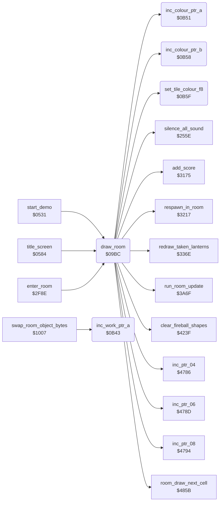

<!-- Generated by c64-docs from knowledge revision 20261016T170255.379-vv114c and src/source-map.json. Do not edit: change the knowledge, generate the source again, then run generate.ts. -->
# room_draw.asm: Room drawing

Range `$09BC-$0B8D`. Source: [room_draw.asm](../../../src/room_draw.asm). Index: [the reference](../index.md).

## Call graph

A solid arrow is a call, a thick arrow a table entry, a dotted arrow a jump. Rounded nodes are in this file.

## Data

| Range | Type | Name | Read by | Written by |
|---|---|---|---|---|
| [`$0B4A`](../../../src/room_draw.asm#L217)-`$0B50` | unused |  |  |  |
| [`$0B6A`](../../../src/room_draw.asm#L242)-`$0B8D` | unused |  |  |  |

## Names

### [`draw_room`](../../../src/room_draw.asm#L6) `$09BC`

*routine*

Draws room current_room; the callers (start_game, start_demo, enter_room) disable IRQs first. Blanks the display and the sprites, clears screen row 0, fills colour RAM $D878-$DBFF with room_char_colours, sends Bruce to room 13 instead of room 11 when rooms 12, 14 and 16 have no lanterns left, pays the first-entry bonus, resets the room state, the enemy spawn timers and the charset, decodes the RLE map onto screen rows 3-24, redraws taken lanterns, runs the room init handler, unblanks and runs the room frame handler once through run_room_update, whose RTS returns to the caller.
PAL freeze bug: see the line comment at $0B33.

- **Called from:** [`start_demo`](restart.md#start_demo) [`$056D`](../../../src/restart.asm#L49), [`title_screen`](title.md#title_screen) [`$074C`](../../../src/title.asm#L210), [`enter_room`](background_touch.md#enter_room) [`$2FCC`](../../../src/background_touch.asm#L248)
- **Calls:** [`clear_fireball_shapes`](fireballs.md#clear_fireball_shapes), [`silence_all_sound`](sound_effects.md#silence_all_sound), [`respawn_in_room`](room_entry_traps.md#respawn_in_room), [`add_score`](score.md#add_score), [`inc_ptr_06`](pointer_helpers.md#inc_ptr_06), [`set_tile_colour_f8`](room_draw.md#set_tile_colour_f8), [`inc_ptr_04`](pointer_helpers.md#inc_ptr_04), [`inc_ptr_08`](pointer_helpers.md#inc_ptr_08), [`inc_colour_ptr_a`](room_draw.md#inc_colour_ptr_a), [`inc_colour_ptr_b`](room_draw.md#inc_colour_ptr_b), [`room_draw_next_cell`](charset_expand.md#room_draw_next_cell), [`redraw_taken_lanterns`](lanterns.md#redraw_taken_lanterns), [`run_room_update`](room_update.md#run_room_update)
- **Reads:** [`SCROLY`](../variables.md#SCROLY), [`SPENA`](../variables.md#SPENA), [`current_room`](../variables.md#current_room), [`room_lanterns_left+12`](../variables.md#room_lanterns_left), [`room_lanterns_left+14`](../variables.md#room_lanterns_left), [`room_lanterns_left+16`](../variables.md#room_lanterns_left), [`saved_sprite_enable`](../variables.md#saved_sprite_enable), [`current_player`](../variables.md#current_player), [`game_cycle`](../variables.md#game_cycle), [`human_opponent_mode`](variables.md#human_opponent_mode), [`work_ptr_b`](../variables.md#work_ptr_b), [`l_22c5`](../../../src/object_actions.asm#L396), [`l_22c6`](../../../src/object_actions.asm#L397), [`l_22b3`](../../../src/object_actions.asm#L379), [`work_ptr_a`](../variables.md#work_ptr_a), [`work_ptr_c`](../variables.md#work_ptr_c)
- **Writes:** [`SCROLY`](../variables.md#SCROLY), [`saved_sprite_enable`](../variables.md#saved_sprite_enable), [`SPENA`](../variables.md#SPENA), [`screen_ram+38`](vic_bank2.md#screen_ram), [`screen_ram+39`](vic_bank2.md#screen_ram), [`ld828+80`](../variables.md#ld828), [`ld828+81`](../variables.md#ld828), [`ld900`](../variables.md#ld900), [`ld900+1`](../variables.md#ld900), [`lda00`](../variables.md#lda00), [`lda00+1`](../variables.md#lda00), [`ldb00`](../variables.md#ldb00), [`ldb00+1`](../variables.md#ldb00), [`actor_move_history+118`](actor_vars.md#actor_move_history), [`actor_move_history+119`](actor_vars.md#actor_move_history), [`room_timer_lo`](../variables.md#room_timer_lo), [`room_timer`](../variables.md#room_timer), [`scroll_direction`](../variables.md#scroll_direction), [`anim_speed_index`](variables.md#anim_speed_index), [`room_without_enemies`](../variables.md#room_without_enemies), [`enemy_entry_x`](../variables.md#enemy_entry_x), [`enemy_entry_x+1`](../variables.md#enemy_entry_x), [`ninja_spawn_timer`](../variables.md#ninja_spawn_timer), [`yamo_spawn_timer`](../variables.md#yamo_spawn_timer), [`actor_contact`](../variables.md#actor_contact), [`actor_state_timer`](../variables.md#actor_state_timer), [`tile_anim_timer`](actor_vars.md#tile_anim_timer), [`tile_anim_timer+1`](actor_vars.md#tile_anim_timer), [`tile_anim_timer+2`](actor_vars.md#tile_anim_timer), [`actor_state`](../variables.md#actor_state), [`actor_step_delay`](../variables.md#actor_step_delay), [`work_ptr_b`](../variables.md#work_ptr_b), [`work_ptr_b+1`](../variables.md#work_ptr_b), [`raster_colours+18`](../variables.md#raster_colours), [`raster_colours+19`](../variables.md#raster_colours), [`room_charset_d018`](../variables.md#room_charset_d018), [`work_ptr_a`](../variables.md#work_ptr_a), [`colour_ptr_a`](../variables.md#colour_ptr_a), [`work_ptr_c`](../variables.md#work_ptr_c), [`colour_ptr_b`](../variables.md#colour_ptr_b) and 5 more
- **Refers to:** [`room_char_colours`](room_colours.md#room_char_colours), [`room_lanterns_left`](../variables.md#room_lanterns_left), [`room_entry_bonus_flags`](../variables.md#room_entry_bonus_flags), [`room_no_combat_flags`](room_tables.md#room_no_combat_flags), [`enemy_entry_x`](../variables.md#enemy_entry_x), [`ninja_first_spawn_delay`](actor_room_tables.md#ninja_first_spawn_delay), [`yamo_first_spawn_delay`](actor_room_tables.md#yamo_first_spawn_delay), [`tile_anim_timer`](actor_vars.md#tile_anim_timer), [`room_atari_colour_ptrs`](room_tables.md#room_atari_colour_ptrs), [`room_atari_colour_ptrs+1`](room_tables.md#room_atari_colour_ptrs), [`work_ptr_b`](../variables.md#work_ptr_b), [`room_map_ptrs_lo`](room_tables.md#room_map_ptrs_lo), [`room_map_ptrs_hi`](room_tables.md#room_map_ptrs_hi), [`screen_ram`](vic_bank2.md#screen_ram), [`work_ptr_a`](../variables.md#work_ptr_a), [`work_ptr_c`](../variables.md#work_ptr_c), [`colour_ptr_a`](../variables.md#colour_ptr_a), [`colour_ptr_b`](../variables.md#colour_ptr_b), [`charset_src_0+433`](room_charset_src.md#charset_src_0)

### [`draw_room_clear_row0`](../../../src/room_draw.asm#L17) `$09D4`

*label*

- **Jumped to from:** [`draw_room`](room_draw.md#draw_room) [`$09D8`](../../../src/room_draw.asm#L20)

### [`draw_room_fill_colour`](../../../src/room_draw.asm#L24) `$09E1`

*label*

- **Jumped to from:** [`draw_room`](room_draw.md#draw_room) [`$09EE`](../../../src/room_draw.asm#L30)

### [`draw_room_special`](../../../src/room_draw.asm#L34) `$09F6`

*label*

Room 11 with no lanterns left in rooms 12, 14 and 16 is not drawn: Bruce is sent to room 13 through respawn_in_room.
room 11 with no lanterns left in rooms 12, 14 and 16: Bruce enters room 13 instead (respawn_in_room X=13)

### [`draw_room_bonus`](../../../src/room_draw.asm#L46) `$0A0E`

*label*

first entry of this player into this room: 2000 points ($07D0) via add_score

- **Jumped to from:** [`draw_room`](room_draw.md#draw_room) [`$09FA`](../../../src/room_draw.asm#L37), [`draw_room`](room_draw.md#draw_room) [`$0A02`](../../../src/room_draw.asm#L41)

### [`draw_room_reset`](../../../src/room_draw.asm#L61) `$0A2A`

*label*

Room reset: clears $4F57-$4FDA (actor_move_counters and the move history), room_timer and scroll_direction; anim_speed_index = 7; room_without_enemies = room_no_combat_flags (non-zero also clears enemy_entry_x, so no enemy follows into the room).

- **Jumped to from:** [`draw_room`](room_draw.md#draw_room) [`$0A17`](../../../src/room_draw.asm#L52)

### [`draw_room_clear_moves`](../../../src/room_draw.asm#L64) `$0A2E`

*label*

- **Jumped to from:** [`draw_room`](room_draw.md#draw_room) [`$0A32`](../../../src/room_draw.asm#L67)

### [`draw_room_spawn_timers`](../../../src/room_draw.asm#L81) `$0A4E`

*label*

Spawn timers from ninja_first_spawn_delay and yamo_first_spawn_delay; both 3 when game_cycle is non-zero; yamo_spawn_timer 8 with a human Yamo.
first spawn delays of Ninja and Yamo for this room

- **Jumped to from:** [`draw_room`](room_draw.md#draw_room) [`$0A46`](../../../src/room_draw.asm#L76)

### [`draw_room_human_yamo_delay`](../../../src/room_draw.asm#L91) `$0A62`

*label*

- **Jumped to from:** [`draw_room`](room_draw.md#draw_room) [`$0A5A`](../../../src/room_draw.asm#L87)

### [`draw_room_reset_bruce`](../../../src/room_draw.asm#L97) `$0A6B`

*label*

Bruce (actor 0): actor_contact 1, actor_state_timer 4, actor_state 0, actor_step_delay 0; the three floor trap slots (tile_anim_timer) are freed.

- **Jumped to from:** [`draw_room`](room_draw.md#draw_room) [`$0A65`](../../../src/room_draw.asm#L93)

### [`draw_room_copy_atari_set`](../../../src/room_draw.asm#L116) `$0A93`

*label*

- **Jumped to from:** [`draw_room`](room_draw.md#draw_room) [`$0A99`](../../../src/room_draw.asm#L120)

### [`draw_room_map_setup`](../../../src/room_draw.asm#L132) `$0AAD`

*label*

Map decode set-up: work_ptr_b = map stream (room_map_ptrs_lo/hi), work_ptr_a = $8C78 (screen row 3, top chars), work_ptr_c = $8CA0 (row 4, bottom chars), colour_ptr_a/b = $D878/$D8A0, draw_count = 39; Y stays 0 during the decode.

- **Jumped to from:** [`draw_room`](room_draw.md#draw_room) [`$0AA1`](../../../src/room_draw.asm#L124), [`draw_room`](room_draw.md#draw_room) [`$0AA9`](../../../src/room_draw.asm#L128)

### [`room_decode_next`](../../../src/room_draw.asm#L154) `$0AD7`

*label*

Room map RLE: $80 ends; $81-$FF = the next (b & $7F) bytes are cells; $01-$7F = the next byte is one cell repeated b times ($00 would repeat 256 times). Cell: bits 0-6 = tile, the top char gets the tile and the bottom char tile|$80; bit 7 = colour RAM $F8 for both chars, else the room colour from $09DC stays. 40 cells per double row from $8C78.

- **Jumped to from:** [`draw_room`](room_draw.md#draw_room) [`$0B05`](../../../src/room_draw.asm#L177), [`draw_room`](room_draw.md#draw_room) [`$0B2D`](../../../src/room_draw.asm#L197)

### [`room_literal_loop`](../../../src/room_draw.asm#L161) `$0AE3`

*label*

- **Jumped to from:** [`draw_room`](room_draw.md#draw_room) [`$0B03`](../../../src/room_draw.asm#L176)

### [`room_literal_store`](../../../src/room_draw.asm#L165) `$0AEA`

*label*

- **Jumped to from:** [`draw_room`](room_draw.md#draw_room) [`$0AE5`](../../../src/room_draw.asm#L163)

### [`room_run`](../../../src/room_draw.asm#L178) `$0B07`

*label*

- **Jumped to from:** [`draw_room`](room_draw.md#draw_room) [`$0AD9`](../../../src/room_draw.asm#L156)

### [`room_run_loop`](../../../src/room_draw.asm#L181) `$0B0B`

*label*

- **Jumped to from:** [`draw_room`](room_draw.md#draw_room) [`$0B28`](../../../src/room_draw.asm#L195)

### [`room_run_store`](../../../src/room_draw.asm#L185) `$0B12`

*label*

- **Jumped to from:** [`draw_room`](room_draw.md#draw_room) [`$0B0D`](../../../src/room_draw.asm#L183)

### [`room_decode_done`](../../../src/room_draw.asm#L199) `$0B30`

*label*

End of map: redraw_taken_lanterns (which also runs the room init handler), display on, sprite enable restored, then run_room_update runs the room frame handler once; its RTS returns to the caller of draw_room.

- **Jumped to from:** [`draw_room`](room_draw.md#draw_room) [`$0ADD`](../../../src/room_draw.asm#L158)

### [`inc_work_ptr_a`](../../../src/room_draw.asm#L209) `$0B43`

*routine*

Increments the pointer work_ptr_a ($04/$05).

- **Called from:** [`swap_room_object_bytes`](game_vars.md#swap_room_object_bytes) [`$1024`](../../../src/game_vars.asm#L110)
- **Reads:** [`work_ptr_a`](../variables.md#work_ptr_a), [`work_ptr_a+1`](../variables.md#work_ptr_a)
- **Writes:** [`work_ptr_a`](../variables.md#work_ptr_a), [`work_ptr_a+1`](../variables.md#work_ptr_a)
- **Refers to:** [`work_ptr_a`](../variables.md#work_ptr_a)

### [`inc_colour_ptr_a`](../../../src/room_draw.asm#L219) `$0B51`

*routine*

Increments colour_ptr_a ($10/$11).

- **Called from:** [`draw_room`](room_draw.md#draw_room) [`$0AF9`](../../../src/room_draw.asm#L172), [`draw_room`](room_draw.md#draw_room) [`$0B1E`](../../../src/room_draw.asm#L191)
- **Reads:** [`colour_ptr_a`](../variables.md#colour_ptr_a), [`colour_ptr_a+1`](../variables.md#colour_ptr_a)
- **Writes:** [`colour_ptr_a`](../variables.md#colour_ptr_a), [`colour_ptr_a+1`](../variables.md#colour_ptr_a)
- **Refers to:** [`colour_ptr_a`](../variables.md#colour_ptr_a)

### [`inc_colour_ptr_b`](../../../src/room_draw.asm#L226) `$0B58`

*routine*

Increments colour_ptr_b ($12/$13).

- **Called from:** [`draw_room`](room_draw.md#draw_room) [`$0AFC`](../../../src/room_draw.asm#L173), [`draw_room`](room_draw.md#draw_room) [`$0B21`](../../../src/room_draw.asm#L192)
- **Reads:** [`colour_ptr_b`](../variables.md#colour_ptr_b), [`colour_ptr_b+1`](../variables.md#colour_ptr_b)
- **Writes:** [`colour_ptr_b`](../variables.md#colour_ptr_b), [`colour_ptr_b+1`](../variables.md#colour_ptr_b)
- **Refers to:** [`colour_ptr_b`](../variables.md#colour_ptr_b)

### [`set_tile_colour_f8`](../../../src/room_draw.asm#L233) `$0B5F`

*routine*

Writes colour $F8 (multicolour, colour-3 pixels black) to both colour RAM cells of the current map cell and returns A with bit 7 cleared.

- **Called from:** [`draw_room`](room_draw.md#draw_room) [`$0AE7`](../../../src/room_draw.asm#L164), [`draw_room`](room_draw.md#draw_room) [`$0B0F`](../../../src/room_draw.asm#L184)
- **Reads:** [`colour_ptr_a`](../variables.md#colour_ptr_a), [`colour_ptr_b`](../variables.md#colour_ptr_b)
