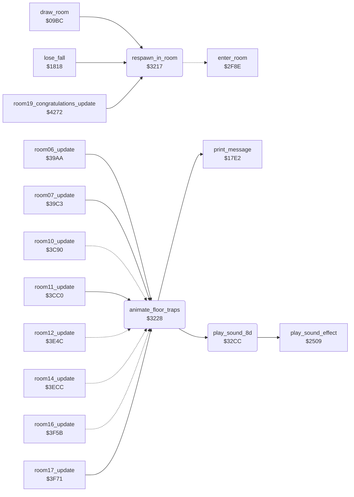

<!-- Generated by c64-docs from knowledge revision 20261016T170255.379-vv114c and src/source-map.json. Do not edit: change the knowledge, generate the source again, then run generate.ts. -->
# room_entry_traps.asm: Respawn into a room and floor trap animation

Range `$3217-$32DB`. Source: [room_entry_traps.asm](../../../src/room_entry_traps.asm). Index: [the reference](../index.md).

## Call graph

A solid arrow is a call, a thick arrow a table entry, a dotted arrow a jump. Rounded nodes are in this file.

## Names

### [`respawn_in_room`](../../../src/room_entry_traps.asm#L6) `$3217`

*routine*

X = room: Bruce (actor 0) enters room X at room_spawn_x/room_spawn_y through enter_room. Used after a lost fall (next_player_turn), after the ending (room 19) and by draw_room's room 11 to room 13 redirect.

- **Called from:** [`draw_room`](room_draw.md#draw_room) [`$0A0B`](../../../src/room_draw.asm#L45), [`lose_fall`](game_over.md#lose_fall) [`$188B`](../../../src/game_over.asm#L65), [`room19_congratulations_update`](final_room.md#room19_congratulations_update) [`$4295`](../../../src/final_room.asm#L54)
- **Jumps to:** [`enter_room`](background_touch.md#enter_room)
- **Writes:** [`current_actor`](../variables.md#current_actor), [`last_key+3`](../variables.md#last_key)
- **Refers to:** [`room_spawn_y`](room_tables.md#room_spawn_y), [`room_spawn_x`](room_tables.md#room_spawn_x)

### [`animate_floor_traps`](../../../src/room_entry_traps.asm#L16) `$3228`

*routine*

Steps the three floor trap slots: frame 8 sound $8D and tiles $2F/$30, 12 tiles $31/$32, 16 tiles $2F/$30, 20 clears the trap (tile 0, colour $F8 two rows lower, tile $33), 24 frees the slot.

- **Called from:** [`room06_update`](room_update.md#room06_update) [`$39BD`](../../../src/room_update.asm#L475), [`room07_update`](room_update.md#room07_update) [`$39C3`](../../../src/room_update.asm#L479), [`room11_update`](room_update.md#room11_update) [`$3CD6`](../../../src/room_update.asm#L906), [`room17_update`](room_update.md#room17_update) [`$3FD5`](../../../src/room_update.asm#L1294)
- **Jumped to from:** [`room10_update`](room_update.md#room10_update) [`$3CBD`](../../../src/room_update.asm#L892), [`room12_update`](room_update.md#room12_update) [`$3E79`](../../../src/room_update.asm#L1115), [`room14_update`](room_update.md#room14_update) [`$3EE3`](../../../src/room_update.asm#L1173), [`room16_update`](room_update.md#room16_update) [`$3F6E`](../../../src/room_update.asm#L1239)
- **Calls:** [`play_sound_8d`](room_entry_traps.md#play_sound_8d), [`print_message`](text.md#print_message)
- **Reads:** [`trap_slot`](../variables.md#trap_slot), [`tile_anim_timer+2`](actor_vars.md#tile_anim_timer)
- **Writes:** [`trap_slot`](../variables.md#trap_slot)
- **Refers to:** [`tile_anim_timer`](actor_vars.md#tile_anim_timer), [`tile_anim_col`](actor_vars.md#tile_anim_col), [`tile_anim_row`](actor_vars.md#tile_anim_row)

### [`floor_trap_slot_loop`](../../../src/room_entry_traps.asm#L20) `$322C`

*label*

Slot trap_slot (2..0): tile_anim_timer 0 = free; else count it up and act on the old value.

- **Jumped to from:** [`animate_floor_traps`](room_entry_traps.md#animate_floor_traps) [`$32C8`](../../../src/room_entry_traps.asm#L102)

### [`floor_trap_tick`](../../../src/room_entry_traps.asm#L25) `$3236`

*label*

- **Jumped to from:** [`animate_floor_traps`](room_entry_traps.md#animate_floor_traps) [`$3231`](../../../src/room_entry_traps.asm#L23)

### [`floor_trap_show_spikes1`](../../../src/room_entry_traps.asm#L31) `$3240`

*label*

Timer 8 (with sound $8D) and 16: messages $2F/$30 (deadly tiles $71-$76) at text rows row and row+1, columns col..col+2.

- **Jumped to from:** [`animate_floor_traps`](room_entry_traps.md#animate_floor_traps) [`$3284`](../../../src/room_entry_traps.asm#L66)

### [`floor_trap_check_spikes2`](../../../src/room_entry_traps.asm#L47) `$3260`

*label*

Timer 12: messages $31/$32 (deadly tiles $77-$7C).

- **Jumped to from:** [`animate_floor_traps`](room_entry_traps.md#animate_floor_traps) [`$323B`](../../../src/room_entry_traps.asm#L28)

### [`floor_trap_check_retract`](../../../src/room_entry_traps.asm#L64) `$3282`

*label*

Timer 20: clears the upper row (message 0), sets colour RAM of the trigger cell back to $F8 (re-arms it) and draws message $33 (tiles $7D, $60, $7D) on the lower row.

- **Jumped to from:** [`animate_floor_traps`](room_entry_traps.md#animate_floor_traps) [`$3262`](../../../src/room_entry_traps.asm#L49)

### [`floor_trap_check_free`](../../../src/room_entry_traps.asm#L94) `$32BB`

*label*

Timer 24: frees the slot.

- **Jumped to from:** [`animate_floor_traps`](room_entry_traps.md#animate_floor_traps) [`$3288`](../../../src/room_entry_traps.asm#L68)

### [`floor_trap_next_slot`](../../../src/room_entry_traps.asm#L99) `$32C4`

*label*

- **Jumped to from:** [`animate_floor_traps`](room_entry_traps.md#animate_floor_traps) [`$3233`](../../../src/room_entry_traps.asm#L24), [`animate_floor_traps`](room_entry_traps.md#animate_floor_traps) [`$32BD`](../../../src/room_entry_traps.asm#L96)

### [`play_sound_8d`](../../../src/room_entry_traps.asm#L106) `$32CC`

*routine*

Plays sound effect $8D through $2509; keeps A, X and Y.

- **Called from:** [`animate_floor_traps`](room_entry_traps.md#animate_floor_traps) [`$323D`](../../../src/room_entry_traps.asm#L29)
- **Calls:** [`play_sound_effect`](sound_effects.md#play_sound_effect)
