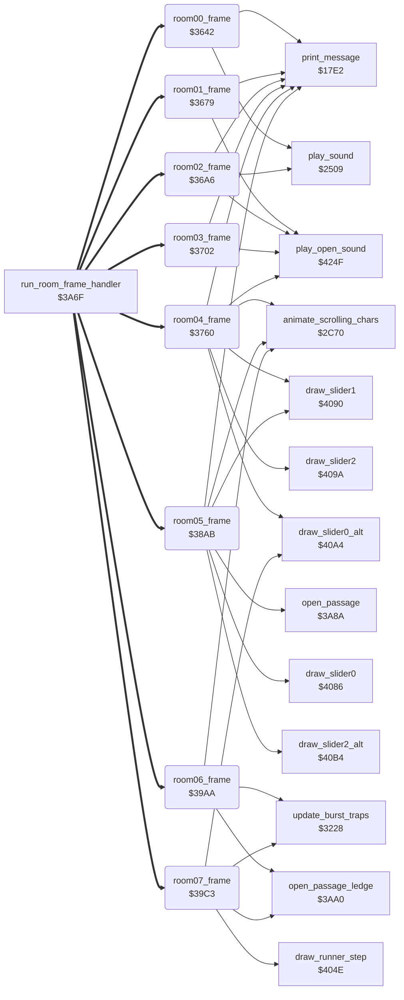

<!-- Generated by c64-docs from knowledge revision 20261017T105502.847-19cl2o and src/source-map.json. Do not edit: change the knowledge, generate the source again, then run generate.ts. -->
# room_frames_0_7.asm: Room frame handlers for rooms 0-7

Range `$3642-$3A62`. Source: [room_frames_0_7.asm](../../../src/room_frames_0_7.asm). Index: [the reference](../index.md).

## Call graph

A solid arrow is a call, a thick arrow a table entry, a dotted arrow a jump. Rounded nodes are in this file.

## Data

| Range | Type | Name | Read by | Written by |
|---|---|---|---|---|
| [`$3A62`](../../../src/room_frames_0_7.asm#L626) | unused |  |  |  |

## Names

### [`room00_frame`](../../../src/room_frames_0_7.asm#L9) `$3642`

*routine*

Room 0 frame handler (every main loop pass, through run_room_frame_handler). When room 6 has no lanterns left (room_lanterns_left+6 = 0), the mouth of the statue at row 9, column 7 moves: on even passes (pass_parity = 0) the timer room_state_a counts down; tile $1D (char C6) is shown with sound $81 for one step, then tile $1E (char C7) for 6 steps. room_state_b = which tile is shown.
lanterns left in room 6

- **Jumped to from:** [`run_room_frame_handler`](passage_open.md#run_room_frame_handler) [`$3A7B`](../../../src/passage_open.asm#L26)
- **Entry of:** [`room_frame_handlers`](../tables.md#room_frame_handlers)
- **Calls:** [`play_sound`](sound_request.md#play_sound), [`print_message`](actor_driver_text.md#print_message)
- **Reads:** [`room_lanterns_left+6`](../variables.md#room_lanterns_left), [`pass_parity`](../variables.md#pass_parity), [`room_state_a`](room_dispatch.md#room_state_a), [`room_state_b`](room_dispatch.md#room_state_b)
- **Writes:** [`room_state_a`](room_dispatch.md#room_state_a), [`room_state_b`](room_dispatch.md#room_state_b)
- **Refers to:** [`room_lanterns_left`](../variables.md#room_lanterns_left)

### [`room00_frame_mouth_b`](../../../src/room_frames_0_7.asm#L28) `$3667`

*label*

tile $1E (char C7) at row 9, column 7

- **Jumped to from:** [`room00_frame`](room_frames_0_7.md#room00_frame) [`$3652`](../../../src/room_frames_0_7.asm#L18)

### [`room00_frame_done`](../../../src/room_frames_0_7.asm#L36) `$3678`

*label*

- **Jumped to from:** [`room00_frame`](room_frames_0_7.md#room00_frame) [`$3644`](../../../src/room_frames_0_7.asm#L11), [`room00_frame`](room_frames_0_7.md#room00_frame) [`$3648`](../../../src/room_frames_0_7.asm#L14), [`room00_frame`](room_frames_0_7.md#room00_frame) [`$364D`](../../../src/room_frames_0_7.asm#L16), [`room00_frame`](room_frames_0_7.md#room00_frame) [`$3665`](../../../src/room_frames_0_7.asm#L27)

### [`room01_frame`](../../../src/room_frames_0_7.asm#L42) `$3679`

*routine*

Room 1 frame handler: opens the trapdoor in the floor (row 12, columns 17-21). Condition: rooms 0, 1 and 2 have no lanterns left (room_lanterns_left+0/+1/+2 = 0) while room 6 still has lanterns. On even passes room_state_a counts 3 -> $FF and tile $10 + room_state_a is drawn: $12, $11, $10, $0F (the last step is the open trapdoor). play_open_sound at the first step.

- **Jumped to from:** [`run_room_frame_handler`](passage_open.md#run_room_frame_handler) [`$3A7B`](../../../src/passage_open.asm#L26)
- **Entry of:** [`room_frame_handlers`](../tables.md#room_frame_handlers)
- **Calls:** [`play_open_sound`](wizard_fireballs.md#play_open_sound), [`print_message`](actor_driver_text.md#print_message)
- **Reads:** [`pass_parity`](../variables.md#pass_parity), [`room_state_a`](room_dispatch.md#room_state_a), [`room_lanterns_left+6`](../variables.md#room_lanterns_left), [`room_lanterns_left`](../variables.md#room_lanterns_left), [`room_lanterns_left+1`](../variables.md#room_lanterns_left), [`room_lanterns_left+2`](../variables.md#room_lanterns_left)
- **Writes:** [`room_state_a`](room_dispatch.md#room_state_a)
- **Refers to:** [`room_lanterns_left`](../variables.md#room_lanterns_left)

### [`room01_frame_draw_trapdoor`](../../../src/room_frames_0_7.asm#L59) `$369B`

*label*

- **Jumped to from:** [`room01_frame`](room_frames_0_7.md#room01_frame) [`$3696`](../../../src/room_frames_0_7.asm#L57)

### [`room01_frame_done`](../../../src/room_frames_0_7.asm#L65) `$36A5`

*label*

- **Jumped to from:** [`room01_frame`](room_frames_0_7.md#room01_frame) [`$367B`](../../../src/room_frames_0_7.asm#L44), [`room01_frame`](room_frames_0_7.md#room01_frame) [`$3680`](../../../src/room_frames_0_7.asm#L46), [`room01_frame`](room_frames_0_7.md#room01_frame) [`$3684`](../../../src/room_frames_0_7.asm#L48), [`room01_frame`](room_frames_0_7.md#room01_frame) [`$368C`](../../../src/room_frames_0_7.asm#L52)

### [`room02_frame`](../../../src/room_frames_0_7.asm#L75) `$36A6`

*routine*

Room 2 frame handler. First a protection check: loops forever unless zero page $00 (D6510) holds $EF, the value the original loader leaves there. When room 6 has no lanterns left: - one time (room_state_b): play_open_sound, tile $1A at row 11 and tile $07 at row 12, column 37 (opens the floor at the bottom right); - the mouth of the statue at row 9, column 33 moves as in room 0 (timer room_state_c, shown tile in room_state_a).

- **Jumped to from:** [`run_room_frame_handler`](passage_open.md#run_room_frame_handler) [`$3A7B`](../../../src/passage_open.asm#L26)
- **Entry of:** [`room_frame_handlers`](../tables.md#room_frame_handlers)
- **Calls:** [`play_open_sound`](wizard_fireballs.md#play_open_sound), [`print_message`](actor_driver_text.md#print_message), [`play_sound`](sound_request.md#play_sound)
- **Reads:** [`room_lanterns_left+6`](../variables.md#room_lanterns_left), [`room_state_b`](room_dispatch.md#room_state_b), [`pass_parity`](../variables.md#pass_parity), [`room_state_c`](room_dispatch.md#room_state_c), [`room_state_a`](room_dispatch.md#room_state_a)
- **Writes:** [`room_state_b`](room_dispatch.md#room_state_b), [`room_state_c`](room_dispatch.md#room_state_c), [`room_state_a`](room_dispatch.md#room_state_a)
- **Refers to:** [`room_lanterns_left`](../variables.md#room_lanterns_left)

### [`room02_frame_mouth`](../../../src/room_frames_0_7.asm#L106) `$36CF`

*label*

- **Jumped to from:** [`room02_frame`](room_frames_0_7.md#room02_frame) [`$36B5`](../../../src/room_frames_0_7.asm#L95)

### [`room02_frame_mouth_b`](../../../src/room_frames_0_7.asm#L121) `$36F0`

*label*

tile $1E at row 9, column 33

- **Jumped to from:** [`room02_frame`](room_frames_0_7.md#room02_frame) [`$36DB`](../../../src/room_frames_0_7.asm#L112)

### [`room02_frame_done`](../../../src/room_frames_0_7.asm#L129) `$3701`

*label*

- **Jumped to from:** [`room02_frame`](room_frames_0_7.md#room02_frame) [`$36B0`](../../../src/room_frames_0_7.asm#L92), [`room02_frame`](room_frames_0_7.md#room02_frame) [`$36D1`](../../../src/room_frames_0_7.asm#L108), [`room02_frame`](room_frames_0_7.md#room02_frame) [`$36D6`](../../../src/room_frames_0_7.asm#L110), [`room02_frame`](room_frames_0_7.md#room02_frame) [`$36EE`](../../../src/room_frames_0_7.asm#L120)

### [`room03_frame`](../../../src/room_frames_0_7.asm#L136) `$3702`

*routine*

Room 3 frame handler. 1. When room 3 has no lanterns left (room_lanterns_left+3 = 0): opens the trapdoor at row 12, columns 29-33 in 4 steps on even passes (as room 1: tiles $12, $11, $10, $0F; play_open_sound at the first step). 2. Every pass: the alternating ledges of row 6. room_state_c counts 33 passes; then room_state_b toggles and tile $06 (chars 4B x7) and tile $60 (chars 09 x7) swap places between columns 9-15 and 21-27.

- **Jumped to from:** [`run_room_frame_handler`](passage_open.md#run_room_frame_handler) [`$3A7B`](../../../src/passage_open.asm#L26)
- **Entry of:** [`room_frame_handlers`](../tables.md#room_frame_handlers)
- **Calls:** [`play_open_sound`](wizard_fireballs.md#play_open_sound), [`print_message`](actor_driver_text.md#print_message)
- **Reads:** [`pass_parity`](../variables.md#pass_parity), [`room_state_a`](room_dispatch.md#room_state_a), [`room_lanterns_left+3`](../variables.md#room_lanterns_left), [`room_state_c`](room_dispatch.md#room_state_c), [`room_state_b`](room_dispatch.md#room_state_b)
- **Writes:** [`room_state_a`](room_dispatch.md#room_state_a), [`room_state_c`](room_dispatch.md#room_state_c), [`room_state_b`](room_dispatch.md#room_state_b)
- **Refers to:** [`room_lanterns_left`](../variables.md#room_lanterns_left)

### [`room03_frame_draw_trapdoor`](../../../src/room_frames_0_7.asm#L149) `$371C`

*label*

- **Jumped to from:** [`room03_frame`](room_frames_0_7.md#room03_frame) [`$3717`](../../../src/room_frames_0_7.asm#L147)

### [`room03_frame_ledges`](../../../src/room_frames_0_7.asm#L155) `$3726`

*label*

- **Jumped to from:** [`room03_frame`](room_frames_0_7.md#room03_frame) [`$3704`](../../../src/room_frames_0_7.asm#L138), [`room03_frame`](room_frames_0_7.md#room03_frame) [`$3709`](../../../src/room_frames_0_7.asm#L140), [`room03_frame`](room_frames_0_7.md#room03_frame) [`$370D`](../../../src/room_frames_0_7.asm#L142)

### [`room03_frame_ledges_wait`](../../../src/room_frames_0_7.asm#L158) `$372B`

*label*

### [`room03_frame_swap_ledges`](../../../src/room_frames_0_7.asm#L160) `$372C`

*label*

next swap in 33 passes

- **Jumped to from:** [`room03_frame`](room_frames_0_7.md#room03_frame) [`$3729`](../../../src/room_frames_0_7.asm#L157)

### [`room03_frame_ledges_phase_b`](../../../src/room_frames_0_7.asm#L174) `$374B`

*label*

- **Jumped to from:** [`room03_frame`](room_frames_0_7.md#room03_frame) [`$3734`](../../../src/room_frames_0_7.asm#L164)

### [`room04_frame`](../../../src/room_frames_0_7.asm#L195) `$3760`

*routine*

Room 4 frame handler (dark cave). Lantern 1 (row 4, column 11, record lantern_list_room4) and lantern 2 (row 4, column 28, record lantern_list_room4+4) blink while present: a counter (room_state_c / room_state_d) shows the lit lantern (tile $34 / $35, chars $13/$93 and $14/$94, which can be picked up) at 32 and the dark lantern (tile $36 / $37, chars E6 / E7) at 64, then restarts. Taking lantern 1, one time (room_state_a): play_open_sound, clears 4 cells at rows 8-9 from column 11, erases slider 1. Taking lantern 2, one time (room_state_b): restarts the animated chars (anim_chars_direction = 0, anim_chars_speed_step = 7), play_open_sound, clears 4 cells at rows 8-9 from column 25, erases slider 2. Then the sliders: slider 0 (row 11, columns 1-3, second look), slider 1 (row 7, columns 11-12) while lantern 1 is present, slider 2 (row 7, columns 26-27) while lantern 2 is present. At the end, animate_scrolling_chars.
lantern 1 present?

- **Jumped to from:** [`run_room_frame_handler`](passage_open.md#run_room_frame_handler) [`$3A7B`](../../../src/passage_open.asm#L26)
- **Entry of:** [`room_frame_handlers`](../tables.md#room_frame_handlers)
- **Calls:** [`print_message`](actor_driver_text.md#print_message), [`play_open_sound`](wizard_fireballs.md#play_open_sound), [`draw_slider1`](room_hazard_draw.md#draw_slider1), [`draw_slider2`](room_hazard_draw.md#draw_slider2), [`draw_slider0_alt`](room_hazard_draw.md#draw_slider0_alt), [`animate_scrolling_chars`](animated_chars.md#animate_scrolling_chars)
- **Reads:** [`lantern_list_room4`](lantern_lists.md#lantern_list_room4), [`room_state_c`](room_dispatch.md#room_state_c), [`room_state_a`](room_dispatch.md#room_state_a), [`lantern_list_room4+4`](lantern_lists.md#lantern_list_room4), [`room_state_d`](room_dispatch.md#room_state_d), [`room_state_b`](room_dispatch.md#room_state_b), [`slider_timer`](../variables.md#slider_timer), [`slider_col`](../variables.md#slider_col), [`slider_timer+1`](../variables.md#slider_timer), [`slider_col+1`](../variables.md#slider_col), [`slider_timer+2`](../variables.md#slider_timer), [`slider_col+2`](../variables.md#slider_col)
- **Writes:** [`room_state_c`](room_dispatch.md#room_state_c), [`room_state_a`](room_dispatch.md#room_state_a), [`room_state_d`](room_dispatch.md#room_state_d), [`room_state_b`](room_dispatch.md#room_state_b), [`anim_chars_direction`](../variables.md#anim_chars_direction), [`anim_chars_speed_step`](options_and_patterns.md#anim_chars_speed_step), [`slider_timer`](../variables.md#slider_timer), [`slider_col`](../variables.md#slider_col), [`slider_timer+1`](../variables.md#slider_timer), [`slider_col+1`](../variables.md#slider_col), [`slider_timer+2`](../variables.md#slider_timer), [`slider_col+2`](../variables.md#slider_col)
- **Refers to:** [`lantern_list_room4`](lantern_lists.md#lantern_list_room4), [`slider_timer`](../variables.md#slider_timer), [`slider_col`](../variables.md#slider_col)

### [`room04_frame_lantern1_check_dark`](../../../src/room_frames_0_7.asm#L207) `$377B`

*label*

counter 64: dark lantern, restart

- **Jumped to from:** [`room04_frame`](room_frames_0_7.md#room04_frame) [`$376D`](../../../src/room_frames_0_7.asm#L201)

### [`room04_frame_lantern1_taken`](../../../src/room_frames_0_7.asm#L216) `$378D`

*label*

- **Jumped to from:** [`room04_frame`](room_frames_0_7.md#room04_frame) [`$3763`](../../../src/room_frames_0_7.asm#L197), [`room04_frame`](room_frames_0_7.md#room04_frame) [`$3778`](../../../src/room_frames_0_7.asm#L206), [`room04_frame`](room_frames_0_7.md#room04_frame) [`$377D`](../../../src/room_frames_0_7.asm#L209)

### [`room04_frame_lantern2_blink`](../../../src/room_frames_0_7.asm#L235) `$37B4`

*label*

Lantern 2 (row 4, column 28): blink while present, else open the cells below it one time.

- **Jumped to from:** [`room04_frame`](room_frames_0_7.md#room04_frame) [`$3790`](../../../src/room_frames_0_7.asm#L218), [`room04_frame`](room_frames_0_7.md#room04_frame) [`$3795`](../../../src/room_frames_0_7.asm#L221)

### [`room04_frame_lantern2_check_dark`](../../../src/room_frames_0_7.asm#L247) `$37CF`

*label*

- **Jumped to from:** [`room04_frame`](room_frames_0_7.md#room04_frame) [`$37C1`](../../../src/room_frames_0_7.asm#L241)

### [`room04_frame_lantern2_taken`](../../../src/room_frames_0_7.asm#L256) `$37E1`

*label*

- **Jumped to from:** [`room04_frame`](room_frames_0_7.md#room04_frame) [`$37B7`](../../../src/room_frames_0_7.asm#L237), [`room04_frame`](room_frames_0_7.md#room04_frame) [`$37CC`](../../../src/room_frames_0_7.asm#L246), [`room04_frame`](room_frames_0_7.md#room04_frame) [`$37D1`](../../../src/room_frames_0_7.asm#L249)

### [`room04_frame_slider0`](../../../src/room_frames_0_7.asm#L281) `$3811`

*label*

Slider 0. slider_timer counts up each pass; negative = waiting. Frames 0-6 draw tiles; at frame 3 the slider moves one column right (blank frame at the old place, frame 2 at the new place, timer back to 2) until the end column; at frame 7 it waits again and goes back to the start column.

- **Jumped to from:** [`room04_frame`](room_frames_0_7.md#room04_frame) [`$37E4`](../../../src/room_frames_0_7.asm#L258), [`room04_frame`](room_frames_0_7.md#room04_frame) [`$37E9`](../../../src/room_frames_0_7.asm#L261)

### [`room04_frame_slider0_frame`](../../../src/room_frames_0_7.asm#L284) `$3815`

*label*

### [`room04_frame_slider0_draw`](../../../src/room_frames_0_7.asm#L290) `$381F`

*label*

draw frame A (tiles $26-$2C)

- **Jumped to from:** [`room04_frame`](room_frames_0_7.md#room04_frame) [`$3829`](../../../src/room_frames_0_7.asm#L296), [`room04_frame`](room_frames_0_7.md#room04_frame) [`$3836`](../../../src/room_frames_0_7.asm#L302)

### [`room04_frame_slider0_step`](../../../src/room_frames_0_7.asm#L293) `$3825`

*label*

- **Jumped to from:** [`room04_frame`](room_frames_0_7.md#room04_frame) [`$3819`](../../../src/room_frames_0_7.asm#L287)

### [`room04_frame_slider0_reset`](../../../src/room_frames_0_7.asm#L303) `$3838`

*label*

wait 96 passes

- **Jumped to from:** [`room04_frame`](room_frames_0_7.md#room04_frame) [`$381D`](../../../src/room_frames_0_7.asm#L289)

### [`room04_frame_slider1`](../../../src/room_frames_0_7.asm#L309) `$3840`

*label*

Slider 1 (row 7, columns 11-12) while lantern 1 is present.
slider 1 only while lantern 1 is present

- **Jumped to from:** [`room04_frame`](room_frames_0_7.md#room04_frame) [`$3813`](../../../src/room_frames_0_7.asm#L283), [`room04_frame`](room_frames_0_7.md#room04_frame) [`$3822`](../../../src/room_frames_0_7.asm#L292)

### [`room04_frame_slider1_draw`](../../../src/room_frames_0_7.asm#L319) `$3853`

*label*

draw frame A (tiles $1F-$25)

- **Jumped to from:** [`room04_frame`](room_frames_0_7.md#room04_frame) [`$385D`](../../../src/room_frames_0_7.asm#L325), [`room04_frame`](room_frames_0_7.md#room04_frame) [`$386A`](../../../src/room_frames_0_7.asm#L331)

### [`room04_frame_slider1_step`](../../../src/room_frames_0_7.asm#L322) `$3859`

*label*

- **Jumped to from:** [`room04_frame`](room_frames_0_7.md#room04_frame) [`$384D`](../../../src/room_frames_0_7.asm#L316)

### [`room04_frame_slider1_reset`](../../../src/room_frames_0_7.asm#L332) `$386C`

*label*

wait 28 passes

- **Jumped to from:** [`room04_frame`](room_frames_0_7.md#room04_frame) [`$3851`](../../../src/room_frames_0_7.asm#L318)

### [`room04_frame_slider2`](../../../src/room_frames_0_7.asm#L338) `$3874`

*label*

Slider 2 (row 7, columns 26-27) while lantern 2 is present.
slider 2 only while lantern 2 is present

- **Jumped to from:** [`room04_frame`](room_frames_0_7.md#room04_frame) [`$3843`](../../../src/room_frames_0_7.asm#L311), [`room04_frame`](room_frames_0_7.md#room04_frame) [`$3847`](../../../src/room_frames_0_7.asm#L313), [`room04_frame`](room_frames_0_7.md#room04_frame) [`$3856`](../../../src/room_frames_0_7.asm#L321)

### [`room04_frame_slider2_draw`](../../../src/room_frames_0_7.asm#L348) `$3887`

*label*

- **Jumped to from:** [`room04_frame`](room_frames_0_7.md#room04_frame) [`$3891`](../../../src/room_frames_0_7.asm#L354), [`room04_frame`](room_frames_0_7.md#room04_frame) [`$389E`](../../../src/room_frames_0_7.asm#L360)

### [`room04_frame_slider2_step`](../../../src/room_frames_0_7.asm#L351) `$388D`

*label*

- **Jumped to from:** [`room04_frame`](room_frames_0_7.md#room04_frame) [`$3881`](../../../src/room_frames_0_7.asm#L345)

### [`room04_frame_slider2_reset`](../../../src/room_frames_0_7.asm#L361) `$38A0`

*label*

- **Jumped to from:** [`room04_frame`](room_frames_0_7.md#room04_frame) [`$3885`](../../../src/room_frames_0_7.asm#L347)

### [`room04_frame_animate_chars`](../../../src/room_frames_0_7.asm#L366) `$38A8`

*label*

animate chars $61-$63

- **Jumped to from:** [`room04_frame`](room_frames_0_7.md#room04_frame) [`$3877`](../../../src/room_frames_0_7.asm#L340), [`room04_frame`](room_frames_0_7.md#room04_frame) [`$387B`](../../../src/room_frames_0_7.asm#L342), [`room04_frame`](room_frames_0_7.md#room04_frame) [`$388A`](../../../src/room_frames_0_7.asm#L350)

### [`room05_frame`](../../../src/room_frames_0_7.asm#L378) `$38AB`

*routine*

Room 5 frame handler. - Lantern lantern_list_room5+32 (row 10, column 26) taken, one time (room_state_c): passages at columns 25 and 26 from row 10 (open_passage) and slider 1 erased. - Lantern lantern_list_room5+24 (row 10, column 2) taken, one time (room_state_d): passage at column 0 from row 10, tile $15 at row 11. - Room 6 has no lanterns left and lantern lantern_list_room5+8 (row 3, column 28) or lantern_list_room5+16 (row 3, column 38) is taken, one time (room_state_e): tile $19 (61 85 63) at row 2, column 34, passages at row 3 column 30 and row 6 column 32. - Sliders: 0 at row 9 columns 27-28, 1 at row 10 columns 27-28 while lantern lantern_list_room5+32 is present, 2 at row 5 columns 1-2 (second look). Then animate_scrolling_chars.
lantern at row 10, column 26 present?

- **Jumped to from:** [`run_room_frame_handler`](passage_open.md#run_room_frame_handler) [`$3A7B`](../../../src/passage_open.asm#L26)
- **Entry of:** [`room_frame_handlers`](../tables.md#room_frame_handlers)
- **Calls:** [`open_passage`](passage_open.md#open_passage), [`draw_slider1`](room_hazard_draw.md#draw_slider1), [`print_message`](actor_driver_text.md#print_message), [`draw_slider0`](room_hazard_draw.md#draw_slider0), [`draw_slider2_alt`](room_hazard_draw.md#draw_slider2_alt), [`animate_scrolling_chars`](animated_chars.md#animate_scrolling_chars)
- **Reads:** [`lantern_list_room5+32`](lantern_lists.md#lantern_list_room5), [`room_state_c`](room_dispatch.md#room_state_c), [`lantern_list_room5+24`](lantern_lists.md#lantern_list_room5), [`room_state_d`](room_dispatch.md#room_state_d), [`room_lanterns_left+6`](../variables.md#room_lanterns_left), [`lantern_list_room5+8`](lantern_lists.md#lantern_list_room5), [`lantern_list_room5+16`](lantern_lists.md#lantern_list_room5), [`room_state_e`](room_dispatch.md#room_state_e), [`slider_timer`](../variables.md#slider_timer), [`slider_col`](../variables.md#slider_col), [`slider_timer+1`](../variables.md#slider_timer), [`slider_col+1`](../variables.md#slider_col), [`slider_timer+2`](../variables.md#slider_timer), [`slider_col+2`](../variables.md#slider_col)
- **Writes:** [`room_state_c`](room_dispatch.md#room_state_c), [`room_state_d`](room_dispatch.md#room_state_d), [`room_state_e`](room_dispatch.md#room_state_e), [`slider_timer`](../variables.md#slider_timer), [`slider_col`](../variables.md#slider_col), [`slider_timer+1`](../variables.md#slider_timer), [`slider_col+1`](../variables.md#slider_col), [`slider_timer+2`](../variables.md#slider_timer), [`slider_col+2`](../variables.md#slider_col)
- **Refers to:** [`lantern_list_room5`](lantern_lists.md#lantern_list_room5), [`room_lanterns_left`](../variables.md#room_lanterns_left), [`slider_timer`](../variables.md#slider_timer), [`slider_col`](../variables.md#slider_col)

### [`room05_frame_left_passage`](../../../src/room_frames_0_7.asm#L394) `$38CB`

*label*

Lantern at row 10, column 2 taken: passage at column 0 from row 10, one time.
lantern at row 10, column 2 present?

- **Jumped to from:** [`room05_frame`](room_frames_0_7.md#room05_frame) [`$38AE`](../../../src/room_frames_0_7.asm#L380), [`room05_frame`](room_frames_0_7.md#room05_frame) [`$38B3`](../../../src/room_frames_0_7.asm#L383)

### [`room05_frame_top_passage`](../../../src/room_frames_0_7.asm#L408) `$38E8`

*label*

Room 6 cleared and one of the lanterns of row 3 (columns 28, 38) taken: top passages, one time.
room 6 cleared and lantern at row 3, column 28 taken

- **Jumped to from:** [`room05_frame`](room_frames_0_7.md#room05_frame) [`$38CE`](../../../src/room_frames_0_7.asm#L396), [`room05_frame`](room_frames_0_7.md#room05_frame) [`$38D3`](../../../src/room_frames_0_7.asm#L398)

### [`room05_frame_top_passage_alt`](../../../src/room_frames_0_7.asm#L412) `$38EF`

*label*

or room 6 cleared and lantern at row 3, column 38 taken

### [`room05_frame_open_top`](../../../src/room_frames_0_7.asm#L416) `$38F6`

*label*

- **Jumped to from:** [`room05_frame`](room_frames_0_7.md#room05_frame) [`$38ED`](../../../src/room_frames_0_7.asm#L411)

### [`room05_frame_slider0`](../../../src/room_frames_0_7.asm#L432) `$3915`

*label*

Slider 0 (row 9, columns 27-28).

- **Jumped to from:** [`room05_frame`](room_frames_0_7.md#room05_frame) [`$38F4`](../../../src/room_frames_0_7.asm#L415), [`room05_frame`](room_frames_0_7.md#room05_frame) [`$38F9`](../../../src/room_frames_0_7.asm#L419)

### [`room05_frame_slider0_frame`](../../../src/room_frames_0_7.asm#L435) `$3919`

*label*

### [`room05_frame_slider0_draw`](../../../src/room_frames_0_7.asm#L441) `$3923`

*label*

- **Jumped to from:** [`room05_frame`](room_frames_0_7.md#room05_frame) [`$392D`](../../../src/room_frames_0_7.asm#L447), [`room05_frame`](room_frames_0_7.md#room05_frame) [`$393A`](../../../src/room_frames_0_7.asm#L453)

### [`room05_frame_slider0_step`](../../../src/room_frames_0_7.asm#L444) `$3929`

*label*

- **Jumped to from:** [`room05_frame`](room_frames_0_7.md#room05_frame) [`$391D`](../../../src/room_frames_0_7.asm#L438)

### [`room05_frame_slider0_reset`](../../../src/room_frames_0_7.asm#L454) `$393C`

*label*

wait 32 passes

- **Jumped to from:** [`room05_frame`](room_frames_0_7.md#room05_frame) [`$3921`](../../../src/room_frames_0_7.asm#L440)

### [`room05_frame_slider1`](../../../src/room_frames_0_7.asm#L460) `$3944`

*label*

Slider 1 (row 10, columns 27-28) while the lantern at row 10, column 26 is present.
slider 1 only while the lantern at row 10, column 26 is present

- **Jumped to from:** [`room05_frame`](room_frames_0_7.md#room05_frame) [`$3917`](../../../src/room_frames_0_7.asm#L434), [`room05_frame`](room_frames_0_7.md#room05_frame) [`$3926`](../../../src/room_frames_0_7.asm#L443)

### [`room05_frame_slider1_draw`](../../../src/room_frames_0_7.asm#L470) `$3957`

*label*

- **Jumped to from:** [`room05_frame`](room_frames_0_7.md#room05_frame) [`$3961`](../../../src/room_frames_0_7.asm#L476), [`room05_frame`](room_frames_0_7.md#room05_frame) [`$396E`](../../../src/room_frames_0_7.asm#L482)

### [`room05_frame_slider1_step`](../../../src/room_frames_0_7.asm#L473) `$395D`

*label*

- **Jumped to from:** [`room05_frame`](room_frames_0_7.md#room05_frame) [`$3951`](../../../src/room_frames_0_7.asm#L467)

### [`room05_frame_slider1_reset`](../../../src/room_frames_0_7.asm#L483) `$3970`

*label*

- **Jumped to from:** [`room05_frame`](room_frames_0_7.md#room05_frame) [`$3955`](../../../src/room_frames_0_7.asm#L469)

### [`room05_frame_slider2`](../../../src/room_frames_0_7.asm#L489) `$3978`

*label*

Slider 2 (row 5, columns 1-2, second look).

- **Jumped to from:** [`room05_frame`](room_frames_0_7.md#room05_frame) [`$3947`](../../../src/room_frames_0_7.asm#L462), [`room05_frame`](room_frames_0_7.md#room05_frame) [`$394B`](../../../src/room_frames_0_7.asm#L464), [`room05_frame`](room_frames_0_7.md#room05_frame) [`$395A`](../../../src/room_frames_0_7.asm#L472)

### [`room05_frame_slider2_draw`](../../../src/room_frames_0_7.asm#L497) `$3986`

*label*

second look: tiles $26-$2C

- **Jumped to from:** [`room05_frame`](room_frames_0_7.md#room05_frame) [`$3990`](../../../src/room_frames_0_7.asm#L503), [`room05_frame`](room_frames_0_7.md#room05_frame) [`$399D`](../../../src/room_frames_0_7.asm#L509)

### [`room05_frame_slider2_step`](../../../src/room_frames_0_7.asm#L500) `$398C`

*label*

- **Jumped to from:** [`room05_frame`](room_frames_0_7.md#room05_frame) [`$3980`](../../../src/room_frames_0_7.asm#L494)

### [`room05_frame_slider2_reset`](../../../src/room_frames_0_7.asm#L510) `$399F`

*label*

wait 30 passes

- **Jumped to from:** [`room05_frame`](room_frames_0_7.md#room05_frame) [`$3984`](../../../src/room_frames_0_7.asm#L496)

### [`room05_frame_animate_chars`](../../../src/room_frames_0_7.asm#L515) `$39A7`

*label*

- **Jumped to from:** [`room05_frame`](room_frames_0_7.md#room05_frame) [`$397A`](../../../src/room_frames_0_7.asm#L491), [`room05_frame`](room_frames_0_7.md#room05_frame) [`$3989`](../../../src/room_frames_0_7.asm#L499)

### [`room06_frame`](../../../src/room_frames_0_7.asm#L519) `$39AA`

*routine*

Room 6 frame handler: when room 6 has no lanterns left, one time (room_state_a) a passage opens at row 5, column 1 (open_passage_ledge). Then update_burst_traps and animate_scrolling_chars.
lanterns left in room 6

- **Jumped to from:** [`run_room_frame_handler`](passage_open.md#run_room_frame_handler) [`$3A7B`](../../../src/passage_open.asm#L26)
- **Entry of:** [`room_frame_handlers`](../tables.md#room_frame_handlers)
- **Calls:** [`open_passage_ledge`](passage_open.md#open_passage_ledge), [`update_burst_traps`](room_misc_support.md#update_burst_traps), [`animate_scrolling_chars`](animated_chars.md#animate_scrolling_chars)
- **Reads:** [`room_lanterns_left+6`](../variables.md#room_lanterns_left), [`room_state_a`](room_dispatch.md#room_state_a)
- **Writes:** [`room_state_a`](room_dispatch.md#room_state_a)
- **Refers to:** [`room_lanterns_left`](../variables.md#room_lanterns_left)

### [`room06_frame_bursts`](../../../src/room_frames_0_7.asm#L529) `$39BD`

*label*

- **Jumped to from:** [`room06_frame`](room_frames_0_7.md#room06_frame) [`$39AC`](../../../src/room_frames_0_7.asm#L521), [`room06_frame`](room_frames_0_7.md#room06_frame) [`$39B1`](../../../src/room_frames_0_7.asm#L524)

### [`room07_frame`](../../../src/room_frames_0_7.asm#L542) `$39C3`

*routine*

Room 7 frame handler. - update_burst_traps. - The 5 lanterns of row 2 taken, one time (room_state_a): passage at row 2, column 33 (open_passage_ledge), and return. - The 6 lanterns of row 5 taken, one time (room_state_b): passage at row 5, column 38 (open_passage_ledge), and return. - Slider 0 at row 4, columns 34-36 (second look). - The runner at row 11 moves right (columns 5-35, then back to 5) while lantern lantern_list_room7+$2C or lantern_list_room7+$30 (row 9) is present, and moves left (columns 36-5, then back to 36) when both are taken.

- **Jumped to from:** [`run_room_frame_handler`](passage_open.md#run_room_frame_handler) [`$3A7B`](../../../src/passage_open.asm#L26)
- **Entry of:** [`room_frame_handlers`](../tables.md#room_frame_handlers)
- **Calls:** [`update_burst_traps`](room_misc_support.md#update_burst_traps), [`open_passage_ledge`](passage_open.md#open_passage_ledge), [`draw_slider0_alt`](room_hazard_draw.md#draw_slider0_alt), [`draw_runner_step`](room_hazard_draw.md#draw_runner_step)
- **Reads:** [`lantern_list_room7`](lantern_lists.md#lantern_list_room7), [`lantern_list_room7+4`](lantern_lists.md#lantern_list_room7), [`lantern_list_room7+8`](lantern_lists.md#lantern_list_room7), [`lantern_list_room7+12`](lantern_lists.md#lantern_list_room7), [`lantern_list_room7+16`](lantern_lists.md#lantern_list_room7), [`room_state_a`](room_dispatch.md#room_state_a), [`lantern_list_room7+20`](lantern_lists.md#lantern_list_room7), [`lantern_list_room7+24`](lantern_lists.md#lantern_list_room7), [`lantern_list_room7+28`](lantern_lists.md#lantern_list_room7), [`lantern_list_room7+32`](lantern_lists.md#lantern_list_room7), [`lantern_list_room7+36`](lantern_lists.md#lantern_list_room7), [`lantern_list_room7+40`](lantern_lists.md#lantern_list_room7), [`room_state_b`](room_dispatch.md#room_state_b), [`slider_timer`](../variables.md#slider_timer), [`slider_col`](../variables.md#slider_col), [`lantern_list_room7+44`](lantern_lists.md#lantern_list_room7), [`lantern_list_room7+48`](lantern_lists.md#lantern_list_room7), [`runner_col`](../variables.md#runner_col)
- **Writes:** [`room_state_a`](room_dispatch.md#room_state_a), [`room_state_b`](room_dispatch.md#room_state_b), [`slider_timer`](../variables.md#slider_timer), [`slider_col`](../variables.md#slider_col), [`runner_old_col`](../variables.md#runner_old_col), [`runner_col`](../variables.md#runner_col)
- **Refers to:** [`lantern_list_room7`](lantern_lists.md#lantern_list_room7)

### [`room07_frame_middle_passage`](../../../src/room_frames_0_7.asm#L557) `$39E6`

*label*

The 6 lanterns of row 5 taken: passage at row 5, column 38, one time.
lanterns of row 5 present?

- **Jumped to from:** [`room07_frame`](room_frames_0_7.md#room07_frame) [`$39D5`](../../../src/room_frames_0_7.asm#L549), [`room07_frame`](room_frames_0_7.md#room07_frame) [`$39DA`](../../../src/room_frames_0_7.asm#L551)

### [`room07_frame_slider0`](../../../src/room_frames_0_7.asm#L573) `$3A09`

*label*

Slider 0 (row 4, columns 34-36, second look).

- **Jumped to from:** [`room07_frame`](room_frames_0_7.md#room07_frame) [`$39F8`](../../../src/room_frames_0_7.asm#L564), [`room07_frame`](room_frames_0_7.md#room07_frame) [`$39FD`](../../../src/room_frames_0_7.asm#L567)

### [`room07_frame_slider0_frame`](../../../src/room_frames_0_7.asm#L576) `$3A0D`

*label*

### [`room07_frame_slider0_draw`](../../../src/room_frames_0_7.asm#L582) `$3A17`

*label*

- **Jumped to from:** [`room07_frame`](room_frames_0_7.md#room07_frame) [`$3A21`](../../../src/room_frames_0_7.asm#L588), [`room07_frame`](room_frames_0_7.md#room07_frame) [`$3A2E`](../../../src/room_frames_0_7.asm#L594)

### [`room07_frame_slider0_step`](../../../src/room_frames_0_7.asm#L585) `$3A1D`

*label*

- **Jumped to from:** [`room07_frame`](room_frames_0_7.md#room07_frame) [`$3A11`](../../../src/room_frames_0_7.asm#L579)

### [`room07_frame_slider0_reset`](../../../src/room_frames_0_7.asm#L595) `$3A30`

*label*

back to column 34

- **Jumped to from:** [`room07_frame`](room_frames_0_7.md#room07_frame) [`$3A15`](../../../src/room_frames_0_7.asm#L581)

### [`room07_frame_runner`](../../../src/room_frames_0_7.asm#L601) `$3A38`

*label*

Runner of row 11: right while a lantern of row 9 is present, left when both are taken.
lanterns of row 9 present?

- **Jumped to from:** [`room07_frame`](room_frames_0_7.md#room07_frame) [`$3A0B`](../../../src/room_frames_0_7.asm#L575), [`room07_frame`](room_frames_0_7.md#room07_frame) [`$3A1A`](../../../src/room_frames_0_7.asm#L584)

### [`room07_frame_runner_draw`](../../../src/room_frames_0_7.asm#L612) `$3A4E`

*label*

- **Jumped to from:** [`room07_frame`](room_frames_0_7.md#room07_frame) [`$3A48`](../../../src/room_frames_0_7.asm#L609)

### [`room07_frame_runner_left`](../../../src/room_frames_0_7.asm#L614) `$3A51`

*label*

- **Jumped to from:** [`room07_frame`](room_frames_0_7.md#room07_frame) [`$3A3E`](../../../src/room_frames_0_7.asm#L604)

### [`room07_frame_runner_left_draw`](../../../src/room_frames_0_7.asm#L623) `$3A5F`

*label*

- **Jumped to from:** [`room07_frame`](room_frames_0_7.md#room07_frame) [`$3A59`](../../../src/room_frames_0_7.asm#L620)
