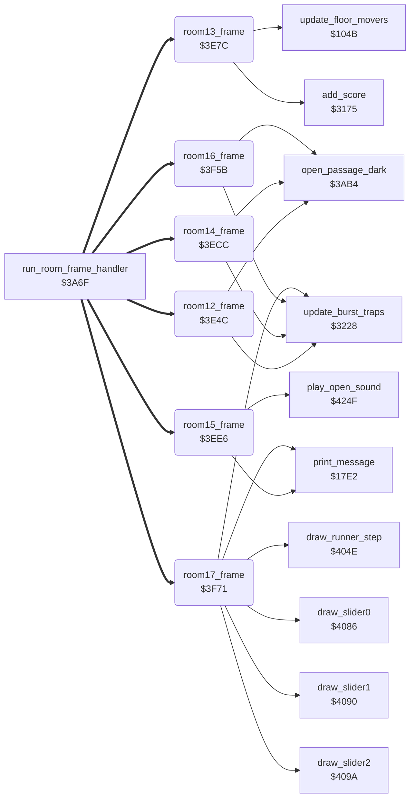

<!-- Generated by c64-docs from knowledge revision 20261017T121733.607-wszjh3 and src/source-map.json. Do not edit: change the knowledge, generate the source again, then run generate.ts. -->
# room_frames_12_17.asm: Room frame handlers for rooms 12-17

Range `$3E4C-$404D`. Source: [room_frames_12_17.asm](../../../src/room_frames_12_17.asm). Index: [the reference](../index.md).

## Call graph

A solid arrow is a call, a thick arrow a table entry, a dotted arrow a jump. Rounded nodes are in this file.

## Names

### [`room12_frame`](../../../src/room_frames_12_17.asm#L11) `$3E4C`

*routine*

Room 12 frame handler. - Lantern lantern_list_room12+8 (row 10, column 36) taken (room_state_a, set to 1 by room12_init, so drawn on two passes): passage at row 10, column 38 (open_passage_dark). - Room 12 has no lanterns left and the room 14 lanterns lantern_list_room14+8 and +12 are taken, one time (room_state_b): passage at row 7, column 38. - update_burst_traps.

- **Jumped to from:** [`run_room_frame_handler`](passage_open.md#run_room_frame_handler) [`$3A7B`](../../../src/passage_open.asm#L26)
- **Entry of:** [`room_frame_handlers`](../tables.md#room_frame_handlers)
- **Calls:** [`open_passage_dark`](passage_open.md#open_passage_dark), [`update_burst_traps`](room_misc_support.md#update_burst_traps)
- **Reads:** [`room_state_a`](room_dispatch.md#room_state_a), [`lantern_list_room12+8`](lantern_lists.md#lantern_list_room12), [`room_state_b`](room_dispatch.md#room_state_b), [`room_lanterns_left+12`](../variables.md#room_lanterns_left), [`lantern_list_room14+8`](lantern_lists.md#lantern_list_room14), [`lantern_list_room14+12`](lantern_lists.md#lantern_list_room14)
- **Writes:** [`room_state_a`](room_dispatch.md#room_state_a), [`room_state_b`](room_dispatch.md#room_state_b)
- **Refers to:** [`lantern_list_room12`](lantern_lists.md#lantern_list_room12), [`room_lanterns_left`](../variables.md#room_lanterns_left), [`lantern_list_room14`](lantern_lists.md#lantern_list_room14)

### [`room12_frame_check_cleared`](../../../src/room_frames_12_17.asm#L21) `$3E60`

*label*

- **Jumped to from:** [`room12_frame`](room_frames_12_17.md#room12_frame) [`$3E4F`](../../../src/room_frames_12_17.asm#L13), [`room12_frame`](room_frames_12_17.md#room12_frame) [`$3E54`](../../../src/room_frames_12_17.asm#L15)

### [`room12_frame_bursts`](../../../src/room_frames_12_17.asm#L33) `$3E79`

*label*

- **Jumped to from:** [`room12_frame`](room_frames_12_17.md#room12_frame) [`$3E63`](../../../src/room_frames_12_17.asm#L23), [`room12_frame`](room_frames_12_17.md#room12_frame) [`$3E6D`](../../../src/room_frames_12_17.asm#L27)

### [`room13_frame`](../../../src/room_frames_12_17.asm#L41) `$3E7C`

*routine*

Room 13 frame handler. Bruce falls down the room. Each of three height bands gives 500 points one time per player: actor_y $64-$89, $8A-$B5 and $B6 or more. The flags are room13_band_bonus + player*4 + band (1 = bonus still there); room19_frame sets them again. A pass that gives a bonus returns after the score. Otherwise: the floor movers (update_floor_movers) move on even passes, and only sprites 0 and 1 (Bruce) stay on.

- **Jumped to from:** [`run_room_frame_handler`](passage_open.md#run_room_frame_handler) [`$3A7B`](../../../src/passage_open.asm#L26)
- **Entry of:** [`room_frame_handlers`](../tables.md#room_frame_handlers)
- **Calls:** [`add_score`](score.md#add_score), [`update_floor_movers`](game_setup.md#update_floor_movers)
- **Reads:** [`current_player`](../variables.md#current_player), [`actor_y`](../variables.md#actor_y), [`pass_parity`](../variables.md#pass_parity), [`SPENA`](../variables.md#SPENA)
- **Writes:** [`SPENA`](../variables.md#SPENA)
- **Refers to:** [`room13_band_bonus`](../variables.md#room13_band_bonus)

### [`room13_frame_band_middle`](../../../src/room_frames_12_17.asm#L56) `$3E96`

*label*

- **Jumped to from:** [`room13_frame`](room_frames_12_17.md#room13_frame) [`$3E89`](../../../src/room_frames_12_17.asm#L50)

### [`room13_frame_band_low`](../../../src/room_frames_12_17.asm#L65) `$3EA6`

*label*

- **Jumped to from:** [`room13_frame`](room_frames_12_17.md#room13_frame) [`$3E99`](../../../src/room_frames_12_17.asm#L59)

### [`room13_frame_award_bonus`](../../../src/room_frames_12_17.asm#L70) `$3EAF`

*label*

+$0100 points

- **Jumped to from:** [`room13_frame`](room_frames_12_17.md#room13_frame) [`$3E93`](../../../src/room_frames_12_17.asm#L55), [`room13_frame`](room_frames_12_17.md#room13_frame) [`$3EA3`](../../../src/room_frames_12_17.asm#L64)

### [`room13_frame_runners`](../../../src/room_frames_12_17.asm#L77) `$3EBC`

*label*

- **Jumped to from:** [`room13_frame`](room_frames_12_17.md#room13_frame) [`$3E85`](../../../src/room_frames_12_17.asm#L48), [`room13_frame`](room_frames_12_17.md#room13_frame) [`$3E8E`](../../../src/room_frames_12_17.asm#L53), [`room13_frame`](room_frames_12_17.md#room13_frame) [`$3E9E`](../../../src/room_frames_12_17.asm#L62), [`room13_frame`](room_frames_12_17.md#room13_frame) [`$3EAA`](../../../src/room_frames_12_17.asm#L68)

### [`room13_frame_sprites_off`](../../../src/room_frames_12_17.asm#L81) `$3EC3`

*label*

- **Jumped to from:** [`room13_frame`](room_frames_12_17.md#room13_frame) [`$3EBE`](../../../src/room_frames_12_17.asm#L79)

### [`room14_frame`](../../../src/room_frames_12_17.asm#L88) `$3ECC`

*routine*

Room 14 frame handler: lanterns lantern_list_room14 and +4 (row 7) taken (room_state_a, set to 1 by room14_init, so drawn on two passes): passage at row 4, column 38 (open_passage_dark). Then update_burst_traps.

- **Jumped to from:** [`run_room_frame_handler`](passage_open.md#run_room_frame_handler) [`$3A7B`](../../../src/passage_open.asm#L26)
- **Entry of:** [`room_frame_handlers`](../tables.md#room_frame_handlers)
- **Calls:** [`open_passage_dark`](passage_open.md#open_passage_dark), [`update_burst_traps`](room_misc_support.md#update_burst_traps)
- **Reads:** [`room_state_a`](room_dispatch.md#room_state_a), [`lantern_list_room14`](lantern_lists.md#lantern_list_room14), [`lantern_list_room14+4`](lantern_lists.md#lantern_list_room14)
- **Writes:** [`room_state_a`](room_dispatch.md#room_state_a)
- **Refers to:** [`lantern_list_room14`](lantern_lists.md#lantern_list_room14)

### [`room14_frame_bursts`](../../../src/room_frames_12_17.asm#L99) `$3EE3`

*label*

- **Jumped to from:** [`room14_frame`](room_frames_12_17.md#room14_frame) [`$3ECF`](../../../src/room_frames_12_17.asm#L90), [`room14_frame`](room_frames_12_17.md#room14_frame) [`$3ED7`](../../../src/room_frames_12_17.asm#L93)

### [`room15_frame`](../../../src/room_frames_12_17.asm#L106) `$3EE6`

*routine*

Room 15 frame handler. Each opening is drawn on two passes (room_state_a..c start at 1): - lantern lantern_list_room15 (row 3, column 19) taken: tile $57 at row 3 and tile $58 at row 4, column 17, play_open_sound; - lanterns lantern_list_room15+4, +8 and +16 taken: tiles $57/$58 at rows 3/4, column 23, play_open_sound; - room 15 has no lanterns left: tiles $59, $5A, $5B at rows 9, 8, 7, column 37, play_open_sound.

- **Jumped to from:** [`run_room_frame_handler`](passage_open.md#run_room_frame_handler) [`$3A7B`](../../../src/passage_open.asm#L26)
- **Entry of:** [`room_frame_handlers`](../tables.md#room_frame_handlers)
- **Calls:** [`print_message`](actor_driver_text.md#print_message), [`play_open_sound`](wizard_fireballs.md#play_open_sound)
- **Reads:** [`room_state_a`](room_dispatch.md#room_state_a), [`lantern_list_room15`](lantern_lists.md#lantern_list_room15), [`room_state_b`](room_dispatch.md#room_state_b), [`lantern_list_room15+4`](lantern_lists.md#lantern_list_room15), [`lantern_list_room15+8`](lantern_lists.md#lantern_list_room15), [`lantern_list_room15+16`](lantern_lists.md#lantern_list_room15), [`room_state_c`](room_dispatch.md#room_state_c), [`room_lanterns_left+15`](../variables.md#room_lanterns_left)
- **Writes:** [`room_state_a`](room_dispatch.md#room_state_a), [`room_state_b`](room_dispatch.md#room_state_b), [`room_state_c`](room_dispatch.md#room_state_c)
- **Refers to:** [`lantern_list_room15`](lantern_lists.md#lantern_list_room15), [`room_lanterns_left`](../variables.md#room_lanterns_left)

### [`room15_frame_check_three`](../../../src/room_frames_12_17.asm#L123) `$3F08`

*label*

Lanterns lantern_list_room15+4, +8 and +16 taken: opening at column 23.

- **Jumped to from:** [`room15_frame`](room_frames_12_17.md#room15_frame) [`$3EE9`](../../../src/room_frames_12_17.asm#L108), [`room15_frame`](room_frames_12_17.md#room15_frame) [`$3EEE`](../../../src/room_frames_12_17.asm#L110)

### [`room15_frame_check_cleared`](../../../src/room_frames_12_17.asm#L142) `$3F30`

*label*

Room 15 cleared: opening at column 37, rows 7-9.

- **Jumped to from:** [`room15_frame`](room_frames_12_17.md#room15_frame) [`$3F0B`](../../../src/room_frames_12_17.asm#L125), [`room15_frame`](room_frames_12_17.md#room15_frame) [`$3F16`](../../../src/room_frames_12_17.asm#L129)

### [`room15_frame_done`](../../../src/room_frames_12_17.asm#L162) `$3F5A`

*label*

- **Jumped to from:** [`room15_frame`](room_frames_12_17.md#room15_frame) [`$3F33`](../../../src/room_frames_12_17.asm#L144), [`room15_frame`](room_frames_12_17.md#room15_frame) [`$3F37`](../../../src/room_frames_12_17.asm#L146)

### [`room16_frame`](../../../src/room_frames_12_17.asm#L166) `$3F5B`

*routine*

Room 16 frame handler: room 16 has no lanterns left, one time (room_state_a): passage at row 7, column 1 (open_passage_dark). Then update_burst_traps.

- **Jumped to from:** [`run_room_frame_handler`](passage_open.md#run_room_frame_handler) [`$3A7B`](../../../src/passage_open.asm#L26)
- **Entry of:** [`room_frame_handlers`](../tables.md#room_frame_handlers)
- **Calls:** [`open_passage_dark`](passage_open.md#open_passage_dark), [`update_burst_traps`](room_misc_support.md#update_burst_traps)
- **Reads:** [`room_state_a`](room_dispatch.md#room_state_a), [`room_lanterns_left+16`](../variables.md#room_lanterns_left)
- **Writes:** [`room_state_a`](room_dispatch.md#room_state_a)
- **Refers to:** [`room_lanterns_left`](../variables.md#room_lanterns_left)

### [`room16_frame_bursts`](../../../src/room_frames_12_17.asm#L176) `$3F6E`

*label*

- **Jumped to from:** [`room16_frame`](room_frames_12_17.md#room16_frame) [`$3F5E`](../../../src/room_frames_12_17.asm#L168), [`room16_frame`](room_frames_12_17.md#room16_frame) [`$3F62`](../../../src/room_frames_12_17.asm#L170)

### [`room17_frame`](../../../src/room_frames_12_17.asm#L188) `$3F71`

*routine*

Room 17 frame handler. - Every 11 passes (room_state_c) the colour of screen row 3, columns 8-35 changes (colour XOR 2). - The runner at row 5 moves right on every second pass (room_state_d), columns 11-27, then back to 11. - Lantern lantern_list_room17 (row 10, column 38) taken, one time (room_state_a): tile $5D at row 10, column 37. - Lantern lantern_list_room17+4 (row 11, column 31) taken, one time (room_state_b): tile $5C at row 10, column 24. - update_burst_traps. - Three sliders in one loop (temp_counter = 2..0) at rows 3, 7, 9 from column 8 to column 35 (slider 0) or 37 (sliders 1, 2); after each run they wait and start again at column 8.

- **Jumped to from:** [`run_room_frame_handler`](passage_open.md#run_room_frame_handler) [`$3A7B`](../../../src/passage_open.asm#L26)
- **Entry of:** [`room_frame_handlers`](../tables.md#room_frame_handlers)
- **Calls:** [`draw_runner_step`](room_hazard_draw.md#draw_runner_step), [`print_message`](actor_driver_text.md#print_message), [`update_burst_traps`](room_misc_support.md#update_burst_traps), [`draw_slider0`](room_hazard_draw.md#draw_slider0), [`draw_slider1`](room_hazard_draw.md#draw_slider1), [`draw_slider2`](room_hazard_draw.md#draw_slider2)
- **Reads:** [`room_state_c`](room_dispatch.md#room_state_c), [`RANDOM+1125`](../variables.md#RANDOM), [`room_state_d`](room_dispatch.md#room_state_d), [`runner_col`](../variables.md#runner_col), [`room_state_a`](room_dispatch.md#room_state_a), [`lantern_list_room17`](lantern_lists.md#lantern_list_room17), [`room_state_b`](room_dispatch.md#room_state_b), [`lantern_list_room17+4`](lantern_lists.md#lantern_list_room17), [`temp_counter`](../variables.md#temp_counter), [`slider_timer+1`](../variables.md#slider_timer), [`slider_timer+2`](../variables.md#slider_timer), [`slider_col+1`](../variables.md#slider_col)
- **Writes:** [`room_state_c`](room_dispatch.md#room_state_c), [`RANDOM+1151`](../variables.md#RANDOM), [`RANDOM+1152`](../variables.md#RANDOM), [`room_state_d`](room_dispatch.md#room_state_d), [`runner_old_col`](../variables.md#runner_old_col), [`runner_col`](../variables.md#runner_col), [`room_state_a`](room_dispatch.md#room_state_a), [`room_state_b`](room_dispatch.md#room_state_b), [`temp_counter`](../variables.md#temp_counter), [`slider_timer+1`](../variables.md#slider_timer), [`slider_timer+2`](../variables.md#slider_timer), [`slider_col+1`](../variables.md#slider_col)
- **Refers to:** [`lantern_list_room17`](lantern_lists.md#lantern_list_room17)

### [`room17_frame_colour_loop`](../../../src/room_frames_12_17.asm#L198) `$3F86`

*label*

colour RAM, screen row 3, columns 8-35

- **Jumped to from:** [`room17_frame`](room_frames_12_17.md#room17_frame) [`$3F8A`](../../../src/room_frames_12_17.asm#L201)

### [`room17_frame_runner`](../../../src/room_frames_12_17.asm#L203) `$3F8C`

*label*

Runner of row 5, every second pass.

- **Jumped to from:** [`room17_frame`](room_frames_12_17.md#room17_frame) [`$3F74`](../../../src/room_frames_12_17.asm#L190)

### [`room17_frame_runner_rearm`](../../../src/room_frames_12_17.asm#L207) `$3F93`

*label*

### [`room17_frame_runner_step`](../../../src/room_frames_12_17.asm#L210) `$3F98`

*label*

- **Jumped to from:** [`room17_frame`](room_frames_12_17.md#room17_frame) [`$3F91`](../../../src/room_frames_12_17.asm#L206)

### [`room17_frame_runner_draw`](../../../src/room_frames_12_17.asm#L218) `$3FA6`

*label*

- **Jumped to from:** [`room17_frame`](room_frames_12_17.md#room17_frame) [`$3FA0`](../../../src/room_frames_12_17.asm#L215)

### [`room17_frame_check_lantern1`](../../../src/room_frames_12_17.asm#L221) `$3FA9`

*label*

One-time tile changes when the two lanterns are taken.
1 = change not done yet

- **Jumped to from:** [`room17_frame`](room_frames_12_17.md#room17_frame) [`$3F8F`](../../../src/room_frames_12_17.asm#L205)

### [`room17_frame_check_lantern2`](../../../src/room_frames_12_17.asm#L232) `$3FBF`

*label*

- **Jumped to from:** [`room17_frame`](room_frames_12_17.md#room17_frame) [`$3FAC`](../../../src/room_frames_12_17.asm#L223), [`room17_frame`](room_frames_12_17.md#room17_frame) [`$3FB1`](../../../src/room_frames_12_17.asm#L225)

### [`room17_frame_bursts`](../../../src/room_frames_12_17.asm#L244) `$3FD5`

*label*

Burst traps, then the three sliders.

- **Jumped to from:** [`room17_frame`](room_frames_12_17.md#room17_frame) [`$3FC2`](../../../src/room_frames_12_17.asm#L234), [`room17_frame`](room_frames_12_17.md#room17_frame) [`$3FC7`](../../../src/room_frames_12_17.asm#L236)

### [`room17_frame_slider_loop`](../../../src/room_frames_12_17.asm#L248) `$3FDC`

*label*

- **Jumped to from:** [`room17_frame`](room_frames_12_17.md#room17_frame) [`$404B`](../../../src/room_frames_12_17.asm#L314)

### [`room17_frame_slider_frame`](../../../src/room_frames_12_17.asm#L252) `$3FE2`

*label*

### [`room17_frame_slider_draw`](../../../src/room_frames_12_17.asm#L259) `$3FEC`

*label*

Draw frame A of slider X with tiles $1F-$25.

- **Jumped to from:** [`room17_frame`](room_frames_12_17.md#room17_frame) [`$400E`](../../../src/room_frames_12_17.asm#L277), [`room17_frame`](room_frames_12_17.md#room17_frame) [`$4014`](../../../src/room_frames_12_17.asm#L282), [`room17_frame`](room_frames_12_17.md#room17_frame) [`$4037`](../../../src/room_frames_12_17.asm#L302)

### [`room17_frame_slider_draw_1`](../../../src/room_frames_12_17.asm#L264) `$3FF6`

*label*

- **Jumped to from:** [`room17_frame`](room_frames_12_17.md#room17_frame) [`$3FEE`](../../../src/room_frames_12_17.asm#L261)

### [`room17_frame_slider_draw_2`](../../../src/room_frames_12_17.asm#L269) `$4000`

*label*

- **Jumped to from:** [`room17_frame`](room_frames_12_17.md#room17_frame) [`$3FF8`](../../../src/room_frames_12_17.asm#L266)

### [`room17_frame_slider_step`](../../../src/room_frames_12_17.asm#L272) `$4006`

*label*

slider column

- **Jumped to from:** [`room17_frame`](room_frames_12_17.md#room17_frame) [`$3FE6`](../../../src/room_frames_12_17.asm#L255)

### [`room17_frame_slider_step_0`](../../../src/room_frames_12_17.asm#L278) `$4010`

*label*

### [`room17_frame_slider_step_12`](../../../src/room_frames_12_17.asm#L280) `$4012`

*label*

sliders 1, 2 end column 37

- **Jumped to from:** [`room17_frame`](room_frames_12_17.md#room17_frame) [`$400A`](../../../src/room_frames_12_17.asm#L275)

### [`room17_frame_slider_move`](../../../src/room_frames_12_17.asm#L283) `$4016`

*label*

A=6: blank frame at the old place

- **Jumped to from:** [`room17_frame`](room_frames_12_17.md#room17_frame) [`$4010`](../../../src/room_frames_12_17.asm#L279)

### [`room17_frame_slider_erase_0`](../../../src/room_frames_12_17.asm#L287) `$401C`

*label*

### [`room17_frame_slider_erase_1`](../../../src/room_frames_12_17.asm#L290) `$4022`

*label*

- **Jumped to from:** [`room17_frame`](room_frames_12_17.md#room17_frame) [`$401A`](../../../src/room_frames_12_17.asm#L286)

### [`room17_frame_slider_erase_2`](../../../src/room_frames_12_17.asm#L295) `$402C`

*label*

- **Jumped to from:** [`room17_frame`](room_frames_12_17.md#room17_frame) [`$4024`](../../../src/room_frames_12_17.asm#L292)

### [`room17_frame_slider_advance`](../../../src/room_frames_12_17.asm#L297) `$402F`

*label*

- **Jumped to from:** [`room17_frame`](room_frames_12_17.md#room17_frame) [`$401F`](../../../src/room_frames_12_17.asm#L289), [`room17_frame`](room_frames_12_17.md#room17_frame) [`$4029`](../../../src/room_frames_12_17.asm#L294)

### [`room17_frame_slider_reset`](../../../src/room_frames_12_17.asm#L303) `$4039`

*label*

sliders 1, 2: wait 54 passes

- **Jumped to from:** [`room17_frame`](room_frames_12_17.md#room17_frame) [`$3FEA`](../../../src/room_frames_12_17.asm#L257)

### [`room17_frame_slider_next`](../../../src/room_frames_12_17.asm#L312) `$4049`

*label*

- **Jumped to from:** [`room17_frame`](room_frames_12_17.md#room17_frame) [`$3FE0`](../../../src/room_frames_12_17.asm#L251), [`room17_frame`](room_frames_12_17.md#room17_frame) [`$3FF3`](../../../src/room_frames_12_17.asm#L263), [`room17_frame`](room_frames_12_17.md#room17_frame) [`$3FFD`](../../../src/room_frames_12_17.asm#L268), [`room17_frame`](room_frames_12_17.md#room17_frame) [`$4003`](../../../src/room_frames_12_17.asm#L271), [`room17_frame`](room_frames_12_17.md#room17_frame) [`$4043`](../../../src/room_frames_12_17.asm#L309)

### [`room17_frame_done`](../../../src/room_frames_12_17.asm#L315) `$404D`

*label*
