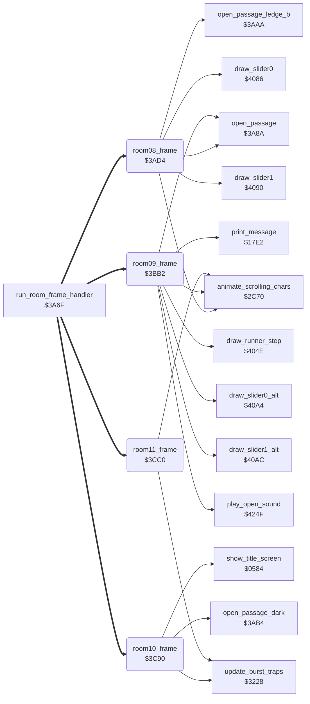

<!-- Generated by c64-docs from knowledge revision 20261017T123532.893-hcxwuv and src/source-map.json. Do not edit: change the knowledge, generate the source again, then run generate.ts. -->
# room_frames_8_11.asm: Room frame handlers for rooms 8-11

Range `$3AD4-$3CDB`. Source: [room_frames_8_11.asm](../../../src/room_frames_8_11.asm). Index: [the reference](../index.md).

## Call graph

A solid arrow is a call, a thick arrow a table entry, a dotted arrow a jump. Rounded nodes are in this file.

## Names

### [`room08_frame`](../../../src/room_frames_8_11.asm#L16) `$3AD4`

*routine*

Room 8 frame handler. Each opening happens one time: - room 7 has no lanterns left and lantern lantern_list_room8+8 (row 7, column 6) is taken (room_state_c): passage at row 7, column 14; - lanterns lantern_list_room8 and lantern_list_room8+4 (row 3) taken (room_state_d): if lantern lantern_list_room8+12 is still present, the animated chars restart with direction 1; passage at row 7, column 25; - room 8 has no lanterns left and the room 9 lanterns lantern_list_room9+8 and +12 are taken (room_state_e): passage at row 2, column 38 (open_passage_ledge_b); - lantern lantern_list_room8+8 taken (room_state_a): passage at row 10, column 1; - rooms 7 and 8 have no lanterns left (room_state_b): passage at row 10, column 38. Then slider 0 (row 5, columns 6-11), slider 1 (row 5, columns 27-32) and animate_scrolling_chars.
lanterns left in room 7

- **Jumped to from:** [`run_room_frame_handler`](passage_open.md#run_room_frame_handler) [`$3A7B`](../../../src/passage_open.asm#L26)
- **Entry of:** [`room_frame_handlers`](../tables.md#room_frame_handlers)
- **Calls:** [`open_passage`](passage_open.md#open_passage), [`open_passage_ledge_b`](passage_open.md#open_passage_ledge_b), [`draw_slider0`](room_hazard_draw.md#draw_slider0), [`draw_slider1`](room_hazard_draw.md#draw_slider1), [`animate_scrolling_chars`](animated_chars.md#animate_scrolling_chars)
- **Reads:** [`room_lanterns_left+7`](../variables.md#room_lanterns_left), [`lantern_list_room8+8`](lantern_lists.md#lantern_list_room8), [`room_state_c`](room_dispatch.md#room_state_c), [`lantern_list_room8`](lantern_lists.md#lantern_list_room8), [`lantern_list_room8+4`](lantern_lists.md#lantern_list_room8), [`room_state_d`](room_dispatch.md#room_state_d), [`lantern_list_room8+12`](lantern_lists.md#lantern_list_room8), [`room_lanterns_left+8`](../variables.md#room_lanterns_left), [`lantern_list_room9+8`](lantern_lists.md#lantern_list_room9), [`lantern_list_room9+12`](lantern_lists.md#lantern_list_room9), [`room_state_e`](room_dispatch.md#room_state_e), [`room_state_a`](room_dispatch.md#room_state_a), [`room_state_b`](room_dispatch.md#room_state_b), [`slider_timer`](../variables.md#slider_timer), [`slider_col`](../variables.md#slider_col), [`slider_timer+1`](../variables.md#slider_timer), [`slider_col+1`](../variables.md#slider_col)
- **Writes:** [`room_state_c`](room_dispatch.md#room_state_c), [`room_state_d`](room_dispatch.md#room_state_d), [`anim_chars_direction`](../variables.md#anim_chars_direction), [`anim_chars_speed_step`](options_and_patterns.md#anim_chars_speed_step), [`room_state_e`](room_dispatch.md#room_state_e), [`room_state_a`](room_dispatch.md#room_state_a), [`room_state_b`](room_dispatch.md#room_state_b), [`slider_timer`](../variables.md#slider_timer), [`slider_col`](../variables.md#slider_col), [`slider_timer+1`](../variables.md#slider_timer), [`slider_col+1`](../variables.md#slider_col)
- **Refers to:** [`room_lanterns_left`](../variables.md#room_lanterns_left), [`lantern_list_room8`](lantern_lists.md#lantern_list_room8), [`lantern_list_room9`](lantern_lists.md#lantern_list_room9), [`slider_timer`](../variables.md#slider_timer), [`slider_col`](../variables.md#slider_col)

### [`room08_frame_check_row3_pair`](../../../src/room_frames_8_11.asm#L29) `$3AEA`

*label*

Lanterns of row 3 taken: passage at row 7, column 25 (animated chars restart in direction 1 while the lantern lantern_list_room8+12 is present).

- **Jumped to from:** [`room08_frame`](room_frames_8_11.md#room08_frame) [`$3AD9`](../../../src/room_frames_8_11.asm#L19), [`room08_frame`](room_frames_8_11.md#room08_frame) [`$3ADE`](../../../src/room_frames_8_11.asm#L22)

### [`room08_frame_open_middle`](../../../src/room_frames_8_11.asm#L43) `$3B08`

*label*

passage at row 7, column 25

- **Jumped to from:** [`room08_frame`](room_frames_8_11.md#room08_frame) [`$3AFD`](../../../src/room_frames_8_11.asm#L38)

### [`room08_frame_check_top_right`](../../../src/room_frames_8_11.asm#L48) `$3B0F`

*label*

Room 8 cleared and the room 9 lanterns +8/+12 taken: passage at row 2, column 38.
lanterns left in room 8

- **Jumped to from:** [`room08_frame`](room_frames_8_11.md#room08_frame) [`$3AF0`](../../../src/room_frames_8_11.asm#L32), [`room08_frame`](room_frames_8_11.md#room08_frame) [`$3AF5`](../../../src/room_frames_8_11.asm#L35)

### [`room08_frame_check_bottom_left`](../../../src/room_frames_8_11.asm#L61) `$3B28`

*label*

Lantern at row 7, column 6 taken: passage at row 10, column 1.

- **Jumped to from:** [`room08_frame`](room_frames_8_11.md#room08_frame) [`$3B17`](../../../src/room_frames_8_11.asm#L52), [`room08_frame`](room_frames_8_11.md#room08_frame) [`$3B1C`](../../../src/room_frames_8_11.asm#L55)

### [`room08_frame_check_bottom_right`](../../../src/room_frames_8_11.asm#L72) `$3B3C`

*label*

Rooms 7 and 8 cleared: passage at row 10, column 38.

- **Jumped to from:** [`room08_frame`](room_frames_8_11.md#room08_frame) [`$3B2B`](../../../src/room_frames_8_11.asm#L63), [`room08_frame`](room_frames_8_11.md#room08_frame) [`$3B30`](../../../src/room_frames_8_11.asm#L66)

### [`room08_frame_slider0`](../../../src/room_frames_8_11.asm#L84) `$3B51`

*label*

Slider 0 (row 5, columns 6-11).

- **Jumped to from:** [`room08_frame`](room_frames_8_11.md#room08_frame) [`$3B40`](../../../src/room_frames_8_11.asm#L75), [`room08_frame`](room_frames_8_11.md#room08_frame) [`$3B45`](../../../src/room_frames_8_11.asm#L78)

### [`room08_frame_slider0_frame`](../../../src/room_frames_8_11.asm#L87) `$3B55`

*label*

### [`room08_frame_slider0_draw`](../../../src/room_frames_8_11.asm#L93) `$3B5F`

*label*

- **Jumped to from:** [`room08_frame`](room_frames_8_11.md#room08_frame) [`$3B69`](../../../src/room_frames_8_11.asm#L99), [`room08_frame`](room_frames_8_11.md#room08_frame) [`$3B76`](../../../src/room_frames_8_11.asm#L105)

### [`room08_frame_slider0_step`](../../../src/room_frames_8_11.asm#L96) `$3B65`

*label*

- **Jumped to from:** [`room08_frame`](room_frames_8_11.md#room08_frame) [`$3B59`](../../../src/room_frames_8_11.asm#L90)

### [`room08_frame_slider0_reset`](../../../src/room_frames_8_11.asm#L106) `$3B78`

*label*

back to column 6

- **Jumped to from:** [`room08_frame`](room_frames_8_11.md#room08_frame) [`$3B5D`](../../../src/room_frames_8_11.asm#L92)

### [`room08_frame_slider1`](../../../src/room_frames_8_11.asm#L112) `$3B80`

*label*

Slider 1 (row 5, columns 27-32).

- **Jumped to from:** [`room08_frame`](room_frames_8_11.md#room08_frame) [`$3B53`](../../../src/room_frames_8_11.asm#L86), [`room08_frame`](room_frames_8_11.md#room08_frame) [`$3B62`](../../../src/room_frames_8_11.asm#L95)

### [`room08_frame_slider1_draw`](../../../src/room_frames_8_11.asm#L120) `$3B8E`

*label*

- **Jumped to from:** [`room08_frame`](room_frames_8_11.md#room08_frame) [`$3B98`](../../../src/room_frames_8_11.asm#L126), [`room08_frame`](room_frames_8_11.md#room08_frame) [`$3BA5`](../../../src/room_frames_8_11.asm#L132)

### [`room08_frame_slider1_step`](../../../src/room_frames_8_11.asm#L123) `$3B94`

*label*

- **Jumped to from:** [`room08_frame`](room_frames_8_11.md#room08_frame) [`$3B88`](../../../src/room_frames_8_11.asm#L117)

### [`room08_frame_slider1_reset`](../../../src/room_frames_8_11.asm#L133) `$3BA7`

*label*

back to column 27

- **Jumped to from:** [`room08_frame`](room_frames_8_11.md#room08_frame) [`$3B8C`](../../../src/room_frames_8_11.asm#L119)

### [`room08_frame_animate_chars`](../../../src/room_frames_8_11.asm#L138) `$3BAF`

*label*

- **Jumped to from:** [`room08_frame`](room_frames_8_11.md#room08_frame) [`$3B82`](../../../src/room_frames_8_11.asm#L114), [`room08_frame`](room_frames_8_11.md#room08_frame) [`$3B91`](../../../src/room_frames_8_11.asm#L122)

### [`room09_frame`](../../../src/room_frames_8_11.asm#L149) `$3BB2`

*routine*

Room 9 frame handler. One-time events: - lantern lantern_list_room9 (row 2, column 32) taken (room_state_c): animated chars direction 1, restart; - lantern lantern_list_room9+4 (row 7, column 15) taken (room_state_a): passage at row 7, column 23; direction 0, restart; - room 9 has no lanterns left (room_state_b): direction 0, restart, play_open_sound, tile $18 (61 84 84 63) at row 2, column 35. Every pass: the runner at row 12 moves right (columns 4-24, then back to 4) while lantern lantern_list_room9+8 or +12 is present, otherwise left (then back to 24); slider 0 (row 5) and slider 1 (row 6), columns 16-20, second look; animate_scrolling_chars.
one-shot

- **Jumped to from:** [`run_room_frame_handler`](passage_open.md#run_room_frame_handler) [`$3A7B`](../../../src/passage_open.asm#L26)
- **Entry of:** [`room_frame_handlers`](../tables.md#room_frame_handlers)
- **Calls:** [`open_passage`](passage_open.md#open_passage), [`play_open_sound`](wizard_fireballs.md#play_open_sound), [`print_message`](actor_driver_text.md#print_message), [`draw_runner_step`](room_hazard_draw.md#draw_runner_step), [`draw_slider0_alt`](room_hazard_draw.md#draw_slider0_alt), [`draw_slider1_alt`](room_hazard_draw.md#draw_slider1_alt), [`animate_scrolling_chars`](animated_chars.md#animate_scrolling_chars)
- **Reads:** [`room_state_c`](room_dispatch.md#room_state_c), [`lantern_list_room9`](lantern_lists.md#lantern_list_room9), [`lantern_list_room9+4`](lantern_lists.md#lantern_list_room9), [`room_state_a`](room_dispatch.md#room_state_a), [`room_lanterns_left+9`](../variables.md#room_lanterns_left), [`room_state_b`](room_dispatch.md#room_state_b), [`lantern_list_room9+8`](lantern_lists.md#lantern_list_room9), [`lantern_list_room9+12`](lantern_lists.md#lantern_list_room9), [`runner_col`](../variables.md#runner_col), [`slider_timer`](../variables.md#slider_timer), [`slider_col`](../variables.md#slider_col), [`slider_timer+1`](../variables.md#slider_timer), [`slider_col+1`](../variables.md#slider_col)
- **Writes:** [`room_state_c`](room_dispatch.md#room_state_c), [`anim_chars_direction`](../variables.md#anim_chars_direction), [`anim_chars_speed_step`](options_and_patterns.md#anim_chars_speed_step), [`room_state_a`](room_dispatch.md#room_state_a), [`room_state_b`](room_dispatch.md#room_state_b), [`runner_old_col`](../variables.md#runner_old_col), [`runner_col`](../variables.md#runner_col), [`slider_timer`](../variables.md#slider_timer), [`slider_col`](../variables.md#slider_col), [`slider_timer+1`](../variables.md#slider_timer), [`slider_col+1`](../variables.md#slider_col)
- **Refers to:** [`lantern_list_room9`](lantern_lists.md#lantern_list_room9), [`room_lanterns_left`](../variables.md#room_lanterns_left), [`slider_timer`](../variables.md#slider_timer), [`slider_col`](../variables.md#slider_col)

### [`room09_frame_check_lantern2`](../../../src/room_frames_8_11.asm#L161) `$3BC8`

*label*

Lantern at row 7, column 15 taken: passage at row 7, column 23, animated chars direction 0.

- **Jumped to from:** [`room09_frame`](room_frames_8_11.md#room09_frame) [`$3BB5`](../../../src/room_frames_8_11.asm#L151), [`room09_frame`](room_frames_8_11.md#room09_frame) [`$3BBA`](../../../src/room_frames_8_11.asm#L153)

### [`room09_frame_check_cleared`](../../../src/room_frames_8_11.asm#L176) `$3BE5`

*label*

Room 9 cleared: tile $18 at row 2, column 35, animated chars direction 0.
lanterns left in room 9

- **Jumped to from:** [`room09_frame`](room_frames_8_11.md#room09_frame) [`$3BCB`](../../../src/room_frames_8_11.asm#L163), [`room09_frame`](room_frames_8_11.md#room09_frame) [`$3BD0`](../../../src/room_frames_8_11.asm#L166)

### [`room09_frame_runner`](../../../src/room_frames_8_11.asm#L193) `$3C06`

*label*

Runner of row 12: right while lantern +8 or +12 is present, else left.

- **Jumped to from:** [`room09_frame`](room_frames_8_11.md#room09_frame) [`$3BE7`](../../../src/room_frames_8_11.asm#L178), [`room09_frame`](room_frames_8_11.md#room09_frame) [`$3BEC`](../../../src/room_frames_8_11.asm#L181)

### [`room09_frame_runner_right`](../../../src/room_frames_8_11.asm#L206) `$3C1E`

*label*

- **Jumped to from:** [`room09_frame`](room_frames_8_11.md#room09_frame) [`$3C0C`](../../../src/room_frames_8_11.asm#L196)

### [`room09_frame_runner_draw`](../../../src/room_frames_8_11.asm#L214) `$3C2C`

*label*

- **Jumped to from:** [`room09_frame`](room_frames_8_11.md#room09_frame) [`$3C16`](../../../src/room_frames_8_11.asm#L202), [`room09_frame`](room_frames_8_11.md#room09_frame) [`$3C1C`](../../../src/room_frames_8_11.asm#L205), [`room09_frame`](room_frames_8_11.md#room09_frame) [`$3C26`](../../../src/room_frames_8_11.asm#L211)

### [`room09_frame_slider0_frame`](../../../src/room_frames_8_11.asm#L219) `$3C33`

*label*

### [`room09_frame_slider0_draw`](../../../src/room_frames_8_11.asm#L225) `$3C3D`

*label*

- **Jumped to from:** [`room09_frame`](room_frames_8_11.md#room09_frame) [`$3C47`](../../../src/room_frames_8_11.asm#L231), [`room09_frame`](room_frames_8_11.md#room09_frame) [`$3C54`](../../../src/room_frames_8_11.asm#L237)

### [`room09_frame_slider0_step`](../../../src/room_frames_8_11.asm#L228) `$3C43`

*label*

- **Jumped to from:** [`room09_frame`](room_frames_8_11.md#room09_frame) [`$3C37`](../../../src/room_frames_8_11.asm#L222)

### [`room09_frame_slider0_reset`](../../../src/room_frames_8_11.asm#L238) `$3C56`

*label*

back to column 16

- **Jumped to from:** [`room09_frame`](room_frames_8_11.md#room09_frame) [`$3C3B`](../../../src/room_frames_8_11.asm#L224)

### [`room09_frame_slider1`](../../../src/room_frames_8_11.asm#L244) `$3C5E`

*label*

Slider 1 (row 6, columns 16-20, second look).

- **Jumped to from:** [`room09_frame`](room_frames_8_11.md#room09_frame) [`$3C31`](../../../src/room_frames_8_11.asm#L218), [`room09_frame`](room_frames_8_11.md#room09_frame) [`$3C40`](../../../src/room_frames_8_11.asm#L227)

### [`room09_frame_slider1_draw`](../../../src/room_frames_8_11.asm#L252) `$3C6C`

*label*

- **Jumped to from:** [`room09_frame`](room_frames_8_11.md#room09_frame) [`$3C76`](../../../src/room_frames_8_11.asm#L258), [`room09_frame`](room_frames_8_11.md#room09_frame) [`$3C83`](../../../src/room_frames_8_11.asm#L264)

### [`room09_frame_slider1_step`](../../../src/room_frames_8_11.asm#L255) `$3C72`

*label*

- **Jumped to from:** [`room09_frame`](room_frames_8_11.md#room09_frame) [`$3C66`](../../../src/room_frames_8_11.asm#L249)

### [`room09_frame_slider1_reset`](../../../src/room_frames_8_11.asm#L265) `$3C85`

*label*

- **Jumped to from:** [`room09_frame`](room_frames_8_11.md#room09_frame) [`$3C6A`](../../../src/room_frames_8_11.asm#L251)

### [`room09_frame_animate_chars`](../../../src/room_frames_8_11.asm#L270) `$3C8D`

*label*

- **Jumped to from:** [`room09_frame`](room_frames_8_11.md#room09_frame) [`$3C60`](../../../src/room_frames_8_11.asm#L246), [`room09_frame`](room_frames_8_11.md#room09_frame) [`$3C6F`](../../../src/room_frames_8_11.asm#L254)

### [`room10_frame`](../../../src/room_frames_8_11.asm#L278) `$3C90`

*routine*

Room 10 frame handler. - Lanterns lantern_list_room10 (row 4, column 1) and lantern_list_room10+4 (row 7, column 30) taken, one time (room_state_a): passage at row 4, column 38 (open_passage_dark). - Protection check: if zero page $00 (D6510) does not hold $EF, it writes $80 into the first bytes of room_map_00, room_map_05 and room_map_01 and jumps to show_title_screen (restart). - update_burst_traps.

- **Jumped to from:** [`run_room_frame_handler`](passage_open.md#run_room_frame_handler) [`$3A7B`](../../../src/passage_open.asm#L26)
- **Entry of:** [`room_frame_handlers`](../tables.md#room_frame_handlers)
- **Calls:** [`open_passage_dark`](passage_open.md#open_passage_dark), [`show_title_screen`](title_demo_start.md#show_title_screen), [`update_burst_traps`](room_misc_support.md#update_burst_traps)
- **Reads:** [`room_state_a`](room_dispatch.md#room_state_a), [`lantern_list_room10`](lantern_lists.md#lantern_list_room10), [`lantern_list_room10+4`](lantern_lists.md#lantern_list_room10)
- **Writes:** [`room_state_a`](room_dispatch.md#room_state_a), [`room_map_00`](room_maps_00_04.md#room_map_00), [`room_map_05`](room_maps_05_09.md#room_map_05), [`room_map_01`](room_maps_00_04.md#room_map_01)
- **Refers to:** [`lantern_list_room10`](lantern_lists.md#lantern_list_room10)

### [`room10_frame_protection_check`](../../../src/room_frames_8_11.asm#L289) `$3CA7`

*label*

- **Jumped to from:** [`room10_frame`](room_frames_8_11.md#room10_frame) [`$3C93`](../../../src/room_frames_8_11.asm#L280), [`room10_frame`](room_frames_8_11.md#room10_frame) [`$3C9B`](../../../src/room_frames_8_11.asm#L283)

### [`room10_frame_bursts`](../../../src/room_frames_8_11.asm#L313) `$3CBD`

*label*

- **Jumped to from:** [`room10_frame`](room_frames_8_11.md#room10_frame) [`$3CAD`](../../../src/room_frames_8_11.asm#L303)

### [`room11_frame`](../../../src/room_frames_8_11.asm#L318) `$3CC0`

*routine*

Room 11 frame handler: lantern lantern_list_room11+8 (row 10, column 7) taken, one time (room_state_a): the animated chars restart with direction 0. Then update_burst_traps and animate_scrolling_chars. draw_room has a room 11 rule too: when rooms 12, 14 and 16 have no lanterns left, it goes on to room 13.

- **Jumped to from:** [`run_room_frame_handler`](passage_open.md#run_room_frame_handler) [`$3A7B`](../../../src/passage_open.asm#L26)
- **Entry of:** [`room_frame_handlers`](../tables.md#room_frame_handlers)
- **Calls:** [`update_burst_traps`](room_misc_support.md#update_burst_traps), [`animate_scrolling_chars`](animated_chars.md#animate_scrolling_chars)
- **Reads:** [`room_state_a`](room_dispatch.md#room_state_a), [`lantern_list_room11+8`](lantern_lists.md#lantern_list_room11)
- **Writes:** [`room_state_a`](room_dispatch.md#room_state_a), [`anim_chars_direction`](../variables.md#anim_chars_direction), [`anim_chars_speed_step`](options_and_patterns.md#anim_chars_speed_step)
- **Refers to:** [`lantern_list_room11`](lantern_lists.md#lantern_list_room11)

### [`room11_frame_bursts`](../../../src/room_frames_8_11.asm#L329) `$3CD6`

*label*

- **Jumped to from:** [`room11_frame`](room_frames_8_11.md#room11_frame) [`$3CC3`](../../../src/room_frames_8_11.asm#L320), [`room11_frame`](room_frames_8_11.md#room11_frame) [`$3CC8`](../../../src/room_frames_8_11.asm#L322)
