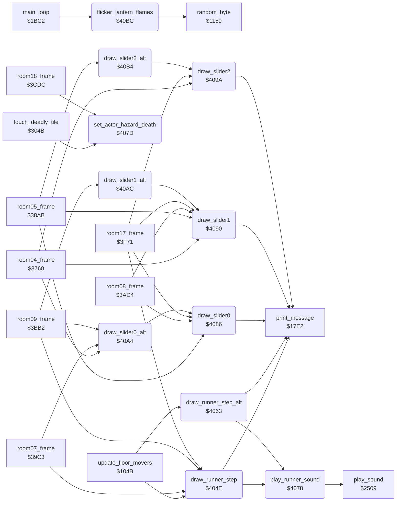

<!-- Generated by c64-docs from knowledge revision 20261018T152957.577-ll4gr6 and src/source-map.json. Do not edit: change the knowledge, generate the source again, then run docs.ts generate. -->
# room_hazard_draw.asm: Runner and slider hazard drawing, hazard death, lantern flame flicker

Range `$404E-$4132`. Source: [room_hazard_draw.asm](../../../src/room_hazard_draw.asm). Index: [the reference](../index.md).

## Call graph

A solid arrow is a call, a thick arrow a table entry, a dotted arrow a jump. Rounded nodes are in this file.

## Data

| Range | Type | Name | Read by | Written by |
|---|---|---|---|---|
| [`$40AA`](../../../src/room_hazard_draw.asm#L73)-`$40AB` | unused |  |  |  |
| [`$40B2`](../../../src/room_hazard_draw.asm#L80)-`$40B3` | unused |  |  |  |
| [`$40BA`](../../../src/room_hazard_draw.asm#L87)-`$40BB` | unused |  |  |  |

## Names

### [`draw_runner_step`](../../../src/room_hazard_draw.asm#L9) `$404E`

*routine*

Moves a runner hazard one cell: play_runner_sound (sound $89), draws tile $1C (char E5, the track) at the old column runner_old_col and tile $1B (char E4, the runner) at the new column runner_col, both in row runner_row. The char $64 of the runner tile kills an actor on contact (handle_touched_tile). Used by rooms 7, 9 and 17 and by the room 13 floor movers (update_floor_movers).

- **Called from:** [`update_floor_movers`](game_setup.md#update_floor_movers) [`$1083`](../../../src/game_setup.asm#L196), [`update_floor_movers`](game_setup.md#update_floor_movers) [`$10AC`](../../../src/game_setup.asm#L215), [`room07_frame`](room_frames_0_7.md#room07_frame) [`$3A4E`](../../../src/room_frames_0_7.asm#L613), [`room07_frame`](room_frames_0_7.md#room07_frame) [`$3A5F`](../../../src/room_frames_0_7.asm#L624), [`room09_frame`](room_frames_8_11.md#room09_frame) [`$3C2C`](../../../src/room_frames_8_11.asm#L215), [`room17_frame`](room_frames_12_17.md#room17_frame) [`$3FA6`](../../../src/room_frames_12_17.asm#L219)
- **Calls:** [`play_runner_sound`](room_hazard_draw.md#play_runner_sound), [`print_message`](actor_driver_text.md#print_message)
- **Reads:** [`runner_row`](../memory-map.md#runner_row), [`runner_old_col`](../memory-map.md#runner_old_col), [`runner_col`](../memory-map.md#runner_col)

### [`draw_runner_step_alt`](../../../src/room_hazard_draw.asm#L21) `$4063`

*routine*

As draw_runner_step with tiles $55 (char E7) at the old column and $54 (char E6) at the new column. update_floor_movers (room 13) uses it for rows 5 and 10.

- **Called from:** [`update_floor_movers`](game_setup.md#update_floor_movers) [`$1089`](../../../src/game_setup.asm#L199)
- **Calls:** [`play_runner_sound`](room_hazard_draw.md#play_runner_sound), [`print_message`](actor_driver_text.md#print_message)
- **Reads:** [`runner_row`](../memory-map.md#runner_row), [`runner_old_col`](../memory-map.md#runner_old_col), [`runner_col`](../memory-map.md#runner_col)

### [`play_runner_sound`](../../../src/room_hazard_draw.asm#L32) `$4078`

*routine*

Plays sound effect $89 (runner step).

- **Called from:** [`draw_runner_step`](room_hazard_draw.md#draw_runner_step) [`$404E`](../../../src/room_hazard_draw.asm#L10), [`draw_runner_step_alt`](room_hazard_draw.md#draw_runner_step_alt) [`$4063`](../../../src/room_hazard_draw.asm#L22)
- **Calls:** [`play_sound`](sound_request.md#play_sound)

### [`set_actor_hazard_death`](../../../src/room_hazard_draw.asm#L37) `$407D`

*routine*

Starts the hazard death of actor X: actor_state,X = $19 (dying) and actor_timer,X = $10. Called by touch_deadly_tile and by the room 18 fireball hit.

- **Called from:** [`touch_deadly_tile`](touch_effects.md#touch_deadly_tile) [`$3068`](../../../src/touch_effects.asm#L97), [`room18_frame`](wizard_room.md#room18_frame) [`$3D35`](../../../src/wizard_room.asm#L58)

### [`draw_slider0`](../../../src/room_hazard_draw.asm#L46) `$4086`

*routine*

Draws tile $1F + A (slider frame A, 0-6) at row slider_row, column slider_col (slider 0). Frames: tiles $1F-$25 = D6 / D5 / D5 D6 / D4 D5 / 00 D5 / 00 D4 / 00 00 (frame 6 is blank). Their top chars $54-$5A kill an actor on contact (handle_touched_tile), except in room 18.

- **Called from:** [`room05_frame`](room_frames_0_7.md#room05_frame) [`$3923`](../../../src/room_frames_0_7.asm#L442), [`room05_frame`](room_frames_0_7.md#room05_frame) [`$3931`](../../../src/room_frames_0_7.asm#L449), [`room08_frame`](room_frames_8_11.md#room08_frame) [`$3B5F`](../../../src/room_frames_8_11.asm#L94), [`room08_frame`](room_frames_8_11.md#room08_frame) [`$3B6D`](../../../src/room_frames_8_11.asm#L101), [`room17_frame`](room_frames_12_17.md#room17_frame) [`$3FF0`](../../../src/room_frames_12_17.asm#L262), [`room17_frame`](room_frames_12_17.md#room17_frame) [`$401C`](../../../src/room_frames_12_17.asm#L288), [`draw_slider0_alt`](room_hazard_draw.md#draw_slider0_alt) [`$40A7`](../../../src/room_hazard_draw.asm#L71)
- **Calls:** [`print_message`](actor_driver_text.md#print_message)
- **Reads:** [`slider_row`](../memory-map.md#slider_row), [`slider_col`](../memory-map.md#slider_col)

### [`draw_slider1`](../../../src/room_hazard_draw.asm#L53) `$4090`

*routine*

Draws tile $1F + A (slider frame A) at row slider_row+1, column slider_col+1 (slider 1).

- **Called from:** [`room04_frame`](room_frames_0_7.md#room04_frame) [`$37B1`](../../../src/room_frames_0_7.asm#L233), [`room04_frame`](room_frames_0_7.md#room04_frame) [`$3853`](../../../src/room_frames_0_7.asm#L320), [`room04_frame`](room_frames_0_7.md#room04_frame) [`$3861`](../../../src/room_frames_0_7.asm#L327), [`room05_frame`](room_frames_0_7.md#room05_frame) [`$38C8`](../../../src/room_frames_0_7.asm#L392), [`room05_frame`](room_frames_0_7.md#room05_frame) [`$3957`](../../../src/room_frames_0_7.asm#L471), [`room05_frame`](room_frames_0_7.md#room05_frame) [`$3965`](../../../src/room_frames_0_7.asm#L478), [`room08_frame`](room_frames_8_11.md#room08_frame) [`$3B8E`](../../../src/room_frames_8_11.asm#L121), [`room08_frame`](room_frames_8_11.md#room08_frame) [`$3B9C`](../../../src/room_frames_8_11.asm#L128), [`room17_frame`](room_frames_12_17.md#room17_frame) [`$3FFA`](../../../src/room_frames_12_17.asm#L267), [`room17_frame`](room_frames_12_17.md#room17_frame) [`$4026`](../../../src/room_frames_12_17.asm#L293), [`draw_slider1_alt`](room_hazard_draw.md#draw_slider1_alt) [`$40AF`](../../../src/room_hazard_draw.asm#L78)
- **Calls:** [`print_message`](actor_driver_text.md#print_message)
- **Reads:** [`slider_row+1`](../memory-map.md#slider_row), [`slider_col+1`](../memory-map.md#slider_col)
- **Refers to:** [`slider_row`](../memory-map.md#slider_row), [`slider_col`](../memory-map.md#slider_col)

### [`draw_slider2`](../../../src/room_hazard_draw.asm#L60) `$409A`

*routine*

Draws tile $1F + A (slider frame A) at row slider_row+2, column slider_col+2 (slider 2).

- **Called from:** [`room04_frame`](room_frames_0_7.md#room04_frame) [`$380E`](../../../src/room_frames_0_7.asm#L277), [`room04_frame`](room_frames_0_7.md#room04_frame) [`$3887`](../../../src/room_frames_0_7.asm#L349), [`room04_frame`](room_frames_0_7.md#room04_frame) [`$3895`](../../../src/room_frames_0_7.asm#L356), [`room17_frame`](room_frames_12_17.md#room17_frame) [`$4000`](../../../src/room_frames_12_17.asm#L270), [`room17_frame`](room_frames_12_17.md#room17_frame) [`$402C`](../../../src/room_frames_12_17.asm#L296), [`draw_slider2_alt`](room_hazard_draw.md#draw_slider2_alt) [`$40B7`](../../../src/room_hazard_draw.asm#L85)
- **Calls:** [`print_message`](actor_driver_text.md#print_message)
- **Reads:** [`slider_row+2`](../memory-map.md#slider_row), [`slider_col+2`](../memory-map.md#slider_col)
- **Refers to:** [`slider_row`](../memory-map.md#slider_row), [`slider_col`](../memory-map.md#slider_col)

### [`draw_slider0_alt`](../../../src/room_hazard_draw.asm#L68) `$40A4`

*routine*

Draws slider 0 with the second look: tile $26 + A (tiles $26-$2C = DA / D9 / D9 DA / D8 D9 / 00 D9 / 00 D8 / 00 00).

- **Called from:** [`room04_frame`](room_frames_0_7.md#room04_frame) [`$381F`](../../../src/room_frames_0_7.asm#L291), [`room04_frame`](room_frames_0_7.md#room04_frame) [`$382D`](../../../src/room_frames_0_7.asm#L298), [`room07_frame`](room_frames_0_7.md#room07_frame) [`$3A17`](../../../src/room_frames_0_7.asm#L583), [`room07_frame`](room_frames_0_7.md#room07_frame) [`$3A25`](../../../src/room_frames_0_7.asm#L590), [`room09_frame`](room_frames_8_11.md#room09_frame) [`$3C3D`](../../../src/room_frames_8_11.asm#L226), [`room09_frame`](room_frames_8_11.md#room09_frame) [`$3C4B`](../../../src/room_frames_8_11.asm#L233)
- **Calls:** [`draw_slider0`](room_hazard_draw.md#draw_slider0)

### [`draw_slider1_alt`](../../../src/room_hazard_draw.asm#L75) `$40AC`

*routine*

Draws slider 1 with the second look: tile $26 + A.

- **Called from:** [`room09_frame`](room_frames_8_11.md#room09_frame) [`$3C6C`](../../../src/room_frames_8_11.asm#L253), [`room09_frame`](room_frames_8_11.md#room09_frame) [`$3C7A`](../../../src/room_frames_8_11.asm#L260)
- **Calls:** [`draw_slider1`](room_hazard_draw.md#draw_slider1)

### [`draw_slider2_alt`](../../../src/room_hazard_draw.asm#L82) `$40B4`

*routine*

Draws slider 2 with the second look: tile $26 + A.

- **Called from:** [`room05_frame`](room_frames_0_7.md#room05_frame) [`$3986`](../../../src/room_frames_0_7.asm#L498), [`room05_frame`](room_frames_0_7.md#room05_frame) [`$3994`](../../../src/room_frames_0_7.asm#L505)
- **Calls:** [`draw_slider2`](room_hazard_draw.md#draw_slider2)

### [`flicker_lantern_flames`](../../../src/room_hazard_draw.asm#L96) `$40BC`

*routine*

Flickers the flame chars; the main loop calls it on every pass in every room. Three timers (flame_timer_a, _b, _c) count down; when one reaches 0 it gets a new random value 1-15 and new random pixel bytes go into bytes 2 and 3 of its chars, in both room charsets (charset_rooms_0_9 and charset_rooms_10_19): timer a: char $93 (lantern flame) and char $86 (charset_rooms_0_9 only) timer b: char $B1 timer c: char $94 (lantern flame) and char $E7 (charset_rooms_0_9 only). Random numbers from random_byte.

- **Called from:** [`main_loop`](game_main_loop.md#main_loop) [`$1BEE`](../../../src/game_main_loop.asm#L45)
- **Calls:** [`random_byte`](interrupt_entry.md#random_byte)
- **Reads:** [`flame_timer_a`](../memory-map.md#flame_timer_a), [`flame_timer_b`](../memory-map.md#flame_timer_b), [`flame_timer_c`](../memory-map.md#flame_timer_c)
- **Writes:** [`flame_timer_a`](../memory-map.md#flame_timer_a), [`charset_rooms_10_19+1178`](../memory-map.md#charset_rooms_10_19), [`charset_rooms_10_19+1179`](../memory-map.md#charset_rooms_10_19), [`charset_rooms_0_9+1178`](../memory-map.md#charset_rooms_0_9), [`charset_rooms_0_9+1179`](../memory-map.md#charset_rooms_0_9), [`charset_rooms_0_9+1074`](../memory-map.md#charset_rooms_0_9), [`charset_rooms_0_9+1075`](../memory-map.md#charset_rooms_0_9), [`flame_timer_b`](../memory-map.md#flame_timer_b), [`charset_rooms_10_19+1418`](../memory-map.md#charset_rooms_10_19), [`charset_rooms_10_19+1419`](../memory-map.md#charset_rooms_10_19), [`charset_rooms_0_9+1418`](../memory-map.md#charset_rooms_0_9), [`charset_rooms_0_9+1419`](../memory-map.md#charset_rooms_0_9), [`flame_timer_c`](../memory-map.md#flame_timer_c), [`charset_rooms_10_19+1186`](../memory-map.md#charset_rooms_10_19), [`charset_rooms_10_19+1187`](../memory-map.md#charset_rooms_10_19), [`charset_rooms_0_9+1186`](../memory-map.md#charset_rooms_0_9), [`charset_rooms_0_9+1187`](../memory-map.md#charset_rooms_0_9), [`charset_rooms_0_9+1850`](../memory-map.md#charset_rooms_0_9), [`charset_rooms_0_9+1851`](../memory-map.md#charset_rooms_0_9)
- **Refers to:** [`charset_rooms_10_19`](../memory-map.md#charset_rooms_10_19), [`charset_rooms_0_9`](../memory-map.md#charset_rooms_0_9)

### [`flicker_flames_a_new_time`](../../../src/room_hazard_draw.asm#L99) `$40C1`

*label*

- **Jumped to from:** [`flicker_lantern_flames`](room_hazard_draw.md#flicker_lantern_flames) [`$40C6`](../../../src/room_hazard_draw.asm#L102)

### [`flicker_flames_a_new_pixels`](../../../src/room_hazard_draw.asm#L103) `$40C8`

*label*

### [`flicker_flames_b`](../../../src/room_hazard_draw.asm#L116) `$40E6`

*label*

Timer b: char $B1.

- **Jumped to from:** [`flicker_lantern_flames`](room_hazard_draw.md#flicker_lantern_flames) [`$40BF`](../../../src/room_hazard_draw.asm#L98)

### [`flicker_flames_b_new_time`](../../../src/room_hazard_draw.asm#L119) `$40EB`

*label*

- **Jumped to from:** [`flicker_lantern_flames`](room_hazard_draw.md#flicker_lantern_flames) [`$40F0`](../../../src/room_hazard_draw.asm#L122)

### [`flicker_flames_b_new_pixels`](../../../src/room_hazard_draw.asm#L123) `$40F2`

*label*

### [`flicker_flames_c`](../../../src/room_hazard_draw.asm#L133) `$4108`

*label*

Timer c: chars $94 and $E7.

- **Jumped to from:** [`flicker_lantern_flames`](room_hazard_draw.md#flicker_lantern_flames) [`$40E9`](../../../src/room_hazard_draw.asm#L118)

### [`flicker_flames_c_new_time`](../../../src/room_hazard_draw.asm#L136) `$410D`

*label*

- **Jumped to from:** [`flicker_lantern_flames`](room_hazard_draw.md#flicker_lantern_flames) [`$4112`](../../../src/room_hazard_draw.asm#L139)

### [`flicker_flames_c_new_pixels`](../../../src/room_hazard_draw.asm#L140) `$4114`

*label*

### [`flicker_flames_done`](../../../src/room_hazard_draw.asm#L152) `$4132`

*label*

- **Jumped to from:** [`flicker_lantern_flames`](room_hazard_draw.md#flicker_lantern_flames) [`$410B`](../../../src/room_hazard_draw.asm#L135)
