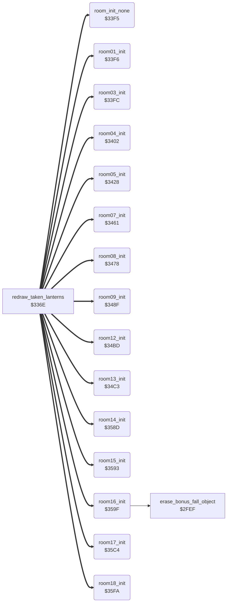

<!-- Generated by c64-docs from knowledge revision 20261016T170255.379-vv114c and src/source-map.json. Do not edit: change the knowledge, generate the source again, then run generate.ts. -->
# room_init.asm: Per-room init handlers (rooms 0-18), run when a room is drawn

Range `$33F5-$3641`. Source: [room_init.asm](../../../src/room_init.asm). Index: [the reference](../index.md).

## Call graph

A solid arrow is a call, a thick arrow a table entry, a dotted arrow a jump. Rounded nodes are in this file.

## Names

### [`room_init_none`](../../../src/room_init.asm#L6) `$33F5`

*routine*

Room init handler for rooms 0, 2, 6, 10 and 11: nothing to do.

- **Jumped to from:** [`redraw_taken_lanterns`](lanterns.md#redraw_taken_lanterns) [`$33C9`](../../../src/lanterns.asm#L124)
- **Entry of:** [`room_setup_handlers`](../tables.md#room_setup_handlers)

### [`room01_init`](../../../src/room_init.asm#L9) `$33F6`

*routine*

Room 1 init: room_script_vars = 3 (steps of the passage animation).

- **Jumped to from:** [`redraw_taken_lanterns`](lanterns.md#redraw_taken_lanterns) [`$33C9`](../../../src/lanterns.asm#L124)
- **Entry of:** [`room_setup_handlers`](../tables.md#room_setup_handlers)
- **Writes:** [`room_script_vars`](room_tables.md#room_script_vars)

### [`room03_init`](../../../src/room_init.asm#L14) `$33FC`

*routine*

Room 3 init: room_script_vars = 3 (steps of the passage animation).

- **Jumped to from:** [`redraw_taken_lanterns`](lanterns.md#redraw_taken_lanterns) [`$33C9`](../../../src/lanterns.asm#L124)
- **Entry of:** [`room_setup_handlers`](../tables.md#room_setup_handlers)
- **Writes:** [`room_script_vars`](room_tables.md#room_script_vars)

### [`room04_init`](../../../src/room_init.asm#L19) `$3402`

*routine*

Room 4 init: room_script_vars+3 = $1F and the three moving hazards at (row,col) (11,1), (7,11), (7,26) with timers $FF/$FF/$F4.

- **Jumped to from:** [`redraw_taken_lanterns`](lanterns.md#redraw_taken_lanterns) [`$33C9`](../../../src/lanterns.asm#L124)
- **Entry of:** [`room_setup_handlers`](../tables.md#room_setup_handlers)
- **Writes:** [`room_script_vars+3`](room_tables.md#room_script_vars), [`hazard_col`](../variables.md#hazard_col), [`hazard_row`](../variables.md#hazard_row), [`hazard_col+1`](../variables.md#hazard_col), [`hazard_row+1`](../variables.md#hazard_row), [`hazard_row+2`](../variables.md#hazard_row), [`hazard_col+2`](../variables.md#hazard_col), [`hazard_timer`](../variables.md#hazard_timer), [`hazard_timer+1`](../variables.md#hazard_timer), [`hazard_timer+2`](../variables.md#hazard_timer)
- **Refers to:** [`room_script_vars`](room_tables.md#room_script_vars), [`hazard_col`](../variables.md#hazard_col), [`hazard_row`](../variables.md#hazard_row), [`hazard_timer`](../variables.md#hazard_timer)

### [`room05_init`](../../../src/room_init.asm#L40) `$3428`

*routine*

Room 5 init: hangs unless $02 = $32 (protection remnant), colours 2x3 cells $FC, sets hazards at (9,27), (10,27), (5,1) with timers $FF/$FC/$F8.
protection remnant: loops forever unless $02 = $32

- **Jumped to from:** [`redraw_taken_lanterns`](lanterns.md#redraw_taken_lanterns) [`$33C9`](../../../src/lanterns.asm#L124)
- **Entry of:** [`room_setup_handlers`](../tables.md#room_setup_handlers)
- **Writes:** [`ld89a+1`](../variables.md#ld89a), [`ld89a+2`](../variables.md#ld89a), [`ld8ae+21`](../variables.md#ld8ae), [`ld8ae+22`](../variables.md#ld8ae), [`hazard_col`](../variables.md#hazard_col), [`hazard_col+1`](../variables.md#hazard_col), [`hazard_col+2`](../variables.md#hazard_col), [`hazard_row`](../variables.md#hazard_row), [`hazard_row+1`](../variables.md#hazard_row), [`hazard_row+2`](../variables.md#hazard_row), [`hazard_timer`](../variables.md#hazard_timer), [`hazard_timer+1`](../variables.md#hazard_timer), [`hazard_timer+2`](../variables.md#hazard_timer)
- **Refers to:** [`hazard_col`](../variables.md#hazard_col), [`hazard_row`](../variables.md#hazard_row), [`hazard_timer`](../variables.md#hazard_timer)

### [`room07_init`](../../../src/room_init.asm#L72) `$3461`

*routine*

Room 7 init: slider at row 11 starting at column 5, hazard 0 at (4,$22) with timer $FF.

- **Jumped to from:** [`redraw_taken_lanterns`](lanterns.md#redraw_taken_lanterns) [`$33C9`](../../../src/lanterns.asm#L124)
- **Entry of:** [`room_setup_handlers`](../tables.md#room_setup_handlers)
- **Writes:** [`slider_col`](../variables.md#slider_col), [`slider_prev_col`](../variables.md#slider_prev_col), [`slider_row`](../variables.md#slider_row), [`hazard_col`](../variables.md#hazard_col), [`hazard_row`](../variables.md#hazard_row), [`hazard_timer`](../variables.md#hazard_timer)

### [`room08_init`](../../../src/room_init.asm#L86) `$3478`

*routine*

Room 8 init: hazards 0 and 1 at (5,6) and (5,$1B) with timers $FF/$F2.

- **Jumped to from:** [`redraw_taken_lanterns`](lanterns.md#redraw_taken_lanterns) [`$33C9`](../../../src/lanterns.asm#L124)
- **Entry of:** [`room_setup_handlers`](../tables.md#room_setup_handlers)
- **Writes:** [`hazard_col`](../variables.md#hazard_col), [`hazard_col+1`](../variables.md#hazard_col), [`hazard_row`](../variables.md#hazard_row), [`hazard_row+1`](../variables.md#hazard_row), [`hazard_timer`](../variables.md#hazard_timer), [`hazard_timer+1`](../variables.md#hazard_timer)
- **Refers to:** [`hazard_col`](../variables.md#hazard_col), [`hazard_row`](../variables.md#hazard_row), [`hazard_timer`](../variables.md#hazard_timer)

### [`room09_init`](../../../src/room_init.asm#L100) `$348F`

*routine*

Room 9 init: colours 2x4 cells $FA, slider at row 12 starting at column 4, hazards 0 and 1 at (5,$10) and (6,$10) with timers $FC/$FF.

- **Jumped to from:** [`redraw_taken_lanterns`](lanterns.md#redraw_taken_lanterns) [`$33C9`](../../../src/lanterns.asm#L124)
- **Entry of:** [`room_setup_handlers`](../tables.md#room_setup_handlers)
- **Writes:** [`ld89a+3`](../variables.md#ld89a), [`ld89a+4`](../variables.md#ld89a), [`ld8ae+23`](../variables.md#ld8ae), [`ld8ae+24`](../variables.md#ld8ae), [`slider_col`](../variables.md#slider_col), [`slider_prev_col`](../variables.md#slider_prev_col), [`slider_row`](../variables.md#slider_row), [`hazard_col`](../variables.md#hazard_col), [`hazard_col+1`](../variables.md#hazard_col), [`hazard_row`](../variables.md#hazard_row), [`hazard_row+1`](../variables.md#hazard_row), [`hazard_timer`](../variables.md#hazard_timer), [`hazard_timer+1`](../variables.md#hazard_timer)
- **Refers to:** [`hazard_col`](../variables.md#hazard_col), [`hazard_row`](../variables.md#hazard_row), [`hazard_timer`](../variables.md#hazard_timer)

### [`room12_init`](../../../src/room_init.asm#L126) `$34BD`

*routine*

Room 12 init: room_script_vars = 1.

- **Jumped to from:** [`redraw_taken_lanterns`](lanterns.md#redraw_taken_lanterns) [`$33C9`](../../../src/lanterns.asm#L124)
- **Entry of:** [`room_setup_handlers`](../tables.md#room_setup_handlers)
- **Writes:** [`room_script_vars`](room_tables.md#room_script_vars)

### [`room13_init`](../../../src/room_init.asm#L131) `$34C3`

*routine*

Room 13 init: fills the slider table $010F-$014A for 8 sliders on text rows 5, 7, 10 and 12 (slots 0-2 and 4 move left, 5-8 right, 3 and 9 off). A non-zero game_cycle gives other start columns and wider ranges.

- **Jumped to from:** [`redraw_taken_lanterns`](lanterns.md#redraw_taken_lanterns) [`$33C9`](../../../src/lanterns.asm#L124)
- **Entry of:** [`room_setup_handlers`](../tables.md#room_setup_handlers)
- **Reads:** [`game_cycle`](../variables.md#game_cycle)
- **Writes:** [`sliders_dir+3`](../variables.md#sliders_dir), [`sliders_dir+4`](../variables.md#sliders_dir), [`sliders_dir+8`](../variables.md#sliders_dir), [`sliders_dir+9`](../variables.md#sliders_dir), [`sliders_min_col+1`](../variables.md#sliders_min_col), [`sliders_col+5`](../variables.md#sliders_col), [`sliders_prev_col+5`](../variables.md#sliders_prev_col), [`sliders_min_col+5`](../variables.md#sliders_min_col), [`sliders_min_col+6`](../variables.md#sliders_min_col), [`sliders_col+2`](../variables.md#sliders_col), [`sliders_prev_col+2`](../variables.md#sliders_prev_col), [`sliders_min_col+2`](../variables.md#sliders_min_col), [`sliders_min_col+4`](../variables.md#sliders_min_col), [`sliders_col+7`](../variables.md#sliders_col), [`sliders_prev_col+7`](../variables.md#sliders_prev_col), [`sliders_min_col+7`](../variables.md#sliders_min_col), [`sliders_min_col`](../variables.md#sliders_min_col), [`sliders_max_col+7`](../variables.md#sliders_max_col), [`sliders_col+1`](../variables.md#sliders_col), [`sliders_prev_col+1`](../variables.md#sliders_prev_col), [`sliders_max_col+1`](../variables.md#sliders_max_col), [`sliders_col+6`](../variables.md#sliders_col), [`sliders_prev_col+6`](../variables.md#sliders_prev_col), [`sliders_col+4`](../variables.md#sliders_col), [`sliders_prev_col+4`](../variables.md#sliders_prev_col), [`sliders_col+8`](../variables.md#sliders_col), [`sliders_prev_col+8`](../variables.md#sliders_prev_col), [`sliders_min_col+8`](../variables.md#sliders_min_col), [`sliders_col`](../variables.md#sliders_col), [`sliders_prev_col`](../variables.md#sliders_prev_col), [`sliders_max_col`](../variables.md#sliders_max_col), [`sliders_max_col+2`](../variables.md#sliders_max_col), [`sliders_max_col+4`](../variables.md#sliders_max_col), [`sliders_max_col+5`](../variables.md#sliders_max_col), [`sliders_max_col+6`](../variables.md#sliders_max_col), [`sliders_max_col+8`](../variables.md#sliders_max_col), [`sliders_row+5`](../variables.md#sliders_row), [`sliders_row+6`](../variables.md#sliders_row), [`sliders_row`](../variables.md#sliders_row), [`sliders_row+7`](../variables.md#sliders_row) and 4 more
- **Refers to:** [`sliders_dir`](../variables.md#sliders_dir), [`sliders_min_col`](../variables.md#sliders_min_col), [`sliders_col`](../variables.md#sliders_col), [`sliders_prev_col`](../variables.md#sliders_prev_col), [`sliders_max_col`](../variables.md#sliders_max_col), [`sliders_row`](../variables.md#sliders_row)

### [`room13_init_dir_loop`](../../../src/room_init.asm#L133) `$34C5`

*label*

- **Jumped to from:** [`room13_init`](room_init.md#room13_init) [`$34D0`](../../../src/room_init.asm#L139)

### [`room14_init`](../../../src/room_init.asm#L221) `$358D`

*routine*

Room 14 init: room_script_vars = 1.

- **Jumped to from:** [`redraw_taken_lanterns`](lanterns.md#redraw_taken_lanterns) [`$33C9`](../../../src/lanterns.asm#L124)
- **Entry of:** [`room_setup_handlers`](../tables.md#room_setup_handlers)
- **Writes:** [`room_script_vars`](room_tables.md#room_script_vars)

### [`room15_init`](../../../src/room_init.asm#L226) `$3593`

*routine*

Room 15 init: room_script_vars, +1, +2 = 1.

- **Jumped to from:** [`redraw_taken_lanterns`](lanterns.md#redraw_taken_lanterns) [`$33C9`](../../../src/lanterns.asm#L124)
- **Entry of:** [`room_setup_handlers`](../tables.md#room_setup_handlers)
- **Writes:** [`room_script_vars`](room_tables.md#room_script_vars), [`room_script_vars+1`](room_tables.md#room_script_vars), [`room_script_vars+2`](room_tables.md#room_script_vars)
- **Refers to:** [`room_script_vars`](room_tables.md#room_script_vars)

### [`room16_init`](../../../src/room_init.asm#L233) `$359F`

*routine*

Room 16 init: sets 8 colour RAM cells to $FF and erases the bonus-fall object when the current player has no bonus_falls_left.

- **Jumped to from:** [`redraw_taken_lanterns`](lanterns.md#redraw_taken_lanterns) [`$33C9`](../../../src/lanterns.asm#L124)
- **Entry of:** [`room_setup_handlers`](../tables.md#room_setup_handlers)
- **Calls:** [`erase_bonus_fall_object`](background_touch.md#erase_bonus_fall_object)
- **Reads:** [`current_player`](../variables.md#current_player), [`contact_group_hits+4`](actor_vars.md#contact_group_hits)
- **Writes:** [`ldb1c`](../variables.md#ldb1c), [`ldb1c+1`](../variables.md#ldb1c), [`ldb44`](../variables.md#ldb44), [`ldb44+1`](../variables.md#ldb44), [`ldb44+40`](../variables.md#ldb44), [`ldb44+41`](../variables.md#ldb44), [`ldb94`](../variables.md#ldb94), [`ldb94+1`](../variables.md#ldb94)

### [`room16_init_done`](../../../src/room_init.asm#L248) `$35C3`

*label*

- **Jumped to from:** [`room16_init`](room_init.md#room16_init) [`$35BE`](../../../src/room_init.asm#L245)

### [`room17_init`](../../../src/room_init.asm#L251) `$35C4`

*routine*

Room 17 init: colour cell $DB1E = $FF, room_script_vars/+1 = 1, slider at row 5 column $0B, hazards at (3,8), (7,8), (9,8) with timers $F8/$F1/$EA.

- **Jumped to from:** [`redraw_taken_lanterns`](lanterns.md#redraw_taken_lanterns) [`$33C9`](../../../src/lanterns.asm#L124)
- **Entry of:** [`room_setup_handlers`](../tables.md#room_setup_handlers)
- **Writes:** [`ldb1e`](../variables.md#ldb1e), [`room_script_vars`](room_tables.md#room_script_vars), [`room_script_vars+1`](room_tables.md#room_script_vars), [`hazard_col`](../variables.md#hazard_col), [`hazard_col+1`](../variables.md#hazard_col), [`hazard_col+2`](../variables.md#hazard_col), [`hazard_row`](../variables.md#hazard_row), [`slider_row`](../variables.md#slider_row), [`hazard_row+1`](../variables.md#hazard_row), [`hazard_row+2`](../variables.md#hazard_row), [`slider_col`](../variables.md#slider_col), [`hazard_timer`](../variables.md#hazard_timer), [`hazard_timer+1`](../variables.md#hazard_timer), [`hazard_timer+2`](../variables.md#hazard_timer)
- **Refers to:** [`room_script_vars`](room_tables.md#room_script_vars), [`hazard_col`](../variables.md#hazard_col), [`hazard_row`](../variables.md#hazard_row), [`hazard_timer`](../variables.md#hazard_timer)

### [`room18_init`](../../../src/room_init.asm#L279) `$35FA`

*routine*

Room 18 init: fills colour RAM $D878-$DBFF with $FE, clears sprite data $8340-$83BF, no Y expand, X expand for all sprites, room_script_vars/+1 = 1 and sets $432E-$4337.

- **Jumped to from:** [`redraw_taken_lanterns`](lanterns.md#redraw_taken_lanterns) [`$33C9`](../../../src/lanterns.asm#L124)
- **Entry of:** [`room_setup_handlers`](../tables.md#room_setup_handlers)
- **Writes:** [`ld828+80`](../variables.md#ld828), [`ld828+81`](../variables.md#ld828), [`ld900`](../variables.md#ld900), [`ld900+1`](../variables.md#ld900), [`lda00`](../variables.md#lda00), [`lda00+1`](../variables.md#lda00), [`ldb00`](../variables.md#ldb00), [`ldb00+1`](../variables.md#ldb00), [`sprite_blocks+574`](vic_bank2.md#sprite_blocks), [`sprite_blocks+575`](vic_bank2.md#sprite_blocks), [`YXPAND`](../variables.md#YXPAND), [`XXPAND`](../variables.md#XXPAND), [`room_script_vars`](room_tables.md#room_script_vars), [`room_script_vars+1`](room_tables.md#room_script_vars), [`fireball_active`](variables.md#fireball_active), [`fireball_active+1`](variables.md#fireball_active), [`fireball_launch_delay`](variables.md#fireball_launch_delay), [`fireball_launch_delay+1`](variables.md#fireball_launch_delay), [`room18_unused_init_bytes`](variables.md#room18_unused_init_bytes), [`room18_unused_init_bytes+1`](variables.md#room18_unused_init_bytes)
- **Refers to:** [`sprite_blocks`](vic_bank2.md#sprite_blocks), [`room_script_vars`](room_tables.md#room_script_vars), [`fireball_active`](variables.md#fireball_active), [`fireball_launch_delay`](variables.md#fireball_launch_delay), [`fireball_y`](variables.md#fireball_y)

### [`room18_fill_colour_loop`](../../../src/room_init.asm#L282) `$35FE`

*label*

- **Jumped to from:** [`room18_init`](room_init.md#room18_init) [`$360B`](../../../src/room_init.asm#L288)

### [`room18_clear_fireball_blocks_loop`](../../../src/room_init.asm#L291) `$3611`

*label*

- **Jumped to from:** [`room18_init`](room_init.md#room18_init) [`$3615`](../../../src/room_init.asm#L294)
