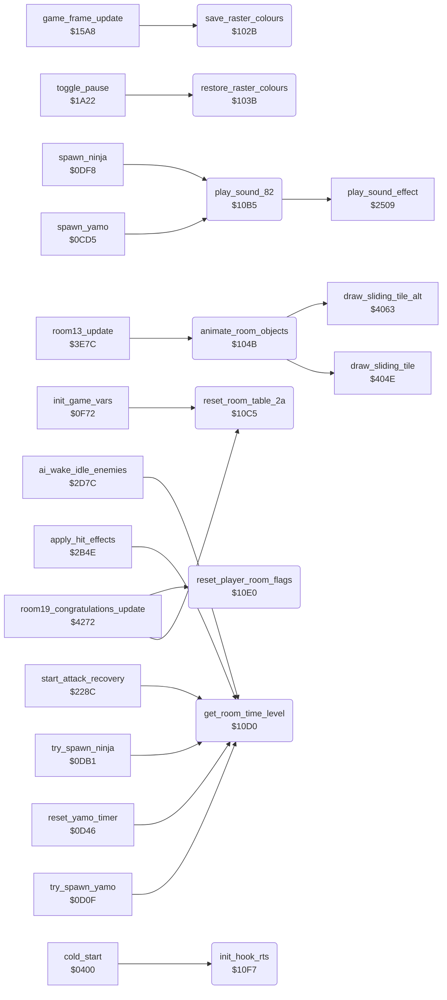

<!-- Generated by c64-docs from knowledge revision 20261016T170255.379-vv114c and src/source-map.json. Do not edit: change the knowledge, generate the source again, then run generate.ts. -->
# room_state.asm: Room object state swap, colour save/restore, cycling objects, small game helpers

Range `$102B-$1102`. Source: [room_state.asm](../../../src/room_state.asm). Index: [the reference](../index.md).

## Call graph

A solid arrow is a call, a thick arrow a table entry, a dotted arrow a jump. Rounded nodes are in this file.

## Data

| Range | Type | Name | Read by | Written by |
|---|---|---|---|---|
| [`$10F8`](../../../src/room_state.asm#L142)-`$1102` | bytes |  |  |  |

## Names

### [`save_raster_colours`](../../../src/room_state.asm#L6) `$102B`

*routine*

Copies the 20 raster colours at $0153 to $47B4 and sets idle_timer to $FE (screen saver on). Called when the idle auto-pause starts.

- **Called from:** [`game_frame_update`](frame_update.md#game_frame_update) [`$163C`](../../../src/frame_update.asm#L88)
- **Reads:** [`raster_colours+18`](../variables.md#raster_colours), [`raster_colours+19`](../variables.md#raster_colours)
- **Writes:** [`saved_band_colours+18`](room_colours.md#saved_band_colours), [`saved_band_colours+19`](room_colours.md#saved_band_colours), [`idle_timer`](../variables.md#idle_timer)

### [`restore_raster_colours`](../../../src/room_state.asm#L18) `$103B`

*routine*

Copies the saved raster colours at $47B4 back to $0153 and clears idle_timer (screen saver off).

- **Called from:** [`toggle_pause`](status.md#toggle_pause) [`$1A35`](../../../src/status.asm#L87)
- **Reads:** [`saved_band_colours+18`](room_colours.md#saved_band_colours), [`saved_band_colours+19`](room_colours.md#saved_band_colours)
- **Writes:** [`raster_colours+18`](../variables.md#raster_colours), [`raster_colours+19`](../variables.md#raster_colours), [`idle_timer`](../variables.md#idle_timer)

### [`animate_room_objects`](../../../src/room_state.asm#L29) `$104B`

*routine*

For each of 9 cycling-object slots with sliders_dir,X non-zero: moves sliders_col,X left (bit 7 clear) or right (bit 7 set), wrapping between sliders_min_col,X and sliders_max_col,X, then redraws it at text row sliders_row,X with draw_sliding_tile, or draw_sliding_tile_alt on rows 5 and 10.

- **Called from:** [`room13_update`](room_update.md#room13_update) [`$3EC0`](../../../src/room_update.asm#L1155)
- **Calls:** [`draw_sliding_tile`](room_tiles.md#draw_sliding_tile), [`draw_sliding_tile_alt`](room_tiles.md#draw_sliding_tile_alt)
- **Reads:** [`sliders_dir+8`](../variables.md#sliders_dir), [`sliders_col+8`](../variables.md#sliders_col), [`sliders_row+8`](../variables.md#sliders_row), [`sliders_min_col+8`](../variables.md#sliders_min_col), [`sliders_max_col+8`](../variables.md#sliders_max_col), [`slider_row`](../variables.md#slider_row)
- **Writes:** [`sliders_prev_col+8`](../variables.md#sliders_prev_col), [`slider_prev_col`](../variables.md#slider_prev_col), [`slider_row`](../variables.md#slider_row), [`sliders_col+8`](../variables.md#sliders_col), [`slider_col`](../variables.md#slider_col)
- **Refers to:** [`sliders_col`](../variables.md#sliders_col), [`sliders_max_col`](../variables.md#sliders_max_col), [`sliders_min_col`](../variables.md#sliders_min_col)

### [`sliders_slot_loop`](../../../src/room_state.asm#L32) `$104D`

*label*

Slot X: skipped while sliders_dir,X = 0.

- **Jumped to from:** [`animate_room_objects`](room_state.md#animate_room_objects) [`$10B2`](../../../src/room_state.asm#L83)

### [`slider_left_draw`](../../../src/room_state.asm#L50) `$1077`

*label*

- **Jumped to from:** [`animate_room_objects`](room_state.md#animate_room_objects) [`$106F`](../../../src/room_state.asm#L47)

### [`sliders_draw_alt`](../../../src/room_state.asm#L59) `$1089`

*label*

- **Jumped to from:** [`animate_room_objects`](room_state.md#animate_room_objects) [`$107D`](../../../src/room_state.asm#L54), [`animate_room_objects`](room_state.md#animate_room_objects) [`$1081`](../../../src/room_state.asm#L56), [`animate_room_objects`](room_state.md#animate_room_objects) [`$10A6`](../../../src/room_state.asm#L74), [`animate_room_objects`](room_state.md#animate_room_objects) [`$10AA`](../../../src/room_state.asm#L76)

### [`sliders_move_right`](../../../src/room_state.asm#L63) `$108F`

*label*

Bit 7 set: column + 1; at sliders_max_col wraps to sliders_min_col.

- **Jumped to from:** [`animate_room_objects`](room_state.md#animate_room_objects) [`$1064`](../../../src/room_state.asm#L43)

### [`slider_right_draw`](../../../src/room_state.asm#L70) `$10A0`

*label*

- **Jumped to from:** [`animate_room_objects`](room_state.md#animate_room_objects) [`$1098`](../../../src/room_state.asm#L67)

### [`slider_next`](../../../src/room_state.asm#L78) `$10AF`

*label*

- **Jumped to from:** [`animate_room_objects`](room_state.md#animate_room_objects) [`$1086`](../../../src/room_state.asm#L58), [`animate_room_objects`](room_state.md#animate_room_objects) [`$108C`](../../../src/room_state.asm#L61)

### [`sliders_next_slot`](../../../src/room_state.asm#L81) `$10B1`

*label*

- **Jumped to from:** [`animate_room_objects`](room_state.md#animate_room_objects) [`$1050`](../../../src/room_state.asm#L34)

### [`play_sound_82`](../../../src/room_state.asm#L86) `$10B5`

*routine*

Starts sound effect $82 through $2509. Keeps A, X and Y.

- **Called from:** [`spawn_yamo`](actors.md#spawn_yamo) [`$0CD5`](../../../src/actors.asm#L178), [`spawn_ninja`](actors.md#spawn_ninja) [`$0DF8`](../../../src/actors.asm#L356)
- **Calls:** [`play_sound_effect`](sound_effects.md#play_sound_effect)

### [`reset_room_table_2a`](../../../src/room_state.asm#L101) `$10C5`

*routine*

Copies the 20 default bytes at $4CCE to $2A-$3D (one byte per room).

- **Called from:** [`init_game_vars`](game_vars.md#init_game_vars) [`$0FA1`](../../../src/game_vars.asm#L33), [`room19_congratulations_update`](final_room.md#room19_congratulations_update) [`$428A`](../../../src/final_room.asm#L50)
- **Reads:** [`room_lantern_counts+18`](room_tables.md#room_lantern_counts), [`room_lantern_counts+19`](room_tables.md#room_lantern_counts)
- **Writes:** [`room_lanterns_left+18`](../variables.md#room_lanterns_left), [`room_lanterns_left+19`](../variables.md#room_lanterns_left)

### [`get_room_time_level`](../../../src/room_state.asm#L110) `$10D0`

*routine*

Tests room_timer: returns V=1 (A=$FF) when it is >= $20; otherwise V=0 and C=1 when it is >= $19, C=0 below. The enemy spawn code shortens the delays with it.

- **Called from:** [`try_spawn_yamo`](actors.md#try_spawn_yamo) [`$0D2E`](../../../src/actors.asm#L223), [`reset_yamo_timer`](actors.md#reset_yamo_timer) [`$0D63`](../../../src/actors.asm#L260), [`reset_yamo_timer`](actors.md#reset_yamo_timer) [`$0D8A`](../../../src/actors.asm#L286), [`try_spawn_ninja`](actors.md#try_spawn_ninja) [`$0DC4`](../../../src/actors.asm#L325), [`try_spawn_ninja`](actors.md#try_spawn_ninja) [`$0DE9`](../../../src/actors.asm#L343), [`start_attack_recovery`](object_actions.md#start_attack_recovery) [`$229C`](../../../src/object_actions.asm#L365), [`start_attack_recovery`](object_actions.md#start_attack_recovery) [`$22A6`](../../../src/object_actions.asm#L371), [`apply_hit_effects`](combat_hits.md#apply_hit_effects) [`$2B6B`](../../../src/combat_hits.asm#L243), [`apply_hit_effects`](combat_hits.md#apply_hit_effects) [`$2B83`](../../../src/combat_hits.asm#L258), [`ai_wake_idle_enemies`](actor_checks.md#ai_wake_idle_enemies) [`$2DC7`](../../../src/actor_checks.asm#L76)
- **Reads:** [`room_timer`](../variables.md#room_timer)

### [`rts_for_bit_test`](../../../src/room_state.asm#L120) `$10DF`

*label*

RTS; BIT $10DF at $10DC reads this $60 to set V.

- **Read by:** [`get_room_time_level`](room_state.md#get_room_time_level) [`$10DC`](../../../src/room_state.asm#L119)

### [`reset_player_room_flags`](../../../src/room_state.asm#L123) `$10E0`

*routine*

Sets the 20 bytes $0300+current_player+2*i (i=0..19) to 1, then clears the first one. Only the code at $4290, which no run reached, calls it.

- **Called from:** [`room19_congratulations_update`](final_room.md#room19_congratulations_update) [`$4290`](../../../src/final_room.asm#L52)
- **Reads:** [`current_player`](../variables.md#current_player)
- **Writes:** [`room_entry_bonus_flags+54`](../variables.md#room_entry_bonus_flags), [`l_03aa`](../../../src/casbuf.asm#L25)
- **Refers to:** [`room_entry_bonus_flags`](../variables.md#room_entry_bonus_flags)

### [`init_hook_rts`](../../../src/room_state.asm#L139) `$10F7`

*routine*

Single RTS. The init code calls it at $04F3 after the graphics are built.

- **Called from:** [`cold_start`](init.md#cold_start) [`$04F3`](../../../src/init.asm#L132)
