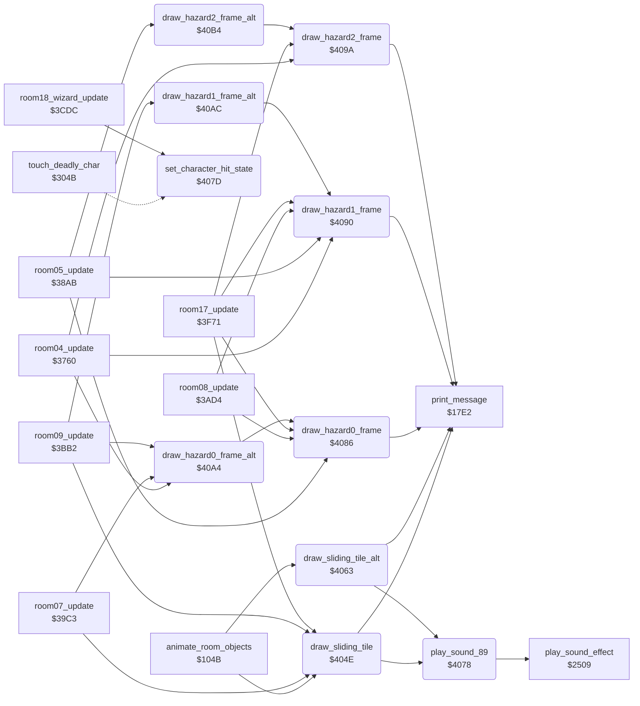

<!-- Generated by c64-docs from knowledge revision 20261016T170255.379-vv114c and src/source-map.json. Do not edit: change the knowledge, generate the source again, then run generate.ts. -->
# room_tiles.asm: Sliding tiles and travelling hazard drawing helpers

Range `$404E-$40BB`. Source: [room_tiles.asm](../../../src/room_tiles.asm). Index: [the reference](../index.md).

## Call graph

A solid arrow is a call, a thick arrow a table entry, a dotted arrow a jump. Rounded nodes are in this file.

## Data

| Range | Type | Name | Read by | Written by |
|---|---|---|---|---|
| [`$40AA`](../../../src/room_tiles.asm#L65)-`$40AB` | unused |  |  |  |
| [`$40B2`](../../../src/room_tiles.asm#L72)-`$40B3` | unused |  |  |  |
| [`$40BA`](../../../src/room_tiles.asm#L79)-`$40BB` | unused |  |  |  |

## Names

### [`draw_sliding_tile`](../../../src/room_tiles.asm#L6) `$404E`

*routine*

Plays sound $89 and redraws a sliding one-tile object on text row $6f: message 28 at the previous column $70 and message 27 at the new column $6e.

- **Called from:** [`animate_room_objects`](room_state.md#animate_room_objects) [`$1083`](../../../src/room_state.asm#L57), [`animate_room_objects`](room_state.md#animate_room_objects) [`$10AC`](../../../src/room_state.asm#L77), [`room07_update`](room_update.md#room07_update) [`$3A4E`](../../../src/room_update.asm#L546), [`room07_update`](room_update.md#room07_update) [`$3A5F`](../../../src/room_update.asm#L557), [`room09_update`](room_update.md#room09_update) [`$3C2C`](../../../src/room_update.asm#L809), [`room17_update`](room_update.md#room17_update) [`$3FA6`](../../../src/room_update.asm#L1272)
- **Calls:** [`play_sound_89`](room_tiles.md#play_sound_89), [`print_message`](text.md#print_message)
- **Reads:** [`slider_row`](../variables.md#slider_row), [`slider_prev_col`](../variables.md#slider_prev_col)

### [`draw_sliding_tile_alt`](../../../src/room_tiles.asm#L17) `$4063`

*routine*

Same as draw_sliding_tile with messages 85 (previous column $70) and 84 (new column $6e); used on text rows 5 and 10.

- **Called from:** [`animate_room_objects`](room_state.md#animate_room_objects) [`$1089`](../../../src/room_state.asm#L60)
- **Calls:** [`play_sound_89`](room_tiles.md#play_sound_89), [`print_message`](text.md#print_message)
- **Reads:** [`slider_row`](../variables.md#slider_row), [`slider_prev_col`](../variables.md#slider_prev_col)

### [`play_sound_89`](../../../src/room_tiles.asm#L28) `$4078`

*routine*

Starts sound effect $89 ($2509).

- **Called from:** [`draw_sliding_tile`](room_tiles.md#draw_sliding_tile) [`$404E`](../../../src/room_tiles.asm#L7), [`draw_sliding_tile_alt`](room_tiles.md#draw_sliding_tile_alt) [`$4063`](../../../src/room_tiles.asm#L18)
- **Calls:** [`play_sound_effect`](sound_effects.md#play_sound_effect)

### [`set_character_hit_state`](../../../src/room_tiles.asm#L32) `$407D`

*routine*

Sets actor X to state $19 (dying) with timer $10. Used by touch_deadly_char and by the room 18 fireball collision.

- **Called from:** [`room18_wizard_update`](room_update.md#room18_wizard_update) [`$3D35`](../../../src/room_update.asm#L953)
- **Jumped to from:** [`touch_deadly_char`](background_touch.md#touch_deadly_char) [`$3068`](../../../src/background_touch.asm#L339)

### [`draw_hazard0_frame`](../../../src/room_tiles.asm#L39) `$4086`

*routine*

Prints travelling hazard 0 frame A (message $1f+A) at row $74, column $71.

- **Called from:** [`room05_update`](room_update.md#room05_update) [`$3923`](../../../src/room_update.asm#L385), [`room05_update`](room_update.md#room05_update) [`$3931`](../../../src/room_update.asm#L393), [`room08_update`](room_update.md#room08_update) [`$3B5F`](../../../src/room_update.asm#L698), [`room08_update`](room_update.md#room08_update) [`$3B6D`](../../../src/room_update.asm#L706), [`room17_update`](room_update.md#room17_update) [`$3FF0`](../../../src/room_update.asm#L1310), [`room17_update`](room_update.md#room17_update) [`$401C`](../../../src/room_update.asm#L1336), [`draw_hazard0_frame_alt`](room_tiles.md#draw_hazard0_frame_alt) [`$40A7`](../../../src/room_tiles.asm#L63)
- **Calls:** [`print_message`](text.md#print_message)
- **Reads:** [`hazard_row`](../variables.md#hazard_row), [`hazard_col`](../variables.md#hazard_col)

### [`draw_hazard1_frame`](../../../src/room_tiles.asm#L46) `$4090`

*routine*

Prints travelling hazard 1 frame A (message $1f+A) at row $75, column $72.

- **Called from:** [`room04_update`](room_update.md#room04_update) [`$3853`](../../../src/room_update.asm#L275), [`room04_update`](room_update.md#room04_update) [`$3861`](../../../src/room_update.asm#L283), [`room05_update`](room_update.md#room05_update) [`$3957`](../../../src/room_update.asm#L415), [`room05_update`](room_update.md#room05_update) [`$3965`](../../../src/room_update.asm#L423), [`room08_update`](room_update.md#room08_update) [`$3B8E`](../../../src/room_update.asm#L726), [`room08_update`](room_update.md#room08_update) [`$3B9C`](../../../src/room_update.asm#L734), [`room17_update`](room_update.md#room17_update) [`$3FFA`](../../../src/room_update.asm#L1316), [`room17_update`](room_update.md#room17_update) [`$4026`](../../../src/room_update.asm#L1342), [`draw_hazard1_frame_alt`](room_tiles.md#draw_hazard1_frame_alt) [`$40AF`](../../../src/room_tiles.asm#L70)
- **Calls:** [`print_message`](text.md#print_message)
- **Reads:** [`hazard_row+1`](../variables.md#hazard_row), [`hazard_col+1`](../variables.md#hazard_col)
- **Refers to:** [`hazard_row`](../variables.md#hazard_row), [`hazard_col`](../variables.md#hazard_col)

### [`draw_hazard2_frame`](../../../src/room_tiles.asm#L53) `$409A`

*routine*

Prints travelling hazard 2 frame A (message $1f+A) at row $76, column $73.

- **Called from:** [`room04_update`](room_update.md#room04_update) [`$3887`](../../../src/room_update.asm#L305), [`room04_update`](room_update.md#room04_update) [`$3895`](../../../src/room_update.asm#L313), [`room17_update`](room_update.md#room17_update) [`$4000`](../../../src/room_update.asm#L1319), [`room17_update`](room_update.md#room17_update) [`$402C`](../../../src/room_update.asm#L1345), [`draw_hazard2_frame_alt`](room_tiles.md#draw_hazard2_frame_alt) [`$40B7`](../../../src/room_tiles.asm#L77)
- **Calls:** [`print_message`](text.md#print_message)
- **Reads:** [`hazard_row+2`](../variables.md#hazard_row), [`hazard_col+2`](../variables.md#hazard_col)
- **Refers to:** [`hazard_row`](../variables.md#hazard_row), [`hazard_col`](../variables.md#hazard_col)

### [`draw_hazard0_frame_alt`](../../../src/room_tiles.asm#L60) `$40A4`

*routine*

Hazard 0 with the alternate frame set (message $26+A).

- **Called from:** [`room04_update`](room_update.md#room04_update) [`$381F`](../../../src/room_update.asm#L245), [`room04_update`](room_update.md#room04_update) [`$382D`](../../../src/room_update.asm#L253), [`room07_update`](room_update.md#room07_update) [`$3A17`](../../../src/room_update.asm#L515), [`room07_update`](room_update.md#room07_update) [`$3A25`](../../../src/room_update.asm#L523), [`room09_update`](room_update.md#room09_update) [`$3C3D`](../../../src/room_update.asm#L818), [`room09_update`](room_update.md#room09_update) [`$3C4B`](../../../src/room_update.asm#L826)
- **Calls:** [`draw_hazard0_frame`](room_tiles.md#draw_hazard0_frame)

### [`draw_hazard1_frame_alt`](../../../src/room_tiles.asm#L67) `$40AC`

*routine*

Hazard 1 with the alternate frame set (message $26+A).

- **Called from:** [`room09_update`](room_update.md#room09_update) [`$3C6C`](../../../src/room_update.asm#L846), [`room09_update`](room_update.md#room09_update) [`$3C7A`](../../../src/room_update.asm#L854)
- **Calls:** [`draw_hazard1_frame`](room_tiles.md#draw_hazard1_frame)

### [`draw_hazard2_frame_alt`](../../../src/room_tiles.asm#L74) `$40B4`

*routine*

Hazard 2 with the alternate frame set (message $26+A).

- **Called from:** [`room05_update`](room_update.md#room05_update) [`$3986`](../../../src/room_update.asm#L443), [`room05_update`](room_update.md#room05_update) [`$3994`](../../../src/room_update.asm#L451)
- **Calls:** [`draw_hazard2_frame`](room_tiles.md#draw_hazard2_frame)
