<!-- Generated by c64-docs from knowledge revision 20261016T170255.379-vv114c and src/source-map.json. Do not edit: change the knowledge, generate the source again, then run generate.ts. -->
# room_update.asm: Per-room frame handlers and passage drawing helpers

Range `$3642-$404D`. Source: [room_update.asm](../../../src/room_update.asm). Index: [the reference](../index.md).

## Call graph

A solid arrow is a call, a thick arrow a table entry, a dotted arrow a jump. Rounded nodes are in this file.

The graph shows 60 of the 126 edges: the calls only.

```mermaid
flowchart LR
  n0584["title_screen<br/>$0584"]
  n09bc["draw_room<br/>$09BC"]
  n1007["swap_room_object_bytes<br/>$1007"]
  n17e2["print_message<br/>$17E2"]
  n1bc2["main_loop<br/>$1BC2"]
  n2509["play_sound_effect<br/>$2509"]
  n2c70["animate_scrolling_chars<br/>$2C70"]
  n3175["add_score<br/>$3175"]
  n3228["animate_floor_traps<br/>$3228"]
  n33da["reset_room_lanterns<br/>$33DA"]
  n3642("room00_update<br/>$3642")
  n3679("room01_update<br/>$3679")
  n36a6("room02_update<br/>$36A6")
  n3702("room03_update<br/>$3702")
  n3760("room04_update<br/>$3760")
  n38ab("room05_update<br/>$38AB")
  n39aa("room06_update<br/>$39AA")
  n39c3("room07_update<br/>$39C3")
  n3a63("next_lantern_entry<br/>$3A63")
  n3a6f("run_room_update<br/>$3A6F")
  n3a7c("advance_ptr_0a_by_4<br/>$3A7C")
  n3a8a("open_wall_column<br/>$3A8A")
  n3aa0("open_wall_column_17<br/>$3AA0")
  n3aaa("open_wall_column_2d<br/>$3AAA")
  n3ab4("draw_column_63_64<br/>$3AB4")
  n3aca("draw_tile_down<br/>$3ACA")
  n3ad4("room08_update<br/>$3AD4")
  n3bb2("room09_update<br/>$3BB2")
  n3c90("room10_update<br/>$3C90")
  n3cc0("room11_update<br/>$3CC0")
  n3cdc("room18_wizard_update<br/>$3CDC")
  n3d81("draw_wizard_face_row3<br/>$3D81")
  n3d8e("draw_wizard_face_row4<br/>$3D8E")
  n3daf("room18_defeat_effect<br/>$3DAF")
  n3e4c("room12_update<br/>$3E4C")
  n3e7c("room13_update<br/>$3E7C")
  n3ecc("room14_update<br/>$3ECC")
  n3ee6("room15_update<br/>$3EE6")
  n3f5b("room16_update<br/>$3F5B")
  n3f71("room17_update<br/>$3F71")
  n402f("l_402f<br/>$402F")
  n4049("next_travelling_hazard<br/>$4049")
  n404e["draw_sliding_tile<br/>$404E"]
  n407d["set_character_hit_state<br/>$407D"]
  n4086["draw_hazard0_frame<br/>$4086"]
  n4090["draw_hazard1_frame<br/>$4090"]
  n409a["draw_hazard2_frame<br/>$409A"]
  n40a4["draw_hazard0_frame_alt<br/>$40A4"]
  n40ac["draw_hazard1_frame_alt<br/>$40AC"]
  n40b4["draw_hazard2_frame_alt<br/>$40B4"]
  n4133["update_fireballs<br/>$4133"]
  n423f["clear_fireball_shapes<br/>$423F"]
  n424f["play_sound_8a<br/>$424F"]
  n09bc --> n3a6f
  n1007 --> n3a7c
  n1bc2 --> n3a6f
  n33da --> n3a63
  n3642 --> n17e2
  n3642 --> n2509
  n3679 --> n17e2
  n3679 --> n424f
  n36a6 --> n17e2
  n36a6 --> n2509
  n36a6 --> n424f
  n3702 --> n17e2
  n3702 --> n424f
  n3760 --> n17e2
  n3760 --> n2c70
  n3760 --> n4090
  n3760 --> n409a
  n3760 --> n40a4
  n3760 --> n424f
  n38ab --> n17e2
  n38ab --> n2c70
  n38ab --> n3a8a
  n38ab --> n4086
  n38ab --> n4090
  n38ab --> n40b4
  n39aa --> n2c70
  n39aa --> n3228
  n39aa --> n3aa0
  n39c3 --> n3228
  n39c3 --> n3aa0
  n39c3 --> n404e
  n39c3 --> n40a4
  n3a8a --> n424f
  n3aa0 --> n3a8a
  n3aaa --> n3a8a
  n3ab4 --> n424f
  n3ad4 --> n2c70
  n3ad4 --> n3a8a
  n3ad4 --> n3aaa
  n3ad4 --> n4086
  n3ad4 --> n4090
  n3bb2 --> n2c70
  n3bb2 --> n3a8a
  n3bb2 --> n404e
  n3bb2 --> n40a4
  n3bb2 --> n40ac
  n3bb2 --> n424f
  n3c90 --> n0584
  n3c90 --> n3ab4
  n3cc0 --> n2c70
  n3cc0 --> n3228
  n3cdc --> n17e2
  n3cdc --> n3175
  n3cdc --> n3d81
  n3cdc --> n3d8e
  n3cdc --> n3daf
  n3cdc --> n407d
  n3cdc --> n4133
  n3cdc --> n423f
  n3d81 --> n17e2
```

## Data

| Range | Type | Name | Read by | Written by |
|---|---|---|---|---|
| [`$3A62`](../../../src/room_update.asm#L559) | unused |  |  |  |

## Names

### [`room00_update`](../../../src/room_update.asm#L6) `$3642`

*routine*

Room 0 frame: once room 6 has no lanterns left, animates the bull's mouth at text row 9, column 7 on passes with frame_parity = 0: message $1D (tile $46, mouth closed) with sound $81, one step later message $1E (tile $47, mouth open) for 6 steps. room_script_vars = step countdown, room_script_vars+1 = mouth state.

- **Jumped to from:** [`redraw_taken_lanterns`](lanterns.md#redraw_taken_lanterns) [`$33C9`](../../../src/lanterns.asm#L124)
- **Entry of:** [`room_frame_handlers`](../tables.md#room_frame_handlers)
- **Calls:** [`play_sound_effect`](sound_effects.md#play_sound_effect), [`print_message`](text.md#print_message)
- **Reads:** [`room_lanterns_left+6`](../variables.md#room_lanterns_left), [`frame_parity`](../variables.md#frame_parity), [`room_script_vars`](room_tables.md#room_script_vars), [`room_script_vars+1`](room_tables.md#room_script_vars)
- **Writes:** [`room_script_vars`](room_tables.md#room_script_vars)
- **Refers to:** [`room_lanterns_left`](../variables.md#room_lanterns_left), [`room_script_vars`](room_tables.md#room_script_vars)

### [`room00_bull_mouth_open`](../../../src/room_update.asm#L24) `$3667`

*label*

Mouth state 1: draw message $1E (open), state 0, countdown 5.

- **Jumped to from:** [`room00_update`](room_update.md#room00_update) [`$3652`](../../../src/room_update.asm#L14)

### [`room01_update`](../../../src/room_update.asm#L35) `$3679`

*routine*

Room 1 frame: when rooms 0, 1 and 2 have no lanterns left and room 6 still has some, opens the floor hatch at text row 12, columns 17-21 in 4 steps on passes with frame_parity = 0: messages $12, $11, $10, $0F (sound $8A at the first). The last step leaves exit tiles 3 (to room 5). room_script_vars = steps left (init 3, $FF = done).

- **Jumped to from:** [`redraw_taken_lanterns`](lanterns.md#redraw_taken_lanterns) [`$33C9`](../../../src/lanterns.asm#L124)
- **Entry of:** [`room_frame_handlers`](../tables.md#room_frame_handlers)
- **Calls:** [`play_sound_8a`](final_room.md#play_sound_8a), [`print_message`](text.md#print_message)
- **Reads:** [`frame_parity`](../variables.md#frame_parity), [`room_script_vars`](room_tables.md#room_script_vars), [`room_lanterns_left+6`](../variables.md#room_lanterns_left), [`room_lanterns_left`](../variables.md#room_lanterns_left), [`room_lanterns_left+1`](../variables.md#room_lanterns_left), [`room_lanterns_left+2`](../variables.md#room_lanterns_left)
- **Writes:** [`room_script_vars`](room_tables.md#room_script_vars)
- **Refers to:** [`room_lanterns_left`](../variables.md#room_lanterns_left)

### [`room01_hatch_draw_step`](../../../src/room_update.asm#L51) `$369B`

*label*

- **Jumped to from:** [`room01_update`](room_update.md#room01_update) [`$3696`](../../../src/room_update.asm#L49)

### [`room02_update`](../../../src/room_update.asm#L60) `$36A6`

*routine*

Room 2 frame: hangs unless DDR $00 = $EF (protection remnant). Once room 6 has no lanterns left: one-shot (room_script_vars+1) sound $8A and messages $1A/$07 at text rows 11/12, column 37, which put exit tile 5 (to room 3) at column 39; then animates the bull's mouth at text row 9, column 33 like room 0 (+2 countdown, +0 mouth state).
protection remnant: loops forever unless DDR $00 = $EF

- **Jumped to from:** [`redraw_taken_lanterns`](lanterns.md#redraw_taken_lanterns) [`$33C9`](../../../src/lanterns.asm#L124)
- **Entry of:** [`room_frame_handlers`](../tables.md#room_frame_handlers)
- **Calls:** [`play_sound_8a`](final_room.md#play_sound_8a), [`play_sound_effect`](sound_effects.md#play_sound_effect), [`print_message`](text.md#print_message)
- **Reads:** [`room_lanterns_left+6`](../variables.md#room_lanterns_left), [`room_script_vars+1`](room_tables.md#room_script_vars), [`frame_parity`](../variables.md#frame_parity), [`room_script_vars+2`](room_tables.md#room_script_vars), [`room_script_vars`](room_tables.md#room_script_vars)
- **Writes:** [`room_script_vars+1`](room_tables.md#room_script_vars), [`room_script_vars+2`](room_tables.md#room_script_vars)
- **Refers to:** [`room_lanterns_left`](../variables.md#room_lanterns_left), [`room_script_vars`](room_tables.md#room_script_vars)

### [`room02_bull_tick`](../../../src/room_update.asm#L79) `$36CF`

*label*

- **Jumped to from:** [`room02_update`](room_update.md#room02_update) [`$36B5`](../../../src/room_update.asm#L68)

### [`room02_bull_mouth_open`](../../../src/room_update.asm#L95) `$36F0`

*label*

Mouth state 1: draw message $1E (open), state 0, countdown 5.

- **Jumped to from:** [`room02_update`](room_update.md#room02_update) [`$36DB`](../../../src/room_update.asm#L85)

### [`room03_update`](../../../src/room_update.asm#L106) `$3702`

*routine*

Room 3 frame: when room 3 has no lanterns left, opens the floor hatch at text row 12, columns 29-33 in 4 steps (messages $12, $11, $10, $0F, sound $8A; exit tiles 3 to room 10). Every 33 passes moves the bridge over the spike pits at text row 6: message 6 (tiles $4B) on one side, message $60 (tiles $09) on the other (columns 9 and 21).

- **Jumped to from:** [`redraw_taken_lanterns`](lanterns.md#redraw_taken_lanterns) [`$33C9`](../../../src/lanterns.asm#L124)
- **Entry of:** [`room_frame_handlers`](../tables.md#room_frame_handlers)
- **Calls:** [`play_sound_8a`](final_room.md#play_sound_8a), [`print_message`](text.md#print_message)
- **Reads:** [`frame_parity`](../variables.md#frame_parity), [`room_script_vars`](room_tables.md#room_script_vars), [`room_lanterns_left+3`](../variables.md#room_lanterns_left), [`room_script_vars+2`](room_tables.md#room_script_vars), [`room_script_vars+1`](room_tables.md#room_script_vars)
- **Writes:** [`room_script_vars`](room_tables.md#room_script_vars), [`room_script_vars+2`](room_tables.md#room_script_vars), [`room_script_vars+1`](room_tables.md#room_script_vars)
- **Refers to:** [`room_lanterns_left`](../variables.md#room_lanterns_left), [`room_script_vars`](room_tables.md#room_script_vars)

### [`room03_hatch_draw_step`](../../../src/room_update.asm#L118) `$371C`

*label*

- **Jumped to from:** [`room03_update`](room_update.md#room03_update) [`$3717`](../../../src/room_update.asm#L116)

### [`room03_bridge_tick`](../../../src/room_update.asm#L125) `$3726`

*label*

room_script_vars+2 counts the passes; below 0 it reloads $20 and the bridge changes side.

- **Jumped to from:** [`room03_update`](room_update.md#room03_update) [`$3704`](../../../src/room_update.asm#L108), [`room03_update`](room_update.md#room03_update) [`$3709`](../../../src/room_update.asm#L110), [`room03_update`](room_update.md#room03_update) [`$370D`](../../../src/room_update.asm#L112)

### [`room03_move_bridge`](../../../src/room_update.asm#L130) `$372C`

*label*

room_script_vars+1 = 1: bridge to the left pit (columns 9-15), side 0.

- **Jumped to from:** [`room03_update`](room_update.md#room03_update) [`$3729`](../../../src/room_update.asm#L127)

### [`room03_bridge_to_right`](../../../src/room_update.asm#L145) `$374B`

*label*

Side 0: bridge to the right pit (columns 21-27), side 1.

- **Jumped to from:** [`room03_update`](room_update.md#room03_update) [`$3734`](../../../src/room_update.asm#L134)

### [`room04_update`](../../../src/room_update.asm#L156) `$3760`

*routine*

Room 4 frame: while lantern 0/1 is present it blinks (64-pass cycle: message $34/$35 lit tile, $36/$37 dark tile); taking lantern 0 blanks text rows 8-9, columns 11-14 and stops hazard 1; taking lantern 1 blanks columns 25-28, stops hazard 2 and restarts the texture upwards; hazard 0 always runs; then animate_scrolling_chars.

- **Jumped to from:** [`redraw_taken_lanterns`](lanterns.md#redraw_taken_lanterns) [`$33C9`](../../../src/lanterns.asm#L124)
- **Entry of:** [`room_frame_handlers`](../tables.md#room_frame_handlers)
- **Calls:** [`print_message`](text.md#print_message), [`play_sound_8a`](final_room.md#play_sound_8a), [`draw_hazard0_frame_alt`](room_tiles.md#draw_hazard0_frame_alt), [`draw_hazard1_frame`](room_tiles.md#draw_hazard1_frame), [`draw_hazard2_frame`](room_tiles.md#draw_hazard2_frame), [`animate_scrolling_chars`](animated_chars.md#animate_scrolling_chars)
- **Reads:** [`lantern_list_room04`](room_tables.md#lantern_list_room04), [`room_script_vars+2`](room_tables.md#room_script_vars), [`room_script_vars`](room_tables.md#room_script_vars), [`lantern_list_room04+4`](room_tables.md#lantern_list_room04), [`room_script_vars+3`](room_tables.md#room_script_vars), [`room_script_vars+1`](room_tables.md#room_script_vars), [`hazard_timer`](../variables.md#hazard_timer), [`hazard_col`](../variables.md#hazard_col), [`hazard_timer+1`](../variables.md#hazard_timer), [`hazard_col+1`](../variables.md#hazard_col), [`hazard_timer+2`](../variables.md#hazard_timer), [`hazard_col+2`](../variables.md#hazard_col)
- **Writes:** [`room_script_vars+2`](room_tables.md#room_script_vars), [`room_script_vars`](room_tables.md#room_script_vars), [`room_script_vars+3`](room_tables.md#room_script_vars), [`room_script_vars+1`](room_tables.md#room_script_vars), [`scroll_direction`](../variables.md#scroll_direction), [`anim_speed_index`](variables.md#anim_speed_index), [`hazard_timer`](../variables.md#hazard_timer), [`hazard_col`](../variables.md#hazard_col), [`hazard_timer+1`](../variables.md#hazard_timer), [`hazard_col+1`](../variables.md#hazard_col), [`hazard_timer+2`](../variables.md#hazard_timer), [`hazard_col+2`](../variables.md#hazard_col)
- **Refers to:** [`room_script_vars`](room_tables.md#room_script_vars), [`lantern_list_room04`](room_tables.md#lantern_list_room04), [`hazard_timer`](../variables.md#hazard_timer), [`hazard_col`](../variables.md#hazard_col)

### [`room04_lantern0_dark_check`](../../../src/room_update.asm#L168) `$377B`

*label*

- **Jumped to from:** [`room04_update`](room_update.md#room04_update) [`$376D`](../../../src/room_update.asm#L162)

### [`room04_check_lantern0_taken`](../../../src/room_update.asm#L177) `$378D`

*label*

- **Jumped to from:** [`room04_update`](room_update.md#room04_update) [`$3763`](../../../src/room_update.asm#L158), [`room04_update`](room_update.md#room04_update) [`$377D`](../../../src/room_update.asm#L170)

### [`room04_blink_lantern1`](../../../src/room_update.asm#L194) `$37B4`

*label*

- **Jumped to from:** [`room04_update`](room_update.md#room04_update) [`$3790`](../../../src/room_update.asm#L179), [`room04_update`](room_update.md#room04_update) [`$3795`](../../../src/room_update.asm#L181)

### [`room04_lantern1_dark_check`](../../../src/room_update.asm#L206) `$37CF`

*label*

- **Jumped to from:** [`room04_update`](room_update.md#room04_update) [`$37C1`](../../../src/room_update.asm#L200)

### [`room04_check_lantern1_taken`](../../../src/room_update.asm#L215) `$37E1`

*label*

- **Jumped to from:** [`room04_update`](room_update.md#room04_update) [`$37B7`](../../../src/room_update.asm#L196), [`room04_update`](room_update.md#room04_update) [`$37D1`](../../../src/room_update.asm#L208)

### [`room04_step_hazard0`](../../../src/room_update.asm#L236) `$3811`

*label*

- **Jumped to from:** [`room04_update`](room_update.md#room04_update) [`$37E4`](../../../src/room_update.asm#L217), [`room04_update`](room_update.md#room04_update) [`$37E9`](../../../src/room_update.asm#L219)

### [`room04_hazard0_advance`](../../../src/room_update.asm#L248) `$3825`

*label*

Phase 3: below the column limit, erase (frame 6), column + 1, phase 2, draw frame 2 at the new column.

- **Jumped to from:** [`room04_update`](room_update.md#room04_update) [`$3819`](../../../src/room_update.asm#L241)

### [`room04_hazard0_restart`](../../../src/room_update.asm#L259) `$3838`

*label*

Phase 7: back to the start column with a negative phase (wait).
wait $A0: 95 passes

- **Jumped to from:** [`room04_update`](room_update.md#room04_update) [`$381D`](../../../src/room_update.asm#L243)

### [`room04_step_hazard1`](../../../src/room_update.asm#L264) `$3840`

*label*

- **Jumped to from:** [`room04_update`](room_update.md#room04_update) [`$3813`](../../../src/room_update.asm#L238), [`room04_update`](room_update.md#room04_update) [`$3822`](../../../src/room_update.asm#L246)

### [`room04_hazard1_advance`](../../../src/room_update.asm#L278) `$3859`

*label*

Phase 3: below the column limit, erase (frame 6), column + 1, phase 2, draw frame 2 at the new column.

- **Jumped to from:** [`room04_update`](room_update.md#room04_update) [`$384D`](../../../src/room_update.asm#L271)

### [`room04_hazard1_restart`](../../../src/room_update.asm#L289) `$386C`

*label*

Phase 7: back to the start column with a negative phase (wait).
wait $E4: 27 passes

- **Jumped to from:** [`room04_update`](room_update.md#room04_update) [`$3851`](../../../src/room_update.asm#L273)

### [`room04_step_hazard2`](../../../src/room_update.asm#L294) `$3874`

*label*

- **Jumped to from:** [`room04_update`](room_update.md#room04_update) [`$3843`](../../../src/room_update.asm#L266), [`room04_update`](room_update.md#room04_update) [`$3847`](../../../src/room_update.asm#L268)

### [`room04_hazard2_advance`](../../../src/room_update.asm#L308) `$388D`

*label*

Phase 3: below the column limit, erase (frame 6), column + 1, phase 2, draw frame 2 at the new column.

- **Jumped to from:** [`room04_update`](room_update.md#room04_update) [`$3881`](../../../src/room_update.asm#L301)

### [`room04_hazard2_restart`](../../../src/room_update.asm#L319) `$38A0`

*label*

Phase 7: back to the start column with a negative phase (wait).
wait $E4: 27 passes

- **Jumped to from:** [`room04_update`](room_update.md#room04_update) [`$3885`](../../../src/room_update.asm#L303)

### [`room05_update`](../../../src/room_update.asm#L327) `$38AB`

*routine*

Room 5 frame: lantern 8 taken opens text rows 10-12 at columns 25 and 26 and stops hazard 1; lantern 6 taken opens column 0 and draws exit tile 2 (to room 4) at text row 11; room 6 empty plus lantern 2 or 4 taken replaces the spikes at text row 2, column 34 with exit tile 5 (to room 1, message $19) and opens text rows 3-5 column 30 and rows 6-8 column 32. Moves hazards 0-2 (1 only while lantern 8 is present), then animate_scrolling_chars.

- **Jumped to from:** [`redraw_taken_lanterns`](lanterns.md#redraw_taken_lanterns) [`$33C9`](../../../src/lanterns.asm#L124)
- **Entry of:** [`room_frame_handlers`](../tables.md#room_frame_handlers)
- **Calls:** [`open_wall_column`](room_update.md#open_wall_column), [`print_message`](text.md#print_message), [`draw_hazard0_frame`](room_tiles.md#draw_hazard0_frame), [`draw_hazard1_frame`](room_tiles.md#draw_hazard1_frame), [`draw_hazard2_frame_alt`](room_tiles.md#draw_hazard2_frame_alt), [`animate_scrolling_chars`](animated_chars.md#animate_scrolling_chars)
- **Reads:** [`lantern_list_room05+32`](room_tables.md#lantern_list_room05), [`room_script_vars+2`](room_tables.md#room_script_vars), [`lantern_list_room05+24`](room_tables.md#lantern_list_room05), [`room_script_vars+3`](room_tables.md#room_script_vars), [`room_lanterns_left+6`](../variables.md#room_lanterns_left), [`lantern_list_room05+8`](room_tables.md#lantern_list_room05), [`lantern_list_room05+16`](room_tables.md#lantern_list_room05), [`room_script_vars+4`](room_tables.md#room_script_vars), [`hazard_timer`](../variables.md#hazard_timer), [`hazard_col`](../variables.md#hazard_col), [`hazard_timer+1`](../variables.md#hazard_timer), [`hazard_col+1`](../variables.md#hazard_col), [`hazard_timer+2`](../variables.md#hazard_timer), [`hazard_col+2`](../variables.md#hazard_col)
- **Writes:** [`room_script_vars+2`](room_tables.md#room_script_vars), [`room_script_vars+3`](room_tables.md#room_script_vars), [`room_script_vars+4`](room_tables.md#room_script_vars), [`hazard_timer`](../variables.md#hazard_timer), [`hazard_col`](../variables.md#hazard_col), [`hazard_timer+1`](../variables.md#hazard_timer), [`hazard_col+1`](../variables.md#hazard_col), [`hazard_timer+2`](../variables.md#hazard_timer), [`hazard_col+2`](../variables.md#hazard_col)
- **Refers to:** [`lantern_list_room05`](room_tables.md#lantern_list_room05), [`room_script_vars`](room_tables.md#room_script_vars), [`room_lanterns_left`](../variables.md#room_lanterns_left), [`hazard_timer`](../variables.md#hazard_timer), [`hazard_col`](../variables.md#hazard_col)

### [`room05_check_lantern6_taken`](../../../src/room_update.asm#L341) `$38CB`

*label*

- **Jumped to from:** [`room05_update`](room_update.md#room05_update) [`$38AE`](../../../src/room_update.asm#L329), [`room05_update`](room_update.md#room05_update) [`$38B3`](../../../src/room_update.asm#L331)

### [`room05_check_top_exit`](../../../src/room_update.asm#L354) `$38E8`

*label*

- **Jumped to from:** [`room05_update`](room_update.md#room05_update) [`$38CE`](../../../src/room_update.asm#L343), [`room05_update`](room_update.md#room05_update) [`$38D3`](../../../src/room_update.asm#L345)

### [`room05_open_top_exit`](../../../src/room_update.asm#L362) `$38F6`

*label*

room_lanterns_left+6 = 0 and lantern 2 or lantern 4 taken; one-shot room_script_vars+4.

- **Jumped to from:** [`room05_update`](room_update.md#room05_update) [`$38ED`](../../../src/room_update.asm#L357)

### [`room05_step_hazard0`](../../../src/room_update.asm#L376) `$3915`

*label*

- **Jumped to from:** [`room05_update`](room_update.md#room05_update) [`$38F4`](../../../src/room_update.asm#L360), [`room05_update`](room_update.md#room05_update) [`$38F9`](../../../src/room_update.asm#L364)

### [`room05_hazard0_advance`](../../../src/room_update.asm#L388) `$3929`

*label*

Phase 3: below the column limit, erase (frame 6), column + 1, phase 2, draw frame 2 at the new column.

- **Jumped to from:** [`room05_update`](room_update.md#room05_update) [`$391D`](../../../src/room_update.asm#L381)

### [`room05_hazard0_restart`](../../../src/room_update.asm#L399) `$393C`

*label*

Phase 7: back to the start column with a negative phase (wait).

- **Jumped to from:** [`room05_update`](room_update.md#room05_update) [`$3921`](../../../src/room_update.asm#L383)

### [`room05_step_hazard1`](../../../src/room_update.asm#L404) `$3944`

*label*

- **Jumped to from:** [`room05_update`](room_update.md#room05_update) [`$3917`](../../../src/room_update.asm#L378), [`room05_update`](room_update.md#room05_update) [`$3926`](../../../src/room_update.asm#L386)

### [`room05_hazard1_advance`](../../../src/room_update.asm#L418) `$395D`

*label*

Phase 3: below the column limit, erase (frame 6), column + 1, phase 2, draw frame 2 at the new column.

- **Jumped to from:** [`room05_update`](room_update.md#room05_update) [`$3951`](../../../src/room_update.asm#L411)

### [`room05_hazard1_restart`](../../../src/room_update.asm#L429) `$3970`

*label*

Phase 7: back to the start column with a negative phase (wait).

- **Jumped to from:** [`room05_update`](room_update.md#room05_update) [`$3955`](../../../src/room_update.asm#L413)

### [`room05_step_hazard2`](../../../src/room_update.asm#L434) `$3978`

*label*

- **Jumped to from:** [`room05_update`](room_update.md#room05_update) [`$3947`](../../../src/room_update.asm#L406), [`room05_update`](room_update.md#room05_update) [`$394B`](../../../src/room_update.asm#L408)

### [`room05_hazard2_advance`](../../../src/room_update.asm#L446) `$398C`

*label*

Phase 3: below the column limit, erase (frame 6), column + 1, phase 2, draw frame 2 at the new column.

- **Jumped to from:** [`room05_update`](room_update.md#room05_update) [`$3980`](../../../src/room_update.asm#L439)

### [`room05_hazard2_restart`](../../../src/room_update.asm#L457) `$399F`

*label*

Phase 7: back to the start column with a negative phase (wait).

- **Jumped to from:** [`room05_update`](room_update.md#room05_update) [`$3984`](../../../src/room_update.asm#L441)

### [`room06_update`](../../../src/room_update.asm#L465) `$39AA`

*routine*

Room 6 frame: once room 6 has no lanterns left, opens the wall at text rows 5-7, column 1 (open_wall_column_17, one-shot room_script_vars), which frees exit tile 2 (to room 5) at column 0; then animate_floor_traps and animate_scrolling_chars.

- **Jumped to from:** [`redraw_taken_lanterns`](lanterns.md#redraw_taken_lanterns) [`$33C9`](../../../src/lanterns.asm#L124)
- **Entry of:** [`room_frame_handlers`](../tables.md#room_frame_handlers)
- **Calls:** [`open_wall_column_17`](room_update.md#open_wall_column_17), [`animate_floor_traps`](room_entry_traps.md#animate_floor_traps), [`animate_scrolling_chars`](animated_chars.md#animate_scrolling_chars)
- **Reads:** [`room_lanterns_left+6`](../variables.md#room_lanterns_left), [`room_script_vars`](room_tables.md#room_script_vars)
- **Writes:** [`room_script_vars`](room_tables.md#room_script_vars)
- **Refers to:** [`room_lanterns_left`](../variables.md#room_lanterns_left)

### [`room06_animate_traps`](../../../src/room_update.asm#L474) `$39BD`

*label*

- **Jumped to from:** [`room06_update`](room_update.md#room06_update) [`$39AC`](../../../src/room_update.asm#L467), [`room06_update`](room_update.md#room06_update) [`$39B1`](../../../src/room_update.asm#L469)

### [`room07_update`](../../../src/room_update.asm#L478) `$39C3`

*routine*

Room 7 frame: animate_floor_traps; lanterns 0-4 taken opens text rows 2-4, column 33 (one-shot room_script_vars); lanterns 5-10 taken opens rows 5-7, column 38 (+1); both openings end the pass (JMP). Moves hazard 0 and the slider on text row 11: right (columns 5-35) while lantern 11 or 12 is present, else left (columns 36 down to 5).

- **Jumped to from:** [`redraw_taken_lanterns`](lanterns.md#redraw_taken_lanterns) [`$33C9`](../../../src/lanterns.asm#L124)
- **Entry of:** [`room_frame_handlers`](../tables.md#room_frame_handlers)
- **Calls:** [`animate_floor_traps`](room_entry_traps.md#animate_floor_traps), [`open_wall_column_17`](room_update.md#open_wall_column_17), [`draw_hazard0_frame_alt`](room_tiles.md#draw_hazard0_frame_alt), [`draw_sliding_tile`](room_tiles.md#draw_sliding_tile)
- **Reads:** [`lantern_list_room07`](room_tables.md#lantern_list_room07), [`lantern_list_room07+4`](room_tables.md#lantern_list_room07), [`lantern_list_room07+8`](room_tables.md#lantern_list_room07), [`lantern_list_room07+12`](room_tables.md#lantern_list_room07), [`lantern_list_room07+16`](room_tables.md#lantern_list_room07), [`room_script_vars`](room_tables.md#room_script_vars), [`lantern_list_room07+20`](room_tables.md#lantern_list_room07), [`lantern_list_room07+24`](room_tables.md#lantern_list_room07), [`lantern_list_room07+28`](room_tables.md#lantern_list_room07), [`lantern_list_room07+32`](room_tables.md#lantern_list_room07), [`lantern_list_room07+36`](room_tables.md#lantern_list_room07), [`lantern_list_room07+40`](room_tables.md#lantern_list_room07), [`room_script_vars+1`](room_tables.md#room_script_vars), [`hazard_timer`](../variables.md#hazard_timer), [`hazard_col`](../variables.md#hazard_col), [`lantern_list_room07+44`](room_tables.md#lantern_list_room07), [`lantern_list_room07+48`](room_tables.md#lantern_list_room07), [`slider_col`](../variables.md#slider_col)
- **Writes:** [`room_script_vars`](room_tables.md#room_script_vars), [`room_script_vars+1`](room_tables.md#room_script_vars), [`hazard_timer`](../variables.md#hazard_timer), [`hazard_col`](../variables.md#hazard_col), [`slider_prev_col`](../variables.md#slider_prev_col), [`slider_col`](../variables.md#slider_col)
- **Refers to:** [`lantern_list_room07`](room_tables.md#lantern_list_room07), [`room_script_vars`](room_tables.md#room_script_vars)

### [`room07_check_row5_lanterns`](../../../src/room_update.asm#L492) `$39E6`

*label*

- **Jumped to from:** [`room07_update`](room_update.md#room07_update) [`$39D5`](../../../src/room_update.asm#L485), [`room07_update`](room_update.md#room07_update) [`$39DA`](../../../src/room_update.asm#L487)

### [`room07_step_hazard0`](../../../src/room_update.asm#L506) `$3A09`

*label*

- **Jumped to from:** [`room07_update`](room_update.md#room07_update) [`$39F8`](../../../src/room_update.asm#L499), [`room07_update`](room_update.md#room07_update) [`$39FD`](../../../src/room_update.asm#L501)

### [`room07_hazard0_advance`](../../../src/room_update.asm#L518) `$3A1D`

*label*

Phase 3: below the column limit, erase (frame 6), column + 1, phase 2, draw frame 2 at the new column.

- **Jumped to from:** [`room07_update`](room_update.md#room07_update) [`$3A11`](../../../src/room_update.asm#L511)

### [`room07_hazard0_restart`](../../../src/room_update.asm#L529) `$3A30`

*label*

Phase 7: back to the start column with a negative phase (wait).

- **Jumped to from:** [`room07_update`](room_update.md#room07_update) [`$3A15`](../../../src/room_update.asm#L513)

### [`room07_move_slider`](../../../src/room_update.asm#L534) `$3A38`

*label*

- **Jumped to from:** [`room07_update`](room_update.md#room07_update) [`$3A0B`](../../../src/room_update.asm#L508), [`room07_update`](room_update.md#room07_update) [`$3A1A`](../../../src/room_update.asm#L516)

### [`room07_slider_left`](../../../src/room_update.asm#L548) `$3A51`

*label*

Lanterns 11 and 12 taken: slider column - 1; when the old column is below 6 the new column is $24.

- **Jumped to from:** [`room07_update`](room_update.md#room07_update) [`$3A3E`](../../../src/room_update.asm#L537)

### [`next_lantern_entry`](../../../src/room_update.asm#L561) `$3A63`

*routine*

Adds 4 to lantern_ptr (next lantern list entry).

- **Called from:** [`reset_room_lanterns`](lanterns.md#reset_room_lanterns) [`$33EE`](../../../src/lanterns.asm#L149)
- **Reads:** [`lantern_ptr`](../variables.md#lantern_ptr), [`lantern_ptr+1`](../variables.md#lantern_ptr)
- **Writes:** [`lantern_ptr`](../variables.md#lantern_ptr), [`lantern_ptr+1`](../variables.md#lantern_ptr)
- **Refers to:** [`lantern_ptr`](../variables.md#lantern_ptr)

### [`run_room_update`](../../../src/room_update.asm#L571) `$3A6F`

*routine*

Calls the frame handler of current_room from room_frame_handlers (PHA/PHA/RTS). Called by main_loop every pass ($1C0A) and once at the end of draw_room ($0B40).

- **Called from:** [`draw_room`](room_draw.md#draw_room) [`$0B40`](../../../src/room_draw.asm#L207), [`main_loop`](main_loop.md#main_loop) [`$1C0A`](../../../src/main_loop.asm#L41)
- **Jumps to:** [`room09_update`](room_update.md#room09_update), [`room10_update`](room_update.md#room10_update), [`room11_update`](room_update.md#room11_update), [`room18_wizard_update`](room_update.md#room18_wizard_update), [`room12_update`](room_update.md#room12_update), [`room13_update`](room_update.md#room13_update), [`room14_update`](room_update.md#room14_update), [`room15_update`](room_update.md#room15_update), [`room16_update`](room_update.md#room16_update), [`room17_update`](room_update.md#room17_update), [`room19_congratulations_update`](final_room.md#room19_congratulations_update)
- **Reads:** [`current_room`](../variables.md#current_room)
- **Refers to:** [`room_frame_handlers`](room_tables.md#room_frame_handlers), [`room_frame_handlers+1`](room_tables.md#room_frame_handlers)

### [`advance_ptr_0a_by_4`](../../../src/room_update.asm#L581) `$3A7C`

*routine*

Adds 4 to the pointer $0A/$0B (next lantern list entry).

- **Called from:** [`swap_room_object_bytes`](game_vars.md#swap_room_object_bytes) [`$1021`](../../../src/game_vars.asm#L109)
- **Reads:** [`work_ptr_c+2`](../variables.md#work_ptr_c), [`work_ptr_c+3`](../variables.md#work_ptr_c)
- **Writes:** [`work_ptr_c+2`](../variables.md#work_ptr_c), [`work_ptr_c+3`](../variables.md#work_ptr_c)

### [`open_wall_column`](../../../src/room_update.asm#L591) `$3A8A`

*routine*

Opens a passage: plays sound $8A (A and Y kept), then draws messages $13, $13, $14 (tiles $00, $00, $3E) downwards from text row A at column Y (three text rows).

- **Called from:** [`room05_update`](room_update.md#room05_update) [`$38BC`](../../../src/room_update.asm#L335), [`room05_update`](room_update.md#room05_update) [`$38DC`](../../../src/room_update.asm#L349), [`room05_update`](room_update.md#room05_update) [`$3912`](../../../src/room_update.asm#L375), [`open_wall_column_17`](room_update.md#open_wall_column_17) [`$3AA0`](../../../src/room_update.asm#L603), [`open_wall_column_2d`](room_update.md#open_wall_column_2d) [`$3AAA`](../../../src/room_update.asm#L609), [`room08_update`](room_update.md#room08_update) [`$3AE7`](../../../src/room_update.asm#L641), [`room08_update`](room_update.md#room08_update) [`$3B0C`](../../../src/room_update.asm#L658), [`room08_update`](room_update.md#room08_update) [`$3B39`](../../../src/room_update.asm#L678), [`room08_update`](room_update.md#room08_update) [`$3B4E`](../../../src/room_update.asm#L688), [`room09_update`](room_update.md#room09_update) [`$3BD9`](../../../src/room_update.asm#L766)
- **Calls:** [`play_sound_8a`](final_room.md#play_sound_8a)

### [`open_wall_column_17`](../../../src/room_update.asm#L602) `$3AA0`

*routine*

Like open_wall_column, then redraws the third cell with message $17 (tile $11).

- **Called from:** [`room06_update`](room_update.md#room06_update) [`$39BA`](../../../src/room_update.asm#L473), [`room07_update`](room_update.md#room07_update) [`$39E3`](../../../src/room_update.asm#L491), [`room07_update`](room_update.md#room07_update) [`$3A06`](../../../src/room_update.asm#L505)
- **Calls:** [`open_wall_column`](room_update.md#open_wall_column)

### [`open_wall_column_2d`](../../../src/room_update.asm#L608) `$3AAA`

*routine*

Like open_wall_column, then redraws the third cell with message $2D (tile $11, same result as open_wall_column_17).

- **Called from:** [`room08_update`](room_update.md#room08_update) [`$3B25`](../../../src/room_update.asm#L669)
- **Calls:** [`open_wall_column`](room_update.md#open_wall_column)

### [`draw_column_63_64`](../../../src/room_update.asm#L614) `$3AB4`

*routine*

Plays sound $8A and draws messages $63, $63, $64 (tiles $07, $07, $0E) downwards from text row A at column Y.

- **Called from:** [`room10_update`](room_update.md#room10_update) [`$3CA4`](../../../src/room_update.asm#L877), [`room12_update`](room_update.md#room12_update) [`$3E5D`](../../../src/room_update.asm#L1102), [`room12_update`](room_update.md#room12_update) [`$3E76`](../../../src/room_update.asm#L1113), [`room14_update`](room_update.md#room14_update) [`$3EE0`](../../../src/room_update.asm#L1171), [`room16_update`](room_update.md#room16_update) [`$3F6B`](../../../src/room_update.asm#L1237)
- **Calls:** [`play_sound_8a`](final_room.md#play_sound_8a)

### [`draw_tile_down`](../../../src/room_update.asm#L625) `$3ACA`

*routine*

Draws message A at text row tile_row, column tile_col ($17E2), then moves tile_row down one text row.

### [`room08_update`](../../../src/room_update.asm#L632) `$3AD4`

*routine*

Room 8 frame: five one-shot passages (open_wall_column, the top-right one open_wall_column_2d): room 7 empty + lantern 2 taken -> text row 7 column 14 (+2); lanterns 0 and 1 taken -> row 7 column 25 (+3, texture downwards if lantern 3 is present); room 8 empty + room 9 lanterns 2 and 3 taken -> row 2 column 38 (+4); lantern 2 taken -> row 10 column 1 (+0); rooms 7 and 8 empty -> row 10 column 38 (+1). Moves hazards 0 and 1, then animate_scrolling_chars.

- **Jumped to from:** [`redraw_taken_lanterns`](lanterns.md#redraw_taken_lanterns) [`$33C9`](../../../src/lanterns.asm#L124)
- **Entry of:** [`room_frame_handlers`](../tables.md#room_frame_handlers)
- **Calls:** [`open_wall_column`](room_update.md#open_wall_column), [`open_wall_column_2d`](room_update.md#open_wall_column_2d), [`draw_hazard0_frame`](room_tiles.md#draw_hazard0_frame), [`draw_hazard1_frame`](room_tiles.md#draw_hazard1_frame), [`animate_scrolling_chars`](animated_chars.md#animate_scrolling_chars)
- **Reads:** [`room_lanterns_left+7`](../variables.md#room_lanterns_left), [`lantern_list_room08+8`](room_tables.md#lantern_list_room08), [`room_script_vars+2`](room_tables.md#room_script_vars), [`lantern_list_room08`](room_tables.md#lantern_list_room08), [`lantern_list_room08+4`](room_tables.md#lantern_list_room08), [`room_script_vars+3`](room_tables.md#room_script_vars), [`lantern_list_room08+12`](room_tables.md#lantern_list_room08), [`room_lanterns_left+8`](../variables.md#room_lanterns_left), [`lantern_list_room09+8`](room_tables.md#lantern_list_room09), [`lantern_list_room09+12`](room_tables.md#lantern_list_room09), [`room_script_vars+4`](room_tables.md#room_script_vars), [`room_script_vars`](room_tables.md#room_script_vars), [`room_script_vars+1`](room_tables.md#room_script_vars), [`hazard_timer`](../variables.md#hazard_timer), [`hazard_col`](../variables.md#hazard_col), [`hazard_timer+1`](../variables.md#hazard_timer), [`hazard_col+1`](../variables.md#hazard_col)
- **Writes:** [`room_script_vars+2`](room_tables.md#room_script_vars), [`room_script_vars+3`](room_tables.md#room_script_vars), [`scroll_direction`](../variables.md#scroll_direction), [`anim_speed_index`](variables.md#anim_speed_index), [`room_script_vars+4`](room_tables.md#room_script_vars), [`room_script_vars`](room_tables.md#room_script_vars), [`room_script_vars+1`](room_tables.md#room_script_vars), [`hazard_timer`](../variables.md#hazard_timer), [`hazard_col`](../variables.md#hazard_col), [`hazard_timer+1`](../variables.md#hazard_timer), [`hazard_col+1`](../variables.md#hazard_col)
- **Refers to:** [`room_lanterns_left`](../variables.md#room_lanterns_left), [`lantern_list_room08`](room_tables.md#lantern_list_room08), [`room_script_vars`](room_tables.md#room_script_vars), [`lantern_list_room09`](room_tables.md#lantern_list_room09), [`hazard_timer`](../variables.md#hazard_timer), [`hazard_col`](../variables.md#hazard_col)

### [`room08_check_lanterns_0_1`](../../../src/room_update.asm#L642) `$3AEA`

*label*

- **Jumped to from:** [`room08_update`](room_update.md#room08_update) [`$3AD9`](../../../src/room_update.asm#L635), [`room08_update`](room_update.md#room08_update) [`$3ADE`](../../../src/room_update.asm#L637)

### [`room08_open_column_25`](../../../src/room_update.asm#L655) `$3B08`

*label*

- **Jumped to from:** [`room08_update`](room_update.md#room08_update) [`$3AFD`](../../../src/room_update.asm#L650)

### [`room08_check_top_right`](../../../src/room_update.asm#L659) `$3B0F`

*label*

- **Jumped to from:** [`room08_update`](room_update.md#room08_update) [`$3AF0`](../../../src/room_update.asm#L645), [`room08_update`](room_update.md#room08_update) [`$3AF5`](../../../src/room_update.asm#L647)

### [`room08_check_lantern2`](../../../src/room_update.asm#L670) `$3B28`

*label*

- **Jumped to from:** [`room08_update`](room_update.md#room08_update) [`$3B17`](../../../src/room_update.asm#L663), [`room08_update`](room_update.md#room08_update) [`$3B1C`](../../../src/room_update.asm#L665)

### [`room08_check_rooms_7_8`](../../../src/room_update.asm#L679) `$3B3C`

*label*

- **Jumped to from:** [`room08_update`](room_update.md#room08_update) [`$3B2B`](../../../src/room_update.asm#L672), [`room08_update`](room_update.md#room08_update) [`$3B30`](../../../src/room_update.asm#L674)

### [`room08_step_hazard0`](../../../src/room_update.asm#L689) `$3B51`

*label*

- **Jumped to from:** [`room08_update`](room_update.md#room08_update) [`$3B40`](../../../src/room_update.asm#L682), [`room08_update`](room_update.md#room08_update) [`$3B45`](../../../src/room_update.asm#L684)

### [`room08_hazard0_advance`](../../../src/room_update.asm#L701) `$3B65`

*label*

Phase 3: below the column limit, erase (frame 6), column + 1, phase 2, draw frame 2 at the new column.

- **Jumped to from:** [`room08_update`](room_update.md#room08_update) [`$3B59`](../../../src/room_update.asm#L694)

### [`room08_hazard0_restart`](../../../src/room_update.asm#L712) `$3B78`

*label*

Phase 7: back to the start column with a negative phase (wait).

- **Jumped to from:** [`room08_update`](room_update.md#room08_update) [`$3B5D`](../../../src/room_update.asm#L696)

### [`room08_step_hazard1`](../../../src/room_update.asm#L717) `$3B80`

*label*

- **Jumped to from:** [`room08_update`](room_update.md#room08_update) [`$3B53`](../../../src/room_update.asm#L691), [`room08_update`](room_update.md#room08_update) [`$3B62`](../../../src/room_update.asm#L699)

### [`room08_hazard1_advance`](../../../src/room_update.asm#L729) `$3B94`

*label*

Phase 3: below the column limit, erase (frame 6), column + 1, phase 2, draw frame 2 at the new column.

- **Jumped to from:** [`room08_update`](room_update.md#room08_update) [`$3B88`](../../../src/room_update.asm#L722)

### [`room08_hazard1_restart`](../../../src/room_update.asm#L740) `$3BA7`

*label*

Phase 7: back to the start column with a negative phase (wait).

- **Jumped to from:** [`room08_update`](room_update.md#room08_update) [`$3B8C`](../../../src/room_update.asm#L724)

### [`room09_update`](../../../src/room_update.asm#L748) `$3BB2`

*routine*

Room 9 frame: lantern 0 taken -> texture downwards (one-shot +2); lantern 1 taken -> open_wall_column at text row 7, column 23 and texture upwards (+0); room 9 empty -> texture upwards, sound $8A and message $18 at text row 2, column 35 (exit tile 4 to room 6 instead of the spikes, +1). Moves the slider on text row 12 (right, columns 4-24, while lantern 2 or 3 is present, else left), hazards 0 and 1, then animate_scrolling_chars.

- **Jumped to from:** [`redraw_taken_lanterns`](lanterns.md#redraw_taken_lanterns) [`$33C9`](../../../src/lanterns.asm#L124), [`run_room_update`](room_update.md#run_room_update) [`$3A7B`](../../../src/room_update.asm#L579)
- **Entry of:** [`room_frame_handlers`](../tables.md#room_frame_handlers)
- **Calls:** [`open_wall_column`](room_update.md#open_wall_column), [`play_sound_8a`](final_room.md#play_sound_8a), [`draw_sliding_tile`](room_tiles.md#draw_sliding_tile), [`draw_hazard0_frame_alt`](room_tiles.md#draw_hazard0_frame_alt), [`draw_hazard1_frame_alt`](room_tiles.md#draw_hazard1_frame_alt), [`animate_scrolling_chars`](animated_chars.md#animate_scrolling_chars)
- **Reads:** [`room_script_vars+2`](room_tables.md#room_script_vars), [`lantern_list_room09`](room_tables.md#lantern_list_room09), [`lantern_list_room09+4`](room_tables.md#lantern_list_room09), [`room_script_vars`](room_tables.md#room_script_vars), [`room_lanterns_left+9`](../variables.md#room_lanterns_left), [`room_script_vars+1`](room_tables.md#room_script_vars), [`lantern_list_room09+8`](room_tables.md#lantern_list_room09), [`lantern_list_room09+12`](room_tables.md#lantern_list_room09), [`slider_col`](../variables.md#slider_col), [`hazard_timer`](../variables.md#hazard_timer), [`hazard_col`](../variables.md#hazard_col), [`hazard_timer+1`](../variables.md#hazard_timer), [`hazard_col+1`](../variables.md#hazard_col)
- **Writes:** [`room_script_vars+2`](room_tables.md#room_script_vars), [`scroll_direction`](../variables.md#scroll_direction), [`anim_speed_index`](variables.md#anim_speed_index), [`room_script_vars`](room_tables.md#room_script_vars), [`room_script_vars+1`](room_tables.md#room_script_vars), [`slider_prev_col`](../variables.md#slider_prev_col), [`slider_col`](../variables.md#slider_col), [`hazard_timer`](../variables.md#hazard_timer), [`hazard_col`](../variables.md#hazard_col), [`hazard_timer+1`](../variables.md#hazard_timer), [`hazard_col+1`](../variables.md#hazard_col)
- **Refers to:** [`room_script_vars`](room_tables.md#room_script_vars), [`lantern_list_room09`](room_tables.md#lantern_list_room09), [`room_lanterns_left`](../variables.md#room_lanterns_left), [`hazard_timer`](../variables.md#hazard_timer), [`hazard_col`](../variables.md#hazard_col)

### [`room09_check_lantern1`](../../../src/room_update.asm#L758) `$3BC8`

*label*

- **Jumped to from:** [`room09_update`](room_update.md#room09_update) [`$3BB5`](../../../src/room_update.asm#L750), [`room09_update`](room_update.md#room09_update) [`$3BBA`](../../../src/room_update.asm#L752)

### [`room09_check_room_empty`](../../../src/room_update.asm#L771) `$3BE5`

*label*

- **Jumped to from:** [`room09_update`](room_update.md#room09_update) [`$3BCB`](../../../src/room_update.asm#L760), [`room09_update`](room_update.md#room09_update) [`$3BD0`](../../../src/room_update.asm#L762)

### [`room09_move_slider`](../../../src/room_update.asm#L787) `$3C06`

*label*

Lanterns 2 and 3 taken: slider column - 1; when the old column is below 5 the new column is $18.

- **Jumped to from:** [`room09_update`](room_update.md#room09_update) [`$3BE7`](../../../src/room_update.asm#L773), [`room09_update`](room_update.md#room09_update) [`$3BEC`](../../../src/room_update.asm#L775)

### [`room09_slider_right`](../../../src/room_update.asm#L800) `$3C1E`

*label*

Lantern 2 or 3 present: slider column + 1; when the old column is $18 or more the new column is 4.

- **Jumped to from:** [`room09_update`](room_update.md#room09_update) [`$3C0C`](../../../src/room_update.asm#L790)

### [`room09_draw_slider`](../../../src/room_update.asm#L808) `$3C2C`

*label*

- **Jumped to from:** [`room09_update`](room_update.md#room09_update) [`$3C16`](../../../src/room_update.asm#L795), [`room09_update`](room_update.md#room09_update) [`$3C1C`](../../../src/room_update.asm#L798), [`room09_update`](room_update.md#room09_update) [`$3C26`](../../../src/room_update.asm#L805)

### [`room09_hazard0_advance`](../../../src/room_update.asm#L821) `$3C43`

*label*

Phase 3: below the column limit, erase (frame 6), column + 1, phase 2, draw frame 2 at the new column.

- **Jumped to from:** [`room09_update`](room_update.md#room09_update) [`$3C37`](../../../src/room_update.asm#L814)

### [`room09_hazard0_restart`](../../../src/room_update.asm#L832) `$3C56`

*label*

Phase 7: back to the start column with a negative phase (wait).

- **Jumped to from:** [`room09_update`](room_update.md#room09_update) [`$3C3B`](../../../src/room_update.asm#L816)

### [`room09_step_hazard1`](../../../src/room_update.asm#L837) `$3C5E`

*label*

- **Jumped to from:** [`room09_update`](room_update.md#room09_update) [`$3C31`](../../../src/room_update.asm#L811), [`room09_update`](room_update.md#room09_update) [`$3C40`](../../../src/room_update.asm#L819)

### [`room09_hazard1_advance`](../../../src/room_update.asm#L849) `$3C72`

*label*

Phase 3: below the column limit, erase (frame 6), column + 1, phase 2, draw frame 2 at the new column.

- **Jumped to from:** [`room09_update`](room_update.md#room09_update) [`$3C66`](../../../src/room_update.asm#L842)

### [`room09_hazard1_restart`](../../../src/room_update.asm#L860) `$3C85`

*label*

Phase 7: back to the start column with a negative phase (wait).

- **Jumped to from:** [`room09_update`](room_update.md#room09_update) [`$3C6A`](../../../src/room_update.asm#L844)

### [`room10_update`](../../../src/room_update.asm#L868) `$3C90`

*routine*

Room 10 frame handler. Once per entry (room_script_vars+0): when lantern records $4E1E and $4E22 are both 0, draws the passage at column 38, text rows 4-6 (draw_column_63_64), which opens the way to the exit to room 11. Then the $00 = $EF protection check and animate_floor_traps.

- **Jumped to from:** [`redraw_taken_lanterns`](lanterns.md#redraw_taken_lanterns) [`$33C9`](../../../src/lanterns.asm#L124), [`run_room_update`](room_update.md#run_room_update) [`$3A7B`](../../../src/room_update.asm#L579)
- **Entry of:** [`room_frame_handlers`](../tables.md#room_frame_handlers)
- **Calls:** [`draw_column_63_64`](room_update.md#draw_column_63_64), [`title_screen`](title.md#title_screen)
- **Jumps to:** [`animate_floor_traps`](room_entry_traps.md#animate_floor_traps)
- **Reads:** [`room_script_vars`](room_tables.md#room_script_vars), [`lantern_list_room10`](room_tables.md#lantern_list_room10), [`lantern_list_room10+4`](room_tables.md#lantern_list_room10)
- **Writes:** [`room_script_vars`](room_tables.md#room_script_vars), [`room00_map`](room_maps.md#room00_map), [`room05_map`](room_maps.md#room05_map), [`room01_map`](room_maps.md#room01_map)
- **Refers to:** [`lantern_list_room10`](room_tables.md#lantern_list_room10)

### [`room10_check_cpu_port_ddr`](../../../src/room_update.asm#L879) `$3CA7`

*label*

Hidden integrity check: reads $00 through LDX $00,Y. A value other than $EF writes the map end mark $80 into the first byte of the maps of rooms 0, 5 and 1 ($68F9, $6F82, $6A09) and jumps to title_screen ($0584).

- **Jumped to from:** [`room10_update`](room_update.md#room10_update) [`$3C93`](../../../src/room_update.asm#L870), [`room10_update`](room_update.md#room10_update) [`$3C9B`](../../../src/room_update.asm#L873)

### [`room10_sabotage_room_data`](../../../src/room_update.asm#L884) `$3CAF`

*label*

### [`room10_animate_traps`](../../../src/room_update.asm#L891) `$3CBD`

*label*

- **Jumped to from:** [`room10_update`](room_update.md#room10_update) [`$3CAD`](../../../src/room_update.asm#L883)

### [`room11_update`](../../../src/room_update.asm#L894) `$3CC0`

*routine*

Room 11 frame handler. Once per entry (room_script_vars+0): when lantern record $4E33 is 0, sets scroll_direction = 0 and anim_speed_index = 7 (texture animation forward at the start speed). Then animate_floor_traps and animate_scrolling_chars.

- **Jumped to from:** [`redraw_taken_lanterns`](lanterns.md#redraw_taken_lanterns) [`$33C9`](../../../src/lanterns.asm#L124), [`run_room_update`](room_update.md#run_room_update) [`$3A7B`](../../../src/room_update.asm#L579)
- **Entry of:** [`room_frame_handlers`](../tables.md#room_frame_handlers)
- **Calls:** [`animate_floor_traps`](room_entry_traps.md#animate_floor_traps), [`animate_scrolling_chars`](animated_chars.md#animate_scrolling_chars)
- **Reads:** [`room_script_vars`](room_tables.md#room_script_vars), [`lantern_list_room11+8`](room_tables.md#lantern_list_room11)
- **Writes:** [`room_script_vars`](room_tables.md#room_script_vars), [`scroll_direction`](../variables.md#scroll_direction), [`anim_speed_index`](variables.md#anim_speed_index)
- **Refers to:** [`lantern_list_room11`](room_tables.md#lantern_list_room11)

### [`room11_animate`](../../../src/room_update.asm#L905) `$3CD6`

*label*

- **Jumped to from:** [`room11_update`](room_update.md#room11_update) [`$3CC3`](../../../src/room_update.asm#L896), [`room11_update`](room_update.md#room11_update) [`$3CC8`](../../../src/room_update.asm#L898)

### [`room18_wizard_update`](../../../src/room_update.asm#L909) `$3CDC`

*routine*

Room 18 (wizard) frame handler. room_script_vars+0 = 0: defeat effect. Else, when lantern record $4E86 (the wizard's lantern at text row 11, column 37) is 0: defeat. Else: fireballs; a fireball (sprites 6-7) touching Bruce (sprites 0-1) sets Bruce's dying state $19; every 8 passes the face is redrawn for Bruce's x zone.

- **Jumped to from:** [`redraw_taken_lanterns`](lanterns.md#redraw_taken_lanterns) [`$33C9`](../../../src/lanterns.asm#L124), [`run_room_update`](room_update.md#run_room_update) [`$3A7B`](../../../src/room_update.asm#L579)
- **Entry of:** [`room_frame_handlers`](../tables.md#room_frame_handlers)
- **Calls:** [`room18_defeat_effect`](room_update.md#room18_defeat_effect), [`clear_fireball_shapes`](fireballs.md#clear_fireball_shapes), [`print_message`](text.md#print_message), [`add_score`](score.md#add_score), [`update_fireballs`](fireballs.md#update_fireballs), [`set_character_hit_state`](room_tiles.md#set_character_hit_state), [`draw_wizard_face_row3`](room_update.md#draw_wizard_face_row3), [`draw_wizard_face_row4`](room_update.md#draw_wizard_face_row4)
- **Reads:** [`room_script_vars`](room_tables.md#room_script_vars), [`lantern_list_room18`](room_tables.md#lantern_list_room18), [`SPENA`](../variables.md#SPENA), [`SPSPCL`](../variables.md#SPSPCL), [`actor_state`](../variables.md#actor_state), [`room_script_vars+1`](room_tables.md#room_script_vars), [`actor_x`](../variables.md#actor_x), [`room18_zone_x_limits+1`](room_tables.md#room18_zone_x_limits), [`room18_zone_x_limits+2`](room_tables.md#room18_zone_x_limits), [`room_script_vars+2`](room_tables.md#room_script_vars), [`room_script_vars+3`](room_tables.md#room_script_vars)
- **Writes:** [`room_script_vars`](room_tables.md#room_script_vars), [`SPENA`](../variables.md#SPENA), [`room_script_vars+1`](room_tables.md#room_script_vars), [`room_script_vars+2`](room_tables.md#room_script_vars), [`room_script_vars+3`](room_tables.md#room_script_vars)
- **Refers to:** [`room_script_vars`](room_tables.md#room_script_vars)

### [`room18_wizard_just_defeated`](../../../src/room_update.asm#L917) `$3CE9`

*label*

Wizard defeat, once: room_script_vars+0 = 0, fireball shapes cleared, sprites 5-7 off, message 97 at text row 11, column 0 replaces exit char $02 (the way back to room 17 closes), 3000 points, room_script_vars+1 = $50 effect passes, face redrawn with zone 1.

### [`room18_wizard_alive`](../../../src/room_update.asm#L939) `$3D1D`

*label*

- **Jumped to from:** [`room18_wizard_update`](room_update.md#room18_wizard_update) [`$3CE7`](../../../src/room_update.asm#L915)

### [`room18_face_timer`](../../../src/room_update.asm#L954) `$3D38`

*label*

- **Jumped to from:** [`room18_wizard_update`](room_update.md#room18_wizard_update) [`$3D26`](../../../src/room_update.asm#L944), [`room18_wizard_update`](room_update.md#room18_wizard_update) [`$3D2B`](../../../src/room_update.asm#L948), [`room18_wizard_update`](room_update.md#room18_wizard_update) [`$3D33`](../../../src/room_update.asm#L952)

### [`room18_zone_loop`](../../../src/room_update.asm#L961) `$3D46`

*label*

- **Jumped to from:** [`room18_wizard_update`](room_update.md#room18_wizard_update) [`$3D4C`](../../../src/room_update.asm#L965)

### [`room18_draw_face`](../../../src/room_update.asm#L967) `$3D4E`

*label*

Draws the wizard face row 2 (message $38+zone, zone 0-2 in $4e99 from Bruce's x $9e against thresholds $4a89) and toggles the lower face rows (message sets +0/+6).

- **Jumped to from:** [`room18_wizard_update`](room_update.md#room18_wizard_update) [`$3D49`](../../../src/room_update.asm#L963)

### [`room18_face_frame_set0`](../../../src/room_update.asm#L983) `$3D73`

*label*

### [`room18_update_done`](../../../src/room_update.asm#L989) `$3D80`

*label*

- **Jumped to from:** [`room18_wizard_update`](room_update.md#room18_wizard_update) [`$3D3B`](../../../src/room_update.asm#L956)

### [`draw_wizard_face_row3`](../../../src/room_update.asm#L992) `$3D81`

*routine*

Prints wizard face message $3b+A+zone ($4e99) at text row 3, column $12. A=0 or 6 selects the frame.

- **Called from:** [`room18_wizard_update`](room_update.md#room18_wizard_update) [`$3D78`](../../../src/room_update.asm#L986)
- **Calls:** [`print_message`](text.md#print_message)
- **Reads:** [`room_script_vars+2`](room_tables.md#room_script_vars)
- **Refers to:** [`room_script_vars`](room_tables.md#room_script_vars)

### [`draw_wizard_face_row4`](../../../src/room_update.asm#L1000) `$3D8E`

*routine*

Prints wizard face message $3e+A+zone ($4e99) at text row 4, column $12. A=0 or 6 selects the frame.

- **Called from:** [`room18_wizard_update`](room_update.md#room18_wizard_update) [`$3D7D`](../../../src/room_update.asm#L988)
- **Calls:** [`print_message`](text.md#print_message)
- **Reads:** [`room_script_vars+2`](room_tables.md#room_script_vars)
- **Refers to:** [`room_script_vars`](room_tables.md#room_script_vars)

### [`room18_draw_open_exit`](../../../src/room_update.asm#L1008) `$3D9B`

*label*

Runs every pass once the defeat effect is over: message 94 at text row 11, column 37 (exit char $03 at column 39, the exit to room 19) and message 95 at text row 12, column 38.

- **Jumped to from:** [`room18_defeat_effect`](room_update.md#room18_defeat_effect) [`$3DB2`](../../../src/room_update.asm#L1021)

### [`room18_defeat_effect`](../../../src/room_update.asm#L1019) `$3DAF`

*label*

Defeat effect, one step per pass while room_script_vars+1 counts $50 down: one random colour over the wizard's colour RAM (black on the last step), charset $3E (set 3, the room without the wizard; $3C with chance 1/16 while the counter is $11 or more), sound $8B, wizard body messages 71-78 at text rows 3 and 6. At 0 goes to room18_draw_open_exit.

- **Called from:** [`room18_wizard_update`](room_update.md#room18_wizard_update) [`$3CE1`](../../../src/room_update.asm#L912)
- **Calls:** [`random_byte`](interrupts.md#random_byte), [`play_sound_effect`](sound_effects.md#play_sound_effect), [`print_message`](text.md#print_message)
- **Jumps to:** [`room18_draw_open_exit`](room_update.md#room18_draw_open_exit)
- **Reads:** [`room_script_vars+1`](room_tables.md#room_script_vars), [`room_script_vars+3`](room_tables.md#room_script_vars)
- **Writes:** [`ld8d3+16`](../variables.md#ld8d3), [`ld8d3+17`](../variables.md#ld8d3), [`ld900+11`](../variables.md#ld900), [`ld900+12`](../variables.md#ld900), [`ld900+51`](../variables.md#ld900), [`ld900+52`](../variables.md#ld900), [`ld900+91`](../variables.md#ld900), [`ld900+92`](../variables.md#ld900), [`ld886+16`](../variables.md#ld886), [`ld8ae+16`](../variables.md#ld8ae), [`ld900+134`](../variables.md#ld900), [`ld99e+16`](../variables.md#ld99e), [`ld99e+56`](../variables.md#ld99e), [`ld9ee+16`](../variables.md#ld9ee), [`room_script_vars+1`](room_tables.md#room_script_vars), [`room_charset_d018`](../variables.md#room_charset_d018), [`room_script_vars+3`](room_tables.md#room_script_vars)
- **Refers to:** [`room_script_vars`](room_tables.md#room_script_vars)

### [`room18_effect_random_colour`](../../../src/room_update.asm#L1030) `$3DC4`

*label*

- **Jumped to from:** [`room18_defeat_effect`](room_update.md#room18_defeat_effect) [`$3DBE`](../../../src/room_update.asm#L1027)

### [`room18_effect_colour_ready`](../../../src/room_update.asm#L1033) `$3DC9`

*label*

- **Jumped to from:** [`room18_defeat_effect`](room_update.md#room18_defeat_effect) [`$3DC2`](../../../src/room_update.asm#L1029)

### [`room18_effect_colour_loop`](../../../src/room_update.asm#L1036) `$3DCD`

*label*

- **Jumped to from:** [`room18_defeat_effect`](room_update.md#room18_defeat_effect) [`$3DF0`](../../../src/room_update.asm#L1051)

### [`room18_effect_next_column`](../../../src/room_update.asm#L1049) `$3DEF`

*label*

- **Jumped to from:** [`room18_defeat_effect`](room_update.md#room18_defeat_effect) [`$3DDB`](../../../src/room_update.asm#L1042)

### [`room18_effect_sound_and_tiles`](../../../src/room_update.asm#L1063) `$3E0B`

*label*

- **Jumped to from:** [`room18_defeat_effect`](room_update.md#room18_defeat_effect) [`$3DFE`](../../../src/room_update.asm#L1057), [`room18_defeat_effect`](room_update.md#room18_defeat_effect) [`$3E05`](../../../src/room_update.asm#L1060)

### [`room12_update`](../../../src/room_update.asm#L1094) `$3E4C`

*routine*

Room 12 frame handler. Event A (room_script_vars+0, preset 1 by room12_init, so it fires on two passes): record $4E40 = 0 -> passage at column 38, text rows 10-12 (exit to room 14). Event B (room_script_vars+1): room 12 counter $36 = 0 and room 14 records $4E52/$4E56 = 0 -> passage at column 38, text rows 7-9 (exit to room 11). Then animate_floor_traps.

- **Jumped to from:** [`redraw_taken_lanterns`](lanterns.md#redraw_taken_lanterns) [`$33C9`](../../../src/lanterns.asm#L124), [`run_room_update`](room_update.md#run_room_update) [`$3A7B`](../../../src/room_update.asm#L579)
- **Entry of:** [`room_frame_handlers`](../tables.md#room_frame_handlers)
- **Calls:** [`draw_column_63_64`](room_update.md#draw_column_63_64)
- **Jumps to:** [`animate_floor_traps`](room_entry_traps.md#animate_floor_traps)
- **Reads:** [`room_script_vars`](room_tables.md#room_script_vars), [`lantern_list_room12+8`](room_tables.md#lantern_list_room12), [`room_script_vars+1`](room_tables.md#room_script_vars), [`room_lanterns_left+12`](../variables.md#room_lanterns_left), [`lantern_list_room14+8`](room_tables.md#lantern_list_room14), [`lantern_list_room14+12`](room_tables.md#lantern_list_room14)
- **Writes:** [`room_script_vars`](room_tables.md#room_script_vars), [`room_script_vars+1`](room_tables.md#room_script_vars)
- **Refers to:** [`lantern_list_room12`](room_tables.md#lantern_list_room12), [`room_script_vars`](room_tables.md#room_script_vars), [`room_lanterns_left`](../variables.md#room_lanterns_left), [`lantern_list_room14`](room_tables.md#lantern_list_room14)

### [`room12_check_upper_passage`](../../../src/room_update.asm#L1103) `$3E60`

*label*

- **Jumped to from:** [`room12_update`](room_update.md#room12_update) [`$3E4F`](../../../src/room_update.asm#L1096), [`room12_update`](room_update.md#room12_update) [`$3E54`](../../../src/room_update.asm#L1098)

### [`room12_animate_traps`](../../../src/room_update.asm#L1114) `$3E79`

*label*

- **Jumped to from:** [`room12_update`](room_update.md#room12_update) [`$3E63`](../../../src/room_update.asm#L1105), [`room12_update`](room_update.md#room12_update) [`$3E6D`](../../../src/room_update.asm#L1109)

### [`room13_update`](../../../src/room_update.asm#L1117) `$3E7C`

*routine*

Room 13 frame handler. When Bruce's y is $64 or more, the floor band (y < $8A, < $B6, else) selects a byte of room13_floor_bonus_flags + 4*current_player; a non-zero byte is cleared and gives 500 points. On passes with frame_parity = 0 moves the sliders (animate_room_objects). Keeps only sprites 0-1 enabled.

- **Jumped to from:** [`redraw_taken_lanterns`](lanterns.md#redraw_taken_lanterns) [`$33C9`](../../../src/lanterns.asm#L124), [`run_room_update`](room_update.md#run_room_update) [`$3A7B`](../../../src/room_update.asm#L579)
- **Entry of:** [`room_frame_handlers`](../tables.md#room_frame_handlers)
- **Calls:** [`add_score`](score.md#add_score), [`animate_room_objects`](room_state.md#animate_room_objects)
- **Reads:** [`current_player`](../variables.md#current_player), [`actor_y`](../variables.md#actor_y), [`raster_colours+160`](../variables.md#raster_colours), [`raster_colours+161`](../variables.md#raster_colours), [`raster_colours+162`](../variables.md#raster_colours), [`frame_parity`](../variables.md#frame_parity), [`SPENA`](../variables.md#SPENA)
- **Writes:** [`raster_colours+160`](../variables.md#raster_colours), [`raster_colours+161`](../variables.md#raster_colours), [`raster_colours+162`](../variables.md#raster_colours), [`SPENA`](../variables.md#SPENA)

### [`room13_check_band1`](../../../src/room_update.asm#L1132) `$3E96`

*label*

- **Jumped to from:** [`room13_update`](room_update.md#room13_update) [`$3E89`](../../../src/room_update.asm#L1127)

### [`room13_check_band2`](../../../src/room_update.asm#L1140) `$3EA6`

*label*

- **Jumped to from:** [`room13_update`](room_update.md#room13_update) [`$3E99`](../../../src/room_update.asm#L1135)

### [`room13_award_500`](../../../src/room_update.asm#L1145) `$3EAF`

*label*

500 points ($01F4) with $3EB5

- **Jumped to from:** [`room13_update`](room_update.md#room13_update) [`$3E93`](../../../src/room_update.asm#L1131), [`room13_update`](room_update.md#room13_update) [`$3EA3`](../../../src/room_update.asm#L1139)

### [`room13_update_objects`](../../../src/room_update.asm#L1152) `$3EBC`

*label*

- **Jumped to from:** [`room13_update`](room_update.md#room13_update) [`$3E85`](../../../src/room_update.asm#L1124), [`room13_update`](room_update.md#room13_update) [`$3E8E`](../../../src/room_update.asm#L1129), [`room13_update`](room_update.md#room13_update) [`$3E9E`](../../../src/room_update.asm#L1137), [`room13_update`](room_update.md#room13_update) [`$3EAA`](../../../src/room_update.asm#L1143)

### [`room13_keep_bruce_sprites`](../../../src/room_update.asm#L1156) `$3EC3`

*label*

- **Jumped to from:** [`room13_update`](room_update.md#room13_update) [`$3EBE`](../../../src/room_update.asm#L1154)

### [`room14_update`](../../../src/room_update.asm#L1162) `$3ECC`

*routine*

Room 14 frame handler. Event A (room_script_vars+0, preset 1 by room14_init, so it fires on two passes): records $4E4A and $4E4E = 0 -> passage at column 38, text rows 4-6 (exit to room 11). Then animate_floor_traps.

- **Jumped to from:** [`redraw_taken_lanterns`](lanterns.md#redraw_taken_lanterns) [`$33C9`](../../../src/lanterns.asm#L124), [`run_room_update`](room_update.md#run_room_update) [`$3A7B`](../../../src/room_update.asm#L579)
- **Entry of:** [`room_frame_handlers`](../tables.md#room_frame_handlers)
- **Calls:** [`draw_column_63_64`](room_update.md#draw_column_63_64)
- **Jumps to:** [`animate_floor_traps`](room_entry_traps.md#animate_floor_traps)
- **Reads:** [`room_script_vars`](room_tables.md#room_script_vars), [`lantern_list_room14`](room_tables.md#lantern_list_room14), [`lantern_list_room14+4`](room_tables.md#lantern_list_room14)
- **Writes:** [`room_script_vars`](room_tables.md#room_script_vars)
- **Refers to:** [`lantern_list_room14`](room_tables.md#lantern_list_room14)

### [`room14_animate_traps`](../../../src/room_update.asm#L1172) `$3EE3`

*label*

- **Jumped to from:** [`room14_update`](room_update.md#room14_update) [`$3ECF`](../../../src/room_update.asm#L1164), [`room14_update`](room_update.md#room14_update) [`$3ED7`](../../../src/room_update.asm#L1167)

### [`room15_update`](../../../src/room_update.asm#L1175) `$3EE6`

*routine*

Room 15 frame handler. room15_init presets the three flags to 1, so each event fires on two passes, with sound $8A. A: record $4E5B = 0 -> messages 87/88 at text rows 3/4, column 17 (tower left wall). B: records $4E5F, $4E63 and $4E6B = 0 -> the same at column 23. C: room 15 counter $39 = 0 -> messages 89, 90, 91 at text rows 9, 8, 7, column 37, which put exit chars $03 at column 39 (exit to room 17).

- **Jumped to from:** [`redraw_taken_lanterns`](lanterns.md#redraw_taken_lanterns) [`$33C9`](../../../src/lanterns.asm#L124), [`run_room_update`](room_update.md#run_room_update) [`$3A7B`](../../../src/room_update.asm#L579)
- **Entry of:** [`room_frame_handlers`](../tables.md#room_frame_handlers)
- **Calls:** [`print_message`](text.md#print_message), [`play_sound_8a`](final_room.md#play_sound_8a)
- **Reads:** [`room_script_vars`](room_tables.md#room_script_vars), [`lantern_list_room15`](room_tables.md#lantern_list_room15), [`room_script_vars+1`](room_tables.md#room_script_vars), [`lantern_list_room15+4`](room_tables.md#lantern_list_room15), [`lantern_list_room15+8`](room_tables.md#lantern_list_room15), [`lantern_list_room15+16`](room_tables.md#lantern_list_room15), [`room_script_vars+2`](room_tables.md#room_script_vars), [`room_lanterns_left+15`](../variables.md#room_lanterns_left)
- **Writes:** [`room_script_vars+2`](room_tables.md#room_script_vars)
- **Refers to:** [`room_script_vars`](room_tables.md#room_script_vars), [`lantern_list_room15`](room_tables.md#lantern_list_room15), [`room_lanterns_left`](../variables.md#room_lanterns_left)

### [`room15_check_right_wall`](../../../src/room_update.asm#L1190) `$3F08`

*label*

- **Jumped to from:** [`room15_update`](room_update.md#room15_update) [`$3EE9`](../../../src/room_update.asm#L1177), [`room15_update`](room_update.md#room15_update) [`$3EEE`](../../../src/room_update.asm#L1179)

### [`room15_check_exit`](../../../src/room_update.asm#L1207) `$3F30`

*label*

- **Jumped to from:** [`room15_update`](room_update.md#room15_update) [`$3F0B`](../../../src/room_update.asm#L1192), [`room15_update`](room_update.md#room15_update) [`$3F16`](../../../src/room_update.asm#L1196)

### [`room15_update_done`](../../../src/room_update.asm#L1226) `$3F5A`

*label*

- **Jumped to from:** [`room15_update`](room_update.md#room15_update) [`$3F33`](../../../src/room_update.asm#L1209), [`room15_update`](room_update.md#room15_update) [`$3F37`](../../../src/room_update.asm#L1211)

### [`room16_update`](../../../src/room_update.asm#L1229) `$3F5B`

*routine*

Room 16 frame handler. Once per entry (room_script_vars+0): room 16 counter $3A = 0 -> passage at column 1, text rows 7-9 (exit to room 11). Then animate_floor_traps.

- **Jumped to from:** [`redraw_taken_lanterns`](lanterns.md#redraw_taken_lanterns) [`$33C9`](../../../src/lanterns.asm#L124), [`run_room_update`](room_update.md#run_room_update) [`$3A7B`](../../../src/room_update.asm#L579)
- **Entry of:** [`room_frame_handlers`](../tables.md#room_frame_handlers)
- **Calls:** [`draw_column_63_64`](room_update.md#draw_column_63_64)
- **Jumps to:** [`animate_floor_traps`](room_entry_traps.md#animate_floor_traps)
- **Reads:** [`room_script_vars`](room_tables.md#room_script_vars), [`room_lanterns_left+16`](../variables.md#room_lanterns_left)
- **Writes:** [`room_script_vars`](room_tables.md#room_script_vars)
- **Refers to:** [`room_lanterns_left`](../variables.md#room_lanterns_left)

### [`room16_animate_traps`](../../../src/room_update.asm#L1238) `$3F6E`

*label*

- **Jumped to from:** [`room16_update`](room_update.md#room16_update) [`$3F5E`](../../../src/room_update.asm#L1231), [`room16_update`](room_update.md#room16_update) [`$3F62`](../../../src/room_update.asm#L1233)

### [`room17_update`](../../../src/room_update.asm#L1241) `$3F71`

*routine*

Room 17 frame handler. Every 11 passes XORs colour 2 into colour RAM $D880-$D89B (ceiling blink). Every 2nd pass moves the slider one column right on text row 5 (columns $0B-$1B, deadly tile $64). Once per entry: record $4E7D = 0 -> message 93 at text row 10, column 37; record $4E81 = 0 -> message 92 at text row 10, column 24. Then animate_floor_traps and the three travelling hazards.

- **Jumped to from:** [`redraw_taken_lanterns`](lanterns.md#redraw_taken_lanterns) [`$33C9`](../../../src/lanterns.asm#L124), [`run_room_update`](room_update.md#run_room_update) [`$3A7B`](../../../src/room_update.asm#L579)
- **Entry of:** [`room_frame_handlers`](../tables.md#room_frame_handlers)
- **Calls:** [`draw_sliding_tile`](room_tiles.md#draw_sliding_tile), [`print_message`](text.md#print_message), [`animate_floor_traps`](room_entry_traps.md#animate_floor_traps), [`draw_hazard0_frame`](room_tiles.md#draw_hazard0_frame), [`next_travelling_hazard`](room_update.md#next_travelling_hazard), [`draw_hazard1_frame`](room_tiles.md#draw_hazard1_frame), [`draw_hazard2_frame`](room_tiles.md#draw_hazard2_frame), [`l_402f`](../../../src/room_update.asm#L1346)
- **Jumps to:** [`next_travelling_hazard`](room_update.md#next_travelling_hazard), [`hazard_restart_wait`](room_update.md#hazard_restart_wait)
- **Reads:** [`room_script_vars+2`](room_tables.md#room_script_vars), [`ld880`](../variables.md#ld880), [`room_script_vars+3`](room_tables.md#room_script_vars), [`slider_col`](../variables.md#slider_col), [`room_script_vars`](room_tables.md#room_script_vars), [`lantern_list_room17`](room_tables.md#lantern_list_room17), [`room_script_vars+1`](room_tables.md#room_script_vars), [`lantern_list_room17+4`](room_tables.md#lantern_list_room17), [`last_key+1`](../variables.md#last_key), [`hazard_timer+2`](../variables.md#hazard_timer)
- **Writes:** [`room_script_vars+2`](room_tables.md#room_script_vars), [`ld89a`](../variables.md#ld89a), [`ld89a+1`](../variables.md#ld89a), [`room_script_vars+3`](room_tables.md#room_script_vars), [`slider_prev_col`](../variables.md#slider_prev_col), [`slider_col`](../variables.md#slider_col), [`room_script_vars`](room_tables.md#room_script_vars), [`room_script_vars+1`](room_tables.md#room_script_vars), [`last_key+1`](../variables.md#last_key), [`hazard_timer+2`](../variables.md#hazard_timer)
- **Refers to:** [`room_script_vars`](room_tables.md#room_script_vars), [`lantern_list_room17`](room_tables.md#lantern_list_room17)

### [`room17_colour_flip_loop`](../../../src/room_update.asm#L1251) `$3F86`

*label*

- **Jumped to from:** [`room17_update`](room_update.md#room17_update) [`$3F8A`](../../../src/room_update.asm#L1254)

### [`room17_slider_tick`](../../../src/room_update.asm#L1256) `$3F8C`

*label*

Slider rate: room_script_vars+3 counts down; at 0 the slider waits, below 0 it is set to 1 and the slider moves, so the slider moves on every second pass.

- **Jumped to from:** [`room17_update`](room_update.md#room17_update) [`$3F74`](../../../src/room_update.asm#L1243)

### [`room17_move_slider`](../../../src/room_update.asm#L1262) `$3F98`

*label*

- **Jumped to from:** [`room17_update`](room_update.md#room17_update) [`$3F91`](../../../src/room_update.asm#L1259)

### [`room17_draw_slider`](../../../src/room_update.asm#L1271) `$3FA6`

*label*

- **Jumped to from:** [`room17_update`](room_update.md#room17_update) [`$3FA0`](../../../src/room_update.asm#L1267)

### [`room17_check_lantern_a`](../../../src/room_update.asm#L1273) `$3FA9`

*label*

- **Jumped to from:** [`room17_update`](room_update.md#room17_update) [`$3F8F`](../../../src/room_update.asm#L1258)

### [`room17_check_lantern_b`](../../../src/room_update.asm#L1283) `$3FBF`

*label*

- **Jumped to from:** [`room17_update`](room_update.md#room17_update) [`$3FAC`](../../../src/room_update.asm#L1275), [`room17_update`](room_update.md#room17_update) [`$3FB1`](../../../src/room_update.asm#L1277)

### [`room17_traps_and_hazards`](../../../src/room_update.asm#L1293) `$3FD5`

*label*

- **Jumped to from:** [`room17_update`](room_update.md#room17_update) [`$3FC2`](../../../src/room_update.asm#L1285), [`room17_update`](room_update.md#room17_update) [`$3FC7`](../../../src/room_update.asm#L1287)

### [`step_travelling_hazards`](../../../src/room_update.asm#L1298) `$3FDC`

*label*

Room 17 travelling hazards, X = 2..0: hazard_timer counts up each pass; negative waits; 0-2 draw frames 0-2 (messages $1F+frame); at 3 the hazard erases itself and moves one column right per pass until column $23 (hazard 0) or $25; frames 3-6 then fade it out, and at 7 it restarts at column 8 with timer $C8 (hazard 0) or $CA.

- **Jumped to from:** [`next_travelling_hazard`](room_update.md#next_travelling_hazard) [`$404B`](../../../src/room_update.asm#L1364)

### [`hazard_draw_frame`](../../../src/room_update.asm#L1307) `$3FEC`

*label*

- **Jumped to from:** [`room17_update`](room_update.md#room17_update) [`$400E`](../../../src/room_update.asm#L1326), [`room17_update`](room_update.md#room17_update) [`$4014`](../../../src/room_update.asm#L1331), [`l_402f`](../../../src/room_update.asm#L1346) [`$4037`](../../../src/room_update.asm#L1351)

### [`hazard_phase_advance`](../../../src/room_update.asm#L1321) `$4006`

*label*

- **Jumped to from:** [`room17_update`](room_update.md#room17_update) [`$3FE6`](../../../src/room_update.asm#L1304)

### [`hazard_move_column`](../../../src/room_update.asm#L1332) `$4016`

*label*

- **Jumped to from:** [`room17_update`](room_update.md#room17_update) [`$4010`](../../../src/room_update.asm#L1327)

### [`hazard_restart_wait`](../../../src/room_update.asm#L1352) `$4039`

*label*

- **Jumped to from:** [`room17_update`](room_update.md#room17_update) [`$3FEA`](../../../src/room_update.asm#L1306)

### [`next_travelling_hazard`](../../../src/room_update.asm#L1362) `$4049`

*label*

- **Called from:** [`room17_update`](room_update.md#room17_update) [`$3FF3`](../../../src/room_update.asm#L1311)
- **Jumped to from:** [`room17_update`](room_update.md#room17_update) [`$3FE0`](../../../src/room_update.asm#L1301), [`l_402f`](../../../src/room_update.asm#L1346) [`$4043`](../../../src/room_update.asm#L1359)
- **Jumps to:** [`step_travelling_hazards`](room_update.md#step_travelling_hazards)
- **Reads:** [`last_key+1`](../variables.md#last_key)
- **Writes:** [`last_key+1`](../variables.md#last_key)
