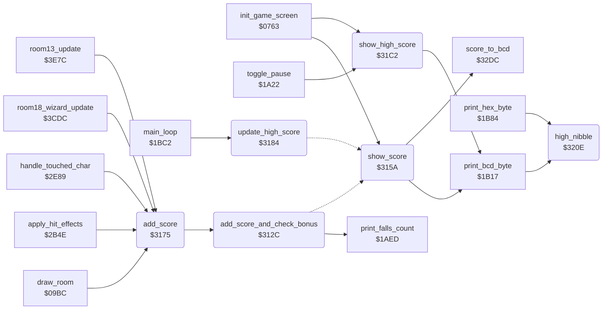

<!-- Generated by c64-docs from knowledge revision 20261016T170255.379-vv114c and src/source-map.json. Do not edit: change the knowledge, generate the source again, then run generate.ts. -->
# score.asm: Score, extra falls from score and high score

Range `$312C-$3216`. Source: [score.asm](../../../src/score.asm). Index: [the reference](../index.md).

## Call graph

A solid arrow is a call, a thick arrow a table entry, a dotted arrow a jump. Rounded nodes are in this file.

## Data

| Range | Type | Name | Read by | Written by |
|---|---|---|---|---|
| [`$320C`](../../../src/score.asm#L131)-`$320D` | unused |  |  |  |
| [`$3215`](../../../src/score.asm#L140)-`$3216` | unused |  |  |  |

## Names

### [`add_score_and_check_bonus`](../../../src/score.asm#L6) `$312C`

*routine*

Adds the 24-bit value score_add to score. When each of the three bytes of score is at least the same byte of next_extra_life_score (a byte-wise test, not a 24-bit compare), adds extra_life_interval to next_extra_life_score and gives an extra fall. Then shows the score.

- **Called from:** [`add_score`](score.md#add_score) [`$3181`](../../../src/score.asm#L55)
- **Calls:** [`print_falls_count`](status.md#print_falls_count)
- **Jumps to:** [`show_score`](score.md#show_score)
- **Reads:** [`score+1`](../variables.md#score), [`score+2`](../variables.md#score), [`score_add+1`](../variables.md#score_add), [`score_add+2`](../variables.md#score_add), [`next_extra_life_score`](variables.md#next_extra_life_score), [`next_extra_life_score+1`](variables.md#next_extra_life_score), [`next_extra_life_score+2`](variables.md#next_extra_life_score), [`extra_life_interval+1`](variables.md#extra_life_interval), [`extra_life_interval+2`](variables.md#extra_life_interval), [`falls_left`](../variables.md#falls_left)
- **Writes:** [`score+1`](../variables.md#score), [`score+2`](../variables.md#score), [`next_extra_life_score+1`](variables.md#next_extra_life_score), [`next_extra_life_score+2`](variables.md#next_extra_life_score), [`falls_left`](../variables.md#falls_left)

### [`show_score`](../../../src/score.asm#L35) `$315A`

*routine*

Converts score to BCD (score_to_bcd) and prints its 6 digits in the top line at columns $30-$35.

- **Called from:** [`init_game_screen`](game_setup.md#init_game_screen) [`$07FF`](../../../src/game_setup.asm#L76)
- **Jumped to from:** [`add_score_and_check_bonus`](score.md#add_score_and_check_bonus) [`$313F`](../../../src/score.asm#L19), [`update_high_score`](score.md#update_high_score) [`$3187`](../../../src/score.asm#L59), [`update_high_score`](score.md#update_high_score) [`$31AF`](../../../src/score.asm#L81), [`update_high_score`](score.md#update_high_score) [`$31B6`](../../../src/score.asm#L86)
- **Calls:** [`score_to_bcd`](score_bcd_regsave.md#score_to_bcd), [`print_bcd_byte`](status.md#print_bcd_byte)
- **Reads:** [`bcd_conv_digits+1`](variables.md#bcd_conv_digits), [`bcd_conv_digits+2`](variables.md#bcd_conv_digits), [`bcd_conv_digits+3`](variables.md#bcd_conv_digits)
- **Refers to:** [`bcd_conv_digits`](variables.md#bcd_conv_digits)

### [`add_score`](../../../src/score.asm#L47) `$3175`

*routine*

Adds A to the score byte X (0 = high, 2 = low) via score_add, checks the bonus fall and shows the score.

- **Called from:** [`draw_room`](room_draw.md#draw_room) [`$0A20`](../../../src/room_draw.asm#L56), [`apply_hit_effects`](combat_hits.md#apply_hit_effects) [`$2BBF`](../../../src/combat_hits.asm#L294), [`apply_hit_effects`](combat_hits.md#apply_hit_effects) [`$2BE3`](../../../src/combat_hits.asm#L315), [`apply_hit_effects`](combat_hits.md#apply_hit_effects) [`$2C07`](../../../src/combat_hits.asm#L337), [`apply_hit_effects`](combat_hits.md#apply_hit_effects) [`$2C33`](../../../src/combat_hits.asm#L366), [`apply_hit_effects`](combat_hits.md#apply_hit_effects) [`$2C44`](../../../src/combat_hits.asm#L374), [`handle_touched_char`](background_touch.md#handle_touched_char) [`$2F31`](../../../src/background_touch.asm#L159), [`room18_wizard_update`](room_update.md#room18_wizard_update) [`$3D0B`](../../../src/room_update.asm#L932), [`room13_update`](room_update.md#room13_update) [`$3EB2`](../../../src/room_update.asm#L1148)
- **Calls:** [`add_score_and_check_bonus`](score.md#add_score_and_check_bonus)
- **Writes:** [`score_add`](../variables.md#score_add), [`score_add+1`](../variables.md#score_add), [`score_add+2`](../variables.md#score_add)
- **Refers to:** [`score_add`](../variables.md#score_add)

### [`update_high_score`](../../../src/score.asm#L57) `$3184`

*routine*

Each main-loop pass: in demo mode only shows the score. In a game: protection key check; then if score > high_score copies it (4 bytes) and shows the high score, else shows the score.

- **Called from:** [`main_loop`](main_loop.md#main_loop) [`$1C26`](../../../src/main_loop.asm#L55)
- **Jumps to:** [`show_score`](score.md#show_score)
- **Reads:** [`game_playing`](../variables.md#game_playing), [`protection_sig_a+2`](protection_signature.md#protection_sig_a), [`protection_sig_b+2`](protection_signature.md#protection_sig_b), [`protection_sig_a+5`](protection_signature.md#protection_sig_a), [`protection_sig_b+5`](protection_signature.md#protection_sig_b), [`protection_sig_a+8`](protection_signature.md#protection_sig_a), [`protection_sig_b+8`](protection_signature.md#protection_sig_b), [`lde00`](../variables.md#lde00), [`high_score`](variables.md#high_score), [`high_score+1`](variables.md#high_score), [`score+2`](../variables.md#score), [`split_index`](../variables.md#split_index)
- **Writes:** [`high_score+2`](variables.md#high_score), [`first_extra_life_score`](variables.md#first_extra_life_score)
- **Refers to:** [`protection_sig_a`](protection_signature.md#protection_sig_a), [`protection_sig_b`](protection_signature.md#protection_sig_b)

### [`protection_key_check`](../../../src/score.asm#L61) `$3189`

*label*

Protection remnant: if the key bytes $CF7B/$CF7E/$CF81 equal $CF9B/$CF9E/$CFA1, JMP ($DE00) into I/O space (crash).

### [`protection_trap_jump`](../../../src/score.asm#L72) `$31A1`

*label*

### [`store_high_score`](../../../src/score.asm#L87) `$31B8`

*label*

copies 4 bytes: $44 also lands in $438B

- **Jumped to from:** [`update_high_score`](score.md#update_high_score) [`$31AB`](../../../src/score.asm#L79)

### [`show_high_score`](../../../src/score.asm#L95) `$31C2`

*routine*

Converts high_score to BCD and prints its 6 digits in the top line at columns $3C-$41.

- **Called from:** [`init_game_screen`](game_setup.md#init_game_screen) [`$0802`](../../../src/game_setup.asm#L77), [`toggle_pause`](status.md#toggle_pause) [`$1A3F`](../../../src/status.asm#L92)
- **Calls:** [`print_bcd_byte`](status.md#print_bcd_byte)
- **Reads:** [`high_score+2`](variables.md#high_score), [`first_extra_life_score`](variables.md#first_extra_life_score), [`bcd_conv_binary+2`](variables.md#bcd_conv_binary), [`bcd_conv_binary+1`](variables.md#bcd_conv_binary), [`bcd_conv_binary`](variables.md#bcd_conv_binary), [`bcd_conv_digits+2`](variables.md#bcd_conv_digits), [`bcd_conv_digits+3`](variables.md#bcd_conv_digits), [`bcd_conv_digits+1`](variables.md#bcd_conv_digits)
- **Writes:** [`bcd_conv_binary+2`](variables.md#bcd_conv_binary), [`bcd_conv_digits`](variables.md#bcd_conv_digits), [`bcd_conv_digits+2`](variables.md#bcd_conv_digits), [`bcd_conv_digits+3`](variables.md#bcd_conv_digits), [`bcd_conv_binary+1`](variables.md#bcd_conv_binary), [`bcd_conv_binary`](variables.md#bcd_conv_binary)
- **Refers to:** [`bcd_conv_digits`](variables.md#bcd_conv_digits), [`bcd_conv_binary`](variables.md#bcd_conv_binary)

### [`high_nibble`](../../../src/score.asm#L133) `$320E`

*routine*

Returns the high nibble of A in A (A >> 4).

- **Called from:** [`print_bcd_byte`](status.md#print_bcd_byte) [`$1B18`](../../../src/status.asm#L227), [`print_hex_byte`](status.md#print_hex_byte) [`$1B85`](../../../src/status.asm#L291)
