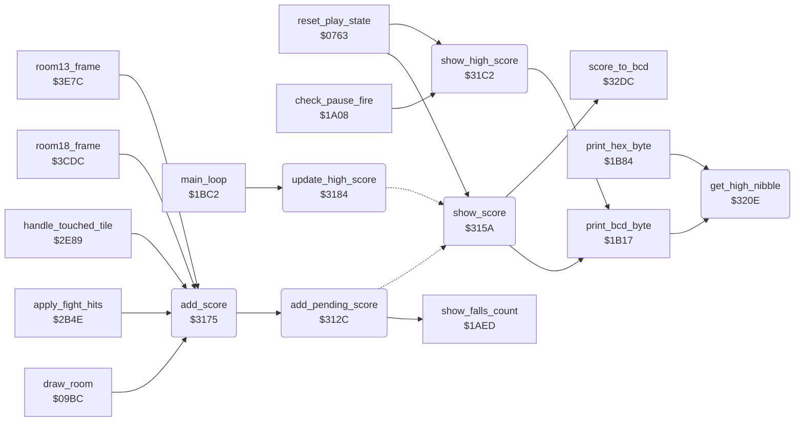

<!-- Generated by c64-docs from knowledge revision 20261017T121733.607-wszjh3 and src/source-map.json. Do not edit: change the knowledge, generate the source again, then run generate.ts. -->
# score.asm: Score: add points, extra falls, score and high score display

Range `$312C-$3216`. Source: [score.asm](../../../src/score.asm). Index: [the reference](../index.md).

## Call graph

A solid arrow is a call, a thick arrow a table entry, a dotted arrow a jump. Rounded nodes are in this file.

## Names

### [`add_pending_score`](../../../src/score.asm#L8) `$312C`

*routine*

Adds the 24-bit points_to_add to score (binary, high byte first). Then checks the extra fall: when score reaches bonus_fall_next_score, that limit goes up by bonus_fall_score_step (30000), falls_left goes up by 1 and is shown. Then it shows the score (show_score).

- **Called from:** [`add_score`](score.md#add_score) [`$3181`](../../../src/score.asm#L60)
- **Calls:** [`show_falls_count`](status_and_keys.md#show_falls_count)
- **Jumps to:** [`show_score`](score.md#show_score)
- **Reads:** [`score+1`](../variables.md#score), [`score+2`](../variables.md#score), [`points_to_add+1`](../variables.md#points_to_add), [`points_to_add+2`](../variables.md#points_to_add), [`bonus_fall_next_score`](fireball_text_score_vars.md#bonus_fall_next_score), [`bonus_fall_next_score+1`](fireball_text_score_vars.md#bonus_fall_next_score), [`bonus_fall_next_score+2`](fireball_text_score_vars.md#bonus_fall_next_score), [`bonus_fall_score_step+1`](fireball_text_score_vars.md#bonus_fall_score_step), [`bonus_fall_score_step+2`](fireball_text_score_vars.md#bonus_fall_score_step), [`falls_left`](../variables.md#falls_left)
- **Writes:** [`score+1`](../variables.md#score), [`score+2`](../variables.md#score), [`bonus_fall_next_score+1`](fireball_text_score_vars.md#bonus_fall_next_score), [`bonus_fall_next_score+2`](fireball_text_score_vars.md#bonus_fall_next_score), [`falls_left`](../variables.md#falls_left)

### [`add_pending_score_loop`](../../../src/score.asm#L11) `$312F`

*label*

- **Jumped to from:** [`add_pending_score`](score.md#add_pending_score) [`$3136`](../../../src/score.asm#L16)

### [`check_extra_fall_loop`](../../../src/score.asm#L18) `$313A`

*label*

- **Jumped to from:** [`add_pending_score`](score.md#add_pending_score) [`$3144`](../../../src/score.asm#L24)

### [`award_extra_fall`](../../../src/score.asm#L25) `$3146`

*label*

### [`award_extra_fall_loop`](../../../src/score.asm#L29) `$3149`

*label*

- **Jumped to from:** [`add_pending_score`](score.md#add_pending_score) [`$3153`](../../../src/score.asm#L34)

### [`show_score`](../../../src/score.asm#L39) `$315A`

*routine*

Shows the score: score_to_bcd makes 6 BCD digits in bcd_conv_digits+1..+3, print_bcd_byte writes them at game_screen offsets $30, $32, $34 (status line, after 1UP).

- **Called from:** [`reset_play_state`](play_init.md#reset_play_state) [`$07FF`](../../../src/play_init.asm#L91)
- **Jumped to from:** [`add_pending_score`](score.md#add_pending_score) [`$313F`](../../../src/score.asm#L21), [`update_high_score`](score.md#update_high_score) [`$3187`](../../../src/score.asm#L67), [`update_high_score`](score.md#update_high_score) [`$31AF`](../../../src/score.asm#L96), [`update_high_score`](score.md#update_high_score) [`$31B6`](../../../src/score.asm#L101)
- **Calls:** [`score_to_bcd`](room_misc_support.md#score_to_bcd), [`print_bcd_byte`](status_and_keys.md#print_bcd_byte)
- **Reads:** [`bcd_conv_digits+1`](fireball_text_score_vars.md#bcd_conv_digits), [`bcd_conv_digits+2`](fireball_text_score_vars.md#bcd_conv_digits), [`bcd_conv_digits+3`](fireball_text_score_vars.md#bcd_conv_digits)
- **Refers to:** [`bcd_conv_digits`](fireball_text_score_vars.md#bcd_conv_digits)

### [`add_score`](../../../src/score.asm#L52) `$3175`

*routine*

Adds A points at byte X of the 24-bit score (X = 2 low byte, 1 = 256 points, 0 = 65536 points): points_to_add = 0, points_to_add+X = A, then add_pending_score.

- **Called from:** [`draw_room`](draw_room.md#draw_room) [`$0A20`](../../../src/draw_room.asm#L78), [`draw_room`](draw_room.md#draw_room) [`$0A27`](../../../src/draw_room.asm#L81), [`apply_fight_hits`](fight_hits.md#apply_fight_hits) [`$2BBF`](../../../src/fight_hits.asm#L319), [`apply_fight_hits`](fight_hits.md#apply_fight_hits) [`$2BE3`](../../../src/fight_hits.asm#L340), [`apply_fight_hits`](fight_hits.md#apply_fight_hits) [`$2C07`](../../../src/fight_hits.asm#L362), [`apply_fight_hits`](fight_hits.md#apply_fight_hits) [`$2C33`](../../../src/fight_hits.asm#L393), [`apply_fight_hits`](fight_hits.md#apply_fight_hits) [`$2C3A`](../../../src/fight_hits.asm#L396), [`apply_fight_hits`](fight_hits.md#apply_fight_hits) [`$2C44`](../../../src/fight_hits.asm#L401), [`handle_touched_tile`](background_touch.md#handle_touched_tile) [`$2F31`](../../../src/background_touch.asm#L170), [`room18_frame`](wizard_room.md#room18_frame) [`$3D04`](../../../src/wizard_room.asm#L34), [`room18_frame`](wizard_room.md#room18_frame) [`$3D0B`](../../../src/wizard_room.asm#L37), [`room13_frame`](room_frames_12_17.md#room13_frame) [`$3EB2`](../../../src/room_frames_12_17.asm#L73), [`room13_frame`](room_frames_12_17.md#room13_frame) [`$3EB9`](../../../src/room_frames_12_17.asm#L76)
- **Calls:** [`add_pending_score`](score.md#add_pending_score)
- **Writes:** [`points_to_add`](../variables.md#points_to_add), [`points_to_add+1`](../variables.md#points_to_add), [`points_to_add+2`](../variables.md#points_to_add)
- **Refers to:** [`points_to_add`](../variables.md#points_to_add)

### [`update_high_score`](../../../src/score.asm#L65) `$3184`

*routine*

Main loop: in a game (game_mode <> 0) a score above top_score becomes the high score and both are shown; in the demo only the score is shown. First a check of protection data: when prot_key_trap1 = prot_key_trap1_pair, prot_key_trap2 = prot_key_trap2_pair and prot_key_trap3 = prot_key_trap3_pair, it jumps through io1_dummy ($DE00, I/O area, no valid vector).

- **Called from:** [`main_loop`](game_main_loop.md#main_loop) [`$1C26`](../../../src/game_main_loop.asm#L78)
- **Jumps to:** [`show_score`](score.md#show_score)
- **Reads:** [`game_mode`](../variables.md#game_mode), [`prot_key_trap1`](protection_key_page.md#prot_key_trap1), [`prot_key_trap1_pair`](protection_key_page.md#prot_key_trap1_pair), [`prot_key_trap2`](protection_key_page.md#prot_key_trap2), [`prot_key_trap2_pair`](protection_key_page.md#prot_key_trap2_pair), [`prot_key_trap3`](protection_key_page.md#prot_key_trap3), [`prot_key_trap3_pair`](protection_key_page.md#prot_key_trap3_pair), [`io1_dummy`](../variables.md#io1_dummy), [`top_score`](fireball_text_score_vars.md#top_score), [`top_score+1`](fireball_text_score_vars.md#top_score), [`score+2`](../variables.md#score), [`raster_split_index`](../variables.md#raster_split_index)
- **Writes:** [`top_score+2`](fireball_text_score_vars.md#top_score), [`bonus_fall_first_score`](fireball_text_score_vars.md#bonus_fall_first_score)

### [`update_high_score_compare`](../../../src/score.asm#L89) `$31A4`

*label*

- **Jumped to from:** [`update_high_score`](score.md#update_high_score) [`$318F`](../../../src/score.asm#L70), [`update_high_score`](score.md#update_high_score) [`$3197`](../../../src/score.asm#L74), [`update_high_score`](score.md#update_high_score) [`$319F`](../../../src/score.asm#L77)

### [`update_high_score_compare_loop`](../../../src/score.asm#L91) `$31A6`

*label*

- **Jumped to from:** [`update_high_score`](score.md#update_high_score) [`$31B4`](../../../src/score.asm#L100)

### [`update_high_score_compare_next`](../../../src/score.asm#L97) `$31B1`

*label*

- **Jumped to from:** [`update_high_score`](score.md#update_high_score) [`$31AD`](../../../src/score.asm#L95)

### [`update_high_score_store`](../../../src/score.asm#L102) `$31B8`

*label*

copies 4 bytes: score..score+2 and raster_split_index to top_score..+2 and bonus_fall_first_score

- **Jumped to from:** [`update_high_score`](score.md#update_high_score) [`$31AB`](../../../src/score.asm#L94)

### [`update_high_score_store_loop`](../../../src/score.asm#L104) `$31BA`

*label*

- **Jumped to from:** [`update_high_score`](score.md#update_high_score) [`$31C0`](../../../src/score.asm#L108)

### [`show_high_score`](../../../src/score.asm#L112) `$31C2`

*routine*

Shows top_score: converts the 24-bit binary value to BCD digits in bcd_conv_digits (shift left 24 times, doubling the BCD result in decimal mode) and writes the 6 low digits at game_screen offsets $3C, $3E, $40 (after TOP) with print_bcd_byte.

- **Called from:** [`reset_play_state`](play_init.md#reset_play_state) [`$0802`](../../../src/play_init.asm#L92), [`check_pause_fire`](pause_status_line.md#check_pause_fire) [`$1A3F`](../../../src/pause_status_line.asm#L84)
- **Calls:** [`print_bcd_byte`](status_and_keys.md#print_bcd_byte)
- **Reads:** [`top_score+2`](fireball_text_score_vars.md#top_score), [`bonus_fall_first_score`](fireball_text_score_vars.md#bonus_fall_first_score), [`bcd_conv_binary+2`](fireball_text_score_vars.md#bcd_conv_binary), [`bcd_conv_binary+1`](fireball_text_score_vars.md#bcd_conv_binary), [`bcd_conv_binary`](fireball_text_score_vars.md#bcd_conv_binary), [`bcd_conv_digits+2`](fireball_text_score_vars.md#bcd_conv_digits), [`bcd_conv_digits+3`](fireball_text_score_vars.md#bcd_conv_digits), [`bcd_conv_digits+1`](fireball_text_score_vars.md#bcd_conv_digits)
- **Writes:** [`bcd_conv_binary+2`](fireball_text_score_vars.md#bcd_conv_binary), [`bcd_conv_digits`](fireball_text_score_vars.md#bcd_conv_digits), [`bcd_conv_digits+2`](fireball_text_score_vars.md#bcd_conv_digits), [`bcd_conv_digits+3`](fireball_text_score_vars.md#bcd_conv_digits), [`bcd_conv_binary+1`](fireball_text_score_vars.md#bcd_conv_binary), [`bcd_conv_binary`](fireball_text_score_vars.md#bcd_conv_binary)
- **Refers to:** [`bcd_conv_digits`](fireball_text_score_vars.md#bcd_conv_digits), [`bcd_conv_binary`](fireball_text_score_vars.md#bcd_conv_binary)

### [`show_high_score_copy_loop`](../../../src/score.asm#L114) `$31C4`

*label*

- **Jumped to from:** [`show_high_score`](score.md#show_high_score) [`$31D0`](../../../src/score.asm#L120)

### [`show_high_score_bit_loop`](../../../src/score.asm#L125) `$31D9`

*label*

- **Jumped to from:** [`show_high_score`](score.md#show_high_score) [`$31F1`](../../../src/score.asm#L137)

### [`show_high_score_add_loop`](../../../src/score.asm#L130) `$31E4`

*label*

- **Jumped to from:** [`show_high_score`](score.md#show_high_score) [`$31EE`](../../../src/score.asm#L135)

### [`get_nibble_by_carry`](../../../src/score.asm#L149) `$320C`

*label*

Entry that nothing calls: carry set returns the low nibble of A, else the high nibble.

### [`get_high_nibble`](../../../src/score.asm#L153) `$320E`

*routine*

Returns the high nibble of A in the low 4 bits.

- **Called from:** [`print_bcd_byte`](status_and_keys.md#print_bcd_byte) [`$1B18`](../../../src/status_and_keys.asm#L41), [`print_hex_byte`](status_and_keys.md#print_hex_byte) [`$1B85`](../../../src/status_and_keys.asm#L118)

### [`get_low_nibble`](../../../src/score.asm#L158) `$3212`

*label*

### [`enter_current_room`](../../../src/score.asm#L162) `$3215`

*label*

Entry that nothing calls: X = current room, then place_bruce_at_room_start puts Bruce in room X.
