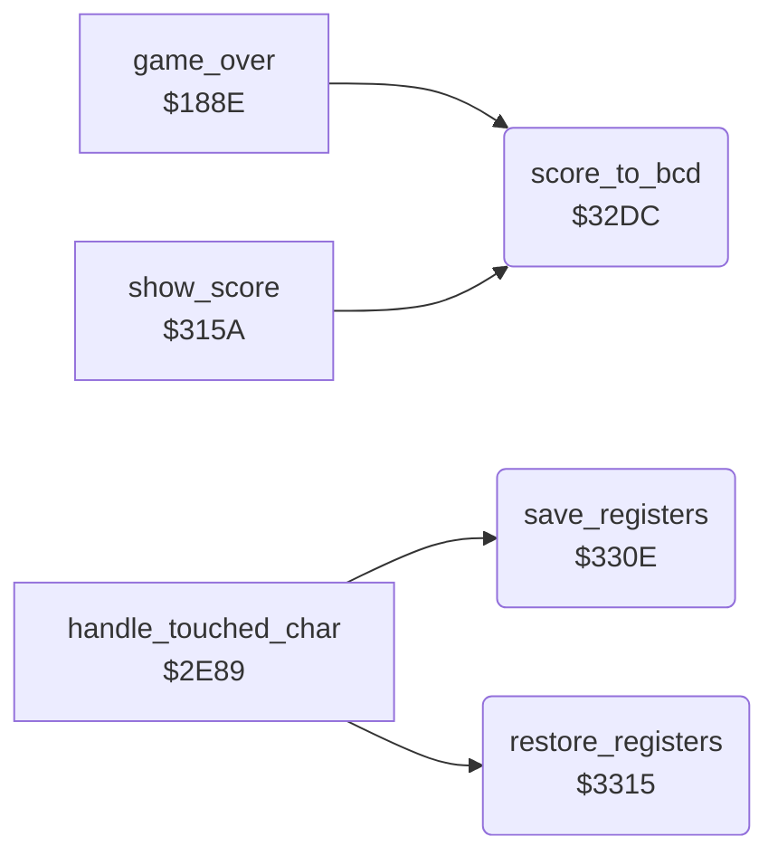

<!-- Generated by c64-docs from knowledge revision 20261016T170255.379-vv114c and src/source-map.json. Do not edit: change the knowledge, generate the source again, then run generate.ts. -->
# score_bcd_regsave.asm: Score to BCD conversion and register save/restore helpers

Range `$32DC-$331B`. Source: [score_bcd_regsave.asm](../../../src/score_bcd_regsave.asm). Index: [the reference](../index.md).

## Call graph

A solid arrow is a call, a thick arrow a table entry, a dotted arrow a jump. Rounded nodes are in this file.

## Names

### [`score_to_bcd`](../../../src/score_bcd_regsave.asm#L6) `$32DC`

*routine*

Converts the 24-bit binary score into packed BCD at bcd_digits ($439B-$439E) with a shift-and-add loop in decimal mode.

- **Called from:** [`game_over`](game_over.md#game_over) [`$192D`](../../../src/game_over.asm#L138), [`show_score`](score.md#show_score) [`$315A`](../../../src/score.asm#L36)
- **Reads:** [`score+1`](../variables.md#score), [`score+2`](../variables.md#score), [`bcd_conv_binary+2`](variables.md#bcd_conv_binary), [`bcd_conv_binary+1`](variables.md#bcd_conv_binary), [`bcd_conv_binary`](variables.md#bcd_conv_binary), [`bcd_conv_digits+2`](variables.md#bcd_conv_digits), [`bcd_conv_digits+3`](variables.md#bcd_conv_digits)
- **Writes:** [`bcd_conv_binary+1`](variables.md#bcd_conv_binary), [`bcd_conv_binary+2`](variables.md#bcd_conv_binary), [`bcd_conv_digits+1`](variables.md#bcd_conv_digits), [`bcd_conv_digits+2`](variables.md#bcd_conv_digits), [`bcd_conv_digits+3`](variables.md#bcd_conv_digits), [`bcd_conv_binary`](variables.md#bcd_conv_binary)
- **Refers to:** [`bcd_conv_digits`](variables.md#bcd_conv_digits), [`bcd_conv_binary`](variables.md#bcd_conv_binary)

### [`save_registers`](../../../src/score_bcd_regsave.asm#L35) `$330E`

*routine*

Stores A, X, Y in saved_a/saved_x/saved_y.

- **Called from:** [`handle_touched_char`](background_touch.md#handle_touched_char) [`$2F07`](../../../src/background_touch.asm#L134), [`handle_touched_char`](background_touch.md#handle_touched_char) [`$2F2A`](../../../src/background_touch.asm#L156)
- **Writes:** [`saved_a`](../variables.md#saved_a), [`saved_x`](../variables.md#saved_x), [`saved_y`](../variables.md#saved_y)

### [`restore_registers`](../../../src/score_bcd_regsave.asm#L41) `$3315`

*routine*

Loads A, X, Y from saved_a/saved_x/saved_y.

- **Called from:** [`handle_touched_char`](background_touch.md#handle_touched_char) [`$2F10`](../../../src/background_touch.asm#L138), [`handle_touched_char`](background_touch.md#handle_touched_char) [`$2F39`](../../../src/background_touch.asm#L163)
- **Reads:** [`saved_a`](../variables.md#saved_a), [`saved_x`](../variables.md#saved_x), [`saved_y`](../variables.md#saved_y)
