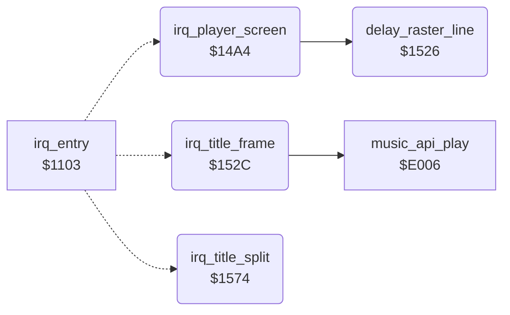

<!-- Generated by c64-docs from knowledge revision 20261018T222907.626-4u1tp6 and src/source-map.json. Do not edit: change the knowledge, generate the source again, then run docs.ts generate. -->
# screen_raster_irqs.asm: Raster interrupt handlers of the PLAYER n, title and game over screens

Range `$14A4-$15A7`. Source: [screen_raster_irqs.asm](../../../src/screen_raster_irqs.asm). Index: [the reference](../index.md).

## Call graph

A solid arrow is a call, a thick arrow a table entry, a dotted arrow a jump. Rounded nodes are in this file.

## Names

### [`irq_player_screen`](../../../src/screen_raster_irqs.asm#L10) `$14A4`

*routine*

Raster IRQ handler of the PLAYER n screen, at raster line $63 (99). Waits for line $6E (110), then changes BGCOL1 (multicolour 1) about every 2 lines to $B, $C, $F, $1, $F, $C, $B (dark grey to white and back), which shades the big PLAYER n text on rows 7-8. Then sets the VIC to screen game_screen, charset $8000 (logo charset), multicolour 40 columns, sets the next IRQ again at line $63, decrements frame_countdown and returns. Installed by show_player_screen.

- **Jumped to from:** [`irq_entry`](interrupt_entry.md#irq_entry) [`$1113`](../../../src/interrupt_entry.asm#L23)
- **Referred to by:** [`show_player_screen`](title_player_screens.md#show_player_screen) [`$0F00`](../../../src/title_player_screens.asm#L118), [`show_player_screen`](title_player_screens.md#show_player_screen) [`$0F05`](../../../src/title_player_screens.asm#L120)
- **Calls:** [`delay_raster_line`](screen_raster_irqs.md#delay_raster_line)
- **Reads:** [`RASTER`](../memory-map.md#RASTER), [`SCROLY`](../memory-map.md#SCROLY), [`frame_countdown`](../memory-map.md#frame_countdown)
- **Writes:** [`BGCOL1`](../memory-map.md#BGCOL1), [`VMCSB`](../memory-map.md#VMCSB), [`SCROLX`](../memory-map.md#SCROLX), [`IRQMSK`](../memory-map.md#IRQMSK), [`VICIRQ`](../memory-map.md#VICIRQ), [`SCROLY`](../memory-map.md#SCROLY), [`RASTER`](../memory-map.md#RASTER), [`frame_countdown`](../memory-map.md#frame_countdown)

### [`irq_player_screen_sync`](../../../src/screen_raster_irqs.asm#L13) `$14A8`

*label*

- **Jumped to from:** [`irq_player_screen`](screen_raster_irqs.md#irq_player_screen) [`$14B0`](../../../src/screen_raster_irqs.asm#L17)

### [`irq_player_screen_delay`](../../../src/screen_raster_irqs.asm#L19) `$14B4`

*label*

- **Jumped to from:** [`irq_player_screen`](screen_raster_irqs.md#irq_player_screen) [`$14B5`](../../../src/screen_raster_irqs.asm#L21)

### [`irq_player_screen_bars`](../../../src/screen_raster_irqs.asm#L22) `$14B7`

*label*

dark grey

- **Jumped to from:** [`irq_player_screen`](screen_raster_irqs.md#irq_player_screen) [`$14AB`](../../../src/screen_raster_irqs.asm#L15)

### [`irq_player_screen_exit`](../../../src/screen_raster_irqs.asm#L63) `$1520`

*label*

- **Jumped to from:** [`irq_player_screen`](screen_raster_irqs.md#irq_player_screen) [`$151C`](../../../src/screen_raster_irqs.asm#L61)

### [`delay_raster_line`](../../../src/screen_raster_irqs.asm#L71) `$1526`

*routine*

Busy wait of about one raster line (10 DEX loops plus JSR/RTS). Changes X.

- **Called from:** [`irq_player_screen`](screen_raster_irqs.md#irq_player_screen) [`$14BC`](../../../src/screen_raster_irqs.asm#L25), [`irq_player_screen`](screen_raster_irqs.md#irq_player_screen) [`$14BF`](../../../src/screen_raster_irqs.asm#L26), [`irq_player_screen`](screen_raster_irqs.md#irq_player_screen) [`$14C7`](../../../src/screen_raster_irqs.asm#L29), [`irq_player_screen`](screen_raster_irqs.md#irq_player_screen) [`$14CA`](../../../src/screen_raster_irqs.asm#L30), [`irq_player_screen`](screen_raster_irqs.md#irq_player_screen) [`$14D2`](../../../src/screen_raster_irqs.asm#L33), [`irq_player_screen`](screen_raster_irqs.md#irq_player_screen) [`$14D5`](../../../src/screen_raster_irqs.asm#L34), [`irq_player_screen`](screen_raster_irqs.md#irq_player_screen) [`$14DD`](../../../src/screen_raster_irqs.asm#L37), [`irq_player_screen`](screen_raster_irqs.md#irq_player_screen) [`$14E5`](../../../src/screen_raster_irqs.asm#L40), [`irq_player_screen`](screen_raster_irqs.md#irq_player_screen) [`$14E8`](../../../src/screen_raster_irqs.asm#L41), [`irq_player_screen`](screen_raster_irqs.md#irq_player_screen) [`$14F0`](../../../src/screen_raster_irqs.asm#L44), [`irq_player_screen`](screen_raster_irqs.md#irq_player_screen) [`$14F3`](../../../src/screen_raster_irqs.asm#L45)

### [`delay_raster_line_loop`](../../../src/screen_raster_irqs.asm#L73) `$1528`

*label*

- **Jumped to from:** [`delay_raster_line`](screen_raster_irqs.md#delay_raster_line) [`$1529`](../../../src/screen_raster_irqs.asm#L75)

### [`irq_title_frame`](../../../src/screen_raster_irqs.asm#L81) `$152C`

*routine*

Raster IRQ handler of the title and game over screens at raster line $FD (253): decrements frame_countdown and the 16-bit title_countdown (both stop at 0), sets the VIC to screen game_screen, charset $8000 (logo charset), multicolour 40 columns for the top of the next frame, plays the music (music_api_play), and sets irq_title_split at raster line $82 as the next handler.

- **Jumped to from:** [`irq_entry`](interrupt_entry.md#irq_entry) [`$1113`](../../../src/interrupt_entry.asm#L23)
- **Referred to by:** [`show_title_screen`](title_demo_start.md#show_title_screen) [`$05DA`](../../../src/title_demo_start.asm#L122), [`show_title_screen`](title_demo_start.md#show_title_screen) [`$05DF`](../../../src/title_demo_start.asm#L124), [`irq_title_split`](screen_raster_irqs.md#irq_title_split) [`$1583`](../../../src/screen_raster_irqs.asm#L130), [`irq_title_split`](screen_raster_irqs.md#irq_title_split) [`$1588`](../../../src/screen_raster_irqs.asm#L132), [`game_over`](lose_fall_game_over.md#game_over) [`$18A2`](../../../src/lose_fall_game_over.asm#L92), [`game_over`](lose_fall_game_over.md#game_over) [`$18A7`](../../../src/lose_fall_game_over.asm#L94)
- **Calls:** [`music_api_play`](music_player_state.md#music_api_play)
- **Reads:** [`frame_countdown`](../memory-map.md#frame_countdown), [`title_countdown`](../memory-map.md#title_countdown), [`title_countdown+1`](../memory-map.md#title_countdown), [`SCROLY`](../memory-map.md#SCROLY)
- **Writes:** [`frame_countdown`](../memory-map.md#frame_countdown), [`title_countdown`](../memory-map.md#title_countdown), [`title_countdown+1`](../memory-map.md#title_countdown), [`VMCSB`](../memory-map.md#VMCSB), [`SCROLX`](../memory-map.md#SCROLX), [`irq_vector`](cold_start.md#irq_vector), [`irq_vector_hi`](cold_start.md#irq_vector_hi), [`IRQMSK`](../memory-map.md#IRQMSK), [`VICIRQ`](../memory-map.md#VICIRQ), [`SCROLY`](../memory-map.md#SCROLY), [`RASTER`](../memory-map.md#RASTER)
- **Refers to:** [`title_countdown`](../memory-map.md#title_countdown), [`irq_title_split`](screen_raster_irqs.md#irq_title_split)

### [`irq_title_countdown`](../../../src/screen_raster_irqs.asm#L85) `$1532`

*label*

- **Jumped to from:** [`irq_title_frame`](screen_raster_irqs.md#irq_title_frame) [`$152E`](../../../src/screen_raster_irqs.asm#L83)

### [`irq_title_set_upper`](../../../src/screen_raster_irqs.asm#L94) `$1542`

*label*

VIC: screen $8C00, charset $8000

- **Jumped to from:** [`irq_title_frame`](screen_raster_irqs.md#irq_title_frame) [`$1534`](../../../src/screen_raster_irqs.asm#L87), [`irq_title_frame`](screen_raster_irqs.md#irq_title_frame) [`$1538`](../../../src/screen_raster_irqs.asm#L89), [`irq_title_frame`](screen_raster_irqs.md#irq_title_frame) [`$153C`](../../../src/screen_raster_irqs.asm#L91)

### [`irq_title_split`](../../../src/screen_raster_irqs.asm#L121) `$1574`

*routine*

Raster IRQ handler at raster line $82 (130) of the title and game over screens: after a short delay switches the lower part of the screen to the text font (charset text_font $8800), multicolour, 38 columns and x-scroll 6, then sets irq_title_frame at raster line $FD as the next handler.

- **Jumped to from:** [`irq_entry`](interrupt_entry.md#irq_entry) [`$1113`](../../../src/interrupt_entry.asm#L23)
- **Referred to by:** [`irq_title_frame`](screen_raster_irqs.md#irq_title_frame) [`$154F`](../../../src/screen_raster_irqs.asm#L100), [`irq_title_frame`](screen_raster_irqs.md#irq_title_frame) [`$1554`](../../../src/screen_raster_irqs.asm#L102)
- **Reads:** [`SCROLY`](../memory-map.md#SCROLY)
- **Writes:** [`VMCSB`](../memory-map.md#VMCSB), [`SCROLX`](../memory-map.md#SCROLX), [`irq_vector`](cold_start.md#irq_vector), [`irq_vector_hi`](cold_start.md#irq_vector_hi), [`IRQMSK`](../memory-map.md#IRQMSK), [`VICIRQ`](../memory-map.md#VICIRQ), [`SCROLY`](../memory-map.md#SCROLY), [`RASTER`](../memory-map.md#RASTER)
- **Refers to:** [`irq_title_frame`](screen_raster_irqs.md#irq_title_frame)

### [`irq_title_split_delay`](../../../src/screen_raster_irqs.asm#L123) `$1576`

*label*

- **Jumped to from:** [`irq_title_split`](screen_raster_irqs.md#irq_title_split) [`$1577`](../../../src/screen_raster_irqs.asm#L125)
