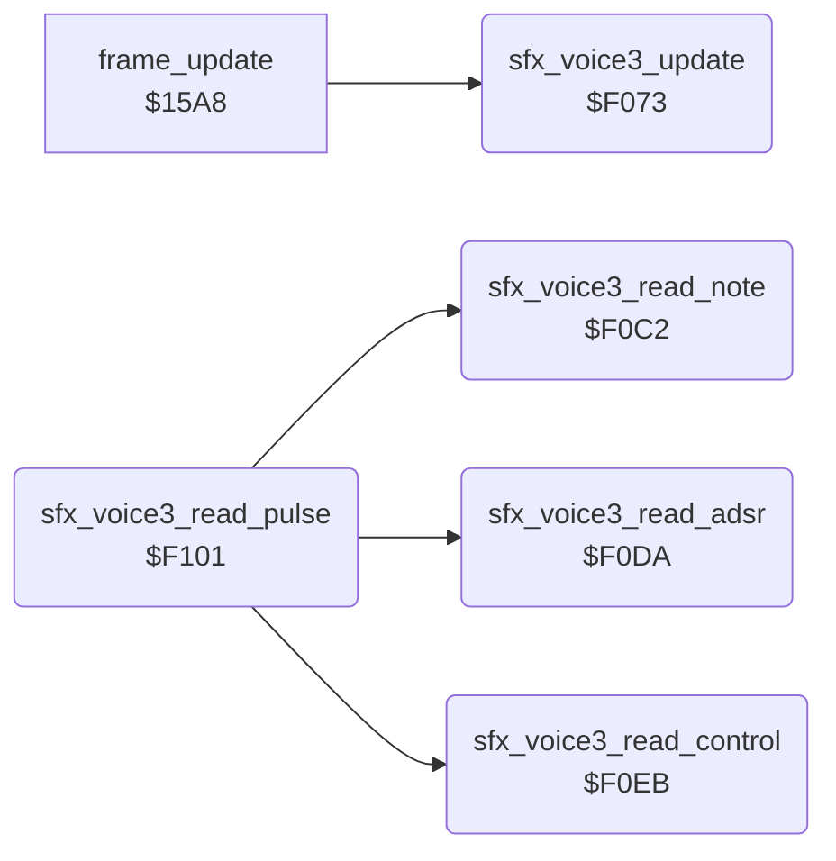

<!-- Generated by c64-docs from knowledge revision 20261025T214801.837-ucnw24 and .c64-re-tools/local/generated/src/source-map.json. Do not edit: change the knowledge, generate the source again, then run docs.ts generate. -->
# sfx/sfx_voice3.asm: Sound effect player for SID voice 3

Range `$F070-$F154`. Source: [sfx/sfx_voice3.asm](../../../../src/sfx/sfx_voice3.asm). Index: [the reference](../../index.md).

## Routines

| Routine | Address | Reached from | Summary |
|---|---|---|---|
| [`sfx_voice3_update`](sfx_voice3.md#sfx_voice3_update) | `$F073` | [`frame_update`](../game/frame_update.md#frame_update) | Sound effect player of SID voice 3 (registers from $D40E (FRELO3)), called every frame by frame_update, which irq_game_bottom runs. |
| [`sfx_voice3_cmd_offset`](sfx_voice3.md#sfx_voice3_cmd_offset) | `$F0A9` |  |  |
| [`sfx_voice3_read_note`](sfx_voice3.md#sfx_voice3_read_note) | `$F0C2` | [`sfx_voice3_read_pulse`](sfx_voice3.md#sfx_voice3_read_pulse) | Reads the duration (to the timer) and the note number of a command and writes the note frequency from note_freq_lo/hi. |
| [`sfx_voice3_read_adsr`](sfx_voice3.md#sfx_voice3_read_adsr) | `$F0DA` | [`sfx_voice3_read_pulse`](sfx_voice3.md#sfx_voice3_read_pulse) | Reads an ADSR index (even) and writes the pair from sfx_adsr_table to AD and SR. |
| [`sfx_voice3_read_control`](sfx_voice3.md#sfx_voice3_read_control) | `$F0EB` | [`sfx_voice3_read_pulse`](sfx_voice3.md#sfx_voice3_read_pulse) | Reads a control byte (waveform, gate) and writes it to the voice control register. |
| [`sfx_voice3_read_pulse`](sfx_voice3.md#sfx_voice3_read_pulse) | `$F101` |  | Reads a pulse index (even) and writes the pulse width from sfx_pulse_table. |

## Data

| Range | Type | Name | Read by | Written by |
|---|---|---|---|---|
| [`$F070`](../../../../src/sfx/sfx_voice3.asm#L7)-`$F072` | workspace | [`sfx_voice3_state`](../../../../src/sfx/sfx_voice3.asm#L6) | [`play_sound`](sound_request.md#play_sound), [`sfx_voice3_update`](sfx_voice3.md#sfx_voice3_update) | [`cold_start`](../game/cold_start.md#cold_start), [`play_sound`](sound_request.md#play_sound), [`stop_all_sounds`](sound_request.md#stop_all_sounds), [`sfx_voice3_update`](sfx_voice3.md#sfx_voice3_update), [`sfx_voice3_read_note`](sfx_voice3.md#sfx_voice3_read_note), [`sfx_voice3_read_control`](sfx_voice3.md#sfx_voice3_read_control), [`sfx_voice3_read_pulse`](sfx_voice3.md#sfx_voice3_read_pulse) |
| [`$F0AA`](../../../../src/sfx/sfx_voice3.asm#L53)-`$F0C1` | jumps | [`sfx_voice3_cmd_jumps`](../../../../src/sfx/sfx_voice3.asm#L52) |  |  |

## Call graph

A solid arrow is a call, a thick arrow a table entry. Rounded nodes are in this file.

## Details

### [`sfx_voice3_state`](../../../../src/sfx/sfx_voice3.asm#L6) `$F070`

*variable*

Effect state of SID voice 3: 0 = idle; $80 + n = request for effect n (written by play_sound); 1 = playing.

- **Read by:** [`play_sound`](sound_request.md#play_sound), [`sfx_voice3_update`](sfx_voice3.md#sfx_voice3_update)
- **Written by:** [`cold_start`](../game/cold_start.md#cold_start), [`play_sound`](sound_request.md#play_sound), [`stop_all_sounds`](sound_request.md#stop_all_sounds), [`sfx_voice3_update`](sfx_voice3.md#sfx_voice3_update), [`sfx_voice3_read_control`](sfx_voice3.md#sfx_voice3_read_control)

### [`sfx_voice3_pos`](../../../../src/sfx/sfx_voice3.asm#L8) `$F071`

*variable*

offset of the next command in the effect stream

- **Read by:** [`sfx_voice3_update`](sfx_voice3.md#sfx_voice3_update)
- **Written by:** [`sfx_voice3_update`](sfx_voice3.md#sfx_voice3_update), [`sfx_voice3_read_control`](sfx_voice3.md#sfx_voice3_read_control), [`sfx_voice3_read_pulse`](sfx_voice3.md#sfx_voice3_read_pulse)

### [`sfx_voice3_timer`](../../../../src/sfx/sfx_voice3.asm#L10) `$F072`

*variable*

frames until the next command

- **Read by:** [`sfx_voice3_update`](sfx_voice3.md#sfx_voice3_update)
- **Written by:** [`sfx_voice3_update`](sfx_voice3.md#sfx_voice3_update), [`sfx_voice3_read_note`](sfx_voice3.md#sfx_voice3_read_note)

### [`sfx_voice3_update`](../../../../src/sfx/sfx_voice3.asm#L19) `$F073`

*routine*

Sound effect player of SID voice 3 (registers from $D40E (FRELO3)), called every frame by frame_update, which irq_game_bottom runs. A request ($80 + n) sets the stream pointer sfx_voice3_stream from sfx_stream_table, the timer to 1 and the state to 1, and clears the voice control register. Each frame the timer counts down; at 0 the player runs one stream command, whose duration reloads the timer. The command byte selects a handler of the jump table through sfx_cmd_offsets and the self-modified branch. The three effect players are identical apart from the SID registers, the pointer and the state.

- **Called from:** [`frame_update`](../game/frame_update.md#frame_update)
- **Jumps to:** [`sfx_voice3_cmd_end`](sfx_voice3.md#sfx_voice3_cmd_end), [`sfx_voice3_cmd_note`](sfx_voice3.md#sfx_voice3_cmd_note), [`sfx_voice3_cmd_note_control`](sfx_voice3.md#sfx_voice3_cmd_note_control), [`sfx_voice3_cmd_note_adsr_control`](sfx_voice3.md#sfx_voice3_cmd_note_adsr_control), [`sfx_voice3_cmd_note_adsr_pulse_control`](sfx_voice3.md#sfx_voice3_cmd_note_adsr_pulse_control), [`sfx_voice3_cmd_note_pulse_control`](sfx_voice3.md#sfx_voice3_cmd_note_pulse_control), [`sfx_voice3_cmd_control`](sfx_voice3.md#sfx_voice3_cmd_control)
- **Reads:** [`sfx_voice3_state`](sfx_voice3.md#sfx_voice3_state), [`sfx_stream_table`](sfx_data.md#sfx_stream_table), [`sfx_voice3_timer`](sfx_voice3.md#sfx_voice3_timer), [`sfx_voice3_pos`](sfx_voice3.md#sfx_voice3_pos), [`sfx_voice3_stream`](../../memory-map.md#sfx_voice3_stream), [`sfx_cmd_offsets`](sfx_data.md#sfx_cmd_offsets)
- **Writes:** [`sfx_voice3_stream`](../../memory-map.md#sfx_voice3_stream), [`sfx_voice3_timer`](sfx_voice3.md#sfx_voice3_timer), [`sfx_voice3_state`](sfx_voice3.md#sfx_voice3_state), [`VCREG3`](../../memory-map.md#VCREG3), [`sfx_voice3_pos`](sfx_voice3.md#sfx_voice3_pos)
- **Refers to:** [`sfx_stream_table`](sfx_data.md#sfx_stream_table), [`sfx_voice3_stream`](../../memory-map.md#sfx_voice3_stream)

| Label | Address | Comment |
|---|---|---|
| [`sfx_voice3_update_done`](../../../../src/sfx/sfx_voice3.asm#L22) | `$F078` |  |
| [`sfx_voice3_check_request`](../../../../src/sfx/sfx_voice3.asm#L24) | `$F079` |  |
| [`sfx_voice3_tick`](../../../../src/sfx/sfx_voice3.asm#L38) | `$F096` |  |
| [`sfx_voice3_cmd_branch`](../../../../src/sfx/sfx_voice3.asm#L47) | `$F0A8` | self-modified: offset from sfx_cmd_offsets, always taken (C = 0) |
| [`sfx_voice3_cmd_jumps`](../../../../src/sfx/sfx_voice3.asm#L52) | `$F0AA` | Stream commands 0-7: end, note, note+control, note+ADSR+control, note+ADSR+pulse+control, note+pulse+control (5 and 6), control only. |

### [`sfx_voice3_cmd_offset`](../../../../src/sfx/sfx_voice3.asm#L48) `$F0A9`

*label*

- **Written by:** [`sfx_voice3_update`](sfx_voice3.md#sfx_voice3_update)

### [`sfx_voice3_read_note`](../../../../src/sfx/sfx_voice3.asm#L65) `$F0C2`

*routine*

Reads the duration (to the timer) and the note number of a command and writes the note frequency from note_freq_lo/hi. Input: Y = offset of the command byte. Output: Y = offset after the note.

- **Called from:** [`sfx_voice3_read_pulse`](sfx_voice3.md#sfx_voice3_read_pulse)
- **Reads:** [`sfx_voice3_stream`](../../memory-map.md#sfx_voice3_stream), [`note_freq_lo`](../music/music_frequency_table.md#note_freq_lo), [`note_freq_hi`](../music/music_frequency_table.md#note_freq_hi)
- **Writes:** [`sfx_voice3_timer`](sfx_voice3.md#sfx_voice3_timer), [`FRELO3`](../../memory-map.md#FRELO3), [`FREHI3`](../../memory-map.md#FREHI3)

### [`sfx_voice3_read_adsr`](../../../../src/sfx/sfx_voice3.asm#L79) `$F0DA`

*routine*

Reads an ADSR index (even) and writes the pair from sfx_adsr_table to AD and SR. Y advances.

- **Called from:** [`sfx_voice3_read_pulse`](sfx_voice3.md#sfx_voice3_read_pulse)
- **Reads:** [`sfx_voice3_stream`](../../memory-map.md#sfx_voice3_stream), [`sfx_adsr_table`](sfx_data.md#sfx_adsr_table)
- **Writes:** [`ATDCY3`](../../memory-map.md#ATDCY3), [`SUREL3`](../../memory-map.md#SUREL3)
- **Refers to:** [`sfx_adsr_table`](sfx_data.md#sfx_adsr_table)

### [`sfx_voice3_read_control`](../../../../src/sfx/sfx_voice3.asm#L89) `$F0EB`

*routine*

Reads a control byte (waveform, gate) and writes it to the voice control register. Y advances.

- **Called from:** [`sfx_voice3_read_pulse`](sfx_voice3.md#sfx_voice3_read_pulse)
- **Reads:** [`sfx_voice3_stream`](../../memory-map.md#sfx_voice3_stream)
- **Writes:** [`VCREG3`](../../memory-map.md#VCREG3), [`FRELO3`](../../memory-map.md#FRELO3), [`FREHI3`](../../memory-map.md#FREHI3), [`sfx_voice3_state`](sfx_voice3.md#sfx_voice3_state), [`sfx_voice3_pos`](sfx_voice3.md#sfx_voice3_pos)

| Label | Address | Comment |
|---|---|---|
| [`sfx_voice3_cmd_end`](../../../../src/sfx/sfx_voice3.asm#L95) | `$F0F2` | Command 0: end of the effect. Frequency 0, state idle. The gate is left as it is. |

### [`sfx_voice3_read_pulse`](../../../../src/sfx/sfx_voice3.asm#L103) `$F101`

*routine*

Reads a pulse index (even) and writes the pulse width from sfx_pulse_table. Y advances.

- **Calls:** [`sfx_voice3_read_note`](sfx_voice3.md#sfx_voice3_read_note), [`sfx_voice3_read_control`](sfx_voice3.md#sfx_voice3_read_control), [`sfx_voice3_read_adsr`](sfx_voice3.md#sfx_voice3_read_adsr)
- **Reads:** [`sfx_voice3_stream`](../../memory-map.md#sfx_voice3_stream), [`sfx_pulse_table`](sfx_data.md#sfx_pulse_table)
- **Writes:** [`PWLO3`](../../memory-map.md#PWLO3), [`PWHI3`](../../memory-map.md#PWHI3), [`sfx_voice3_pos`](sfx_voice3.md#sfx_voice3_pos)
- **Refers to:** [`sfx_pulse_table`](sfx_data.md#sfx_pulse_table)

| Label | Address | Comment |
|---|---|---|
| [`sfx_voice3_cmd_note`](../../../../src/sfx/sfx_voice3.asm#L113) | `$F112` | Command 1: duration, note. |
| [`sfx_voice3_cmd_note_control`](../../../../src/sfx/sfx_voice3.asm#L118) | `$F119` | Command 2: duration, note, control. |
| [`sfx_voice3_cmd_note_adsr_control`](../../../../src/sfx/sfx_voice3.asm#L124) | `$F123` | Command 3: duration, note, ADSR index, control. |
| [`sfx_voice3_cmd_note_adsr_pulse_control`](../../../../src/sfx/sfx_voice3.asm#L131) | `$F130` | Command 4: duration, note, ADSR index, pulse index, control. |
| [`sfx_voice3_cmd_note_pulse_control`](../../../../src/sfx/sfx_voice3.asm#L139) | `$F140` | Commands 5 and 6: duration, note, pulse index, control. |
| [`sfx_voice3_cmd_control`](../../../../src/sfx/sfx_voice3.asm#L147) | `$F14D` | Command 7: control byte only. The timer is not reloaded, so the next command runs 256 frames later. No effect stream uses it. |
