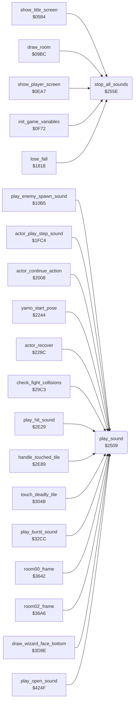

<!-- Generated by c64-docs from knowledge revision 20261025T214801.837-ucnw24 and .c64-re-tools/local/generated/src/source-map.json. Do not edit: change the knowledge, generate the source again, then run docs.ts generate. -->
# sfx/sound_request.asm: Sound effect requests: three voice slots with priorities, and silence

Range `$2509-$2583`. Source: [sfx/sound_request.asm](../../../../src/sfx/sound_request.asm). Index: [the reference](../../index.md).

## Routines

| Routine | Address | Reached from | Summary |
|---|---|---|---|
| [`play_sound`](sound_request.md#play_sound) | `$2509` | [`play_enemy_spawn_sound`](../game/game_setup.md#play_enemy_spawn_sound), [`actor_play_step_sound`](../actor/actor_step.md#actor_play_step_sound), [`actor_continue_action`](../actor/actor_timed_actions.md#actor_continue_action), [`yamo_start_pose`](../actor/actor_timed_actions.md#yamo_start_pose), [`actor_recover`](../actor/actor_timed_actions.md#actor_recover), [`check_fight_collisions`](../actor/fight_hits.md#check_fight_collisions), [`play_hit_sound`](../actor/actor_helpers.md#play_hit_sound), [`handle_touched_tile`](../actor/background_touch.md#handle_touched_tile), [`touch_deadly_tile`](../actor/touch_effects.md#touch_deadly_tile), [`play_burst_sound`](../room/room_misc_support.md#play_burst_sound), [`room00_frame`](../room/room_frames_0_7.md#room00_frame), [`room02_frame`](../room/room_frames_0_7.md#room02_frame) and 4 more | Requests sound effect Y ($80-$8E). |
| [`stop_all_sounds`](sound_request.md#stop_all_sounds) | `$255E` | [`show_title_screen`](../game/title_demo_start.md#show_title_screen), [`draw_room`](../room/draw_room.md#draw_room), [`show_player_screen`](../game/title_player_screens.md#show_player_screen), [`init_game_variables`](../game/game_setup.md#init_game_variables), [`lose_fall`](../game/lose_fall_game_over.md#lose_fall) | Frees the three voice slots of the sound driver (sfx_voice1_state, sfx_voice2_state, sfx_voice3_state = 0) and writes 0 to the SID addresses $D400-$D420, which silences all voices and sets the volume to 0. |

## Data

| Range | Type | Name | Read by | Written by |
|---|---|---|---|---|
| [`$2572`](../../../../src/sfx/sound_request.asm#L77)-`$2580` | bytes | [`sound_priority_table`](../../../../src/sfx/sound_request.asm#L76) | [`play_sound`](sound_request.md#play_sound) |  |
| [`$2581`](../../../../src/sfx/sound_request.asm#L81)-`$2583` | workspace | [`voice1_sound_priority`](../../../../src/sfx/sound_request.asm#L80) | [`play_sound`](sound_request.md#play_sound) | [`play_sound`](sound_request.md#play_sound) |

## Call graph

A solid arrow is a call, a thick arrow a table entry. Rounded nodes are in this file.

## Details

### [`play_sound`](../../../../src/sfx/sound_request.asm#L12) `$2509`

*routine*

Requests sound effect Y ($80-$8E). Sets SIGVOL to $15 (volume 5, low-pass filter mode bit), then stores Y in the first free voice slot of the sound driver (sfx_voice1_state, sfx_voice2_state, sfx_voice3_state; 0 = free) and its priority from sound_priority_table,(Y AND $0F) in voice1/2/3_sound_priority. When all three slots are busy, the first slot whose priority is not above the new one is replaced; otherwise the request is dropped. Changes A and X. Sounds: $80 step, $81 Yamo pose, $84 flying kick, $85 punch or strike swing, $86 and $87 hits, others from the room and hazard code.
volume 5, low-pass filter mode

- **Called from:** [`play_enemy_spawn_sound`](../game/game_setup.md#play_enemy_spawn_sound), [`actor_play_step_sound`](../actor/actor_step.md#actor_play_step_sound), [`actor_continue_action`](../actor/actor_timed_actions.md#actor_continue_action), [`yamo_start_pose`](../actor/actor_timed_actions.md#yamo_start_pose), [`actor_recover`](../actor/actor_timed_actions.md#actor_recover), [`check_fight_collisions`](../actor/fight_hits.md#check_fight_collisions), [`play_hit_sound`](../actor/actor_helpers.md#play_hit_sound), [`handle_touched_tile`](../actor/background_touch.md#handle_touched_tile), [`$2FEC`](../../../../src/actor/touch_effects.asm#L23), [`touch_deadly_tile`](../actor/touch_effects.md#touch_deadly_tile), [`play_burst_sound`](../room/room_misc_support.md#play_burst_sound), [`room00_frame`](../room/room_frames_0_7.md#room00_frame) and 3 more
- **Jumped to from:** [`play_runner_sound`](../room/room_hazard_draw.md#play_runner_sound)
- **Reads:** [`sfx_voice1_state`](sfx_voice1.md#sfx_voice1_state), [`sound_priority_table`](sound_request.md#sound_priority_table), [`sfx_voice2_state`](sfx_voice2.md#sfx_voice2_state), [`sfx_voice3_state`](sfx_voice3.md#sfx_voice3_state), [`voice1_sound_priority`](sound_request.md#voice1_sound_priority), [`voice2_sound_priority`](sound_request.md#voice2_sound_priority), [`voice3_sound_priority`](sound_request.md#voice3_sound_priority)
- **Writes:** [`SIGVOL`](../../memory-map.md#SIGVOL), [`sfx_voice1_state`](sfx_voice1.md#sfx_voice1_state), [`voice1_sound_priority`](sound_request.md#voice1_sound_priority), [`sfx_voice2_state`](sfx_voice2.md#sfx_voice2_state), [`voice2_sound_priority`](sound_request.md#voice2_sound_priority), [`sfx_voice3_state`](sfx_voice3.md#sfx_voice3_state), [`voice3_sound_priority`](sound_request.md#voice3_sound_priority)

| Label | Address | Comment |
|---|---|---|
| [`play_sound_slot1`](../../../../src/sfx/sound_request.asm#L17) | `$2513` |  |
| [`play_sound_try_slot2`](../../../../src/sfx/sound_request.asm#L25) | `$2521` | voice slot 2 of the sound driver |
| [`play_sound_slot2`](../../../../src/sfx/sound_request.asm#L28) | `$2526` |  |
| [`play_sound_try_slot3`](../../../../src/sfx/sound_request.asm#L36) | `$2534` | voice slot 3 of the sound driver |
| [`play_sound_slot3`](../../../../src/sfx/sound_request.asm#L39) | `$2539` |  |
| [`play_sound_by_priority`](../../../../src/sfx/sound_request.asm#L48) | `$2547` | All slots busy: replace the first slot whose priority is lower than or equal to the new one. |

### [`stop_all_sounds`](../../../../src/sfx/sound_request.asm#L63) `$255E`

*routine*

Frees the three voice slots of the sound driver (sfx_voice1_state, sfx_voice2_state, sfx_voice3_state = 0) and writes 0 to the SID addresses $D400-$D420, which silences all voices and sets the volume to 0. Called by lose_fall, show_title_screen, init_game_variables, show_player_screen and draw_room.

- **Called from:** [`show_title_screen`](../game/title_demo_start.md#show_title_screen), [`draw_room`](../room/draw_room.md#draw_room), [`show_player_screen`](../game/title_player_screens.md#show_player_screen), [`init_game_variables`](../game/game_setup.md#init_game_variables), [`lose_fall`](../game/lose_fall_game_over.md#lose_fall)
- **Writes:** [`sfx_voice1_state`](sfx_voice1.md#sfx_voice1_state), [`sfx_voice2_state`](sfx_voice2.md#sfx_voice2_state), [`sfx_voice3_state`](sfx_voice3.md#sfx_voice3_state), [`FRELO1`](../../memory-map.md#FRELO1)

| Label | Address | Comment |
|---|---|---|
| [`stop_all_sounds_loop`](../../../../src/sfx/sound_request.asm#L69) | `$256B` | 33 bytes: $D41D-$D41F are unused SID addresses, $D420 mirrors FRELO1 |

### [`sound_priority_table`](../../../../src/sfx/sound_request.asm#L76) `$2572-$2580`

*data*

Priority of each sound effect, 1 byte, indexed by sound number & $0F ($80-$8E). A higher value replaces a lower one when all voices are busy. Index $0F would read voice1_sound_priority.

- **Read by:** [`play_sound`](sound_request.md#play_sound)

### [`voice1_sound_priority`](../../../../src/sfx/sound_request.asm#L80) `$2581`

*variable*

Priority of the sound in each voice slot of the sound driver (slots 1, 2, 3), written by play_sound.

- **Read by:** [`play_sound`](sound_request.md#play_sound)
- **Written by:** [`play_sound`](sound_request.md#play_sound)

### [`voice2_sound_priority`](../../../../src/sfx/sound_request.asm#L82) `$2582`

*variable*

- **Read by:** [`play_sound`](sound_request.md#play_sound)
- **Written by:** [`play_sound`](sound_request.md#play_sound)

### [`voice3_sound_priority`](../../../../src/sfx/sound_request.asm#L84) `$2583`

*variable*

- **Read by:** [`play_sound`](sound_request.md#play_sound)
- **Written by:** [`play_sound`](sound_request.md#play_sound)
