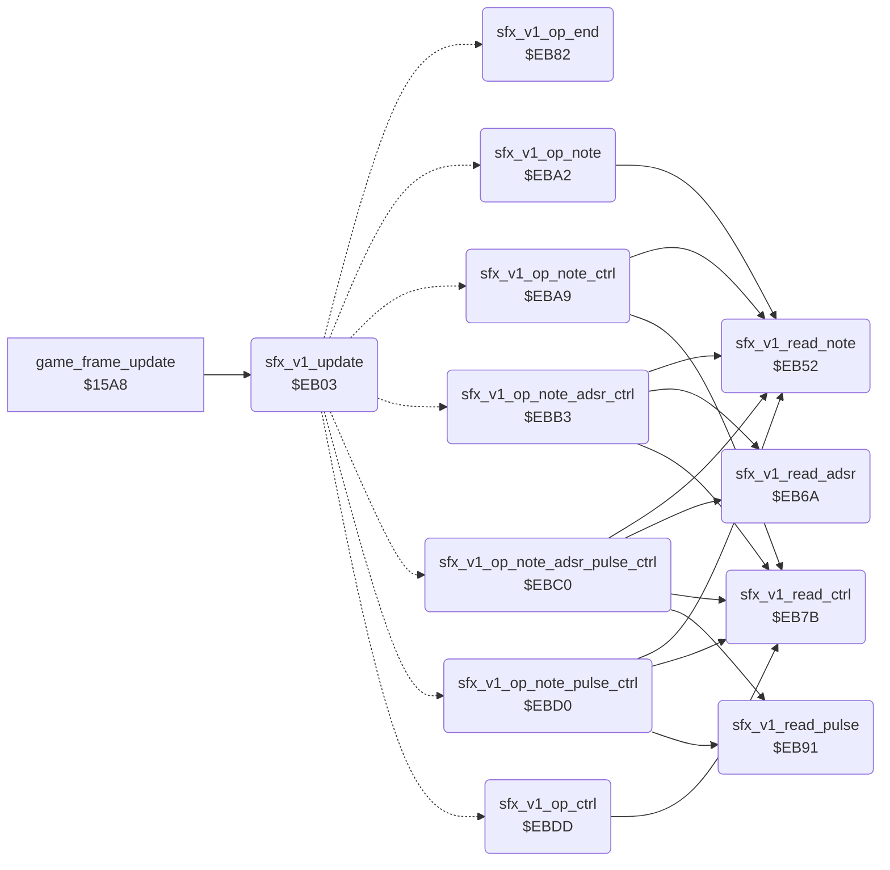

<!-- Generated by c64-docs from knowledge revision 20261016T170255.379-vv114c and src/source-map.json. Do not edit: change the knowledge, generate the source again, then run generate.ts. -->
# sfx_voice1.asm: Sound effect player for SID voice 1

Range `$EB00-$EBE4`. Source: [sfx_voice1.asm](../../../src/sfx_voice1.asm). Index: [the reference](../index.md).

## Call graph

A solid arrow is a call, a thick arrow a table entry, a dotted arrow a jump. Rounded nodes are in this file.

## Data

| Range | Type | Name | Read by | Written by |
|---|---|---|---|---|
| [`$EB00`](../../../src/sfx_voice1.asm#L7)-`$EB02` | workspace | [`sfx_v1_state`](../../../src/sfx_voice1.asm#L6) | [`play_sound_effect`](sound_effects.md#play_sound_effect), [`sfx_v1_update`](sfx_voice1.md#sfx_v1_update) | [`cold_start`](init.md#cold_start), [`play_sound_effect`](sound_effects.md#play_sound_effect), [`silence_all_sound`](sound_effects.md#silence_all_sound), [`sfx_v1_update`](sfx_voice1.md#sfx_v1_update), [`sfx_v1_read_note`](sfx_voice1.md#sfx_v1_read_note), [`sfx_v1_op_end`](sfx_voice1.md#sfx_v1_op_end), [`sfx_v1_op_note`](sfx_voice1.md#sfx_v1_op_note), [`sfx_v1_op_note_ctrl`](sfx_voice1.md#sfx_v1_op_note_ctrl), [`sfx_v1_op_note_adsr_ctrl`](sfx_voice1.md#sfx_v1_op_note_adsr_ctrl), [`sfx_v1_op_note_adsr_pulse_ctrl`](sfx_voice1.md#sfx_v1_op_note_adsr_pulse_ctrl), [`sfx_v1_op_note_pulse_ctrl`](sfx_voice1.md#sfx_v1_op_note_pulse_ctrl), [`sfx_v1_op_ctrl`](sfx_voice1.md#sfx_v1_op_ctrl) |
| [`$EB3A`](../../../src/sfx_voice1.asm#L45)-`$EB51` | jumps | [`sfx_v1_op_jumps`](../../../src/sfx_voice1.asm#L44) |  |  |

## Names

### [`sfx_v1_state`](../../../src/sfx_voice1.asm#L6) `$EB00`

*variable*

Sound id that plays on channel 0 (0 = free).
bit7 set = start sound effect bits0-6; 1 = playing; 0 = idle

- **Read by:** [`play_sound_effect`](sound_effects.md#play_sound_effect) [`$250E`](../../../src/sound_effects.asm#L9), [`sfx_v1_update`](sfx_voice1.md#sfx_v1_update) [`$EB03`](../../../src/sfx_voice1.asm#L14)
- **Written by:** [`cold_start`](init.md#cold_start) [`$0417`](../../../src/init.asm#L25), [`play_sound_effect`](sound_effects.md#play_sound_effect) [`$2513`](../../../src/sound_effects.asm#L12), [`silence_all_sound`](sound_effects.md#silence_all_sound) [`$2560`](../../../src/sound_effects.asm#L57), [`sfx_v1_update`](sfx_voice1.md#sfx_v1_update) [`$EB1C`](../../../src/sfx_voice1.asm#L28), [`sfx_v1_op_end`](sfx_voice1.md#sfx_v1_op_end) [`$EB8A`](../../../src/sfx_voice1.asm#L90)

### [`sfx_v1_index`](../../../src/sfx_voice1.asm#L8) `$EB01`

*variable*

offset of the next record in the stream

- **Read by:** [`sfx_v1_update`](sfx_voice1.md#sfx_v1_update) [`$EB2B`](../../../src/sfx_voice1.asm#L35)
- **Written by:** [`sfx_v1_update`](sfx_voice1.md#sfx_v1_update) [`$EB23`](../../../src/sfx_voice1.asm#L31), [`sfx_v1_op_end`](sfx_voice1.md#sfx_v1_op_end) [`$EB8D`](../../../src/sfx_voice1.asm#L91), [`sfx_v1_op_note`](sfx_voice1.md#sfx_v1_op_note) [`$EBA5`](../../../src/sfx_voice1.asm#L106), [`sfx_v1_op_note_ctrl`](sfx_voice1.md#sfx_v1_op_note_ctrl) [`$EBAF`](../../../src/sfx_voice1.asm#L112), [`sfx_v1_op_note_adsr_ctrl`](sfx_voice1.md#sfx_v1_op_note_adsr_ctrl) [`$EBBC`](../../../src/sfx_voice1.asm#L119), [`sfx_v1_op_note_adsr_pulse_ctrl`](sfx_voice1.md#sfx_v1_op_note_adsr_pulse_ctrl) [`$EBCC`](../../../src/sfx_voice1.asm#L127), [`sfx_v1_op_note_pulse_ctrl`](sfx_voice1.md#sfx_v1_op_note_pulse_ctrl) [`$EBD9`](../../../src/sfx_voice1.asm#L134), [`sfx_v1_op_ctrl`](sfx_voice1.md#sfx_v1_op_ctrl) [`$EBE1`](../../../src/sfx_voice1.asm#L141)

### [`sfx_v1_wait`](../../../src/sfx_voice1.asm#L10) `$EB02`

*variable*

frames until the next record

- **Read by:** [`sfx_v1_update`](sfx_voice1.md#sfx_v1_update) [`$EB26`](../../../src/sfx_voice1.asm#L33)
- **Written by:** [`sfx_v1_update`](sfx_voice1.md#sfx_v1_update) [`$EB19`](../../../src/sfx_voice1.asm#L27), [`sfx_v1_update`](sfx_voice1.md#sfx_v1_update) [`$EB26`](../../../src/sfx_voice1.asm#L33), [`sfx_v1_read_note`](sfx_voice1.md#sfx_v1_read_note) [`$EB55`](../../../src/sfx_voice1.asm#L59)

### [`sfx_v1_update`](../../../src/sfx_voice1.asm#L13) `$EB03`

*routine*

Per-frame sound effect update for SID voice 1 ($D400): starts a requested effect (pointer from sfx_table into $F6/$F7), then runs the next stream record when the wait count reaches 0.

- **Called from:** [`game_frame_update`](frame_update.md#game_frame_update) [`$15AF`](../../../src/frame_update.asm#L11)
- **Jumps to:** [`sfx_v1_op_end`](sfx_voice1.md#sfx_v1_op_end), [`sfx_v1_op_note`](sfx_voice1.md#sfx_v1_op_note), [`sfx_v1_op_note_ctrl`](sfx_voice1.md#sfx_v1_op_note_ctrl), [`sfx_v1_op_note_adsr_ctrl`](sfx_voice1.md#sfx_v1_op_note_adsr_ctrl), [`sfx_v1_op_note_adsr_pulse_ctrl`](sfx_voice1.md#sfx_v1_op_note_adsr_pulse_ctrl), [`sfx_v1_op_note_pulse_ctrl`](sfx_voice1.md#sfx_v1_op_note_pulse_ctrl), [`sfx_v1_op_ctrl`](sfx_voice1.md#sfx_v1_op_ctrl)
- **Reads:** [`sfx_v1_state`](sfx_voice1.md#sfx_v1_state), [`sfx_v1_wait`](sfx_voice1.md#sfx_v1_wait), [`sfx_v1_index`](sfx_voice1.md#sfx_v1_index), [`sfx_v1_ptr`](../variables.md#sfx_v1_ptr), [`sfx_03+15`](sfx_data.md#sfx_03)
- **Writes:** [`sfx_v1_ptr`](../variables.md#sfx_v1_ptr), [`sfx_v1_ptr+1`](../variables.md#sfx_v1_ptr), [`sfx_v1_wait`](sfx_voice1.md#sfx_v1_wait), [`sfx_v1_state`](sfx_voice1.md#sfx_v1_state), [`VCREG1`](../variables.md#VCREG1), [`sfx_v1_index`](sfx_voice1.md#sfx_v1_index)
- **Refers to:** [`sfx_table`](sfx_data.md#sfx_table), [`sfx_table+1`](sfx_data.md#sfx_table), [`sfx_v1_ptr`](../variables.md#sfx_v1_ptr), [`sfx_op_offsets`](sfx_data.md#sfx_op_offsets)

### [`sfx_v1_step`](../../../src/sfx_voice1.asm#L18) `$EB09`

*label*

- **Jumped to from:** [`sfx_v1_update`](sfx_voice1.md#sfx_v1_update) [`$EB06`](../../../src/sfx_voice1.asm#L15)

### [`sfx_v1_op_branch`](../../../src/sfx_voice1.asm#L42) `$EB39`

*variable*

branch offset patched from sfx_op_offsets

- **Written by:** [`sfx_v1_update`](sfx_voice1.md#sfx_v1_update) [`$EB34`](../../../src/sfx_voice1.asm#L39)

### [`sfx_v1_op_jumps`](../../../src/sfx_voice1.asm#L44) `$EB3A`

*label*

opcodes 0-7

### [`sfx_v1_read_note`](../../../src/sfx_voice1.asm#L56) `$EB52`

*routine*

Reads the wait and note bytes of the record at Y+1 and sets the voice frequency from note_freq_lo/hi; Y points after them.

- **Called from:** [`sfx_v1_op_note`](sfx_voice1.md#sfx_v1_op_note) [`$EBA2`](../../../src/sfx_voice1.asm#L105), [`sfx_v1_op_note_ctrl`](sfx_voice1.md#sfx_v1_op_note_ctrl) [`$EBA9`](../../../src/sfx_voice1.asm#L110), [`sfx_v1_op_note_adsr_ctrl`](sfx_voice1.md#sfx_v1_op_note_adsr_ctrl) [`$EBB3`](../../../src/sfx_voice1.asm#L116), [`sfx_v1_op_note_adsr_pulse_ctrl`](sfx_voice1.md#sfx_v1_op_note_adsr_pulse_ctrl) [`$EBC0`](../../../src/sfx_voice1.asm#L123), [`sfx_v1_op_note_pulse_ctrl`](sfx_voice1.md#sfx_v1_op_note_pulse_ctrl) [`$EBD0`](../../../src/sfx_voice1.asm#L131)
- **Reads:** [`sfx_v1_ptr`](../variables.md#sfx_v1_ptr)
- **Writes:** [`sfx_v1_wait`](sfx_voice1.md#sfx_v1_wait), [`FRELO1`](../variables.md#FRELO1), [`FREHI1`](../variables.md#FREHI1)
- **Refers to:** [`note_freq_lo`](music_player.md#note_freq_lo), [`note_freq_hi`](music_player.md#note_freq_hi)

### [`sfx_v1_read_adsr`](../../../src/sfx_voice1.asm#L70) `$EB6A`

*routine*

Reads an index byte and sets attack/decay and sustain/release from sfx_adsr_table.

- **Called from:** [`sfx_v1_op_note_adsr_ctrl`](sfx_voice1.md#sfx_v1_op_note_adsr_ctrl) [`$EBB6`](../../../src/sfx_voice1.asm#L117), [`sfx_v1_op_note_adsr_pulse_ctrl`](sfx_voice1.md#sfx_v1_op_note_adsr_pulse_ctrl) [`$EBC3`](../../../src/sfx_voice1.asm#L124)
- **Reads:** [`sfx_v1_ptr`](../variables.md#sfx_v1_ptr)
- **Writes:** [`ATDCY1`](../variables.md#ATDCY1), [`SUREL1`](../variables.md#SUREL1)
- **Refers to:** [`sfx_adsr_table`](sfx_data.md#sfx_adsr_table), [`sfx_adsr_table+1`](sfx_data.md#sfx_adsr_table)

### [`sfx_v1_read_ctrl`](../../../src/sfx_voice1.asm#L80) `$EB7B`

*routine*

Reads a byte into the voice control register.

- **Called from:** [`sfx_v1_op_note_ctrl`](sfx_voice1.md#sfx_v1_op_note_ctrl) [`$EBAC`](../../../src/sfx_voice1.asm#L111), [`sfx_v1_op_note_adsr_ctrl`](sfx_voice1.md#sfx_v1_op_note_adsr_ctrl) [`$EBB9`](../../../src/sfx_voice1.asm#L118), [`sfx_v1_op_note_adsr_pulse_ctrl`](sfx_voice1.md#sfx_v1_op_note_adsr_pulse_ctrl) [`$EBC9`](../../../src/sfx_voice1.asm#L126), [`sfx_v1_op_note_pulse_ctrl`](sfx_voice1.md#sfx_v1_op_note_pulse_ctrl) [`$EBD6`](../../../src/sfx_voice1.asm#L133), [`sfx_v1_op_ctrl`](sfx_voice1.md#sfx_v1_op_ctrl) [`$EBDE`](../../../src/sfx_voice1.asm#L140)
- **Reads:** [`sfx_v1_ptr`](../variables.md#sfx_v1_ptr)
- **Writes:** [`VCREG1`](../variables.md#VCREG1)

### [`sfx_v1_op_end`](../../../src/sfx_voice1.asm#L86) `$EB82`

*routine*

Opcode 0: frequency 0 and the effect ends (state 0).

- **Jumped to from:** `$B33A`, [`sfx_v1_update`](sfx_voice1.md#sfx_v1_update) [`$EB3A`](../../../src/sfx_voice1.asm#L45)
- **Entry of:** [`sfx_v1_op_jumps`](../tables.md#sfx_v1_op_jumps)
- **Writes:** [`FRELO1`](../variables.md#FRELO1), [`FREHI1`](../variables.md#FREHI1), [`sfx_v1_state`](sfx_voice1.md#sfx_v1_state), [`sfx_v1_index`](sfx_voice1.md#sfx_v1_index)

### [`sfx_v1_read_pulse`](../../../src/sfx_voice1.asm#L94) `$EB91`

*routine*

Reads an index byte and sets the pulse width from sfx_pulse_table.

- **Called from:** [`sfx_v1_op_note_adsr_pulse_ctrl`](sfx_voice1.md#sfx_v1_op_note_adsr_pulse_ctrl) [`$EBC6`](../../../src/sfx_voice1.asm#L125), [`sfx_v1_op_note_pulse_ctrl`](sfx_voice1.md#sfx_v1_op_note_pulse_ctrl) [`$EBD3`](../../../src/sfx_voice1.asm#L132)
- **Reads:** [`sfx_v1_ptr`](../variables.md#sfx_v1_ptr)
- **Writes:** [`PWLO1`](../variables.md#PWLO1), [`PWHI1`](../variables.md#PWHI1)
- **Refers to:** [`sfx_pulse_table`](sfx_data.md#sfx_pulse_table), [`sfx_pulse_table+1`](sfx_data.md#sfx_pulse_table)

### [`sfx_v1_op_note`](../../../src/sfx_voice1.asm#L104) `$EBA2`

*routine*

Opcode 1: wait, note.

- **Jumped to from:** `$B33D`, [`sfx_v1_update`](sfx_voice1.md#sfx_v1_update) [`$EB3D`](../../../src/sfx_voice1.asm#L46)
- **Entry of:** [`sfx_v1_op_jumps`](../tables.md#sfx_v1_op_jumps)
- **Calls:** [`sfx_v1_read_note`](sfx_voice1.md#sfx_v1_read_note)
- **Writes:** [`sfx_v1_index`](sfx_voice1.md#sfx_v1_index)

### [`sfx_v1_op_note_ctrl`](../../../src/sfx_voice1.asm#L109) `$EBA9`

*routine*

Opcode 2: wait, note, control.

- **Jumped to from:** `$B340`, [`sfx_v1_update`](sfx_voice1.md#sfx_v1_update) [`$EB40`](../../../src/sfx_voice1.asm#L47)
- **Entry of:** [`sfx_v1_op_jumps`](../tables.md#sfx_v1_op_jumps)
- **Calls:** [`sfx_v1_read_note`](sfx_voice1.md#sfx_v1_read_note), [`sfx_v1_read_ctrl`](sfx_voice1.md#sfx_v1_read_ctrl)
- **Writes:** [`sfx_v1_index`](sfx_voice1.md#sfx_v1_index)

### [`sfx_v1_op_note_adsr_ctrl`](../../../src/sfx_voice1.asm#L115) `$EBB3`

*routine*

Opcode 3: wait, note, ADSR index, control.

- **Jumped to from:** `$B343`, [`sfx_v1_update`](sfx_voice1.md#sfx_v1_update) [`$EB43`](../../../src/sfx_voice1.asm#L48)
- **Entry of:** [`sfx_v1_op_jumps`](../tables.md#sfx_v1_op_jumps)
- **Calls:** [`sfx_v1_read_note`](sfx_voice1.md#sfx_v1_read_note), [`sfx_v1_read_adsr`](sfx_voice1.md#sfx_v1_read_adsr), [`sfx_v1_read_ctrl`](sfx_voice1.md#sfx_v1_read_ctrl)
- **Writes:** [`sfx_v1_index`](sfx_voice1.md#sfx_v1_index)

### [`sfx_v1_op_note_adsr_pulse_ctrl`](../../../src/sfx_voice1.asm#L122) `$EBC0`

*routine*

Opcode 4: wait, note, ADSR index, pulse index, control.

- **Jumped to from:** `$B346`, [`sfx_v1_update`](sfx_voice1.md#sfx_v1_update) [`$EB46`](../../../src/sfx_voice1.asm#L49)
- **Entry of:** [`sfx_v1_op_jumps`](../tables.md#sfx_v1_op_jumps)
- **Calls:** [`sfx_v1_read_note`](sfx_voice1.md#sfx_v1_read_note), [`sfx_v1_read_adsr`](sfx_voice1.md#sfx_v1_read_adsr), [`sfx_v1_read_pulse`](sfx_voice1.md#sfx_v1_read_pulse), [`sfx_v1_read_ctrl`](sfx_voice1.md#sfx_v1_read_ctrl)
- **Writes:** [`sfx_v1_index`](sfx_voice1.md#sfx_v1_index)

### [`sfx_v1_op_note_pulse_ctrl`](../../../src/sfx_voice1.asm#L130) `$EBD0`

*routine*

Opcodes 5 and 6: wait, note, pulse index, control.

- **Jumped to from:** `$B349`, `$B34C`, [`sfx_v1_update`](sfx_voice1.md#sfx_v1_update) [`$EB49`](../../../src/sfx_voice1.asm#L51), [`sfx_v1_update`](sfx_voice1.md#sfx_v1_update) [`$EB4C`](../../../src/sfx_voice1.asm#L52)
- **Entry of:** [`sfx_v1_op_jumps`](../tables.md#sfx_v1_op_jumps)
- **Calls:** [`sfx_v1_read_note`](sfx_voice1.md#sfx_v1_read_note), [`sfx_v1_read_pulse`](sfx_voice1.md#sfx_v1_read_pulse), [`sfx_v1_read_ctrl`](sfx_voice1.md#sfx_v1_read_ctrl)
- **Writes:** [`sfx_v1_index`](sfx_voice1.md#sfx_v1_index)

### [`sfx_v1_op_ctrl`](../../../src/sfx_voice1.asm#L137) `$EBDD`

*routine*

Opcode 7: one control byte; it does not set a new wait.

- **Jumped to from:** `$B34F`, [`sfx_v1_update`](sfx_voice1.md#sfx_v1_update) [`$EB4F`](../../../src/sfx_voice1.asm#L54)
- **Entry of:** [`sfx_v1_op_jumps`](../tables.md#sfx_v1_op_jumps)
- **Calls:** [`sfx_v1_read_ctrl`](sfx_voice1.md#sfx_v1_read_ctrl)
- **Writes:** [`sfx_v1_index`](sfx_voice1.md#sfx_v1_index)
