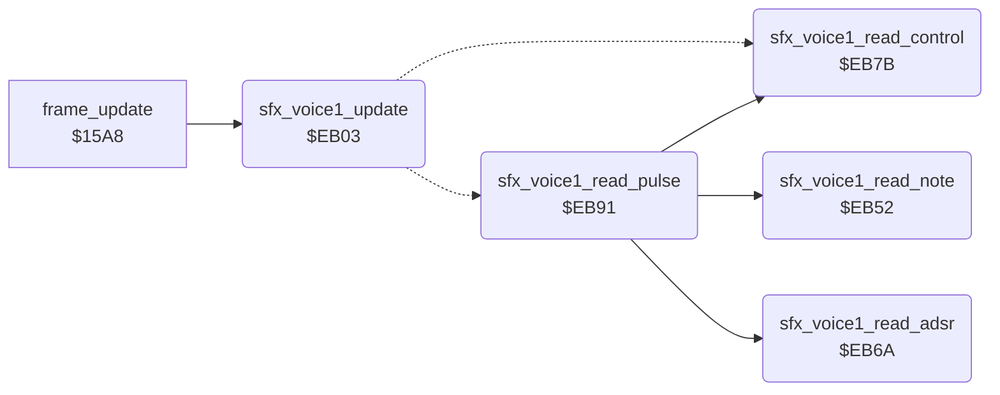

<!-- Generated by c64-docs from knowledge revision 20261018T152957.577-ll4gr6 and src/source-map.json. Do not edit: change the knowledge, generate the source again, then run docs.ts generate. -->
# sfx_voice1.asm: Sound effect player for SID voice 1

Range `$EB00-$EBE4`. Source: [sfx_voice1.asm](../../../src/sfx_voice1.asm). Index: [the reference](../index.md).

## Call graph

A solid arrow is a call, a thick arrow a table entry, a dotted arrow a jump. Rounded nodes are in this file.

## Data

| Range | Type | Name | Read by | Written by |
|---|---|---|---|---|
| [`$EB00`](../../../src/sfx_voice1.asm#L7)-`$EB02` | workspace | [`sfx_voice1_state`](../../../src/sfx_voice1.asm#L6) | [`play_sound`](sound_request.md#play_sound), [`sfx_voice1_update`](sfx_voice1.md#sfx_voice1_update) | [`cold_start`](cold_start.md#cold_start), [`play_sound`](sound_request.md#play_sound), [`stop_all_sounds`](sound_request.md#stop_all_sounds), [`sfx_voice1_update`](sfx_voice1.md#sfx_voice1_update), [`sfx_voice1_read_note`](sfx_voice1.md#sfx_voice1_read_note), [`sfx_voice1_read_control`](sfx_voice1.md#sfx_voice1_read_control), [`sfx_voice1_read_pulse`](sfx_voice1.md#sfx_voice1_read_pulse) |
| [`$EB3A`](../../../src/sfx_voice1.asm#L53)-`$EB51` | jumps | [`sfx_voice1_cmd_jumps`](../../../src/sfx_voice1.asm#L52) |  |  |

## Names

### [`sfx_voice1_state`](../../../src/sfx_voice1.asm#L6) `$EB00`

*variable*

Effect state of SID voice 1: 0 = idle; $80 + n = request for effect n (written by play_sound); 1 = playing.

- **Read by:** [`play_sound`](sound_request.md#play_sound) [`$250E`](../../../src/sound_request.asm#L15), [`sfx_voice1_update`](sfx_voice1.md#sfx_voice1_update) [`$EB03`](../../../src/sfx_voice1.asm#L20)
- **Written by:** [`cold_start`](cold_start.md#cold_start) [`$0417`](../../../src/cold_start.asm#L41), [`play_sound`](sound_request.md#play_sound) [`$2513`](../../../src/sound_request.asm#L18), [`stop_all_sounds`](sound_request.md#stop_all_sounds) [`$2560`](../../../src/sound_request.asm#L65), [`sfx_voice1_update`](sfx_voice1.md#sfx_voice1_update) [`$EB1C`](../../../src/sfx_voice1.asm#L34), [`sfx_voice1_read_control`](sfx_voice1.md#sfx_voice1_read_control) [`$EB8A`](../../../src/sfx_voice1.asm#L99)

### [`sfx_voice1_pos`](../../../src/sfx_voice1.asm#L8) `$EB01`

*variable*

offset of the next command in the effect stream

- **Read by:** [`sfx_voice1_update`](sfx_voice1.md#sfx_voice1_update) [`$EB2B`](../../../src/sfx_voice1.asm#L41)
- **Written by:** [`sfx_voice1_update`](sfx_voice1.md#sfx_voice1_update) [`$EB23`](../../../src/sfx_voice1.asm#L37), [`sfx_voice1_read_control`](sfx_voice1.md#sfx_voice1_read_control) [`$EB8D`](../../../src/sfx_voice1.asm#L100), [`sfx_voice1_read_pulse`](sfx_voice1.md#sfx_voice1_read_pulse) [`$EBA5`](../../../src/sfx_voice1.asm#L115), [`sfx_voice1_read_pulse`](sfx_voice1.md#sfx_voice1_read_pulse) [`$EBAF`](../../../src/sfx_voice1.asm#L121), [`sfx_voice1_read_pulse`](sfx_voice1.md#sfx_voice1_read_pulse) [`$EBBC`](../../../src/sfx_voice1.asm#L128), [`sfx_voice1_read_pulse`](sfx_voice1.md#sfx_voice1_read_pulse) [`$EBCC`](../../../src/sfx_voice1.asm#L136), [`sfx_voice1_read_pulse`](sfx_voice1.md#sfx_voice1_read_pulse) [`$EBD9`](../../../src/sfx_voice1.asm#L143), [`sfx_voice1_read_pulse`](sfx_voice1.md#sfx_voice1_read_pulse) [`$EBE1`](../../../src/sfx_voice1.asm#L151)

### [`sfx_voice1_timer`](../../../src/sfx_voice1.asm#L10) `$EB02`

*variable*

frames until the next command

- **Read by:** [`sfx_voice1_update`](sfx_voice1.md#sfx_voice1_update) [`$EB26`](../../../src/sfx_voice1.asm#L39)
- **Written by:** [`sfx_voice1_update`](sfx_voice1.md#sfx_voice1_update) [`$EB19`](../../../src/sfx_voice1.asm#L33), [`sfx_voice1_update`](sfx_voice1.md#sfx_voice1_update) [`$EB26`](../../../src/sfx_voice1.asm#L39), [`sfx_voice1_read_note`](sfx_voice1.md#sfx_voice1_read_note) [`$EB55`](../../../src/sfx_voice1.asm#L68)

### [`sfx_voice1_update`](../../../src/sfx_voice1.asm#L19) `$EB03`

*routine*

Sound effect player of SID voice 1 (registers from $D400 (FRELO1)), called every frame by frame_update, which irq_game_bottom runs. A request ($80 + n) sets the stream pointer sfx_voice1_stream from sfx_stream_table, the timer to 1 and the state to 1, and clears the voice control register. Each frame the timer counts down; at 0 the player runs one stream command, whose duration reloads the timer. The command byte selects a handler of the jump table through sfx_cmd_offsets and the self-modified branch. The three effect players are identical apart from the SID registers, the pointer and the state.

- **Called from:** [`frame_update`](frame_update.md#frame_update) [`$15AF`](../../../src/frame_update.asm#L25)
- **Jumps to:** [`sfx_voice1_cmd_end`](sfx_voice1.md#sfx_voice1_cmd_end), [`sfx_voice1_cmd_note`](sfx_voice1.md#sfx_voice1_cmd_note), [`sfx_voice1_cmd_note_control`](sfx_voice1.md#sfx_voice1_cmd_note_control), [`sfx_voice1_cmd_note_adsr_control`](sfx_voice1.md#sfx_voice1_cmd_note_adsr_control), [`sfx_voice1_cmd_note_adsr_pulse_control`](sfx_voice1.md#sfx_voice1_cmd_note_adsr_pulse_control), [`sfx_voice1_cmd_note_pulse_control`](sfx_voice1.md#sfx_voice1_cmd_note_pulse_control), [`sfx_voice1_cmd_control`](sfx_voice1.md#sfx_voice1_cmd_control)
- **Reads:** [`sfx_voice1_state`](sfx_voice1.md#sfx_voice1_state), [`sfx_voice1_timer`](sfx_voice1.md#sfx_voice1_timer), [`sfx_voice1_pos`](sfx_voice1.md#sfx_voice1_pos), [`sfx_voice1_stream`](../memory-map.md#sfx_voice1_stream)
- **Writes:** [`sfx_voice1_stream`](../memory-map.md#sfx_voice1_stream), [`sfx_voice1_stream+1`](../memory-map.md#sfx_voice1_stream), [`sfx_voice1_timer`](sfx_voice1.md#sfx_voice1_timer), [`sfx_voice1_state`](sfx_voice1.md#sfx_voice1_state), [`VCREG1`](../memory-map.md#VCREG1), [`sfx_voice1_pos`](sfx_voice1.md#sfx_voice1_pos)
- **Refers to:** [`sfx_stream_table`](sfx_data.md#sfx_stream_table), [`sfx_stream_table+1`](sfx_data.md#sfx_stream_table), [`sfx_voice1_stream`](../memory-map.md#sfx_voice1_stream), [`sfx_cmd_offsets`](sfx_data.md#sfx_cmd_offsets)

### [`sfx_voice1_update_done`](../../../src/sfx_voice1.asm#L22) `$EB08`

*label*

- **Jumped to from:** [`sfx_voice1_update`](sfx_voice1.md#sfx_voice1_update) [`$EB29`](../../../src/sfx_voice1.asm#L40)

### [`sfx_voice1_check_request`](../../../src/sfx_voice1.asm#L24) `$EB09`

*label*

- **Jumped to from:** [`sfx_voice1_update`](sfx_voice1.md#sfx_voice1_update) [`$EB06`](../../../src/sfx_voice1.asm#L21)

### [`sfx_voice1_tick`](../../../src/sfx_voice1.asm#L38) `$EB26`

*label*

- **Jumped to from:** [`sfx_voice1_update`](sfx_voice1.md#sfx_voice1_update) [`$EB09`](../../../src/sfx_voice1.asm#L25)

### [`sfx_voice1_cmd_branch`](../../../src/sfx_voice1.asm#L47) `$EB38`

*label*

self-modified: offset from sfx_cmd_offsets, always taken (C = 0)

- **Jumped to from:** [`sfx_voice1_update`](sfx_voice1.md#sfx_voice1_update) [`$EB38`](../../../src/sfx_voice1.asm#L49)

### [`sfx_voice1_cmd_offset`](../../../src/sfx_voice1.asm#L48) `$EB39`

*label*

- **Written by:** [`sfx_voice1_update`](sfx_voice1.md#sfx_voice1_update) [`$EB34`](../../../src/sfx_voice1.asm#L45)

### [`sfx_voice1_cmd_jumps`](../../../src/sfx_voice1.asm#L52) `$EB3A`

*label*

Stream commands 0-7: end, note, note+control, note+ADSR+control, note+ADSR+pulse+control, note+pulse+control (5 and 6), control only.

### [`sfx_voice1_read_note`](../../../src/sfx_voice1.asm#L65) `$EB52`

*routine*

Reads the duration (to the timer) and the note number of a command and writes the note frequency from note_freq_lo/hi. Input: Y = offset of the command byte. Output: Y = offset after the note.

- **Called from:** [`sfx_voice1_read_pulse`](sfx_voice1.md#sfx_voice1_read_pulse) [`$EBA2`](../../../src/sfx_voice1.asm#L114), [`sfx_voice1_read_pulse`](sfx_voice1.md#sfx_voice1_read_pulse) [`$EBA9`](../../../src/sfx_voice1.asm#L119), [`sfx_voice1_read_pulse`](sfx_voice1.md#sfx_voice1_read_pulse) [`$EBB3`](../../../src/sfx_voice1.asm#L125), [`sfx_voice1_read_pulse`](sfx_voice1.md#sfx_voice1_read_pulse) [`$EBC0`](../../../src/sfx_voice1.asm#L132), [`sfx_voice1_read_pulse`](sfx_voice1.md#sfx_voice1_read_pulse) [`$EBD0`](../../../src/sfx_voice1.asm#L140)
- **Reads:** [`sfx_voice1_stream`](../memory-map.md#sfx_voice1_stream)
- **Writes:** [`sfx_voice1_timer`](sfx_voice1.md#sfx_voice1_timer), [`FRELO1`](../memory-map.md#FRELO1), [`FREHI1`](../memory-map.md#FREHI1)
- **Refers to:** [`note_freq_lo`](music_frequency_table.md#note_freq_lo), [`note_freq_hi`](music_frequency_table.md#note_freq_hi)

### [`sfx_voice1_read_adsr`](../../../src/sfx_voice1.asm#L79) `$EB6A`

*routine*

Reads an ADSR index (even) and writes the pair from sfx_adsr_table to AD and SR. Y advances.

- **Called from:** [`sfx_voice1_read_pulse`](sfx_voice1.md#sfx_voice1_read_pulse) [`$EBB6`](../../../src/sfx_voice1.asm#L126), [`sfx_voice1_read_pulse`](sfx_voice1.md#sfx_voice1_read_pulse) [`$EBC3`](../../../src/sfx_voice1.asm#L133)
- **Reads:** [`sfx_voice1_stream`](../memory-map.md#sfx_voice1_stream)
- **Writes:** [`ATDCY1`](../memory-map.md#ATDCY1), [`SUREL1`](../memory-map.md#SUREL1)
- **Refers to:** [`sfx_adsr_table`](sfx_data.md#sfx_adsr_table), [`sfx_adsr_table+1`](sfx_data.md#sfx_adsr_table)

### [`sfx_voice1_read_control`](../../../src/sfx_voice1.asm#L89) `$EB7B`

*routine*

Reads a control byte (waveform, gate) and writes it to the voice control register. Y advances.

- **Called from:** [`sfx_voice1_read_pulse`](sfx_voice1.md#sfx_voice1_read_pulse) [`$EBAC`](../../../src/sfx_voice1.asm#L120), [`sfx_voice1_read_pulse`](sfx_voice1.md#sfx_voice1_read_pulse) [`$EBB9`](../../../src/sfx_voice1.asm#L127), [`sfx_voice1_read_pulse`](sfx_voice1.md#sfx_voice1_read_pulse) [`$EBC9`](../../../src/sfx_voice1.asm#L135), [`sfx_voice1_read_pulse`](sfx_voice1.md#sfx_voice1_read_pulse) [`$EBD6`](../../../src/sfx_voice1.asm#L142), [`sfx_voice1_read_pulse`](sfx_voice1.md#sfx_voice1_read_pulse) [`$EBDE`](../../../src/sfx_voice1.asm#L150)
- **Reads:** [`sfx_voice1_stream`](../memory-map.md#sfx_voice1_stream)
- **Writes:** [`VCREG1`](../memory-map.md#VCREG1), [`FRELO1`](../memory-map.md#FRELO1), [`FREHI1`](../memory-map.md#FREHI1), [`sfx_voice1_state`](sfx_voice1.md#sfx_voice1_state), [`sfx_voice1_pos`](sfx_voice1.md#sfx_voice1_pos)

### [`sfx_voice1_cmd_end`](../../../src/sfx_voice1.asm#L95) `$EB82`

*label*

Command 0: end of the effect. Frequency 0, state idle. The gate is left as it is.

- **Jumped to from:** [`sfx_voice1_update`](sfx_voice1.md#sfx_voice1_update) [`$EB3A`](../../../src/sfx_voice1.asm#L53)
- **Entry of:** [`sfx_voice1_cmd_jumps`](../tables.md#sfx_voice1_cmd_jumps)

### [`sfx_voice1_read_pulse`](../../../src/sfx_voice1.asm#L103) `$EB91`

*routine*

Reads a pulse index (even) and writes the pulse width from sfx_pulse_table. Y advances.

- **Calls:** [`sfx_voice1_read_note`](sfx_voice1.md#sfx_voice1_read_note), [`sfx_voice1_read_control`](sfx_voice1.md#sfx_voice1_read_control), [`sfx_voice1_read_adsr`](sfx_voice1.md#sfx_voice1_read_adsr)
- **Reads:** [`sfx_voice1_stream`](../memory-map.md#sfx_voice1_stream)
- **Writes:** [`PWLO1`](../memory-map.md#PWLO1), [`PWHI1`](../memory-map.md#PWHI1), [`sfx_voice1_pos`](sfx_voice1.md#sfx_voice1_pos)
- **Refers to:** [`sfx_pulse_table`](sfx_data.md#sfx_pulse_table), [`sfx_pulse_table+1`](sfx_data.md#sfx_pulse_table)

### [`sfx_voice1_cmd_note`](../../../src/sfx_voice1.asm#L113) `$EBA2`

*label*

Command 1: duration, note.

- **Jumped to from:** [`sfx_voice1_update`](sfx_voice1.md#sfx_voice1_update) [`$EB3D`](../../../src/sfx_voice1.asm#L54)
- **Entry of:** [`sfx_voice1_cmd_jumps`](../tables.md#sfx_voice1_cmd_jumps)

### [`sfx_voice1_cmd_note_control`](../../../src/sfx_voice1.asm#L118) `$EBA9`

*label*

Command 2: duration, note, control.

- **Jumped to from:** [`sfx_voice1_update`](sfx_voice1.md#sfx_voice1_update) [`$EB40`](../../../src/sfx_voice1.asm#L55)
- **Entry of:** [`sfx_voice1_cmd_jumps`](../tables.md#sfx_voice1_cmd_jumps)

### [`sfx_voice1_cmd_note_adsr_control`](../../../src/sfx_voice1.asm#L124) `$EBB3`

*label*

Command 3: duration, note, ADSR index, control.

- **Jumped to from:** [`sfx_voice1_update`](sfx_voice1.md#sfx_voice1_update) [`$EB43`](../../../src/sfx_voice1.asm#L56)
- **Entry of:** [`sfx_voice1_cmd_jumps`](../tables.md#sfx_voice1_cmd_jumps)

### [`sfx_voice1_cmd_note_adsr_pulse_control`](../../../src/sfx_voice1.asm#L131) `$EBC0`

*label*

Command 4: duration, note, ADSR index, pulse index, control.

- **Jumped to from:** [`sfx_voice1_update`](sfx_voice1.md#sfx_voice1_update) [`$EB46`](../../../src/sfx_voice1.asm#L57)
- **Entry of:** [`sfx_voice1_cmd_jumps`](../tables.md#sfx_voice1_cmd_jumps)

### [`sfx_voice1_cmd_note_pulse_control`](../../../src/sfx_voice1.asm#L139) `$EBD0`

*label*

Commands 5 and 6: duration, note, pulse index, control.

- **Jumped to from:** [`sfx_voice1_update`](sfx_voice1.md#sfx_voice1_update) [`$EB49`](../../../src/sfx_voice1.asm#L59), [`sfx_voice1_update`](sfx_voice1.md#sfx_voice1_update) [`$EB4C`](../../../src/sfx_voice1.asm#L60)
- **Entry of:** [`sfx_voice1_cmd_jumps`](../tables.md#sfx_voice1_cmd_jumps)

### [`sfx_voice1_cmd_control`](../../../src/sfx_voice1.asm#L147) `$EBDD`

*label*

Command 7: control byte only. The timer is not reloaded, so the next command runs 256 frames later. No effect stream uses it.

- **Jumped to from:** [`sfx_voice1_update`](sfx_voice1.md#sfx_voice1_update) [`$EB4F`](../../../src/sfx_voice1.asm#L62)
- **Entry of:** [`sfx_voice1_cmd_jumps`](../tables.md#sfx_voice1_cmd_jumps)
