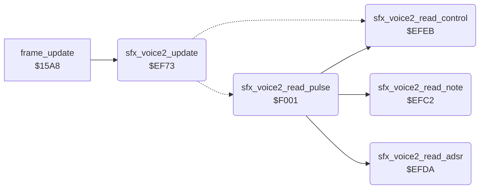

<!-- Generated by c64-docs from knowledge revision 20261018T093012.029-a2us40 and src/source-map.json. Do not edit: change the knowledge, generate the source again, then run docs.ts generate. -->
# sfx_voice2.asm: Sound effect player for SID voice 2

Range `$EF70-$F054`. Source: [sfx_voice2.asm](../../../src/sfx_voice2.asm). Index: [the reference](../index.md).

## Call graph

A solid arrow is a call, a thick arrow a table entry, a dotted arrow a jump. Rounded nodes are in this file.

## Data

| Range | Type | Name | Read by | Written by |
|---|---|---|---|---|
| [`$EF70`](../../../src/sfx_voice2.asm#L7)-`$EF72` | workspace | [`sfx_voice2_state`](../../../src/sfx_voice2.asm#L6) | [`play_sound`](sound_request.md#play_sound), [`sfx_voice2_update`](sfx_voice2.md#sfx_voice2_update) | [`cold_start`](cold_start.md#cold_start), [`play_sound`](sound_request.md#play_sound), [`stop_all_sounds`](sound_request.md#stop_all_sounds), [`sfx_voice2_update`](sfx_voice2.md#sfx_voice2_update), [`sfx_voice2_read_note`](sfx_voice2.md#sfx_voice2_read_note), [`sfx_voice2_read_control`](sfx_voice2.md#sfx_voice2_read_control), [`sfx_voice2_read_pulse`](sfx_voice2.md#sfx_voice2_read_pulse) |
| [`$EFAA`](../../../src/sfx_voice2.asm#L53)-`$EFC1` | jumps | [`sfx_voice2_cmd_jumps`](../../../src/sfx_voice2.asm#L52) |  |  |

## Names

### [`sfx_voice2_state`](../../../src/sfx_voice2.asm#L6) `$EF70`

*variable*

Effect state of SID voice 2: 0 = idle; $80 + n = request for effect n (written by play_sound); 1 = playing.

- **Read by:** [`play_sound`](sound_request.md#play_sound) [`$2521`](../../../src/sound_request.asm#L26), [`sfx_voice2_update`](sfx_voice2.md#sfx_voice2_update) [`$EF73`](../../../src/sfx_voice2.asm#L20)
- **Written by:** [`cold_start`](cold_start.md#cold_start) [`$041A`](../../../src/cold_start.asm#L42), [`play_sound`](sound_request.md#play_sound) [`$2526`](../../../src/sound_request.asm#L29), [`stop_all_sounds`](sound_request.md#stop_all_sounds) [`$2563`](../../../src/sound_request.asm#L66), [`sfx_voice2_update`](sfx_voice2.md#sfx_voice2_update) [`$EF8C`](../../../src/sfx_voice2.asm#L34), [`sfx_voice2_read_control`](sfx_voice2.md#sfx_voice2_read_control) [`$EFFA`](../../../src/sfx_voice2.asm#L99)

### [`sfx_voice2_pos`](../../../src/sfx_voice2.asm#L8) `$EF71`

*variable*

offset of the next command in the effect stream

- **Read by:** [`sfx_voice2_update`](sfx_voice2.md#sfx_voice2_update) [`$EF9B`](../../../src/sfx_voice2.asm#L41)
- **Written by:** [`sfx_voice2_update`](sfx_voice2.md#sfx_voice2_update) [`$EF93`](../../../src/sfx_voice2.asm#L37), [`sfx_voice2_read_control`](sfx_voice2.md#sfx_voice2_read_control) [`$EFFD`](../../../src/sfx_voice2.asm#L100), [`sfx_voice2_read_pulse`](sfx_voice2.md#sfx_voice2_read_pulse) [`$F015`](../../../src/sfx_voice2.asm#L115), [`sfx_voice2_read_pulse`](sfx_voice2.md#sfx_voice2_read_pulse) [`$F01F`](../../../src/sfx_voice2.asm#L121), [`sfx_voice2_read_pulse`](sfx_voice2.md#sfx_voice2_read_pulse) [`$F02C`](../../../src/sfx_voice2.asm#L128), [`sfx_voice2_read_pulse`](sfx_voice2.md#sfx_voice2_read_pulse) [`$F03C`](../../../src/sfx_voice2.asm#L136), [`sfx_voice2_read_pulse`](sfx_voice2.md#sfx_voice2_read_pulse) [`$F049`](../../../src/sfx_voice2.asm#L143), [`sfx_voice2_read_pulse`](sfx_voice2.md#sfx_voice2_read_pulse) [`$F051`](../../../src/sfx_voice2.asm#L151)

### [`sfx_voice2_timer`](../../../src/sfx_voice2.asm#L10) `$EF72`

*variable*

frames until the next command

- **Read by:** [`sfx_voice2_update`](sfx_voice2.md#sfx_voice2_update) [`$EF96`](../../../src/sfx_voice2.asm#L39)
- **Written by:** [`sfx_voice2_update`](sfx_voice2.md#sfx_voice2_update) [`$EF89`](../../../src/sfx_voice2.asm#L33), [`sfx_voice2_update`](sfx_voice2.md#sfx_voice2_update) [`$EF96`](../../../src/sfx_voice2.asm#L39), [`sfx_voice2_read_note`](sfx_voice2.md#sfx_voice2_read_note) [`$EFC5`](../../../src/sfx_voice2.asm#L68)

### [`sfx_voice2_update`](../../../src/sfx_voice2.asm#L19) `$EF73`

*routine*

Sound effect player of SID voice 2 (registers from $D407 (FRELO2)), called every frame by frame_update, which irq_game_bottom runs. A request ($80 + n) sets the stream pointer sfx_voice2_stream from sfx_stream_table, the timer to 1 and the state to 1, and clears the voice control register. Each frame the timer counts down; at 0 the player runs one stream command, whose duration reloads the timer. The command byte selects a handler of the jump table through sfx_cmd_offsets and the self-modified branch. The three effect players are identical apart from the SID registers, the pointer and the state.

- **Called from:** [`frame_update`](frame_update.md#frame_update) [`$15B2`](../../../src/frame_update.asm#L26)
- **Jumps to:** [`sfx_voice2_cmd_end`](sfx_voice2.md#sfx_voice2_cmd_end), [`sfx_voice2_cmd_note`](sfx_voice2.md#sfx_voice2_cmd_note), [`sfx_voice2_cmd_note_control`](sfx_voice2.md#sfx_voice2_cmd_note_control), [`sfx_voice2_cmd_note_adsr_control`](sfx_voice2.md#sfx_voice2_cmd_note_adsr_control), [`sfx_voice2_cmd_note_adsr_pulse_control`](sfx_voice2.md#sfx_voice2_cmd_note_adsr_pulse_control), [`sfx_voice2_cmd_note_pulse_control`](sfx_voice2.md#sfx_voice2_cmd_note_pulse_control), [`sfx_voice2_cmd_control`](sfx_voice2.md#sfx_voice2_cmd_control)
- **Reads:** [`sfx_voice2_state`](sfx_voice2.md#sfx_voice2_state), [`sfx_voice2_timer`](sfx_voice2.md#sfx_voice2_timer), [`sfx_voice2_pos`](sfx_voice2.md#sfx_voice2_pos), [`sfx_voice2_stream`](../variables.md#sfx_voice2_stream)
- **Writes:** [`sfx_voice2_stream`](../variables.md#sfx_voice2_stream), [`sfx_voice2_stream+1`](../variables.md#sfx_voice2_stream), [`sfx_voice2_timer`](sfx_voice2.md#sfx_voice2_timer), [`sfx_voice2_state`](sfx_voice2.md#sfx_voice2_state), [`VCREG2`](../variables.md#VCREG2), [`sfx_voice2_pos`](sfx_voice2.md#sfx_voice2_pos)
- **Refers to:** [`sfx_stream_table`](sfx_data.md#sfx_stream_table), [`sfx_stream_table+1`](sfx_data.md#sfx_stream_table), [`sfx_voice2_stream`](../variables.md#sfx_voice2_stream), [`sfx_cmd_offsets`](sfx_data.md#sfx_cmd_offsets)

### [`sfx_voice2_update_done`](../../../src/sfx_voice2.asm#L22) `$EF78`

*label*

- **Jumped to from:** [`sfx_voice2_update`](sfx_voice2.md#sfx_voice2_update) [`$EF99`](../../../src/sfx_voice2.asm#L40)

### [`sfx_voice2_check_request`](../../../src/sfx_voice2.asm#L24) `$EF79`

*label*

- **Jumped to from:** [`sfx_voice2_update`](sfx_voice2.md#sfx_voice2_update) [`$EF76`](../../../src/sfx_voice2.asm#L21)

### [`sfx_voice2_tick`](../../../src/sfx_voice2.asm#L38) `$EF96`

*label*

- **Jumped to from:** [`sfx_voice2_update`](sfx_voice2.md#sfx_voice2_update) [`$EF79`](../../../src/sfx_voice2.asm#L25)

### [`sfx_voice2_cmd_branch`](../../../src/sfx_voice2.asm#L47) `$EFA8`

*label*

self-modified: offset from sfx_cmd_offsets, always taken (C = 0)

- **Jumped to from:** [`sfx_voice2_update`](sfx_voice2.md#sfx_voice2_update) [`$EFA8`](../../../src/sfx_voice2.asm#L49)

### [`sfx_voice2_cmd_offset`](../../../src/sfx_voice2.asm#L48) `$EFA9`

*label*

- **Written by:** [`sfx_voice2_update`](sfx_voice2.md#sfx_voice2_update) [`$EFA4`](../../../src/sfx_voice2.asm#L45)

### [`sfx_voice2_cmd_jumps`](../../../src/sfx_voice2.asm#L52) `$EFAA`

*label*

Stream commands 0-7: end, note, note+control, note+ADSR+control, note+ADSR+pulse+control, note+pulse+control (5 and 6), control only.

### [`sfx_voice2_read_note`](../../../src/sfx_voice2.asm#L65) `$EFC2`

*routine*

Reads the duration (to the timer) and the note number of a command and writes the note frequency from note_freq_lo/hi. Input: Y = offset of the command byte. Output: Y = offset after the note.

- **Called from:** [`sfx_voice2_read_pulse`](sfx_voice2.md#sfx_voice2_read_pulse) [`$F012`](../../../src/sfx_voice2.asm#L114), [`sfx_voice2_read_pulse`](sfx_voice2.md#sfx_voice2_read_pulse) [`$F019`](../../../src/sfx_voice2.asm#L119), [`sfx_voice2_read_pulse`](sfx_voice2.md#sfx_voice2_read_pulse) [`$F023`](../../../src/sfx_voice2.asm#L125), [`sfx_voice2_read_pulse`](sfx_voice2.md#sfx_voice2_read_pulse) [`$F030`](../../../src/sfx_voice2.asm#L132), [`sfx_voice2_read_pulse`](sfx_voice2.md#sfx_voice2_read_pulse) [`$F040`](../../../src/sfx_voice2.asm#L140)
- **Reads:** [`sfx_voice2_stream`](../variables.md#sfx_voice2_stream)
- **Writes:** [`sfx_voice2_timer`](sfx_voice2.md#sfx_voice2_timer), [`FRELO2`](../variables.md#FRELO2), [`FREHI2`](../variables.md#FREHI2)
- **Refers to:** [`note_freq_lo`](music_frequency_table.md#note_freq_lo), [`note_freq_hi`](music_frequency_table.md#note_freq_hi)

### [`sfx_voice2_read_adsr`](../../../src/sfx_voice2.asm#L79) `$EFDA`

*routine*

Reads an ADSR index (even) and writes the pair from sfx_adsr_table to AD and SR. Y advances.

- **Called from:** [`sfx_voice2_read_pulse`](sfx_voice2.md#sfx_voice2_read_pulse) [`$F026`](../../../src/sfx_voice2.asm#L126), [`sfx_voice2_read_pulse`](sfx_voice2.md#sfx_voice2_read_pulse) [`$F033`](../../../src/sfx_voice2.asm#L133)
- **Reads:** [`sfx_voice2_stream`](../variables.md#sfx_voice2_stream)
- **Writes:** [`ATDCY2`](../variables.md#ATDCY2), [`SUREL2`](../variables.md#SUREL2)
- **Refers to:** [`sfx_adsr_table`](sfx_data.md#sfx_adsr_table), [`sfx_adsr_table+1`](sfx_data.md#sfx_adsr_table)

### [`sfx_voice2_read_control`](../../../src/sfx_voice2.asm#L89) `$EFEB`

*routine*

Reads a control byte (waveform, gate) and writes it to the voice control register. Y advances.

- **Called from:** [`sfx_voice2_read_pulse`](sfx_voice2.md#sfx_voice2_read_pulse) [`$F01C`](../../../src/sfx_voice2.asm#L120), [`sfx_voice2_read_pulse`](sfx_voice2.md#sfx_voice2_read_pulse) [`$F029`](../../../src/sfx_voice2.asm#L127), [`sfx_voice2_read_pulse`](sfx_voice2.md#sfx_voice2_read_pulse) [`$F039`](../../../src/sfx_voice2.asm#L135), [`sfx_voice2_read_pulse`](sfx_voice2.md#sfx_voice2_read_pulse) [`$F046`](../../../src/sfx_voice2.asm#L142), [`sfx_voice2_read_pulse`](sfx_voice2.md#sfx_voice2_read_pulse) [`$F04E`](../../../src/sfx_voice2.asm#L150)
- **Reads:** [`sfx_voice2_stream`](../variables.md#sfx_voice2_stream)
- **Writes:** [`VCREG2`](../variables.md#VCREG2), [`FRELO2`](../variables.md#FRELO2), [`FREHI2`](../variables.md#FREHI2), [`sfx_voice2_state`](sfx_voice2.md#sfx_voice2_state), [`sfx_voice2_pos`](sfx_voice2.md#sfx_voice2_pos)

### [`sfx_voice2_cmd_end`](../../../src/sfx_voice2.asm#L95) `$EFF2`

*label*

Command 0: end of the effect. Frequency 0, state idle. The gate is left as it is.

- **Jumped to from:** [`sfx_voice2_update`](sfx_voice2.md#sfx_voice2_update) [`$EFAA`](../../../src/sfx_voice2.asm#L53)
- **Entry of:** [`sfx_voice2_cmd_jumps`](../tables.md#sfx_voice2_cmd_jumps)

### [`sfx_voice2_read_pulse`](../../../src/sfx_voice2.asm#L103) `$F001`

*routine*

Reads a pulse index (even) and writes the pulse width from sfx_pulse_table. Y advances.

- **Calls:** [`sfx_voice2_read_note`](sfx_voice2.md#sfx_voice2_read_note), [`sfx_voice2_read_control`](sfx_voice2.md#sfx_voice2_read_control), [`sfx_voice2_read_adsr`](sfx_voice2.md#sfx_voice2_read_adsr)
- **Reads:** [`sfx_voice2_stream`](../variables.md#sfx_voice2_stream)
- **Writes:** [`PWLO2`](../variables.md#PWLO2), [`PWHI2`](../variables.md#PWHI2), [`sfx_voice2_pos`](sfx_voice2.md#sfx_voice2_pos)
- **Refers to:** [`sfx_pulse_table`](sfx_data.md#sfx_pulse_table), [`sfx_pulse_table+1`](sfx_data.md#sfx_pulse_table)

### [`sfx_voice2_cmd_note`](../../../src/sfx_voice2.asm#L113) `$F012`

*label*

Command 1: duration, note.

- **Jumped to from:** [`sfx_voice2_update`](sfx_voice2.md#sfx_voice2_update) [`$EFAD`](../../../src/sfx_voice2.asm#L54)
- **Entry of:** [`sfx_voice2_cmd_jumps`](../tables.md#sfx_voice2_cmd_jumps)

### [`sfx_voice2_cmd_note_control`](../../../src/sfx_voice2.asm#L118) `$F019`

*label*

Command 2: duration, note, control.

- **Jumped to from:** [`sfx_voice2_update`](sfx_voice2.md#sfx_voice2_update) [`$EFB0`](../../../src/sfx_voice2.asm#L55)
- **Entry of:** [`sfx_voice2_cmd_jumps`](../tables.md#sfx_voice2_cmd_jumps)

### [`sfx_voice2_cmd_note_adsr_control`](../../../src/sfx_voice2.asm#L124) `$F023`

*label*

Command 3: duration, note, ADSR index, control.

- **Jumped to from:** [`sfx_voice2_update`](sfx_voice2.md#sfx_voice2_update) [`$EFB3`](../../../src/sfx_voice2.asm#L56)
- **Entry of:** [`sfx_voice2_cmd_jumps`](../tables.md#sfx_voice2_cmd_jumps)

### [`sfx_voice2_cmd_note_adsr_pulse_control`](../../../src/sfx_voice2.asm#L131) `$F030`

*label*

Command 4: duration, note, ADSR index, pulse index, control.

- **Jumped to from:** [`sfx_voice2_update`](sfx_voice2.md#sfx_voice2_update) [`$EFB6`](../../../src/sfx_voice2.asm#L57)
- **Entry of:** [`sfx_voice2_cmd_jumps`](../tables.md#sfx_voice2_cmd_jumps)

### [`sfx_voice2_cmd_note_pulse_control`](../../../src/sfx_voice2.asm#L139) `$F040`

*label*

Commands 5 and 6: duration, note, pulse index, control.

- **Jumped to from:** [`sfx_voice2_update`](sfx_voice2.md#sfx_voice2_update) [`$EFB9`](../../../src/sfx_voice2.asm#L59), [`sfx_voice2_update`](sfx_voice2.md#sfx_voice2_update) [`$EFBC`](../../../src/sfx_voice2.asm#L60)
- **Entry of:** [`sfx_voice2_cmd_jumps`](../tables.md#sfx_voice2_cmd_jumps)

### [`sfx_voice2_cmd_control`](../../../src/sfx_voice2.asm#L147) `$F04D`

*label*

Command 7: control byte only. The timer is not reloaded, so the next command runs 256 frames later. No effect stream uses it.

- **Jumped to from:** [`sfx_voice2_update`](sfx_voice2.md#sfx_voice2_update) [`$EFBF`](../../../src/sfx_voice2.asm#L62)
- **Entry of:** [`sfx_voice2_cmd_jumps`](../tables.md#sfx_voice2_cmd_jumps)
