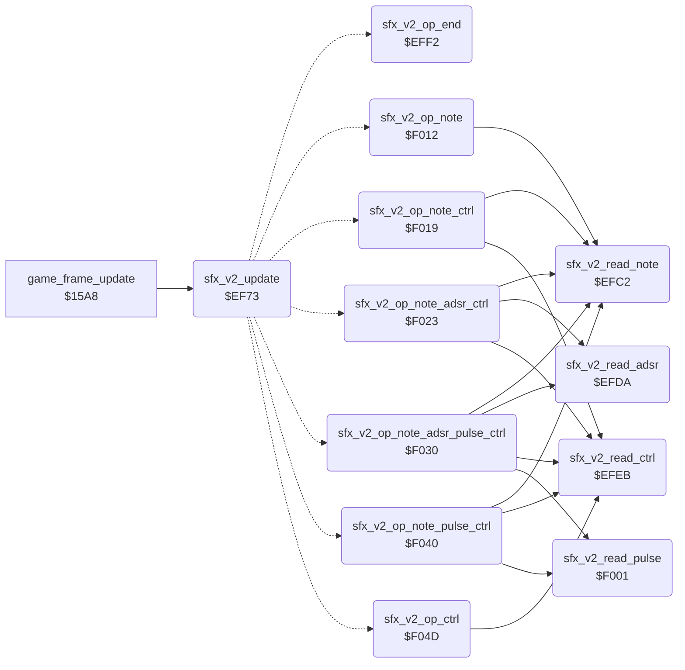

<!-- Generated by c64-docs from knowledge revision 20261016T170255.379-vv114c and src/source-map.json. Do not edit: change the knowledge, generate the source again, then run generate.ts. -->
# sfx_voice2.asm: Sound effect player for SID voice 2

Range `$EF70-$F06F`. Source: [sfx_voice2.asm](../../../src/sfx_voice2.asm). Index: [the reference](../index.md).

## Call graph

A solid arrow is a call, a thick arrow a table entry, a dotted arrow a jump. Rounded nodes are in this file.

## Data

| Range | Type | Name | Read by | Written by |
|---|---|---|---|---|
| [`$EF70`](../../../src/sfx_voice2.asm#L7)-`$EF72` | workspace | [`sfx_v2_state`](../../../src/sfx_voice2.asm#L6) | [`play_sound_effect`](sound_effects.md#play_sound_effect), [`sfx_v2_update`](sfx_voice2.md#sfx_v2_update) | [`cold_start`](init.md#cold_start), [`play_sound_effect`](sound_effects.md#play_sound_effect), [`silence_all_sound`](sound_effects.md#silence_all_sound), [`sfx_v2_update`](sfx_voice2.md#sfx_v2_update), [`sfx_v2_read_note`](sfx_voice2.md#sfx_v2_read_note), [`sfx_v2_op_end`](sfx_voice2.md#sfx_v2_op_end), [`sfx_v2_op_note`](sfx_voice2.md#sfx_v2_op_note), [`sfx_v2_op_note_ctrl`](sfx_voice2.md#sfx_v2_op_note_ctrl), [`sfx_v2_op_note_adsr_ctrl`](sfx_voice2.md#sfx_v2_op_note_adsr_ctrl), [`sfx_v2_op_note_adsr_pulse_ctrl`](sfx_voice2.md#sfx_v2_op_note_adsr_pulse_ctrl), [`sfx_v2_op_note_pulse_ctrl`](sfx_voice2.md#sfx_v2_op_note_pulse_ctrl), [`sfx_v2_op_ctrl`](sfx_voice2.md#sfx_v2_op_ctrl) |
| [`$EFAA`](../../../src/sfx_voice2.asm#L47)-`$EFC1` | jumps | [`sfx_v2_op_jumps`](../../../src/sfx_voice2.asm#L46) |  |  |
| [`$F055`](../../../src/sfx_voice2.asm#L146)-`$F06F` | unused |  |  |  |

## Names

### [`sfx_v2_state`](../../../src/sfx_voice2.asm#L6) `$EF70`

*variable*

Sound id that plays on channel 1 (0 = free).
bit7 set = start sound effect bits0-6; 1 = playing; 0 = idle

- **Read by:** [`play_sound_effect`](sound_effects.md#play_sound_effect) [`$2521`](../../../src/sound_effects.asm#L20), [`sfx_v2_update`](sfx_voice2.md#sfx_v2_update) [`$EF73`](../../../src/sfx_voice2.asm#L14)
- **Written by:** [`cold_start`](init.md#cold_start) [`$041A`](../../../src/init.asm#L26), [`play_sound_effect`](sound_effects.md#play_sound_effect) [`$2526`](../../../src/sound_effects.asm#L23), [`silence_all_sound`](sound_effects.md#silence_all_sound) [`$2563`](../../../src/sound_effects.asm#L58), [`sfx_v2_update`](sfx_voice2.md#sfx_v2_update) [`$EF8C`](../../../src/sfx_voice2.asm#L29), [`sfx_v2_op_end`](sfx_voice2.md#sfx_v2_op_end) [`$EFFA`](../../../src/sfx_voice2.asm#L93)

### [`sfx_v2_index`](../../../src/sfx_voice2.asm#L8) `$EF71`

*variable*

offset of the next record in the stream

- **Jumped to from:** [`$EF57`](../../../src/sfx_data.asm#L184), [`$EF6F`](../../../src/sfx_data.asm#L187)
- **Read by:** [`sfx_v2_update`](sfx_voice2.md#sfx_v2_update) [`$EF9B`](../../../src/sfx_voice2.asm#L36)
- **Written by:** [`sfx_v2_update`](sfx_voice2.md#sfx_v2_update) [`$EF93`](../../../src/sfx_voice2.asm#L32), [`sfx_v2_op_end`](sfx_voice2.md#sfx_v2_op_end) [`$EFFD`](../../../src/sfx_voice2.asm#L94), [`sfx_v2_op_note`](sfx_voice2.md#sfx_v2_op_note) [`$F015`](../../../src/sfx_voice2.asm#L109), [`sfx_v2_op_note_ctrl`](sfx_voice2.md#sfx_v2_op_note_ctrl) [`$F01F`](../../../src/sfx_voice2.asm#L115), [`sfx_v2_op_note_adsr_ctrl`](sfx_voice2.md#sfx_v2_op_note_adsr_ctrl) [`$F02C`](../../../src/sfx_voice2.asm#L122), [`sfx_v2_op_note_adsr_pulse_ctrl`](sfx_voice2.md#sfx_v2_op_note_adsr_pulse_ctrl) [`$F03C`](../../../src/sfx_voice2.asm#L130), [`sfx_v2_op_note_pulse_ctrl`](sfx_voice2.md#sfx_v2_op_note_pulse_ctrl) [`$F049`](../../../src/sfx_voice2.asm#L137), [`sfx_v2_op_ctrl`](sfx_voice2.md#sfx_v2_op_ctrl) [`$F051`](../../../src/sfx_voice2.asm#L144)

### [`sfx_v2_wait`](../../../src/sfx_voice2.asm#L10) `$EF72`

*variable*

frames until the next record

- **Read by:** [`sfx_v2_update`](sfx_voice2.md#sfx_v2_update) [`$EF96`](../../../src/sfx_voice2.asm#L34)
- **Written by:** [`sfx_v2_update`](sfx_voice2.md#sfx_v2_update) [`$EF89`](../../../src/sfx_voice2.asm#L28), [`sfx_v2_update`](sfx_voice2.md#sfx_v2_update) [`$EF96`](../../../src/sfx_voice2.asm#L34), [`sfx_v2_read_note`](sfx_voice2.md#sfx_v2_read_note) [`$EFC5`](../../../src/sfx_voice2.asm#L62)

### [`sfx_v2_update`](../../../src/sfx_voice2.asm#L13) `$EF73`

*routine*

Per-frame sound effect update for SID voice 2 ($D407): starts a requested effect (pointer from sfx_table into $F8/$F9), then runs the next stream record when the wait count reaches 0.

- **Called from:** [`game_frame_update`](frame_update.md#game_frame_update) [`$15B2`](../../../src/frame_update.asm#L12)
- **Jumps to:** [`sfx_v2_op_end`](sfx_voice2.md#sfx_v2_op_end), [`sfx_v2_op_note`](sfx_voice2.md#sfx_v2_op_note), [`sfx_v2_op_note_ctrl`](sfx_voice2.md#sfx_v2_op_note_ctrl), [`sfx_v2_op_note_adsr_ctrl`](sfx_voice2.md#sfx_v2_op_note_adsr_ctrl), [`sfx_v2_op_note_adsr_pulse_ctrl`](sfx_voice2.md#sfx_v2_op_note_adsr_pulse_ctrl), [`sfx_v2_op_note_pulse_ctrl`](sfx_voice2.md#sfx_v2_op_note_pulse_ctrl), [`sfx_v2_op_ctrl`](sfx_voice2.md#sfx_v2_op_ctrl)
- **Reads:** [`sfx_v2_state`](sfx_voice2.md#sfx_v2_state), [`sfx_v2_wait`](sfx_voice2.md#sfx_v2_wait), [`sfx_v2_index`](sfx_voice2.md#sfx_v2_index), [`sfx_v2_ptr`](../variables.md#sfx_v2_ptr)
- **Writes:** [`sfx_v2_ptr`](../variables.md#sfx_v2_ptr), [`sfx_v2_ptr+1`](../variables.md#sfx_v2_ptr), [`sfx_v2_wait`](sfx_voice2.md#sfx_v2_wait), [`sfx_v2_state`](sfx_voice2.md#sfx_v2_state), [`VCREG2`](../variables.md#VCREG2), [`sfx_v2_index`](sfx_voice2.md#sfx_v2_index)
- **Refers to:** [`sfx_table`](sfx_data.md#sfx_table), [`sfx_table+1`](sfx_data.md#sfx_table), [`sfx_v2_ptr`](../variables.md#sfx_v2_ptr), [`sfx_op_offsets`](sfx_data.md#sfx_op_offsets)

### [`sfx_v2_step`](../../../src/sfx_voice2.asm#L19) `$EF79`

*label*

- **Jumped to from:** [`sfx_v2_update`](sfx_voice2.md#sfx_v2_update) [`$EF76`](../../../src/sfx_voice2.asm#L16)

### [`sfx_v2_op_branch`](../../../src/sfx_voice2.asm#L44) `$EFA9`

*variable*

branch offset patched from sfx_op_offsets

- **Written by:** [`sfx_v2_update`](sfx_voice2.md#sfx_v2_update) [`$EFA4`](../../../src/sfx_voice2.asm#L41)

### [`sfx_v2_op_jumps`](../../../src/sfx_voice2.asm#L46) `$EFAA`

*label*

opcodes 0-7

### [`sfx_v2_read_note`](../../../src/sfx_voice2.asm#L59) `$EFC2`

*routine*

Reads the wait and note bytes of the record at Y+1 and sets the voice frequency from note_freq_lo/hi; Y points after them.

- **Called from:** [`sfx_v2_op_note`](sfx_voice2.md#sfx_v2_op_note) [`$F012`](../../../src/sfx_voice2.asm#L108), [`sfx_v2_op_note_ctrl`](sfx_voice2.md#sfx_v2_op_note_ctrl) [`$F019`](../../../src/sfx_voice2.asm#L113), [`sfx_v2_op_note_adsr_ctrl`](sfx_voice2.md#sfx_v2_op_note_adsr_ctrl) [`$F023`](../../../src/sfx_voice2.asm#L119), [`sfx_v2_op_note_adsr_pulse_ctrl`](sfx_voice2.md#sfx_v2_op_note_adsr_pulse_ctrl) [`$F030`](../../../src/sfx_voice2.asm#L126), [`sfx_v2_op_note_pulse_ctrl`](sfx_voice2.md#sfx_v2_op_note_pulse_ctrl) [`$F040`](../../../src/sfx_voice2.asm#L134)
- **Reads:** [`sfx_v2_ptr`](../variables.md#sfx_v2_ptr)
- **Writes:** [`sfx_v2_wait`](sfx_voice2.md#sfx_v2_wait), [`FRELO2`](../variables.md#FRELO2), [`FREHI2`](../variables.md#FREHI2)
- **Refers to:** [`note_freq_lo`](music_player.md#note_freq_lo), [`note_freq_hi`](music_player.md#note_freq_hi)

### [`sfx_v2_read_adsr`](../../../src/sfx_voice2.asm#L73) `$EFDA`

*routine*

Reads an index byte and sets attack/decay and sustain/release from sfx_adsr_table.

- **Called from:** [`sfx_v2_op_note_adsr_ctrl`](sfx_voice2.md#sfx_v2_op_note_adsr_ctrl) [`$F026`](../../../src/sfx_voice2.asm#L120), [`sfx_v2_op_note_adsr_pulse_ctrl`](sfx_voice2.md#sfx_v2_op_note_adsr_pulse_ctrl) [`$F033`](../../../src/sfx_voice2.asm#L127)
- **Reads:** [`sfx_v2_ptr`](../variables.md#sfx_v2_ptr)
- **Writes:** [`ATDCY2`](../variables.md#ATDCY2), [`SUREL2`](../variables.md#SUREL2)
- **Refers to:** [`sfx_adsr_table`](sfx_data.md#sfx_adsr_table), [`sfx_adsr_table+1`](sfx_data.md#sfx_adsr_table)

### [`sfx_v2_read_ctrl`](../../../src/sfx_voice2.asm#L83) `$EFEB`

*routine*

Reads a byte into the voice control register.

- **Called from:** [`sfx_v2_op_note_ctrl`](sfx_voice2.md#sfx_v2_op_note_ctrl) [`$F01C`](../../../src/sfx_voice2.asm#L114), [`sfx_v2_op_note_adsr_ctrl`](sfx_voice2.md#sfx_v2_op_note_adsr_ctrl) [`$F029`](../../../src/sfx_voice2.asm#L121), [`sfx_v2_op_note_adsr_pulse_ctrl`](sfx_voice2.md#sfx_v2_op_note_adsr_pulse_ctrl) [`$F039`](../../../src/sfx_voice2.asm#L129), [`sfx_v2_op_note_pulse_ctrl`](sfx_voice2.md#sfx_v2_op_note_pulse_ctrl) [`$F046`](../../../src/sfx_voice2.asm#L136), [`sfx_v2_op_ctrl`](sfx_voice2.md#sfx_v2_op_ctrl) [`$F04E`](../../../src/sfx_voice2.asm#L143)
- **Reads:** [`sfx_v2_ptr`](../variables.md#sfx_v2_ptr)
- **Writes:** [`VCREG2`](../variables.md#VCREG2)

### [`sfx_v2_op_end`](../../../src/sfx_voice2.asm#L89) `$EFF2`

*routine*

Opcode 0: frequency 0 and the effect ends (state 0).

- **Jumped to from:** `$B7AA`, [`sfx_v2_update`](sfx_voice2.md#sfx_v2_update) [`$EFAA`](../../../src/sfx_voice2.asm#L47)
- **Entry of:** [`sfx_v2_op_jumps`](../tables.md#sfx_v2_op_jumps)
- **Writes:** [`FRELO2`](../variables.md#FRELO2), [`FREHI2`](../variables.md#FREHI2), [`sfx_v2_state`](sfx_voice2.md#sfx_v2_state), [`sfx_v2_index`](sfx_voice2.md#sfx_v2_index)

### [`sfx_v2_read_pulse`](../../../src/sfx_voice2.asm#L97) `$F001`

*routine*

Reads an index byte and sets the pulse width from sfx_pulse_table.

- **Called from:** [`sfx_v2_op_note_adsr_pulse_ctrl`](sfx_voice2.md#sfx_v2_op_note_adsr_pulse_ctrl) [`$F036`](../../../src/sfx_voice2.asm#L128), [`sfx_v2_op_note_pulse_ctrl`](sfx_voice2.md#sfx_v2_op_note_pulse_ctrl) [`$F043`](../../../src/sfx_voice2.asm#L135)
- **Reads:** [`sfx_v2_ptr`](../variables.md#sfx_v2_ptr)
- **Writes:** [`PWLO2`](../variables.md#PWLO2), [`PWHI2`](../variables.md#PWHI2)
- **Refers to:** [`sfx_pulse_table`](sfx_data.md#sfx_pulse_table), [`sfx_pulse_table+1`](sfx_data.md#sfx_pulse_table)

### [`sfx_v2_op_note`](../../../src/sfx_voice2.asm#L107) `$F012`

*routine*

Opcode 1: wait, note.

- **Jumped to from:** `$B7AD`, [`sfx_v2_update`](sfx_voice2.md#sfx_v2_update) [`$EFAD`](../../../src/sfx_voice2.asm#L48)
- **Entry of:** [`sfx_v2_op_jumps`](../tables.md#sfx_v2_op_jumps)
- **Calls:** [`sfx_v2_read_note`](sfx_voice2.md#sfx_v2_read_note)
- **Writes:** [`sfx_v2_index`](sfx_voice2.md#sfx_v2_index)

### [`sfx_v2_op_note_ctrl`](../../../src/sfx_voice2.asm#L112) `$F019`

*routine*

Opcode 2: wait, note, control.

- **Jumped to from:** `$B7B0`, [`sfx_v2_update`](sfx_voice2.md#sfx_v2_update) [`$EFB0`](../../../src/sfx_voice2.asm#L49)
- **Entry of:** [`sfx_v2_op_jumps`](../tables.md#sfx_v2_op_jumps)
- **Calls:** [`sfx_v2_read_note`](sfx_voice2.md#sfx_v2_read_note), [`sfx_v2_read_ctrl`](sfx_voice2.md#sfx_v2_read_ctrl)
- **Writes:** [`sfx_v2_index`](sfx_voice2.md#sfx_v2_index)

### [`sfx_v2_op_note_adsr_ctrl`](../../../src/sfx_voice2.asm#L118) `$F023`

*routine*

Opcode 3: wait, note, ADSR index, control.

- **Jumped to from:** `$B7B3`, [`sfx_v2_update`](sfx_voice2.md#sfx_v2_update) [`$EFB3`](../../../src/sfx_voice2.asm#L50)
- **Entry of:** [`sfx_v2_op_jumps`](../tables.md#sfx_v2_op_jumps)
- **Calls:** [`sfx_v2_read_note`](sfx_voice2.md#sfx_v2_read_note), [`sfx_v2_read_adsr`](sfx_voice2.md#sfx_v2_read_adsr), [`sfx_v2_read_ctrl`](sfx_voice2.md#sfx_v2_read_ctrl)
- **Writes:** [`sfx_v2_index`](sfx_voice2.md#sfx_v2_index)

### [`sfx_v2_op_note_adsr_pulse_ctrl`](../../../src/sfx_voice2.asm#L125) `$F030`

*routine*

Opcode 4: wait, note, ADSR index, pulse index, control.

- **Jumped to from:** `$B7B6`, [`sfx_v2_update`](sfx_voice2.md#sfx_v2_update) [`$EFB6`](../../../src/sfx_voice2.asm#L51)
- **Entry of:** [`sfx_v2_op_jumps`](../tables.md#sfx_v2_op_jumps)
- **Calls:** [`sfx_v2_read_note`](sfx_voice2.md#sfx_v2_read_note), [`sfx_v2_read_adsr`](sfx_voice2.md#sfx_v2_read_adsr), [`sfx_v2_read_pulse`](sfx_voice2.md#sfx_v2_read_pulse), [`sfx_v2_read_ctrl`](sfx_voice2.md#sfx_v2_read_ctrl)
- **Writes:** [`sfx_v2_index`](sfx_voice2.md#sfx_v2_index)

### [`sfx_v2_op_note_pulse_ctrl`](../../../src/sfx_voice2.asm#L133) `$F040`

*routine*

Opcodes 5 and 6: wait, note, pulse index, control.

- **Jumped to from:** `$B7B9`, `$B7BC`, [`sfx_v2_update`](sfx_voice2.md#sfx_v2_update) [`$EFB9`](../../../src/sfx_voice2.asm#L53), [`sfx_v2_update`](sfx_voice2.md#sfx_v2_update) [`$EFBC`](../../../src/sfx_voice2.asm#L54)
- **Entry of:** [`sfx_v2_op_jumps`](../tables.md#sfx_v2_op_jumps)
- **Calls:** [`sfx_v2_read_note`](sfx_voice2.md#sfx_v2_read_note), [`sfx_v2_read_pulse`](sfx_voice2.md#sfx_v2_read_pulse), [`sfx_v2_read_ctrl`](sfx_voice2.md#sfx_v2_read_ctrl)
- **Writes:** [`sfx_v2_index`](sfx_voice2.md#sfx_v2_index)

### [`sfx_v2_op_ctrl`](../../../src/sfx_voice2.asm#L140) `$F04D`

*routine*

Opcode 7: one control byte; it does not set a new wait.

- **Jumped to from:** `$B7BF`, [`sfx_v2_update`](sfx_voice2.md#sfx_v2_update) [`$EFBF`](../../../src/sfx_voice2.asm#L57)
- **Entry of:** [`sfx_v2_op_jumps`](../tables.md#sfx_v2_op_jumps)
- **Calls:** [`sfx_v2_read_ctrl`](sfx_voice2.md#sfx_v2_read_ctrl)
- **Writes:** [`sfx_v2_index`](sfx_voice2.md#sfx_v2_index)
