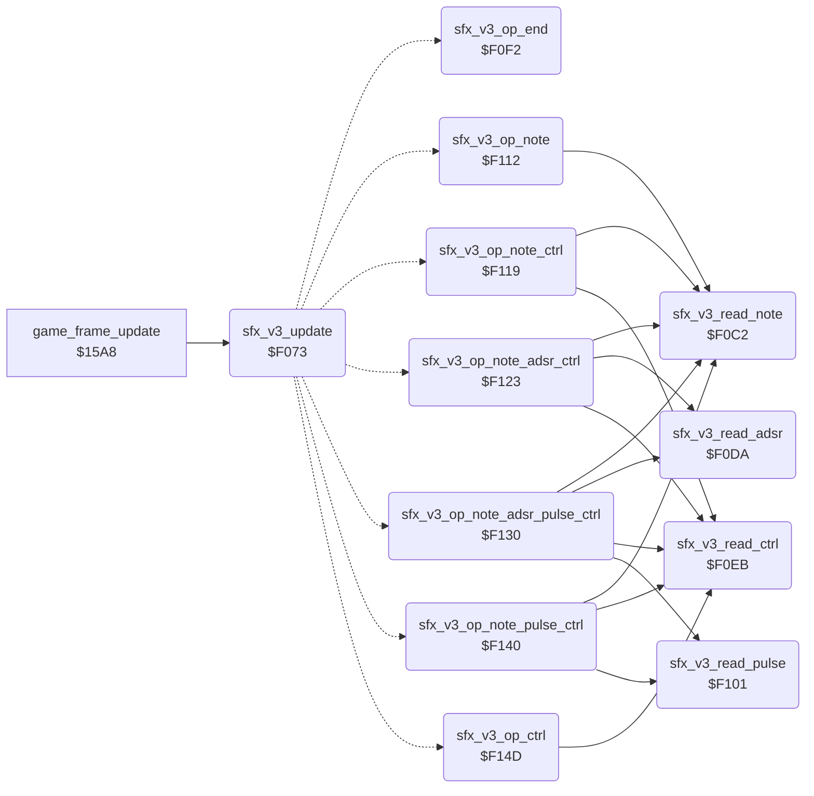

<!-- Generated by c64-docs from knowledge revision 20261016T170255.379-vv114c and src/source-map.json. Do not edit: change the knowledge, generate the source again, then run generate.ts. -->
# sfx_voice3.asm: Sound effect player for SID voice 3

Range `$F070-$F2FF`. Source: [sfx_voice3.asm](../../../src/sfx_voice3.asm). Index: [the reference](../index.md).

## Call graph

A solid arrow is a call, a thick arrow a table entry, a dotted arrow a jump. Rounded nodes are in this file.

## Data

| Range | Type | Name | Read by | Written by |
|---|---|---|---|---|
| [`$F070`](../../../src/sfx_voice3.asm#L7)-`$F072` | workspace | [`sfx_v3_state`](../../../src/sfx_voice3.asm#L6) | [`play_sound_effect`](sound_effects.md#play_sound_effect), [`sfx_v3_update`](sfx_voice3.md#sfx_v3_update) | [`cold_start`](init.md#cold_start), [`play_sound_effect`](sound_effects.md#play_sound_effect), [`silence_all_sound`](sound_effects.md#silence_all_sound), [`sfx_v3_update`](sfx_voice3.md#sfx_v3_update), [`sfx_v3_read_note`](sfx_voice3.md#sfx_v3_read_note), [`sfx_v3_op_end`](sfx_voice3.md#sfx_v3_op_end), [`sfx_v3_op_note`](sfx_voice3.md#sfx_v3_op_note), [`sfx_v3_op_note_ctrl`](sfx_voice3.md#sfx_v3_op_note_ctrl), [`sfx_v3_op_note_adsr_ctrl`](sfx_voice3.md#sfx_v3_op_note_adsr_ctrl), [`sfx_v3_op_note_adsr_pulse_ctrl`](sfx_voice3.md#sfx_v3_op_note_adsr_pulse_ctrl), [`sfx_v3_op_note_pulse_ctrl`](sfx_voice3.md#sfx_v3_op_note_pulse_ctrl), [`sfx_v3_op_ctrl`](sfx_voice3.md#sfx_v3_op_ctrl) |
| [`$F0AA`](../../../src/sfx_voice3.asm#L45)-`$F0C1` | jumps | [`sfx_v3_op_jumps`](../../../src/sfx_voice3.asm#L44) |  |  |
| [`$F155`](../../../src/sfx_voice3.asm#L143)-`$F2FF` | unused |  |  |  |

## Names

### [`sfx_v3_state`](../../../src/sfx_voice3.asm#L6) `$F070`

*variable*

Sound id that plays on channel 2 (0 = free).
bit7 set = start sound effect bits0-6; 1 = playing; 0 = idle

- **Read by:** [`play_sound_effect`](sound_effects.md#play_sound_effect) [`$2534`](../../../src/sound_effects.asm#L31), [`sfx_v3_update`](sfx_voice3.md#sfx_v3_update) [`$F073`](../../../src/sfx_voice3.asm#L14)
- **Written by:** [`cold_start`](init.md#cold_start) [`$041D`](../../../src/init.asm#L27), [`play_sound_effect`](sound_effects.md#play_sound_effect) [`$2539`](../../../src/sound_effects.asm#L34), [`silence_all_sound`](sound_effects.md#silence_all_sound) [`$2566`](../../../src/sound_effects.asm#L59), [`sfx_v3_update`](sfx_voice3.md#sfx_v3_update) [`$F08C`](../../../src/sfx_voice3.asm#L28), [`sfx_v3_op_end`](sfx_voice3.md#sfx_v3_op_end) [`$F0FA`](../../../src/sfx_voice3.asm#L90)

### [`sfx_v3_index`](../../../src/sfx_voice3.asm#L8) `$F071`

*variable*

offset of the next record in the stream

- **Read by:** [`sfx_v3_update`](sfx_voice3.md#sfx_v3_update) [`$F09B`](../../../src/sfx_voice3.asm#L35)
- **Written by:** [`sfx_v3_update`](sfx_voice3.md#sfx_v3_update) [`$F093`](../../../src/sfx_voice3.asm#L31), [`sfx_v3_op_end`](sfx_voice3.md#sfx_v3_op_end) [`$F0FD`](../../../src/sfx_voice3.asm#L91), [`sfx_v3_op_note`](sfx_voice3.md#sfx_v3_op_note) [`$F115`](../../../src/sfx_voice3.asm#L106), [`sfx_v3_op_note_ctrl`](sfx_voice3.md#sfx_v3_op_note_ctrl) [`$F11F`](../../../src/sfx_voice3.asm#L112), [`sfx_v3_op_note_adsr_ctrl`](sfx_voice3.md#sfx_v3_op_note_adsr_ctrl) [`$F12C`](../../../src/sfx_voice3.asm#L119), [`sfx_v3_op_note_adsr_pulse_ctrl`](sfx_voice3.md#sfx_v3_op_note_adsr_pulse_ctrl) [`$F13C`](../../../src/sfx_voice3.asm#L127), [`sfx_v3_op_note_pulse_ctrl`](sfx_voice3.md#sfx_v3_op_note_pulse_ctrl) [`$F149`](../../../src/sfx_voice3.asm#L134), [`sfx_v3_op_ctrl`](sfx_voice3.md#sfx_v3_op_ctrl) [`$F151`](../../../src/sfx_voice3.asm#L141)

### [`sfx_v3_wait`](../../../src/sfx_voice3.asm#L10) `$F072`

*variable*

frames until the next record

- **Read by:** [`sfx_v3_update`](sfx_voice3.md#sfx_v3_update) [`$F096`](../../../src/sfx_voice3.asm#L33)
- **Written by:** [`sfx_v3_update`](sfx_voice3.md#sfx_v3_update) [`$F089`](../../../src/sfx_voice3.asm#L27), [`sfx_v3_update`](sfx_voice3.md#sfx_v3_update) [`$F096`](../../../src/sfx_voice3.asm#L33), [`sfx_v3_read_note`](sfx_voice3.md#sfx_v3_read_note) [`$F0C5`](../../../src/sfx_voice3.asm#L59)

### [`sfx_v3_update`](../../../src/sfx_voice3.asm#L13) `$F073`

*routine*

Per-frame sound effect update for SID voice 3 ($D40E): starts a requested effect (pointer from sfx_table into $FA/$FB), then runs the next stream record when the wait count reaches 0.

- **Called from:** [`game_frame_update`](frame_update.md#game_frame_update) [`$15B5`](../../../src/frame_update.asm#L13)
- **Jumps to:** [`sfx_v3_op_end`](sfx_voice3.md#sfx_v3_op_end), [`sfx_v3_op_note`](sfx_voice3.md#sfx_v3_op_note), [`sfx_v3_op_note_ctrl`](sfx_voice3.md#sfx_v3_op_note_ctrl), [`sfx_v3_op_note_adsr_ctrl`](sfx_voice3.md#sfx_v3_op_note_adsr_ctrl), [`sfx_v3_op_note_adsr_pulse_ctrl`](sfx_voice3.md#sfx_v3_op_note_adsr_pulse_ctrl), [`sfx_v3_op_note_pulse_ctrl`](sfx_voice3.md#sfx_v3_op_note_pulse_ctrl), [`sfx_v3_op_ctrl`](sfx_voice3.md#sfx_v3_op_ctrl)
- **Reads:** [`sfx_v3_state`](sfx_voice3.md#sfx_v3_state), [`sfx_v3_wait`](sfx_voice3.md#sfx_v3_wait), [`sfx_v3_index`](sfx_voice3.md#sfx_v3_index), [`sfx_v3_ptr`](../variables.md#sfx_v3_ptr)
- **Writes:** [`sfx_v3_ptr`](../variables.md#sfx_v3_ptr), [`sfx_v3_ptr+1`](../variables.md#sfx_v3_ptr), [`sfx_v3_wait`](sfx_voice3.md#sfx_v3_wait), [`sfx_v3_state`](sfx_voice3.md#sfx_v3_state), [`VCREG3`](../variables.md#VCREG3), [`sfx_v3_index`](sfx_voice3.md#sfx_v3_index)
- **Refers to:** [`sfx_table`](sfx_data.md#sfx_table), [`sfx_table+1`](sfx_data.md#sfx_table), [`sfx_v3_ptr`](../variables.md#sfx_v3_ptr), [`sfx_op_offsets`](sfx_data.md#sfx_op_offsets)

### [`sfx_v3_step`](../../../src/sfx_voice3.asm#L18) `$F079`

*label*

- **Jumped to from:** [`sfx_v3_update`](sfx_voice3.md#sfx_v3_update) [`$F076`](../../../src/sfx_voice3.asm#L15)

### [`sfx_v3_op_branch`](../../../src/sfx_voice3.asm#L42) `$F0A9`

*variable*

branch offset patched from sfx_op_offsets

- **Written by:** [`sfx_v3_update`](sfx_voice3.md#sfx_v3_update) [`$F0A4`](../../../src/sfx_voice3.asm#L39)

### [`sfx_v3_op_jumps`](../../../src/sfx_voice3.asm#L44) `$F0AA`

*label*

opcodes 0-7

### [`sfx_v3_read_note`](../../../src/sfx_voice3.asm#L56) `$F0C2`

*routine*

Reads the wait and note bytes of the record at Y+1 and sets the voice frequency from note_freq_lo/hi; Y points after them.

- **Called from:** [`sfx_v3_op_note`](sfx_voice3.md#sfx_v3_op_note) [`$F112`](../../../src/sfx_voice3.asm#L105), [`sfx_v3_op_note_ctrl`](sfx_voice3.md#sfx_v3_op_note_ctrl) [`$F119`](../../../src/sfx_voice3.asm#L110), [`sfx_v3_op_note_adsr_ctrl`](sfx_voice3.md#sfx_v3_op_note_adsr_ctrl) [`$F123`](../../../src/sfx_voice3.asm#L116), [`sfx_v3_op_note_adsr_pulse_ctrl`](sfx_voice3.md#sfx_v3_op_note_adsr_pulse_ctrl) [`$F130`](../../../src/sfx_voice3.asm#L123), [`sfx_v3_op_note_pulse_ctrl`](sfx_voice3.md#sfx_v3_op_note_pulse_ctrl) [`$F140`](../../../src/sfx_voice3.asm#L131)
- **Reads:** [`sfx_v3_ptr`](../variables.md#sfx_v3_ptr)
- **Writes:** [`sfx_v3_wait`](sfx_voice3.md#sfx_v3_wait), [`FRELO3`](../variables.md#FRELO3), [`FREHI3`](../variables.md#FREHI3)
- **Refers to:** [`note_freq_lo`](music_player.md#note_freq_lo), [`note_freq_hi`](music_player.md#note_freq_hi)

### [`sfx_v3_read_adsr`](../../../src/sfx_voice3.asm#L70) `$F0DA`

*routine*

Reads an index byte and sets attack/decay and sustain/release from sfx_adsr_table.

- **Called from:** [`sfx_v3_op_note_adsr_ctrl`](sfx_voice3.md#sfx_v3_op_note_adsr_ctrl) [`$F126`](../../../src/sfx_voice3.asm#L117), [`sfx_v3_op_note_adsr_pulse_ctrl`](sfx_voice3.md#sfx_v3_op_note_adsr_pulse_ctrl) [`$F133`](../../../src/sfx_voice3.asm#L124)
- **Reads:** [`sfx_v3_ptr`](../variables.md#sfx_v3_ptr)
- **Writes:** [`ATDCY3`](../variables.md#ATDCY3), [`SUREL3`](../variables.md#SUREL3)
- **Refers to:** [`sfx_adsr_table`](sfx_data.md#sfx_adsr_table), [`sfx_adsr_table+1`](sfx_data.md#sfx_adsr_table)

### [`sfx_v3_read_ctrl`](../../../src/sfx_voice3.asm#L80) `$F0EB`

*routine*

Reads a byte into the voice control register.

- **Called from:** [`sfx_v3_op_note_ctrl`](sfx_voice3.md#sfx_v3_op_note_ctrl) [`$F11C`](../../../src/sfx_voice3.asm#L111), [`sfx_v3_op_note_adsr_ctrl`](sfx_voice3.md#sfx_v3_op_note_adsr_ctrl) [`$F129`](../../../src/sfx_voice3.asm#L118), [`sfx_v3_op_note_adsr_pulse_ctrl`](sfx_voice3.md#sfx_v3_op_note_adsr_pulse_ctrl) [`$F139`](../../../src/sfx_voice3.asm#L126), [`sfx_v3_op_note_pulse_ctrl`](sfx_voice3.md#sfx_v3_op_note_pulse_ctrl) [`$F146`](../../../src/sfx_voice3.asm#L133), [`sfx_v3_op_ctrl`](sfx_voice3.md#sfx_v3_op_ctrl) [`$F14E`](../../../src/sfx_voice3.asm#L140)
- **Reads:** [`sfx_v3_ptr`](../variables.md#sfx_v3_ptr)
- **Writes:** [`VCREG3`](../variables.md#VCREG3)

### [`sfx_v3_op_end`](../../../src/sfx_voice3.asm#L86) `$F0F2`

*routine*

Opcode 0: frequency 0 and the effect ends (state 0).

- **Jumped to from:** `$B8AA`, [`sfx_v3_update`](sfx_voice3.md#sfx_v3_update) [`$F0AA`](../../../src/sfx_voice3.asm#L45)
- **Entry of:** [`sfx_v3_op_jumps`](../tables.md#sfx_v3_op_jumps)
- **Writes:** [`FRELO3`](../variables.md#FRELO3), [`FREHI3`](../variables.md#FREHI3), [`sfx_v3_state`](sfx_voice3.md#sfx_v3_state), [`sfx_v3_index`](sfx_voice3.md#sfx_v3_index)

### [`sfx_v3_read_pulse`](../../../src/sfx_voice3.asm#L94) `$F101`

*routine*

Reads an index byte and sets the pulse width from sfx_pulse_table.

- **Called from:** [`sfx_v3_op_note_adsr_pulse_ctrl`](sfx_voice3.md#sfx_v3_op_note_adsr_pulse_ctrl) [`$F136`](../../../src/sfx_voice3.asm#L125), [`sfx_v3_op_note_pulse_ctrl`](sfx_voice3.md#sfx_v3_op_note_pulse_ctrl) [`$F143`](../../../src/sfx_voice3.asm#L132)
- **Reads:** [`sfx_v3_ptr`](../variables.md#sfx_v3_ptr)
- **Writes:** [`PWLO3`](../variables.md#PWLO3), [`PWHI3`](../variables.md#PWHI3)
- **Refers to:** [`sfx_pulse_table`](sfx_data.md#sfx_pulse_table), [`sfx_pulse_table+1`](sfx_data.md#sfx_pulse_table)

### [`sfx_v3_op_note`](../../../src/sfx_voice3.asm#L104) `$F112`

*routine*

Opcode 1: wait, note.

- **Jumped to from:** `$B8AD`, [`sfx_v3_update`](sfx_voice3.md#sfx_v3_update) [`$F0AD`](../../../src/sfx_voice3.asm#L46)
- **Entry of:** [`sfx_v3_op_jumps`](../tables.md#sfx_v3_op_jumps)
- **Calls:** [`sfx_v3_read_note`](sfx_voice3.md#sfx_v3_read_note)
- **Writes:** [`sfx_v3_index`](sfx_voice3.md#sfx_v3_index)

### [`sfx_v3_op_note_ctrl`](../../../src/sfx_voice3.asm#L109) `$F119`

*routine*

Opcode 2: wait, note, control.

- **Jumped to from:** `$B8B0`, [`sfx_v3_update`](sfx_voice3.md#sfx_v3_update) [`$F0B0`](../../../src/sfx_voice3.asm#L47)
- **Entry of:** [`sfx_v3_op_jumps`](../tables.md#sfx_v3_op_jumps)
- **Calls:** [`sfx_v3_read_note`](sfx_voice3.md#sfx_v3_read_note), [`sfx_v3_read_ctrl`](sfx_voice3.md#sfx_v3_read_ctrl)
- **Writes:** [`sfx_v3_index`](sfx_voice3.md#sfx_v3_index)

### [`sfx_v3_op_note_adsr_ctrl`](../../../src/sfx_voice3.asm#L115) `$F123`

*routine*

Opcode 3: wait, note, ADSR index, control.

- **Jumped to from:** `$B8B3`, [`sfx_v3_update`](sfx_voice3.md#sfx_v3_update) [`$F0B3`](../../../src/sfx_voice3.asm#L48)
- **Entry of:** [`sfx_v3_op_jumps`](../tables.md#sfx_v3_op_jumps)
- **Calls:** [`sfx_v3_read_note`](sfx_voice3.md#sfx_v3_read_note), [`sfx_v3_read_adsr`](sfx_voice3.md#sfx_v3_read_adsr), [`sfx_v3_read_ctrl`](sfx_voice3.md#sfx_v3_read_ctrl)
- **Writes:** [`sfx_v3_index`](sfx_voice3.md#sfx_v3_index)

### [`sfx_v3_op_note_adsr_pulse_ctrl`](../../../src/sfx_voice3.asm#L122) `$F130`

*routine*

Opcode 4: wait, note, ADSR index, pulse index, control.

- **Jumped to from:** `$B8B6`, [`sfx_v3_update`](sfx_voice3.md#sfx_v3_update) [`$F0B6`](../../../src/sfx_voice3.asm#L49)
- **Entry of:** [`sfx_v3_op_jumps`](../tables.md#sfx_v3_op_jumps)
- **Calls:** [`sfx_v3_read_note`](sfx_voice3.md#sfx_v3_read_note), [`sfx_v3_read_adsr`](sfx_voice3.md#sfx_v3_read_adsr), [`sfx_v3_read_pulse`](sfx_voice3.md#sfx_v3_read_pulse), [`sfx_v3_read_ctrl`](sfx_voice3.md#sfx_v3_read_ctrl)
- **Writes:** [`sfx_v3_index`](sfx_voice3.md#sfx_v3_index)

### [`sfx_v3_op_note_pulse_ctrl`](../../../src/sfx_voice3.asm#L130) `$F140`

*routine*

Opcodes 5 and 6: wait, note, pulse index, control.

- **Jumped to from:** `$B8B9`, `$B8BC`, [`sfx_v3_update`](sfx_voice3.md#sfx_v3_update) [`$F0B9`](../../../src/sfx_voice3.asm#L51), [`sfx_v3_update`](sfx_voice3.md#sfx_v3_update) [`$F0BC`](../../../src/sfx_voice3.asm#L52)
- **Entry of:** [`sfx_v3_op_jumps`](../tables.md#sfx_v3_op_jumps)
- **Calls:** [`sfx_v3_read_note`](sfx_voice3.md#sfx_v3_read_note), [`sfx_v3_read_pulse`](sfx_voice3.md#sfx_v3_read_pulse), [`sfx_v3_read_ctrl`](sfx_voice3.md#sfx_v3_read_ctrl)
- **Writes:** [`sfx_v3_index`](sfx_voice3.md#sfx_v3_index)

### [`sfx_v3_op_ctrl`](../../../src/sfx_voice3.asm#L137) `$F14D`

*routine*

Opcode 7: one control byte; it does not set a new wait.

- **Jumped to from:** `$B8BF`, [`sfx_v3_update`](sfx_voice3.md#sfx_v3_update) [`$F0BF`](../../../src/sfx_voice3.asm#L54)
- **Entry of:** [`sfx_v3_op_jumps`](../tables.md#sfx_v3_op_jumps)
- **Calls:** [`sfx_v3_read_ctrl`](sfx_voice3.md#sfx_v3_read_ctrl)
- **Writes:** [`sfx_v3_index`](sfx_voice3.md#sfx_v3_index)
