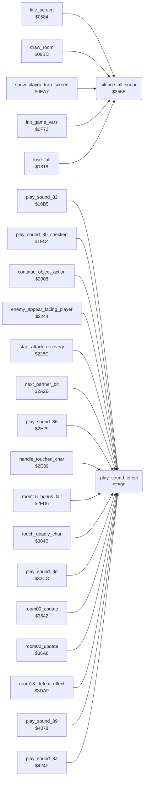

<!-- Generated by c64-docs from knowledge revision 20261016T170255.379-vv114c and src/source-map.json. Do not edit: change the knowledge, generate the source again, then run generate.ts. -->
# sound_effects.asm: Sound effect start and channel allocation

Range `$2509-$2583`. Source: [sound_effects.asm](../../../src/sound_effects.asm). Index: [the reference](../index.md).

## Call graph

A solid arrow is a call, a thick arrow a table entry, a dotted arrow a jump. Rounded nodes are in this file.

## Data

| Range | Type | Name | Read by | Written by |
|---|---|---|---|---|
| [`$2572`](../../../src/sound_effects.asm#L68)-`$2580` | bytes | [`sound_priority_table`](../../../src/sound_effects.asm#L67) |  |  |
| [`$2581`](../../../src/sound_effects.asm#L72)-`$2583` | workspace | [`sound_channel0_priority`](../../../src/sound_effects.asm#L71) | [`play_sound_effect`](sound_effects.md#play_sound_effect) | [`play_sound_effect`](sound_effects.md#play_sound_effect) |

## Names

### [`play_sound_effect`](../../../src/sound_effects.asm#L6) `$2509`

*routine*

Y = sound id ($80 + effect). Sets $D418 to $15 and puts Y into the first free channel ($EB00/$EF70/$F070); when all are busy it replaces the first channel whose priority is lower or equal (sound_priority_table by the low nibble of the id); otherwise the request is dropped.

- **Called from:** [`play_sound_82`](room_state.md#play_sound_82) [`$10BC`](../../../src/room_state.asm#L93), [`play_sound_80_checked`](actor_movement.md#play_sound_80_checked) [`$1FCB`](../../../src/actor_movement.asm#L538), [`continue_object_action`](object_actions.md#continue_object_action) [`$205A`](../../../src/object_actions.asm#L50), [`continue_object_action`](object_actions.md#continue_object_action) [`$209F`](../../../src/object_actions.asm#L89), [`enemy_appear_facing_player`](object_actions.md#enemy_appear_facing_player) [`$225F`](../../../src/object_actions.asm#L328), [`enemy_appear_facing_player`](object_actions.md#enemy_appear_facing_player) [`$227C`](../../../src/object_actions.asm#L347), [`start_attack_recovery`](object_actions.md#start_attack_recovery) [`$22D2`](../../../src/object_actions.asm#L406), [`next_partner_bit`](combat_hits.md#next_partner_bit) [`$2A93`](../../../src/combat_hits.asm#L125), [`play_sound_86`](actor_checks.md#play_sound_86) [`$2E30`](../../../src/actor_checks.asm#L155), [`handle_touched_char`](background_touch.md#handle_touched_char) [`$2F36`](../../../src/background_touch.asm#L161), [`room16_bonus_fall`](background_touch.md#room16_bonus_fall) [`$2FEC`](../../../src/background_touch.asm#L268), [`touch_deadly_char`](background_touch.md#touch_deadly_char) [`$3059`](../../../src/background_touch.asm#L329), [`play_sound_8d`](room_entry_traps.md#play_sound_8d) [`$32D3`](../../../src/room_entry_traps.asm#L113), [`room00_update`](room_update.md#room00_update) [`$3656`](../../../src/room_update.asm#L16), [`room02_update`](room_update.md#room02_update) [`$36DF`](../../../src/room_update.asm#L87), [`room18_defeat_effect`](room_update.md#room18_defeat_effect) [`$3E0D`](../../../src/room_update.asm#L1065), [`play_sound_89`](room_tiles.md#play_sound_89) [`$407A`](../../../src/room_tiles.asm#L30), [`play_sound_8a`](final_room.md#play_sound_8a) [`$4256`](../../../src/final_room.asm#L13)
- **Reads:** [`sfx_v1_state`](sfx_voice1.md#sfx_v1_state), [`sfx_v2_state`](sfx_voice2.md#sfx_v2_state), [`sfx_v3_state`](sfx_voice3.md#sfx_v3_state), [`sound_channel0_priority`](sound_effects.md#sound_channel0_priority), [`sound_channel1_priority`](sound_effects.md#sound_channel1_priority), [`sound_channel2_priority`](sound_effects.md#sound_channel2_priority)
- **Writes:** [`SIGVOL`](../variables.md#SIGVOL), [`sfx_v1_state`](sfx_voice1.md#sfx_v1_state), [`sound_channel0_priority`](sound_effects.md#sound_channel0_priority), [`sfx_v2_state`](sfx_voice2.md#sfx_v2_state), [`sound_channel1_priority`](sound_effects.md#sound_channel1_priority), [`sfx_v3_state`](sfx_voice3.md#sfx_v3_state), [`sound_channel2_priority`](sound_effects.md#sound_channel2_priority)
- **Refers to:** [`sound_priority_table`](sound_effects.md#sound_priority_table)

### [`silence_all_sound`](../../../src/sound_effects.asm#L55) `$255E`

*routine*

Clears the three sound channel ids and writes 0 to SID registers $D400-$D420.

- **Called from:** [`title_screen`](title.md#title_screen) [`$058D`](../../../src/title.asm#L11), [`draw_room`](room_draw.md#draw_room) [`$09F3`](../../../src/room_draw.asm#L32), [`show_player_turn_screen`](player_turn.md#show_player_turn_screen) [`$0ED0`](../../../src/player_turn.asm#L25), [`init_game_vars`](game_vars.md#init_game_vars) [`$0F96`](../../../src/game_vars.asm#L29), [`lose_fall`](game_over.md#lose_fall) [`$1818`](../../../src/game_over.asm#L7)
- **Writes:** [`sfx_v1_state`](sfx_voice1.md#sfx_v1_state), [`sfx_v2_state`](sfx_voice2.md#sfx_v2_state), [`sfx_v3_state`](sfx_voice3.md#sfx_v3_state), [`RANDOM+4`](../variables.md#RANDOM), [`RANDOM+5`](../variables.md#RANDOM)

### [`sound_priority_table`](../../../src/sound_effects.asm#L67) `$2572-$2580`

*data*

Priority of each sound effect, indexed by the low nibble of the sound id.

- **Referred to by:** [`play_sound_effect`](sound_effects.md#play_sound_effect) [`$251A`](../../../src/sound_effects.asm#L16), [`play_sound_effect`](sound_effects.md#play_sound_effect) [`$252D`](../../../src/sound_effects.asm#L27), [`play_sound_effect`](sound_effects.md#play_sound_effect) [`$2540`](../../../src/sound_effects.asm#L38), [`play_sound_effect`](sound_effects.md#play_sound_effect) [`$254B`](../../../src/sound_effects.asm#L45)

### [`sound_channel0_priority`](../../../src/sound_effects.asm#L71) `$2581`

*variable*

Priority of the sound that plays on each of the three channels.

- **Read by:** [`play_sound_effect`](sound_effects.md#play_sound_effect) [`$254E`](../../../src/sound_effects.asm#L46)
- **Written by:** [`play_sound_effect`](sound_effects.md#play_sound_effect) [`$251D`](../../../src/sound_effects.asm#L17)

### [`sound_channel1_priority`](../../../src/sound_effects.asm#L73) `$2582`

*variable*

- **Read by:** [`play_sound_effect`](sound_effects.md#play_sound_effect) [`$2553`](../../../src/sound_effects.asm#L48)
- **Written by:** [`play_sound_effect`](sound_effects.md#play_sound_effect) [`$2530`](../../../src/sound_effects.asm#L28)

### [`sound_channel2_priority`](../../../src/sound_effects.asm#L75) `$2583`

*variable*

- **Read by:** [`play_sound_effect`](sound_effects.md#play_sound_effect) [`$2558`](../../../src/sound_effects.asm#L50)
- **Written by:** [`play_sound_effect`](sound_effects.md#play_sound_effect) [`$2543`](../../../src/sound_effects.asm#L39)
