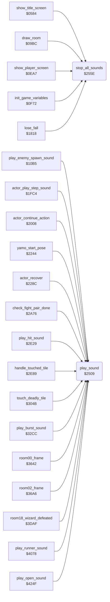

<!-- Generated by c64-docs from knowledge revision 20261017T123532.893-hcxwuv and src/source-map.json. Do not edit: change the knowledge, generate the source again, then run generate.ts. -->
# sound_request.asm: Sound effect requests: three voice slots with priorities, and silence

Range `$2509-$2583`. Source: [sound_request.asm](../../../src/sound_request.asm). Index: [the reference](../index.md).

## Call graph

A solid arrow is a call, a thick arrow a table entry, a dotted arrow a jump. Rounded nodes are in this file.

## Data

| Range | Type | Name | Read by | Written by |
|---|---|---|---|---|
| [`$2572`](../../../src/sound_request.asm#L77)-`$2580` | bytes | [`sound_priority_table`](../../../src/sound_request.asm#L76) |  |  |
| [`$2581`](../../../src/sound_request.asm#L81)-`$2583` | workspace | [`voice1_sound_priority`](../../../src/sound_request.asm#L80) | [`play_sound`](sound_request.md#play_sound) | [`play_sound`](sound_request.md#play_sound) |

## Names

### [`play_sound`](../../../src/sound_request.asm#L12) `$2509`

*routine*

Requests sound effect Y ($80-$8E). Sets SIGVOL to $15 (volume 5, low-pass filter mode bit), then stores Y in the first free voice slot of the sound driver (sfx_voice1_state, sfx_voice2_state, sfx_voice3_state; 0 = free) and its priority from sound_priority_table,(Y AND $0F) in voice1/2/3_sound_priority. When all three slots are busy, the first slot whose priority is not above the new one is replaced; otherwise the request is dropped. Changes A and X. Sounds: $80 step, $81 Yamo pose, $84 flying kick, $85 punch or strike swing, $86 and $87 hits, others from the room and hazard code.
volume 5, low-pass filter mode

- **Called from:** [`play_enemy_spawn_sound`](game_setup.md#play_enemy_spawn_sound) [`$10BC`](../../../src/game_setup.asm#L232), [`actor_play_step_sound`](actor_step.md#actor_play_step_sound) [`$1FCB`](../../../src/actor_step.asm#L563), [`actor_continue_action`](actor_timed_actions.md#actor_continue_action) [`$205A`](../../../src/actor_timed_actions.asm#L60), [`actor_continue_action`](actor_timed_actions.md#actor_continue_action) [`$209F`](../../../src/actor_timed_actions.asm#L96), [`yamo_start_pose`](actor_timed_actions.md#yamo_start_pose) [`$225F`](../../../src/actor_timed_actions.asm#L342), [`yamo_start_pose`](actor_timed_actions.md#yamo_start_pose) [`$227C`](../../../src/actor_timed_actions.asm#L363), [`actor_recover`](actor_timed_actions.md#actor_recover) [`$22D2`](../../../src/actor_timed_actions.asm#L424), [`check_fight_pair_done`](fight_hits.md#check_fight_pair_done) [`$2A93`](../../../src/fight_hits.asm#L140), [`play_hit_sound`](actor_helpers.md#play_hit_sound) [`$2E30`](../../../src/actor_helpers.asm#L166), [`handle_touched_tile`](background_touch.md#handle_touched_tile) [`$2F36`](../../../src/background_touch.asm#L172), [`$2FEC`](../../../src/touch_effects.asm#L23), [`touch_deadly_tile`](touch_effects.md#touch_deadly_tile) [`$3059`](../../../src/touch_effects.asm#L87), [`play_burst_sound`](room_misc_support.md#play_burst_sound) [`$32D3`](../../../src/room_misc_support.asm#L129), [`room00_frame`](room_frames_0_7.md#room00_frame) [`$3656`](../../../src/room_frames_0_7.asm#L21), [`room02_frame`](room_frames_0_7.md#room02_frame) [`$36DF`](../../../src/room_frames_0_7.asm#L114), [`room18_wizard_defeated`](wizard_room.md#room18_wizard_defeated) [`$3E0D`](../../../src/wizard_room.asm#L182), [`play_runner_sound`](room_hazard_draw.md#play_runner_sound) [`$407A`](../../../src/room_hazard_draw.asm#L34), [`play_open_sound`](wizard_fireballs.md#play_open_sound) [`$4256`](../../../src/wizard_fireballs.asm#L190)
- **Reads:** [`sfx_voice1_state`](sfx_voice1.md#sfx_voice1_state), [`sfx_voice2_state`](sfx_voice2.md#sfx_voice2_state), [`sfx_voice3_state`](sfx_voice3.md#sfx_voice3_state), [`voice1_sound_priority`](sound_request.md#voice1_sound_priority), [`voice2_sound_priority`](sound_request.md#voice2_sound_priority), [`voice3_sound_priority`](sound_request.md#voice3_sound_priority)
- **Writes:** [`SIGVOL`](../variables.md#SIGVOL), [`sfx_voice1_state`](sfx_voice1.md#sfx_voice1_state), [`voice1_sound_priority`](sound_request.md#voice1_sound_priority), [`sfx_voice2_state`](sfx_voice2.md#sfx_voice2_state), [`voice2_sound_priority`](sound_request.md#voice2_sound_priority), [`sfx_voice3_state`](sfx_voice3.md#sfx_voice3_state), [`voice3_sound_priority`](sound_request.md#voice3_sound_priority)
- **Refers to:** [`sound_priority_table`](sound_request.md#sound_priority_table)

### [`play_sound_slot1`](../../../src/sound_request.asm#L17) `$2513`

*label*

- **Jumped to from:** [`play_sound`](sound_request.md#play_sound) [`$2551`](../../../src/sound_request.asm#L54)

### [`play_sound_try_slot2`](../../../src/sound_request.asm#L25) `$2521`

*label*

voice slot 2 of the sound driver

- **Jumped to from:** [`play_sound`](sound_request.md#play_sound) [`$2511`](../../../src/sound_request.asm#L16)

### [`play_sound_slot2`](../../../src/sound_request.asm#L28) `$2526`

*label*

- **Jumped to from:** [`play_sound`](sound_request.md#play_sound) [`$2556`](../../../src/sound_request.asm#L56)

### [`play_sound_try_slot3`](../../../src/sound_request.asm#L36) `$2534`

*label*

voice slot 3 of the sound driver

- **Jumped to from:** [`play_sound`](sound_request.md#play_sound) [`$2524`](../../../src/sound_request.asm#L27)

### [`play_sound_slot3`](../../../src/sound_request.asm#L39) `$2539`

*label*

- **Jumped to from:** [`play_sound`](sound_request.md#play_sound) [`$255B`](../../../src/sound_request.asm#L58)

### [`play_sound_by_priority`](../../../src/sound_request.asm#L48) `$2547`

*label*

All slots busy: replace the first slot whose priority is lower than or equal to the new one.

- **Jumped to from:** [`play_sound`](sound_request.md#play_sound) [`$2537`](../../../src/sound_request.asm#L38)

### [`stop_all_sounds`](../../../src/sound_request.asm#L63) `$255E`

*routine*

Frees the three voice slots of the sound driver (sfx_voice1_state, sfx_voice2_state, sfx_voice3_state = 0) and writes 0 to the SID addresses $D400-$D420, which silences all voices and sets the volume to 0. Called by lose_fall, show_title_screen, init_game_variables, show_player_screen and draw_room.

- **Called from:** [`show_title_screen`](title_demo_start.md#show_title_screen) [`$058D`](../../../src/title_demo_start.asm#L88), [`draw_room`](draw_room.md#draw_room) [`$09F3`](../../../src/draw_room.asm#L54), [`show_player_screen`](title_player_screens.md#show_player_screen) [`$0ED0`](../../../src/title_player_screens.asm#L91), [`init_game_variables`](game_setup.md#init_game_variables) [`$0F96`](../../../src/game_setup.asm#L41), [`lose_fall`](lose_fall_game_over.md#lose_fall) [`$1818`](../../../src/lose_fall_game_over.asm#L15)
- **Writes:** [`sfx_voice1_state`](sfx_voice1.md#sfx_voice1_state), [`sfx_voice2_state`](sfx_voice2.md#sfx_voice2_state), [`sfx_voice3_state`](sfx_voice3.md#sfx_voice3_state), [`RANDOM+4`](../variables.md#RANDOM), [`RANDOM+5`](../variables.md#RANDOM)

### [`stop_all_sounds_loop`](../../../src/sound_request.asm#L69) `$256B`

*label*

33 bytes: $D41D-$D41F are unused SID addresses, $D420 mirrors FRELO1

- **Jumped to from:** [`stop_all_sounds`](sound_request.md#stop_all_sounds) [`$256F`](../../../src/sound_request.asm#L72)

### [`sound_priority_table`](../../../src/sound_request.asm#L76) `$2572-$2580`

*data*

Priority of each sound effect, 1 byte, indexed by sound number & $0F ($80-$8E). A higher value replaces a lower one when all voices are busy. Index $0F would read voice1_sound_priority.

- **Referred to by:** [`play_sound`](sound_request.md#play_sound) [`$251A`](../../../src/sound_request.asm#L22), [`play_sound`](sound_request.md#play_sound) [`$252D`](../../../src/sound_request.asm#L33), [`play_sound`](sound_request.md#play_sound) [`$2540`](../../../src/sound_request.asm#L44), [`play_sound`](sound_request.md#play_sound) [`$254B`](../../../src/sound_request.asm#L52)

### [`voice1_sound_priority`](../../../src/sound_request.asm#L80) `$2581`

*variable*

Priority of the sound in each voice slot of the sound driver (slots 1, 2, 3), written by play_sound.

- **Read by:** [`play_sound`](sound_request.md#play_sound) [`$254E`](../../../src/sound_request.asm#L53)
- **Written by:** [`play_sound`](sound_request.md#play_sound) [`$251D`](../../../src/sound_request.asm#L23)

### [`voice2_sound_priority`](../../../src/sound_request.asm#L82) `$2582`

*variable*

- **Read by:** [`play_sound`](sound_request.md#play_sound) [`$2553`](../../../src/sound_request.asm#L55)
- **Written by:** [`play_sound`](sound_request.md#play_sound) [`$2530`](../../../src/sound_request.asm#L34)

### [`voice3_sound_priority`](../../../src/sound_request.asm#L84) `$2583`

*variable*

- **Read by:** [`play_sound`](sound_request.md#play_sound) [`$2558`](../../../src/sound_request.asm#L57)
- **Written by:** [`play_sound`](sound_request.md#play_sound) [`$2543`](../../../src/sound_request.asm#L45)
