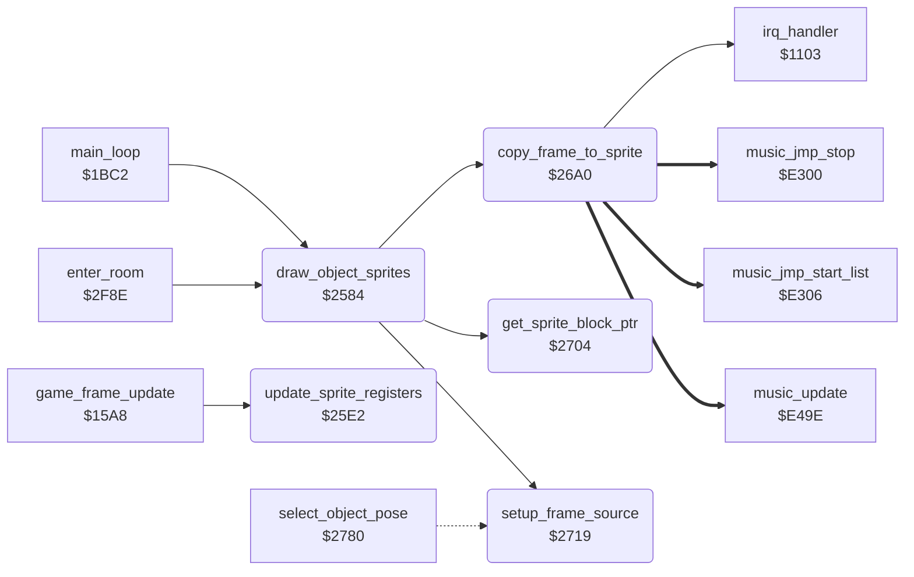

<!-- Generated by c64-docs from knowledge revision 20261016T170255.379-vv114c and src/source-map.json. Do not edit: change the knowledge, generate the source again, then run generate.ts. -->
# sprite_render.asm: Object sprite rendering into double-buffered sprite blocks and sprite register update

Range `$2584-$277F`. Source: [sprite_render.asm](../../../src/sprite_render.asm). Index: [the reference](../index.md).

## Call graph

A solid arrow is a call, a thick arrow a table entry, a dotted arrow a jump. Rounded nodes are in this file.

## Data

| Range | Type | Name | Read by | Written by |
|---|---|---|---|---|
| [`$2703`](../../../src/sprite_render.asm#L235) | unused |  |  |  |
| [`$274F`](../../../src/sprite_render.asm#L282)-`$2762` | words | [`sprite_block_addr_table`](../../../src/sprite_render.asm#L281) |  |  |
| [`$2763`](../../../src/sprite_render.asm#L290)-`$276C` | bytes of 5 | [`sprite_pointer_table`](../../../src/sprite_render.asm#L289) | [`update_sprite_registers`](sprite_render.md#update_sprite_registers) |  |
| [`$276D`](../../../src/sprite_render.asm#L300)-`$276F` | bytes | [`actor_body_sprite`](../../../src/sprite_render.asm#L299) | [`draw_object_sprites`](sprite_render.md#draw_object_sprites), [`update_sprite_registers`](sprite_render.md#update_sprite_registers) |  |
| [`$2770`](../../../src/sprite_render.asm#L307)-`$2772` | bytes | [`actor_overlay_sprite`](../../../src/sprite_render.asm#L306) | [`draw_object_sprites`](sprite_render.md#draw_object_sprites), [`update_sprite_registers`](sprite_render.md#update_sprite_registers) |  |
| [`$2773`](../../../src/sprite_render.asm#L314)-`$2777` | bytes | [`sprite_bit_mask`](../../../src/sprite_render.asm#L313) | [`update_sprite_registers`](sprite_render.md#update_sprite_registers) |  |
| [`$2778`](../../../src/sprite_render.asm#L323)-`$277C` | bytes | [`sprite_clear_mask`](../../../src/sprite_render.asm#L322) | [`update_sprite_registers`](sprite_render.md#update_sprite_registers) |  |
| [`$277D`](../../../src/sprite_render.asm#L332)-`$277F` | bytes | [`sprite_buffer_select`](../../../src/sprite_render.asm#L331) | [`init_actor`](actors.md#init_actor), [`update_sprite_registers`](sprite_render.md#update_sprite_registers), [`copy_frame_to_sprite`](sprite_render.md#copy_frame_to_sprite), [`get_sprite_block_ptr`](sprite_render.md#get_sprite_block_ptr) | [`draw_object_sprites`](sprite_render.md#draw_object_sprites), [`update_sprite_registers`](sprite_render.md#update_sprite_registers), [`copy_frame_to_sprite`](sprite_render.md#copy_frame_to_sprite) |

## Names

### [`draw_object_sprites`](../../../src/sprite_render.asm#L6) `$2584`

*routine*

For each active actor (2..0): copies frame actor_frame_a ($4F4E,X) and, for actors 0 and 1, frame actor_frame_a+1 into the actor's sprite blocks of the buffer selected by sprite_buffer_select; keeps the width flags and colours in $D4-$DF; then clears sprite_frame_shown so the IRQ shows them.

- **Called from:** [`main_loop`](main_loop.md#main_loop) [`$1C2C`](../../../src/main_loop.asm#L57), [`enter_room`](background_touch.md#enter_room) [`$2FCF`](../../../src/background_touch.asm#L249)
- **Calls:** [`get_sprite_block_ptr`](sprite_render.md#get_sprite_block_ptr), [`setup_frame_source`](sprite_render.md#setup_frame_source), [`copy_frame_to_sprite`](sprite_render.md#copy_frame_to_sprite)
- **Reads:** [`actor_flags+1`](../variables.md#actor_flags), [`actor_flags+2`](../variables.md#actor_flags), [`actor_body_sprite+1`](sprite_render.md#actor_body_sprite), [`actor_body_sprite+2`](sprite_render.md#actor_body_sprite), [`actor_frame_a+2`](actor_vars.md#actor_frame_a), [`current_actor`](../variables.md#current_actor), [`actor_frame_height+2`](../variables.md#actor_frame_height), [`actor_body_wide+2`](../variables.md#actor_body_wide), [`actor_overlay_sprite+2`](sprite_render.md#actor_overlay_sprite), [`actor_overlay_wide+2`](../variables.md#actor_overlay_wide)
- **Writes:** [`current_actor`](../variables.md#current_actor), [`actor_body_wide+2`](../variables.md#actor_body_wide), [`actor_body_colour+2`](../variables.md#actor_body_colour), [`actor_overlay_wide+2`](../variables.md#actor_overlay_wide), [`actor_overlay_colour+2`](../variables.md#actor_overlay_colour), [`sprite_frame_shown`](sprite_render.md#sprite_frame_shown)

### [`draw_actor_loop`](../../../src/sprite_render.asm#L8) `$2586`

*label*

- **Jumped to from:** [`draw_object_sprites`](sprite_render.md#draw_object_sprites) [`$25DA`](../../../src/sprite_render.asm#L55)

### [`draw_next_actor`](../../../src/sprite_render.asm#L52) `$25D7`

*label*

- **Jumped to from:** [`draw_object_sprites`](sprite_render.md#draw_object_sprites) [`$258C`](../../../src/sprite_render.asm#L12), [`draw_object_sprites`](sprite_render.md#draw_object_sprites) [`$25B2`](../../../src/sprite_render.asm#L32), [`draw_object_sprites`](sprite_render.md#draw_object_sprites) [`$25B7`](../../../src/sprite_render.asm#L34)

### [`update_sprite_registers`](../../../src/sprite_render.asm#L60) `$25E2`

*routine*

Called from the IRQ. Once per new drawing (sprite_frame_shown = 0): sets X (2 px units, X-MSB in $D010), Y (+$1D) and colour of the sprites of each active object, then points $8FF8-$8FFC at the drawn buffer and flips sprite_buffer_select.

- **Called from:** [`game_frame_update`](frame_update.md#game_frame_update) [`$15BA`](../../../src/frame_update.asm#L15)
- **Reads:** [`sprite_frame_shown`](sprite_render.md#sprite_frame_shown), [`actor_flags+1`](../variables.md#actor_flags), [`actor_flags+2`](../variables.md#actor_flags), [`actor_x+1`](../variables.md#actor_x), [`actor_x+2`](../variables.md#actor_x), [`actor_body_wide+1`](../variables.md#actor_body_wide), [`actor_body_wide+2`](../variables.md#actor_body_wide), [`actor_facing+1`](../variables.md#actor_facing), [`actor_facing+2`](../variables.md#actor_facing), [`actor_body_sprite+1`](sprite_render.md#actor_body_sprite), [`actor_body_sprite+2`](sprite_render.md#actor_body_sprite), [`MSIGX`](../variables.md#MSIGX), [`sprite_bit_mask+2`](sprite_render.md#sprite_bit_mask), [`sprite_bit_mask+4`](sprite_render.md#sprite_bit_mask), [`sprite_clear_mask+2`](sprite_render.md#sprite_clear_mask), [`sprite_clear_mask+4`](sprite_render.md#sprite_clear_mask), [`actor_y+2`](../variables.md#actor_y), [`actor_body_colour+2`](../variables.md#actor_body_colour), [`actor_frame_rel_b+1`](actor_vars.md#actor_frame_rel_b), [`actor_frame_rel_b+2`](actor_vars.md#actor_frame_rel_b), [`actor_overlay_sprite+1`](sprite_render.md#actor_overlay_sprite), [`sprite_bit_mask+3`](sprite_render.md#sprite_bit_mask), [`sprite_clear_mask+3`](sprite_render.md#sprite_clear_mask), [`actor_y+1`](../variables.md#actor_y), [`actor_overlay_colour+1`](../variables.md#actor_overlay_colour), [`current_actor`](../variables.md#current_actor), [`sprite_buffer_select`](sprite_render.md#sprite_buffer_select), [`sprite_pointer_table+4`](sprite_render.md#sprite_pointer_table), [`sprite_pointer_table+8`](sprite_render.md#sprite_pointer_table), [`sprite_pointer_table+9`](sprite_render.md#sprite_pointer_table)
- **Writes:** [`sprite_frame_shown`](sprite_render.md#sprite_frame_shown), [`current_actor`](../variables.md#current_actor), [`actor_shown_x+1`](../variables.md#actor_shown_x), [`actor_shown_x+2`](../variables.md#actor_shown_x), [`MSIGX`](../variables.md#MSIGX), [`SP0Y+7`](../variables.md#SP0Y), [`SP0Y+8`](../variables.md#SP0Y), [`SP4COL`](../variables.md#SP4COL), [`SP0Y+5`](../variables.md#SP0Y), [`SP0Y+6`](../variables.md#SP0Y), [`SP3COL`](../variables.md#SP3COL), [`sprite_pointers+3`](vic_bank2.md#sprite_pointers), [`sprite_pointers+4`](vic_bank2.md#sprite_pointers), [`sprite_buffer_select`](sprite_render.md#sprite_buffer_select)

### [`apply_sprite_registers`](../../../src/sprite_render.asm#L64) `$25E8`

*label*

- **Jumped to from:** [`update_sprite_registers`](sprite_render.md#update_sprite_registers) [`$25E5`](../../../src/sprite_render.asm#L62)

### [`place_actor_loop`](../../../src/sprite_render.asm#L67) `$25ED`

*label*

- **Jumped to from:** [`update_sprite_registers`](sprite_render.md#update_sprite_registers) [`$267F`](../../../src/sprite_render.asm#L150)

### [`place_overlay_sprite`](../../../src/sprite_render.asm#L108) `$2636`

*label*

### [`place_next_actor`](../../../src/sprite_render.asm#L146) `$267A`

*label*

- **Jumped to from:** [`update_sprite_registers`](sprite_render.md#update_sprite_registers) [`$2634`](../../../src/sprite_render.asm#L107)

### [`show_sprite_buffer`](../../../src/sprite_render.asm#L152) `$2682`

*label*

Sets sprite pointers 0-4 to blocks 6-10 or 11-15 and flips sprite_buffer_select.

- **Jumped to from:** [`update_sprite_registers`](sprite_render.md#update_sprite_registers) [`$267D`](../../../src/sprite_render.asm#L149)

### [`copy_frame_to_sprite`](../../../src/sprite_render.asm#L169) `$26A0`

*routine*

Copies a frame to the sprite block at ($0E), from row end offset Y backwards. Z clear = 16-px frame (2 bytes per row), Z set = 8-px frame (1 byte per row, column 0). Then clears the rest of the 63-byte block.

- **Called from:** [`draw_object_sprites`](sprite_render.md#draw_object_sprites) [`$25AB`](../../../src/sprite_render.asm#L29), [`draw_object_sprites`](sprite_render.md#draw_object_sprites) [`$25D4`](../../../src/sprite_render.asm#L51)
- **Calls:** [`irq_handler`](interrupts.md#irq_handler)
- **Reads:** [`sprite_block_ptr`](../variables.md#sprite_block_ptr), [`sprite_bytes_left`](sprite_render.md#sprite_bytes_left)
- **Writes:** [`sprite_bytes_left`](sprite_render.md#sprite_bytes_left), [`l_0403`](../../../src/init.asm#L9), [`l_0404`](../../../src/init.asm#L11)
- **Refers to:** [`music_api_stop`](music_player.md#music_api_stop), [`cold_start`](init.md#cold_start)

### [`copy_narrow_row`](../../../src/sprite_render.asm#L175) `$26AA`

*label*

- **Jumped to from:** [`copy_frame_to_sprite`](sprite_render.md#copy_frame_to_sprite) [`$26C4`](../../../src/sprite_render.asm#L191)

### [`frame_src_narrow`](../../../src/sprite_render.asm#L176) `$26AB-$26C5`

*variable*

Source address of the 8-px frame copy, patched by setup_frame_source.

- **Written by:** [`setup_frame_source`](sprite_render.md#setup_frame_source) [`$271C`](../../../src/sprite_render.asm#L253), [`setup_frame_source`](sprite_render.md#setup_frame_source) [`$2728`](../../../src/sprite_render.asm#L257) (+1)

### [`clear_sprite_rest`](../../../src/sprite_render.asm#L193) `$26C6`

*label*

Y = bytes written (sprite_bytes_left EOR $3F); writes 0 from offset Y to offset 63. A narrow frame with height 21 (frame 129) writes 64 bytes first: sprite_bytes_left is then $FF and one 0 goes to offset $C0 of the block.

- **Jumped to from:** [`copy_frame_to_sprite`](sprite_render.md#copy_frame_to_sprite) [`$26B3`](../../../src/sprite_render.asm#L182), [`copy_frame_to_sprite`](sprite_render.md#copy_frame_to_sprite) [`$26F6`](../../../src/sprite_render.asm#L227)

### [`clear_rest_loop`](../../../src/sprite_render.asm#L198) `$26CE`

*label*

- **Jumped to from:** [`copy_frame_to_sprite`](sprite_render.md#copy_frame_to_sprite) [`$26D4`](../../../src/sprite_render.asm#L202)

### [`copy_wide_frame`](../../../src/sprite_render.asm#L204) `$26D7`

*label*

- **Jumped to from:** [`copy_frame_to_sprite`](sprite_render.md#copy_frame_to_sprite) [`$26A0`](../../../src/sprite_render.asm#L170)

### [`copy_wide_row`](../../../src/sprite_render.asm#L213) `$26E3`

*label*

- **Jumped to from:** [`copy_frame_to_sprite`](sprite_render.md#copy_frame_to_sprite) [`$2701`](../../../src/sprite_render.asm#L233)

### [`frame_src_wide_a`](../../../src/sprite_render.asm#L214) `$26E4-$26ED`

*variable*

Source addresses of the 16-px frame copy, patched by setup_frame_source.

- **Written by:** [`setup_frame_source`](sprite_render.md#setup_frame_source) [`$271F`](../../../src/sprite_render.asm#L254), [`setup_frame_source`](sprite_render.md#setup_frame_source) [`$272B`](../../../src/sprite_render.asm#L258) (+1)

### [`frame_src_wide_b`](../../../src/sprite_render.asm#L221) `$26EE-$2702`

*variable*

- **Written by:** [`setup_frame_source`](sprite_render.md#setup_frame_source) [`$2722`](../../../src/sprite_render.asm#L255), [`setup_frame_source`](sprite_render.md#setup_frame_source) [`$272E`](../../../src/sprite_render.asm#L259) (+1)

### [`get_sprite_block_ptr`](../../../src/sprite_render.asm#L237) `$2704`

*routine*

A = hardware sprite number. Sets ($0E) to the data block of that sprite in the buffer selected by sprite_buffer_select.

- **Called from:** [`draw_object_sprites`](sprite_render.md#draw_object_sprites) [`$2591`](../../../src/sprite_render.asm#L14), [`draw_object_sprites`](sprite_render.md#draw_object_sprites) [`$25B9`](../../../src/sprite_render.asm#L35)
- **Reads:** [`sprite_buffer_select`](sprite_render.md#sprite_buffer_select)
- **Writes:** [`sprite_block_ptr`](../variables.md#sprite_block_ptr), [`sprite_block_ptr+1`](../variables.md#sprite_block_ptr)
- **Refers to:** [`sprite_block_addr_table`](sprite_render.md#sprite_block_addr_table), [`sprite_block_addr_table+1`](sprite_render.md#sprite_block_addr_table), [`sprite_block_ptr`](../variables.md#sprite_block_ptr)

### [`setup_frame_source`](../../../src/sprite_render.asm#L251) `$2719`

*routine*

X = frame number, $51 = object. Patches the copy source with the frame data address ($59BD/$5A8F), stores the frame height ($5B61) in $E0,obj, returns Y = height, A = colour ($5C33, or $F0 for object 2) and X = width flag ($5CBF).

- **Called from:** [`draw_object_sprites`](sprite_render.md#draw_object_sprites) [`$2598`](../../../src/sprite_render.asm#L17), [`draw_object_sprites`](sprite_render.md#draw_object_sprites) [`$25C1`](../../../src/sprite_render.asm#L39)
- **Reads:** [`current_actor`](../variables.md#current_actor)
- **Writes:** [`frame_src_narrow`](sprite_render.md#frame_src_narrow), [`frame_src_wide_a`](sprite_render.md#frame_src_wide_a), [`frame_src_wide_b`](sprite_render.md#frame_src_wide_b), [`frame_src_narrow+1`](sprite_render.md#frame_src_narrow), [`frame_src_wide_a+1`](sprite_render.md#frame_src_wide_a), [`frame_src_wide_b+1`](sprite_render.md#frame_src_wide_b)
- **Refers to:** [`frame_src_lo`](sprite_data.md#frame_src_lo), [`frame_src_hi`](sprite_data.md#frame_src_hi), [`frame_src_narrow`](sprite_render.md#frame_src_narrow), [`frame_src_wide_a`](sprite_render.md#frame_src_wide_a), [`frame_src_wide_b`](sprite_render.md#frame_src_wide_b), [`frame_height`](sprite_data.md#frame_height), [`frame_colour`](sprite_data.md#frame_colour), [`frame_wide_flag`](sprite_data.md#frame_wide_flag)

### [`sprite_block_addr_table`](../../../src/sprite_render.asm#L281) `$274F-$2762`

*data*

Addresses of the sprite blocks of sprites 0-4: buffer 0 $8180-$8280, buffer 1 $82C0-$83C0.

- **Referred to by:** [`get_sprite_block_ptr`](sprite_render.md#get_sprite_block_ptr) [`$270E`](../../../src/sprite_render.asm#L245), [`get_sprite_block_ptr`](sprite_render.md#get_sprite_block_ptr) [`$2713`](../../../src/sprite_render.asm#L247), [`get_sprite_block_ptr`](sprite_render.md#get_sprite_block_ptr) [`$2713`](../../../src/sprite_render.asm#L247) (+1)

### [`sprite_pointer_table`](../../../src/sprite_render.asm#L289) `$2763-$276C`

*data*

Sprite pointer values for sprites 0-4: buffer 0 = 6-10, buffer 1 = 11-15.

- **Read by:** [`update_sprite_registers`](sprite_render.md#update_sprite_registers) [`$268D`](../../../src/sprite_render.asm#L159) (+4), [`update_sprite_registers`](sprite_render.md#update_sprite_registers) [`$268D`](../../../src/sprite_render.asm#L159) (+8), [`update_sprite_registers`](sprite_render.md#update_sprite_registers) [`$268D`](../../../src/sprite_render.asm#L159) (+9)
- **Referred to by:** [`init_actor`](actors.md#init_actor) [`$0C59`](../../../src/actors.asm#L113)

### [`actor_body_sprite`](../../../src/sprite_render.asm#L299) `$276D-$276F`

*data*

Hardware sprite of each object: 0, 2, 4.

- **Read by:** [`draw_object_sprites`](sprite_render.md#draw_object_sprites) [`$258E`](../../../src/sprite_render.asm#L13) (+1), [`draw_object_sprites`](sprite_render.md#draw_object_sprites) [`$258E`](../../../src/sprite_render.asm#L13) (+2), [`update_sprite_registers`](sprite_render.md#update_sprite_registers) [`$2608`](../../../src/sprite_render.asm#L84) (+1), [`update_sprite_registers`](sprite_render.md#update_sprite_registers) [`$2608`](../../../src/sprite_render.asm#L84) (+2), [`update_sprite_registers`](sprite_render.md#update_sprite_registers) [`$262A`](../../../src/sprite_render.asm#L102) (+2)
- **Referred to by:** [`init_actor`](actors.md#init_actor) [`$0C4D`](../../../src/actors.asm#L106), [`init_actor`](actors.md#init_actor) [`$0C5C`](../../../src/actors.asm#L114), [`init_actor`](actors.md#init_actor) [`$0C6D`](../../../src/actors.asm#L123), [`init_actor`](actors.md#init_actor) [`$0CBA`](../../../src/actors.asm#L165), [`remove_actor`](background_touch.md#remove_actor) [`$3009`](../../../src/background_touch.asm#L285)

### [`actor_overlay_sprite`](../../../src/sprite_render.asm#L306) `$2770-$2772`

*data*

Second hardware sprite of each object: 1, 3, none ($FF).

- **Read by:** [`draw_object_sprites`](sprite_render.md#draw_object_sprites) [`$25B4`](../../../src/sprite_render.asm#L33) (+2), [`update_sprite_registers`](sprite_render.md#update_sprite_registers) [`$2650`](../../../src/sprite_render.asm#L125) (+1), [`update_sprite_registers`](sprite_render.md#update_sprite_registers) [`$2672`](../../../src/sprite_render.asm#L143) (+1)
- **Referred to by:** [`init_actor`](actors.md#init_actor) [`$0C8F`](../../../src/actors.asm#L141), [`init_actor`](actors.md#init_actor) [`$0C98`](../../../src/actors.asm#L146), [`init_actor`](actors.md#init_actor) [`$0CC6`](../../../src/actors.asm#L169), [`remove_actor`](background_touch.md#remove_actor) [`$3015`](../../../src/background_touch.asm#L289)

### [`sprite_bit_mask`](../../../src/sprite_render.asm#L313) `$2773-$2777`

*data*

Bit of sprites 0-4 for $D010.

- **Read by:** [`update_sprite_registers`](sprite_render.md#update_sprite_registers) [`$2610`](../../../src/sprite_render.asm#L87) (+2), [`update_sprite_registers`](sprite_render.md#update_sprite_registers) [`$2610`](../../../src/sprite_render.asm#L87) (+4), [`update_sprite_registers`](sprite_render.md#update_sprite_registers) [`$2658`](../../../src/sprite_render.asm#L128) (+3)
- **Referred to by:** [`init_actor`](actors.md#init_actor) [`$0C75`](../../../src/actors.asm#L126), [`init_actor`](actors.md#init_actor) [`$0CA0`](../../../src/actors.asm#L149), [`init_actor`](actors.md#init_actor) [`$0CC0`](../../../src/actors.asm#L167), [`init_actor`](actors.md#init_actor) [`$0CCE`](../../../src/actors.asm#L172)

### [`sprite_clear_mask`](../../../src/sprite_render.asm#L322) `$2778-$277C`

*data*

Inverted bit of sprites 0-4 for $D010.

- **Read by:** [`update_sprite_registers`](sprite_render.md#update_sprite_registers) [`$2615`](../../../src/sprite_render.asm#L90) (+2), [`update_sprite_registers`](sprite_render.md#update_sprite_registers) [`$2615`](../../../src/sprite_render.asm#L90) (+4), [`update_sprite_registers`](sprite_render.md#update_sprite_registers) [`$265D`](../../../src/sprite_render.asm#L131) (+3)
- **Referred to by:** [`init_actor`](actors.md#init_actor) [`$0C7A`](../../../src/actors.asm#L129), [`init_actor`](actors.md#init_actor) [`$0CA5`](../../../src/actors.asm#L152), [`remove_actor`](background_touch.md#remove_actor) [`$300F`](../../../src/background_touch.asm#L287), [`remove_actor`](background_touch.md#remove_actor) [`$301D`](../../../src/background_touch.asm#L292)

### [`sprite_buffer_select`](../../../src/sprite_render.asm#L331) `$277D`

*variable*

0 or 1: sprite block buffer that is drawn next and shown by the IRQ.

- **Read by:** [`init_actor`](actors.md#init_actor) [`$0C50`](../../../src/actors.asm#L107), [`update_sprite_registers`](sprite_render.md#update_sprite_registers) [`$2686`](../../../src/sprite_render.asm#L155), [`update_sprite_registers`](sprite_render.md#update_sprite_registers) [`$2697`](../../../src/sprite_render.asm#L164), [`get_sprite_block_ptr`](sprite_render.md#get_sprite_block_ptr) [`$2705`](../../../src/sprite_render.asm#L239)
- **Written by:** [`update_sprite_registers`](sprite_render.md#update_sprite_registers) [`$269C`](../../../src/sprite_render.asm#L166)

### [`sprite_frame_shown`](../../../src/sprite_render.asm#L334) `$277E`

*variable*

0 = new sprite images are drawn and wait for the IRQ; set by update_sprite_registers.

- **Read by:** [`update_sprite_registers`](sprite_render.md#update_sprite_registers) [`$25E2`](../../../src/sprite_render.asm#L61), [`update_sprite_registers`](sprite_render.md#update_sprite_registers) [`$25E8`](../../../src/sprite_render.asm#L65)
- **Written by:** [`draw_object_sprites`](sprite_render.md#draw_object_sprites) [`$25DE`](../../../src/sprite_render.asm#L57), [`update_sprite_registers`](sprite_render.md#update_sprite_registers) [`$25E8`](../../../src/sprite_render.asm#L65)

### [`sprite_bytes_left`](../../../src/sprite_render.asm#L337) `$277F`

*variable*

$3F minus the bytes that copy_frame_to_sprite has written to the block; the clear loop runs until it is negative, so 64 bytes are written in all.

- **Read by:** [`copy_frame_to_sprite`](sprite_render.md#copy_frame_to_sprite) [`$26AF`](../../../src/sprite_render.asm#L180), [`copy_frame_to_sprite`](sprite_render.md#copy_frame_to_sprite) [`$26BA`](../../../src/sprite_render.asm#L186), [`copy_frame_to_sprite`](sprite_render.md#copy_frame_to_sprite) [`$26C0`](../../../src/sprite_render.asm#L189), [`copy_frame_to_sprite`](sprite_render.md#copy_frame_to_sprite) [`$26C6`](../../../src/sprite_render.asm#L194), [`copy_frame_to_sprite`](sprite_render.md#copy_frame_to_sprite) [`$26D1`](../../../src/sprite_render.asm#L201), [`copy_frame_to_sprite`](sprite_render.md#copy_frame_to_sprite) [`$26E8`](../../../src/sprite_render.asm#L218), [`copy_frame_to_sprite`](sprite_render.md#copy_frame_to_sprite) [`$26F2`](../../../src/sprite_render.asm#L225), [`copy_frame_to_sprite`](sprite_render.md#copy_frame_to_sprite) [`$26FD`](../../../src/sprite_render.asm#L231)
- **Written by:** [`copy_frame_to_sprite`](sprite_render.md#copy_frame_to_sprite) [`$26A4`](../../../src/sprite_render.asm#L172), [`copy_frame_to_sprite`](sprite_render.md#copy_frame_to_sprite) [`$26AF`](../../../src/sprite_render.asm#L180), [`copy_frame_to_sprite`](sprite_render.md#copy_frame_to_sprite) [`$26BA`](../../../src/sprite_render.asm#L186), [`copy_frame_to_sprite`](sprite_render.md#copy_frame_to_sprite) [`$26C0`](../../../src/sprite_render.asm#L189), [`copy_frame_to_sprite`](sprite_render.md#copy_frame_to_sprite) [`$26D1`](../../../src/sprite_render.asm#L201), [`copy_frame_to_sprite`](sprite_render.md#copy_frame_to_sprite) [`$26D9`](../../../src/sprite_render.asm#L206), [`copy_frame_to_sprite`](sprite_render.md#copy_frame_to_sprite) [`$26E8`](../../../src/sprite_render.asm#L218), [`copy_frame_to_sprite`](sprite_render.md#copy_frame_to_sprite) [`$26F2`](../../../src/sprite_render.asm#L225), [`copy_frame_to_sprite`](sprite_render.md#copy_frame_to_sprite) [`$26FD`](../../../src/sprite_render.asm#L231)
