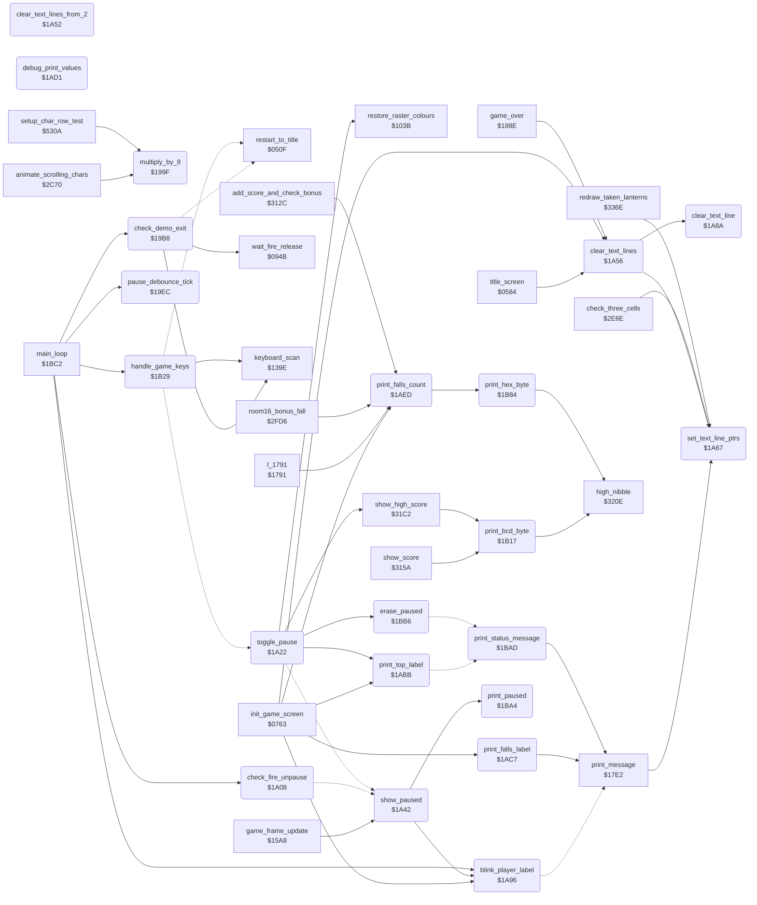

<!-- Generated by c64-docs from knowledge revision 20261016T170255.379-vv114c and src/source-map.json. Do not edit: change the knowledge, generate the source again, then run generate.ts. -->
# status.asm: Status line, pause, demo exit and game keys

Range `$199F-$1BC1`. Source: [status.asm](../../../src/status.asm). Index: [the reference](../index.md).

## Call graph

A solid arrow is a call, a thick arrow a table entry, a dotted arrow a jump. Rounded nodes are in this file.

## Names

### [`multiply_by_8`](../../../src/status.asm#L6) `$199F`

*routine*

Multiplies char_addr_lo by 8 into the 16-bit value char_addr_hi:char_addr_lo ($43BB/$43BC).

- **Called from:** [`animate_scrolling_chars`](animated_chars.md#animate_scrolling_chars) [`$2D0D`](../../../src/animated_chars.asm#L100), [`setup_char_row_test`](collision.md#setup_char_row_test) [`$531E`](../../../src/collision.asm#L301), [`setup_char_row_test`](collision.md#setup_char_row_test) [`$533E`](../../../src/collision.asm#L315), [`setup_char_row_test`](collision.md#setup_char_row_test) [`$5366`](../../../src/collision.asm#L336)
- **Reads:** [`char_addr_lo`](variables.md#char_addr_lo), [`char_addr_hi`](variables.md#char_addr_hi)
- **Writes:** [`char_addr_hi`](variables.md#char_addr_hi), [`char_addr_lo`](variables.md#char_addr_lo)

### [`check_demo_exit`](../../../src/status.asm#L18) `$19B8`

*routine*

In demo mode: fire on port 1 or the F1 key waits for fire release, waits 6 frames and returns to the title ($050F).

- **Called from:** [`main_loop`](main_loop.md#main_loop) [`$1BC6`](../../../src/main_loop.asm#L9)
- **Calls:** [`keyboard_scan`](keyboard.md#keyboard_scan), [`wait_fire_release`](title_menu.md#wait_fire_release)
- **Jumps to:** [`restart_to_title`](restart.md#restart_to_title)
- **Reads:** [`game_playing`](../variables.md#game_playing), [`CIAPRB`](../variables.md#CIAPRB), [`key_pending`](../variables.md#key_pending), [`key_code`](../variables.md#key_code), [`frame_countdown`](../variables.md#frame_countdown)
- **Writes:** [`key_scan_mode`](../variables.md#key_scan_mode), [`key_pending`](../variables.md#key_pending), [`frame_countdown`](../variables.md#frame_countdown)

### [`demo_exit_to_title`](../../../src/status.asm#L35) `$19DD`

*label*

- **Jumped to from:** [`check_demo_exit`](status.md#check_demo_exit) [`$19C2`](../../../src/status.asm#L23)

### [`pause_debounce_tick`](../../../src/status.asm#L46) `$19EC`

*routine*

While the debounce field (bits 1-2) of pause_state is nonzero: replaces bits 0-2 with that field minus 1 (6, 5, 3, 1) and sets last_key to $FF.

- **Called from:** [`main_loop`](main_loop.md#main_loop) [`$1BD1`](../../../src/main_loop.asm#L13)
- **Reads:** [`pause_state`](../variables.md#pause_state)
- **Writes:** [`pause_state`](../variables.md#pause_state), [`last_key`](../variables.md#last_key)

### [`check_fire_unpause`](../../../src/status.asm#L63) `$1A08`

*routine*

While paused and the debounce is over: the fire button of the current player's joystick toggles the pause off (falls into toggle_pause).

- **Called from:** [`main_loop`](main_loop.md#main_loop) [`$1BD4`](../../../src/main_loop.asm#L14)
- **Jumps to:** [`l_1a51`](../../../src/status.asm#L101)
- **Reads:** [`pause_state`](../variables.md#pause_state), [`current_player`](../variables.md#current_player), [`CIAPRB`](../variables.md#CIAPRB)

### [`toggle_pause`](../../../src/status.asm#L77) `$1A22`

*routine*

Flips bit 7 of pause_state and sets the debounce. Pausing shows PAUSED; resuming erases it, restores the colours if the screen saver was on, clears idle_timer, prints TOP and continues at $31C2.

- **Jumped to from:** [`handle_game_keys`](status.md#handle_game_keys) [`$1B65`](../../../src/status.asm#L269)
- **Calls:** [`erase_paused`](status.md#erase_paused), [`restore_raster_colours`](room_state.md#restore_raster_colours), [`print_top_label`](status.md#print_top_label), [`show_high_score`](score.md#show_high_score)
- **Jumps to:** [`show_paused`](status.md#show_paused)
- **Reads:** [`pause_state`](../variables.md#pause_state), [`idle_timer`](../variables.md#idle_timer)
- **Writes:** [`pause_state`](../variables.md#pause_state), [`idle_timer`](../variables.md#idle_timer)

### [`show_paused`](../../../src/status.asm#L94) `$1A42`

*routine*

Shows the player label and the PAUSED message and sets idle_timer to $51 (screen saver after about 47*256 frames).

- **Called from:** [`game_frame_update`](frame_update.md#game_frame_update) [`$1639`](../../../src/frame_update.asm#L87)
- **Jumped to from:** [`toggle_pause`](status.md#toggle_pause) [`$1A2C`](../../../src/status.asm#L82)
- **Calls:** [`blink_player_label`](status.md#blink_player_label), [`print_paused`](status.md#print_paused)
- **Writes:** [`player_tag_blink_timer`](variables.md#player_tag_blink_timer), [`idle_timer`](../variables.md#idle_timer)

### [`clear_text_lines_from_2`](../../../src/status.asm#L104) `$1A52`

*routine*

Clears text lines 2-12 (both rows). Nothing calls it.

### [`clear_text_lines`](../../../src/status.asm#L109) `$1A56`

*routine*

Clears text lines 0-12 (40 bytes on each row) and clears text_single_height.

- **Called from:** [`title_screen`](title.md#title_screen) [`$0595`](../../../src/title.asm#L14), [`init_game_screen`](game_setup.md#init_game_screen) [`$0792`](../../../src/game_setup.asm#L26), [`game_over`](game_over.md#game_over) [`$1891`](../../../src/game_over.asm#L69)
- **Calls:** [`set_text_line_ptrs`](status.md#set_text_line_ptrs), [`clear_text_line`](status.md#clear_text_line)
- **Writes:** [`text_single_height`](../variables.md#text_single_height)

### [`set_text_line_ptrs`](../../../src/status.asm#L120) `$1A67`

*routine*

Sets ($04) to the upper row and ($08) to the lower row of text line X from the tables at $4338/$434C and $4360/$4374; with text_single_height nonzero ($08) is $DE00.

- **Called from:** [`print_message`](text.md#print_message) [`$17E3`](../../../src/text.asm#L8), [`clear_text_lines`](status.md#clear_text_lines) [`$1A5B`](../../../src/status.asm#L113), [`check_three_cells`](background_touch.md#check_three_cells) [`$2E71`](../../../src/background_touch.asm#L39), [`redraw_taken_lanterns`](lanterns.md#redraw_taken_lanterns) [`$3392`](../../../src/lanterns.asm#L86)
- **Reads:** [`text_single_height`](../variables.md#text_single_height)
- **Writes:** [`work_ptr_a`](../variables.md#work_ptr_a), [`work_ptr_a+1`](../variables.md#work_ptr_a), [`work_ptr_c`](../variables.md#work_ptr_c), [`work_ptr_c+1`](../variables.md#work_ptr_c)
- **Refers to:** [`text_row_top_lo`](variables.md#text_row_top_lo), [`text_row_top_hi`](variables.md#text_row_top_hi), [`work_ptr_a`](../variables.md#work_ptr_a), [`text_row_bottom_lo`](variables.md#text_row_bottom_lo), [`text_row_bottom_hi`](variables.md#text_row_bottom_hi), [`work_ptr_c`](../variables.md#work_ptr_c)

### [`clear_text_line`](../../../src/status.asm#L139) `$1A8A`

*routine*

Writes 0 to 40 bytes at ($04) and ($08).

- **Called from:** [`clear_text_lines`](status.md#clear_text_lines) [`$1A5E`](../../../src/status.asm#L114)
- **Reads:** [`work_ptr_a`](../variables.md#work_ptr_a), [`work_ptr_c`](../variables.md#work_ptr_c)
- **Writes:** [`charset_src_0+471`](room_charset_src.md#charset_src_0), [`charset_src_0+472`](room_charset_src.md#charset_src_0)

### [`blink_player_label`](../../../src/status.asm#L149) `$1A96`

*routine*

Blinks the 1UP/2UP label of the current player on the status line: player_tag_blink_timer counts passes down from $20; at 0 prints the blank message 0, at $10 message current_player+1.

- **Called from:** [`init_game_screen`](game_setup.md#init_game_screen) [`$080A`](../../../src/game_setup.asm#L80), [`show_paused`](status.md#show_paused) [`$1A47`](../../../src/status.asm#L97), [`main_loop`](main_loop.md#main_loop) [`$1BEB`](../../../src/main_loop.asm#L25)
- **Jumps to:** [`print_message`](text.md#print_message)
- **Reads:** [`player_tag_blink_timer`](variables.md#player_tag_blink_timer), [`current_player`](../variables.md#current_player)
- **Writes:** [`player_tag_blink_timer`](variables.md#player_tag_blink_timer)

### [`print_top_label`](../../../src/status.asm#L171) `$1ABB`

*routine*

Prints message 3 (TOP) on the status line at offset $38, single height.

- **Called from:** [`init_game_screen`](game_setup.md#init_game_screen) [`$080D`](../../../src/game_setup.asm#L81), [`toggle_pause`](status.md#toggle_pause) [`$1A3C`](../../../src/status.asm#L91)
- **Jumps to:** [`print_status_message`](status.md#print_status_message)
- **Writes:** [`text_single_height`](../variables.md#text_single_height)

### [`print_falls_label`](../../../src/status.asm#L178) `$1AC7`

*routine*

Prints message 5 (FALLS) on text line 0 at offset $44.

- **Called from:** [`init_game_screen`](game_setup.md#init_game_screen) [`$0810`](../../../src/game_setup.asm#L82)
- **Calls:** [`print_message`](text.md#print_message)

### [`debug_print_values`](../../../src/status.asm#L185) `$1AD1`

*routine*

Prints $E6, $E9, $5A and $5B as hex on the status line. No code reaches it (the RTS at $1AD0 comes first).

### [`print_falls_count`](../../../src/status.asm#L200) `$1AED`

*routine*

Converts falls_left to two BCD digits (bcd_tens/bcd_ones) and prints them on the status line at offset $4A.

- **Called from:** [`init_game_screen`](game_setup.md#init_game_screen) [`$0813`](../../../src/game_setup.asm#L83), [`l_1791`](../../../src/frame_update.asm#L286) [`$1794`](../../../src/frame_update.asm#L288), [`room16_bonus_fall`](background_touch.md#room16_bonus_fall) [`$2FE7`](../../../src/background_touch.asm#L266), [`add_score_and_check_bonus`](score.md#add_score_and_check_bonus) [`$3157`](../../../src/score.asm#L33)
- **Calls:** [`print_hex_byte`](status.md#print_hex_byte)
- **Reads:** [`falls_left`](../variables.md#falls_left), [`bcd_conv_digits`](variables.md#bcd_conv_digits), [`bcd_conv_binary`](variables.md#bcd_conv_binary)
- **Writes:** [`bcd_conv_digits`](variables.md#bcd_conv_digits), [`bcd_conv_binary`](variables.md#bcd_conv_binary)

### [`print_bcd_byte`](../../../src/status.asm#L225) `$1B17`

*routine*

Prints A as two decimal digits (characters $10-$19) at $8C00+Y and $8C01+Y.

- **Called from:** [`show_score`](score.md#show_score) [`$3162`](../../../src/score.asm#L39), [`show_score`](score.md#show_score) [`$316A`](../../../src/score.asm#L42), [`show_score`](score.md#show_score) [`$3172`](../../../src/score.asm#L45), [`show_high_score`](score.md#show_high_score) [`$31F9`](../../../src/score.asm#L124), [`show_high_score`](score.md#show_high_score) [`$3201`](../../../src/score.asm#L127), [`show_high_score`](score.md#show_high_score) [`$3209`](../../../src/score.asm#L130)
- **Calls:** [`high_nibble`](score.md#high_nibble)
- **Refers to:** [`screen_ram`](vic_bank2.md#screen_ram), [`screen_ram+1`](vic_bank2.md#screen_ram)

### [`handle_game_keys`](../../../src/status.asm#L236) `$1B29`

*routine*

Scans the game keys: F1 returns to the title, S flips sound_toggle, SPACE toggles the pause, V shows or removes the version line (text at $4707) on the top screen row.

- **Called from:** [`main_loop`](main_loop.md#main_loop) [`$1BCE`](../../../src/main_loop.asm#L12)
- **Calls:** [`keyboard_scan`](keyboard.md#keyboard_scan)
- **Jumps to:** [`restart_to_title`](restart.md#restart_to_title), [`toggle_pause`](status.md#toggle_pause)
- **Reads:** [`key_pending`](../variables.md#key_pending), [`key_code`](../variables.md#key_code), [`sound_toggle`](actor_room_tables.md#sound_toggle), [`screen_ram`](vic_bank2.md#screen_ram), [`version_text+38`](messages.md#version_text), [`version_text+39`](messages.md#version_text)
- **Writes:** [`key_scan_mode`](../variables.md#key_scan_mode), [`key_pending`](../variables.md#key_pending), [`last_key`](../variables.md#last_key), [`sound_toggle`](actor_room_tables.md#sound_toggle), [`title_music_countdown`](title_menu.md#title_music_countdown), [`screen_ram+38`](vic_bank2.md#screen_ram), [`screen_ram+39`](vic_bank2.md#screen_ram)

### [`game_key_dispatch`](../../../src/status.asm#L243) `$1B37`

*label*

- **Jumped to from:** [`handle_game_keys`](status.md#handle_game_keys) [`$1B34`](../../../src/status.asm#L241)

### [`toggle_version_line`](../../../src/status.asm#L270) `$1B68`

*label*

- **Jumped to from:** [`handle_game_keys`](status.md#handle_game_keys) [`$1B62`](../../../src/status.asm#L265)

### [`print_hex_byte`](../../../src/status.asm#L289) `$1B84`

*routine*

Prints A as two hex digits at $8C00+Y and $8C01+Y (characters $10-$19, letters after them).

- **Called from:** [`print_falls_count`](status.md#print_falls_count) [`$1B14`](../../../src/status.asm#L223)
- **Calls:** [`high_nibble`](score.md#high_nibble)
- **Refers to:** [`screen_ram`](vic_bank2.md#screen_ram), [`screen_ram+1`](vic_bank2.md#screen_ram)

### [`print_paused`](../../../src/status.asm#L312) `$1BA4`

*routine*

Prints message 11 (PAUSED) on text line 1 at offset $0F, single height.

- **Called from:** [`show_paused`](status.md#show_paused) [`$1A4E`](../../../src/status.asm#L100)
- **Writes:** [`text_single_height`](../variables.md#text_single_height)

### [`print_status_message`](../../../src/status.asm#L318) `$1BAD`

*routine*

Prints message A at line X, offset Y through print_message, then clears text_single_height.

- **Jumped to from:** [`print_top_label`](status.md#print_top_label) [`$1AC4`](../../../src/status.asm#L176), [`erase_paused`](status.md#erase_paused) [`$1BBF`](../../../src/status.asm#L329)
- **Calls:** [`print_message`](text.md#print_message)

### [`erase_paused`](../../../src/status.asm#L324) `$1BB6`

*routine*

Prints message 12 (blanks) over the PAUSED message.

- **Called from:** [`toggle_pause`](status.md#toggle_pause) [`$1A2E`](../../../src/status.asm#L83)
- **Jumps to:** [`print_status_message`](status.md#print_status_message)
- **Writes:** [`text_single_height`](../variables.md#text_single_height)
