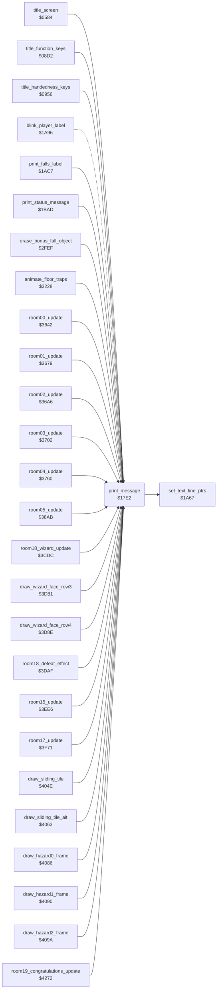

<!-- Generated by c64-docs from knowledge revision 20261016T170255.379-vv114c and src/source-map.json. Do not edit: change the knowledge, generate the source again, then run generate.ts. -->
# text.asm: Double-height message printer

Range `$17E2-$1817`. Source: [text.asm](../../../src/text.asm). Index: [the reference](../index.md).

## Call graph

A solid arrow is a call, a thick arrow a table entry, a dotted arrow a jump. Rounded nodes are in this file.

## Names

### [`print_message`](../../../src/text.asm#L6) `$17E2`

*routine*

Prints message A from message_ptrs at text line X ($1A67), column offset Y. Text is in screen codes +$20, ended by $A0. Writes double-height text: code AND $7F on the upper row, code OR $80 on the lower row; when text_single_height is nonzero the lower row goes to $DE00 (discarded).

- **Called from:** [`title_screen`](title.md#title_screen) [`$0656`](../../../src/title.asm#L96), [`title_function_keys`](title_menu.md#title_function_keys) [`$08F2`](../../../src/title_menu.asm#L39), [`title_handedness_keys`](title_menu.md#title_handedness_keys) [`$096F`](../../../src/title_menu.asm#L109), [`title_handedness_keys`](title_menu.md#title_handedness_keys) [`$097E`](../../../src/title_menu.asm#L117), [`title_handedness_keys`](title_menu.md#title_handedness_keys) [`$098E`](../../../src/title_menu.asm#L125), [`title_handedness_keys`](title_menu.md#title_handedness_keys) [`$099E`](../../../src/title_menu.asm#L133), [`print_falls_label`](status.md#print_falls_label) [`$1ACD`](../../../src/status.asm#L182), [`print_status_message`](status.md#print_status_message) [`$1BAD`](../../../src/status.asm#L319), [`erase_bonus_fall_object`](background_touch.md#erase_bonus_fall_object) [`$2FF5`](../../../src/background_touch.asm#L274), [`animate_floor_traps`](room_entry_traps.md#animate_floor_traps) [`$324B`](../../../src/room_entry_traps.asm#L37), [`animate_floor_traps`](room_entry_traps.md#animate_floor_traps) [`$326D`](../../../src/room_entry_traps.asm#L54), [`animate_floor_traps`](room_entry_traps.md#animate_floor_traps) [`$3293`](../../../src/room_entry_traps.asm#L73), [`room00_update`](room_update.md#room00_update) [`$365F`](../../../src/room_update.asm#L20), [`room00_update`](room_update.md#room00_update) [`$366D`](../../../src/room_update.asm#L28), [`room01_update`](room_update.md#room01_update) [`$36A2`](../../../src/room_update.asm#L56), [`room02_update`](room_update.md#room02_update) [`$36E8`](../../../src/room_update.asm#L91), [`room02_update`](room_update.md#room02_update) [`$36F6`](../../../src/room_update.asm#L99), [`room03_update`](room_update.md#room03_update) [`$3723`](../../../src/room_update.asm#L123), [`room03_update`](room_update.md#room03_update) [`$373F`](../../../src/room_update.asm#L139), [`room03_update`](room_update.md#room03_update) [`$3754`](../../../src/room_update.asm#L150), [`room04_update`](room_update.md#room04_update) [`$3775`](../../../src/room_update.asm#L166), [`room04_update`](room_update.md#room04_update) [`$378A`](../../../src/room_update.asm#L176), [`room04_update`](room_update.md#room04_update) [`$37C9`](../../../src/room_update.asm#L204), [`room04_update`](room_update.md#room04_update) [`$37DE`](../../../src/room_update.asm#L214), [`room05_update`](room_update.md#room05_update) [`$3904`](../../../src/room_update.asm#L369), [`room18_wizard_update`](room_update.md#room18_wizard_update) [`$3CFD`](../../../src/room_update.asm#L926), [`room18_wizard_update`](room_update.md#room18_wizard_update) [`$3D5B`](../../../src/room_update.asm#L974), [`draw_wizard_face_row3`](room_update.md#draw_wizard_face_row3) [`$3D8B`](../../../src/room_update.asm#L998), [`draw_wizard_face_row4`](room_update.md#draw_wizard_face_row4) [`$3D98`](../../../src/room_update.asm#L1006), [`draw_wizard_face_row4`](room_update.md#draw_wizard_face_row4) [`$3DA3`](../../../src/room_update.asm#L1013), [`room18_defeat_effect`](room_update.md#room18_defeat_effect) [`$3E22`](../../../src/room_update.asm#L1074), [`room15_update`](room_update.md#room15_update) [`$3EF6`](../../../src/room_update.asm#L1183), [`room15_update`](room_update.md#room15_update) [`$3F1E`](../../../src/room_update.asm#L1200), [`room15_update`](room_update.md#room15_update) [`$3F3F`](../../../src/room_update.asm#L1215), [`room17_update`](room_update.md#room17_update) [`$3FBC`](../../../src/room_update.asm#L1282), [`room17_update`](room_update.md#room17_update) [`$3FD2`](../../../src/room_update.asm#L1292), [`draw_sliding_tile`](room_tiles.md#draw_sliding_tile) [`$4057`](../../../src/room_tiles.asm#L11), [`draw_sliding_tile_alt`](room_tiles.md#draw_sliding_tile_alt) [`$406C`](../../../src/room_tiles.asm#L22), [`draw_hazard0_frame`](room_tiles.md#draw_hazard0_frame) [`$408D`](../../../src/room_tiles.asm#L44), [`draw_hazard1_frame`](room_tiles.md#draw_hazard1_frame) [`$4097`](../../../src/room_tiles.asm#L51) and 2 more
- **Jumped to from:** [`blink_player_label`](status.md#blink_player_label) [`$1AA5`](../../../src/status.asm#L157), [`blink_player_label`](status.md#blink_player_label) [`$1AB7`](../../../src/status.asm#L167)
- **Calls:** [`set_text_line_ptrs`](status.md#set_text_line_ptrs)
- **Reads:** [`work_ptr_b`](../variables.md#work_ptr_b), [`work_ptr_a`](../variables.md#work_ptr_a), [`work_ptr_c`](../variables.md#work_ptr_c), [`work_ptr_a+1`](../variables.md#work_ptr_a), [`work_ptr_b+1`](../variables.md#work_ptr_b), [`work_ptr_c+1`](../variables.md#work_ptr_c)
- **Writes:** [`work_ptr_b`](../variables.md#work_ptr_b), [`work_ptr_b+1`](../variables.md#work_ptr_b), [`work_ptr_a+1`](../variables.md#work_ptr_a), [`work_ptr_c+1`](../variables.md#work_ptr_c)
- **Refers to:** [`message_pointers`](messages.md#message_pointers), [`message_pointers+1`](messages.md#message_pointers), [`work_ptr_b`](../variables.md#work_ptr_b), [`charset_src_0+433`](room_charset_src.md#charset_src_0), [`work_ptr_a`](../variables.md#work_ptr_a), [`work_ptr_c`](../variables.md#work_ptr_c)

### [`print_message_loop`](../../../src/text.asm#L20) `$17FA`

*label*

- **Jumped to from:** [`print_message`](text.md#print_message) [`$180C`](../../../src/text.asm#L31), [`print_message`](text.md#print_message) [`$1814`](../../../src/text.asm#L36)
