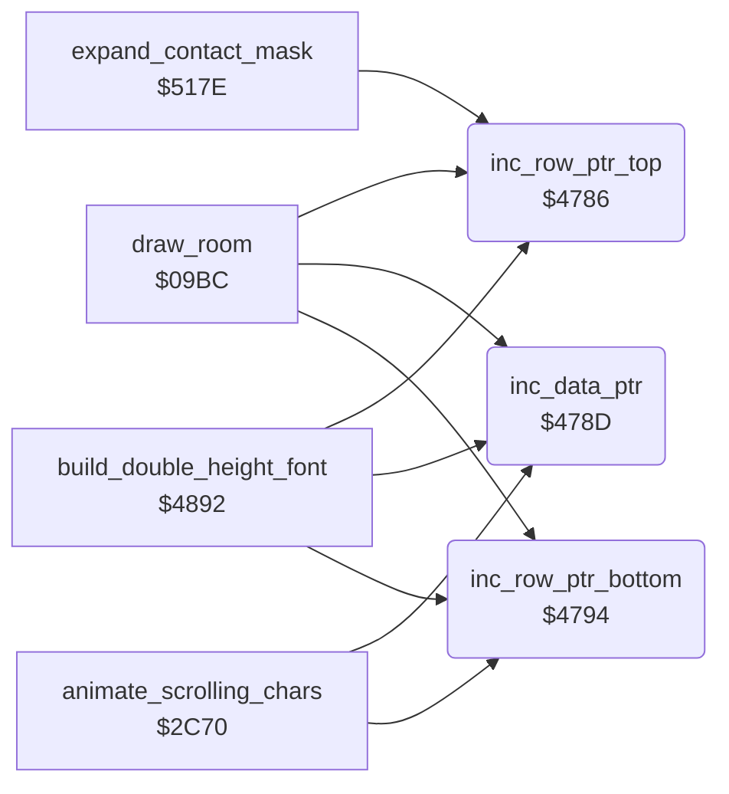

<!-- Generated by c64-docs from knowledge revision 20261025T141148.619-ij2l1b and .c64-re-tools/local/generated/src/source-map.json. Do not edit: change the knowledge, generate the source again, then run docs.ts generate. -->
# text/pointer_helpers.asm: Increment helpers for the zero-page pointers row_ptr_top, data_ptr and row_ptr_bottom

Range `$4786-$479A`. Source: [text/pointer_helpers.asm](../../../../src/text/pointer_helpers.asm). Index: [the reference](../../index.md).

## Routines

| Routine | Address | Reached from | Summary |
|---|---|---|---|
| [`inc_row_ptr_top`](pointer_helpers.md#inc_row_ptr_top) | `$4786` | [`draw_room`](../room/draw_room.md#draw_room), [`build_double_height_font`](../room/draw_helpers.md#build_double_height_font), [`expand_contact_mask`](../actor/frame_builder.md#expand_contact_mask) | Increments the 16-bit pointer row_ptr_top. |
| [`inc_data_ptr`](pointer_helpers.md#inc_data_ptr) | `$478D` | [`draw_room`](../room/draw_room.md#draw_room), [`animate_scrolling_chars`](../room/animated_chars.md#animate_scrolling_chars), [`build_double_height_font`](../room/draw_helpers.md#build_double_height_font) | Increments the 16-bit pointer data_ptr. |
| [`inc_row_ptr_bottom`](pointer_helpers.md#inc_row_ptr_bottom) | `$4794` | [`draw_room`](../room/draw_room.md#draw_room), [`animate_scrolling_chars`](../room/animated_chars.md#animate_scrolling_chars), [`build_double_height_font`](../room/draw_helpers.md#build_double_height_font) | Increments the 16-bit pointer row_ptr_bottom. |

## Call graph

A solid arrow is a call, a thick arrow a table entry. Rounded nodes are in this file.

## Details

### [`inc_row_ptr_top`](../../../../src/text/pointer_helpers.asm#L7) `$4786`

*routine*

Increments the 16-bit pointer row_ptr_top. A, X, Y unchanged. Used by draw_room, build_double_height_font and expand_contact_mask.

- **Called from:** [`draw_room`](../room/draw_room.md#draw_room), [`build_double_height_font`](../room/draw_helpers.md#build_double_height_font), [`expand_contact_mask`](../actor/frame_builder.md#expand_contact_mask)
- **Reads:** [`row_ptr_top`](../../memory-map.md#row_ptr_top)
- **Writes:** [`row_ptr_top`](../../memory-map.md#row_ptr_top)
- **Refers to:** [`row_ptr_top`](../../memory-map.md#row_ptr_top)

| Label | Address | Comment |
|---|---|---|
| [`inc_row_ptr_top_done`](../../../../src/text/pointer_helpers.asm#L11) | `$478C` |  |

### [`inc_data_ptr`](../../../../src/text/pointer_helpers.asm#L15) `$478D`

*routine*

Increments the 16-bit pointer data_ptr. A, X, Y unchanged. Used by draw_room, build_double_height_font and animate_scrolling_chars.

- **Called from:** [`draw_room`](../room/draw_room.md#draw_room), [`animate_scrolling_chars`](../room/animated_chars.md#animate_scrolling_chars), [`build_double_height_font`](../room/draw_helpers.md#build_double_height_font)
- **Reads:** [`data_ptr`](../../memory-map.md#data_ptr)
- **Writes:** [`data_ptr`](../../memory-map.md#data_ptr)
- **Refers to:** [`data_ptr`](../../memory-map.md#data_ptr)

| Label | Address | Comment |
|---|---|---|
| [`inc_data_ptr_done`](../../../../src/text/pointer_helpers.asm#L19) | `$4793` |  |

### [`inc_row_ptr_bottom`](../../../../src/text/pointer_helpers.asm#L23) `$4794`

*routine*

Increments the 16-bit pointer row_ptr_bottom. A, X, Y unchanged. Used by draw_room, build_double_height_font and animate_scrolling_chars.

- **Called from:** [`draw_room`](../room/draw_room.md#draw_room), [`animate_scrolling_chars`](../room/animated_chars.md#animate_scrolling_chars), [`build_double_height_font`](../room/draw_helpers.md#build_double_height_font)
- **Reads:** [`row_ptr_bottom`](../../memory-map.md#row_ptr_bottom)
- **Writes:** [`row_ptr_bottom`](../../memory-map.md#row_ptr_bottom)
- **Refers to:** [`row_ptr_bottom`](../../memory-map.md#row_ptr_bottom)

| Label | Address | Comment |
|---|---|---|
| [`inc_row_ptr_bottom_done`](../../../../src/text/pointer_helpers.asm#L27) | `$479A` |  |
