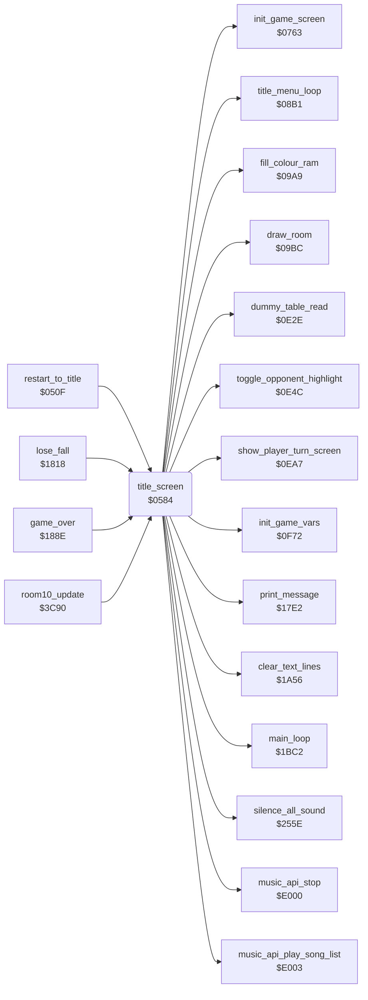

<!-- Generated by c64-docs from knowledge revision 20261016T170255.379-vv114c and src/source-map.json. Do not edit: change the knowledge, generate the source again, then run generate.ts. -->
# title.asm: Title screen and game start

Range `$0584-$0762`. Source: [title.asm](../../../src/title.asm). Index: [the reference](../index.md).

## Call graph

A solid arrow is a call, a thick arrow a table entry, a dotted arrow a jump. Rounded nodes are in this file.

## Names

### [`title_screen`](../../../src/title.asm#L6) `$0584`

*routine*

Builds the title screen (text lines, TM sprite, title raster IRQ), restores the saved options, starts the title tune every fifth visit, runs title_menu_loop and then starts a game (falls into start_game).

- **Called from:** [`restart_to_title`](restart.md#restart_to_title) [`$052E`](../../../src/restart.asm#L22), [`lose_fall`](game_over.md#lose_fall) [`$1823`](../../../src/game_over.asm#L11), [`game_over`](game_over.md#game_over) [`$1981`](../../../src/game_over.asm#L184), [`room10_update`](room_update.md#room10_update) [`$3CBA`](../../../src/room_update.asm#L890)
- **Calls:** [`silence_all_sound`](sound_effects.md#silence_all_sound), [`clear_text_lines`](status.md#clear_text_lines), [`dummy_table_read`](title_options.md#dummy_table_read), [`fill_colour_ram`](title_menu.md#fill_colour_ram), [`print_message`](text.md#print_message), [`toggle_opponent_highlight`](title_options.md#toggle_opponent_highlight), [`music_api_play_song_list`](music_player.md#music_api_play_song_list), [`title_menu_loop`](title_menu.md#title_menu_loop), [`music_api_stop`](music_player.md#music_api_stop), [`show_player_turn_screen`](player_turn.md#show_player_turn_screen), [`init_game_vars`](game_vars.md#init_game_vars), [`init_game_screen`](game_setup.md#init_game_screen), [`draw_room`](room_draw.md#draw_room), [`main_loop`](main_loop.md#main_loop)
- **Reads:** [`SCROLY`](../variables.md#SCROLY), [`tm_sprite_rows+10`](title_options.md#tm_sprite_rows), [`tm_sprite_rows+11`](title_options.md#tm_sprite_rows), [`title_row_datasoft+38`](room_tables.md#title_row_datasoft), [`title_row_datasoft+39`](room_tables.md#title_row_datasoft), [`title_row_bruce_lee_top+38`](room_tables.md#title_row_bruce_lee_top), [`title_row_bruce_lee_top+39`](room_tables.md#title_row_bruce_lee_top), [`title_row_bruce_lee_bottom+38`](room_tables.md#title_row_bruce_lee_bottom), [`title_row_bruce_lee_bottom+39`](room_tables.md#title_row_bruce_lee_bottom), [`title_row_byline+38`](room_tables.md#title_row_byline), [`title_row_byline+39`](room_tables.md#title_row_byline), [`human_opponent_mode`](variables.md#human_opponent_mode), [`sound_toggle`](actor_room_tables.md#sound_toggle), [`title_music_countdown`](title_menu.md#title_music_countdown), [`protection_sig_a+22`](protection_signature.md#protection_sig_a), [`protection_sig_b+24`](protection_signature.md#protection_sig_b), [`protection_sig_a+23`](protection_signature.md#protection_sig_a), [`protection_sig_b+22`](protection_signature.md#protection_sig_b), [`protection_sig_a+24`](protection_signature.md#protection_sig_a), [`protection_sig_b+23`](protection_signature.md#protection_sig_b), [`demo_input_ptr`](../variables.md#demo_input_ptr), [`demo_input_ptr+1`](../variables.md#demo_input_ptr), [`two_player_mode`](variables.md#two_player_mode)
- **Writes:** [`SCROLY`](../variables.md#SCROLY), [`text_single_height`](../variables.md#text_single_height), [`sprite_blocks+638`](vic_bank2.md#sprite_blocks), [`sprite_blocks+639`](vic_bank2.md#sprite_blocks), [`SPENA`](../variables.md#SPENA), [`XXPAND`](../variables.md#XXPAND), [`MSIGX`](../variables.md#MSIGX), [`YXPAND`](../variables.md#YXPAND), [`SPBGPR`](../variables.md#SPBGPR), [`SPMC`](../variables.md#SPMC), [`SP0X`](../variables.md#SP0X), [`SP0Y`](../variables.md#SP0Y), [`SP0COL`](../variables.md#SP0COL), [`sprite_pointers`](vic_bank2.md#sprite_pointers), [`sprite_blocks+598`](vic_bank2.md#sprite_blocks), [`sprite_blocks+599`](vic_bank2.md#sprite_blocks), [`irq_chain_vector`](init.md#irq_chain_vector), [`irq_vector_hi`](init.md#irq_vector_hi), [`IRQMSK`](../variables.md#IRQMSK), [`VICIRQ`](../variables.md#VICIRQ), [`RASTER`](../variables.md#RASTER), [`EXTCOL`](../variables.md#EXTCOL), [`BGCOL0`](../variables.md#BGCOL0), [`BGCOL1`](../variables.md#BGCOL1), [`BGCOL2`](../variables.md#BGCOL2), [`SCROLX`](../variables.md#SCROLX), [`ld99e+66`](../variables.md#ld99e), [`lda00+223`](../variables.md#lda00), [`lda00+224`](../variables.md#lda00), [`ldb94+75`](../variables.md#ldb94), [`screen_ram`](vic_bank2.md#screen_ram), [`screen_ram+255`](vic_bank2.md#screen_ram), [`screen_ram+104`](vic_bank2.md#screen_ram), [`screen_ram+359`](vic_bank2.md#screen_ram), [`screen_ram+118`](vic_bank2.md#screen_ram), [`screen_ram+119`](vic_bank2.md#screen_ram), [`screen_ram+238`](vic_bank2.md#screen_ram), [`screen_ram+239`](vic_bank2.md#screen_ram), [`screen_ram+278`](vic_bank2.md#screen_ram), [`screen_ram+279`](vic_bank2.md#screen_ram) and 14 more
- **Refers to:** [`sprite_blocks`](vic_bank2.md#sprite_blocks), [`irq_split_top`](raster_irq_screens.md#irq_split_top), [`screen_ram`](vic_bank2.md#screen_ram), [`music_song_list`](music_data.md#music_song_list), [`protection_sig_a`](protection_signature.md#protection_sig_a), [`protection_sig_b`](protection_signature.md#protection_sig_b), [`demo_input_ptr`](../variables.md#demo_input_ptr), [`demo_input_data`](demo_input.md#demo_input_data)

### [`title_copy_text`](../../../src/title.asm#L76) `$0628`

*label*

four 40-char title lines from $49BD-$4A5C to rows 2, 5, 6 and 9

- **Jumped to from:** [`title_screen`](title.md#title_screen) [`$0649`](../../../src/title.asm#L90)

### [`title_invert_options`](../../../src/title.asm#L106) `$066D`

*label*

chars +$40 select the inverted font half

### [`title_restore_options`](../../../src/title.asm#L132) `$06A1`

*label*

### [`title_music`](../../../src/title.asm#L146) `$06BD`

*label*

- **Jumped to from:** [`title_screen`](title.md#title_screen) [`$06B8`](../../../src/title.asm#L143)

### [`title_tamper_check`](../../../src/title.asm#L160) `$06DD`

*label*

protection signature bytes must XOR to zero

- **Jumped to from:** [`title_screen`](title.md#title_screen) [`$06C0`](../../../src/title.asm#L148), [`title_screen`](title.md#title_screen) [`$06C5`](../../../src/title.asm#L150)

### [`tamper_wipe_loop`](../../../src/title.asm#L169) `$06F3`

*label*

endless loop: stores A at (demo_input_ptr),Y, one byte in each page, page after page

- **Jumped to from:** [`title_screen`](title.md#title_screen) [`$06F7`](../../../src/title.asm#L173)

### [`title_wait_input`](../../../src/title.asm#L174) `$06FA`

*label*

title countdown: 96 + 9*255 = 2391 frames until start_demo

- **Jumped to from:** [`title_screen`](title.md#title_screen) [`$06F1`](../../../src/title.asm#L168)

### [`start_game`](../../../src/title.asm#L185) `$070E`

*label*

Game start after the title: copies the options into $42CB/$42CC, shows the player turn screen, initialises variables and screen, draws the room and enters the main loop at $1BC2.
