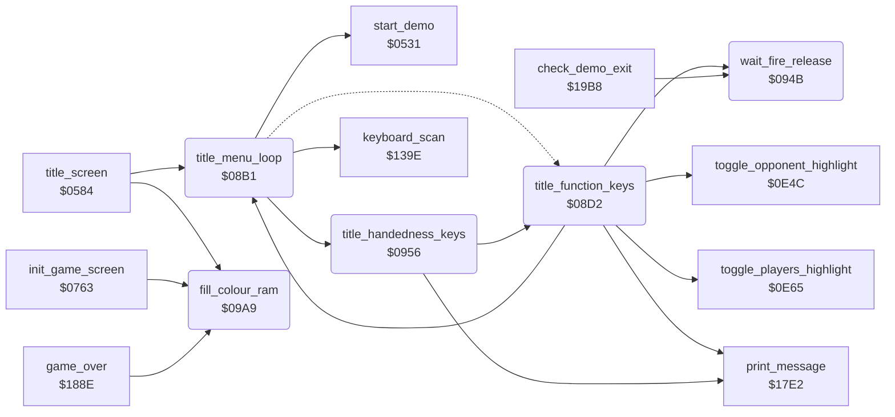

<!-- Generated by c64-docs from knowledge revision 20261016T170255.379-vv114c and src/source-map.json. Do not edit: change the knowledge, generate the source again, then run generate.ts. -->
# title_menu.asm: Title menu input loop

Range `$08B1-$09BB`. Source: [title_menu.asm](../../../src/title_menu.asm). Index: [the reference](../index.md).

## Call graph

A solid arrow is a call, a thick arrow a table entry, a dotted arrow a jump. Rounded nodes are in this file.

## Data

| Range | Type | Name | Read by | Written by |
|---|---|---|---|---|
| [`$09BB`](../../../src/title_menu.asm#L151) | bytes | [`title_music_countdown`](../../../src/title_menu.asm#L150) | [`title_screen`](title.md#title_screen) | [`title_screen`](title.md#title_screen), [`lose_fall`](game_over.md#lose_fall), [`handle_game_keys`](status.md#handle_game_keys) |

## Names

### [`title_menu_loop`](../../../src/title_menu.asm#L6) `$08B1`

*routine*

Title menu: goes to start_demo when title_timeout runs out; handles F7 or port-1 fire (start), F3 (players), F5 (opponent) and the L/R handedness keys. Returns when a game is to start.

- **Called from:** [`title_screen`](title.md#title_screen) [`$070B`](../../../src/title.asm#L183), [`title_function_keys`](title_menu.md#title_function_keys) [`$0929`](../../../src/title_menu.asm#L71)
- **Jumped to from:** [`title_function_keys`](title_menu.md#title_function_keys) [`$08FA`](../../../src/title_menu.asm#L43)
- **Calls:** [`start_demo`](restart.md#start_demo), [`keyboard_scan`](keyboard.md#keyboard_scan), [`title_handedness_keys`](title_menu.md#title_handedness_keys)
- **Jumps to:** [`title_idle`](title_menu.md#title_idle)
- **Reads:** [`attract_countdown`](../variables.md#attract_countdown), [`title_timeout_hi`](../variables.md#title_timeout_hi), [`key_pending`](../variables.md#key_pending), [`key_code`](../variables.md#key_code)
- **Writes:** [`key_scan_mode`](../variables.md#key_scan_mode), [`key_pending`](../variables.md#key_pending)

### [`title_scan_keys`](../../../src/title_menu.asm#L11) `$08BA`

*label*

- **Jumped to from:** [`title_menu_loop`](title_menu.md#title_menu_loop) [`$08B5`](../../../src/title_menu.asm#L9)

### [`title_function_keys`](../../../src/title_menu.asm#L21) `$08D2`

*label*

- **Called from:** [`title_handedness_keys`](title_menu.md#title_handedness_keys) [`$0966`](../../../src/title_menu.asm#L104)
- **Calls:** [`print_message`](text.md#print_message), [`wait_fire_release`](title_menu.md#wait_fire_release), [`toggle_opponent_highlight`](title_options.md#toggle_opponent_highlight), [`title_menu_loop`](title_menu.md#title_menu_loop), [`toggle_players_highlight`](title_options.md#toggle_players_highlight)
- **Jumps to:** [`title_menu_loop`](title_menu.md#title_menu_loop)
- **Reads:** [`title_timeout_hi`](../variables.md#title_timeout_hi), [`attract_countdown`](../variables.md#attract_countdown), [`CIAPRB`](../variables.md#CIAPRB), [`frame_countdown`](../variables.md#frame_countdown), [`human_opponent_mode`](variables.md#human_opponent_mode), [`two_player_mode`](variables.md#two_player_mode)
- **Writes:** [`frame_countdown`](../variables.md#frame_countdown), [`human_opponent_mode`](variables.md#human_opponent_mode), [`saved_human_opponent_mode`](variables.md#saved_human_opponent_mode), [`title_timeout_hi`](../variables.md#title_timeout_hi), [`attract_countdown`](../variables.md#attract_countdown), [`two_player_mode`](variables.md#two_player_mode), [`saved_two_player_mode`](variables.md#saved_two_player_mode)

### [`title_idle`](../../../src/title_menu.asm#L29) `$08E0`

*label*

message $0E at the handedness message position once title_timeout is below $0802

- **Jumped to from:** [`title_menu_loop`](title_menu.md#title_menu_loop) [`$08C5`](../../../src/title_menu.asm#L16)

### [`title_check_fire`](../../../src/title_menu.asm#L40) `$08F5`

*label*

- **Jumped to from:** [`title_function_keys`](title_menu.md#title_function_keys) [`$08E4`](../../../src/title_menu.asm#L32), [`title_function_keys`](title_menu.md#title_function_keys) [`$08EA`](../../../src/title_menu.asm#L35)

### [`title_start_pressed`](../../../src/title_menu.asm#L44) `$08FC`

*label*

- **Jumped to from:** [`title_function_keys`](title_menu.md#title_function_keys) [`$08D6`](../../../src/title_menu.asm#L24)

### [`title_toggle_opponent`](../../../src/title_menu.asm#L54) `$0908`

*label*

F5: toggles human_opponent_mode and its highlight, waits for fire release and restarts the timeout.

- **Jumped to from:** [`title_function_keys`](title_menu.md#title_function_keys) [`$08DA`](../../../src/title_menu.asm#L26)

### [`title_option_done`](../../../src/title_menu.asm#L60) `$0916`

*label*

- **Jumped to from:** [`title_handedness_keys`](title_menu.md#title_handedness_keys) [`$09A6`](../../../src/title_menu.asm#L137)

### [`title_wait_frames`](../../../src/title_menu.asm#L68) `$0925`

*label*

- **Jumped to from:** [`title_function_keys`](title_menu.md#title_function_keys) [`$0927`](../../../src/title_menu.asm#L70), [`title_function_keys`](title_menu.md#title_function_keys) [`$0949`](../../../src/title_menu.asm#L86)

### [`title_toggle_players`](../../../src/title_menu.asm#L73) `$092C`

*label*

F3: toggles two_player_mode and its highlight.

- **Jumped to from:** [`title_function_keys`](title_menu.md#title_function_keys) [`$08DE`](../../../src/title_menu.asm#L28)

### [`wait_fire_release`](../../../src/title_menu.asm#L88) `$094B`

*routine*

Waits until the fire buttons of both joystick ports are released.

- **Called from:** [`title_function_keys`](title_menu.md#title_function_keys) [`$08FC`](../../../src/title_menu.asm#L45), [`title_function_keys`](title_menu.md#title_function_keys) [`$0916`](../../../src/title_menu.asm#L61), [`title_function_keys`](title_menu.md#title_function_keys) [`$093A`](../../../src/title_menu.asm#L79), [`check_demo_exit`](status.md#check_demo_exit) [`$19DD`](../../../src/status.asm#L36)
- **Reads:** [`CIAPRA`](../variables.md#CIAPRA), [`CIAPRB`](../variables.md#CIAPRB)

### [`title_handedness_keys`](../../../src/title_menu.asm#L95) `$0956`

*routine*

Key code in A: L/Shift-L set joystick 1/2 to left-handed, R/Shift-R to right-handed, each with its message; other keys go to title_function_keys.

- **Called from:** [`title_menu_loop`](title_menu.md#title_menu_loop) [`$08CF`](../../../src/title_menu.asm#L20)
- **Calls:** [`title_function_keys`](title_menu.md#title_function_keys), [`print_message`](text.md#print_message)
- **Jumps to:** [`title_option_done`](title_menu.md#title_option_done)

### [`set_joy1_left`](../../../src/title_menu.asm#L105) `$0969`

*label*

- **Jumped to from:** [`title_handedness_keys`](title_menu.md#title_handedness_keys) [`$0958`](../../../src/title_menu.asm#L97)

### [`set_joy2_left`](../../../src/title_menu.asm#L113) `$0979`

*label*

- **Jumped to from:** [`title_handedness_keys`](title_menu.md#title_handedness_keys) [`$095C`](../../../src/title_menu.asm#L99)

### [`set_joy1_right`](../../../src/title_menu.asm#L121) `$0988`

*label*

- **Jumped to from:** [`title_handedness_keys`](title_menu.md#title_handedness_keys) [`$0960`](../../../src/title_menu.asm#L101)

### [`set_joy2_right`](../../../src/title_menu.asm#L129) `$0998`

*label*

- **Jumped to from:** [`title_handedness_keys`](title_menu.md#title_handedness_keys) [`$0964`](../../../src/title_menu.asm#L103)

### [`fill_colour_ram`](../../../src/title_menu.asm#L139) `$09A9`

*routine*

Fills colour RAM $D800-$DBFF with A.

- **Called from:** [`title_screen`](title.md#title_screen) [`$060E`](../../../src/title.asm#L64), [`init_game_screen`](game_setup.md#init_game_screen) [`$0797`](../../../src/game_setup.asm#L28), [`game_over`](game_over.md#game_over) [`$18D6`](../../../src/game_over.asm#L96)
- **Writes:** [`ld800`](../variables.md#ld800), [`ld800+1`](../variables.md#ld800), [`ld900`](../variables.md#ld900), [`ld900+1`](../variables.md#ld900), [`lda00`](../variables.md#lda00), [`lda00+1`](../variables.md#lda00), [`ldb00`](../variables.md#ldb00), [`ldb00+1`](../variables.md#ldb00)

### [`title_music_countdown`](../../../src/title_menu.asm#L150) `$09BB`

*variable*

Title visits until the title tune plays again (4..0, played when it goes negative).
Countdown before the title music starts.

- **Read by:** [`title_screen`](title.md#title_screen) [`$06C2`](../../../src/title.asm#L149)
- **Written by:** [`title_screen`](title.md#title_screen) [`$06C2`](../../../src/title.asm#L149), [`title_screen`](title.md#title_screen) [`$06C9`](../../../src/title.asm#L152), [`lose_fall`](game_over.md#lose_fall) [`$1820`](../../../src/game_over.asm#L10), [`handle_game_keys`](status.md#handle_game_keys) [`$1B58`](../../../src/status.asm#L259)
