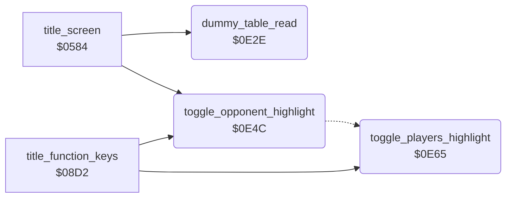

<!-- Generated by c64-docs from knowledge revision 20261016T170255.379-vv114c and src/source-map.json. Do not edit: change the knowledge, generate the source again, then run generate.ts. -->
# title_options.asm: Title sprite and option highlights

Range `$0E2E-$0EA6`. Source: [title_options.asm](../../../src/title_options.asm). Index: [the reference](../index.md).

## Call graph

A solid arrow is a call, a thick arrow a table entry, a dotted arrow a jump. Rounded nodes are in this file.

## Data

| Range | Type | Name | Read by | Written by |
|---|---|---|---|---|
| [`$0E3B`](../../../src/title_options.asm#L18)-`$0E3F` | bytes | [`dead_copy_values`](../../../src/title_options.asm#L17) | [`dummy_table_read`](title_options.md#dummy_table_read) |  |
| [`$0E40`](../../../src/title_options.asm#L25)-`$0E4B` | bytes of 3 | [`tm_sprite_rows`](../../../src/title_options.asm#L24) | [`title_screen`](title.md#title_screen) |  |

## Names

### [`dummy_table_read`](../../../src/title_options.asm#L6) `$0E2E`

*routine*

Loads the five bytes dead_copy_values into A and discards them; keeps X. Has no effect.

- **Called from:** [`title_screen`](title.md#title_screen) [`$0598`](../../../src/title.asm#L15)

### [`dead_copy_values`](../../../src/title_options.asm#L17) `$0E3B-$0E3F`

*data*

- **Read by:** [`dummy_table_read`](title_options.md#dummy_table_read) [`$0E32`](../../../src/title_options.asm#L11) (+3), [`dummy_table_read`](title_options.md#dummy_table_read) [`$0E32`](../../../src/title_options.asm#L11) (+4)

### [`tm_sprite_rows`](../../../src/title_options.asm#L24) `$0E40-$0E4B`

*data*

Rows 4-7 of the title sprite: the TM sign after BRUCE LEE (3 bytes per row).

- **Read by:** [`title_screen`](title.md#title_screen) [`$05D1`](../../../src/title.asm#L40) (+10), [`title_screen`](title.md#title_screen) [`$05D1`](../../../src/title.asm#L40) (+11)

### [`toggle_opponent_highlight`](../../../src/title_options.asm#L34) `$0E4C`

*routine*

Inverts the text of the opponent line (row 14) except the '-' chars and moves its markers to the selected option.

- **Called from:** [`title_screen`](title.md#title_screen) [`$06BA`](../../../src/title.asm#L145), [`title_function_keys`](title_menu.md#title_function_keys) [`$0913`](../../../src/title_menu.asm#L59)
- **Jumps to:** [`draw_option_markers`](title_options.md#draw_option_markers)
- **Reads:** [`screen_ram+594`](vic_bank2.md#screen_ram), [`screen_ram+595`](vic_bank2.md#screen_ram), [`human_opponent_mode`](variables.md#human_opponent_mode)
- **Writes:** [`screen_ram+594`](vic_bank2.md#screen_ram), [`screen_ram+595`](vic_bank2.md#screen_ram)
- **Refers to:** [`screen_ram`](vic_bank2.md#screen_ram)

### [`toggle_players_highlight`](../../../src/title_options.asm#L49) `$0E65`

*routine*

Inverts the text of the players line (row 12) except the '-' chars and moves its markers to the selected option.

- **Called from:** [`title_function_keys`](title_menu.md#title_function_keys) [`$0937`](../../../src/title_menu.asm#L78)
- **Reads:** [`screen_ram+514`](vic_bank2.md#screen_ram), [`screen_ram+515`](vic_bank2.md#screen_ram), [`two_player_mode`](variables.md#two_player_mode)
- **Writes:** [`screen_ram+514`](vic_bank2.md#screen_ram), [`screen_ram+515`](vic_bank2.md#screen_ram), [`screen_ram+495`](vic_bank2.md#screen_ram), [`screen_ram+504`](vic_bank2.md#screen_ram), [`screen_ram+506`](vic_bank2.md#screen_ram), [`screen_ram+516`](vic_bank2.md#screen_ram)
- **Refers to:** [`screen_ram`](vic_bank2.md#screen_ram), [`screen_ram+495`](vic_bank2.md#screen_ram), [`screen_ram+504`](vic_bank2.md#screen_ram), [`screen_ram+506`](vic_bank2.md#screen_ram), [`screen_ram+516`](vic_bank2.md#screen_ram)

### [`draw_option_markers`](../../../src/title_options.asm#L63) `$0E7B`

*label*

X = line offset (0 players, $50 opponent), A = option: draws the marker chars beside the selected option.

- **Jumped to from:** [`toggle_opponent_highlight`](title_options.md#toggle_opponent_highlight) [`$0E62`](../../../src/title_options.asm#L47)

### [`option_markers_right`](../../../src/title_options.asm#L75) `$0E92`

*label*

- **Jumped to from:** [`toggle_players_highlight`](title_options.md#toggle_players_highlight) [`$0E7B`](../../../src/title_options.asm#L64)
