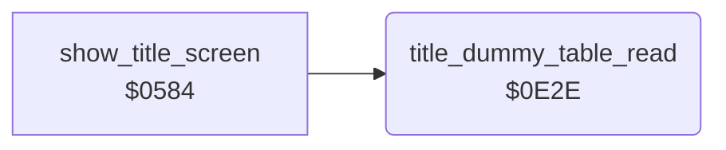

<!-- Generated by c64-docs from knowledge revision 20261018T093012.029-a2us40 and src/source-map.json. Do not edit: change the knowledge, generate the source again, then run docs.ts generate. -->
# title_sprite.asm: Title screen helper and TM sprite data

Range `$0E2E-$0E4B`. Source: [title_sprite.asm](../../../src/title_sprite.asm). Index: [the reference](../index.md).

## Call graph

A solid arrow is a call, a thick arrow a table entry, a dotted arrow a jump. Rounded nodes are in this file.

## Data

| Range | Type | Name | Read by | Written by |
|---|---|---|---|---|
| [`$0E3B`](../../../src/title_sprite.asm#L19)-`$0E3F` | bytes | [`title_dummy_table`](../../../src/title_sprite.asm#L18) | [`title_dummy_table_read`](title_sprite.md#title_dummy_table_read) |  |
| [`$0E40`](../../../src/title_sprite.asm#L23)-`$0E4B` | bytes of 3 | [`title_tm_sprite_rows`](../../../src/title_sprite.asm#L22) | [`show_title_screen`](title_demo_start.md#show_title_screen) |  |

## Names

### [`title_dummy_table_read`](../../../src/title_sprite.asm#L6) `$0E2E`

*routine*

Reads the five bytes of title_dummy_table and discards them. Has no effect; X is preserved.

- **Called from:** [`show_title_screen`](title_demo_start.md#show_title_screen) [`$0598`](../../../src/title_demo_start.asm#L92)

### [`title_dummy_read_loop`](../../../src/title_sprite.asm#L10) `$0E32`

*label*

- **Jumped to from:** [`title_dummy_table_read`](title_sprite.md#title_dummy_table_read) [`$0E36`](../../../src/title_sprite.asm#L13)

### [`title_dummy_table`](../../../src/title_sprite.asm#L18) `$0E3B-$0E3F`

*data*

Five bytes that only title_dummy_table_read reads.

- **Read by:** [`title_dummy_table_read`](title_sprite.md#title_dummy_table_read) [`$0E32`](../../../src/title_sprite.asm#L11) (+3), [`title_dummy_table_read`](title_sprite.md#title_dummy_table_read) [`$0E32`](../../../src/title_sprite.asm#L11) (+4)

### [`title_tm_sprite_rows`](../../../src/title_sprite.asm#L22) `$0E40-$0E4B`

*data*

Rows 4-7 of the TM sprite (3 bytes per sprite row), copied to sprite_buf_b_spr4+12 by show_title_screen. The pixels form a small "TM" next to the BRUCE LEE logo.

- **Read by:** [`show_title_screen`](title_demo_start.md#show_title_screen) [`$05D1`](../../../src/title_demo_start.asm#L118) (+10), [`show_title_screen`](title_demo_start.md#show_title_screen) [`$05D1`](../../../src/title_demo_start.asm#L118) (+11)
