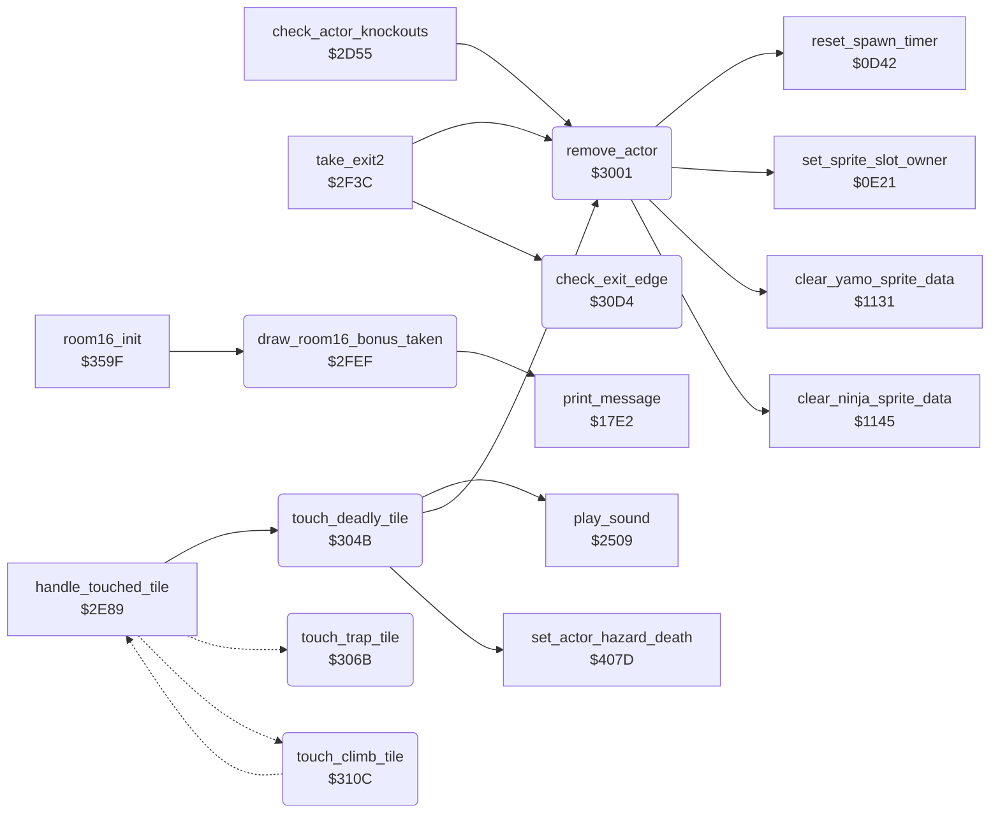

<!-- Generated by c64-docs from knowledge revision 20261018T152957.577-ll4gr6 and src/source-map.json. Do not edit: change the knowledge, generate the source again, then run docs.ts generate. -->
# touch_effects.asm: Touch effects: room 16 bonus, actor removal, deadly and trap tiles, exit edges

Range `$2FD6-$312B`. Source: [touch_effects.asm](../../../src/touch_effects.asm). Index: [the reference](../index.md).

## Call graph

A solid arrow is a call, a thick arrow a table entry, a dotted arrow a jump. Rounded nodes are in this file.

## Names

### [`collect_room16_bonus`](../../../src/touch_effects.asm#L8) `$2FD6`

*label*

Room 16 bonus tile ($2D/$2E), Bruce only and at actor_y $A0 or more: one extra fall. It decrements the bonus count extra_fall_pickups_left of current_player (5 at the game start), adds 1 to falls_left, shows it, starts sound $8E and removes the bonus from the screen (draw_room16_bonus_taken).

- **Jumped to from:** [`handle_touched_tile`](background_touch.md#handle_touched_tile) [`$2EF1`](../../../src/background_touch.asm#L125)

### [`collect_room16_bonus_exit`](../../../src/touch_effects.asm#L12) `$2FD9`

*label*

- **Jumped to from:** [`$2FDE`](../../../src/touch_effects.asm#L17)

### [`collect_room16_bonus_check_y`](../../../src/touch_effects.asm#L14) `$2FDA`

*label*

- **Jumped to from:** [`$2FD7`](../../../src/touch_effects.asm#L11)

### [`draw_room16_bonus_taken`](../../../src/touch_effects.asm#L26) `$2FEF`

*routine*

Draws tile $56 at column $24 of the text lines $0A and $0B over the room 16 bonus. Also called by room16_init when the bonus count of the player is 0.

- **Called from:** [`room16_init`](room_specific_init.md#room16_init) [`$35C0`](../../../src/room_specific_init.asm#L278)
- **Calls:** [`print_message`](actor_driver_text.md#print_message)

### [`remove_actor`](../../../src/touch_effects.asm#L38) `$3001`

*routine*

Removes actor X from the room: clears its active bit, switches off its sprites, frees the extra sprites of actor_collision_code_a,X/_b,X (sprite_owner = $FF), clears its sprite images in both buffers (clear_yamo_sprite_data, clear_ninja_sprite_data) and restarts its spawn timer (reset_spawn_timer).

- **Called from:** [`check_actor_knockouts`](actor_helpers.md#check_actor_knockouts) [`$2D72`](../../../src/actor_helpers.asm#L27), [`take_exit2`](background_touch.md#take_exit2) [`$2F92`](../../../src/background_touch.asm#L225), [`take_exit2`](background_touch.md#take_exit2) [`$2FBF`](../../../src/background_touch.asm#L257), [`touch_deadly_tile`](touch_effects.md#touch_deadly_tile) [`$3065`](../../../src/touch_effects.asm#L95)
- **Calls:** [`set_sprite_slot_owner`](actor_spawn.md#set_sprite_slot_owner), [`clear_yamo_sprite_data`](interrupt_entry.md#clear_yamo_sprite_data), [`clear_ninja_sprite_data`](interrupt_entry.md#clear_ninja_sprite_data), [`reset_spawn_timer`](actor_spawn.md#reset_spawn_timer)
- **Reads:** [`SPENA`](../memory-map.md#SPENA)
- **Writes:** [`SPENA`](../memory-map.md#SPENA)
- **Refers to:** [`actor_main_sprite`](actor_sprites.md#actor_main_sprite), [`sprite_clear_bit`](actor_sprites.md#sprite_clear_bit), [`actor_overlay_sprite`](actor_sprites.md#actor_overlay_sprite), [`sprite_owner`](../memory-map.md#sprite_owner)

### [`remove_actor_free_extra_a`](../../../src/touch_effects.asm#L52) `$3023`

*label*

- **Jumped to from:** [`remove_actor`](touch_effects.md#remove_actor) [`$3018`](../../../src/touch_effects.asm#L48)

### [`remove_actor_free_extra_b`](../../../src/touch_effects.asm#L58) `$302F`

*label*

- **Jumped to from:** [`remove_actor`](touch_effects.md#remove_actor) [`$3025`](../../../src/touch_effects.asm#L54)

### [`remove_actor_clear_images`](../../../src/touch_effects.asm#L64) `$303B`

*label*

- **Jumped to from:** [`remove_actor`](touch_effects.md#remove_actor) [`$3031`](../../../src/touch_effects.asm#L60)

### [`remove_actor_clear_ninja`](../../../src/touch_effects.asm#L69) `$3045`

*label*

- **Jumped to from:** [`remove_actor`](touch_effects.md#remove_actor) [`$303D`](../../../src/touch_effects.asm#L66)

### [`remove_actor_restart_timer`](../../../src/touch_effects.asm#L71) `$3048`

*label*

- **Jumped to from:** [`remove_actor`](touch_effects.md#remove_actor) [`$3042`](../../../src/touch_effects.asm#L68)

### [`touch_deadly_tile`](../../../src/touch_effects.asm#L75) `$304B`

*routine*

Deadly tile touched (not in room 18): sound effect $8C; an enemy is removed, Bruce dies (set_actor_hazard_death sets state $19).

- **Called from:** [`handle_touched_tile`](background_touch.md#handle_touched_tile) [`$2F01`](../../../src/background_touch.asm#L137)
- **Calls:** [`play_sound`](sound_request.md#play_sound), [`remove_actor`](touch_effects.md#remove_actor), [`set_actor_hazard_death`](room_hazard_draw.md#set_actor_hazard_death)
- **Reads:** [`room`](../memory-map.md#room), [`current_actor`](../memory-map.md#current_actor)

### [`touch_deadly_tile_kill`](../../../src/touch_effects.asm#L80) `$3052`

*label*

- **Jumped to from:** [`touch_deadly_tile`](touch_effects.md#touch_deadly_tile) [`$304F`](../../../src/touch_effects.asm#L78)

### [`touch_deadly_tile_bruce`](../../../src/touch_effects.asm#L96) `$3068`

*label*

- **Jumped to from:** [`touch_deadly_tile`](touch_effects.md#touch_deadly_tile) [`$3063`](../../../src/touch_effects.asm#L94)

### [`touch_trap_tile`](../../../src/touch_effects.asm#L101) `$306B`

*routine*

Trap tile $60 touched: when its colour RAM is not yet 5, take a free one of the 3 burst trap slots (burst_trap_timer+n = 1), store the tile row - 1 (burst_trap_row+n) and column - 1 (burst_trap_col+n) and set the colour to $FD (5, marked). update_burst_traps animates the slots. When all slots are busy nothing happens.

- **Jumped to from:** [`handle_touched_tile`](background_touch.md#handle_touched_tile) [`$2EF7`](../../../src/background_touch.asm#L129)
- **Reads:** [`row_ptr_top+1`](../memory-map.md#row_ptr_top), [`row_ptr_top`](../memory-map.md#row_ptr_top), [`burst_trap_timer`](../memory-map.md#burst_trap_timer), [`burst_trap_col`](../memory-map.md#burst_trap_col), [`burst_trap_row`](../memory-map.md#burst_trap_row), [`burst_trap_timer+1`](../memory-map.md#burst_trap_timer), [`burst_trap_col+1`](../memory-map.md#burst_trap_col), [`burst_trap_row+1`](../memory-map.md#burst_trap_row), [`burst_trap_timer+2`](../memory-map.md#burst_trap_timer), [`burst_trap_col+2`](../memory-map.md#burst_trap_col), [`burst_trap_row+2`](../memory-map.md#burst_trap_row)
- **Writes:** [`row_ptr_top+1`](../memory-map.md#row_ptr_top), [`burst_trap_timer`](../memory-map.md#burst_trap_timer), [`burst_trap_row`](../memory-map.md#burst_trap_row), [`burst_trap_col`](../memory-map.md#burst_trap_col), [`burst_trap_timer+1`](../memory-map.md#burst_trap_timer), [`burst_trap_row+1`](../memory-map.md#burst_trap_row), [`burst_trap_col+1`](../memory-map.md#burst_trap_col), [`burst_trap_timer+2`](../memory-map.md#burst_trap_timer), [`burst_trap_row+2`](../memory-map.md#burst_trap_row), [`burst_trap_col+2`](../memory-map.md#burst_trap_col)
- **Refers to:** [`row_ptr_top`](../memory-map.md#row_ptr_top), [`game_screen`](../memory-map.md#game_screen), [`burst_trap_timer`](../memory-map.md#burst_trap_timer), [`burst_trap_row`](../memory-map.md#burst_trap_row), [`burst_trap_col`](../memory-map.md#burst_trap_col)

### [`touch_trap_tile_slot1`](../../../src/touch_effects.asm#L120) `$3095`

*label*

- **Jumped to from:** [`touch_trap_tile`](touch_effects.md#touch_trap_tile) [`$307D`](../../../src/touch_effects.asm#L111)

### [`touch_trap_tile_slot2`](../../../src/touch_effects.asm#L131) `$30B0`

*label*

- **Jumped to from:** [`touch_trap_tile`](touch_effects.md#touch_trap_tile) [`$3098`](../../../src/touch_effects.asm#L122)

### [`touch_trap_tile_mark`](../../../src/touch_effects.asm#L141) `$30C8`

*label*

- **Jumped to from:** [`touch_trap_tile`](touch_effects.md#touch_trap_tile) [`$3092`](../../../src/touch_effects.asm#L119), [`touch_trap_tile`](touch_effects.md#touch_trap_tile) [`$30AD`](../../../src/touch_effects.asm#L130)

### [`touch_trap_tile_done`](../../../src/touch_effects.asm#L144) `$30CC`

*label*

- **Jumped to from:** [`touch_trap_tile`](touch_effects.md#touch_trap_tile) [`$3078`](../../../src/touch_effects.asm#L109), [`touch_trap_tile`](touch_effects.md#touch_trap_tile) [`$30B3`](../../../src/touch_effects.asm#L133)

### [`check_exit_edge`](../../../src/touch_effects.asm#L154) `$30D4`

*routine*

Exit permission of actor X. Returns carry clear when the actor may leave: always in room 11; at the left edge (actor_x < $10) after moving left (actor_move_queue+6,X); at the right edge (actor_x > $A1) after moving right (actor_move_queue+9,X); below actor_y $C5 while falling (state $0E); at the top (actor_y < $31) after moving up (actor_move_queue,X). Else carry set.

- **Called from:** [`take_exit2`](background_touch.md#take_exit2) [`$2F3C`](../../../src/background_touch.asm#L179), [`take_exit2`](background_touch.md#take_exit2) [`$2F51`](../../../src/background_touch.asm#L190), [`take_exit2`](background_touch.md#take_exit2) [`$2F66`](../../../src/background_touch.asm#L200), [`take_exit2`](background_touch.md#take_exit2) [`$2F7B`](../../../src/background_touch.asm#L211)
- **Reads:** [`room`](../memory-map.md#room)
- **Refers to:** [`actor_move_queue`](../memory-map.md#actor_move_queue), [`actor_move_queue+6`](../memory-map.md#actor_move_queue), [`actor_move_queue+9`](../memory-map.md#actor_move_queue)

### [`check_exit_right_edge`](../../../src/touch_effects.asm#L164) `$30E6`

*label*

- **Jumped to from:** [`check_exit_edge`](touch_effects.md#check_exit_edge) [`$30DF`](../../../src/touch_effects.asm#L161)

### [`check_exit_bottom_edge`](../../../src/touch_effects.asm#L170) `$30F1`

*label*

- **Jumped to from:** [`check_exit_edge`](touch_effects.md#check_exit_edge) [`$30EA`](../../../src/touch_effects.asm#L167)

### [`check_exit_top_edge`](../../../src/touch_effects.asm#L178) `$30FD`

*label*

- **Jumped to from:** [`check_exit_edge`](touch_effects.md#check_exit_edge) [`$30F5`](../../../src/touch_effects.asm#L173)

### [`check_exit_blocked`](../../../src/touch_effects.asm#L185) `$3108`

*label*

- **Jumped to from:** [`check_exit_edge`](touch_effects.md#check_exit_edge) [`$3101`](../../../src/touch_effects.asm#L181)

### [`check_exit_allowed`](../../../src/touch_effects.asm#L188) `$310A`

*label*

- **Jumped to from:** [`check_exit_edge`](touch_effects.md#check_exit_edge) [`$30D8`](../../../src/touch_effects.asm#L157), [`check_exit_edge`](touch_effects.md#check_exit_edge) [`$30E4`](../../../src/touch_effects.asm#L163), [`check_exit_edge`](touch_effects.md#check_exit_edge) [`$30EF`](../../../src/touch_effects.asm#L169), [`check_exit_edge`](touch_effects.md#check_exit_edge) [`$30FB`](../../../src/touch_effects.asm#L177), [`check_exit_edge`](touch_effects.md#check_exit_edge) [`$3106`](../../../src/touch_effects.asm#L184)

### [`touch_climb_tile`](../../../src/touch_effects.asm#L194) `$310C`

*routine*

Moving character $62 touched on a ladder or vine (actor_contact,X bit 2): state $17 (ride) with timer $10, actor_step_delay,X = 0 and actor_ride_hold,X = 0 (not for a dying actor). Then the character is checked again from handle_tile_try_bonus.

- **Jumped to from:** [`handle_touched_tile`](background_touch.md#handle_touched_tile) [`$2EF4`](../../../src/background_touch.asm#L127)
- **Jumps to:** [`handle_tile_try_bonus`](background_touch.md#handle_tile_try_bonus)
- **Reads:** [`row_ptr_top`](../memory-map.md#row_ptr_top)
- **Refers to:** [`actor_step_delay`](../memory-map.md#actor_step_delay)

### [`touch_climb_tile_continue`](../../../src/touch_effects.asm#L208) `$3127`

*label*

- **Jumped to from:** [`touch_climb_tile`](touch_effects.md#touch_climb_tile) [`$3110`](../../../src/touch_effects.asm#L197), [`touch_climb_tile`](touch_effects.md#touch_climb_tile) [`$3116`](../../../src/touch_effects.asm#L200)
