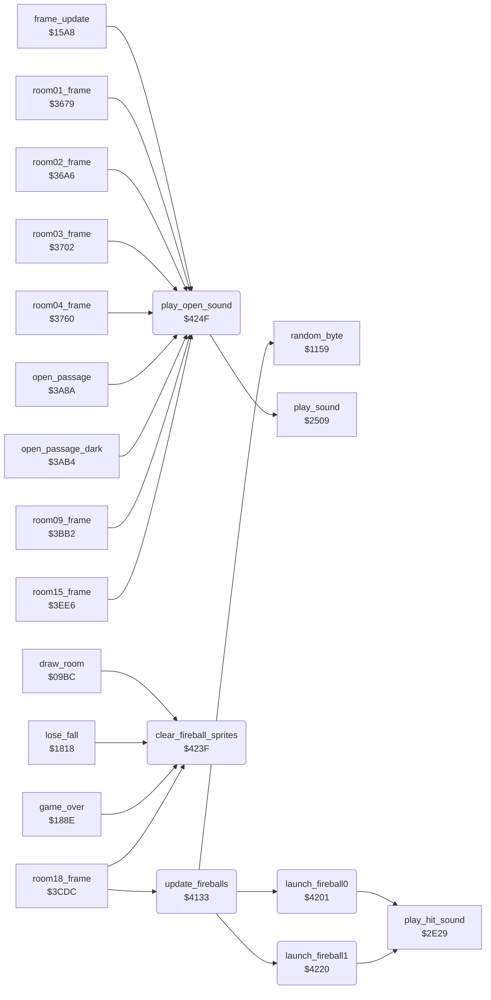

<!-- Generated by c64-docs from knowledge revision 20261017T121733.607-wszjh3 and src/source-map.json. Do not edit: change the knowledge, generate the source again, then run generate.ts. -->
# wizard_fireballs.asm: Wizard fireball sprites (room 18) and sound helper

Range `$4133-$425E`. Source: [wizard_fireballs.asm](../../../src/wizard_fireballs.asm). Index: [the reference](../index.md).

## Call graph

A solid arrow is a call, a thick arrow a table entry, a dotted arrow a jump. Rounded nodes are in this file.

## Names

### [`update_fireballs`](../../../src/wizard_fireballs.asm#L13) `$4133`

*routine*

Updates the two wizard fireballs (sprites 6 and 7) in room 18. 1. New random shapes: the first byte of sprite rows 0-3 of both sprites (sprite_buf_b_spr2, sprite_buf_b_spr3) = random AND fireball_shape_mask+row, so the fireballs sparkle. 2. An inactive fireball (fireball_active+n = 0) waits fireball_respawn_delay+n passes, then launches (launch_fireball0 / launch_fireball1). 3. An active fireball falls 5 lines per pass (fireball_y+n); at Y >= $E0 it becomes inactive with a delay of 2. 4. An active fireball moves its X (fireball_x+n) toward Bruce's actor_x: 3 steps per pass while Y < $A8, 2 steps below. Sprite X = X*2 (bit 8 in MSIGX), sprite Y = Y + $1D, random colour.
4 sprite rows

- **Called from:** [`room18_frame`](wizard_room.md#room18_frame) [`$3D1D`](../../../src/wizard_room.asm#L46)
- **Calls:** [`random_byte`](interrupt_entry.md#random_byte), [`launch_fireball0`](wizard_fireballs.md#launch_fireball0), [`launch_fireball1`](wizard_fireballs.md#launch_fireball1)
- **Reads:** [`fireball_shape_mask+2`](fireball_shape.md#fireball_shape_mask), [`fireball_shape_mask+3`](fireball_shape.md#fireball_shape_mask), [`fireball_active`](fireball_text_score_vars.md#fireball_active), [`fireball_respawn_delay`](fireball_text_score_vars.md#fireball_respawn_delay), [`fireball_active+1`](fireball_text_score_vars.md#fireball_active), [`fireball_respawn_delay+1`](fireball_text_score_vars.md#fireball_respawn_delay), [`fireball_y`](fireball_text_score_vars.md#fireball_y), [`fireball_y+1`](fireball_text_score_vars.md#fireball_y), [`fireball_x`](fireball_text_score_vars.md#fireball_x), [`actor_x`](../variables.md#actor_x), [`MSIGX`](../variables.md#MSIGX), [`fireball_msb_set_mask`](options_and_patterns.md#fireball_msb_set_mask), [`fireball_msb_clear_mask`](options_and_patterns.md#fireball_msb_clear_mask)
- **Writes:** [`sprite_buf_b_spr2`](../variables.md#sprite_buf_b_spr2), [`sprite_buf_b_spr2+3`](../variables.md#sprite_buf_b_spr2), [`sprite_buf_b_spr3`](../variables.md#sprite_buf_b_spr3), [`fireball_respawn_delay`](fireball_text_score_vars.md#fireball_respawn_delay), [`fireball_respawn_delay+1`](fireball_text_score_vars.md#fireball_respawn_delay), [`fireball_y`](fireball_text_score_vars.md#fireball_y), [`fireball_y+1`](fireball_text_score_vars.md#fireball_y), [`fireball_active`](fireball_text_score_vars.md#fireball_active), [`fireball_active+1`](fireball_text_score_vars.md#fireball_active), [`fireball_x`](fireball_text_score_vars.md#fireball_x), [`MSIGX`](../variables.md#MSIGX), [`SP6X`](../variables.md#SP6X), [`SP6Y`](../variables.md#SP6Y), [`SP6COL`](../variables.md#SP6COL)
- **Refers to:** [`fireball_respawn_delay`](fireball_text_score_vars.md#fireball_respawn_delay)

### [`update_fireballs_shape_loop`](../../../src/wizard_fireballs.asm#L16) `$4137`

*label*

- **Jumped to from:** [`update_fireballs`](wizard_fireballs.md#update_fireballs) [`$414D`](../../../src/wizard_fireballs.asm#L27)

### [`update_fireballs_check_delay0`](../../../src/wizard_fireballs.asm#L31) `$4154`

*label*

### [`update_fireballs_launch0`](../../../src/wizard_fireballs.asm#L34) `$4159`

*label*

### [`update_fireballs_wait0`](../../../src/wizard_fireballs.asm#L37) `$415F`

*label*

- **Jumped to from:** [`update_fireballs`](wizard_fireballs.md#update_fireballs) [`$4157`](../../../src/wizard_fireballs.asm#L33)

### [`update_fireballs_check1`](../../../src/wizard_fireballs.asm#L39) `$4162`

*label*

- **Jumped to from:** [`update_fireballs`](wizard_fireballs.md#update_fireballs) [`$4152`](../../../src/wizard_fireballs.asm#L30)

### [`update_fireballs_check_delay1`](../../../src/wizard_fireballs.asm#L42) `$4167`

*label*

### [`update_fireballs_launch1`](../../../src/wizard_fireballs.asm#L45) `$416C`

*label*

### [`update_fireballs_wait1`](../../../src/wizard_fireballs.asm#L48) `$4172`

*label*

- **Jumped to from:** [`update_fireballs`](wizard_fireballs.md#update_fireballs) [`$416A`](../../../src/wizard_fireballs.asm#L44)

### [`update_fireballs_fall`](../../../src/wizard_fireballs.asm#L51) `$4175`

*label*

Active fireballs fall 5 lines per pass; at the bottom they wait 2 passes.

- **Jumped to from:** [`update_fireballs`](wizard_fireballs.md#update_fireballs) [`$415C`](../../../src/wizard_fireballs.asm#L36), [`update_fireballs`](wizard_fireballs.md#update_fireballs) [`$4165`](../../../src/wizard_fireballs.asm#L41), [`update_fireballs`](wizard_fireballs.md#update_fireballs) [`$416F`](../../../src/wizard_fireballs.asm#L47)

### [`update_fireballs_fall_loop`](../../../src/wizard_fireballs.asm#L53) `$4177`

*label*

- **Jumped to from:** [`update_fireballs`](wizard_fireballs.md#update_fireballs) [`$4194`](../../../src/wizard_fireballs.asm#L68)

### [`update_fireballs_fall_next`](../../../src/wizard_fireballs.asm#L66) `$4193`

*label*

- **Jumped to from:** [`update_fireballs`](wizard_fireballs.md#update_fireballs) [`$417A`](../../../src/wizard_fireballs.asm#L55), [`update_fireballs`](wizard_fireballs.md#update_fireballs) [`$4187`](../../../src/wizard_fireballs.asm#L61)

### [`update_fireballs_no_effect`](../../../src/wizard_fireballs.asm#L72) `$419B`

*label*

- **Jumped to from:** [`update_fireballs`](wizard_fireballs.md#update_fireballs) [`$4199`](../../../src/wizard_fireballs.asm#L71)

### [`update_fireballs_position`](../../../src/wizard_fireballs.asm#L76) `$41A0`

*label*

Active fireballs home in on Bruce's X and are written to the VIC-II with a random colour.

- **Jumped to from:** [`update_fireballs`](wizard_fireballs.md#update_fireballs) [`$419E`](../../../src/wizard_fireballs.asm#L74)

### [`update_fireballs_position_loop`](../../../src/wizard_fireballs.asm#L78) `$41A2`

*label*

- **Jumped to from:** [`update_fireballs`](wizard_fireballs.md#update_fireballs) [`$41FE`](../../../src/wizard_fireballs.asm#L136)

### [`update_fireballs_home_loop`](../../../src/wizard_fireballs.asm#L86) `$41B1`

*label*

- **Jumped to from:** [`update_fireballs`](wizard_fireballs.md#update_fireballs) [`$41AE`](../../../src/wizard_fireballs.asm#L84), [`update_fireballs`](wizard_fireballs.md#update_fireballs) [`$41C3`](../../../src/wizard_fireballs.asm#L97)

### [`update_fireballs_home_left`](../../../src/wizard_fireballs.asm#L92) `$41BD`

*label*

- **Jumped to from:** [`update_fireballs`](wizard_fireballs.md#update_fireballs) [`$41B6`](../../../src/wizard_fireballs.asm#L89)

### [`update_fireballs_home_next`](../../../src/wizard_fireballs.asm#L95) `$41C2`

*label*

- **Jumped to from:** [`update_fireballs`](wizard_fireballs.md#update_fireballs) [`$41BB`](../../../src/wizard_fireballs.asm#L91), [`update_fireballs`](wizard_fireballs.md#update_fireballs) [`$41BD`](../../../src/wizard_fireballs.asm#L93)

### [`update_fireballs_set_sprite`](../../../src/wizard_fireballs.asm#L98) `$41C5`

*label*

### [`update_fireballs_msb_clear`](../../../src/wizard_fireballs.asm#L107) `$41D4`

*label*

clear bit 6/7 of MSIGX

- **Jumped to from:** [`update_fireballs`](wizard_fireballs.md#update_fireballs) [`$41CD`](../../../src/wizard_fireballs.asm#L103)

### [`update_fireballs_msb_store`](../../../src/wizard_fireballs.asm#L109) `$41D7`

*label*

- **Jumped to from:** [`update_fireballs`](wizard_fireballs.md#update_fireballs) [`$41D2`](../../../src/wizard_fireballs.asm#L106)

### [`update_fireballs_position_next`](../../../src/wizard_fireballs.asm#L134) `$41FD`

*label*

- **Jumped to from:** [`update_fireballs`](wizard_fireballs.md#update_fireballs) [`$41A5`](../../../src/wizard_fireballs.asm#L80)

### [`update_fireballs_done`](../../../src/wizard_fireballs.asm#L137) `$4200`

*label*

### [`launch_fireball0`](../../../src/wizard_fireballs.asm#L141) `$4201`

*routine*

Launches fireball 0: sprite 6 pointer = $0D (sprite_buf_b_spr2), sprite 6 on, active, X = $50, Y = $37, then sound $86 (play_hit_sound).

- **Called from:** [`update_fireballs`](wizard_fireballs.md#update_fireballs) [`$4159`](../../../src/wizard_fireballs.asm#L35)
- **Calls:** [`play_hit_sound`](actor_helpers.md#play_hit_sound)
- **Reads:** [`SPENA`](../variables.md#SPENA)
- **Writes:** [`sprite_pointers+6`](../variables.md#sprite_pointers), [`SPENA`](../variables.md#SPENA), [`fireball_active`](fireball_text_score_vars.md#fireball_active), [`fireball_x`](fireball_text_score_vars.md#fireball_x), [`fireball_y`](fireball_text_score_vars.md#fireball_y)
- **Refers to:** [`sprite_buf_b_spr2`](../variables.md#sprite_buf_b_spr2), [`sprite_pointers`](../variables.md#sprite_pointers)

### [`launch_fireball1`](../../../src/wizard_fireballs.asm#L156) `$4220`

*routine*

Launches fireball 1: sprite 7 pointer = $0E (sprite_buf_b_spr3), sprite 7 on, active, X = $5E, Y = $37, then sound $86 (play_hit_sound).

- **Called from:** [`update_fireballs`](wizard_fireballs.md#update_fireballs) [`$416C`](../../../src/wizard_fireballs.asm#L46)
- **Calls:** [`play_hit_sound`](actor_helpers.md#play_hit_sound)
- **Reads:** [`SPENA`](../variables.md#SPENA)
- **Writes:** [`sprite_pointers+7`](../variables.md#sprite_pointers), [`SPENA`](../variables.md#SPENA), [`fireball_active+1`](fireball_text_score_vars.md#fireball_active), [`fireball_x+1`](fireball_text_score_vars.md#fireball_x), [`fireball_y+1`](fireball_text_score_vars.md#fireball_y)
- **Refers to:** [`sprite_buf_b_spr3`](../variables.md#sprite_buf_b_spr3), [`sprite_pointers`](../variables.md#sprite_pointers), [`fireball_x`](fireball_text_score_vars.md#fireball_x), [`fireball_y`](fireball_text_score_vars.md#fireball_y)

### [`clear_fireball_sprites`](../../../src/wizard_fireballs.asm#L171) `$423F`

*routine*

Clears the first byte of sprite rows 0-3 of both fireball sprites (sprite_buf_b_spr2 and sprite_buf_b_spr3, the bytes that update_fireballs fills). Called by draw_room, after a death and at the wizard defeat.

- **Called from:** [`draw_room`](draw_room.md#draw_room) [`$09F0`](../../../src/draw_room.asm#L53), [`lose_fall`](lose_fall_game_over.md#lose_fall) [`$1838`](../../../src/lose_fall_game_over.asm#L31), [`game_over`](lose_fall_game_over.md#game_over) [`$188E`](../../../src/lose_fall_game_over.asm#L83), [`room18_frame`](wizard_room.md#room18_frame) [`$3CEC`](../../../src/wizard_room.asm#L24)
- **Writes:** [`sprite_buf_b_spr2+6`](../variables.md#sprite_buf_b_spr2), [`sprite_buf_b_spr2+9`](../variables.md#sprite_buf_b_spr2), [`sprite_buf_b_spr3+6`](../variables.md#sprite_buf_b_spr3), [`sprite_buf_b_spr3+9`](../variables.md#sprite_buf_b_spr3)

### [`clear_fireball_sprites_loop`](../../../src/wizard_fireballs.asm#L174) `$4243`

*label*

- **Jumped to from:** [`clear_fireball_sprites`](wizard_fireballs.md#clear_fireball_sprites) [`$424C`](../../../src/wizard_fireballs.asm#L180)

### [`play_open_sound`](../../../src/wizard_fireballs.asm#L183) `$424F`

*routine*

Plays sound effect $8A (passage opens) through play_sound. Keeps A, X and Y.

- **Called from:** [`frame_update`](frame_update.md#frame_update) [`$1771`](../../../src/frame_update.asm#L322), [`room01_frame`](room_frames_0_7.md#room01_frame) [`$3698`](../../../src/room_frames_0_7.asm#L58), [`room02_frame`](room_frames_0_7.md#room02_frame) [`$36BA`](../../../src/room_frames_0_7.asm#L97), [`room03_frame`](room_frames_0_7.md#room03_frame) [`$3719`](../../../src/room_frames_0_7.asm#L148), [`room04_frame`](room_frames_0_7.md#room04_frame) [`$379A`](../../../src/room_frames_0_7.asm#L223), [`room04_frame`](room_frames_0_7.md#room04_frame) [`$37F7`](../../../src/room_frames_0_7.asm#L267), [`open_passage`](passage_open.md#open_passage) [`$3A8A`](../../../src/passage_open.asm#L43), [`open_passage_dark`](passage_open.md#open_passage_dark) [`$3AB4`](../../../src/passage_open.asm#L70), [`room09_frame`](room_frames_8_11.md#room09_frame) [`$3BFA`](../../../src/room_frames_8_11.asm#L187), [`room15_frame`](room_frames_12_17.md#room15_frame) [`$3F05`](../../../src/room_frames_12_17.asm#L121), [`room15_frame`](room_frames_12_17.md#room15_frame) [`$3F2D`](../../../src/room_frames_12_17.asm#L140), [`room15_frame`](room_frames_12_17.md#room15_frame) [`$3F54`](../../../src/room_frames_12_17.asm#L160)
- **Calls:** [`play_sound`](sound_request.md#play_sound)
