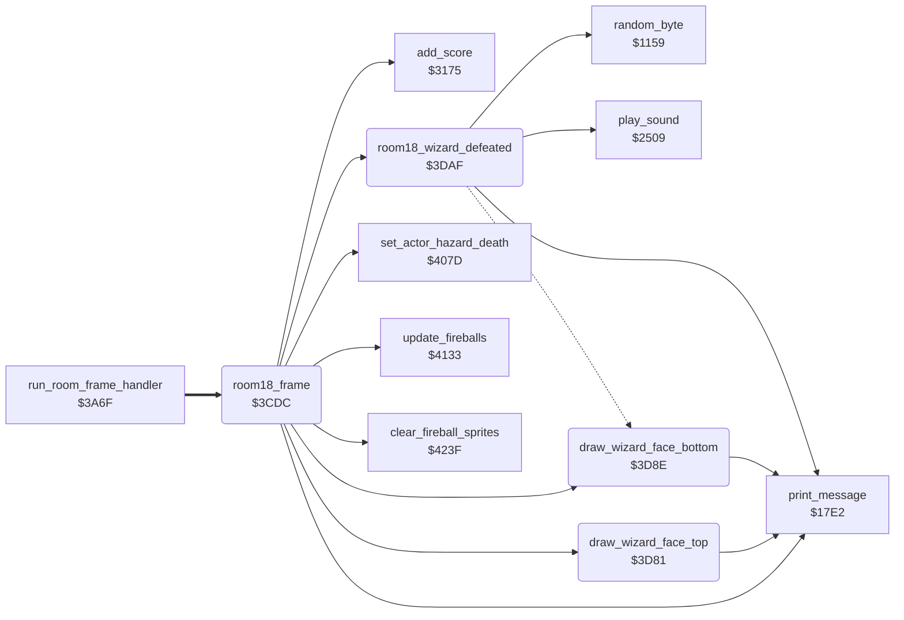

<!-- Generated by c64-docs from knowledge revision 20261017T123532.893-hcxwuv and src/source-map.json. Do not edit: change the knowledge, generate the source again, then run generate.ts. -->
# wizard_room.asm: Room 18: wizard animation, fireball hits and wizard defeat

Range `$3CDC-$3E4B`. Source: [wizard_room.asm](../../../src/wizard_room.asm). Index: [the reference](../index.md).

## Call graph

A solid arrow is a call, a thick arrow a table entry, a dotted arrow a jump. Rounded nodes are in this file.

## Names

### [`room18_frame`](../../../src/wizard_room.asm#L13) `$3CDC`

*routine*

Room 18 (wizard) frame handler. room_state_a = 0 means the wizard is defeated: jump to the defeat sequence. While the lantern of the room (lantern_list_room18, row 11, column 37) is present: update_fireballs, kill Bruce when a fireball sprite touches him, and animate the wizard every 8 passes. The eyes (tiles $38-$3A at row 2, column 16) look left, middle or right by Bruce's X position (wizard_face_zone_x), and the face (tiles $3B-$46 at rows 3-4, column 18) toggles between two frames. When the lantern is taken (first pass): room_state_a = 0, fireball sprites cleared and switched off, tile $61 at row 11 column 0, 3000 points, room_state_b = $50 (length of the defeat sequence).
0 = wizard defeated

- **Jumped to from:** [`run_room_frame_handler`](passage_open.md#run_room_frame_handler) [`$3A7B`](../../../src/passage_open.asm#L26)
- **Entry of:** [`room_frame_handlers`](../tables.md#room_frame_handlers)
- **Calls:** [`room18_wizard_defeated`](wizard_room.md#room18_wizard_defeated), [`clear_fireball_sprites`](wizard_fireballs.md#clear_fireball_sprites), [`print_message`](actor_driver_text.md#print_message), [`add_score`](score.md#add_score), [`update_fireballs`](wizard_fireballs.md#update_fireballs), [`set_actor_hazard_death`](room_hazard_draw.md#set_actor_hazard_death), [`draw_wizard_face_top`](wizard_room.md#draw_wizard_face_top), [`draw_wizard_face_bottom`](wizard_room.md#draw_wizard_face_bottom)
- **Reads:** [`room_state_a`](room_dispatch.md#room_state_a), [`lantern_list_room18`](lantern_lists.md#lantern_list_room18), [`SPENA`](../variables.md#SPENA), [`SPSPCL`](../variables.md#SPSPCL), [`actor_state`](../variables.md#actor_state), [`room_state_b`](room_dispatch.md#room_state_b), [`actor_x`](../variables.md#actor_x), [`wizard_face_zone_x+1`](room_tables.md#wizard_face_zone_x), [`wizard_face_zone_x+2`](room_tables.md#wizard_face_zone_x), [`room_state_c`](room_dispatch.md#room_state_c), [`room_state_d`](room_dispatch.md#room_state_d)
- **Writes:** [`room_state_a`](room_dispatch.md#room_state_a), [`SPENA`](../variables.md#SPENA), [`room_state_d`](room_dispatch.md#room_state_d), [`room_state_b`](room_dispatch.md#room_state_b), [`room_state_c`](room_dispatch.md#room_state_c)

### [`room18_frame_wizard_alive`](../../../src/wizard_room.asm#L18) `$3CE4`

*label*

lantern of room 18 present?

- **Jumped to from:** [`room18_frame`](wizard_room.md#room18_frame) [`$3CDF`](../../../src/wizard_room.asm#L15)

### [`room18_frame_fireballs`](../../../src/wizard_room.asm#L45) `$3D1D`

*label*

Wizard alive: move the fireballs; a fireball sprite (6 or 7) touching Bruce (0 or 1) kills him.

- **Jumped to from:** [`room18_frame`](wizard_room.md#room18_frame) [`$3CE7`](../../../src/wizard_room.asm#L20)

### [`room18_frame_animate_wizard`](../../../src/wizard_room.asm#L60) `$3D38`

*label*

Every 8 passes: eyes toward Bruce, face toggles between two frames.

- **Jumped to from:** [`room18_frame`](wizard_room.md#room18_frame) [`$3D26`](../../../src/wizard_room.asm#L50), [`room18_frame`](wizard_room.md#room18_frame) [`$3D2B`](../../../src/wizard_room.asm#L53), [`room18_frame`](wizard_room.md#room18_frame) [`$3D33`](../../../src/wizard_room.asm#L57)

### [`room18_frame_gaze_loop`](../../../src/wizard_room.asm#L67) `$3D46`

*label*

wizard_face_zone_x+1/+2 are the limits: X = 2 right, 1 middle, 0 left

- **Jumped to from:** [`room18_frame`](wizard_room.md#room18_frame) [`$3D4C`](../../../src/wizard_room.asm#L71)

### [`room18_frame_draw_gaze`](../../../src/wizard_room.asm#L72) `$3D4E`

*label*

- **Jumped to from:** [`room18_frame`](wizard_room.md#room18_frame) [`$3D1A`](../../../src/wizard_room.asm#L43), [`room18_frame`](wizard_room.md#room18_frame) [`$3D49`](../../../src/wizard_room.asm#L69)

### [`room18_frame_face_a`](../../../src/wizard_room.asm#L82) `$3D63`

*label*

### [`room18_frame_face_b`](../../../src/wizard_room.asm#L89) `$3D73`

*label*

- **Jumped to from:** [`room18_frame`](wizard_room.md#room18_frame) [`$3D61`](../../../src/wizard_room.asm#L81)

### [`room18_frame_done`](../../../src/wizard_room.asm#L95) `$3D80`

*label*

- **Jumped to from:** [`room18_frame`](wizard_room.md#room18_frame) [`$3D3B`](../../../src/wizard_room.asm#L62), [`room18_frame`](wizard_room.md#room18_frame) [`$3D70`](../../../src/wizard_room.asm#L88)

### [`draw_wizard_face_top`](../../../src/wizard_room.asm#L98) `$3D81`

*routine*

Draws tile $3B + A + gaze (room_state_c) at row 3, column 18 (top half of the wizard face). A = 0 or 6.

- **Called from:** [`room18_frame`](wizard_room.md#room18_frame) [`$3D68`](../../../src/wizard_room.asm#L85), [`room18_frame`](wizard_room.md#room18_frame) [`$3D78`](../../../src/wizard_room.asm#L92)
- **Calls:** [`print_message`](actor_driver_text.md#print_message)
- **Reads:** [`room_state_c`](room_dispatch.md#room_state_c)

### [`draw_wizard_face_bottom`](../../../src/wizard_room.asm#L106) `$3D8E`

*routine*

Draws tile $3E + A + gaze (room_state_c) at row 4, column 18 (bottom half of the wizard face). A = 0 or 6.

- **Called from:** [`room18_frame`](wizard_room.md#room18_frame) [`$3D6D`](../../../src/wizard_room.asm#L87), [`room18_frame`](wizard_room.md#room18_frame) [`$3D7D`](../../../src/wizard_room.asm#L94)
- **Calls:** [`print_message`](actor_driver_text.md#print_message)
- **Reads:** [`room_state_c`](room_dispatch.md#room_state_c)

### [`room18_wizard_gone`](../../../src/wizard_room.asm#L115) `$3D9B`

*label*

End of the defeat sequence (room_state_b = 0), every pass: tile $5E at row 11, column 37 and tile $5F at row 12, column 38 (the open exit where the lantern was).
no effect: A is loaded again

- **Jumped to from:** [`room18_wizard_defeated`](wizard_room.md#room18_wizard_defeated) [`$3DB2`](../../../src/wizard_room.asm#L136)

### [`room18_wizard_defeated`](../../../src/wizard_room.asm#L134) `$3DAF`

*label*

Wizard defeat sequence, room_state_b passes ($50 at the start): - random colours (colour 0 on the last pass) on the wizard area of colour RAM (screen rows 5-8 columns 11-28, screen rows 3-4 and 9-12 columns 14-25); - room_vmcsb (the VMCSB value of the play area) = $3E (charset_wizard_flash), or $3C (charset_wizard) at random while more than 16 passes are left, so the charset flickers; - sound $8B; - room_state_d toggles and the four wizard parts are drawn in that frame: tiles $47/$48 at row 3 column 12, $49/$4A at row 3 column 25, $4B/$4C at row 6 column 14, $4D/$4E at row 6 column 23.

- **Called from:** [`room18_frame`](wizard_room.md#room18_frame) [`$3CE1`](../../../src/wizard_room.asm#L17)
- **Calls:** [`random_byte`](interrupt_entry.md#random_byte), [`play_sound`](sound_request.md#play_sound), [`print_message`](actor_driver_text.md#print_message)
- **Jumps to:** [`room18_wizard_gone`](wizard_room.md#room18_wizard_gone)
- **Reads:** [`room_state_b`](room_dispatch.md#room_state_b), [`room_state_d`](room_dispatch.md#room_state_d)
- **Writes:** [`RANDOM+1224`](../variables.md#RANDOM), [`RANDOM+1225`](../variables.md#RANDOM), [`RANDOM+1264`](../variables.md#RANDOM), [`RANDOM+1265`](../variables.md#RANDOM), [`RANDOM+1304`](../variables.md#RANDOM), [`RANDOM+1305`](../variables.md#RANDOM), [`RANDOM+1344`](../variables.md#RANDOM), [`RANDOM+1345`](../variables.md#RANDOM), [`RANDOM+1147`](../variables.md#RANDOM), [`RANDOM+1187`](../variables.md#RANDOM), [`RANDOM+1387`](../variables.md#RANDOM), [`RANDOM+1427`](../variables.md#RANDOM), [`RANDOM+1467`](../variables.md#RANDOM), [`RANDOM+1507`](../variables.md#RANDOM), [`room_state_b`](room_dispatch.md#room_state_b), [`room_vmcsb`](../variables.md#room_vmcsb), [`room_state_d`](room_dispatch.md#room_state_d)

### [`room18_wizard_defeated_random`](../../../src/wizard_room.asm#L145) `$3DC4`

*label*

- **Jumped to from:** [`room18_wizard_defeated`](wizard_room.md#room18_wizard_defeated) [`$3DBE`](../../../src/wizard_room.asm#L142)

### [`room18_wizard_defeated_colour`](../../../src/wizard_room.asm#L148) `$3DC9`

*label*

- **Jumped to from:** [`room18_wizard_defeated`](wizard_room.md#room18_wizard_defeated) [`$3DC2`](../../../src/wizard_room.asm#L144)

### [`room18_wizard_defeated_colour_loop`](../../../src/wizard_room.asm#L151) `$3DCD`

*label*

screen rows 5-8 from column 11

- **Jumped to from:** [`room18_wizard_defeated`](wizard_room.md#room18_wizard_defeated) [`$3DF0`](../../../src/wizard_room.asm#L166)

### [`room18_wizard_defeated_colour_next`](../../../src/wizard_room.asm#L164) `$3DEF`

*label*

- **Jumped to from:** [`room18_wizard_defeated`](wizard_room.md#room18_wizard_defeated) [`$3DDB`](../../../src/wizard_room.asm#L157)

### [`room18_wizard_defeated_sound`](../../../src/wizard_room.asm#L180) `$3E0B`

*label*

Sound $8B and the four wizard parts in frame room_state_d.
sound effect $8B

- **Jumped to from:** [`room18_wizard_defeated`](wizard_room.md#room18_wizard_defeated) [`$3DFE`](../../../src/wizard_room.asm#L173), [`room18_wizard_defeated`](wizard_room.md#room18_wizard_defeated) [`$3E05`](../../../src/wizard_room.asm#L176)
