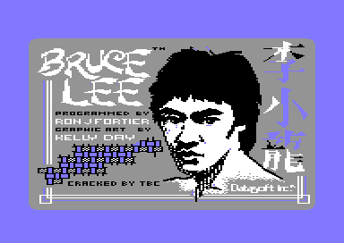

# Bruce Lee: the releases

The project has three cracked releases of *Bruce Lee*: SAEGER, TBC and DC. No uncracked copy of the Datasoft release is in the project. This page tells where each release comes from and what each crack added. It tells what the crackers did with the copy protection, and which traces the cracks and other people left in the program. It also lists each byte where the game differs between the releases, and the switch that gives that byte in the rebuild. A preservation project can use it to identify a copy and to build each release again.

**Conventions.**
- Addresses are C64 addresses. Names are the names of the knowledge.
- A *release* is one cracked file. Its *capture* is the memory at the jump to [`cold_start` `$0400`](../src/game/cold_start.asm#L22). The project knowledge keeps the bytes of each capture.
- The *game bytes* are the 24 segments of the program of the knowledge, from `$03FF` to `$FFFF` (40,075 bytes).
- The *base release* is the release whose bytes are the program of the knowledge: SAEGER.
- A *stage* is one part of a crack that runs before the game, as c64-unpacker found it.
- **Observed** marks a fact that a run or a byte compare showed. **Code** marks a fact from the code only. **Conclusion** marks an interpretation.

## The known releases

The three releases are three cracks of one game image. The table gives the facts that identify each file. The SHA-256 is the hash of the file in `original/` (**Observed**: `sha256sum`). Each extracted file is equal to the file on its disk image (**Observed**: an extraction from each D64).

| Label | Disk image | File | Group | Date | SHA-256 of the file |
|---|---|---|---|---|---|
| SAEGER (base) | `original/saeger.d64`, disk name "XIDEX", file "BRUCE LEE", 186 blocks | `original/bruce_lee.prg`, 47,107 bytes, `$0801-$C001` | Saeger Soft Group (SSG) | October 1984 (intro text) | `032fb72523f73a0c9e755809c71bd6072709e42b119deb443b119ca392fb7590` |
| TBC | unknown (only the PRG file) | `original/bruce_lee_tbc.prg`, 49,423 bytes, `$0801-$C90D` | TBC | unknown | `0ed44d52101414928872eddbe1220427f90cbaf129aa41b3d81ba18909b1d597` |
| DC | `original/danish.d64`, no disk name, file "BRUCE LEE   (DC)", 178 blocks | `original/bruce_lee_dc.prg`, 45,074 bytes, `$0801-$B810` | Danish Crackers (DC) | unknown | `331fe97e73f8c77624242b4da3029efcb9199ffa184d6cd95220a60311efdaf4` |

The disk images have these hashes: `original/saeger.d64` is `b45e53e602fe94654934beffaa483f59989a6d3973ef054afaeea4ea4bc2b8f5`, and `original/danish.d64` is `1a9d294e07f9593ba59d878423d157bacfe6c6902d3a52ef6ac96512a15fb6c5` (**Observed**).

Each file starts with one BASIC line that starts the crack. The line numbers are 1984 in SAEGER, 6368 in TBC and 1985 in DC (**Observed**: the first bytes of each file).

| Label | BASIC line |
|---|---|
| SAEGER | `1984 SYS 2161  SSG` |
| TBC | `6368 SYS 2087 CRACKED BY TBC` |
| DC | `1985 SYS 2073 TCS-CRUNCH!` |

The line number 1985 of the DC file may be the year of the crack. No other source gives a date for TBC or DC (**Conclusion**).

The knowledge records each release with its bytes and the define that builds it. The bytes of each release are in the project knowledge. They come from the captures of the three files at the jump to `cold_start` (**Observed**: `knowledge.ts releases`).

## The original

**TBC holds the game nearest to the original program.** Its game bytes have the text "DATASOFT PRESENTS", the bytes from before a run, and the demo input. DC has the same game bytes, but it lost the demo input. SAEGER holds an image that somebody saved from a game that ran, with a text edit of another cracker (**Observed**: byte compare of the captures. **Conclusion**: which release is nearest).

SAEGER is the base release of the knowledge. The rebuild gives each release byte for byte. The default build is the TBC game without the protection checks (**Observed**: the byte compare of the builds).

These parts of the original release are missing:
- **The original disk or tape.** Each release in the project is a crack. So the original protection loader is not available.
- **The earlier stages of the original loader.** Each crack file still holds the last stage, in its encoded form. The relocator copies it to `$033C-$03FE`. Decoded, it decrypts the game into `$0400-$A0FF`, writes the RTS at `$0080`, and calls `$0400`. The knowledge keeps the encoded stage in space bank6 at `$033C` and the decoded stage in space bank7 (**Code**). The game does not use these bytes (**Observed**: `tests/original_loader_stage_033c.json` writes `$A5` over the 195 bytes and gives PASS).
- **A clean original text.** The image also holds an old copy of `msg_presents` from an earlier build, in space bank1 at `$4F2C`. That copy reads "DATASO...SENTS" (**Code**: the comment of `msg_presents`). So "DATASOFT PRESENTS" in TBC and DC is the text of the authors (**Conclusion**).

## The cracks

Each crack adds an intro and a mover in front of the game. The intros and the movers are different in each release, so each group wrote its own. All three cracks end in the same relocator at `$C000`. It moves the game into place and starts it (**Observed**: the stages of each `image.json`, and runs to `$0400` in the emulator). This page does not describe the crack code, because it is not part of the program.

- **SAEGER.** The file is not packed. The intro shows "CRACKED IN OKTOBER 1984 BY SAEGER SOFT GROUP" and waits for SPACE.
- **TBC.** The file is not packed. The intro shows the Datasoft title picture with "CRACKED BY TBC" and waits for a key.
- **DC.** TCS-CRUNCH packs the file. The intro shows "DC-011/P" and "hit any key", and waits for a key.

**The relocator is crack code.** It is the same in the three releases (**Observed**: `$C000-$C1FF` is equal in the three captures). It starts from the layout of a single file, with the game at `$0900`. It writes again the marks that the protected loader left. Thus it comes from the first crack, the image that the three releases share (**Conclusion**).

**Two parts outside the game are original.** These parts are the encoded last stage of the protected loader at `$C13C` and the title picture of TBC. The relocator copies the loader stage to `$033C-$03FE` (see "The original"). The other bytes outside the game and the leftovers are copies that the relocation left (**Observed**: a byte compare of the three captures). The game does not need `$A000-$A9FF` (**Observed**: `tests/crack_leftover_a000.json` writes `$A5` over the 2,560 bytes and gives PASS).

### The title picture

The title picture is not crack work. It is the Datasoft title picture, and only TBC holds it. TBC changed it in two ways. It wrote "CRACKED BY TBC" into the bitmap, and it gave all cells the screen colours `$CE`. The intro plays no music (**Observed**). The rebuild shows the clean picture as its start screen. The switch `CRACK_TBC_PICTURE` of space bank8 holds the changes of TBC, and its default is 0. [startup_title.md](startup_title.md#the-title-picture-before-the-entry) tells how the loader shows it.

### Trainers and changed texts

**No release has a trainer or a cheat.** None of the differences of the game bytes is code that acts as a cheat (**Observed**: the byte compare). The only changed text in the game bytes is the DIABOLO edit in SAEGER (see "The traces in the program"). TBC and DC change no text of the game. Each crack shows its own texts only in its intro.

### How the cracks dealt with the protection

**No crack removed a protection check.** The checks are equal in the three releases. Each crack copies the key page to `$CF00`, and its relocator writes the marks that the original loader left. So the game passes every check (**Observed**: the byte compare, and runs of the title, the demo and the game).

## The copy protection

The original game holds eleven checks of three loader marks and of a key page. The marks are `$00` = `$EF`, `$02` = `$32` and an RTS at `$0080`. The key bytes are at `$CF79-$CFBA`. A failed check hangs the game, wipes memory, or crashes the game after 32 footsteps (**Code**). [protection.md](protection.md) tells about each check.

All three releases still have every check. The switch `PROTECTION` is on in the three releases and off in the default build (**Observed**: `knowledge.ts switches`).

## The traces in the program

The files hold traces of the cracks in the program, and traces of people other than the authors and the three named groups. The traces show that the cracks did not start from a fresh copy of the original.

### The DIABOLO edit

**A cracker changed message `$62`.** [`msg_presents` `$4770`](../src/text/messages_rooms.asm#L322) reads "DIABOLO  PRESENTS" in SAEGER and "DATASOFT PRESENTS" in TBC and DC. Two spaces keep the length of 17 characters. No code prints this message (**Observed**: byte compare. **Code**: no code prints the index). The edit is only in SAEGER. So a cracker who signed as Diabolo edited a copy of the image, and SSG packed that copy later (**Conclusion**).

### The image of a game that ran

**Somebody saved the SAEGER image from a game that ran.** The music variables of SAEGER hold the state after a tune. The self-modified operands of the music player point into the songs. TBC and DC hold the values from before any run. One of them is `$1234`, a placeholder of the assembler source (**Observed**: byte compare. **Conclusion**: the origin of the values).

**A reset left `$55` at `$9B00`.** The KERNAL RAM test at `$FD6E-$FD83` reads each byte and writes `$55`. It compares, writes `$AA` and compares again. Then it writes the old byte back (**Code**: the KERNAL). A reset that stopped the test after the write of `$55` at `$9B00` leaves `$55` there. A cracker who resets a running game to save its memory can get this byte (**Conclusion**).

**The game reads the damaged byte.** At the cold start, [`build_double_height_font` `$4892`](../src/room/draw_helpers.asm#L51) reads `$9B00` in [`room_charset_c` `$9800`](../src/graphics/room_charset_c.asm#L6) as source data (**Observed**: a watchpoint on `$9B00` in the TBC release). So SAEGER builds character `$60` of `charset_wizard` with a different top row. Nobody checked if room 18 shows character `$60`.

**The game writes each music byte before it reads it.** So the run state does not change the game (**Code**). In the TBC release, a watchpoint on `$E3DF-$E3E8` stops first at the store of [`music_set_voice_pointers` `$E376`](../src/music/music_player.asm#L81), 83 frames after the entry (**Observed**). In SAEGER and DC, the first access of the voice state and the flags is a write. A compare of the first 900 frames of each release shows it (**Observed**: c64-provenance `compare --frames`).

### The tape tools at `$FE00`

**SAEGER and TBC hold tape tools at `$FE00-$FFF9`.** The bytes are equal in the two captures. DC does not hold them (**Observed**: byte compare). The game does not use them (**Observed**: `tests/leftovers_unused.json` writes `$A5` over all leftover blocks and gives PASS). The code installs a tape turbo loader through the KERNAL LOAD vector (**Code**: a disassembly of space bank5). The knowledge keeps it as `tape_turbo_install` in bank5 at `$FE00`.

The tools are not part of the game or of the relocator. They were in the memory of the machine when somebody saved the image that TBC and SAEGER share. Thus that image probably went through a machine with a tape turbo (**Conclusion**).

### The lost demo input of DC

**DC lost the demo input.** The packed file holds the game only up to `$F200`. Thus [`demo_input_stream` `$F300`](../src/input/demo_input.asm#L12) holds the RAM content of the machine: zeros and `$FF` (**Observed**: byte compare of the captures).

In the DC release, the attract demo gives Bruce no input. The demo stops at his first lost fall and then shows the title. **Observed**: a run of the DC release went from [`start_attract_demo` `$0531`](../src/game/title_demo_start.asm#L32) to [`lose_fall` `$1818`](../src/game/lose_fall_game_over.asm#L14) and then to the title. Thus a preservation project must not use the DC file as the source of the demo input.

## The differences

The compare covers the game bytes in the full memory of each capture (**Observed**: c64-provenance `compare`, and a byte compare of the three captures):
- TBC and DC are equal in every game byte, except the demo input that DC does not hold (529 bytes in `$F300-$F538`).
- SAEGER differs from TBC in 76 bytes, in 12 ranges.

The table lists the 76 bytes by variable. The byte compare splits `$E30A-$E314` and `$E3DF-$E3E8` into smaller ranges.

| Bytes | SAEGER | TBC and DC | What the difference does | Switch |
|---|---|---|---|---|
| `$4771-$4777` in `msg_presents` | `IABOLO ` | `ATASOFT` | Message `$62` reads "DIABOLO  PRESENTS" against "DATASOFT PRESENTS". No code prints it. | `CRACK_DIABOLO` |
| `$9B00` in `room_charset_c` | `$55` | `$0F` | The top row of character `$60`. `build_double_height_font` copies it into `charset_wizard` at the cold start. | `FIX_RAM_TEST_BYTE` |
| `$E100-$E130`, `music_transpose` | voice state of a tune | other bytes | The workspace of the music voices. `music_reset_state` writes it for each song. | `RUN_STATE` |
| `$E2E7-$E2E8`, `music_long_lengths` | `$01 $00` | `$B7 $DE` | The length commands of a song write these bytes. | `RUN_STATE` |
| `$E30A-$E314`, `music_stop_request` | flags of a tune | other bytes | The stop request and the other flags of the player. `music_reset_state` and the song setup write them. | `RUN_STATE` |
| `$E3DF-$E3E8`, the operands of `music_fetch_voice0`, `music_fetch_voice1` and `music_fetch_voice2` | `LDA $E8E0`, `LDA $E988`, `LDA $EA3C` | `LDA $1234` three times | The stream pointers of the three voices. `music_set_voice_pointers` writes them for each song. `$1234` is a placeholder of the assembler source. | `RUN_STATE` |
| `$E5E7`, `music_cmd_offset` | `$00` | `$FE` | The operand of a branch into the command table. The command dispatch writes it before the branch. | `RUN_STATE` |
| `$E86C`, `music_playlist_pos` | `$01` | `$00` | The index of the next playlist entry. | `RUN_STATE` |
| `$F300-$F538`, `demo_input_stream` | the demo input | TBC: the demo input. DC: zeros and `$FF` | The input of Bruce in the attract demo. | none: DC has no segment there |

### The switches and the builds

The source holds each difference as a switch in `src/switches.asm`. The default build is the clean game. It has no protection, the original text, the clean charset byte, and the music bytes from before a run (**Observed**: `knowledge.ts switches`).

| Switch | Kind | Default | Releases with it on | Patches |
|---|---|---|---|---|
| `PROTECTION` | protection | 0 | SAEGER, TBC, DC | 13 patches, 53 bytes |
| `CRACK_DIABOLO` | crack | 0 | SAEGER | `$4771-$4777` |
| `FIX_RAM_TEST_BYTE` | fix | 1 | TBC, DC | `$9B00` |
| `RUN_STATE` | change | 0 | SAEGER | `$E100-$E130`, `$E2E7-$E2E8`, `$E30A-$E314`, `$E3DE-$E3E8`, `$E5E6-$E5E7`, `$E86C` |

These commands of c64-assembler build the game and each release. Run them from the project folder.

| Build | Command | Result |
|---|---|---|
| Default game | `assembler.ts build src main.asm --out build/bruce_lee.prg` | the clean game |
| Default runnable loader | `source.ts generate --out src --loader` | `build/clean_loader.prg`, a PRG with `10 SYS 2061` and the start screen |
| SAEGER | `assembler.ts build src main.asm --release SAEGER --compare --out build/bruce_lee_SAEGER.prg` | identical to the program of the knowledge |
| TBC | `... --release TBC --compare` | identical to the TBC bytes of the knowledge in each of its 23 segments |
| DC | `... --release DC --compare` | identical to the DC bytes of the knowledge in each of its 23 segments |

The TBC capture has no segment for the key bytes `$CF79-$CFBA`, but the bytes are in its memory. The DC capture has no segment for the demo input (**Observed**: the segments of the captures). `build/clean_loader.prg` is the loader of the SAEGER build. c64-source checks it in the emulator against the entry state of the capture.

### The tests of the releases

- `tests/no_protection.json` compares the default loader with the TBC release.
- The junk scenarios in [tests/](../tests/) run the SAEGER release on both sides.
- The nine recordings in `tests/recordings/` are sessions of the SAEGER release. Each one replays on `build/clean_loader.prg` with the symbols of `build/symbols/clean_loader.json`, with the same game state at each checkpoint (**Observed**).

## Still open

- Does room 18 draw character `$60` of [`charset_wizard` `$B000`](../src/constants.asm#L202)? A run that enters room 18 on the SAEGER and TBC releases, with a compare of the screen of room 18, can show it.
- What is the order of the cracks? TBC and DC can come from the same clean copy, or one can come from the other.
- What are the 49 bytes at `$A400-$A430` that differ between the SAEGER and TBC captures? A compare of the file offsets that the relocator moves there can show it.
- Who added the tape tools at `$FE00`? A tape version of another crack with the same bytes can show it.
