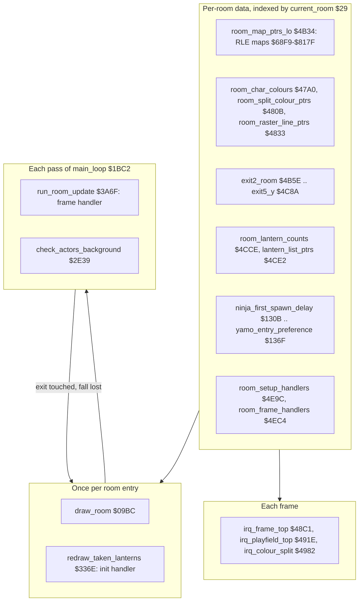

# Bruce Lee: rooms

Up: [the documentation](README.md)

*Bruce Lee* (Datasoft 1984, C64 REV.2) has 20 rooms: screens 0-19, numbered by [`current_room`](../src/constants.asm#L28) [`$29`](reference/variables.md#current_room). This page is the entry page of the room subsystem. It tells how the rooms are stored, how a room is drawn, how a room runs on each pass, and in which order a player goes through the rooms. Names and addresses are those of the project knowledge and of the generated source in `src/`. The documentation is for the unpacked game image of this release.

| Page | Content |
|---|---|
| [parts/room_pipeline.md](parts/room_pipeline.md) | **Room data and room generation.** Every per-room table, the RLE map format, [`draw_room`](../src/room_draw.asm#L6) [`$09BC`](reference/modules/room_draw.md#draw_room) step by step, the charset expansion, the colour bands of a room, the room transition, a worked decode of room 0 and the screen layout. |
| [parts/room_flow.md](parts/room_flow.md) | **The room-level state machine of the game.** Game start, exits and [`enter_room`](../src/background_touch.asm#L210) [`$2F8E`](reference/modules/background_touch.md#enter_room), lanterns, death and respawn, the change of player, floor traps, score and extra falls, the end of the game, the exit graph and the room variables. |
| [parts/rooms_00_09.md](parts/rooms_00_09.md) | **Rooms 0-9, one by one.** The init and frame handler of each room, and the shared mechanisms: cycling objects, hazards, the slider, floor traps, the climbing texture, the light flicker and the passage helpers. |
| [parts/rooms_10_19.md](parts/rooms_10_19.md) | **Rooms 10-19, one by one.** The room 11 diversion, the room 13 sliders, the room 16 bonus fall, the room 18 wizard, the room 19 ending and what [`game_cycle`](../src/constants.asm#L30) [`$40`](reference/variables.md#game_cycle) changes. |

The parts of the program outside the rooms have their own pages: the raster interrupts in [parts/interrupts.md](parts/interrupts.md), the main loop in [parts/main_loop.md](parts/main_loop.md), the actors and enemy spawning in [parts/actors.md](parts/actors.md) and the sprites in [parts/sprites.md](parts/sprites.md).

**Evidence.** **Observed** marks a fact that an emulator run showed. **Code** marks a fact from the code or the image only. **Conclusion** marks an interpretation. A run is named by its c64-testing scenario, for example the `room_special` run.

## 1. The layers

How the layers work together:

1. **The data.** Each room has an entry in more than 30 tables of 20 entries, all indexed by [`current_room`](../src/constants.asm#L28) [`$29`](reference/variables.md#current_room). The map is a run-length stream of 40 x 11 cells ([`room_map_ptrs_lo`](../src/room_tables.asm#L125) [`$4B34`](reference/modules/room_tables.md#room_map_ptrs_lo), [`room_map_ptrs_hi`](../src/room_tables.asm#L129) [`$4B49`](reference/modules/room_tables.md#room_map_ptrs_hi)). The other tables give the colours, the colour bands, the exits, the lanterns, the enemy timers and the two handlers of the room (**Code**).
2. **Once per room entry.** [`draw_room`](../src/room_draw.asm#L6) [`$09BC`](reference/modules/room_draw.md#draw_room) blanks the screen, fills the colour RAM, resets the room state, decodes the map onto screen rows 3-24, redraws the lanterns that the player has taken and runs the init handler of the room ([`redraw_taken_lanterns`](../src/lanterns.asm#L63) [`$336E`](reference/modules/lanterns.md#redraw_taken_lanterns)). It ends with one call of the frame handler (**Code**). A map cell is a double-height tile (8 x 16 pixels, multicolour) (**Code**).
3. **Each pass.** [`main_loop`](../src/main_loop.asm#L6) [`$1BC2`](reference/modules/main_loop.md#main_loop) calls [`run_room_update`](../src/room_update.asm#L571) [`$3A6F`](reference/modules/room_update.md#run_room_update), which runs the frame handler of the room. The handlers draw everything that changes on top of the map: opened passages, new exit tiles, hazards, sliders and the wizard face. They draw with [`print_message`](../src/text.asm#L6) [`$17E2`](reference/modules/text.md#print_message), the same routine that prints text (**Code**). [`check_actors_background`](../src/background_touch.asm#L6) [`$2E39`](reference/modules/background_touch.md#check_actors_background) then tests the cells under each actor for exits, lanterns, deadly tiles and floor traps (**Code**).
4. **Each frame.** The raster interrupt chain sets the room charset from [`room_charset_d018`](../src/constants.asm#L109) [`$F2`](reference/variables.md#room_charset_d018) and switches the background colours at up to two raster lines per room (**Code**). The mechanics of the chain are in [parts/interrupts.md](parts/interrupts.md).
5. **Exits are tiles 2-5.** When an actor touches one, the code looks up the row of the room in the exit tables, and [`enter_room`](../src/background_touch.asm#L210) [`$2F8E`](reference/modules/background_touch.md#enter_room) draws the new room (**Code**). Many exits are not in the map. A handler draws their tile when a condition becomes true (**Code**).
6. **Room state does not persist between visits.** [`room_script_vars`](../src/room_tables.asm#L390) [`$4E97-$4E9B`](reference/modules/room_tables.md#room_script_vars) is cleared and the map is drawn again at each entry. Only the lantern records and counters persist, one set per player. So each event fires again at each entry while its lantern condition holds (**Code**; **Observed** in the `room_events2` run).

## 2. The flow of a player

The events form a chain from room 0 to room 19. The details are in the two room pages.

```mermaid
flowchart LR
  A["clear rooms 0, 1, 2<br/>(room 6 still full)"] -->|"room 1 floor hatch"| R5["room 5"]
  R5 --> R6["clear room 6"]
  R6 -->|"room 2 right exit opens<br/>(room 6 empty)"| R3["room 3: clear it"]
  R3 -->|"floor hatch"| R10["room 10"] --> R11["room 11"]
  R11 --> B["clear rooms 12, 14, 16"]
  B -->|"enter room 11 again:<br/>sent to room 13"| R13["room 13"] --> R15["clear room 15"]
  R15 -->|"exit to 17 drawn"| R17["room 17"] --> R18["room 18: take the<br/>wizard's lantern"]
  R18 -->|"defeat, exit drawn"| R19["room 19"] -->|"game_cycle + 1"| R0["room 0, harder"]
```

- Rooms 4, 7, 8 and 9 hold bonus lanterns and side routes. They are not on this chain.
- **Room 6 is the key room of the first half.** The handlers of rooms 0, 1, 2 and 5 test its lantern counter [`room_lanterns_left+6`](../src/constants.asm#L29) [`$30`](reference/variables.md#room_lanterns_left). The room 1 hatch opens only while room 6 still has lanterns (**Code**; **Observed** in the `room_events3` run).
- **Room 13 has no normal entrance.** [`draw_room`](../src/room_draw.asm#L6) sends an entry into room 11 to room 13 when rooms 12, 14 and 16 have no lanterns left ([`draw_room_special`](../src/room_draw.asm#L34) [`$09F6`](reference/modules/room_draw.md#draw_room_special); **Observed** in the `room_special` run, [`current_room`](../src/constants.asm#L28) = 13).
- **To change the order of the rooms**, change all of these:
  - the exit tables;
  - the fixed `room_lanterns_left+N` addresses and the lantern record addresses in the handlers;
  - the tests of room numbers in [`draw_room`](../src/room_draw.asm#L6) [`$09BC`](reference/modules/room_draw.md#draw_room) (charset, room 11), [`animate_scrolling_chars`](../src/animated_chars.asm#L6) [`$2C70`](reference/modules/animated_chars.md#animate_scrolling_chars) and [`handle_touched_char`](../src/background_touch.asm#L53) [`$2E89`](reference/modules/background_touch.md#handle_touched_char).

  The list of the cross-room conditions is in [parts/rooms_00_09.md](parts/rooms_00_09.md), section "Dependency table".

## 3. Findings

| Finding | Evidence |
|---|---|
| **PAL freeze bug of the original game.** [`draw_room`](../src/room_draw.asm#L6) [`$09BC`](reference/modules/room_draw.md#draw_room) changes `$D011` with a read-modify-write at its start and again at [`room_decode_done`](../src/room_draw.asm#L199) [`$0B33`](../src/room_draw.asm#L202). A read of `$D011` gives bit 8 of the current raster line in bit 7. So a draw that runs on raster lines 256-311 sets bit 8 of the raster compare. The pending IRQ line `$40` becomes `$140` (320), which a PAL frame (312 lines) never reaches. [`main_loop`](../src/main_loop.asm#L6) then waits forever in [`main_loop_wait`](../src/main_loop.asm#L59) [`$1C32`](reference/modules/main_loop.md#main_loop_wait) for [`frame_countdown`](../src/constants.asm#L34) [`$48`](reference/variables.md#frame_countdown). | **Observed** in the `r17_freeze` run: in room 17 the draw read `$9B` from `$D011` on line 279, the closing write ran on line 287, and no IRQ came after it. The NTSC window (lines 256-262) is a **Conclusion**. |
| Entering room 11 with no lanterns left in rooms 12, 14 and 16 sends Bruce to room 13. It is the only way into room 13. | **Observed** in the `room_special` run: [`current_room`](../src/constants.asm#L28) = 13 after the entry. **Code**: [`draw_room_special`](../src/room_draw.asm#L34) [`$09F6`](reference/modules/room_draw.md#draw_room_special). |
| Wizard defeat: taking the lantern at [`lantern_list_room18`](../src/room_tables.asm#L377) [`$4E86`](reference/modules/room_tables.md#lantern_list_room18) gives 3000 points, closes the exit to room 17, flashes the screen with charset set 3 ([`room_charset_d018`](../src/constants.asm#L109) = `$3E`) for 80 passes, then draws exit tile `$03` to room 19. Room 18 stays on set 3 until the next [`draw_room`](../src/room_draw.asm#L6). | **Observed** in the `room_special` run (`$F2` = `$3E` still 400 frames later). **Code**: [`room18_defeat_effect`](../src/room_update.asm#L1019) [`$3DAF`](reference/modules/room_update.md#room18_defeat_effect). Details in [parts/rooms_10_19.md](parts/rooms_10_19.md). |
| Room 19: after `$0458` frames [`game_cycle`](../src/constants.asm#L30) [`$40`](reference/variables.md#game_cycle) + 1, the lanterns and the flags are reset, and the game goes on in room 0. Each non-zero [`game_cycle`](../src/constants.asm#L30) makes the enemies spawn after 3 passes. | **Observed** in the `room_special` run ([`game_cycle`](../src/constants.asm#L30) 0 to 1, room 0). The effect of [`game_cycle`](../src/constants.asm#L30) is **Code** ([`draw_room_spawn_timers`](../src/room_draw.asm#L81) [`$0A4E`](reference/modules/room_draw.md#draw_room_spawn_timers)). |
| The events of rooms 12, 14 and 15 fire twice per visit. The init handler sets the one-shot flags to 1, the frame handler decrements a flag after its event and tests it with `bmi`, so the event runs again when the flag is 0. | **Observed** in a run of room 15 (flag `$01` to `$FF`). **Code**: [`room15_init`](../src/room_init.asm#L226) [`$3593`](reference/modules/room_init.md#room15_init), [`room15_update`](../src/room_update.asm#L1175) [`$3EE6`](reference/modules/room_update.md#room15_update). |
| [`draw_room`](../src/room_draw.asm#L6) copies a 20-byte colour set per room ([`room_atari_colour_ptrs`](../src/room_tables.asm#L86) [`$4AA8`](reference/modules/room_tables.md#room_atari_colour_ptrs)) to [`raster_colours`](../src/constants.asm#L136) [`$0153`](reference/variables.md#raster_colours). [`irq_frame_top`](../src/raster_irq_game.asm#L6) [`$48C1`](reference/modules/raster_irq_game.md#irq_frame_top) writes the first 12 bytes again on the next frame, so the copy has no effect on the picture. The set is the colour set of the Atari version. | **Code** for the copy and the overwrite. The Atari origin is a **Conclusion** (5 bytes per band, typical Atari colour values). |
| Six room maps hold 442 cells, two more than the 440 of the screen. The two extra cells go to `$8FE8/$8FE9` (unused screen RAM) and, as bottom chars, to `$9010/$9011` in the collision masks. | **Code** (decode of the image). |
| The room 7 slider moves one cell past its strip when it moves left, and writes `$65` over map tile `$2A`. | **Observed** in the `room_events2` run. Details in [parts/rooms_00_09.md](parts/rooms_00_09.md). |
| [`enter_room`](../src/background_touch.asm#L210) [`$2F8E`](reference/modules/background_touch.md#enter_room) reloads both enemy spawn timers ([`reset_enemy_timer`](../src/actors.asm#L239) [`$0D42`](reference/modules/actors.md#reset_enemy_timer)), but [`draw_room`](../src/room_draw.asm#L6) writes them again with the first-spawn delays of the new room. The reload has no effect. | **Code** |
| The extra fall from the score compares the three score bytes one by one, not as a 24-bit number. | **Code**: [`add_score_and_check_bonus`](../src/score.asm#L6) [`$313A`](../src/score.asm#L17). Details in [parts/room_flow.md](parts/room_flow.md). |

## 4. The reference

The generated reference of every routine, table and variable is in [reference/index.md](reference/index.md). The room modules are `room_draw.asm`, `room_tables.asm`, `room_maps.asm`, `room_colours.asm`, `room_split_tables.asm`, `room_init.asm`, `room_update.asm`, `lanterns.asm`, `background_touch.asm` and `room_entry_traps.asm`.

## 5. The runs

The runs are c64-testing scenarios. Run each one again with `run.ts` of c64-testing and the scenario of the same name.

| Run | What it does |
|---|---|
| `rooms` | Enters each room and keeps a snapshot and a screenshot of it. |
| `room_events` | In each room snapshot: sets every lantern counter to 0, runs 400 frames and records the screen cells. |
| `room_events2` | Enters each room through [`enter_room`](../src/background_touch.asm#L210) two times: normally, and with every lantern record and counter at 0. It also logs the room 4 texture every 100 frames. |
| `room_events3` | The room 1 hatch (rooms 0-2 empty, room 6 full), room 8 with lanterns 0 and 1 taken, and a 3000-frame texture log in room 9. |
| `room_special` | The wizard defeat, the room 11 diversion and the room 19 ending. |
| `r17_freeze` | The room 17 freeze, frame by frame. |

## 6. Still open

- **Not run yet:**
  - the room 16 bonus fall — a run that takes the object in room 16 with [`bonus_falls_left`](../src/room_tables.asm#L385) [`$4E95`](reference/modules/room_tables.md#bonus_falls_left) > 0;
  - floor-trap slot 2 ([`floor_trap_try_slot2`](../src/background_touch.asm#L371) [`$30B0`](reference/modules/background_touch.md#floor_trap_try_slot2)) — a run with three traps that fire at the same time;
  - the exit tests at the top and the bottom screen edge ([`check_exit_direction`](../src/background_touch.asm#L392) [`$30F7`](../src/background_touch.asm#L413) and `$3103`) — a run through an exit tile at y > `$C5` or y < `$31`;
  - the later events of room 17 — a run of room 17 on NTSC timing, or with the draw outside lines 256-311;
  - a fireball that hits Bruce in room 18 ([`room18_wizard_alive`](../src/room_update.asm#L939) [`$3D28`](../src/room_update.asm#L946)) — a run of room 18 that waits for a fireball.
- **The open questions of each part** are at the end of each page.
- **The code that no run executed** is marked `; not executed` in the source. [report.md](../report.md) lists it with reasons.
