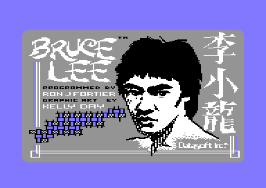

# Bruce Lee: cold start, title screen and game start

Before the program starts, the boot of the rebuild shows the Datasoft title picture. When the loader gives control to the program, the program prepares its fonts and room charsets one time. Then it shows the title screen: the DATASOFT logo, the big BRUCE LEE and a menu. In the menu, the player chooses one or two players, a computer or a human Yamo, and the handedness of each joystick. F7 or fire starts a game: the PLAYER 1 screen shows, then Bruce stands in room 0. When nobody touches the menu for 48 seconds, the attract demo plays room 0 from a recorded input. The demo continues until Bruce loses a fall or someone presses fire.

This page follows the program from its entry to the first pass of the main loop. The main loop, the keys of a game, the score and the turns are on the page [main_loop.md](main_loop.md).

**Conventions.**
- Addresses are C64 addresses. Names are the names of the knowledge.
- A *frame* is one raster interrupt (50 per second on PAL). A *pass* is one run of [`main_loop` `$1BC2`](../src/game_main_loop.asm#L23).
- A *text row* is a row of [`print_message` `$17E2`](../src/actor_driver_text.asm#L59): a double row of two screen rows, except rows 0 and 1.
- A *fall* is a life of Bruce. The status line calls them FALLS.
- **Observed** marks a fact that a run showed. **Code** marks a fact from the code only. **Conclusion** marks an interpretation.
- The runs named on this page are runs of c64-testing from the snapshot `explore1/entry.vsf` (the program at its entry). "Run d1-flow" goes from the entry through the title, the demo, a two-player game and two game overs.

## How it works

The program has a start that runs one time and a restart that runs at each return to the title. The title screen and its menu then lead either to a game or to the demo. Both are the same main loop. One flag tells them apart.

~~~mermaid
flowchart TB
  CS["Cold start: fonts, charsets, contact masks"] --> RT["Restart: clear the game"]
  RT --> TS["Title screen"]
  TS --> MN["Menu: options and countdown"]
  MN -- "F7 or fire" --> NG["Start a game"]
  NG --> PS["PLAYER 1 screen"]
  PS --> GM["Main loop: a game"]
  MN -- "48 seconds without a key" --> AD["Start the demo"]
  AD --> DM["Main loop: the demo"]
  DM -- "fire or F1" --> RT
  DM -- "Bruce loses a fall" --> TS
  GM -- "F1" --> RT
  GM -- "game over" --> TS
~~~

1. **The cold start runs one time.** [`cold_start` `$0400`](../src/cold_start.asm#L22) copies the ROM font and expands the four room charsets to double height. Then it builds the contact masks of the actor frames over the charset sources, and continues into the restart. (**Code**)
2. **The restart puts the game into a known state.** [`restart_to_title` `$050F`](../src/title_demo_start.asm#L9) stops the music and clears the game variables. The cold start, F1 in a game and the end of the demo by fire or F1 come here. (**Code**)
3. **The title screen draws the logo and the menu.** [`show_title_screen` `$0584`](../src/title_demo_start.asm#L83) also restores the options of the last game and starts the title tune at some titles. A game over and the end of the demo by a lost fall come straight here. (**Code**)
4. **The menu waits for the player.** [`title_menu_loop` `$08B1`](../src/title_menu.asm#L14) reads the keys and the fire button of port 1. It returns when the player starts a game, and it jumps to the demo when the 48 seconds run out. (**Code**)
5. **A game starts.** When the menu returns, the code continues into [`start_new_game` `$070E`](../src/title_demo_start.asm#L283). It shows the PLAYER 1 screen ([`show_player_screen` `$0EA7`](../src/title_player_screens.asm#L71)), draws room 0 and enters the main loop. (**Code**)
6. **The demo is the game with one flag cleared.** [`start_attract_demo` `$0531`](../src/title_demo_start.asm#L32) sets `game_mode` = 0. Bruce then follows a recorded input, and `random_byte` always gives 1. So the demo plays the same way each time. (**Code**)

## The title picture before the entry

The Datasoft release showed a title picture while it loaded the game. The picture shows Bruce Lee and the title, and it names the programmer Ron J. Fortier and the graphic artist Kelly Day. The Chinese name of Bruce Lee is on the right. The game bytes do not hold the picture, and no code of the game shows it. Only the TBC crack keeps the picture, in its intro (**Observed**: see [releases.md](releases.md)).

The rebuild shows a clean copy of the picture before the loader starts the game. [src/boot.asm](../src/boot.asm) is a source that a person wrote, not a source of the knowledge. It does these steps (**Observed**: `tests/boot_title_picture.json`, `tests/boot_fire.json` and `tests/boot_timeout.json`):

1. It unpacks the picture from `src/title_picture.rle` into VIC bank 3: the multicolour bitmap at `$E000`, the screen at `$CC00` and the colour RAM at `$D800`. The background is black and the border light blue.
2. It waits for a key, for the fire button of port 1 or port 2, or for 500 frames (10 seconds on PAL).
3. It moves the loader to `$0801` and starts it. The loader writes the entry state and jumps to `cold_start`.

The picture uses four colours: black, white, grey and light blue. 53 cells around the Chinese name have white in place of light blue (screen value `$C1`). All other cells have the screen value `$CE` (**Code**: `src/title_picture.kla`). The switch `TITLE_PICTURE` in `src/config.asm` turns the picture off.

## The cold start

The cold start prepares four things that stay the same for the whole session:

- a table of random bytes,
- the text font of the menu and the status line,
- the four double-height charsets of the rooms,
- the contact masks of the actor frames.

At its end, the program removes the ROMs from the memory map for good. It never uses the KERNAL or BASIC. [`cold_start` `$0400`](../src/cold_start.asm#L22) runs one time, when the loader gives control to the program. **Code.**

### The steps

1. SEI, CLD, the stack pointer = `$FF`. It clears the DEN bit of `SCROLY` to blank the screen.
2. It reads [`warm_start_flag` `$03FF`](../src/cold_start.asm#L7). A nonzero value jumps to `cold_start_expand_last_font` (step 9) and skips the random table, the font and the first three charsets. Nothing in the program writes the flag, and the image holds 0, so the program always does the full start.
3. It clears `sfx_voice1_state` and the two other sound effect states.
4. It sets SID voice 3 to frequency `$FFFF` with the noise waveform and the gate off. `RANDOM` (OSC3) then gives random bytes.
5. It reads 256 samples of `RANDOM` into [`random_table` `$0200`](../src/constants.asm#L147). A loop of `$60` DEY steps waits between two samples.
6. `JSR $0080`: the loader leaves an RTS in `frame_count_256`, so the call returns at once. This is protection check 2 (see [protection.md](protection.md)). In the default build (`PROTECTION` = 0) the three bytes are NOPs.
7. It sets `$01` = `$32` (character ROM at `$D000`). It copies ROM characters 0-31 to `$8900` (`text_font_letters`) and ROM characters 32-63 to `$8800` (`text_font`), and each byte EOR `$FF` to `$8B00` and `$8A00`. Then `$01` = `$36` (I/O again). With `text_font` as the charset, a screen code is the ASCII code minus `$20`, and adding `$40` gives the inverted character.
8. It changes three characters of the font. Code 32 (the "@") becomes a solid block. Code 66 (`text_font_keycap_left`) becomes a bar of 2 pixels at the right edge (`$03` in each row). Code 86 (`text_font_keycap_right`) becomes a bar of 2 pixels at the left edge (`$C0` in each row). The menu uses the two bars as the end caps of the option box.
9. It calls [`build_double_height_font` `$4892`](../src/draw_helpers.asm#L51) four times, one time for each room charset. The warm path of step 2 starts at the fourth call. This step also sets the stack pointer to `$B8`, the high byte of `charset_wizard_flash`, through TAX/TXS. `restart_to_title` sets the stack again.
10. It calls [`build_contact_masks` `$512F`](../src/frame_builder.asm#L16). That routine first waits for the protection bytes, then builds the background contact masks of the actor frames.
11. It calls `empty_init_hook` (only an RTS).
12. It sets `$01` = `$35`: all RAM, with I/O at `$D000`.
13. It sets the fixed sprite colours. Sprites 1, 3 and 4 are black (`$F0`). Sprite 0 is yellow (`$F7`, Bruce), and sprite 2 is green (`$F5`, Yamo).
14. The code continues into `restart_to_title`.

**The raster vector is a part of the cold start code.** The two bytes at [`irq_vector` `$0408`](../src/cold_start.asm#L31) are the `AND #$EF` instruction of step 1. After the cold start, the IRQ entry does `JMP (irq_vector)`, and each screen stores the address of its next raster handler in these two bytes. See [interrupts.md](interrupts.md). **Code.**

### The random table is never read

**The program fills `random_table` with SID noise and never reads it.** `cold_start` fills the table, and `restart_to_title` points [`random_ptr` `$0016`](../src/constants.asm#L20) at it. But [`init_game_variables` `$0F72`](../src/game_setup.asm#L18) clears zero page `$03-$F5` right after that, also `random_ptr`. [`random_byte` `$1159`](../src/interrupt_entry.asm#L89) reads `(random_ptr),Y`, so it reads zero page and the stack page, not the table. `frame_update` increments only the low byte of `random_ptr` in each frame. **Code.**

**Observed** (run d1-flow): `random_ptr` = `$0000` when `title_menu_loop` starts. **Conclusion:** the program writes the 256 bytes of `random_table` and never reads them.

### The double-height charsets

The rooms use characters that are two screen rows high. A cell of a map gives character c in the upper row and character c + 128 in the lower row. [`build_double_height_font` `$4892`](../src/draw_helpers.asm#L51) makes such a charset from a normal 8x8 charset. It writes each pixel row twice. Rows 0-3 of a source character go into character c, and rows 4-7 go into character c + 128. **Code.**

| Source | Output, top halves (c) | Output, bottom halves (c + 128) | Used for |
|---|---|---|---|
| `room_charset_a` | `charset_rooms_0_9` | `$A400` | rooms 0-9 |
| `room_charset_b` | `charset_rooms_10_19` | `$AC00` | rooms 10-17 and 19 |
| `room_charset_c` | `charset_wizard` | `$B400` | room 18 |
| `room_charset_d` | `charset_wizard_flash` | `$BC00` | VMCSB value `$3E` (`frame_update` maps it there) |

The cold start gives four inputs to the routine:

- `row_ptr_top`: the source,
- `data_ptr`: the top output,
- `row_ptr_bottom`: the bottom output,
- `column_counter`: the count of characters minus 1 (127).

~~~
repeat for 128 characters:
    for row in 0..3:  top[2*row] = top[2*row+1] = src[row]           ; character c
    for row in 4..7:  bottom[2*(row-4)] = bottom[2*(row-4)+1] = src[row] ; character c+128
    src += 8; top += 8; bottom += 8
~~~

**Worked example.** Character 10 of [`room_charset_a` `$9000`](../src/room_charset_a.asm#L12) is at `$9050`. Character 11 is at `$9058`.

| Character | Source bytes | Top half (character c) | Bottom half (character c + 128) |
|---|---|---|---|
| 10 | `AA AA AA AA AA A8 80 00` | `$A050`: `AA AA AA AA AA AA AA AA` | `$A450`: `AA AA A8 A8 80 80 00 00` |
| 11 | `AA 2A 0A 02 00 00 00 00` | `$A058`: `AA AA 2A 2A 0A 0A 02 02` | `$A458`: `00 00 00 00 00 00 00 00` |

**The warm path would make a wrong charset.** The order of the steps matters: `build_contact_masks` writes its masks over `$9000-$9FBF`, the four source charsets, after the expansion. **Code.** **Conclusion:** the warm path of step 2 would expand `room_charset_d` at `$9C00` again after the masks are there, and it would make a wrong [`charset_wizard_flash` `$B800`](../src/constants.asm#L203). The image never takes this path.

### The protection waits of the start

Two checks of the start read the protection key page `$CF00-$CFFF`. A copy without the right bytes hangs or destroys itself before the menu can be used. **Code.**

| Check | Where | Condition | When it fails |
|---|---|---|---|
| Signature (check 1) | `build_contact_masks` | `prot_signature_a` = `$B9` and `prot_signature_b` = `prot_signature_a` | loops for ever: the program hangs with a blank screen |
| Signature XOR (check 3) | `title_protection_check`, at each title | the EOR of the six bytes `prot_signature_a`, `+1`, `+2` and `prot_signature_b`, `+1`, `+2` is 0 | `title_protection_wipe` writes A over memory page by page from `(demo_input_ptr)` and never returns |

**Worked example.** The bytes are `$CF8F-$CF91` = `B9 B4 B4` and `$CFAF-$CFB1` = `B9 B4 B4`. The first check sees `$B9` and `$B9 EOR $B9` = 0. The second check computes `B9 EOR B4 EOR B4 EOR B9 EOR B4 EOR B4` = 0. Both checks pass. The other checks of the key page run during the game.

In the default build (`PROTECTION` = 0), NOPs replace both checks and the call of step 6. So the start never waits, and the title never wipes memory. The page [protection.md](protection.md) has all the checks. **Code.**

## The restart

Each return to the title uses [`restart_to_title` `$050F`](../src/title_demo_start.asm#L9), except after a game over or a demo that ends with a lost fall. These events come here:

- the end of the cold start,
- F1 in a game, also during the pause,
- fire or F1 in the demo.

The restart puts the program into a known state before the title. **Code.**

1. SEI, CLD, the stack pointer = `$FD`. It blanks the screen.
2. `music_api_stop` stops the music and silences the SID.
3. It points `random_ptr` at `random_table` (the next step clears the pointer again).
4. [`init_game_variables` `$0F72`](../src/game_setup.asm#L18) clears the game variables and sets `game_mode` = 1.
5. [`reset_play_state` `$0763`](../src/play_init.asm#L19) prepares the game screen and the game interrupt and spawns Bruce. The title screen replaces this screen at once.
6. It jumps to `show_title_screen`.

## The title screen

The title shows "DATASOFT PRESENTS", the big BRUCE LEE with a TM sign, "BY RON J FORTIER" and three menu lines. A box shows each chosen option in inverted characters. [`show_title_screen` `$0584`](../src/title_demo_start.asm#L83) builds the screen. Four places go to it: `restart_to_title`, `lose_fall` at the end of the demo, [`game_over` `$188E`](../src/lose_fall_game_over.asm#L82), and a protection failure in `room10_frame`. **Code.**

### The setup

1. It blanks the screen and calls `stop_all_sounds`.
2. `clear_text_screen` clears the text rows. `title_dummy_table_read` has no effect.
3. It clears `sprite_buf_b_spr4` (`$83C0-$83FF`). Sprite 0 becomes the TM sign: X-expanded, X = 266, Y = 86, light grey, pointer block `$0F`. It copies the 12 bytes of `title_tm_sprite_rows` into rows 4-7 of the sprite.
4. [`irq_vector` `$0408`](../src/cold_start.asm#L31) = `irq_title_frame`, raster line `$FD`. The border and background are blue (`$F6`).
5. `fill_colour_ram` fills colour RAM with `$FF`. Then it makes rows 12-24 white and fills screen rows 0-8 with the blank logo character `$DC`.
6. It copies four rows of 40 characters, each ORed with `$80`. Bit 7 selects characters 128-255 of the logo charset at `$8000`, that is [`title_logo_chars` `$8400`](../src/title_logo_charset.asm#L9).

   | Screen row | Source | Text |
   |---|---|---|
   | 2 | `title_logo_row2` | DATASOFT PRESENTS |
   | 5 | `title_logo_row5` | BRUCE LEE, top half |
   | 6 | `title_logo_row6` | BRUCE LEE, bottom half |
   | 9 | `title_logo_row9` | BY RON J FORTIER |

7. With `text_single_height` = `$FF` it prints three menu lines one row high with `print_message`:

   | Message | Text | Screen row |
   |---|---|---|
   | `$4F` `msg_option_players` | F3 - 1 PLAYER - 2 PLAYERS | 12 |
   | `$50` `msg_option_opponent` | PRESS F5 - COMPUTER - OPPONENT | 14 |
   | `$51` `msg_option_begin` | F7 - TO BEGIN GAME | 16 |

8. `title_highlight_defaults` adds `$40` (the inverted form) to columns 16-25 of rows 12 and 14 and to columns 11-12 (the key names) of rows 12, 14 and 16. This marks "1 PLAYER" and "COMPUTER".
9. It restores the two options from their saved copies. For each option that is 1, it calls the routine of its option box (see below).
10. `title_music_check` decides about the title tune (see below).
11. `title_protection_check`: check 3 of the protection (see the cold start).
12. `title_start_countdown` sets `title_countdown` = `$0960` (2400 frames, 48 seconds). It enables the screen, then CLI.
13. JSR `title_menu_loop`. When it returns, the code continues into `start_new_game`.

The raster interrupt of the title has two handlers. [`irq_title_frame` `$152C`](../src/screen_raster_irqs.asm#L81) at line `$FD` decrements `frame_countdown` and `title_countdown`, selects the logo charset for the top of the screen and plays the music. [`irq_title_split` `$1574`](../src/screen_raster_irqs.asm#L121) at line `$82` switches to `text_font` at `$8800` for the menu. See [interrupts.md](interrupts.md). **Code.**

The title screen after the cold start: the boxes mark "1 PLAYER" and "COMPUTER". **Observed.**

### The options and their saved copies

The menu has two options of one byte each. [`option_two_players` `$42C9`](../src/options_and_patterns.asm#L14) is 0 for one player and 1 for two players who take turns. [`option_yamo_player2` `$42CA`](../src/options_and_patterns.asm#L18) is 0 when the computer moves Yamo and 1 when player 2 moves Yamo. **Code.**

Each option has a saved copy, `option_two_players_saved` and `option_yamo_player2_saved`. F3 and F5 write the option and its copy. The demo sets both options to 0, so it saves them first. The start of a game also saves them. `show_title_screen` copies the saved values back. So the choices of the player survive the demo and the game. **Code.**

When player 2 does not move Yamo for 7 × 256 frames, the idle check of `frame_update` returns Yamo to computer control. It clears `option_yamo_player2`, but not the saved copy. So the next title shows OPPONENT again (see [main_loop.md](main_loop.md)). **Code.**

### The option box

[`title_show_players_choice` `$0E65`](../src/title_player_screens.asm#L27) and [`title_show_opponent_choice` `$0E4C`](../src/title_player_screens.asm#L10) move the box of one option row from the first choice to the second, or back. **Code.**

1. They EOR `$40` into the 20 characters of columns 16-35 of the row (row 12 or row 14). Character `$4D` (the inverted "-") stays as it is. So the inverted part moves from the first choice to the second choice, or back.
2. `title_draw_option_box` writes the four end-cap cells of the row from the option value:

   | Option value | Column 15 | Column 24 | Column 26 | Column 36 |
   |---|---|---|---|---|
   | 0 (first choice) | `$42` left cap | `$40` inverted blank | `$56` right cap | `$00` blank |
   | 1 (second choice) | `$00` blank | `$42` left cap | `$40` inverted blank | `$56` right cap |

After F3, F5 and L, the boxes mark "2 PLAYERS" and "OPPONENT". The message row shows the handedness of joystick 1. **Observed.**

### The title tune on every fifth title

**The title tune plays at the first title, at every fifth title and after each demo that ends with a lost fall.** [`title_music_check` `$06BD`](../src/title_demo_start.asm#L228) decides if the tune plays. **Code.**

1. When `title_music_off` is nonzero, there is no tune. The value is 0 at the start. The S key in a game toggles it between 0 and 1 (silent).
2. Else it decrements [`title_music_skip_count` `$09BB`](../src/title_menu.asm#L163), a signed byte. When the result is 0 or more, there is no tune.
3. When the result is negative, it sets the count to 4 and `music_end_action` = 3. It sets the playlist: `music_playlist` = song 0 and `music_playlist_end` = `$FF`, so song 0 loops. Then it calls [`music_api_start` `$E003`](../src/music_player_state.asm#L10).

The count is 0 in the image. So the tune plays at the first title, then at every fifth title. Two events set the count to 0, so the next title plays the tune:

- the end of the demo by a lost fall (`lose_fall`),
- the S key in a game.

| Title | Count before | Count after | Tune |
|---|---|---|---|
| first title after the cold start | 0 | 4 | yes |
| next titles | 4, 3, 2, 1 | 3, 2, 1, 0 | no |
| fifth title after that | 0 | 4 | yes |
| title after a demo that ended with a lost fall | 0 (set by `lose_fall`) | 4 | yes |

**Observed** (run d1-flow): the count is 4 after the first title. It is 4 again after the demo ended with a lost fall. It is 3 after the title that follows a game over.

## The title menu

The menu lets the player change the options and start a game, and it starts the demo when nobody does anything. [`title_menu_loop` `$08B1`](../src/title_menu.asm#L14) polls the keyboard and port 1 without a frame sync. Only its waits use `frame_countdown`, which the title interrupt decrements. The 48 seconds before the demo are in [`title_countdown` `$0049`](../src/constants.asm#L35), a 16-bit frame count with the low byte first. **Code.**

### The state machine

~~~mermaid
stateDiagram-v2
  state "Menu" as Menu
  state "Option changed" as Opt
  state "Message cleared" as Clr
  state "Start wait" as Start
  state "Start a game" as Game
  state "Attract demo" as Demo
  [*] --> Menu: title screen
  Menu --> Demo: countdown = 0
  Menu --> Opt: F3, F5, L, R, shift-L, shift-R
  Opt --> Menu: fire released, 4 frames
  Menu --> Clr: countdown = $0801 or $0800
  Clr --> Menu
  Menu --> Start: F7 or fire on port 1
  Start --> Game: fire released, 16 frames, RTS
~~~

| State | Condition | Next state | Code |
|---|---|---|---|
| Menu | `title_countdown` = 0 | the attract demo | `title_menu_loop` jumps to `start_attract_demo` |
| Menu | `key_ready` = 1 | the key test | `title_menu_scan_keys` clears `key_ready` and goes to `title_menu_handedness_keys` |
| Menu | key `$2A` (L) | Option changed | `title_set_joy1_left_handed`: message 8, joystick 1 left handed |
| Menu | key `$11` (R) | Option changed | `title_set_joy1_right_handed`: message 9, joystick 1 right handed |
| Menu | key `$AA` (shift-L) | Option changed | `title_set_joy2_left_handed`: message `$0A`, joystick 2 left handed |
| Menu | key `$91` (shift-R) | Option changed | `title_set_joy2_right_handed`: message `$0D`, joystick 2 right handed |
| Menu | key AND `$7F` = `$06` (F5) | Option changed | `title_menu_toggle_opponent`: `option_yamo_player2` EOR 1, also into the saved copy, highlight |
| Menu | key AND `$7F` = `$05` (F3) | Option changed | `title_menu_toggle_players`: `option_two_players` EOR 1, also into the saved copy, highlight |
| Menu | key AND `$7F` = `$03` (F7) | Start wait | `title_menu_function_keys` branches to `title_menu_start_game` |
| Menu | high byte of `title_countdown` = 8 and low byte < 2 | Message cleared | `title_menu_check_message_timeout` prints message `$0E` (36 blanks) on text row 10 |
| Menu | bit 4 of `CIAPRB` = 0 (fire on port 1) | Start wait | `title_menu_check_fire` |
| Option changed | fire released on both ports, then 4 frames | Menu | `title_menu_option_changed` sets `title_countdown` = `$0960` again |
| Start wait | fire released on both ports, then 16 frames | `start_new_game` | `title_menu_start_game` returns to `show_title_screen` |

An option key restarts the 2400 frames before the demo. Each option key and the start wait for [`wait_fire_released` `$094B`](../src/title_menu.asm#L97), which returns when bit 4 of `CIAPRA` and `CIAPRB` are both 1. F3, F5 and F7 also work with shift, because the test masks bit 7. **Code.**

The menu clears the message row about 350 frames after the last option key: `$0960` - `$0801` = 351 frames. The test is true for two frames, so the menu prints the row more than once. **Code.**

**Only fire on port 1 starts a game.** Fire on port 2 does nothing on the title, but the PLAYER 2 turn of a two-player game uses port 2. **Code.**

### The key codes

[`scan_keyboard` `$139E`](../src/keyboard_scan.asm#L24) with `key_scan_mode` = 0 gives any key as column × 8 + row of the keyboard matrix. The column is the bit of CIA 1 port A that the scan drives low. The row is the bit of port B. The scan sets bit 7 when a shift key is down. It sets `key_ready` = 1, and it does nothing while a joystick line is low. **Code.**

| Key | Code | Matrix (port A bit, port B bit) | Action on the title |
|---|---|---|---|
| F7 | `$03` | 0, 3 | start the game |
| F3 | `$05` | 0, 5 | one / two players |
| F5 | `$06` | 0, 6 | computer / human opponent |
| R | `$11` | 2, 1 | joystick 1 right handed |
| L | `$2A` | 5, 2 | joystick 1 left handed |
| shift-R | `$91` | 2, 1 + shift | joystick 2 right handed |
| shift-L | `$AA` | 5, 2 + shift | joystick 2 left handed |

**The right-handed key is R.** Code `$11` is column 2, row 1 of the C64 matrix, which is the R key. D would be `$12`. **Code.** **Conclusion:** R for right and L for left.

[`joystick_right_handed` `$1383`](../src/room_enemy_tables.asm#L114) holds the handedness, one byte for each joystick. The value 1 is right handed (the start value), and 0 is left handed. [`frame_update` `$15A8`](../src/frame_update.asm#L20) turns a left-handed joystick by 90 degrees. The status line shows an L for it. **Code.**

The message after code `$91` (shift-R): joystick 2 is right handed. **Observed.**

The title after F3: two players. **Observed.**

## The start of a game

When the player presses F7 or fire, the menu returns and the code continues into [`start_new_game` `$070E`](../src/title_demo_start.asm#L283). It shows the PLAYER 1 screen, prepares a new game and enters the main loop in room 0. **Code.**

1. SEI. It blanks the screen and disables the sprites.
2. `current_player` = 0 (player 1).
3. `music_stop_request` = 1, then `music_api_stop`.
4. It copies the two options to their saved copies.
5. [`show_player_screen` `$0EA7`](../src/title_player_screens.asm#L71) shows PLAYER 1.
6. It blanks the screen again and sets the stack pointer to `$FD`.
7. [`init_game_variables` `$0F72`](../src/game_setup.asm#L18) clears the game. It sets 4 falls (9 when player 2 moves Yamo) and the first bonus fall at `bonus_fall_first_score`. It makes a copy of the player block for player 2 and sets `game_mode` = 1.
8. `reset_play_state` makes the game screen and the status line, sets the game interrupt and spawns Bruce.
9. [`draw_room` `$09BC`](../src/draw_room.asm#L28) draws room 0.
10. `demo_input_ptr` = `demo_input_stream` (the game does not read it).
11. It enables the screen, then CLI, and it jumps to `main_loop`.

Room 0 when the game starts: the status line shows 1UP, the score, TOP and FALLS 04. **Observed.**

## The attract demo

The demo shows the game to a passer-by. It is the normal game with [`game_mode` `$0104`](../src/constants.asm#L130) = 0 (1 is a game). Bruce follows a recorded input, the enemies follow fixed random numbers, and no score reaches the high score. **Code.**

### The start

[`start_attract_demo` `$0531`](../src/title_demo_start.asm#L32) runs when `title_countdown` reaches 0. **Code.**

1. SEI. It blanks the screen and disables the sprites.
2. `music_stop_request` = 1, then `music_api_stop`.
3. The stack pointer = `$FD`. `init_game_variables` and `reset_play_state`.
4. LSR `game_mode`: 1 becomes 0, the demo.
5. It saves the options in the saved copies and sets both options to 0: one player, computer Yamo.
6. `draw_room` draws room 0.
7. [`demo_input_ptr` `$001D`](../src/constants.asm#L24), the 2-byte read pointer of the demo input, = [`demo_input_stream` `$F300`](../src/demo_input.asm#L12).
8. It enables the screen, then CLI, and it jumps to `main_loop`.

The instruction at `demo_start_blank_screen` has a second use: the high byte of its operand, [`frame_update_wipe_counter` `$0539`](../src/title_demo_start.asm#L37), is the page counter of a protection wipe in `frame_update`. **Code.**

### What the demo changes

These places read `game_mode`. **Code.**

| Place | In a game (`game_mode` = 1) | In the demo (`game_mode` = 0) |
|---|---|---|
| `main_loop` | `handle_game_keys`, pause | no keys, no pause |
| `check_demo_abort` | returns at once | fire on port 1 or F1 ends the demo |
| `update_actors` | Bruce's input from the joystick (read by `frame_update`) | one byte of `demo_input_stream` in each pass: bits 0-3 to `actor_joy_dir`, bits 4-7 to `actor_fire` |
| `frame_update` | reads the joysticks, counts `room_time`, input resets `idle_timer` | no joystick read, `room_time` stops, `idle_timer` is reset in each frame |
| `random_byte` | a byte from `(random_ptr),Y` | always 1 |
| `spawn_actor` | Bruce at start point A, enemies by the rules of the room | every actor at start point A |
| `update_high_score` | updates and shows TOP | shows only the score |
| `lose_fall` | counts the fall | sets `title_music_skip_count` = 0 and jumps to `show_title_screen` |

**Conclusion:** with [`random_byte` `$1159`](../src/interrupt_entry.asm#L89) fixed at 1 and the same input bytes, the demo plays the same way each time.

### The end of the demo

The demo ends in one of two ways. Fire or F1 starts the restart. A lost fall goes directly to the title and plays the title tune.

- Fire on port 1, or F1: [`check_demo_abort` `$19B8`](../src/pause_status_line.asm#L7) waits until the player releases fire, waits 6 frames and jumps to `restart_to_title`. **Code.**
- Bruce loses a fall: [`lose_fall` `$1818`](../src/lose_fall_game_over.asm#L14) goes to `show_title_screen`, and the title tune plays. **Code.**

**The demo ends at its first lost fall, after 569 input bytes.** The input stream has no end mark. **Observed** (run d1-flow, and run a8/run2 of the analysis): the demo reached `lose_fall` with `demo_input_ptr` = `$F539`. That is after 569 bytes (`$F300-$F538`), about 1713 frames after the start. The score was 125 (one lantern), and `falls_left` was still 4.

The attract demo: Bruce took a lantern (score 125), and Yamo and the Ninja are in the room. TOP stays 000000. **Observed.**

## The PLAYER n screen

Before each turn, the program shows "PLAYER 1" or "PLAYER 2" in big shaded letters on a blue screen. So the players know whose turn comes next. [`show_player_screen` `$0EA7`](../src/title_player_screens.asm#L71) draws it. `start_new_game` and `lose_fall` call it. **Code.**

1. SEI. It blanks the screen, disables the sprites and sets a blue border and background.
2. It fills the screen page [`game_screen` `$8C00`](../src/constants.asm#L195)-`$8FFF` with `$DC`. This also writes the sprite pointers, but the sprites are off.
3. `stop_all_sounds`.
4. It copies the two characters of the big digit of `current_player` from `player_banner_digit_top` and `player_banner_digit_bottom` into columns 14-15 of `player_banner_top` and `player_banner_bottom`.
5. It copies the 16 characters of each half, ORed with `$80`, to screen rows 7 and 8 from column 12.
6. `irq_vector` = [`irq_player_screen` `$14A4`](../src/screen_raster_irqs.asm#L10) at raster line `$63`. VMCSB = `$30` (screen `$8C00`, charset `$8000`), multicolour. It enables the screen, then CLI.
7. It waits until `frame_countdown` is 0: 64 frames, 128 frames in a two-player game. The 24-bit busy counter `player_screen_wait` = `$038080` decrements in the same loop and ends the wait when the interrupt does not count.

`irq_player_screen` waits for line `$6E` and changes `BGCOL1` about every two lines to `$B`, `$C`, `$F`, `$1`, `$F`, `$C`, `$B`. This shades the big letters from dark grey to white and back. It also decrements `frame_countdown`. **Code.**

The PLAYER 1 screen at the start of a game. **Observed.**

**Observed** (run d1-flow): in a two-player game, 60 frames after the start of the PLAYER 2 screen, `frame_countdown` = `$44` (128 - 60).

## Still open

- What [`warm_start_flag` `$03FF`](../src/cold_start.asm#L7) was meant for (a restart from a cartridge or a monitor?). No code writes it.
- A key test with real key presses: the runs set `key_code` and `key_ready` directly, because the test tool cannot press one key of the matrix. A press of R on a real C64 would check the key codes above.
