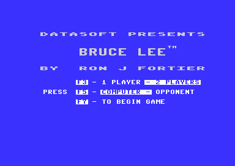

# Bruce Lee: cold start, title screen and game start

This page follows the program from its entry to the first pass of the main loop. It covers the cold start, the
title screen with its menu, the start of a game, the attract demo and the PLAYER n screen.

## 1. Scope

- The cold start: [`cold_start`](../src/cold_start.asm#L22) [`$0400`](reference/modules/cold_start.md#cold_start) and the routines that it calls.
- The restart: [`restart_to_title`](../src/title_demo_start.asm#L9) [`$050F`](reference/modules/title_demo_start.md#restart_to_title).
- The title screen: [`show_title_screen`](../src/title_demo_start.asm#L83) [`$0584`](reference/modules/title_demo_start.md#show_title_screen), [`title_menu_loop`](../src/title_menu.asm#L14) [`$08B1`](reference/modules/title_menu.md#title_menu_loop) and the option highlights.
- The game start: [`start_new_game`](../src/title_demo_start.asm#L283) [`$070E`](reference/modules/title_demo_start.md#start_new_game).
- The attract demo: [`start_attract_demo`](../src/title_demo_start.asm#L32) [`$0531`](reference/modules/title_demo_start.md#start_attract_demo) and what [`game_mode`](../src/constants.asm#L134) [`$0104`](reference/variables.md#game_mode) = 0 changes in the game.
- The PLAYER n screen: [`show_player_screen`](../src/title_player_screens.asm#L71) [`$0EA7`](reference/modules/title_player_screens.md#show_player_screen).
- Sources: `src/cold_start.asm`, `src/title_demo_start.asm`, `src/title_menu.asm`,
  `src/title_player_screens.asm`, `src/screen_raster_irqs.asm`, `src/frame_builder.asm`, `src/draw_helpers.asm`.
- The main loop, the keys of a game, the score and the turns are on the page [main_loop.md](main_loop.md).

**Conventions.**
- Addresses are C64 addresses. Names are the names of the knowledge.
- A *frame* is one raster interrupt (50 per second on PAL). A *pass* is one run of [`main_loop`](../src/game_main_loop.asm#L23) [`$1BC2`](reference/modules/game_main_loop.md#main_loop).
- A *text row* is a row of [`print_message`](../src/actor_driver_text.asm#L59) [`$17E2`](reference/modules/actor_driver_text.md#print_message): a double row of two screen rows, except rows 0 and 1.
- A *fall* is a life of Bruce. The status line calls them FALLS.
- **Observed** marks a fact that a run showed. **Code** marks a fact from the code only. **Conclusion** marks an
  interpretation.
- The runs named on this page are runs of c64-testing from the snapshot `explore1/entry.vsf` (the program at its
  entry). "Run d1-flow" goes from the entry through the title, the demo, a two-player game and two game overs.

## 2. Overview

~~~mermaid
flowchart TB
  CS["cold_start $0400"] --> RT["restart_to_title $050F"]
  RT --> ST["show_title_screen $0584"]
  ST --> TM["title_menu_loop $08B1"]
  TM -- "F7 or fire: RTS" --> NG["start_new_game $070E"]
  TM -- "title_countdown = 0" --> AD["start_attract_demo $0531"]
  NG --> PS["show_player_screen $0EA7"]
  PS --> NG
  NG --> ML["main_loop $1BC2 (game)"]
  AD --> MD["main_loop $1BC2 (demo)"]
  MD -- "fire port 1 or F1" --> RT
  MD -- "Bruce loses a fall" --> ST
  ML -- "F1" --> RT
  ML -- "game over" --> ST
~~~

| Step | Routine | Next |
|---|---|---|
| Cold start | [`cold_start`](../src/cold_start.asm#L22) [`$0400`](reference/modules/cold_start.md#cold_start) | falls into [`restart_to_title`](../src/title_demo_start.asm#L9) [`$050F`](reference/modules/title_demo_start.md#restart_to_title) |
| Restart | [`restart_to_title`](../src/title_demo_start.asm#L9) [`$050F`](reference/modules/title_demo_start.md#restart_to_title) | jumps to [`show_title_screen`](../src/title_demo_start.asm#L83) [`$0584`](reference/modules/title_demo_start.md#show_title_screen) |
| Title setup | [`show_title_screen`](../src/title_demo_start.asm#L83) [`$0584`](reference/modules/title_demo_start.md#show_title_screen) | calls [`title_menu_loop`](../src/title_menu.asm#L14) [`$08B1`](reference/modules/title_menu.md#title_menu_loop) |
| Menu | [`title_menu_loop`](../src/title_menu.asm#L14) [`$08B1`](reference/modules/title_menu.md#title_menu_loop) | returns into [`start_new_game`](../src/title_demo_start.asm#L283) [`$070E`](reference/modules/title_demo_start.md#start_new_game), or jumps to [`start_attract_demo`](../src/title_demo_start.asm#L32) [`$0531`](reference/modules/title_demo_start.md#start_attract_demo) |
| Game start | [`start_new_game`](../src/title_demo_start.asm#L283) [`$070E`](reference/modules/title_demo_start.md#start_new_game) | calls [`show_player_screen`](../src/title_player_screens.asm#L71) [`$0EA7`](reference/modules/title_player_screens.md#show_player_screen), then jumps to [`main_loop`](../src/game_main_loop.asm#L23) [`$1BC2`](reference/modules/game_main_loop.md#main_loop) |
| Demo start | [`start_attract_demo`](../src/title_demo_start.asm#L32) [`$0531`](reference/modules/title_demo_start.md#start_attract_demo) | jumps to [`main_loop`](../src/game_main_loop.asm#L23) [`$1BC2`](reference/modules/game_main_loop.md#main_loop) |
| Demo end | [`check_demo_abort`](../src/pause_status_line.asm#L7) [`$19B8`](reference/modules/pause_status_line.md#check_demo_abort) or [`lose_fall`](../src/lose_fall_game_over.asm#L14) [`$1818`](reference/modules/lose_fall_game_over.md#lose_fall) | [`restart_to_title`](../src/title_demo_start.asm#L9) [`$050F`](reference/modules/title_demo_start.md#restart_to_title) or [`show_title_screen`](../src/title_demo_start.asm#L83) [`$0584`](reference/modules/title_demo_start.md#show_title_screen) |
| Game end | [`handle_game_keys`](../src/status_and_keys.asm#L57) [`$1B29`](reference/modules/status_and_keys.md#handle_game_keys) (F1) or [`game_over`](../src/lose_fall_game_over.asm#L82) [`$188E`](reference/modules/lose_fall_game_over.md#game_over) | [`restart_to_title`](../src/title_demo_start.asm#L9) [`$050F`](reference/modules/title_demo_start.md#restart_to_title) or [`show_title_screen`](../src/title_demo_start.asm#L83) [`$0584`](reference/modules/title_demo_start.md#show_title_screen) |

## 3. The catalogue

| Name | Address | Layout | Writers | Readers |
|---|---|---|---|---|
| [`warm_start_flag`](../src/cold_start.asm#L7) | `$03FF` | 1 byte. 0 = full cold start. The image holds 0. | none | [`cold_start`](../src/cold_start.asm#L22) [`$0400`](reference/modules/cold_start.md#cold_start) |
| [`irq_vector`](../src/cold_start.asm#L31) | `$0408` | 2 bytes, the address of the next raster handler. They are the operand bytes of an instruction of the cold start. | [`show_title_screen`](../src/title_demo_start.asm#L83) [`$0584`](reference/modules/title_demo_start.md#show_title_screen), [`show_player_screen`](../src/title_player_screens.asm#L71) [`$0EA7`](reference/modules/title_player_screens.md#show_player_screen), [`init_game_irq`](../src/play_init.asm#L114) [`$082D`](reference/modules/play_init.md#init_game_irq), the raster handlers | the IRQ entry (`JMP (irq_vector)`) |
| [`random_table`](../src/constants.asm#L151) | `$0200` | 256 bytes of SID noise. | [`cold_start`](../src/cold_start.asm#L22) [`$0400`](reference/modules/cold_start.md#cold_start) | none (see section 4.2) |
| [`text_font`](../src/constants.asm#L193) | `$8800` | 4 pages of 64 characters: `$8800` ROM characters 32-63, `$8900` ROM characters 0-31, `$8A00` and `$8B00` the same inverted. | [`cold_start`](../src/cold_start.asm#L22) [`$0400`](reference/modules/cold_start.md#cold_start) | the title menu lines and the status line |
| [`charset_rooms_0_9`](../src/constants.asm#L204) | `$A000` | Double-height charset: 128 top halves at `$A000`, 128 bottom halves at `$A400`. | [`build_double_height_font`](../src/draw_helpers.asm#L51) [`$4892`](reference/modules/draw_helpers.md#build_double_height_font) | the VIC in rooms 0-9 |
| [`charset_rooms_10_19`](../src/constants.asm#L205) | `$A800` | The same form, from [`room_charset_b`](../src/room_charset_b.asm#L6) [`$9400`](reference/graphics.md#room_charset_b). | [`build_double_height_font`](../src/draw_helpers.asm#L51) [`$4892`](reference/modules/draw_helpers.md#build_double_height_font) | the VIC in rooms 10-17 and 19 |
| [`charset_wizard`](../src/constants.asm#L206) | `$B000` | The same form, from [`room_charset_c`](../src/room_charset_c.asm#L6) [`$9800`](reference/graphics.md#room_charset_c). | [`build_double_height_font`](../src/draw_helpers.asm#L51) [`$4892`](reference/modules/draw_helpers.md#build_double_height_font) | the VIC in room 18 |
| [`charset_wizard_flash`](../src/constants.asm#L207) | `$B800` | The same form, from [`room_charset_d`](../src/room_charset_d.asm#L8) [`$9C00`](reference/graphics.md#room_charset_d). | [`build_double_height_font`](../src/draw_helpers.asm#L51) [`$4892`](reference/modules/draw_helpers.md#build_double_height_font) | [`frame_update`](../src/frame_update.asm#L20) [`$15A8`](reference/modules/frame_update.md#frame_update) maps VMCSB `$3E` to it |
| [`title_countdown`](../src/constants.asm#L39) | `$0049` | 16-bit frame count, low byte first. `$0960` = 2400 frames at the start. | [`show_title_screen`](../src/title_demo_start.asm#L83) [`$0584`](reference/modules/title_demo_start.md#show_title_screen), [`title_menu_option_changed`](../src/title_menu.asm#L68) [`$0916`](reference/modules/title_menu.md#title_menu_option_changed); [`irq_title_frame`](../src/screen_raster_irqs.asm#L81) [`$152C`](reference/modules/screen_raster_irqs.md#irq_title_frame) counts it down | [`title_menu_loop`](../src/title_menu.asm#L14) [`$08B1`](reference/modules/title_menu.md#title_menu_loop) |
| [`title_music_skip_count`](../src/title_menu.asm#L163) | `$09BB` | 1 byte, signed. The title tune plays when a decrement makes it negative. | [`show_title_screen`](../src/title_demo_start.asm#L83) [`$0584`](reference/modules/title_demo_start.md#show_title_screen) (4), [`lose_fall`](../src/lose_fall_game_over.asm#L14) [`$1818`](reference/modules/lose_fall_game_over.md#lose_fall) and the S key (0) | [`show_title_screen`](../src/title_demo_start.asm#L83) [`$0584`](reference/modules/title_demo_start.md#show_title_screen) |
| [`title_music_off`](../src/room_enemy_tables.asm#L118) | `$1385` | 1 byte. 0 = the title tune can play, 1 = silent. | the S key in [`handle_game_keys`](../src/status_and_keys.asm#L57) [`$1B29`](reference/modules/status_and_keys.md#handle_game_keys) | [`show_title_screen`](../src/title_demo_start.asm#L83) [`$0584`](reference/modules/title_demo_start.md#show_title_screen) |
| [`option_two_players`](../src/options_and_patterns.asm#L14) | `$42C9` | 1 byte. 0 = one player, 1 = two players who take turns. | F3, the demo start, [`show_title_screen`](../src/title_demo_start.asm#L83) [`$0584`](reference/modules/title_demo_start.md#show_title_screen) | the turn code, [`frame_update`](../src/frame_update.asm#L20) [`$15A8`](reference/modules/frame_update.md#frame_update) |
| [`option_yamo_player2`](../src/options_and_patterns.asm#L18) | `$42CA` | 1 byte. 0 = the computer moves Yamo, 1 = player 2 moves Yamo. | F5, the demo start, [`show_title_screen`](../src/title_demo_start.asm#L83) [`$0584`](reference/modules/title_demo_start.md#show_title_screen), the Yamo idle check | [`init_game_variables`](../src/game_setup.asm#L18) [`$0F72`](reference/modules/game_setup.md#init_game_variables), the actor code |
| [`option_two_players_saved`](../src/options_and_patterns.asm#L21) | `$42CB` | Copy of the option over the demo and the game. | F3, [`start_attract_demo`](../src/title_demo_start.asm#L32) [`$0531`](reference/modules/title_demo_start.md#start_attract_demo), [`start_new_game`](../src/title_demo_start.asm#L283) [`$070E`](reference/modules/title_demo_start.md#start_new_game) | [`show_title_screen`](../src/title_demo_start.asm#L83) [`$0584`](reference/modules/title_demo_start.md#show_title_screen) |
| [`option_yamo_player2_saved`](../src/options_and_patterns.asm#L24) | `$42CC` | The same for the opponent option. | F5, [`start_attract_demo`](../src/title_demo_start.asm#L32) [`$0531`](reference/modules/title_demo_start.md#start_attract_demo), [`start_new_game`](../src/title_demo_start.asm#L283) [`$070E`](reference/modules/title_demo_start.md#start_new_game) | [`show_title_screen`](../src/title_demo_start.asm#L83) [`$0584`](reference/modules/title_demo_start.md#show_title_screen) |
| [`joystick_right_handed`](../src/room_enemy_tables.asm#L114) | `$1383` | 2 bytes, joystick 1 and joystick 2. 1 = right handed (start value), 0 = left handed. | the L and R keys of the title | [`frame_update`](../src/frame_update.asm#L20) [`$15A8`](reference/modules/frame_update.md#frame_update) |
| [`game_mode`](../src/constants.asm#L134) | `$0104` | 1 byte. 1 = a game, 0 = the attract demo. | [`init_game_variables`](../src/game_setup.asm#L18) [`$0F72`](reference/modules/game_setup.md#init_game_variables) (1), [`start_attract_demo`](../src/title_demo_start.asm#L32) [`$0531`](reference/modules/title_demo_start.md#start_attract_demo) (LSR to 0) | see section 9 |
| [`demo_input_ptr`](../src/constants.asm#L28) | `$001D` | 2 bytes, the read pointer of the demo input. | [`start_attract_demo`](../src/title_demo_start.asm#L32) [`$0531`](reference/modules/title_demo_start.md#start_attract_demo), [`start_new_game`](../src/title_demo_start.asm#L283) [`$070E`](reference/modules/title_demo_start.md#start_new_game), [`update_actors`](../src/actor_driver_text.asm#L10) [`$179E`](reference/modules/actor_driver_text.md#update_actors) | [`update_actors`](../src/actor_driver_text.asm#L10) [`$179E`](reference/modules/actor_driver_text.md#update_actors) |
| [`player_screen_wait`](../src/constants.asm#L25) | `$0018` | 3 bytes, a 24-bit busy counter, start value `$038080`. | [`show_player_screen`](../src/title_player_screens.asm#L71) [`$0EA7`](reference/modules/title_player_screens.md#show_player_screen) | [`show_player_screen`](../src/title_player_screens.asm#L71) [`$0EA7`](reference/modules/title_player_screens.md#show_player_screen) |

## 4. The cold start

### 4.1 The steps

[`cold_start`](../src/cold_start.asm#L22) [`$0400`](reference/modules/cold_start.md#cold_start) runs one time, when the loader gives control to the program. **Code.**

1. SEI, CLD, the stack pointer = `$FF`. It clears the DEN bit of [`SCROLY`](../src/constants.asm#L222) to blank the screen.
2. It reads [`warm_start_flag`](../src/cold_start.asm#L7) [`$03FF`](reference/modules/cold_start.md#warm_start_flag). A nonzero value jumps to [`cold_start_expand_last_font`](../src/cold_start.asm#L149) [`$04D1`](reference/modules/cold_start.md#cold_start_expand_last_font) (step 9).
   Nothing in the program writes the flag, and the image holds 0, so the program always does the full start.
3. [`cold_start_full_init`](../src/cold_start.asm#L39) [`$0415`](reference/modules/cold_start.md#cold_start_full_init) clears [`sfx_voice1_state`](../src/sfx_voice1.asm#L6) [`$EB00`](reference/modules/sfx_voice1.md#sfx_voice1_state) and the two other sound effect states.
4. It sets SID voice 3 to frequency `$FFFF` with the noise waveform and the gate off. [`RANDOM`](../src/constants.asm#L272) (OSC3) then gives
   random bytes.
5. [`cold_start_random_loop`](../src/cold_start.asm#L52) [`$0432`](reference/modules/cold_start.md#cold_start_random_loop) reads 256 samples of [`RANDOM`](../src/constants.asm#L272) into [`random_table`](../src/constants.asm#L151) [`$0200`](reference/variables.md#random_table). A loop of `$60`
   DEY steps ([`cold_start_random_delay`](../src/cold_start.asm#L54) [`$0434`](reference/modules/cold_start.md#cold_start_random_delay)) waits between two samples.
6. `JSR $0080`: the loader leaves an RTS in [`frame_count_256`](../src/constants.asm#L80) [`$0080`](reference/variables.md#frame_count_256), so the call returns at once.
7. It sets `$01` = `$32` (character ROM at `$D000`). [`cold_start_copy_rom_font`](../src/cold_start.asm#L77) [`$0449`](reference/modules/cold_start.md#cold_start_copy_rom_font) copies ROM characters
   0-31 to [`text_font_letters`](../src/constants.asm#L194) [`$8900`](reference/variables.md#text_font_letters) and ROM characters 32-63 ([`char_rom_chars_32_63`](../src/constants.asm#L244) [`$D100`](reference/variables.md#char_rom_chars_32_63)) to [`text_font`](../src/constants.asm#L193)
   `$8800`. It writes each byte EOR `$FF` to [`text_font_inverse_letters`](../src/constants.asm#L198) [`$8B00`](reference/variables.md#text_font_inverse_letters) and [`text_font_inverse`](../src/constants.asm#L195) [`$8A00`](reference/variables.md#text_font_inverse).
   Then `$01` = `$36` (I/O again).
8. [`cold_start_patch_font_chars`](../src/cold_start.asm#L94) [`$0468`](reference/modules/cold_start.md#cold_start_patch_font_chars) changes three characters of the font:
   - code 32 ([`text_font_letters`](../src/constants.asm#L194) [`$8900`](reference/variables.md#text_font_letters), the "@") becomes a solid block;
   - code 66 ([`text_font_keycap_left`](../src/constants.asm#L196) [`$8A10`](reference/variables.md#text_font_keycap_left)) becomes a bar of 2 pixels at the right edge (`$03` in each row);
   - code 86 ([`text_font_keycap_right`](../src/constants.asm#L197) [`$8AB0`](reference/variables.md#text_font_keycap_right)) becomes a bar of 2 pixels at the left edge (`$C0` in each row).
   The title menu uses the two bars as the end caps of the option box (section 6.2).
9. It calls [`build_double_height_font`](../src/draw_helpers.asm#L51) [`$4892`](reference/modules/draw_helpers.md#build_double_height_font) four times (section 4.3). The warm path starts at the fourth call,
   [`cold_start_expand_last_font`](../src/cold_start.asm#L149) [`$04D1`](reference/modules/cold_start.md#cold_start_expand_last_font). This step also sets the stack pointer to `$B8` (the high byte of
   [`charset_wizard_flash`](../src/constants.asm#L207) [`$B800`](reference/variables.md#charset_wizard_flash), through TAX/TXS). [`restart_to_title`](../src/title_demo_start.asm#L9) [`$050F`](reference/modules/title_demo_start.md#restart_to_title) sets the stack again.
10. It calls [`build_contact_masks`](../src/frame_builder.asm#L16) [`$512F`](reference/modules/frame_builder.md#build_contact_masks). That routine first waits for the protection bytes (section 4.4), then
    builds the background contact masks of the actor frames.
11. It calls [`empty_init_hook`](../src/game_setup.asm#L284) [`$10F7`](reference/modules/game_setup.md#empty_init_hook) (only an RTS).
12. It sets `$01` = `$35` (all RAM, I/O at `$D000`). The program never uses the KERNAL or BASIC.
13. It sets the fixed sprite colours: sprites 1, 3 and 4 black (`$F0`), sprite 0 yellow (`$F7`, Bruce), sprite 2
    green (`$F5`, Yamo).
14. The code falls into [`restart_to_title`](../src/title_demo_start.asm#L9) [`$050F`](reference/modules/title_demo_start.md#restart_to_title).

The bytes at [`irq_vector`](../src/cold_start.asm#L31) [`$0408`](reference/modules/cold_start.md#irq_vector) are the operand of the `AND #$EF` in step 1. After the cold start, the program
uses these two bytes as the vector of the raster interrupt. **Code.**

### 4.2 The random table is not used

[`cold_start`](../src/cold_start.asm#L22) [`$0400`](reference/modules/cold_start.md#cold_start) fills [`random_table`](../src/constants.asm#L151) [`$0200`](reference/variables.md#random_table), and [`restart_to_title`](../src/title_demo_start.asm#L9) [`$050F`](reference/modules/title_demo_start.md#restart_to_title) points [`random_ptr`](../src/constants.asm#L24) [`$0016`](reference/variables.md#random_ptr) at
it. But [`init_game_variables`](../src/game_setup.asm#L18) [`$0F72`](reference/modules/game_setup.md#init_game_variables) clears zero page `$03-$F5` right after that, also [`random_ptr`](../src/constants.asm#L24) [`$0016`](reference/variables.md#random_ptr).
[`random_byte`](../src/interrupt_entry.asm#L89) [`$1159`](reference/modules/interrupt_entry.md#random_byte) reads `(random_ptr),Y`, so it reads zero page and the stack page, not the table. [`frame_update`](../src/frame_update.asm#L20)
`$15A8` increments only the low byte of [`random_ptr`](../src/constants.asm#L24) [`$0016`](reference/variables.md#random_ptr) in each frame.

- **Observed** (run d1-flow): [`random_ptr`](../src/constants.asm#L24) [`$0016`](reference/variables.md#random_ptr) = `$0000` when [`title_menu_loop`](../src/title_menu.asm#L14) [`$08B1`](reference/modules/title_menu.md#title_menu_loop) starts.
- **Conclusion:** the 256 bytes of [`random_table`](../src/constants.asm#L151) [`$0200`](reference/variables.md#random_table) are written and never read.

### 4.3 The double-height charsets

The rooms use characters that are two screen rows high. A cell of a map gives character c in the upper row and
c + 128 in the lower row. [`build_double_height_font`](../src/draw_helpers.asm#L51) [`$4892`](reference/modules/draw_helpers.md#build_double_height_font) makes such a charset from a normal 8x8 charset. **Code.**

| Source | Output, top halves (c) | Output, bottom halves (c + 128) | Used for |
|---|---|---|---|
| [`room_charset_a`](../src/room_charset_a.asm#L12) [`$9000`](reference/graphics.md#room_charset_a) | [`charset_rooms_0_9`](../src/constants.asm#L204) [`$A000`](reference/variables.md#charset_rooms_0_9) | `$A400` | rooms 0-9 |
| [`room_charset_b`](../src/room_charset_b.asm#L6) [`$9400`](reference/graphics.md#room_charset_b) | [`charset_rooms_10_19`](../src/constants.asm#L205) [`$A800`](reference/variables.md#charset_rooms_10_19) | `$AC00` | rooms 10-17 and 19 |
| [`room_charset_c`](../src/room_charset_c.asm#L6) [`$9800`](reference/graphics.md#room_charset_c) | [`charset_wizard`](../src/constants.asm#L206) [`$B000`](reference/variables.md#charset_wizard) | `$B400` | room 18 |
| [`room_charset_d`](../src/room_charset_d.asm#L8) [`$9C00`](reference/graphics.md#room_charset_d) | [`charset_wizard_flash`](../src/constants.asm#L207) [`$B800`](reference/variables.md#charset_wizard_flash) | `$BC00` | VMCSB value `$3E` |

Inputs: [`row_ptr_top`](../src/constants.asm#L15) [`$0004`](reference/variables.md#row_ptr_top) = source, [`data_ptr`](../src/constants.asm#L16) [`$0006`](reference/variables.md#data_ptr) = top output, [`row_ptr_bottom`](../src/constants.asm#L17) [`$0008`](reference/variables.md#row_ptr_bottom) = bottom
output, [`column_counter`](../src/constants.asm#L122) [`$00F3`](reference/variables.md#column_counter) = 127 (the count of characters minus 1).

~~~
repeat for 128 characters:
    for row in 0..3:  top[2*row] = top[2*row+1] = src[row]           ; character c
    for row in 4..7:  bottom[2*(row-4)] = bottom[2*(row-4)+1] = src[row] ; character c+128
    src += 8; top += 8; bottom += 8
~~~

**Worked example.** Character 10 of [`room_charset_a`](../src/room_charset_a.asm#L12) [`$9000`](reference/graphics.md#room_charset_a) is at `$9050`. Character 11 is at `$9058`.

| Character | Source bytes | Top half (character c) | Bottom half (character c + 128) |
|---|---|---|---|
| 10 | `AA AA AA AA AA A8 80 00` | `$A050`: `AA AA AA AA AA AA AA AA` | `$A450`: `AA AA A8 A8 80 80 00 00` |
| 11 | `AA 2A 0A 02 00 00 00 00` | `$A058`: `AA AA 2A 2A 0A 0A 02 02` | `$A458`: `00 00 00 00 00 00 00 00` |

The order of the steps matters. [`build_contact_masks`](../src/frame_builder.asm#L16) [`$512F`](reference/modules/frame_builder.md#build_contact_masks) writes its masks over `$9000-$9FBF`, the four source
charsets, after the expansion. **Code.** **Conclusion:** the warm path of step 2 would expand [`room_charset_d`](../src/room_charset_d.asm#L8)
`$9C00` again after the masks are there, and it would make a wrong [`charset_wizard_flash`](../src/constants.asm#L207) [`$B800`](reference/variables.md#charset_wizard_flash). The image never
takes this path.

### 4.4 The protection waits of the start

Two checks of the start read the protection key page `$CF00-$CFFF`. **Code.**

| Check | Where | Condition | When it fails |
|---|---|---|---|
| Signature | [`build_contact_masks`](../src/frame_builder.asm#L16) [`$512F`](reference/modules/frame_builder.md#build_contact_masks) | [`prot_signature_a`](../src/protection_key_page.asm#L26) [`$CF8F`](reference/modules/protection_key_page.md#prot_signature_a) = `$B9` and [`prot_signature_b`](../src/protection_key_page.asm#L45) [`$CFAF`](reference/modules/protection_key_page.md#prot_signature_b) = [`prot_signature_a`](../src/protection_key_page.asm#L26) | loops for ever: the program hangs with a blank screen |
| Signature XOR | [`title_protection_check`](../src/title_demo_start.asm#L245) [`$06DD`](reference/modules/title_demo_start.md#title_protection_check), at each title | the EOR of the six bytes [`prot_signature_a`](../src/protection_key_page.asm#L26), `+1`, `+2` and [`prot_signature_b`](../src/protection_key_page.asm#L45), `+1`, `+2` is 0 | [`title_protection_wipe`](../src/title_demo_start.asm#L253) [`$06F3`](reference/modules/title_demo_start.md#title_protection_wipe) writes A over memory page by page from `(demo_input_ptr)` and never returns |

**Worked example.** The bytes are `$CF8F-$CF91` = `B9 B4 B4` and `$CFAF-$CFB1` = `B9 B4 B4`. The first check sees
`$B9` and `$B9 EOR $B9` = 0. The second check computes `B9 EOR B4 EOR B4 EOR B9 EOR B4 EOR B4` = 0. Both checks
pass. The other checks of the key page run during the game.

## 5. The restart

[`restart_to_title`](../src/title_demo_start.asm#L9) [`$050F`](reference/modules/title_demo_start.md#restart_to_title) is the common entry of the title. The end of the cold start, F1 in a game and the end
of the demo by fire or F1 come here. **Code.**

1. SEI, CLD, the stack pointer = `$FD`. It blanks the screen.
2. [`music_api_stop`](../src/music_player_state.asm#L7) [`$E000`](reference/modules/music_player_state.md#music_api_stop) stops the music and silences the SID.
3. It points [`random_ptr`](../src/constants.asm#L24) [`$0016`](reference/variables.md#random_ptr) at [`random_table`](../src/constants.asm#L151) [`$0200`](reference/variables.md#random_table) (cleared again in step 4).
4. [`init_game_variables`](../src/game_setup.asm#L18) [`$0F72`](reference/modules/game_setup.md#init_game_variables) clears the game variables and sets [`game_mode`](../src/constants.asm#L134) [`$0104`](reference/variables.md#game_mode) = 1.
5. [`reset_play_state`](../src/play_init.asm#L19) [`$0763`](reference/modules/play_init.md#reset_play_state) sets up the game screen and the game interrupt and spawns Bruce. The title screen
   replaces this screen at once.
6. It jumps to [`show_title_screen`](../src/title_demo_start.asm#L83) [`$0584`](reference/modules/title_demo_start.md#show_title_screen).

## 6. The title screen

### 6.1 The setup

[`show_title_screen`](../src/title_demo_start.asm#L83) [`$0584`](reference/modules/title_demo_start.md#show_title_screen) is entered from [`restart_to_title`](../src/title_demo_start.asm#L9) [`$050F`](reference/modules/title_demo_start.md#restart_to_title), from [`lose_fall`](../src/lose_fall_game_over.asm#L14) [`$1818`](reference/modules/lose_fall_game_over.md#lose_fall) at the end of
the demo, from [`game_over`](../src/lose_fall_game_over.asm#L82) [`$188E`](reference/modules/lose_fall_game_over.md#game_over), and from a protection failure in [`room10_frame`](../src/room_frames_8_11.asm#L278) [`$3C90`](reference/modules/room_frames_8_11.md#room10_frame). **Code.**

1. It blanks the screen and calls [`stop_all_sounds`](../src/sound_request.asm#L63) [`$255E`](reference/modules/sound_request.md#stop_all_sounds).
2. [`clear_text_screen`](../src/pause_status_line.asm#L104) [`$1A56`](reference/modules/pause_status_line.md#clear_text_screen) clears the text rows. [`title_dummy_table_read`](../src/title_sprite.asm#L6) [`$0E2E`](reference/modules/title_sprite.md#title_dummy_table_read) has no effect.
3. [`title_clear_sprite_loop`](../src/title_demo_start.asm#L96) [`$059F`](reference/modules/title_demo_start.md#title_clear_sprite_loop) clears [`sprite_buf_b_spr4`](../src/constants.asm#L192) [`$83C0`](reference/variables.md#sprite_buf_b_spr4). Sprite 0 becomes the TM sign: X-expanded,
   X = 266, Y = 86, light grey, pointer block `$0F`. [`title_copy_tm_sprite`](../src/title_demo_start.asm#L117) [`$05D1`](reference/modules/title_demo_start.md#title_copy_tm_sprite) copies the 12 bytes of
   [`title_tm_sprite_rows`](../src/title_sprite.asm#L22) [`$0E40`](reference/modules/title_sprite.md#title_tm_sprite_rows) into rows 4-7 of the sprite.
4. [`irq_vector`](../src/cold_start.asm#L31) [`$0408`](reference/modules/cold_start.md#irq_vector) = [`irq_title_frame`](../src/screen_raster_irqs.asm#L81) [`$152C`](reference/modules/screen_raster_irqs.md#irq_title_frame), raster line `$FD`. The border and background are blue (`$F6`).
5. [`fill_colour_ram`](../src/title_menu.asm#L151) [`$09A9`](reference/modules/title_menu.md#fill_colour_ram) fills colour RAM with `$FF`. [`title_fill_screen_loop`](../src/title_demo_start.asm#L144) [`$0613`](reference/modules/title_demo_start.md#title_fill_screen_loop) makes rows 12-24 white
   and fills screen rows 0-8 with the blank logo character `$DC`.
6. [`title_copy_logo_rows`](../src/title_demo_start.asm#L156) [`$0628`](reference/modules/title_demo_start.md#title_copy_logo_rows) copies four rows of 40 characters, each ORed with `$80` (characters 128-255 of the
   logo charset at `$8000`, that is [`title_logo_chars`](../src/title_logo_charset.asm#L9) [`$8400`](reference/graphics.md#title_logo_chars)):

   | Screen row | Source | Text |
   |---|---|---|
   | 2 | [`title_logo_row2`](../src/banners.asm#L20) [`$4A0D`](reference/modules/banners.md#title_logo_row2) | DATASOFT PRESENTS |
   | 5 | [`title_logo_row5`](../src/banners.asm#L8) [`$49BD`](reference/modules/banners.md#title_logo_row5) | BRUCE LEE, top half |
   | 6 | [`title_logo_row6`](../src/banners.asm#L14) [`$49E5`](reference/modules/banners.md#title_logo_row6) | BRUCE LEE, bottom half |
   | 9 | [`title_logo_row9`](../src/banners.asm#L26) [`$4A35`](reference/modules/banners.md#title_logo_row9) | BY RON J FORTIER |

7. With [`text_single_height`](../src/constants.asm#L130) [`$0100`](reference/variables.md#text_single_height) = `$FF` it prints three menu lines one row high with [`print_message`](../src/actor_driver_text.asm#L59) [`$17E2`](reference/modules/actor_driver_text.md#print_message):

   | Message | Text | Screen row |
   |---|---|---|
   | `$4F` [`msg_option_players`](../src/messages_rooms.asm#L225) [`$46A3`](reference/modules/messages_rooms.md#msg_option_players) | F3 - 1 PLAYER - 2 PLAYERS | 12 |
   | `$50` [`msg_option_opponent`](../src/messages_rooms.asm#L237) [`$46BF`](reference/modules/messages_rooms.md#msg_option_opponent) | PRESS F5 - COMPUTER - OPPONENT | 14 |
   | `$51` [`msg_option_begin`](../src/messages_rooms.asm#L249) [`$46E0`](reference/modules/messages_rooms.md#msg_option_begin) | F7 - TO BEGIN GAME | 16 |

8. [`title_highlight_defaults`](../src/title_demo_start.asm#L188) [`$066D`](reference/modules/title_demo_start.md#title_highlight_defaults) adds `$40` (the inverted form) to columns 16-25 of rows 12 and 14 and to
   columns 11-12 (the key names) of rows 12, 14 and 16. This marks "1 PLAYER" and "COMPUTER".
9. It copies [`option_two_players_saved`](../src/options_and_patterns.asm#L21) [`$42CB`](reference/modules/options_and_patterns.md#option_two_players_saved) and [`option_yamo_player2_saved`](../src/options_and_patterns.asm#L24) [`$42CC`](reference/modules/options_and_patterns.md#option_yamo_player2_saved) back to the options. For each
   option that is 1, it calls [`title_show_players_choice`](../src/title_player_screens.asm#L27) [`$0E65`](reference/modules/title_player_screens.md#title_show_players_choice) or [`title_show_opponent_choice`](../src/title_player_screens.asm#L10) [`$0E4C`](reference/modules/title_player_screens.md#title_show_opponent_choice) (section
   6.2).
10. [`title_music_check`](../src/title_demo_start.asm#L228) [`$06BD`](reference/modules/title_demo_start.md#title_music_check): the title tune (section 6.3).
11. [`title_protection_check`](../src/title_demo_start.asm#L245) [`$06DD`](reference/modules/title_demo_start.md#title_protection_check) (section 4.4).
12. [`title_start_countdown`](../src/title_demo_start.asm#L269) [`$06FA`](reference/modules/title_demo_start.md#title_start_countdown): [`title_countdown`](../src/constants.asm#L39) [`$0049`](reference/variables.md#title_countdown) = `$0960` (2400 frames, 48 seconds). The screen goes
    on, CLI.
13. JSR [`title_menu_loop`](../src/title_menu.asm#L14) [`$08B1`](reference/modules/title_menu.md#title_menu_loop). When it returns, the code falls into [`start_new_game`](../src/title_demo_start.asm#L283) [`$070E`](reference/modules/title_demo_start.md#start_new_game).

The raster interrupt of the title has two handlers. [`irq_title_frame`](../src/screen_raster_irqs.asm#L81) [`$152C`](reference/modules/screen_raster_irqs.md#irq_title_frame) at line `$FD` counts down
[`frame_countdown`](../src/constants.asm#L38) [`$0048`](reference/variables.md#frame_countdown) and [`title_countdown`](../src/constants.asm#L39) [`$0049`](reference/variables.md#title_countdown), selects the logo charset for the top of the screen and
plays the music. [`irq_title_split`](../src/screen_raster_irqs.asm#L121) [`$1574`](reference/modules/screen_raster_irqs.md#irq_title_split) at line `$82` switches to [`text_font`](../src/constants.asm#L193) [`$8800`](reference/variables.md#text_font) for the menu. **Code.**

The title screen after the cold start: "1 PLAYER" and "COMPUTER" are marked. **Observed.**

### 6.2 The option box

[`title_show_players_choice`](../src/title_player_screens.asm#L27) [`$0E65`](reference/modules/title_player_screens.md#title_show_players_choice) and [`title_show_opponent_choice`](../src/title_player_screens.asm#L10) [`$0E4C`](reference/modules/title_player_screens.md#title_show_opponent_choice) change one option row. **Code.**

1. They EOR `$40` into the 20 characters of columns 16-35 of the row (row 12 or row 14). Character `$4D` (the
   inverted "-") stays as it is. So the inverted part moves from the first choice to the second choice, or back.
2. [`title_draw_option_box`](../src/title_player_screens.asm#L44) [`$0E7B`](reference/modules/title_player_screens.md#title_draw_option_box) writes the four end-cap cells of the row from the option value:

   | Option value | Column 15 | Column 24 | Column 26 | Column 36 |
   |---|---|---|---|---|
   | 0 (first choice) | `$42` left cap | `$40` inverted blank | `$56` right cap | `$00` blank |
   | 1 (second choice) | `$00` blank | `$42` left cap | `$40` inverted blank | `$56` right cap |

After F3, F5 and L: "2 PLAYERS" and "OPPONENT" are marked, and the message row shows the handedness of joystick 1.
**Observed.**

### 6.3 The title tune on every fifth title

[`title_music_check`](../src/title_demo_start.asm#L228) [`$06BD`](reference/modules/title_demo_start.md#title_music_check) decides if the title tune plays. **Code.**

1. When [`title_music_off`](../src/room_enemy_tables.asm#L118) [`$1385`](reference/modules/room_enemy_tables.md#title_music_off) is nonzero, there is no tune.
2. Else it decrements [`title_music_skip_count`](../src/title_menu.asm#L163) [`$09BB`](reference/modules/title_menu.md#title_music_skip_count). When the result is 0 or more, there is no tune.
3. When the result is negative, it sets the count to 4, sets [`music_end_action`](../src/music_player.asm#L38) [`$E314`](reference/modules/music_player.md#music_end_action) = 3, the playlist
   [`music_playlist`](../src/music_data.asm#L37) [`$E870`](reference/modules/music_data.md#music_playlist) = song 0 and [`music_playlist_end`](../src/music_data.asm#L39) [`$E871`](reference/modules/music_data.md#music_playlist_end) = `$FF` (so song 0 loops), and calls
   [`music_api_start`](../src/music_player_state.asm#L10) [`$E003`](reference/modules/music_player_state.md#music_api_start).

The count is 0 in the image. So the tune plays at the first title, then at every fifth title. Two events set the
count to 0, so the next title plays the tune: the end of the demo by a lost fall ([`lose_fall`](../src/lose_fall_game_over.asm#L14) [`$1818`](reference/modules/lose_fall_game_over.md#lose_fall)), and the S
key in a game. The S key also toggles [`title_music_off`](../src/room_enemy_tables.asm#L118) [`$1385`](reference/modules/room_enemy_tables.md#title_music_off).

| Title | Count before | Count after | Tune |
|---|---|---|---|
| first title after the cold start | 0 | 4 | yes |
| next titles | 4, 3, 2, 1 | 3, 2, 1, 0 | no |
| fifth title after that | 0 | 4 | yes |
| title after a demo that ended with a lost fall | 0 (set by [`lose_fall`](../src/lose_fall_game_over.asm#L14) [`$1818`](reference/modules/lose_fall_game_over.md#lose_fall)) | 4 | yes |

**Observed** (run d1-flow): the count is 4 after the first title. It is 4 again after the demo ended with a lost
fall. It is 3 after the title that follows a game over.

## 7. The menu loop

### 7.1 The state machine

[`title_menu_loop`](../src/title_menu.asm#L14) [`$08B1`](reference/modules/title_menu.md#title_menu_loop) polls without a frame sync. Only the waits use [`frame_countdown`](../src/constants.asm#L38) [`$0048`](reference/variables.md#frame_countdown). **Code.**

~~~mermaid
stateDiagram-v2
  state "Menu: title_menu_loop $08B1" as Menu
  state "Option changed: title_menu_option_changed $0916" as Opt
  state "Message cleared: title_menu_check_message_timeout $08E0" as Clr
  state "Start wait: title_menu_start_game $08FC" as Start
  state "start_new_game $070E" as Game
  state "start_attract_demo $0531" as Demo
  [*] --> Menu: show_title_screen $0584
  Menu --> Demo: title_countdown = 0
  Menu --> Opt: F3, F5, L, R, shift-L, shift-R
  Opt --> Menu: fire released, 4 frames
  Menu --> Clr: title_countdown = $0801 or $0800
  Clr --> Menu
  Menu --> Start: F7 or fire on port 1
  Start --> Game: fire released, 16 frames, RTS
~~~

| State | Condition | Next state | Code |
|---|---|---|---|
| Menu | [`title_countdown`](../src/constants.asm#L39) [`$0049`](reference/variables.md#title_countdown) = 0 | the attract demo | [`title_menu_loop`](../src/title_menu.asm#L14) [`$08B1`](reference/modules/title_menu.md#title_menu_loop) jumps to [`start_attract_demo`](../src/title_demo_start.asm#L32) [`$0531`](reference/modules/title_demo_start.md#start_attract_demo) |
| Menu | [`key_ready`](../src/constants.asm#L140) [`$010C`](reference/variables.md#key_ready) = 1 | the key test | [`title_menu_scan_keys`](../src/title_menu.asm#L19) [`$08BA`](reference/modules/title_menu.md#title_menu_scan_keys) clears [`key_ready`](../src/constants.asm#L140) and goes to [`title_menu_handedness_keys`](../src/title_menu.asm#L107) [`$0956`](reference/modules/title_menu.md#title_menu_handedness_keys) |
| Menu | key `$2A` (L) | Option changed | [`title_set_joy1_left_handed`](../src/title_menu.asm#L117) [`$0969`](reference/modules/title_menu.md#title_set_joy1_left_handed): message 8, joystick 1 left handed |
| Menu | key `$11` (R) | Option changed | [`title_set_joy1_right_handed`](../src/title_menu.asm#L133) [`$0988`](reference/modules/title_menu.md#title_set_joy1_right_handed): message 9, joystick 1 right handed |
| Menu | key `$AA` (shift-L) | Option changed | [`title_set_joy2_left_handed`](../src/title_menu.asm#L125) [`$0979`](reference/modules/title_menu.md#title_set_joy2_left_handed): message `$0A`, joystick 2 left handed |
| Menu | key `$91` (shift-R) | Option changed | [`title_set_joy2_right_handed`](../src/title_menu.asm#L141) [`$0998`](reference/modules/title_menu.md#title_set_joy2_right_handed): message `$0D`, joystick 2 right handed |
| Menu | key AND `$7F` = `$06` (F5) | Option changed | [`title_menu_toggle_opponent`](../src/title_menu.asm#L61) [`$0908`](reference/modules/title_menu.md#title_menu_toggle_opponent): [`option_yamo_player2`](../src/options_and_patterns.asm#L18) [`$42CA`](reference/modules/options_and_patterns.md#option_yamo_player2) EOR 1, also into the saved copy, highlight |
| Menu | key AND `$7F` = `$05` (F3) | Option changed | [`title_menu_toggle_players`](../src/title_menu.asm#L81) [`$092C`](reference/modules/title_menu.md#title_menu_toggle_players): [`option_two_players`](../src/options_and_patterns.asm#L14) [`$42C9`](reference/modules/options_and_patterns.md#option_two_players) EOR 1, also into the saved copy, highlight |
| Menu | key AND `$7F` = `$03` (F7) | Start wait | [`title_menu_function_keys`](../src/title_menu.asm#L29) [`$08D2`](reference/modules/title_menu.md#title_menu_function_keys) branches to [`title_menu_start_game`](../src/title_menu.asm#L52) [`$08FC`](reference/modules/title_menu.md#title_menu_start_game) |
| Menu | high byte of [`title_countdown`](../src/constants.asm#L39) = 8 and low byte < 2 | Message cleared | [`title_menu_check_message_timeout`](../src/title_menu.asm#L37) [`$08E0`](reference/modules/title_menu.md#title_menu_check_message_timeout) prints message `$0E` (36 blanks) on text row 10 |
| Menu | bit 4 of [`CIAPRB`](../src/constants.asm#L276) = 0 (fire on port 1) | Start wait | [`title_menu_check_fire`](../src/title_menu.asm#L48) [`$08F5`](reference/modules/title_menu.md#title_menu_check_fire) |
| Option changed | fire released on both ports, then 4 frames | Menu | [`title_menu_option_changed`](../src/title_menu.asm#L68) [`$0916`](reference/modules/title_menu.md#title_menu_option_changed) sets [`title_countdown`](../src/constants.asm#L39) = `$0960` again |
| Start wait | fire released on both ports, then 16 frames | [`start_new_game`](../src/title_demo_start.asm#L283) [`$070E`](reference/modules/title_demo_start.md#start_new_game) | [`title_menu_start_game`](../src/title_menu.asm#L52) [`$08FC`](reference/modules/title_menu.md#title_menu_start_game) returns to [`show_title_screen`](../src/title_demo_start.asm#L83) [`$0584`](reference/modules/title_demo_start.md#show_title_screen) |

Notes:

- The message row is cleared about 350 frames after the last option key: `$0960` - `$0801` = 351 frames. The test is
  true for two frames, so the row is printed more than once. **Code.**
- Only fire on joystick port 1 starts a game. Fire on port 2 does nothing on the title. **Code.**
- An option key restarts the 2400 frames before the demo. **Code.**
- Each option key waits for [`wait_fire_released`](../src/title_menu.asm#L97) [`$094B`](reference/modules/title_menu.md#wait_fire_released). It returns when bit 4 of [`CIAPRA`](../src/constants.asm#L275) and [`CIAPRB`](../src/constants.asm#L276) are both 1.
- F3, F5 and F7 also work with shift, because the test masks bit 7. **Code.**

### 7.2 The key codes

[`scan_keyboard`](../src/keyboard_scan.asm#L24) [`$139E`](reference/modules/keyboard_scan.md#scan_keyboard) with [`key_scan_mode`](../src/constants.asm#L142) [`$010E`](reference/variables.md#key_scan_mode) = 0 gives any key as column * 8 + row of the keyboard matrix
(column = the bit of CIA 1 port A that is driven low, row = the bit of port B). Bit 7 is set when a shift key is
down. It sets [`key_ready`](../src/constants.asm#L140) [`$010C`](reference/variables.md#key_ready) = 1. The scan does nothing while a joystick line is low. **Code.**

| Key | Code | Matrix (port A bit, port B bit) | Action on the title |
|---|---|---|---|
| F7 | `$03` | 0, 3 | start the game |
| F3 | `$05` | 0, 5 | one / two players |
| F5 | `$06` | 0, 6 | computer / human opponent |
| R | `$11` | 2, 1 | joystick 1 right handed |
| L | `$2A` | 5, 2 | joystick 1 left handed |
| shift-R | `$91` | 2, 1 + shift | joystick 2 right handed |
| shift-L | `$AA` | 5, 2 + shift | joystick 2 left handed |

The knowledge calls the right-handed key "D". Code `$11` is column 2, row 1 of the C64 matrix, which is the R key.
D would be `$12`. **Code.** **Conclusion:** the key is R (R for right, L for left).

A left-handed joystick is turned 90 degrees by [`frame_update`](../src/frame_update.asm#L20) [`$15A8`](reference/modules/frame_update.md#frame_update), and the status line shows an L for it.

The message after code `$91` (shift-R): joystick 2 is right handed. **Observed.**

The title after F3: two players. **Observed.**

## 8. The start of a new game

[`start_new_game`](../src/title_demo_start.asm#L283) [`$070E`](reference/modules/title_demo_start.md#start_new_game) runs when [`title_menu_loop`](../src/title_menu.asm#L14) [`$08B1`](reference/modules/title_menu.md#title_menu_loop) returns. **Code.**

1. SEI. It blanks the screen and turns the sprites off.
2. [`current_player`](../src/constants.asm#L14) [`$0003`](reference/variables.md#current_player) = 0 (player 1).
3. [`music_stop_request`](../src/music_player.asm#L17) [`$E30A`](reference/modules/music_player.md#music_stop_request) = 1, then [`music_api_stop`](../src/music_player_state.asm#L7) [`$E000`](reference/modules/music_player_state.md#music_api_stop).
4. It copies the two options to [`option_two_players_saved`](../src/options_and_patterns.asm#L21) [`$42CB`](reference/modules/options_and_patterns.md#option_two_players_saved) and [`option_yamo_player2_saved`](../src/options_and_patterns.asm#L24) [`$42CC`](reference/modules/options_and_patterns.md#option_yamo_player2_saved).
5. [`show_player_screen`](../src/title_player_screens.asm#L71) [`$0EA7`](reference/modules/title_player_screens.md#show_player_screen) shows PLAYER 1 (section 10).
6. It blanks the screen again and sets the stack pointer to `$FD`.
7. [`init_game_variables`](../src/game_setup.asm#L18) [`$0F72`](reference/modules/game_setup.md#init_game_variables) clears the game: 4 falls (9 when player 2 moves Yamo), the first bonus fall at
   [`bonus_fall_first_score`](../src/fireball_text_score_vars.asm#L62) [`$438B`](reference/modules/fireball_text_score_vars.md#bonus_fall_first_score), and a copy of the player block for player 2. [`game_mode`](../src/constants.asm#L134) [`$0104`](reference/variables.md#game_mode) = 1.
8. [`reset_play_state`](../src/play_init.asm#L19) [`$0763`](reference/modules/play_init.md#reset_play_state) makes the game screen and the status line, sets the game interrupt and spawns Bruce.
9. [`draw_room`](../src/draw_room.asm#L28) [`$09BC`](reference/modules/draw_room.md#draw_room) draws room 0.
10. [`demo_input_ptr`](../src/constants.asm#L28) [`$001D`](reference/variables.md#demo_input_ptr) = [`demo_input_stream`](../src/demo_input.asm#L10) [`$F300`](reference/modules/demo_input.md#demo_input_stream) (the game does not read it).
11. The screen goes on, CLI, and it jumps to [`main_loop`](../src/game_main_loop.asm#L23) [`$1BC2`](reference/modules/game_main_loop.md#main_loop).

Room 0 when the game starts: the status line shows 1UP, the score, TOP and FALLS 04. **Observed.**

## 9. The attract demo

### 9.1 The start

[`start_attract_demo`](../src/title_demo_start.asm#L32) [`$0531`](reference/modules/title_demo_start.md#start_attract_demo) runs when [`title_countdown`](../src/constants.asm#L39) [`$0049`](reference/variables.md#title_countdown) reaches 0. **Code.**

1. SEI. It blanks the screen and turns the sprites off.
2. [`music_stop_request`](../src/music_player.asm#L17) [`$E30A`](reference/modules/music_player.md#music_stop_request) = 1, then [`music_api_stop`](../src/music_player_state.asm#L7) [`$E000`](reference/modules/music_player_state.md#music_api_stop).
3. The stack pointer = `$FD`. [`init_game_variables`](../src/game_setup.asm#L18) [`$0F72`](reference/modules/game_setup.md#init_game_variables) and [`reset_play_state`](../src/play_init.asm#L19) [`$0763`](reference/modules/play_init.md#reset_play_state).
4. LSR [`game_mode`](../src/constants.asm#L134) [`$0104`](reference/variables.md#game_mode): 1 becomes 0, the demo.
5. It saves the options in the saved copies and sets both options to 0: one player, computer Yamo.
6. [`draw_room`](../src/draw_room.asm#L28) [`$09BC`](reference/modules/draw_room.md#draw_room) draws room 0.
7. [`demo_input_ptr`](../src/constants.asm#L28) [`$001D`](reference/variables.md#demo_input_ptr) = [`demo_input_stream`](../src/demo_input.asm#L10) [`$F300`](reference/modules/demo_input.md#demo_input_stream).
8. The screen goes on, CLI, and it jumps to [`main_loop`](../src/game_main_loop.asm#L23) [`$1BC2`](reference/modules/game_main_loop.md#main_loop).

The instruction at [`demo_start_blank_screen`](../src/title_demo_start.asm#L36) [`$0537`](reference/modules/title_demo_start.md#demo_start_blank_screen) has a second use: the high byte of its operand,
[`frame_update_wipe_counter`](../src/title_demo_start.asm#L37) [`$0539`](reference/modules/title_demo_start.md#frame_update_wipe_counter), is the page counter of a protection wipe in [`frame_update`](../src/frame_update.asm#L20) [`$15A8`](reference/modules/frame_update.md#frame_update).

### 9.2 What the demo changes

The demo is the normal game with [`game_mode`](../src/constants.asm#L134) [`$0104`](reference/variables.md#game_mode) = 0. These places read the flag. **Code.**

| Place | In a game ([`game_mode`](../src/constants.asm#L134) = 1) | In the demo ([`game_mode`](../src/constants.asm#L134) = 0) |
|---|---|---|
| [`main_loop`](../src/game_main_loop.asm#L23) [`$1BC2`](reference/modules/game_main_loop.md#main_loop) | [`handle_game_keys`](../src/status_and_keys.asm#L57) [`$1B29`](reference/modules/status_and_keys.md#handle_game_keys), pause | no keys, no pause |
| [`check_demo_abort`](../src/pause_status_line.asm#L7) [`$19B8`](reference/modules/pause_status_line.md#check_demo_abort) | returns at once | fire on port 1 or F1 ends the demo |
| [`update_actors`](../src/actor_driver_text.asm#L10) [`$179E`](reference/modules/actor_driver_text.md#update_actors) | Bruce's input from the joystick (read by [`frame_update`](../src/frame_update.asm#L20) [`$15A8`](reference/modules/frame_update.md#frame_update)) | one byte of [`demo_input_stream`](../src/demo_input.asm#L10) [`$F300`](reference/modules/demo_input.md#demo_input_stream) in each pass: bits 0-3 to [`actor_joy_dir`](../src/constants.asm#L92) [`$0098`](reference/variables.md#actor_joy_dir), bits 4-7 to [`actor_fire`](../src/constants.asm#L93) [`$009B`](reference/variables.md#actor_fire) |
| [`frame_update`](../src/frame_update.asm#L20) [`$15A8`](reference/modules/frame_update.md#frame_update) | reads the joysticks; counts [`room_time`](../src/constants.asm#L86) [`$0087`](reference/variables.md#room_time); input resets [`idle_timer`](../src/constants.asm#L81) [`$0082`](reference/variables.md#idle_timer) | no joystick read; [`room_time`](../src/constants.asm#L86) stops; [`idle_timer`](../src/constants.asm#L81) is reset in each frame |
| [`random_byte`](../src/interrupt_entry.asm#L89) [`$1159`](reference/modules/interrupt_entry.md#random_byte) | a byte from `(random_ptr),Y` | always 1 |
| [`spawn_actor`](../src/actor_spawn.asm#L20) [`$0B8E`](reference/modules/actor_spawn.md#spawn_actor) | Bruce at start point A, enemies by the rules of the room | every actor at start point A |
| [`update_high_score`](../src/score.asm#L65) [`$3184`](reference/modules/score.md#update_high_score) | updates and shows TOP | shows only the score |
| [`lose_fall`](../src/lose_fall_game_over.asm#L14) [`$1818`](reference/modules/lose_fall_game_over.md#lose_fall) | counts the fall | sets [`title_music_skip_count`](../src/title_menu.asm#L163) [`$09BB`](reference/modules/title_menu.md#title_music_skip_count) = 0 and jumps to [`show_title_screen`](../src/title_demo_start.asm#L83) [`$0584`](reference/modules/title_demo_start.md#show_title_screen) |

**Conclusion:** with [`random_byte`](../src/interrupt_entry.asm#L89) [`$1159`](reference/modules/interrupt_entry.md#random_byte) fixed at 1 and the same input bytes, the demo plays the same way each
time.

### 9.3 The end of the demo

- Fire on port 1, or F1: [`check_demo_abort`](../src/pause_status_line.asm#L7) [`$19B8`](reference/modules/pause_status_line.md#check_demo_abort) waits until fire is released, waits 6 frames and jumps to
  [`restart_to_title`](../src/title_demo_start.asm#L9) [`$050F`](reference/modules/title_demo_start.md#restart_to_title). **Code.**
- Bruce loses a fall: [`lose_fall`](../src/lose_fall_game_over.asm#L14) [`$1818`](reference/modules/lose_fall_game_over.md#lose_fall) goes to [`show_title_screen`](../src/title_demo_start.asm#L83) [`$0584`](reference/modules/title_demo_start.md#show_title_screen), and the title tune plays. **Code.**
- The input stream has no end mark. **Observed** (run d1-flow, and run a8/run2 of the analysis): the demo reached
  [`lose_fall`](../src/lose_fall_game_over.asm#L14) [`$1818`](reference/modules/lose_fall_game_over.md#lose_fall) with [`demo_input_ptr`](../src/constants.asm#L28) [`$001D`](reference/variables.md#demo_input_ptr) = `$F539`, after 569 bytes (`$F300-$F538`), about 1713 frames
  after the start. The score was 125 (one lantern), and [`falls_left`](../src/constants.asm#L31) [`$0028`](reference/variables.md#falls_left) was still 4.

The attract demo: Bruce has taken a lantern (score 125), Yamo and the Ninja are in the room. TOP stays 000000.
**Observed.**

## 10. The PLAYER n screen

[`show_player_screen`](../src/title_player_screens.asm#L71) [`$0EA7`](reference/modules/title_player_screens.md#show_player_screen) shows "PLAYER 1" or "PLAYER 2" before each turn. [`start_new_game`](../src/title_demo_start.asm#L283) [`$070E`](reference/modules/title_demo_start.md#start_new_game) and
[`lose_fall`](../src/lose_fall_game_over.asm#L14) [`$1818`](reference/modules/lose_fall_game_over.md#lose_fall) call it. **Code.**

1. SEI. It blanks the screen, turns the sprites off and sets a blue border and background.
2. [`show_player_clear_loop`](../src/title_player_screens.asm#L84) [`$0EC1`](reference/modules/title_player_screens.md#show_player_clear_loop) fills the screen page [`game_screen`](../src/constants.asm#L199) [`$8C00`](reference/variables.md#game_screen)-`$8FFF` with `$DC`. This also writes
   the sprite pointers, but the sprites are off.
3. [`stop_all_sounds`](../src/sound_request.asm#L63) [`$255E`](reference/modules/sound_request.md#stop_all_sounds).
4. [`show_player_digit_loop`](../src/title_player_screens.asm#L97) [`$0ED9`](reference/modules/title_player_screens.md#show_player_digit_loop) copies the two characters of the big digit of [`current_player`](../src/constants.asm#L14) [`$0003`](reference/variables.md#current_player) from
   [`player_banner_digit_top`](../src/banners.asm#L43) [`$4A7D`](reference/modules/banners.md#player_banner_digit_top) and [`player_banner_digit_bottom`](../src/banners.asm#L46) [`$4A81`](reference/modules/banners.md#player_banner_digit_bottom) into columns 14-15 of
   [`player_banner_top`](../src/banners.asm#L36) [`$4A5D`](reference/modules/banners.md#player_banner_top) and [`player_banner_bottom`](../src/banners.asm#L39) [`$4A6D`](reference/modules/banners.md#player_banner_bottom).
5. [`show_player_text_loop`](../src/title_player_screens.asm#L108) [`$0EED`](reference/modules/title_player_screens.md#show_player_text_loop) copies the 16 characters of each half, ORed with `$80`, to screen rows 7 and 8
   from column 12.
6. [`irq_vector`](../src/cold_start.asm#L31) [`$0408`](reference/modules/cold_start.md#irq_vector) = [`irq_player_screen`](../src/screen_raster_irqs.asm#L10) [`$14A4`](reference/modules/screen_raster_irqs.md#irq_player_screen) at raster line `$63`. VMCSB = `$30` (screen `$8C00`, charset
   `$8000`), multicolour. The screen goes on, CLI.
7. It waits until [`frame_countdown`](../src/constants.asm#L38) [`$0048`](reference/variables.md#frame_countdown) is 0: 64 frames, 128 frames in a two-player game.
   [`player_screen_wait`](../src/constants.asm#L25) [`$0018`](reference/variables.md#player_screen_wait) = `$038080` counts down in the same loop ([`show_player_wait_loop`](../src/title_player_screens.asm#L150) [`$0F47`](reference/modules/title_player_screens.md#show_player_wait_loop)) and ends
   the wait when the interrupt does not count.

[`irq_player_screen`](../src/screen_raster_irqs.asm#L10) [`$14A4`](reference/modules/screen_raster_irqs.md#irq_player_screen) waits for line `$6E` and changes [`BGCOL1`](../src/constants.asm#L236) about every two lines to `$B`, `$C`, `$F`,
`$1`, `$F`, `$C`, `$B`. This shades the big letters from dark grey to white and back. It counts down
[`frame_countdown`](../src/constants.asm#L38) [`$0048`](reference/variables.md#frame_countdown). **Code.**

The PLAYER 1 screen at the start of a game. **Observed.**

**Observed** (run d1-flow): in a two-player game, 60 frames after the start of the PLAYER 2 screen,
[`frame_countdown`](../src/constants.asm#L38) [`$0048`](reference/variables.md#frame_countdown) = `$44` (128 - 60).

## 11. Findings

| Finding | Evidence |
|---|---|
| [`random_table`](../src/constants.asm#L151) [`$0200`](reference/variables.md#random_table) is filled with SID noise and never read; [`random_byte`](../src/interrupt_entry.asm#L89) [`$1159`](reference/modules/interrupt_entry.md#random_byte) reads zero page and the stack page. | Observed: [`random_ptr`](../src/constants.asm#L24) [`$0016`](reference/variables.md#random_ptr) = 0 at the title (run d1-flow). Code: [`init_game_variables`](../src/game_setup.asm#L18) [`$0F72`](reference/modules/game_setup.md#init_game_variables) clears it. |
| The right-handed key of the title is R (`$11`), not D. | Code: the key matrix. |
| The demo always ends when Bruce loses his first fall, after 569 input bytes. | Observed: run d1-flow and run a8/run2. |
| The title tune plays at the first title, every fifth title and after each demo that ends with a lost fall. | Observed: run d1-flow. |
| Only fire on port 1 starts a game from the title, but the PLAYER 2 turn uses port 2. | Code. |
| The warm path of the cold start would make a wrong [`charset_wizard_flash`](../src/constants.asm#L207) [`$B800`](reference/variables.md#charset_wizard_flash), because the masks overwrite its source. Nothing takes the path. | Code; Conclusion. |

## 12. Still open

- What [`warm_start_flag`](../src/cold_start.asm#L7) [`$03FF`](reference/modules/cold_start.md#warm_start_flag) was meant for (a restart from a cartridge or a monitor?). No code writes it.
- A key test with real key presses: the runs set [`key_code`](../src/constants.asm#L137) [`$0109`](reference/variables.md#key_code) and [`key_ready`](../src/constants.asm#L140) [`$010C`](reference/variables.md#key_ready) directly, because the
  test tool cannot press one key of the matrix. A press of R on a real C64 would confirm section 7.2.
