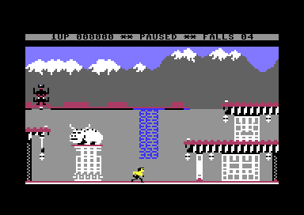
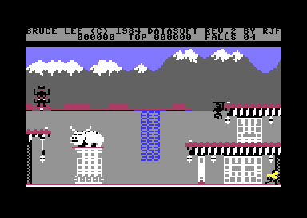
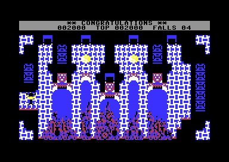
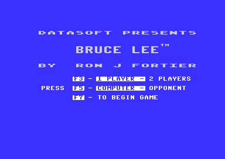
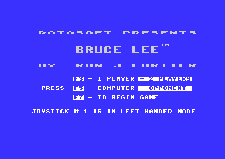
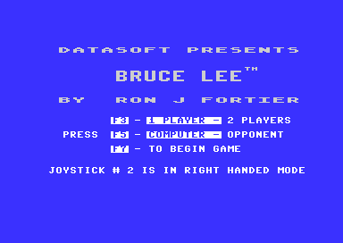
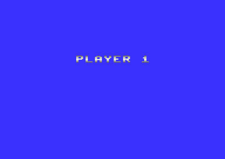
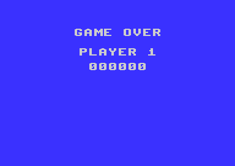

# Bruce Lee: text and messages

Most text of the game and most small changes in a room go through one printer, [`print_message` `$17E2`](../src/actor_driver_text.asm#L59). The printer writes the 1UP label, TOP and FALLS on the status line. It also writes the PAUSED message, the menu of the title and the joystick messages. In a room, the same printer draws the pieces that change while Bruce plays. Examples are a trapdoor that opens, a lantern that goes dark, a slider and the face of the wizard. The game keeps 101 such messages in one table, [`message_ptrs` `$43BE`](../src/messages.asm#L11).

The PLAYER n screen, the GAME OVER screen and the title logo do not use the printer. Their big letters come from a charset of big glyphs. This page explains the printer, the message format, the status line, the title texts and the big banners. It ends with a catalogue of all 101 messages. The charsets and the set-up of the VIC are on the page [graphics.md](graphics.md).

**Conventions.**

- Addresses are C64 addresses. Names are the names of the knowledge.
- A *message* is an entry of `message_ptrs`, numbered `$00-$64`. The room code calls a graphic message a *tile*.
- A *text line* is an entry of the row tables `text_line_top_lo` and `text_line_bottom_lo`. It is a pair of screen rows: the upper half and the lower half of a line of text. A *cell code* is the character code that a message byte gives.
- A *pass* is one run of `main_loop` (3 frames).
- **Observed** marks a fact that a run showed. **Code** marks a fact from the code only. **Conclusion** marks an interpretation.

## How it works

A caller gives the printer three numbers: the message, the text line and the offset in that line. The printer finds the two screen rows of the text line and the bytes of the message. It writes each byte as two cells, one above the other. With a room charset, the two cells are the upper half and the lower half of a tile of 8 x 16 pixels. So the same printer draws text and room pieces.

~~~mermaid
flowchart TB
  CALL["A caller: message, text line, offset"] --> PM["Print a message (print_message)"]
  PM --> ROWS["Find the two screen rows of the text line (set_text_row_pointers)"]
  ROWS --> H{"Text one row high?"}
  H -- yes --> LOST["Lower row goes to io1_dummy and is lost"]
  H -- no --> LOW["Lower row = the screen row below"]
  PM --> FIND["Find the message (message_ptrs)"]
  FIND --> LOOP["Each byte: a cell in the upper row, the cell OR $80 in the lower row"]
  LOOP --> END["Stop at byte $A0"]
~~~

[`print_message` `$17E2`](../src/actor_driver_text.asm#L59) takes the message number in A, the text line in X and the offset in Y. In the order of the code:

1. It calls [`set_text_row_pointers` `$1A67`](../src/pause_status_line.asm#L117), which reads the addresses of the two screen rows of text line X into `row_ptr_top` and `row_ptr_bottom`. When the text must be one row high, the lower pointer goes to `io1_dummy` instead.
2. It reads the address of the message from `message_ptrs` and subtracts Y from it. Then `(data_ptr),Y` is the first byte of the message and `(row_ptr_top),Y` is the first cell on the screen, so one index register serves both.
3. For each byte it subtracts `$20`. The result `$80` (the byte `$A0`) ends the message. Else it writes the result AND `$7F` to the upper row and the result OR `$80` to the lower row. Then it increments Y.

There are four other writers of text, and they write to the screen directly (**Code**):

- The digits of the score, through `print_bcd_byte`.
- The count of falls, through `print_hex_byte`.
- The version line, through `toggle_credit_line`.
- The big banners of the PLAYER n and GAME OVER screens, in `show_player_screen` and `game_over`.

### The text lines

The text lines are pairs of screen rows of the game screen at `$8C00`. [`reset_play_state` `$0763`](../src/play_init.asm#L19) calls [`build_screen_row_tables` `$0869`](../src/play_init.asm#L144) with the address of the game screen - 40. Entry n gets the upper row `$8BD8` + 80n and the lower row `$8C00` + 80n. Then `reset_play_state` patches the first two entries. Thus the status line in screen rows 0 and 1 becomes two text lines of one row each (**Code**):

| Text line | Upper row | Lower row | Use |
|---|---|---|---|
| 0 | screen row 0 (`$8C00`) | `io1_dummy` | status line: offsets 0-39 = row 0, offsets 40-79 = row 1 |
| 1 | screen row 1 (`$8C28`) | `io1_dummy` | status line (the pause message) |
| n = 2-12 | screen row 2n-1 | screen row 2n | the room (tile row n-2), the title menu |
| 13 | screen row 25 (`$8FE8`) | screen row 26 | not used |

The offset Y can be 40 or more: then the text starts on the next screen row. The title uses this: text line 6, offset `$31` (49) is screen row 12, column 9 (**Code**).

Writes to [`io1_dummy` `$DE00`](../src/constants.asm#L283) go to the I/O area 1 and are lost (**Conclusion**: no cartridge is present).

### One or two rows high

Text in a room is two rows high, as the tiles are. The status line and the menu of the title are one row high. The flag [`text_single_height` `$0100`](../src/constants.asm#L126) chooses:

- `text_single_height` = 0: the lower row gets the cell OR `$80`. In a room charset that is the lower half of the tile, so the cell is 8 x 16 pixels.
- `text_single_height` nonzero: `set_text_row_pointers` sets the lower row pointer to `io1_dummy`, and only the upper row is drawn.
- Text lines 0 and 1 are always one row high, because their lower rows are `io1_dummy`.

| Writer of `text_single_height` | Value | Effect |
|---|---|---|
| `clear_text_screen`, `show_title_screen` (start) | 0 | double height |
| `show_title_screen` (before the menu) | `$FF` | the title menu and the joystick messages are one row high |
| `print_top_label` | 3 | one row (status line) |
| `show_paused_message` / `clear_paused_message` | `$0B` / `$0C` (the message number) | one row |
| `print_status_row_message` (after the print) | 0 | back to double height |

`start_new_game` and `start_attract_demo` call `reset_play_state`, which calls [`clear_text_screen` `$1A56`](../src/pause_status_line.asm#L104): the game starts with double height (**Code**).

## The message format

### Where the data is

A message is a string of bytes that ends with `$A0`. The strings are in one block, but not in the order of their numbers. The table `message_ptrs` gives the address of each string.

| Name | Address | Layout |
|---|---|---|
| `message_ptrs` | `$43BE` | 101 words, index = message number |
| messages | `$4488-$4785` | byte strings, each ended by `$A0`, not in number order |
| `text_line_top_lo` / `text_line_top_hi` | `$4338` / `$434C` | 20 + 20 bytes, entries 0-13 used: address of the upper screen row of text line n |
| `text_line_bottom_lo` / `text_line_bottom_hi` | `$4360` / `$4374` | the same for the lower screen row |
| `text_single_height` | `$0100` | 0 = two rows high, nonzero = one row high |

### The byte layout

| Byte b | Meaning |
|---|---|
| `$A0` | End of the message. |
| any other | One cell. Cell code c = (b - `$20`) AND `$7F`. c goes to the upper row, c OR `$80` to the lower row. |

What a cell code shows depends on the charset of the screen rows:

| Byte b | Cell code c | In `text_font` (rows 0-1, title) | In a room charset (rows 3-24) |
|---|---|---|---|
| `$20-$3F` | `$00-$1F` | space, punctuation, digits (ASCII - `$20`) | tiles `$00-$1F` |
| `$40-$5F` | `$20-$3F` | @ (a solid block), A-Z, [ £ ] arrows | tiles `$20-$3F` |
| `$60-$7F` | `$40-$5F` | the same as `$00-$1F` inverted (`$42` and `$56` = key cap ends) | tiles `$40-$5F` |
| `$80-$9F`, `$00-$1F` | `$60-$7F` | `$20-$3F` inverted | tiles `$60-$7F` |
| `$A1-$FF` | `$01-$5F` | as byte b - `$80` | as byte b - `$80` |

So an ASCII text prints as text with the text font. In a room, the same printer draws tile c: the upper half c and the lower half c + `$80`. The tile scheme is on [graphics.md](graphics.md). The source writes the text messages with `!pet` (ACME turns lower-case letters into `$41-$5A`).

### The decoder

```
print_message(A = message, X = text line, Y = offset):
    set_text_row_pointers(X)            ; row_ptr_top, row_ptr_bottom (io1_dummy when single height)
    data_ptr = message_ptrs[A] - Y      ; so (data_ptr),Y is the first byte
    loop:
        c = (data_ptr),Y - $20
        if c == $80: return              ; byte $A0
        (row_ptr_top),Y    = c AND $7F
        (row_ptr_bottom),Y = (c AND $7F) OR $80
        Y = Y + 1
        if Y == 0: increment the high bytes of the three pointers   ; never executed
```

The subtraction of the start offset is at [`print_message` `$17E9`](../src/actor_driver_text.asm#L65) (**Code**). The code for a message that crosses a page, at [`print_message` `$180E`](../src/actor_driver_text.asm#L86), never ran in the coverage (**Observed**: coverage).

### Worked example: the pause message

Message `$0B` is [`msg_paused` `$457E`](../src/messages_paused.asm#L6). The routine [`show_paused_message` `$1BA4`](../src/status_and_keys.asm#L141) prints it with X = 1, Y = `$0F` and `text_single_height` = `$0B`.

| Byte | `$2A` | `$2A` | `$20` | `$50` | `$41` | `$55` | `$53` | `$45` | `$44` | `$20` | `$2A` | `$2A` | `$A0` |
|---|---|---|---|---|---|---|---|---|---|---|---|---|---|
| Cell code | `$0A` | `$0A` | `$00` | `$30` | `$21` | `$35` | `$33` | `$25` | `$24` | `$00` | `$0A` | `$0A` | end |
| Character | * | * | space | P | A | U | S | E | D | space | * | * | |

Text line 1 starts at `$8C28` (row 1). The cells go to `$8C37-$8C42`: row 1, columns 15-26. They cover "TOP" and the top score. The lower row goes to `io1_dummy` (**Code**, **Observed**: the pause screenshot).



The pause message covers TOP and the top score. 1UP stays on.

### Worked example: the mouth of the statue

Message `$1D` is [`msg_statue_mouth_a` `$45E4`](../src/messages_rooms.asm#L64). The routine [`room00_frame` `$3642`](../src/room_frames_0_7.asm#L9) prints it with X = 9, Y = 7. The byte `$E6` gives c = (`$E6` - `$20`) AND `$7F` = `$46`. Text line 9 has its upper row at `$8BD8` + 9 x 80 = `$8EA8` (screen row 17). The printer writes `$46` to `$8EAF` (row 17, column 7) and `$C6` to `$8ED7` (row 18, column 7). The result is tile `$46` of [`charset_rooms_0_9` `$A000`](../src/constants.asm#L200), the open mouth of the statue (**Code**).

## The status line

The status line at the top of the game screen shows who plays (1UP or 2UP), the score, the top score and the remaining falls. It is screen rows 0 and 1, drawn with [`text_font` `$8800`](../src/constants.asm#L189): `$D018` = `$32` from raster `$FD` to raster `$42`. The colour RAM of rows 0-1 is black with bit 3 clear. So the characters are hires black on the grey background `$FC` (**Code**: `reset_play_state`, [`irq_game_bottom` `$48C1`](../src/game_irq.asm#L12)).

| Row | Columns | Content | Writer |
|---|---|---|---|
| 0 | 0-39 | 40 x code `$20` (solid block): a black bar | `reset_play_state`, `draw_room` |
| 0 | 0-39 | the version line `BRUCE LEE (C) 1984 DATASOFT REV.2 BY RJF` | `toggle_credit_line` (V key) |
| 0 | 10-30 | `** CONGRATULATIONS **` (message `$04`) | `room19_frame` |
| 1 | 2 | `L` (code `$2C`) when joystick 1 is in left-handed mode | `frame_update` |
| 1 | 4-6 | `1UP` / `2UP` (messages `$01`/`$02`), blinking | `blink_player_label` |
| 1 | 8-13 | the score, 6 digits | `show_score` via `print_bcd_byte` (offsets `$30`, `$32`, `$34`) |
| 1 | 16-18 | `TOP` (message `$03`) | `print_top_label` |
| 1 | 20-25 | the top score | `show_high_score` (offsets `$3C`, `$3E`, `$40`) |
| 1 | 28-32 | `FALLS` (message `$05`) | `print_falls_label` |
| 1 | 34-35 | the falls left, 2 digits | `show_falls_count` via `print_hex_byte` (offset `$4A`) |
| 1 | 37 | `L` when joystick 2 is in use and left-handed | `frame_update` |
| 1 | 15-26 | `** PAUSED **` (message `$0B`), erased with message `$0C` | `show_paused_message`, `clear_paused_message` |

A digit is the code `$10` + digit, from [`print_bcd_byte` `$1B17`](../src/status_and_keys.asm#L39). [`print_hex_byte` `$1B84`](../src/status_and_keys.asm#L116) adds 7 for the nibbles A-F. Only the unused [`debug_show_values` `$1AD1`](../src/pause_status_line.asm#L187) would need that (**Code**).

The pause message covers TOP and the top score, so [`toggle_pause` `$1A22`](../src/pause_status_line.asm#L69) draws them again when the pause ends (**Code**).

The V key shows the version line in row 0. [`toggle_credit_line` `$1B68`](../src/status_and_keys.asm#L94) copies it from `version_banner`, which holds 40 screen codes, not the message format (**Code**).



After the V key: row 0 shows the version line in black on grey, row 1 the status line.



Room 19: message `$04` in row 0. The 1UP mark is in its blank phase.

## The blink of 1UP and 2UP

The label of the player who plays blinks on the status line. [`blink_player_label` `$1A96`](../src/pause_status_line.asm#L147) runs once per pass from `main_loop`, but not during the pause. It counts [`up_blink_timer` `$43BD`](../src/fireball_text_score_vars.asm#L103) down and prints the label or three spaces over it.

~~~mermaid
stateDiagram-v2
  state "Label shown" as Shown
  state "Blank" as Blank
  [*] --> Shown: reset_play_state (timer $11)
  Shown --> Blank: timer reaches 0
  Blank --> Shown: timer reaches $10
~~~

| State | Condition | Next state | Code |
|---|---|---|---|
| Shown | `up_blink_timer` - 1 = 0 | Blank: timer = `$20`, print message `$00` at line 0, offset `$2C` | `blink_player_label` |
| Blank | `up_blink_timer` - 1 = `$10` | Shown: print message 1 + `current_player` at line 0, offset `$2C` | `blink_player_label_show` |

The period is 32 passes, 96 frames. The routine [`show_paused` `$1A42`](../src/pause_status_line.asm#L88) sets the timer to `$11` and calls `blink_player_label`. Thus the label appears and stays on during the pause (**Code**, **Observed**: the paused screenshot shows 1UP).

## The title texts

The title shows the logo in big letters and a menu of three options under it. The logo comes from the charset of big glyphs. The menu and the joystick messages are messages in the text font, one row high.



The title: three logo rows from `title_logo_chars`, the menu from messages `$4F-$51` in the text font.

[`show_title_screen` `$0584`](../src/title_demo_start.asm#L83) draws these parts (**Code**, **Observed**: title screenshots):

| Screen rows | Content | Source |
|---|---|---|
| 0-8 | blank logo character `$DC` | `show_title_screen` |
| 2 | `DATASOFT PRESENTS` in small logo letters (2 characters per letter) | `title_logo_row2`, each byte OR `$80` |
| 5-6 | `BRUCE LEE` in big letters (2 x 2 characters) | `title_logo_row5`, `title_logo_row6` |
| 9 | `BY RON J FORTIER` in small logo letters | `title_logo_row9` |
| 12 | `F3 - 1 PLAYER - 2 PLAYERS` (message `$4F`, line 6, offset `$31`) | `print_message` |
| 14 | `PRESS F5 - COMPUTER - OPPONENT` (message `$50`, line 7, offset `$2B`) | `print_message` |
| 16 | `F7 - TO BEGIN GAME` (message `$51`, line 8, offset `$31`) | `print_message` |
| 19 | a joystick message (messages `$08`, `$09`, `$0A`, `$0D`, line 10, offset 2) | `title_menu_loop` |

The menu marks the keys and the chosen options with inverted text in boxes (**Code**):

- The menu messages draw the key caps with the bytes `$62` (code `$42`, left end) and `$76` (code `$56`, right end).
- [`title_highlight_defaults` `$066D`](../src/title_demo_start.asm#L188) adds `$40` to the key names (columns 11-12 of rows 12, 14, 16). It also adds `$40` to columns 16-25 of rows 12 and 14. The result is inverted text for `F3`, `F5`, `F7`, `1 PLAYER` and `COMPUTER`.
- F3 or F5 changes an option. Then [`title_show_players_choice` `$0E65`](../src/title_player_screens.asm#L27) or `title_show_opponent_choice` toggles bit 6 of columns 16-35 (except the code `$4D`). It also moves the ends of the box.

On the title, four keys set the joystick ports for left-handed or right-handed play, and each prints its message on row 19 (**Code**):

| Key | Handler | Message |
|---|---|---|
| L | `title_set_joy1_left_handed` | `$08` |
| D | `title_set_joy1_right_handed` | `$09` |
| shift-L | `title_set_joy2_left_handed` | `$0A` |
| shift-D | `title_set_joy2_right_handed` | `$0D` |

[`title_menu_check_message_timeout` `$08E0`](../src/title_menu.asm#L37) erases the message with message `$0E` (36 spaces). It does this when `title_countdown` reaches `$08xx` with a low byte below 2. That is about 350 frames after the last change of an option (**Code**).



After F3, F5 and L: the boxes on `2 PLAYERS` and `OPPONENT`, and message `$08` on row 19.



After shift-D: message `$0D` on row 19.

## The big banners

The screens between the turns show big letters: PLAYER n before each turn, and GAME OVER with the score at the end. The logo of the title uses the same letters.

### The big glyphs

The PLAYER n screen, the GAME OVER screen and the title logo use [`title_logo_chars` `$8400`](../src/title_logo_charset.asm#L9): the characters `$80-$FF` of the charset at `$8000`, with `$D018` = `$30`. The program writes a table byte g as g OR `$80`. A big glyph is 2 x 2 characters (**Code**):

| Position | Character |
|---|---|
| upper left | g |
| lower left | g + 1 |
| upper right | g + 2 |
| lower right | g + 3 |

| Glyph | A | B | C | E | G | L | M | O | P | R | U | V | Y | digit d | blank |
|---|---|---|---|---|---|---|---|---|---|---|---|---|---|---|---|
| g | `$00` | `$04` | `$08` | `$0C` | `$10` | `$14` | `$18` | `$1C` | `$20` | `$24` | `$28` | `$2C` | `$30` | `$34` + 4d | `$5C` |

The set holds only the letters that the program needs (**Code**: the bytes of `title_logo_row5`, `player_banner_top`, `game_over_letters_top` and [`draw_big_digit` `$1984`](../src/lose_fall_game_over.asm#L214)).

### PLAYER n

[`show_player_screen` `$0EA7`](../src/title_player_screens.asm#L71) shows the PLAYER n screen at the start of a game and of each turn:

1. It blanks the screen, turns the sprites off, sets a blue border and background, and fills `$8C00-$8FFF` with `$DC`.
2. It copies 2 bytes of `player_banner_digit_top` / `player_banner_digit_bottom` (index `current_player` x 2) into the digit of the banner, [`player_banner_top+14` `$4A6B`](../src/banners.asm#L38) / `player_banner_bottom+14`.
3. It copies the 16 bytes of `player_banner_top` / `player_banner_bottom`, OR `$80`, to screen rows 7 and 8, columns 12-27.
4. It installs [`irq_player_screen` `$14A4`](../src/screen_raster_irqs.asm#L10) (line `$63`), which shades the letters with `BGCOL1`, and waits 64 frames (128 with two players).

Worked example: `player_banner_top` = `20 22 14 16 00 02 30 32 0C 0E 24 26 5C 5C 38 3A`. The pairs give P (`$20`), L (`$14`), A (`$00`) and Y (`$30`). Then come E (`$0C`), R (`$24`), blank (`$5C`) and 1 (`$38` = `$34` + 4). Row 7 gets `$A0 $A2 $94 $96 ...`. Row 8 gets `$A1 $A3 $95 $97 ...` from `player_banner_bottom` (**Observed**: the PLAYER 1 screenshot).



The PLAYER 1 screen before the first turn.

### GAME OVER

[`game_over` `$188E`](../src/lose_fall_game_over.asm#L82) uses the title interrupts (`irq_title_frame`) and a blue screen, and draws:

| Screen rows | Columns | Content | Source |
|---|---|---|---|
| 1-2 | 11-28 | `GAME OVER` | `game_over_letters_top` / `game_over_letters_bottom`, 18 bytes each, OR `$80` |
| 5-6 | 12-27 | `PLAYER n` | `player_banner_top` / `player_banner_bottom` |
| 8-9 | 14-25 | the score, 6 big digits | `draw_big_digit`: glyph `$34` + 4d OR `$80` |

Then it waits 254 frames, and 64 more before `show_title_screen` (**Code**).



The GAME OVER screen of player 1 with the score 000000.

**The GAME OVER screen copies only half of the player digit.** [`game_over_digit_loop` `$1909`](../src/lose_fall_game_over.asm#L144) runs one time only (`DEY` / `BPL` from Y = 0). It copies only the left half of the player digit into the banner. The right half keeps the value of the last PLAYER n screen (**Code**). The bug has no visible effect. [`lose_fall` `$1818`](../src/lose_fall_game_over.asm#L14) shows the PLAYER n screen of the current player at the start of each fall. So the last PLAYER n screen before a game over is always for the same player (**Conclusion**).

## The catalogue of the messages

The message number is the index in [`message_ptrs` `$43BE`](../src/messages.asm#L11). "Line / offset" are the X and Y of the call. For a text line n >= 2, an offset y < 40 is screen row 2n-1, column y. The table of graphic messages gives the cell codes of the upper row. The lower row gets each code OR `$80`.

### Text messages

| # | Name | Text | Printed by | Line / offset |
|---|---|---|---|---|
| `$00` | `msg_blank3` | 3 spaces | `blink_player_label` (erase 1UP/2UP), `update_burst_traps` (top row after a burst) | 0 / `$2C`, or the trap position |
| `$01` | `msg_1up` | `1UP` | `blink_player_label_show` (A = 1 + `current_player`) | 0 / `$2C` |
| `$02` | `msg_2up` | `2UP` | `blink_player_label_show` | 0 / `$2C` |
| `$03` | `msg_top` | `TOP` | `print_top_label` | 0 / `$38` |
| `$04` | `msg_congratulations` | `** CONGRATULATIONS **` | `room19_frame` | 0 / `$0A` |
| `$05` | `msg_falls` | `FALLS` | `print_falls_label` | 0 / `$44` |
| `$08` | `msg_joy1_left_handed` | `JOYSTICK # 1 IS IN LEFT HANDED MODE ` | `title_set_joy1_left_handed` | 10 / 2 |
| `$09` | `msg_joy1_right_handed` | `JOYSTICK # 1 IS IN RIGHT HANDED MODE` | `title_set_joy1_right_handed` | 10 / 2 |
| `$0A` | `msg_joy2_left_handed` | `JOYSTICK # 2 IS IN LEFT HANDED MODE ` | `title_set_joy2_left_handed` | 10 / 2 |
| `$0B` | `msg_paused` | `** PAUSED **` | `show_paused_message` | 1 / `$0F` |
| `$0C` | `msg_blank12` | 12 spaces | `clear_paused_message` | 1 / `$0F` |
| `$0D` | `msg_joy2_right_handed` | `JOYSTICK # 2 IS IN RIGHT HANDED MODE` | `title_set_joy2_right_handed` | 10 / 2 |
| `$0E` | `msg_blank36` | 36 spaces | `title_menu_check_message_timeout` | 10 / 2 |
| `$13` | `msg_blank1` | 1 space | `open_passage` (two cells) | passage |
| `$16` | `msg_blank4` | 4 spaces | `room04_frame` (erases a barrier when a lantern is taken) | 8 and 9 / 11 or 25 |
| `$4F` | `msg_option_players` | ` [F3]-[1 PLAYER -]2 PLAYERS` (key cap codes `$42`/`$56`) | `show_title_screen` | 6 / `$31` |
| `$50` | `msg_option_opponent` | ` PRESS [F5]-[COMPUTER -]OPPONENT` | `show_title_screen` | 7 / `$2B` |
| `$51` | `msg_option_begin` | ` [F7]- TO BEGIN GAME` | `show_title_screen` | 8 / `$31` |
| `$56` | `msg_blank2` | 2 spaces | `draw_room16_bonus_taken` (the extra-fall pickup of room 16) | 10 and 11 / `$24` |
| `$57` | `msg_room15_gap_top` | 1 space | `room15_frame` | 3 / 17 or 23 |

### Graphic messages (room pieces)

| # | Name | Cell codes | What it draws | Printed by | Line / offset |
|---|---|---|---|---|---|
| `$06` | `msg_room3_ledge_a` | 7 x `$4B` | room 3 ledge, look A | `room03_frame` (swaps with `$60`) | 6 / 9 and 21 |
| `$07` | `msg_room2_gap_bottom` | `$11 $11 $11` | room 2 passage, lower piece | `room02_frame` | 12 / 37 |
| `$0F` | `msg_trapdoor_open_4` | `$22 $22 $03 $03 $03` | trapdoor, last step (open) | `room01_frame`, `room03_frame` (message `$10` + `room_state_a`) | 12 / 17 (room 1), 29 (room 3) |
| `$10` | `msg_trapdoor_open_3` | `$5C $5D $5E $03 $03` | trapdoor, step 3 | the same | the same |
| `$11` | `msg_trapdoor_open_2` | `$11 $22 $22 $03 $03` | trapdoor, step 2 | the same | the same |
| `$12` | `msg_trapdoor_open_1` | `$11 $5C $5D $5E $5F` | trapdoor, first step | the same | the same |
| `$14` | `msg_wall_gap_base` | `$3E` | bottom cell of an opened wall (rooms 0-9) | `open_passage` (rooms 5, 8, 9) | passage |
| `$15` | `msg_room5_gap_edge` | `$02` | room 5 wall edge | `room05_frame` | 11 / 0 |
| `$17` | `msg_wall_gap_floor` | `$11` | bottom cell in place of `$14` | `open_passage_ledge` (rooms 6, 7) | passage |
| `$18` | `msg_room9_opening` | `$61 $04 $04 $63` | room 9 opening | `room09_frame` | 2 / 35 |
| `$19` | `msg_room5_opening` | `$61 $05 $63` | room 5 opening | `room05_frame` | 2 / 34 |
| `$1A` | `msg_room2_gap_top` | `$00 $00 $05` | room 2 passage, upper piece | `room02_frame` | 11 / 37 |
| `$1B` | `msg_runner_a` | `$64` | runner hazard | `draw_runner_step` (rooms 7, 9, 17, and room 13 through `update_floor_movers`) | runner position |
| `$1C` | `msg_runner_track_a` | `$65` | runner track | `draw_runner_step` | old runner column |
| `$1D` | `msg_statue_mouth_a` | `$46` | statue mouth open | `room00_frame`, `room02_frame` | 9 / 7 (room 0), 33 (room 2) |
| `$1E` | `msg_statue_mouth_b` | `$47` | statue mouth closed | the same | the same |
| `$1F` | `msg_slider_a_0` | `$56` | slider frame 0, look A | `draw_slider0` / `draw_slider1` / `draw_slider2` (message `$1F` + frame, rooms 4, 5, 8, 17) | slider position |
| `$20` | `msg_slider_a_1` | `$55` | slider frame 1, look A | the same | |
| `$21` | `msg_slider_a_2` | `$55 $56` | slider frame 2, look A | the same | |
| `$22` | `msg_slider_a_3` | `$54 $55` | slider frame 3, look A | the same | |
| `$23` | `msg_slider_a_4` | `$00 $55` | slider frame 4, look A | the same | |
| `$24` | `msg_slider_a_5` | `$00 $54` | slider frame 5, look A | the same | |
| `$25` | `msg_slider_a_6` | `$00 $00` | slider gone | the same | |
| `$26` | `msg_slider_b_0` | `$5A` | slider frame 0, look B | `draw_slider0_alt` / `draw_slider1_alt` / `draw_slider2_alt` (frame + 7, rooms 4, 5, 7, 9) | slider position |
| `$27` | `msg_slider_b_1` | `$59` | slider frame 1, look B | the same | |
| `$28` | `msg_slider_b_2` | `$59 $5A` | slider frame 2, look B | the same | |
| `$29` | `msg_slider_b_3` | `$58 $59` | slider frame 3, look B | the same | |
| `$2A` | `msg_slider_b_4` | `$00 $59` | slider frame 4, look B | the same | |
| `$2B` | `msg_slider_b_5` | `$00 $58` | slider frame 5, look B | the same | |
| `$2C` | `msg_slider_b_6` | `$00 $00` | slider gone | the same | |
| `$2D` | `msg_wall_gap_floor_alt` | `$11` | as `$17` | `open_passage_ledge_b` (room 8, never ran in the coverage) | passage |
| `$2F` | `msg_burst_small_top` | `$71 $72 $73` | burst trap, small burst, top | `update_burst_traps` (rooms 6, 7, 10, 11, 12, 14, 16, 17) | trap row / column |
| `$30` | `msg_burst_small_bottom` | `$74 $75 $76` | small burst, bottom | the same | trap row + 1 |
| `$31` | `msg_burst_large_top` | `$77 $78 $79` | large burst, top | the same | trap row |
| `$32` | `msg_burst_large_bottom` | `$7A $7B $7C` | large burst, bottom | the same | trap row + 1 |
| `$33` | `msg_burst_trap_rearmed` | `$7D $60 $7D` | the trap after the burst | the same | trap row + 1 |
| `$34` | `msg_room4_lantern1_lit` | `$13` | room 4 lantern 1, lit | `room04_frame` (every 32 passes) | 4 / 11 |
| `$35` | `msg_room4_lantern2_lit` | `$14` | room 4 lantern 2, lit | `room04_frame` | 4 / 28 |
| `$36` | `msg_room4_lantern1_dark` | `$66` | room 4 lantern 1, dark | `room04_frame` | 4 / 11 |
| `$37` | `msg_room4_lantern2_dark` | `$67` | room 4 lantern 2, dark | `room04_frame` | 4 / 28 |
| `$38` | `msg_wizard_face_top_left` | `$00 $67-$6C $00` | wizard face, top, Bruce on the left | `room18_frame_draw_gaze` (message `$38` + zone) | 2 / 16 |
| `$39` | `msg_wizard_face_top_centre` | `$07-$0E` | wizard face, top, Bruce in the middle | the same | 2 / 16 |
| `$3A` | `msg_wizard_face_top_right` | `$00 $28 $0F $59 $79 $7A $7B $00` | wizard face, top, Bruce on the right | the same | 2 / 16 |
| `$3B` | `msg_wizard_face_mid_left` | `$10 $11 $70 $71` | wizard face, middle, left, look A | `draw_wizard_face_top` (message `$3B` + 0 or 6 + zone) | 3 / 18 |
| `$3C` | `msg_wizard_face_mid_centre` | `$1D $1E $1F $20` | middle, centre, look A | the same | 3 / 18 |
| `$3D` | `msg_wizard_face_mid_right` | `$63 $53 $29 $2A` | middle, right, look A | the same | 3 / 18 |
| `$3E` | `msg_wizard_face_low_left` | `$16 $1C $21 $77` | wizard face, lower, left, look A | `draw_wizard_face_bottom` (message `$3E` + 0 or 6 + zone) | 4 / 18 |
| `$3F` | `msg_wizard_face_low_centre` | `$72 $78 $7C $34` | lower, centre, look A | the same | 4 / 18 |
| `$40` | `msg_wizard_face_low_right` | `$72 $30 $31 $32` | lower, right, look A | the same | 4 / 18 |
| `$41` | `msg_wizard_face_mid_left_b` | `$6E $6F $70 $71` | middle, left, look B | `draw_wizard_face_top` | 3 / 18 |
| `$42` | `msg_wizard_face_mid_centre_b` | `$1D $33 $3D $20` | middle, centre, look B | the same | 3 / 18 |
| `$43` | `msg_wizard_face_mid_right_b` | `$63 $53 $54 $60` | middle, right, look B | the same | 3 / 18 |
| `$44` | `msg_wizard_face_low_left_b` | `$74 $75 $76 $77` | lower, left, look B | `draw_wizard_face_bottom` | 4 / 18 |
| `$45` | `msg_wizard_face_low_centre_b` | `$72 $3E $4F $34` | lower, centre, look B | the same | 4 / 18 |
| `$46` | `msg_wizard_face_low_right_b` | `$72 $65 $66 $15` | lower, right, look B | the same | 4 / 18 |
| `$47` | `msg_wizard_flash_1a` | `$17 $18 $19` | defeat of the wizard, piece 1, frame A | `room18_wizard_defeated` (message + `room_state_d`) | 3 / 12 |
| `$48` | `msg_wizard_flash_1b` | `$1C $18 $7C` | piece 1, frame B | the same | 3 / 12 |
| `$49` | `msg_wizard_flash_2a` | `$24 $25 $26` | piece 2, frame A | the same | 3 / 25 |
| `$4A` | `msg_wizard_flash_2b` | `$10 $25 $21` | piece 2, frame B | the same | 3 / 25 |
| `$4B` | `msg_wizard_flash_3a` | `$55 $56 $57` | piece 3, frame A | the same | 6 / 14 |
| `$4C` | `msg_wizard_flash_3b` | `$1E $1F $78` | piece 3, frame B | the same | 6 / 14 |
| `$4D` | `msg_wizard_flash_4a` | `$52 $62` | piece 4, frame A | the same | 6 / 23 |
| `$4E` | `msg_wizard_flash_4b` | `$11 $16` | piece 4, frame B | the same | 6 / 23 |
| `$54` | `msg_runner_b` | `$66` | runner hazard, look B | `draw_runner_step_alt` (room 13, rows 5 and 10) | runner position |
| `$55` | `msg_runner_track_b` | `$67` | runner track, look B | `draw_runner_step_alt` | old runner column |
| `$58` | `msg_room15_gap_bottom` | `$2F` | room 15 passage, lower cell | `room15_frame` | 4 / 17 or 23 |
| `$59` | `msg_room15_ladder_bottom` | `$2F $2F $2F` | room 15 right edge | `room15_frame` | 9 / 37 |
| `$5A` | `msg_room15_ladder_mid` | `$00 $00 $03` | room 15 right edge | `room15_frame` | 8 / 37 |
| `$5B` | `msg_room15_ladder_top` | `$00 $00 $03` | room 15 right edge | `room15_frame` | 7 / 37 |
| `$5C` | `msg_room17_gap_a` | `$49 $49 $49` | room 17 floor opening | `room17_frame` | 10 / 24 |
| `$5D` | `msg_room17_gap_b` | `$44 $44` | room 17 floor opening | `room17_frame` | 10 / 37 |
| `$5E` | `msg_wizard_exit_top` | `$00 $00 $03` | room 18 exit | `room18_wizard_gone` (never ran in the coverage) | 11 / 37 |
| `$5F` | `msg_wizard_exit_bottom` | `$5A $5A` | room 18 exit | `room18_wizard_gone` | 12 / 38 |
| `$60` | `msg_room3_ledge_b` | 7 x `$09` | room 3 ledge, look B | `room03_frame` | 6 / 9 and 21 |
| `$61` | `msg_wizard_left_marker` | `$06` | room 18 piece after the lantern is taken | `room18_frame_wizard_alive` | 11 / 0 |
| `$63` | `msg_passage_dark_cell` | `$07` | passage cell, rooms 10-17 | `open_passage_dark` (rooms 10, 12, 14, 16, two cells) | passage |
| `$64` | `msg_passage_dark_base` | `$0E` | passage bottom cell, rooms 10-17 | `open_passage_dark` | passage + 2 |

The passage helpers print a passage one cell at a time. They take the top line in A and the column in Y. [`draw_passage_cell` `$3ACA`](../src/passage_open.asm#L80) prints each cell and moves [`passage_row` `$006C`](../src/constants.asm#L63) one line down (**Code**). The room pages describe the room handlers.

### Unused messages

These entries of `message_ptrs` have no caller. No code loads their number before a call of `print_message` (**Code**). The coverage of the title, demo and play runs has no print of them (**Observed**).

| # | Name | Text |
|---|---|---|
| `$2E` | `msg_unused_j` | `J` |
| `$52` | `msg_unused_player_1` | `PLAYER 1` |
| `$53` | `msg_unused_player_2` | `PLAYER 2` |
| `$62` | `msg_presents` | `DATASOFT PRESENTS`, but `DIABOLO  PRESENTS` (two spaces) in the SAEGER release |

**Message `$62` was changed by a cracker.** Message `$62`, [`msg_presents` `$4770`](../src/messages_rooms.asm#L322), reads `DIABOLO  PRESENTS` in the SAEGER release and `DATASOFT PRESENTS` in the TBC and DC releases (**Observed**: [releases.md](releases.md)). In the SAEGER image, the actor workspace also held an older copy of the end of the message area. This copy is a development leftover, and the knowledge keeps it in space `bank1`. The 81 bytes `contact_col0` .. `contact_count_c10` (`$4EED-$4F3D`) held a copy of the bytes `$4731-$4781`. That range goes from the second byte of [`msg_blank2` `$472F`](../src/messages_rooms.asm#L273) to the end of `msg_presents`. The copy agrees with the message area, except in the text of message `$62` (**Observed**: the bytes of the original image):

| Bytes | Message `$62` now (`msg_presents`) | The copy (`contact_col2+17`) |
|---|---|---|
| 0-5 | `44 49 41 42 4F 4C` `DIABOL` | `44 41 54 41 53 4F` `DATASO` |
| 6-11 | `4F 20 20 50 52 45` `O  PRE` | `00 00 00 00 00 00` |
| 12-16 | `53 45 4E 54 53` `SENTS` | `53 45 4E 54 53` `SENTS` |
| 17 | `A0` end | `A0` end |

The original text of message `$62` was `DATASOFT PRESENTS`, 17 characters. The six zero bytes held `FT PRE`. The TBC and DC releases still have this text. A cracker, Diabolo, changed it to `DIABOLO  PRESENTS`, with two spaces to keep the length (**Conclusion**).

The change has no visible effect. No code prints message `$62`, and the title shows `DATASOFT PRESENTS` from [`title_logo_row2` `$4A0D`](../src/banners.asm#L20) in logo letters (**Observed**: the title screenshot). [`init_game_variables` `$0F72`](../src/game_setup.asm#L18) clears the copy at the first game start. So the copy is image residue only, and the rebuild leaves it out of the image. The switch `CRACK_DIABOLO` puts the edit into a build. The default build has `DATASOFT PRESENTS` ([releases.md](releases.md)).

### Texts without a pointer

The original image also held texts in the message format that no pointer and no code reaches (**Code**). They are `BRUCE LEE`, `BY` and `RON J FORTIER` at `$4563-$457D`, and `GAME OVER` and `PLAYER ` at `$4598-$45A9`. They are not part of the game: the knowledge keeps them as leftovers in space `bank1`.

With messages `$52`, `$53` and `$62`, they are the texts of the title, PLAYER n and GAME OVER screens in the message format. This version draws those screens with the big glyphs of `title_logo_chars` instead (see [The big banners](#the-big-banners)) (**Conclusion**).

## Still open

- The names of the room pieces come from their place and use. A screen capture before and after each opening (rooms 2, 3, 5, 9, 15, 17) would show what each piece looks like.
- [`msg_unused_j` `$4610`](../src/messages_rooms.asm#L118) (`J`): its purpose is unknown.
- [`room18_wizard_gone` `$3D9B`](../src/wizard_room.asm#L115) and [`open_passage_ledge_b` `$3AAA`](../src/passage_open.asm#L61) never ran in the coverage. A run that defeats the wizard can show messages `$5E` and `$5F`.
- A two-player game over run can confirm that the `game_over_digit_loop` bug has no visible effect.
