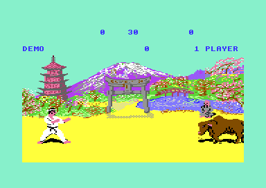
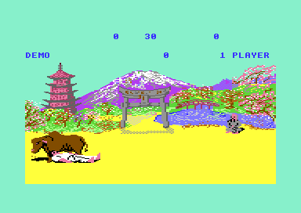
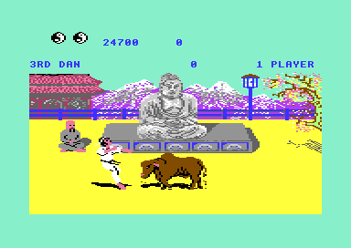
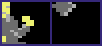

# The development of The Way of the Exploding Fist

This page tells how Beam Software made the game, as the code and the leftovers of the two versions tell it. Version I (project `v1`) holds a working bull round and a sample player that nothing starts. It also holds a judge that does nothing and a tune that nothing plays. Version II (project `v2`) turns each of them into a part of the game and corrects the bugs of version I. The gaps between the tables hold the RAM contents of the machine that saved each version.

**Evidence.** **Observed** marks a fact that a run or a byte compare of the files showed. **Code** marks a fact from the code only. **Conclusion** marks an interpretation.

**Conventions.**
- Addresses are C64 addresses. Names are the names of the knowledge. The label `v1:` or `v2:` gives the project of a name.
- A *frame* is a shape frame of a fighter (the value of `fighter_frame`). Frame numbers are hex with `$`, or decimal without `$`.
- A *part* is one 64-byte sprite block of a frame. A frame has 9 parts in 3 columns and 3 rows.
- The *loading stage* is the set of original files that the loader uses before the game starts: M.MYTINY, M.SPCHTBL, M.TSOUND, M.PICTURE and M.PRERUN. See [loading_stage.md](loading_stage.md).

## The authors and the versions

The game holds no credit text, no date and no version text. A search of the game bytes of both versions finds only the texts "1 PLAYER", "2 PLAYER", "NOVICE" and "10TH DAN". Version II adds "JOYSTICK" and "KEYBOARD". **Observed** (byte search of the captures).

The only original names are the file names on the 2010 disk: M.PROG, M.SHAPES, M.CHSET, M.XSPRITES, M.PICTURE, M.PRERUN, M.MYTINY, M.SPCHTBL and M.TSOUND. The crack replaced only the protected loader and kept these files. The names `tsound_*` of the loading stage come from M.TSOUND. "SPCHTBL" reads as "speech table", and the file is the table of the speech sample. **Observed** (disk directory) / **Conclusion** (the meaning of the names).

| Version | Project | Releases | Entry | New parts |
|---|---|---|---|---|
| I | [v1](../v1/README.md) | R2010, SHADOW | `$1158` | none |
| II | [v2](../v2/README.md) | SCC, MRZ | `$115A` | bull round, samples, judge, top-5 high score table, keyboard control, packed scene maps |

The full list of the differences is on [versions.md](versions.md). The releases are on [releases.md](releases.md).

### Version I came first

The order of the versions is clear from five kinds of evidence:

1. **The crack text.** The 2010 crack of version I shows "WAIT FOR VERSION II" on its loading screen. **Observed** (run of the 2010 loader).
2. **Version II contains version I.** An opcode alignment matches 4378 of the 4737 instructions of version I in version II. The music driver `$09A5-$0F51` has the same bytes in both versions. **Code**.
3. **Version II corrects the bugs of version I.** The rank cap, the tune 1 order list and the X limits are bugs in version I and correct code in version II. The sections below give the bytes. **Observed** / **Code**.
4. **Version II finishes what version I prepared.** The bull test, the sample player, the judge stub and tune 4 are complete but unused in version I. Version II calls each of them from the game. **Code**.
5. **Version II has edits inside version I code.** In the AI, new code made a branch too long. At [`v2:ai_choose_attack` `$24B8`](../v2/src/ai/ai_opponent.asm#L288) the author inverted the v1 `BEQ` and added a `JMP`, because the new distance is $87 bytes and a branch reaches only $7F. **Code**.

Version II also keeps the dead code of version I with the new addresses in its operands. For example, the unused patch routines of the multiplexer write to the v2 handler addresses. Thus the authors assembled version II again from the source text of version I. They did not patch a memory image of version I. **Code** / **Conclusion**.

Each version has a different RAM pattern in its gaps (see [The RAM in the gaps](#the-ram-in-the-gaps)). Thus the authors saved the two versions in different sessions. **Observed** (byte compare) / **Conclusion**.

### The rank cap

In version I a one-player game has no upper rank. [`v1:game_one_player` `$16A9`](../v1/src/game/game_modes.asm#L81) stops the promotions only at `stage_counter` $16, after 22 promotions. The rank table `v1:rank_number_table` has 12 entries, so ranks 12 to 22 read code bytes from `$1D48` as rank numbers. The panel then shows texts such as "|||TH DANN", and the AI level of the opponent reads the next tables. **Observed** in [rank_overflow.json](../v1/tests/rank_overflow.json) and the recording `cpu_ranks`.

Version II compares with 10 at [`v2:game_1p_rank_cap_test` `$1C27`](../v2/src/game/game_modes.asm#L146). The rank stays "10TH DAN", and the AI level after the cap is 7 to 10. **Observed** in the recording `cpu_ranks` of [../v2/tests/README.md](../v2/tests/README.md). The details are on [../v1/docs/game_flow.md](../v1/docs/game_flow.md) and [../v2/docs/game_flow.md](../v2/docs/game_flow.md).

### The tune 1 order list

Tune 1 is the music of the demo. Its voice 0 order list in version I, [`v1:music_t1_order_v0` `$0FC2`](../v1/src/music/music_tables.asm#L52), has 19 bytes: `01 00 01 00 01 01 01 01 01 01 01 01 03 13 01 01 02 02 00`. The repeat command `03 13 01` jumps to position 19, but the list ends at position 18. Voice 0 thus continues in the list of voice 1, and pattern 2 never plays. **Code**. The coverage of version I has no read of pattern 2 or of its instrument 2. **Observed**.

Voices 1 and 2 loop after 2130 ticks. Voice 0 needs one more pattern entry of 192 ticks before the repeat to give the same loop. Version II has exactly this entry. [`v2:music_t1_order_v0` `$0FC2`](../v2/src/music/music_tables.asm#L43) has `01 00` at `$0FCE`, and the repeat target 19 is now the jump at `$0FD5`. The coverage of version II reads pattern 2 and instrument 2. **Code** / **Observed**.

Conclusion: one entry was lost in version I, and version II put it back. The two new bytes moved all later music data by 2. Each order list pointer after it and all 25 instrument pointers are the v1 value plus 2. The game entry moved with them from `$1158` to `$115A`. **Code**. See [../v2/docs/sound_music.md](../v2/docs/sound_music.md).

### The X limits and the somersault steps

In version I the frames $16, $17 and $20 of the somersaults sit one column (12 units) to the right in their 72-pixel frame. The scripts compensate with one-frame steps of dx -11 and +11. [`v1:script_down_back` `$7832`](../v1/src/fighter/anim_scripts.asm#L83) has the steps `01 17 F5 FE` and `01 15 0B 00`, and `v1:script_up_back` has a pair of the same kind. **Code**.

[`v1:anim_check_x_limits` `$30B5`](../v1/src/fighter/anim_step_3041.asm#L74) refuses a move out of $0C to $94 and keeps the old X. Near an edge it can refuse the -11 step and then accept the +11 step. The fighter then moves 11 units with no reason. **Code** / **Conclusion**.

Version II moves the three frames and their shadows one column to the left in the part tables. It removes the compensation steps, so `v2:script_down_back` has 7 steps (v1 9). [`v2:anim_check_x_limits` `$384C`](../v2/src/fighter/anim_step_37d8.asm#L74) clamps X to limits by facing from `v2:fighter_x_min` and `v2:fighter_x_max`: $0C-$95 for facing 0 and $00-$89 for facing 1. **Code**. See [../v2/docs/fighters.md](../v2/docs/fighters.md).

### Two more corrections

- **Shape buffer 3.** In version I, shape buffer 3 is `$C700-$C93F`. The M.SHAPES segment starts at `$C900`, so the shape builder writes over its first 64 bytes. These bytes hold only RAM noise. In version II the bull blocks start at `$C940`, just after the buffer. **Code** / **Conclusion** (the v2 sprite layout respects the buffers).
- **A CPU copy from under the I/O area.** The v1 bull test copies parts with `shape_page_offset` $40. For the small figure, the source would be `$D180-$D3FF`, under the I/O area ($01 = $05), so the copy would read VIC and SID registers. Version II shows the bull with direct sprite pointers, so the VIC reads the blocks. **Code**.

## The tools of the authors

The leftovers tell some things about the tools. They do not name a computer or an assembler.

- **Whole memory ranges.** Several files hold bytes that no code uses. Examples are the last page of M.SPCHTBL, 512 bytes of M.CHSET (`v1:charset_ram_noise`) and 112 bytes of M.XSPRITES (`v1:xsprites_ram_noise`). The first 64 bytes of the `$C900` segment are of the same kind. The authors saved each file as a memory range, not as the exact data. **Code** / **Conclusion**.
- **A general font.** M.CHSET is a full ASCII font of 128 characters with lower case letters. Version I uses 26 of them. Version II cuts the font to 64 characters. **Code** / **Conclusion** (a font of the development tools).
- **Colour maps read back from a C64.** The colour maps of version I have random high nybbles. In scene 0, 167 of 480 bytes have $F, and the others have $0, $A, $4, $8 and more values. Colour RAM keeps only 4 bits, so a read of colour RAM gives such values. M.PICTURE has the same kind of colour data. Thus an editor on a running C64 saved the maps by a read of colour RAM. **Observed** (byte compare) / **Conclusion**.
- **A music tool.** Each tune is one block of patterns with offsets relative to the block start. The order lists and the instruments use absolute addresses. Thus a music tool or converter wrote the patterns, and the game source placed the rest. **Code** / **Conclusion**. See [../v1/docs/sound_music.md](../v1/docs/sound_music.md).
- **Placeholder operands.** Version II has self-modified operands with typical placeholder values in the file: `STA $1234,Y` at `v2:scene_clear_loop`, `LDA $8000,X` at `v2:hs_copy_char` and `STA $CC00,Y` in `v2:hs_put_char`. **Code**.
- **A simple packer.** The packed scene maps of version II often split a run that one token could hold, 18 to 26 times in each scene. Two streams end with a pad nybble of $A. **Code** / **Conclusion** (a simple packer tool).

## The bull bonus round

The bull round is a bonus stage: the player must stop a charging bull with a low blow. Version I has a working prototype that nothing calls. Version II calls a corrected copy of it after every fourth stage. See [../v2/docs/bull_round.md](../v2/docs/bull_round.md) for the round of version II.

### The prototype in version I

[`v1:dev_bull_test` `$138F`](../v1/src/dev/dev_bull_test_138f.asm#L6) and its three helpers fill `$1354-$1413`. No instruction refers to this range, and no run of the game executes it. **Code** / **Observed** (coverage).

1. `v1:dev_clear_part_ptrs` writes 0 to the part pointers of both fighters.
2. `v1:dev_update_fighter` updates one fighter without the hit test and without the choice of the front fighter. It is `v1:fighter_update` without the parts that need an opponent.
3. `v1:dev_setup_fighter0` puts fighter 0 alone at X $3E in the stand.
4. `v1:dev_bull_test` sets `shape_page_offset` to $40 and makes fighter 1 a brown bull (colour 9) at X $B0 with animation $1C. In each frame it tests the sprite collision of sprites 3 and 4.
5. On a contact, fighter 0 can stop the bull with frame $0D at a distance of $1A-$1E. This scores 30 x 100 = 3000 points and starts animation $1D. Else fighter 0 gets hit reaction $16, the fall.
6. The loop ends when the bull reaches X 0.

**Code**.

The bull graphics are in M.XSPRITES, which the loader puts at [`v1:bull_parts` `$F540`](../v1/src/graphics/bull_sprites_run.asm#L6). The frames $3B-$42 use the parts $D5-$FD. With `shape_page_offset` $40 the part pages become $F5-$FF, that is `$F540-$FF7F`. This area is also the floor of the screen, bitmap rows 17-24. The floor colours are all yellow, so the bull graphics hide in the floor bitmap. **Code**.

The scripts are [`v1:script_bull_charge` `$797E`](../v1/src/fighter/anim_scripts.asm#L206) (animation $1C: 9 steps, dx -22 for each cycle of 54 frames) and `v1:script_bull_hit` (animation $1D, frames $42, $40, $41). They are the last two entries of the script table. The numbers fit together: $B0 = 176 = 8 x 22, so the bull reaches X 0 after exactly 8 cycles. **Code**.

The final code of version I has traces of the test:

- [`v1:anim_check_x_limits` `$30B7`](../v1/src/fighter/anim_step_3041.asm#L76) skips the X limits for frames $3B and up. No fighter script uses such a frame. Only the bull needs to run past the edge. **Code**.
- The bout set-up writes 0 to `shape_page_offset` and sets fighter 1 to red again before each bout. Only the test makes them different. **Code**.
- The hit-zone tables cover only frames $00-$3A. Thus the bull frames never reach the hit test. **Code**.

The test has faults that show work in progress. A fall has no exit, because nothing tests `bout_knockdown`. After a stop, animation $1C starts again from step 0, so X can pass 0 and wrap. The 3000 points use `v1:score_add_100` without the tens digit step, so a score of "     0" becomes "  30 0". **Code** / **Conclusion**.

The scenario [bull_test.json](../v1/tests/bull_test.json) runs the test on the original. It starts a demo bout, writes a stub at `$0200` that calls the three routines, and captures two screens. **Observed**.

The first capture shows the brown bull 90 frames after the start of the test. It runs at the white fighter from the right edge.

The second capture shows the fighter on the floor with hit reaction $16. The bull runs over him. **Observed**.

### The round in version II

[`v2:bull_bonus_round` `$132C`](../v2/src/game/bull_round_12f8.asm#L36) is `v1:dev_bull_test` with corrections. `v2:game_one_player` calls it after the two wins of each scene 3 stage. `v2:solo_fighter_update` has the same body as `v1:dev_update_fighter`, and `v2:bull_setup_fighter0` is `v1:dev_setup_fighter0`. Even `v2:dev_clear_part_ptrs` is still there with the same 11 bytes, and nothing calls it. **Code**.

| Point | Version I test | Version II round |
|---|---|---|
| Caller | none | the one-player game, after the two wins of each scene 3 stage |
| Contact | sprite collision of sprites 3 and 4 | a reach table by fighter frame (`bull_reach_by_frame`) |
| Stop | frame $0D at distance $1A-$1E, in any frame | frame $0D at distance $19-$1D, only in the frame of a new step |
| After a stop | the run starts again | the bull falls (7 steps) and the round ends |
| After a hit | hit reaction $16 in each contact frame | one hit, sample 1, the fighter stays down |
| End | X = 0 after any step | at the end of a run cycle, then two exit animations at the left edge |
| Points | 3000 for a stop | 3000 for a stop, 500 for a run without a hit |
| Speed | 54 frames for each run cycle | 24 frames for each run cycle |
| Graphics | CPU copy from `$F540` with offset $40 | direct sprite pointers, blocks at `$C940-$E5BF` |

The bull graphics had to leave `$F540`, because version II puts its samples in the floor bitmap there. All 41 bull blocks are byte copies of the v1 blocks. With offset $40, the v1 copy source of part p was `$C000` + p x 64, that is the address of sprite pointer p. Version II uses this fact. [`v2:shape_build` `$3914`](../v2/src/shapes/shape_build_390c.asm#L11) sends a non-zero `shape_page_offset` to `v2:shape_direct_ptrs`, which writes the part numbers as sprite pointers. **Code** / **Observed** (byte compare).

The old method still shows in version II. The copy code still adds `shape_page_offset` in 10 places, but it runs only with offset 0. **Code**.

The round also shows that its author wrote it for the v1 sample player. It writes $7F to `sfx_done`, the end value of the v1 player. The v2 player writes $FF. **Code** / **Conclusion**.

The capture shows the round in scene 3, with the Buddha statue. The recording `cpu_ranks` of version II plays through several bull rounds. **Observed**. No run stopped the bull, so the 3000-point path of version II is **Code** only.

## The samples

The game plays short 1-bit samples: each byte gives the time to the next toggle of the SID volume. The same player is in three places. The loading stage plays a speech sample with it, version I has it dead, and version II plays four game sounds with it. See [../v1/docs/sound_music.md](../v1/docs/sound_music.md), [../v2/docs/sound_music.md](../v2/docs/sound_music.md) and [loading_stage.md](loading_stage.md).

### The player in the loading stage

The loader calls M.MYTINY at `$9000` before the game. It plays M.TSOUND, 5590 bytes at `$2000-$35D5`, once: 2.23 seconds. The asset [loading_sample.wav](../v1/docs/assets/loading_sample.wav) holds the render. **Observed** (render). The IRQ is `tsound_irq` in bank1 at `$90CD`, and its two period tables are `tsound_period_lo` and `tsound_period_hi` in bank1 at `$9800` and `$9900`.

The method is the same in all three players. CIA1 timer A counts with a latch of 8, so it underflows every 9 cycles. Timer B counts these underflows. Each timer B IRQ toggles the volume between 0 and 15 with `EOR #$0F`. It then reads the next sample byte and loads timer B with the count from the period tables. **Code**.

### The dead player in version I

[`v1:sfx_sample_irq` `$29C8`](../v1/src/sfx/sfx_sample_player.asm#L6) and `v1:sfx_sample_start` are this player inside the game. No code calls the start routine, and CIA1 IRQs are off. Still, all 15 raster handlers start with `BIT $D019 / BMI / JMP $29C8` to send a non-VIC IRQ to the player. **Code** / **Observed** (coverage: no execution).

The start routine is the start code of M.MYTINY with changes for the game. Both set timer A to 8, timer A control to $51, timer B to $0101, and clear the SID with a loop from $1C down. The game version uses its own IRQ vector, a one-shot timer B ($59) and an end value of $7F (M.MYTINY: 1). It writes `$DC0D` = $7F twice and `sfx_done` = 0 twice, which are signs of edits. **Code** / **Conclusion**.

The data of the player is gone. Its sample range `$0804-$0A04` now holds tune 3, all of tune 4, the pattern offset tables and the first bytes of the music driver. Its period tables at `$0E00` and `$0F00` (`v1:sfx_period_lo_old`) now hold music driver code and tune tables. All bytes decode as music, and no byte of a sample stays. **Code**.

Conclusion: an earlier build of version I had a game sample with its tables in the area of the music. The music took that memory, and the authors removed the sample but not the player or its 15 dispatches.

### The live samples of version II

[`v2:sfx_sample_irq` `$311A`](../v2/src/sfx/sfx_sample_player.asm#L6) is the same player, now live. Each raster handler now tests `BIT $DC0D` first and sends a CIA1 IRQ to the player with a `CLI`. `v2:init_game_state` copies the period tables from `$C700-$C8FF` to `$0200-$03FF`, out of the music area. DEL on the title switches the samples on or off. **Code**.

The period tables of version II are the first two pages of M.SPCHTBL, with 0 different bytes. Sample 1 is a part of the loading speech: its 790 bytes `$F663-$F978` are equal to M.TSOUND `$3214-$3529`. Thus the authors took the hit sound from the speech recording of the loading stage. **Observed** (byte compare).

The samples sit in `v2:sfx_sample_table` at `$F540`, in the floor bitmap where version I had the bull. The table gives (start, end) offsets from `$F540`.

| Entry | Bytes | Length | Sound | Asset |
|---|---|---|---|---|
| 0 | `$F580-$F663` | 0.08 s | hit reaction $16, the fall | sample0_knockdown.wav |
| 1 | `$F663-$F979` | 0.46 s | hit reactions $1A and $1B, the bull hit | sample1_hit.wav |
| 2 | `$F979-$FCD3` | 0.36 s | the start of an attack move | sample2_attack.wav |
| 3 | `$FED3-$FFDD` | 0.18 s | a fighter on the floor, the bull run | sample3_floor.wav |

**Observed** (render) / **Code**. The renders are [sample0_knockdown.wav](../v2/docs/assets/sample0_knockdown.wav), [sample1_hit.wav](../v2/docs/assets/sample1_hit.wav), [sample2_attack.wav](../v2/docs/assets/sample2_attack.wav) and [sample3_floor.wav](../v2/docs/assets/sample3_floor.wav).

Someone cut sample 2 by hand. Entry 0 ends at offset $0123, where entry 1 starts, and entry 1 ends at $0439, where entry 2 starts. Entry 2 ends at $0793, but entry 3 starts at $0993, 2 pages later. The 511 bytes between them, `v2:sfx_sample_attack_cut` at `$FCD4`, have the value range of sample 2 and no reader. **Code** / **Observed** (coverage).

Conclusion: the samples came from one continuous recording. Someone then changed the high byte of the end of sample 2 from $09 to $07, and nobody removed the bytes. The asset [sample2_attack_uncut.wav](../v2/docs/assets/sample2_attack_uncut.wav) plays the uncut sample of 0.54 seconds.

The player has 8 start entries, `v2:sfx_play_sample_0` to `v2:sfx_play_sample_7`, but only 4 samples. Entries 4-7 read table bytes at `$F550-$F55F` that hold sample values, not offsets. The sample block has a head of 64 bytes, and the table uses only 16 of them. **Code** / **Conclusion** (a plan for 8 samples).

## The judge

Version II shows a judge (sprite 6) with a flag in the colour of the winner (sprite 7). It does this after a decision by time and at the end of a two-player game. Version I has the place for it but no judge. **Code**. See [../v2/docs/game_flow.md](../v2/docs/game_flow.md).

The evidence in version I:

- [`v1:winner_stub` `$1AB7`](../v1/src/game/score_and_timer.asm#L43) is a lone `RTS`. Three places call it with the winner in X: the end of a two-player game, a won decision and a lost decision. **Code**.
- The multiplexer keeps the X bit 8 of sprites 6 and 7 with `AND #$C0` at `v1:mux_a_set_msb`. The bout loop keeps sprites 6 and 7 with `ORA #$3F` on the sprite enable register, and the start enables all 8 sprites. Nothing in version I writes the pointers or the positions of sprites 6 and 7. **Code**.
- The flag block of the v2 judge is already in version I: v1 `$D500` in `v1:figure_parts_unused` is equal to `v2:judge_flag_sprite` at `$D440`. **Observed** (byte compare).

[`v2:judge_show_winner` `$1F93`](../v2/src/game/score_and_judge.asm#L43) replaces the stub at the same three call sites. It reads the place of the judge from four tables by scene. Version II also patches the two-player game with a `DEC stage_counter` after bout 4, so that the table index matches the scene on the screen. The judge sprite at `$D400` and `$D700` is new. **Code**.

The parts of frame 68 of version I: a small standing figure that no script shows (see [Old graphics](#old-graphics)).

The judge sprite of version II for scenes 2 and 3, a new single sprite.

## Tune 4

Version I holds a fourth tune that nothing plays: patterns at `$08D6-$0956`, the order lists at [`v1:music_t4_order_v0` `$1053`](../v1/src/music/music_tables_0fd5.asm#L84) and instruments 19-21. Only tune 4 uses the stop command, the sharp notes and the subtracting filter sweep of the driver. No code writes 4 to `game_mode`, and the coverage has no read of the tune. **Code** / **Observed** (coverage).

A trace with `game_mode` = 4 plays the tune: a short fanfare of 384 ticks (7.7 seconds), then all voices stop. **Observed** (SID writes in a trace). The driver tables have entries for 5 tunes (0-4), with tune 0 as an empty placeholder. **Code**.

Version II plays tune 4 at the name entry of its new high score table. [`v2:hs_name_entry` `$1762`](../v2/src/game/high_score_table.asm#L382) writes 4 to `game_mode`. The tune data is the same as in version I. The name entry run read all of tune 4 and executed the stop command. **Code** / **Observed** (coverage). Conclusion: the jingle was ready in version I, and version II gave it an event.

## The scene data

The four scenes are multicolour bitmaps of rows 5-16, $F00 bytes each, with a colour map and a screen map of 480 bytes each. Their storage changed two times. See [../v1/docs/graphics.md](../v1/docs/graphics.md) and [../v2/docs/graphics.md](../v2/docs/graphics.md).

### The older layout in version I

[`v1:old_scene_bitmap_ptrs` `$127F`](../v1/src/leftovers/leftover_127f.asm#L6) holds the words `$E640`, `$3600`, `$4500` and `$5400`. Nothing reads them. **Code** / **Observed** (coverage).

The numbers make a layout: $3600 + $F00 = $4500, + $F00 = $5400, and + $F00 = $6300, the first colour map. $F00 is 3840, the size of an unpacked bitmap of rows 5-16. `$E640` is that area on the screen. Thus an older build stored three scenes unpacked at `$3600-$62FF` and kept scene 0 at its screen place. **Conclusion**.

The final version I packs the four bitmaps with a backward RLE. [`v1:scene_unpack_bitmap` `$12CE`](../v1/src/scenes/scene_unpack.asm#L6) unpacks them, and the packed data ends at `$62FF`, just below the maps. The code grew to `$36A1`, over the start of the old scene 1 area. The table of the old layout stayed in the tables file. **Code** / **Conclusion**.

### The map packer of version II

Version II packs the maps too. [`v2:scene_unpack_maps` `$1849`](../v2/src/scenes/scene_unpack.asm#L87) is a new nybble RLE unpacker, and the packed maps fill `$68CB-$71FF`. Unpacked, the screen maps of all 4 scenes are equal to version I. The colour maps are equal to the low nybbles of version I. The random high nybbles of version I are gone. **Code** (a model of the unpacker on the file bytes).

The numbers show why the authors did it:

| Item | Version I | Version II |
|---|---|---|
| Scene maps | 3840 bytes, unpacked, `$6300-$71FF` | 2357 bytes, packed, `$68CB-$71FF` |
| Packed bitmaps | `$3994-$62FF` | `$3F5F-$68CA`, the same bytes |
| End of the code | `$36A1` | `$3E7F` |
| Free gap before the bitmaps | `$36A2-$3993` (754 bytes) | `$3E80-$3F5E` (223 bytes) |

The saving is 3840 - 2357 = 1483 = $5CB bytes. The bitmaps moved up by exactly $5CB, and the maps still end at `$71FF`, just below the hit-zone tables, which start at `$7200` in both versions. The end of the code moved up by 2014 bytes. The packed maps paid for 1483 of them, and the old gap gave the rest. **Code** / **Conclusion**.

Version II still has the v1 tables of the unpacked maps, `v2:old_scene_colour_ptrs` and `v2:old_scene_screen_ptrs`, beside the older table. Nothing reads any of the three tables. **Code**.

## Old graphics

The shape files hold blocks that no frame shows. Some are older forms of blocks in use. **Code** unless the row says otherwise.

| Block | Version I | What it is | Version II |
|---|---|---|---|
| `bull_part_old` | `$F6C0` | the hind quarter of the bull part `$F5C0`, in plain colour 2 without the shading (35 bits differ) | kept at `$DEC0`, unused |
| `bull_parts_old_copy` | `$DF00-$DFFF` | byte copy of the bull parts `$FE80-$FF7F` (Observed, byte compare) | the 4 blocks only once, at `$DC40-$DD3F` |
| `figure_head_old_a`, `figure_head_old_b` | `$C940`, `$D140` | one head in two versions, 12 bits apart | gone |
| `figure_heads_unused` | `$DA00-$DB3F` | five heads with colour 3 hair | gone |
| `figure_box_unused`, `figure_staff_unused`, `figure_limbs_unused`, `figure_hand_unused` | `$CB80`, `$CBC0`, `$D000`, `$D880` | small pieces of a figure | box, staff and limbs kept at `$D200-$D2BF`, unused |
| figure frames 67-71 | `$C980-$CBFF`, `$D180-$D3FF`, `$D7C0-$D87F` | a small standing figure in 5 poses, no script | frames 77-78 kept, unused |
| `fighter_legs_unused` | `$BF00` | the legs of a stand, used only by bull frame 60 | no frame uses it |

No script uses the small figure of frames 67-71, and some of its parts are under the I/O area in version I. **Code**. Conclusion: a first try at the judge or referee. Version II keeps two of its frames (77 and 78) and uses a new single sprite for the judge.

The bull frames reuse the fighter part numbers $D5-$FD with offset $40. Part $FC lost its last fighter frame this way. **Code** / **Conclusion** (the bull frames came after the fighter set).

Version II has two more unused bull leftovers. `v2:bull_part_copy_unused` at `$E5C0` is equal to `$E000`, a side effect of a copy of 12 blocks in one run. Frame 73 has the pointers of two shadow blocks in place of bull parts, and no script uses it. **Code** / **Observed** (byte compare).

## Unused code and data

These parts are in version I, and most of them are still in version II with new addresses. None of them changes the game. **Code**, with the coverage of all runs as **Observed**.

- **The gap-$16 patch routines.** `v1:mux_unused_patch_b3_a2` (`$2FBD`) and `v1:mux_unused_patch_a3_b2` (`$3003`) are the patch routines of two sprite row layouts with the rows exchanged. The planner still has `CMP #$16 / BNE` to the next instruction at [`v1:mux_a_above_b` `$2B54`](../v1/src/irq/sprite_mux_plan.asm#L117) and `v1:mux_b_above_a`. The gap between the sprite groups is always a multiple of 4, so $16 cannot occur. The authors removed the layouts but not the tests or the routines. Version II has both routines at `$3754` and `$379A`, with the v2 handler addresses. See [../v1/docs/interrupts.md](../v1/docs/interrupts.md).
- **The mirrored pointer lists.** `v1:shape_unused_mirror_lists` (`$3131`) holds the 4 sprite pointer lists with columns 1 and 3 exchanged, and `v1:shape_unused_mlist_lo` holds their addresses. No run reads them. Conclusion: an older mirror method exchanged the pointers, and the final method changes the part order. Version II has the lists at `$38D8`, with the v2 addresses.
- **The old clear-demo routine.** `v1:clear_demo_text_old` (`$1C53`) clears the 4 cells of "DEMO". The final code clears 8 cells, the width of "10TH DAN". Version II rewrote this dead routine in the same place as `v2:clear_panel_texts` (`$21A5`), a loop for the new control text. See [../v1/docs/game_flow.md](../v1/docs/game_flow.md).
- **Dead jumps and returns.** `v1:ai_dead_repeat_jump` (`$1F8C`) is a `JMP` just after an `RTS`, an old exit of the attack timing. The `RTS` at `$1607` after the `JMP` of `v1:cold_start` is the end of an older `JSR` to the title. `v1:anim_unused_rts` (`$3040`) follows a `JMP`. All three are in version II (`$251E`, `$1AF3`, `$37D7`). See [../v1/docs/ai.md](../v1/docs/ai.md).
- **Move tables.** `v1:move_flags_unreferenced` (`$11ED`) has 21 entries, for the moves $00-$14, and no reader. The tables in use have 25 entries. Conclusion: the game had 21 moves first. The AI walk table has 11 entries, the other 7 level tables have 12. See [../v1/docs/combat.md](../v1/docs/combat.md).
- **A flag without a reader.** `v1:fighter_unused_flag` (`$005C`) gets only zeros, in both versions.
- **The F7 key.** Version I tests F7 on the title and does nothing. Version II uses F7 for the keyboard control, and the v1 code stays as the tail of `v2:title_key_f7`.
- **Music.** The driver has features that no tune uses, for example repeat counts above 1 and a duration without a release. `TYA` at `$0B6F` always gives 0. See [../v1/docs/sound_music.md](../v1/docs/sound_music.md).
- **New in version II.** The demo writes $FF to `v2:music_t1_p4_end` (`$04F0`), a byte that holds $FF already. `v2:bull_run_done` writes 0 to a byte that the IRQ writes again before any read. `v2:key_chars` is a full table of 64 keys, and a mask leaves only the keys of the name entry.

## The RAM in the gaps

The tables of both versions start at the same addresses, for example the scripts at `$7720` and the part tables at `$7AE0`. The gaps between them hold bytes that no code reads. **Code**.

These bytes repeat one 256-byte pattern that the low address byte selects. In version I, before the scenes ([`v1:ram_noise_before_scenes` `$36A2`](../v1/src/scenes/unused_ram_pattern.asm#L6)), the even bytes are mostly $00 or $80 and the odd bytes mostly $3F or $BF. In version II ([`v2:ram_noise_before_scenes` `$3E80`](../v2/src/scenes/unused_ram_pattern.asm#L6)) the even bytes are mostly $80 or $00 and the odd bytes mostly $FF. **Observed** (byte compare).

Inside one version the pattern repeats: v2 `$3E80-$3EDF` is equal to v2 `$7A80-$7ADF` in 93 of 96 bytes. Between the versions it does not: v1 and v2 have 13 of 96 equal bytes at `$7A80`. No gap byte of version I survives in version II. The music workspace at `$0C8C-$0D03` shows the same: both files have runs of $00 and $FF, but 23 stray bytes differ. **Observed** (byte compare).

Conclusion: these bytes are RAM that no program wrote before the save. The authors saved each version from a different RAM state. They wrote the tables of version II into new memory and did not take them from a memory image of version I.

The colour data has a second kind of RAM trace. The colour maps of version I and the colour data of M.PICTURE have random high nybbles. A read from colour RAM gives such values (see [The tools of the authors](#the-tools-of-the-authors)). Version II packs only the low nybbles, so this trace is gone from its maps. **Observed** (byte compare) / **Conclusion**.

## The code style of the high score table

The top-5 table of version II, from [`v2:hs_table_update` `$146A`](../v2/src/game/high_score_table.asm#L6), looks different from the code of version I. See [../v2/docs/high_scores.md](../v2/docs/high_scores.md). **Code**:

- Loops end with `DEX / CPX #$FF / BNE` or with a `JMP` back. The older code uses `DEX / BPL` or `DEY / BPL`, for example `v1:dev_clear_part_ptrs`.
- `v2:hs_shift_names` and `v2:hs_shift_scores` unroll the shift of the entries. Each entry has its own `LDA / STA` pair and its own `CPY` test.
- `v2:hs_clear_panel` does the same job as `v2:panel_clear_text`, with a backward loop, and does not call it.
- `v2:key_scan` and `v2:key_chars` are a general key reader with a full PETSCII table, cut down by a mask.

Conclusion: another programmer, or the same programmer at another time, wrote the high score module apart from the rest of the game. The placeholder operands `$8000` and `$CC00` are in this module too.

## Conclusion

The leftovers give this order of the work (**Conclusion**):

1. **The loading stage.** The speech sample, its table and the tiny player M.MYTINY were ready early. The game player is a copy of the same code.
2. **The fighters and the moves.** The game first had 21 moves, then 25. The fighter part set came before the bull, because the bull reuses its part numbers.
3. **Unpacked scenes.** An early build kept the scene bitmaps unpacked at `$3600-$62FF`. Then the RLE packer made room for more code.
4. **A game sample, then the music.** An early build had a sample in the area of the music. The music driver and the four tunes took that memory, and the sample left. Tune 4 waited for an event.
5. **The bull test.** The bull, its scripts and its test loop came late in version I. The authors stopped before they finished it. The judge stub and the small figure show a plan for a judge in the same version.
6. **Version I shipped** with the prototypes in it and with the bugs of the rank, the tune 1 order list and the X limits.
7. **Version II** came from the same source. It corrected the bugs, finished the bull round, the judge and the samples, and gave tune 4 to a new high score table. It packed the scene maps to make room for this code. A different hand or a later session wrote the high score module.

## Still open

- Is the small figure of frames 67-71 of version I the judge? A run can point sprite 6 to its parts and capture the screen.
- What did the v1 game sample play, and for which event? No byte of it stays in version I.
- What was the purpose of the v2 store of $FF to `$04F0`? A watchpoint on `$04F0` from the cold start can show another writer.
- What were tune 4 and the winner stub for in version I? The code gives no event for them.
- Which part of the speech of M.TSOUND is sample 1? A listen to the render of `$3214-$3529` can tell.
- No run stopped the bull in version II. A recording with a crouching punch at the right distance can show the 3000-point path.
