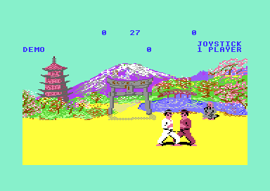
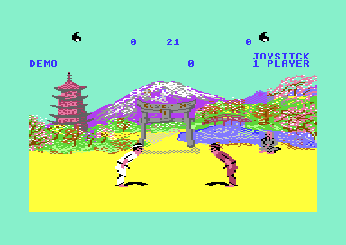

# The copy protection

The original disk of The Way of the Exploding Fist had a protected loader of Melbourne House. That loader is lost. All four releases of this project are cracks, and each crack replaces the loader with its own. Version I has no check in the game. Version II has one check: it reads a CIA2 register on every scoring hit and crashes the game when the register is not 0.

**Conventions.**
- Addresses are C64 addresses. Names are the names of the knowledge. The label `v1:` or `v2:` gives the project of a name.
- A *scoring hit* is a hit that gives a point: a half point or a full point (a yin-yang on the panel).
- **Observed** marks a fact that a run showed. **Code** marks a fact from the code only. **Conclusion** marks an interpretation.

## The scheme

Melbourne House sold the game on a disk with a protected loader. No release in this project keeps that loader. R2010, SHADOW, SCC and MRZ are all cracks, and each one starts the game with a loader of the cracker. Thus the bytes of the original loader are lost. Its disk format, its own checks and its fast loader code are not available. **Conclusion** (the four release disks, see [releases.md](releases.md)).

The 2010 disk keeps the file names of the original disk: M.PROG, M.SHAPES, M.CHSET, M.PICTURE, M.TSOUND and others. The crackers kept these files and replaced only the loader. The crack loader loads the same parts in a sequence, and [loading_stage.md](loading_stage.md) tells what each part does. **Observed** (disk directory and run) / **Conclusion**.

The original loader left one mark that the game can test. CIA2 control A (`$DD0E`) holds 0 at the game entry `$115A`. Version II tests this mark. A C64 after a KERNAL reset has `$08` in `$DD0E`. Thus a copy that loads the game with the KERNAL and jumps to `$115A` does not have the mark. **Code** / **Conclusion**.

Version I has no check. The game code of version I reads no loader mark. It has no read of `$DD0E`. [`v1:hit_record` `$2591`](../v1/src/fighter/hit_test.asm#L175) goes directly from the store of `scoring_move` to the hit reaction. **Code**.

## The check of version II

Version II checks the mark at [`v2:protect_cia2_check` `$2CAE`](../v2/src/fighter/hit_test.asm#L180), inside [`v2:hit_record` `$2CA8`](../v2/src/fighter/hit_test.asm#L175). This routine records each scoring hit of a fighter. After it stores `scoring_move`, it reads `$DD0E`. When the value is 0, the routine continues to the hit reaction of the opponent. **Code**.

```
hit_record          LDY opponent_index
                    LDA fighter_move,X
                    STA scoring_move
protect_cia2_check  LDA $DD0E           ; CIA2 control A
                    BEQ hit_record_reaction
protect_cia2_trap   LDX #$4E
                    PHA                 ; high byte: the $DD0E value
                    TYA
                    PHA                 ; low byte: opponent_index
                    JMP anim_update
```

The game never writes `$DD0E`. Its CIA2 writes go to `$DD00`, `$DD06`/`$DD07`, `$DD0D` and `$DD0F`. Thus the value that the check reads is the value that the loader left. Each value other than 0 fails the check, not only a running timer A. **Code**.

The check is new in version II. The same routine in version I has no such read, and [versions.md](versions.md) lists the other changes. **Code**.

The check hides in three ways:

- It runs late, at the first scoring hit, not at the start of the game.
- It is three instructions in the middle of the hit code, with no compare and no text.
- The failure jumps to `anim_update`, a normal target. `move_start_anim` jumps to the same routine at `$2B6D`. The crash then occurs far from the check.

**Code** / **Conclusion**.

| Check | Version | Where | When | Compares | Expected |
|---|---|---|---|---|---|
| CIA2 control A | II only | `protect_cia2_check` in `hit_record` | every scoring hit, also in the demo | `$DD0E` with 0 | 0, as the original loader left it |

The original loader must have left 0 in `$DD0E`. Otherwise the original game crashes at its first point. **Conclusion**.

## The effect of a failed check

When `$DD0E` is not 0, the trap [`v2:protect_cia2_trap` `$2CB3`](../v2/src/fighter/hit_test.asm#L194) runs. It pushes a false return address on the stack: the `$DD0E` value as the high byte and `opponent_index` as the low byte. Then it jumps into [`v2:anim_update` `$37BD`](../v2/src/fighter/anim_step.asm#L6) with X = `$4E`. **Code**.

With X = `$4E`, `anim_update` works on the zero page `$4E` bytes above the fighter variables. It reads `anim_number,X` at `$93`, which is `ai_table_index`. When that byte is not 0, the routine plays a false animation step. It writes the sprite position bytes plus `$4E`, for example `$62` (`fighter_move` of fighter 1) and `$66` (`cpu_controlled` of fighter 1). **Code**.

The last RTS of `anim_update` pulls the two pushed bytes. The CPU continues at `$DD0E` × 256 + `opponent_index` + 1. With `$08` this is `$0801` or `$0802`, in the music data of tune 3 (`music_t3_pattern_03`). The CPU then executes data as code, far from the check. **Code**.

The run [protection_trap_original.json](../v2/tests/protection_trap_original.json) shows the effect. It starts the original SCC game, writes `$08` to `$DD0E` at the entry `$115A`, and lets the demo play. **Observed**:

1. The first scoring hit of the demo reaches `$2CAE` with `$DD0E` = `$08`, X = 0 and Y = 1. Thus the false return address is `$0802`.
2. 600 frames later, the CPU executes at `$902C`. This address is in the fighter shape data (`$8040-$BEFF`).
3. The game stops. The panel shows no yin-yang for the hit, and the clock stops at 27.

The crash comes at the first point of the game or of the demo. The bout clock starts at 30, so the demo crashes about three clock seconds after its first bout starts. A player sees the title and the demo work, and then the game stops for no clear reason. **Observed** / **Conclusion**.



The original game 600 frames after the first scoring hit: no yin-yang on the panel, and the clock stopped at 27.



The default rebuild in the same run with `$DD0E` = `$08`: the panel shows the yin-yangs, and the clock is at 21.

## The releases

Version I (R2010 and SHADOW) has no check, so no crack had to change it. Version II (SCC and MRZ) keeps the check unchanged: the game bytes of SCC and MRZ are identical, and both have the original `LDA $DD0E`. **Observed** (byte compare).

The SCC crack sets the mark in its loader. The boot file of the SCC disk loads at `$0200`. At the end of its load chain, the code at `$0360` is `LDA #$00 / STA $DD0E / JMP $115A`. **Observed** (run: history before `$115A`).

The Mr. Z crack also starts the game with `$DD0E` = 0. The capture of MRZ at `$115A` has `$DD0E` = 0, and the reset value is `$08`. The code that writes the 0 is not known. **Observed** (entry state of `original/releases/mrz`).

## The rebuild

The v2 switch `PROTECTION` in [config.asm](../v2/src/config.asm) disables the check. Its kind is protection, and its default is 0. The releases SCC and MRZ build with `PROTECTION` = 1. Version I has no protection switch. **Code**.

`PROTECTION` = 0 changes three bytes at [`v2:protect_cia2_check` `$2CAE-$2CB0`](../v2/src/fighter/hit_test.asm#L180):

| `PROTECTION` | Bytes at `$2CAE-$2CB0` | Code | Result |
|---|---|---|---|
| 1 (SCC, MRZ) | `AD 0E DD` | `LDA $DD0E` | the check reads the CIA2 register |
| 0 (default) | `A9 00 EA` | `LDA #$00` / `NOP` | A = 0, the BEQ always branches |

The trap stays in the default build, but no path reaches it. A build with `--release SCC` or `--release MRZ` gives the original check and the original bytes. **Code** / **Observed** (generate check: each release build is identical to its file).

These tests show that the default build plays as the original. **Observed** (all PASS):

- The scenarios [demo.json](../v2/tests/demo.json), [one_player_cpu_bull.json](../v2/tests/one_player_cpu_bull.json), [two_player.json](../v2/tests/two_player.json), [rank_cap.json](../v2/tests/rank_cap.json), [keyboard_option.json](../v2/tests/keyboard_option.json) and [leftovers_unused.json](../v2/tests/leftovers_unused.json) run the original and the default rebuild side by side. Both loaders write 0 to `$DD0E`, so both games score points.
- The four recordings in [tests/record](../v2/tests/record) replay on the rebuild: one_player_moves, two_player, cpu_ranks and keyboard. They pass 9262, 11107, 53394 and 6787 checkpoints.
- The run [protection_trap_rebuild.json](../v2/tests/protection_trap_rebuild.json) writes `$08` to `$DD0E`, as the run of the original does. The default rebuild plays on through the first scoring hit.

The loader `v2/build/clean_loader.prg` uses the default build. Thus it plays on each C64, also after a KERNAL reset with `$08` in `$DD0E`. **Conclusion**.

## Still open

- The original protected loader: its disk format, its checks and the reason that it left 0 in `$DD0E`. An image of the original Melbourne House disk can answer this.
- The code of the Mr. Z crack that writes 0 to `$DD0E`. A watchpoint on writes to `$DD0E` during the Mr. Z load can find it.
- The false animation step of the trap when `ai_table_index` is not 0. A run with a watchpoint on `$62` and `$66` after the trap can show it. The coverage runs never executed the trap. Only the run of the original with `$08` reached it.
