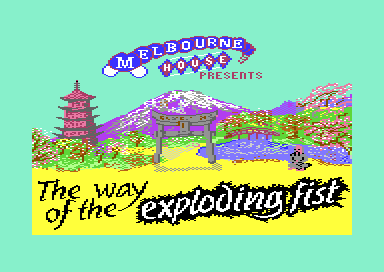
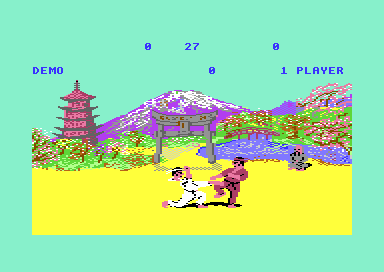

# The Way of the Exploding Fist, version I

The Way of the Exploding Fist is a karate game for the Commodore 64. Melbourne House published it in 1985, and Beam Software programmed it. Two fighters meet in four scenes, and a one-player game climbs the ranks from NOVICE to 10TH DAN. This documentation is for version I of the program, the program of the releases R2010 and SHADOW. The base release is R2010, the crack of the group 2010 that keeps the original files of Melbourne House. Version II is on [../v2/README.md](../v2/README.md), and the parts of both versions are on [../README.md](../README.md).

**Evidence.** **Observed** marks a fact that a run showed. **Code** marks a fact from the code only. **Conclusion** marks an interpretation.

The title picture of the loading stage, from M.PICTURE of the 2010 disk. `build/clean_loader.prg` shows it as its start screen and plays the speech sample.

## The development

The game holds no credit text, no date and no version text. The traces of the work are in the code and in the data. Version I came first. The 2010 crack screen says "WAIT FOR VERSION II", and version II contains 4378 of the 4737 instructions of version I. Version I shipped with several parts that the authors prepared but did not connect. Version II connects them. (**Observed**, **Code**)

**The bull test.** [`dev_bull_test` `$138F`](src/dev/dev_bull_test_138f.asm#L6) and three helpers fill `$1354-$1413`. No instruction refers to this range, and no run of the game executes it. The test makes fighter 1 a brown bull that runs at the white fighter. A punch from the crouch at the right distance stops the bull for 3000 points. Else the bull hits the fighter, and the fighter falls. (**Code**, **Observed** coverage)

The bull graphics are in M.XSPRITES at `$F540`, in the bitmap of the floor. All four colours of the floor are yellow, so the bull parts stay invisible there. The X limit test of the fighters skips the bull frames `$3B` and up, because only the bull runs past the edge. The test has faults: a fall has no exit, and the 3000 points do not set the tens digit. Thus the authors stopped before they finished it. (**Code**, **Conclusion**)

**The dead sample player.** [`sfx_sample_irq` `$29C8`](src/sfx/sfx_sample_player.asm#L6) is a complete 1-bit sample player. It is the player of the loading stage, M.MYTINY, with changes for the game. No code calls its start routine, and the cold start disables all CIA 1 interrupts. The data of the player is gone: its sample range `$0804-$0A04` and its tables at `$0E00` and `$0F00` now hold music. Thus an earlier build played a game sample in this memory, and the music took its place. (**Code**, **Conclusion**)

**Tune 4.** The music data holds a fourth tune with its own patterns, order lists and instruments 19-21. Its order list of voice 0 is [`music_t4_order_v0` `$1053`](src/music/music_tables_0fd5.asm#L84). No code writes 4 into `game_mode`, so the game never plays it. A trace with `game_mode` = 4 plays a fanfare of 7.7 seconds. Version II plays this tune at the name entry of its high score table. (**Code**, **Observed**)

**The old scene table.** [`old_scene_bitmap_ptrs` `$127F`](src/leftovers/leftover_127f.asm#L6) holds the words `$E640`, `$3600`, `$4500` and `$5400`, and nothing reads them. Each gap is `$F00` bytes, the size of one unpacked scene. `$5400` + `$F00` is `$6300`, the address of the first colour map. Thus an earlier build kept three scenes unpacked at `$3600-$62FF` and one scene on the screen. The final build packs the four bitmaps into 10604 bytes, and the code grew over the old area. (**Code**, **Conclusion**)

**Unused graphics.** The shape files hold blocks that no frame shows. Frames `$43-$47` show a small standing figure in five poses, and no animation script uses them. There are also old heads, an older bull part and a byte copy of four bull parts. The flag sprite of the judge of version II is already at `$D500` in `figure_parts_unused`. The game calls `winner_stub`, a lone RTS, with the winner in X. Thus the authors planned a judge in version I. (**Code**, **Observed** byte compare, **Conclusion**)

**The tools.** The gaps between the tables hold RAM contents, and the colour maps have random high nybbles. A read of colour RAM gives such nybbles. Thus the authors saved memory ranges from a running C64, not exact data. (**Observed** byte compare, **Conclusion**)

The details are on [../docs/development.md](../docs/development.md).

## The copy protection

The original disk of Melbourne House had a protected loader. No release of this project keeps that loader. R2010 and SHADOW are cracks, and each crack starts the game with a loader of its own. Thus the bytes, the disk format and the checks of the original loader are lost. The 2010 disk keeps the original file names, for example M.PROG, M.SHAPES and M.PICTURE. The crackers replaced only the loader. (**Observed** disk directory, **Conclusion**)

Version I has no check in the game. The code reads no mark of the loader, and it has no read of CIA 2 control A at `$DD0E`. [`hit_record` `$2591`](src/fighter/hit_test.asm#L175) goes directly from the store of the scoring move to the hit reaction. Version II adds a check of `$DD0E` at this place. It crashes the game at the first point when the value is not 0. (**Code**)

The game uses one byte that the loader left in memory. `ai_random` at `$8D` holds `$C7` at the entry of both releases, and no code writes it before the first demo. The byte is not a check, but it makes the first demo the same after each load (see [Findings](#findings)). (**Observed** entry state, **Code**)

The rebuild needs no protection switch. Its loader sets the entry state of the capture, with this byte. The details are on [../docs/protection.md](../docs/protection.md). The loading stage of the original files is on [../docs/loading_stage.md](../docs/loading_stage.md).

## Findings

- **The rank overflows after 10TH DAN.** [`game_1p_promote` `$171D`](src/game/game_modes.asm#L133) stops only at `stage_counter` = `$16`, after 22 promotions. `rank_number_table` has 12 entries, so from rank index 12 the rank text comes from code bytes at `$1D48`. The panel shows wrong characters, and the AI level of the computer reads past its tables. **Observed** in [rank_overflow.json](tests/rank_overflow.json) and in the recording `cpu_ranks`. A player who wins 24 bouts sees a broken rank, and the game continues. Version II stops at 10TH DAN (**Code**). See [game_flow.md](docs/game_flow.md#the-rank-overflow) and [ai.md](docs/ai.md#the-levels-above-11-after-the-rank-overflow).

  

  The panel after the promotion to rank index 13. The code byte `$5E` plus `$30` gives character `$8E`, and the panel shows it as "@".

- **The bull bonus round is dead code.** The bull test is complete, but nothing calls it. **Code**, and **Observed** in the coverage of all runs. The run [bull_test.json](tests/bull_test.json) starts it from a stub at `$0200` in a demo bout. The brown bull runs at the white fighter, hits him and runs over him. **Observed**. A test can start dead code in this way and get evidence for it. Version II made the bonus round from this code. See [fighters.md](docs/fighters.md#the-x-limits) and [../docs/development.md](../docs/development.md#the-bull-bonus-round).

- **The dead sample player costs time in each frame.** All 15 raster handlers start with `BIT $D019`, `BMI` and `JMP sfx_sample_irq`. No CIA 1 interrupt is on, so no handler takes the jump. **Code**, and **Observed** in the coverage. The test costs 7 cycles in each interrupt, 42 to 56 cycles in each frame. A change of the raster handlers must keep this test, or check the timing of the writes again (**Conclusion**). See [interrupts.md](docs/interrupts.md#the-test-at-the-start-of-each-handler) and [sound_music.md](docs/sound_music.md#the-dead-sample-player).

- **Tune 4 is complete, and nothing plays it.** Only tune 4 uses the stop command, the sharp notes and the subtracting filter sweep of the driver. The coverage of the game runs marks none of them. **Observed**. A trace with `game_mode` = 4 plays the fanfare. **Observed**. Thus a test of the music driver must write `game_mode` to reach these paths. See [sound_music.md](docs/sound_music.md#tune-4-the-unused-jingle).

- **The two computer fighters share their AI masks.** [`ai_setup_level` `$1FFD`](src/ai/ai_opponent_1f8f.asm#L78) writes six masks without the index X. The second call, for fighter 1, writes over the values of fighter 0. Special action 8 writes `ai_special_action` without X, and special action 7 compares with `fighter_move` of fighter 0. **Code**. A run executed action 8, and no run executed action 7. **Observed** coverage. In the one-player game the player cannot see these bugs. In the demo, fighter 0 fights with the timing of the level of fighter 1. See [ai.md](docs/ai.md#the-bugs).

- **The tie-break reads the wrong fighter.** [`bout_hit_value_add` `$1C17`](src/game/panel_texts.asm#L6) reads `hit_points` without X. Thus the tie-break value of the computer uses the full or half flag of the last hit of the player. **Code**. The bug changes only a one-player bout that ends at time up with equal half points. A computer with two half points can then win against a full point of the player (**Conclusion**). No run reached this case. See [combat.md](docs/combat.md#the-tie-break-and-its-bug).

- **Voice 0 of the demo tune drifts.** The order list [`music_t1_order_v0` `$0FC2`](src/music/music_tables.asm#L52) repeats to position 19, but the list ends at position 18. Voice 0 thus continues in the list of voice 1, and pattern 2 never plays. **Code**, and **Observed** in the coverage. The loop of voice 0 is 1752 ticks, and the loop of the other voices is 2130 ticks. Thus voice 0 moves out of time in each loop of the demo music. Version II adds the missing 2 bytes, and the entry moves from `$1158` to `$115A`. See [sound_music.md](docs/sound_music.md#bugs).

- **The note table is for NTSC.** `music_note_freqs` holds the NTSC values of the Commodore 64 Programmer's Reference Guide. On a PAL C64, each note is 3.7 % low, about 2/3 of a semitone. A4 gives 423.8 Hz, not 440 Hz. **Code**. The music stays in tune with itself, so a player hears only a lower key (**Conclusion**). See [sound_music.md](docs/sound_music.md#bugs).

- **The first demo after each load is the same.** No code writes `ai_random` before the first demo, and the entry state has `$C7` in it. The first two random steps give level 7 to both demo fighters. A saved state at the first demo bout shows these levels. **Observed**. The one-player game copies `frame_random` into `ai_random`, so the opponent depends on the frame of the start. Thus a test that writes `frame_random` makes the opponent repeat, and the recordings pin it (**Conclusion**). See [ai.md](docs/ai.md#the-random-number-generator) and [game_flow.md](docs/game_flow.md#the-attract-demo).

- **The RESET vector points to an RTI.** `init_vectors_cias` writes the address of [`reset_vector_rti` `$14A6`](src/game/init_bout_loop.asm#L75) into `$FFFC`. A reset switches the KERNAL ROM on, so the CPU reads the vector of the ROM and never this byte. **Code**, and **Observed**: no run executed it. The NMI handler also ignores the RESTORE key. Thus a reset works as on each C64, and RESTORE does nothing that a player can see (**Conclusion**). See [interrupts.md](docs/interrupts.md#the-vectors-and-the-cia-set-up).

## How the program works

The loader puts the game files into memory and jumps to `program_entry` at `$1158`. The cold start switches the ROMs off and prepares the vectors, the CIAs and VIC bank 3. Then the title loop shows the text panel at the top of the screen and plays a demo of two computer fighters under it. The program has no separate title screen. (**Code**)

A start key or the fire button starts a game. Each game mode is a loop of bouts, and each bout is a loop of exchanges. The bout loop runs one pass in each frame: it updates both fighters, steps the random number and reads the title keys. A chain of raster interrupts draws the panel, the scene and the fighters, and it calls the music driver at the end of each frame. (**Code**)

~~~mermaid
flowchart TB
  L["Loading stage: picture and speech"] --> C["Cold start: ROMs off, vectors, VIC bank 3 (cold_start)"]
  C --> T["Title loop, demo and game modes (title_main_loop)"]
  T --> B["Bout loop: one pass in each frame (bout_loop)"]
  B --> F["Fighter update: input, move, animation (fighter_update)"]
  F --> A["Computer opponent (ai_update)"]
  F --> H["Hit test (hit_check)"]
  F --> S["Shape builder: 9 sprite parts (shape_build)"]
  S -.-> I["Raster chain: panel, bitmap, sprite rows (irq_frame_start)"]
  I --> M["Music driver at line $FF (music_play_frame)"]
~~~

~~~mermaid
flowchart TB
  P["Load: title picture and speech"] --> D["Title panel and demo: 4 bouts in 4 scenes"]
  D -->|"fire or F1, 1 PLAYER"| O["One-player bout against the computer"]
  D -->|"fire or F1, 2 PLAYER"| W["Two-player game: 4 bouts of 30 seconds"]
  O -->|"2 won bouts"| R["Promotion: new rank, next scene, stronger opponent"]
  R --> O
  O -->|"draw at time up"| O
  O -->|"lost bout"| G["High score, end of the game"]
  G --> D
  W -->|"the higher score bows"| D
~~~

1. **The start runs one time.** [`cold_start` `$1601`](src/game/init_bout_loop.asm#L240) calls `init_game_state`, which switches the ROMs off, sets the IRQ, NMI and RESET vectors and prepares the screen. Then it jumps to the title loop. (**Code**)
2. **The title loop never returns.** [`title_main_loop` `$19A7`](src/game/title_and_scene.asm#L64) shows the mode and the high score and plays the demo. A start key calls the one-player game or the two-player game. Each game ends in the title loop again. (**Code**)
3. **The bout loop sets the pace.** [`bout_loop` `$1590`](src/game/init_bout_loop.asm#L184) plays one exchange. Each pass waits for raster line `$FD` and updates fighter 1 and then fighter 0. The exchange ends at a fall, at time up or at a start key. (**Code**)
4. **The fighters obey one set of rules.** [`fighter_update` `$2233`](src/fighter/fighter_moves.asm#L6) does the hit test, gets the requested move and steps the animation script. The request comes from the joystick or from [`ai_update` `$1D48`](src/ai/ai_opponent.asm#L6). Thus the computer uses the same moves and the same hit test as a player. (**Code**)
5. **The interrupts draw the screen.** [`irq_frame_start` `$2A66`](src/irq/sprite_mux_plan.asm#L6) runs at line 0. It plans the frame and writes the plan into the operands of the later handlers. Six hardware sprites show two fighters of 3 x 3 sprites. A CIA 2 NMI makes the floor yellow. (**Code**)
6. **The music runs in the interrupt.** The last handler calls [`music_play_frame` `$09A5`](src/music/music_driver.asm#L6) at line `$FF`. `game_mode` selects the tune: 1 in the demo, 2 for one player and 3 for two players. (**Code**)

The first bout of the demo in scene 0. The panel is at the top, the scene bitmap is in the middle and the yellow floor is at the bottom (**Observed**).

## The pages

| Page | Content |
|---|---|
| [docs/game_flow.md](docs/game_flow.md) | **The game flow.** The title loop, the demo, the game modes, the bout loop, the points, the ranks and the rank overflow. |
| [docs/fighters.md](docs/fighters.md) | **The fighters.** The joystick, the 25 moves, the move state machine, the animation scripts and the X limits. |
| [docs/ai.md](docs/ai.md) | **The computer opponent.** The reaction to an attack, the timers, the skill levels, the random numbers and the AI bugs. |
| [docs/combat.md](docs/combat.md) | **Combat.** The hit test, the reach windows, the hit-zone tables, the score and the tie-break bug. |
| [docs/graphics.md](docs/graphics.md) | **The graphics.** The screen bands, the 9 sprite parts of a fighter, the shape builder and the packed scenes. |
| [docs/interrupts.md](docs/interrupts.md) | **The interrupt chain.** The raster handlers, the 7 layouts of the multiplexer, the floor NMI and the vectors. |
| [docs/sound_music.md](docs/sound_music.md) | **Sound and music.** The music driver, the data format, the four tunes and the dead sample player. |
| [../docs/development.md](../docs/development.md) | **The development.** The traces of the work of the authors in both versions. |
| [../docs/protection.md](../docs/protection.md) | **The copy protection.** The lost loader and the check of version II. |
| [../docs/releases.md](../docs/releases.md) | **The releases.** The four disks, their files and the traces of each crack. |
| [../docs/loading_stage.md](../docs/loading_stage.md) | **The loading stage.** The title picture, the speech sample and its player. |
| [../docs/versions.md](../docs/versions.md) | **Version I and version II.** Each difference between the two programs. |

## The releases

| Label | File | SHA-256 |
|---|---|---|
| R2010 | `original/2010.d64` | `2646d419a57fa29c76d914dbe9b9dfe23f5e6e13d232ed1d30386b9ce31f7494` |
| SHADOW | `original/Exploding_Fist.d64` | `de5ddbc564fe70f4d0b9e4d2809d2aa72707e812f58cc1d559db7b6970283299` |

- **R2010** (2010 and CHR.): the original files of Melbourne House with a KERNAL loader of the crackers at `$C000`. It plays the loading stage with the original files and changes no byte of the game. (**Observed**, **Conclusion**)
- **SHADOW** (Copenhagen Crackers): an intro file and the game packed into one file. 307 game bytes differ from R2010: 304 bytes of run-time state and 3 bytes at `$0800-$0802`. (**Observed** byte compare)

**The Shadow release is a dump of a game that ran.** 304 of the different bytes are values that the game writes when it runs. They are the operands of the raster handlers, the music workspace, the shape pointers and the sprite buffers. An example is [`irq_a_row2_y` `$263F`](src/irq/irq_sprite_rows.asm#L13), which R2010 holds as 0. Thus Shadow saved the memory of a running game, not the original files. The planner writes each operand before the chain uses it, so these values do not change the play. The switch `RUN_STATE` holds them. (**Observed**, **Code**, **Conclusion**)

**Shadow put zeros into tune 3.** SHADOW has 0 at `$0800-$0802`, where R2010 has bytes of [`music_t3_pattern_03` `$07F3`](src/music/music_patterns_04be.asm#L516). No run of the game writes page `$08`, so the crack made this change. The packed file of Shadow loads at `$0801`, and a BASIC program needs a 0 at `$0800`. Thus SHADOW plays the two-player tune with three changed bytes. The switch `CRACK_SHADOW_0800` holds them. (**Observed** coverage, **Conclusion**)

The disks, the files and the captures are on [../docs/releases.md](../docs/releases.md).

## The rebuild

**The base release.** The knowledge holds the memory of R2010 at the game entry `$1158`. It has four segments: `$0400-$BFFF`, `$C900-$CBFF`, `$D000-$E5FF` and `$F540-$FFEF`. The capture leaves out the loader and M.PRERUN at `$C000-$C435`, and the rest of the picture at `$CC00-$CFE7` and `$E600-$F53F`. Junk tests showed that the game does not need these areas. (**Observed**)

**The entry state.** `build/clean_loader.prg` copies the segments into place and sets the entry state of the capture at `$0002-$03FF`, with `ai_random` = `$C7`. Then it jumps to `$1158`. The tests run the original bytes with the generated loader `original/fist_v1_2010.prg` in the same way. (**Code**, **Observed**)

**The start screen.** Before the game starts, `build/clean_loader.prg` shows the Melbourne House title picture and plays the speech sample. Then it waits for a key, or for the fire button of joystick port 1 or 2. The knowledge holds a capture of the 2010 loading stage at the call of the sample player at `$9000`, in the space `loading`. The capture keeps all memory of the stage, also the picture: the screen at `$CC00`, the bitmap at `$E000` and the colour RAM. A coverage run of the call ([runs/loading_stage_rc3](runs/loading_stage_rc3/run.json)) gives the bytes that the sample needs. The show code calls `$9000`, and the call returns at the end of the sample. The game stays packed until the wait ends. Then it unpacks over the picture. (**Observed**: the loader check of c64-source.) Set `START_SCREEN = 0` in `src/config.asm` to start the game at once. An older capture of the same stage stays in space bank1 as history. The loader does not use it.

**The switches.** `src/config.asm` holds the value of each switch. `src/switches.asm` holds the values of each release. All switches of version I have the default 0, which gives the R2010 bytes. Version I has no protection switch and no trainer. (**Code**)

| Switch | Kind | Default | Releases with it on | What it changes |
|---|---|---|---|---|
| `RUN_STATE` | change | 0 | SHADOW | 96 patches: the run-time values of the raster operands, the music state, the shape pointers and the sprite buffers |
| `CRACK_SHADOW_0800` | crack | 0 | SHADOW | 0 at `$0800-$0802` in place of the bytes of tune 3 |

**The builds.** From the project folder, with the script of the c64-assembler skill:

1. `source.ts generate --out src --loader` writes `build/clean_loader.prg`, the default build with the start screen. It loads with `LOAD"...",8` and starts with RUN. `assembler.ts build src main.asm --out build/fist_v1_main.prg` builds the game alone, without the leftovers.
2. `assembler.ts build src main.asm --out build/fist_v1_shadow.prg --release SHADOW` builds the SHADOW bytes. `--release R2010` builds the base release. Each release build is identical to the bytes of its release in the project knowledge. (**Observed**)

**The tests.** All tests in [tests/](tests/) PASS (**Observed**):

- The scenarios run the original loader and `build/clean_loader.prg` side by side, and compare memory, the VIC-II and the screen. The rebuild side runs to `loader_start_screen_wait` and sets the PC to `loader_start_screen_continue`. Its symbols are in `build/symbols/clean_loader.json`, which `generate --loader` writes. The scenarios are [demo.json](tests/demo.json), [one_player_cpu.json](tests/one_player_cpu.json), [two_player.json](tests/two_player.json) and [rank_overflow.json](tests/rank_overflow.json).
- [leftovers_unused.json](tests/leftovers_unused.json) fills 36 unused ranges with `$A5` on the rebuild side. These ranges include the 26 leftover ranges (1029 bytes) that `build/clean_loader.prg` leaves out. The state and the screens stay the same as on the original.
- The runs with expected values are [bull_test.json](tests/bull_test.json) and [start_screen.json](tests/start_screen.json).
- The recordings in [tests/record](tests/record) replay on `build/clean_loader.prg` with the symbols of `build/symbols/clean_loader.json`. The replay runs the rebuild to `loader_start_screen_wait` and sets the PC to `loader_start_screen_continue`. `one_player_moves` plays all 16 joystick moves, `two_player` uses both joysticks, and `cpu_ranks` plays 80610 frames into the rank overflow. They pass 9608, 11579 and 64935 checkpoints. The recorded sessions and their coverage are in [tests/recordings](tests/recordings).

The emulator tools of this setup take no joystick input, but the recordings do. The runs with the computer write `cpu_controlled` after the start of a game. After all runs, 46 code ranges with 297 instructions stayed unexecuted. Most of them are the bull test, the sample player and its 15 jumps, the title keys and the paths of tune 4. The generated list `.c64-re-tools/local/generated/src/not_executed.json` gives them. `generate` writes it, and git does not keep it. (**Observed**)

## Still open

- What does an AI command above `$18` do at the levels 12-16 after the rank overflow? — A one-player game with `cpu_skill+1` = 12 and a watch on `fighter_input` of fighter 1.
- What does the rank wrap after rank index 22 do? — A run with the rank index and `stage_counter` at 21 before two won bouts.
- How do the keys F1, F3, F5 and F7 act? In this VICE, bits 5-7 of `$DC01` read 0, so no key compare matches. — A run on another emulator.
- Does the tie-break bug change a result in play? — A one-player bout with the hits of the example in [combat.md](docs/combat.md#the-tie-break-and-its-bug), to time up.
- Can both fighters hit in one exchange? — A watchpoint on `hit_reaction` of both fighters in the recording `two_player`.
- Is the drift of voice 0 in the demo music audible? — A recording of the SID output for two loops of the demo.
- What was tune 4 for in version I, and what did the dead sample player play? — No byte of version I tells. An earlier build can tell.
- Is the small figure of frames `$43-$47` a first judge? — A run that points sprite 6 to its parts.
- Does SHADOW play the same as R2010? — A replay of a recording of [tests/record](tests/record) on the SHADOW capture.
- What did the original protected loader do? — Only an image of the original Melbourne House disk can tell.

## The reference

[docs/reference/index.md](docs/reference/index.md)
