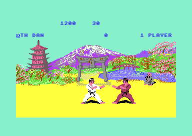

# The computer opponent (version I)

The computer fights for a fighter when the player does not use that fighter. In the one-player game, the computer controls the red fighter, and its skill grows with the rank of the player. In the attract demo, the computer controls both fighters. In each frame, the AI looks at the move of the opponent and at the distance between the fighters. Then it writes one move command, the same value that the joystick table gives for a human player. The AI uses no other way to move a fighter. Thus the AI obeys the same move rules, animations and hit test as the human player.

**Conventions.**
- Addresses are C64 addresses. Names are the names of the knowledge.
- A *frame* is one pass of the frame loop of `bout_loop`. The loop waits for raster line `$FD`, so it runs one time in each PAL frame, 50 times in a second.
- An *exchange* is one run of `bout_loop`, from the start positions to a fall or the end of the time. A *bout* has exchanges until a fighter has two full points or the time ends.
- *Fighter 0* is the white fighter (player 1, joystick port 2). *Fighter 1* is the red fighter (player 2). `X` holds the index of the fighter that the code updates. `opponent_index` holds the index of the other fighter.
- A *move* is the state in `fighter_move`, `$00-$18`. A *command* is the move that the AI requests in `fighter_input` and `ai_command`. [fighters.md](fighters.md) gives the moves and their joystick directions.
- The *distance* `d` is the signed difference of the two `fighter_x` values, in units of 2 pixels. The AI computes it so that a positive `d` is in front of the fighter when the facings are different.
- A *level* is the skill level in `cpu_skill`, the index into the eight level tables. A *mask* is a byte that the AI ANDs with a random value to get a time or a choice.
- A *timer* with bit 7 set means "load a new random time in the next frame".
- **Observed** marks a fact that a run showed. **Code** marks a fact from the code only. **Conclusion** marks an interpretation.

## How it works

The AI runs only for a fighter with `cpu_controlled` = 1. [`fighter_get_input` `$225F`](../src/fighter/fighter_moves.asm#L30) first gives the hit reaction to a fighter that a hit struck. Else it jumps to [`ai_update` `$1D48`](../src/ai/ai_opponent.asm#L6) when `cpu_controlled,x` is not 0, and it reads the joystick when the value is 0. The game modes set the flags in this way (**Code**):

| Game mode | `cpu_controlled` (fighter 0, fighter 1) | Level of the AI |
|---|---|---|
| Attract demo | 1, 1 | Random 3-11 for each fighter, one time for the four bouts |
| One-player game | 0, 1 | Fighter 1: the rank index, 0 (NOVICE) and up |
| Two-player game | 0, 0 | The AI does not run |

~~~mermaid
flowchart TB
  A["Opponent hit: keep the input, then stand"]
  B["Special action pending: do its next step"]
  C["Opponent attacks?"]
  D["Own block, low move or held pose: keep or stand"]
  E["Attack in range: reaction delay, then the response"]
  F["Own move holds its end pose: hold time, then stand"]
  G["Distance and facings"]
  H["Walk or stop"]
  I["About turn"]
  J["Attack delay, then the attack by distance"]
  A --> B --> C
  C -- "yes" --> D
  C -- "yes, own stand or walk" --> E
  C -- "no" --> F
  E -- "out of range or wait" --> F
  F -- "stand or walk" --> G
  G --> H
  G --> I
  G --> J
~~~

`ai_update` does these steps in this order. The first step that gives a command ends the frame for the AI (**Code**).

1. **The opponent is hit.** When `hit_reaction` of the opponent is not 0, the AI keeps its attack input for `ai_release_timer` frames. Then it commands stand. A flying kick `$0E` commands stand at once. The exchange ends at the fall of the opponent, so this step is short. (**Code**)
2. **A special action runs.** When `ai_special_action,x` is not 0, the AI jumps through `ai_dispatch_special` to the next step of that action. A special action is a short plan of two or more frames, for example "crouch, then punch". (**Code**)
3. **The danger check.** The AI looks at the move of the opponent. It decides if the opponent attacks now, and it keeps, ends or answers its own move. The section [The reaction to an attack](#the-reaction-to-an-attack) tells the rules. (**Code**)
4. **The reaction.** When the fighter stands or walks and the attack is in range, the AI waits a reaction delay. Then it chooses an attack, a counter move or a special action. (**Code**)
5. **The held pose.** When the own move holds its end pose, the AI keeps it for a random time. Then it commands stand, and the move returns to the stance. (**Code**)
6. **The position.** When the fighter stands or walks, the AI uses the distance and the facings. It walks, stops, turns or prepares an attack. (**Code**)
7. **The attack.** After a random attack delay, the AI takes an attack from one of two distance tables. (**Code**)

The AI never presses "walk back" for a block. It commands the blocks `$13` and `$14` directly. The AI also commands about turn `$12`, but it completes the turn itself. It writes stand into `fighter_move` and flips `fighter_facing`. (**Code**)

### The reaction to an attack

[`ai_check_opponent` `$1D65`](../src/ai/ai_opponent.asm#L24) starts the danger check. An opponent that holds the end pose of its move is a special case. From level 5, the AI treats a held pose as no danger, but it watches a held crouch. Levels 0-4 treat a held attack pose as an attack. An opponent that retracts its move, or runs a move with no attack flag, is no danger. In these cases the AI goes to the movement steps. (**Code**)

When the opponent attacks, the own move decides the next step (**Code**):

- **Own block `$13` or `$14`.** The AI keeps the block when it is the counter move of the attack in `move_counter_moves`. Else it commands stand.
- **Own about turn `$12`.** The AI goes to the movement steps and completes the turn.
- **Own stand or walk (`$01-$03`).** The AI goes to the reaction below.
- **Own move holds or retracts.** The AI commands stand.
- **Opponent sweep `$0A` or `$10`, or a held crouch at level 5 and up.** The AI keeps only a crouch or a low move (`$04 $07 $0A $0B $10`). Else it commands stand.
- **Other moves.** The AI keeps its last command.

[`ai_react_to_attack` `$1DEC`](../src/ai/ai_opponent.asm#L98) first calls [`hit_range_test` `$25D3`](../src/fighter/hit_test.asm#L213). When the fighters have different facings, the test says "in range" for `d` from -17 to 19. It also needs reach type 0 for the opponent move. When the facings are the same, the test needs reach type 1 and `d` from 3 to 31. The attacks with reach type 1 are `$0F` and `$10`. Thus the AI never reacts to `$0F` or `$10` when the fighters face each other. It reacts only to these two attacks when the facings are the same. (**Code**) No run executed the "in range" exit of the same-facing path, `$2632-$2634`. (**Observed**, coverage of all runs)

The reaction delay comes next. When bit 7 of `ai_react_timer,x` is 1, the AI loads random AND `ai_react_mask`. A value of 0 gives the response in the same frame. Else the timer counts down to 0 in the next frames, and then the AI responds. (**Code**)

[`ai_choose_response` `$1E0B`](../src/ai/ai_opponent.asm#L115) takes r = random AND `ai_response_mask` (**Code**):

1. Bit 7 of r set: the AI attacks at once through the attack choice. It does not wait for the attack delay.
2. Bit 5 or bit 6 of r set: the AI commands the counter move of the opponent move from `move_counter_moves`. That is block `$13`, block `$14` or jump `$05`.
3. Else the AI starts the special action of `ai_special_by_move` for the opponent move. When that entry is 0, it commands the counter move.

The counter moves are these values (**Code**):

| Opponent move | `$06` | `$07` | `$0A` | `$0B` | `$0C` | `$0D` | `$0E` | `$0F` | `$10` | `$11` | `$18` |
|---|---|---|---|---|---|---|---|---|---|---|---|
| Counter move | `$14` | `$13` | `$05` | `$13` | `$13` | `$14` | `$14` | `$14` | `$05` | `$14` | `$13` |
| Special action | 8 | 2 | 4 | 3 | 2 | 0 | 1 | 4 | 7 | 2 | 6 |

Block `$13` stops the low and middle attacks. Block `$14` stops the high attacks. The AI jumps over the two sweeps. [fighters.md](fighters.md) tells how a human player blocks: the player pulls the joystick back while the opponent attacks. The AI uses the same counter table, so a human block and an AI block stop the same attacks. (**Code**)

### The timers and the random masks

The AI keeps four timers for each fighter. Each timer gets a random value AND a mask from the level. The mask decides the longest time, and a smaller mask makes the AI faster. (**Code**)

| Timer | Mask | Time | Code |
|---|---|---|---|
| `ai_react_timer` | `ai_react_mask` | Frames before the response to an attack | `ai_react_to_attack` |
| `ai_hold_timer` | `ai_hold_mask` | Frames that a held end pose stays, random AND mask + 5 or 6 | `ai_hold_pose` |
| `ai_attack_timer` | `ai_attack_mask` | Frames of stand before the next attack | `ai_attack_timing` |
| `ai_walk_timer` | `ai_walk_mask,x` or `ai_stop_mask,x` | Frames of a walk or of a stop | `ai_walk_decision` |

[`ai_hold_pose` `$1E60`](../src/ai/ai_opponent.asm#L162) adds 5 and the carry of the random step to the masked value. Thus a held kick or punch stays for at least 5 frames. A crouch `$04` stays until another step commands a new move. (**Code**)

[`ai_attack_timing` `$1F13`](../src/ai/ai_opponent.asm#L265) commands stand in each frame of the attack delay. A random value of 0 gives no attack: the timer then goes to `$FF`, and the AI loads a new delay in the next frame. At level 0 the mask is `$7F`, so the AI stands for up to 127 frames, about 2.5 seconds, between two attacks. (**Code**)

Two more masks choose between moves. `ai_response_mask` chooses the response to an attack. `ai_variant_mask` changes a back attack `$0F` or `$10` into another move. (**Code**)

### Walk, stop and turn

[`ai_check_position` `$1E92`](../src/ai/ai_opponent.asm#L191) computes the distance and compares the facings. The result selects one of three actions (**Code**):

| Facings | Distance `d` | Meaning | Action |
|---|---|---|---|
| Different | -43 to 20 (`$D5-$FF`, `$00-$14`) | Opponent close | Attack delay and attack |
| Different | 21 to 127 (`$15-$7F`) | Opponent far in front | Walk or stop |
| Different | -128 to -44 (`$80-$D4`) | Opponent far behind | About turn |
| Same | -33 to 30 (`$DF-$FF`, `$00-$1E`) | Opponent close | Attack delay and attack |
| Same | -128 to -34 (`$80-$DE`) | Opponent far in front | Walk or stop |
| Same | 31 to 127 (`$1F-$7F`) | Opponent far behind | About turn |

For the same facing, the code reverses the sign of `d`, so a negative `d` is in front. (**Code**)

[`ai_walk_decision` `$1EBC`](../src/ai/ai_opponent.asm#L215) counts `ai_walk_timer,x` down. At 0, a walking fighter stops for random AND `ai_stop_mask,x` frames. A stop time of 0 means "walk on". A standing fighter walks forward for random AND `ai_walk_mask,x` frames, and a value of 0 gives 256 frames. From level 7 the stop mask is 0, so the AI walks to the opponent without a pause. The AI never walks back in this step. Only the variant of a back attack commands walk back `$03`. (**Code**)

### The attack choice by distance

[`ai_choose_attack` `$1F29`](../src/ai/ai_opponent.asm#L277) first looks at a block of the opponent, when the facings are different. Against a low block `$13`, it takes a random entry of `ai_reply_to_low_block`: `$06 $0D $0E $11`. Against a high block `$14`, it takes a random entry of `ai_reply_to_high_block`: `$07 $0B $0C $18`. These are the attacks that the block does not stop. (**Code**) No run executed the reply to a low block, `$1F4F-$1F5C`. (**Observed**, coverage)

Else the AI reads a distance table. The index is the distance plus a base, plus random AND `ai_spread_mask` (**Code**):

- Different facings: [`ai_attack_facing_table` `$2102`](../src/ai/ai_tables.asm#L6), index = `d` + `$33` + spread.
- Same facing: [`ai_attack_same_facing_table` `$2152`](../src/ai/ai_tables.asm#L18), index = `d` + `$29` + spread.

The spread moves the index up the table, toward the moves for a longer distance. At a low level the spread is `$07`, so its choice is less exact. The section [The distance tables](#the-distance-tables) gives the values. (**Code**)

Some results get one more step (**Code**):

- **Foot sweep `$0A`.** Levels 0 and 1 give no command. The last command stays.
- **Crouching attack `$07`.** The AI starts special action 5: crouch first, then `$07`. The input rules of `move_fix_input` change `$07` from a stand into `$18`, so the crouch is necessary. See [fighters.md](fighters.md).
- **Back attack `$0F` or back sweep `$10`.** [`ai_attack_variant` `$1FC8`](../src/ai/ai_opponent_1f8f.asm#L41) takes v = random AND `ai_variant_mask`. Bit 7 of v gives about turn. `$40-$7F` gives walk back `$03`. `$20-$3F` gives the backward somersault `$08`. `$01-$1F` keeps the move. 0 gives the forward somersault `$09`.

### The special actions

[`ai_dispatch_special` `$20F3`](../src/ai/ai_opponent_1f8f.asm#L231) reads the address of action n at [`ai_special_jump_table` `$21A1`](../src/ai/ai_tables.asm#L30) + 2n. It then jumps through `ai_special_vector`. An action stays in `ai_special_action,x` until it clears the value, so it can take several frames. Entry 0 holds `$0000`, and nothing reads it. The reference shows `$0000` as `cpu_port_ddr` only because that is the name of address `$0000`. (**Code**)

| Action | Name | Against | What it does |
|---|---|---|---|
| 1 | `ai_spec_duck_then_sweep` | `$0E` flying kick | Crouch, then foot sweep `$0A`. Level 7 and up sweeps at frame `$19` of the opponent. Lower levels sweep when the opponent stands again. |
| 2 | `ai_spec_foot_sweep` | `$07`, `$0C`, `$11` | Foot sweep `$0A` until the move `$0A` starts. |
| 3 | `ai_spec_flying_kick` | `$0B` low kick | Flying kick `$0E`. |
| 4 | `ai_spec_somersault` | `$0A`, `$0F` | Forward somersault `$09`. |
| 5 | `ai_spec_crouch_punch` | (from the attack choice) | Crouch `$04` until the crouch holds, then `$07`. |
| 6 | `ai_spec_random_punch` | `$18` | `$06` or `$18`, about half the time each. |
| 7 | `ai_spec_sweep_by_facing` | `$10` back sweep | Back sweep `$10` or foot sweep `$0A`. The compare has a bug. |
| 8 | `ai_spec_punch_or_crouch` | `$06` | About half the time action 5, else action 6. The write of action 5 has a bug. |

Action 1 ends with `BEQ $2068` directly after `BNE $2061`. The branch is always taken, so it acts as a jump. (**Code**) **Conclusion**: the authors put action 3 after action 1 and closed action 1 with a branch pair, not with a JMP.

## The skill levels

[`ai_setup_level` `$1FFD`](../src/ai/ai_opponent_1f8f.asm#L78) copies the values of level `cpu_skill,x` into the masks. [`bout_setup_fighters` `$1536`](../src/game/init_bout_loop.asm#L136) calls it for fighter 0 and then for fighter 1 before each exchange. It also resets the AI state: command stand, no special action, no turn, and all timers to "load a new time". (**Code**)

The eight level tables start at [`ai_level_hold_mask` `$21D4`](../src/ai/ai_tables.asm#L47). These are their values for levels 0-11 (**Code**):

| Table | Address | 0 | 1 | 2 | 3 | 4 | 5 | 6 | 7 | 8 | 9 | 10 | 11 |
|---|---|---|---|---|---|---|---|---|---|---|---|---|---|
| Hold mask and release time | `$21D4` | `$1F` | `$1F` | `$0F` | `$0F` | `$0F` | `$0F` | `$07` | `$07` | `$07` | `$07` | `$07` | `$07` |
| Attack spread | `$21E0` | `$07` | `$07` | `$07` | `$07` | `$07` | `$03` | `$03` | `$03` | `$03` | `$03` | `$03` | `$03` |
| Attack delay | `$21EC` | `$7F` | `$1F` | `$0F` | `$0F` | `$0F` | `$07` | `$07` | `$07` | `$07` | `$07` | `$07` | `$07` |
| Walk time | `$21F8` | `$1F` | `$3F` | `$1F` | `$3F` | `$3F` | `$3F` | `$3F` | `$3F` | `$3F` | `$3F` | `$3F` | (`$3F`) |
| Stop time | `$2203` | `$3F` | `$3F` | `$1F` | `$3F` | `$1F` | `$1F` | `$0F` | `$00` | `$00` | `$00` | `$00` | `$00` |
| Variant | `$220F` | `$8F` | `$2F` | `$4F` | `$FF` | `$8F` | `$E0` | `$87` | `$E7` | `$E7` | `$27` | `$FF` | `$8F` |
| Response | `$221B` | `$80` | `$8F` | `$8F` | `$60` | `$60` | `$0F` | `$0F` | `$FF` | `$0F` | `$0F` | `$0F` | `$0F` |
| Reaction delay | `$2227` | `$1F` | `$0F` | `$07` | `$03` | `$00` | `$00` | `$00` | `$00` | `$00` | `$00` | `$00` | `$00` |

The walk table has only 11 entries. Level 11 reads `$2203`, the first byte of the stop table. That byte is `$3F`, the same value as the other walk masks, so the error has no effect. (**Code**) **Conclusion**: the authors added a level, or moved the stop table, after they made the walk table.

The hold value has two uses. It is the hold mask, and it is also the release time after a hit, in frames. (**Code**)

Three tests use the level directly, not a table. Level 5 and up watches a held crouch of the opponent. Level 2 and up can do the foot sweep from the attack choice. Level 7 and up times the sweep of special action 1 to frame `$19` of the opponent. (**Code**)

The response mask gives each level its style (**Code**, the fractions are approximate):

| Levels | Response mask | Attack at once | Counter move | Special action |
|---|---|---|---|---|
| 0-2 | `$80`, `$8F` | about 1/2 | only when no special action exists | about 1/2 |
| 3-4 | `$60` | never | about 3/4 | about 1/4 |
| 5-6, 8-11 | `$0F` | never | only when no special action exists | always |
| 7 | `$FF` | about 1/2 | about 3/8 | about 1/8 |

The variant mask also gives large differences. Level 5 has `$E0`, so a back attack never stays a back attack: the result is a turn, a walk back or a somersault. Levels 1 and 9 never turn and never walk back for a variant, because bit 7 and bit 6 of their masks are 0. (**Code**)

The level of the one-player opponent is the rank index in `cpu_skill+1`. [`game_1p_promote` `$171D`](../src/game/game_modes.asm#L133) adds 1 to it after two won bouts. Level 0 is NOVICE, and levels 1-10 are 1ST DAN to 10TH DAN. Level 11 shows 10TH DAN a second time, because `rank_number_table` holds 10 in its last two entries. [game_flow.md](game_flow.md) tells the one-player game. (**Code**)

[`demo_play` `$17BF`](../src/game/game_modes.asm#L220) gives each demo fighter level random AND 7 + 3 + carry. The carry comes from the random step, so the levels are 3-11. The two levels stay the same for the four bouts of a demo. (**Code**)

## The random number generator

[`ai_next_random` `$1FF3`](../src/ai/ai_opponent_1f8f.asm#L69) steps `ai_random` and returns the new value in A. It shifts the byte left one bit. When the bit that goes out is 1, it does EOR `#$1D`. This is a linear feedback shift register with the polynomial x^8 + x^4 + x^3 + x^2 + 1. (**Code**)

```
ai_next_random:  A = ai_random << 1
                 if carry: A = A EOR $1D
                 ai_random = A          ; carry = the bit that went out
```

A short computation of all start values gives a period of 255. The register goes through each value from `$01` to `$FF`, and 0 stays 0. EOR `#$1D` does not change bit 7, so bit 7 of the next value is bit 6 of this value. The values are thus not independent. A decision by bit 7 in one frame and a decision by bit 7 in the next call use neighbouring bits of one bit stream. (**Code**, computation)

The game has two registers with the same step (**Code**):

| Register | Seed | Steps | Users |
|---|---|---|---|
| `frame_random` | `$53`, written by `init_game_state` at the cold start | One step in each frame of a bout, by `frame_random_step` | Only the seed of `ai_random` |
| `ai_random` | The byte that the loader left at `$8D`, then `frame_random` at the start of each one-player game | One step in each call of `ai_next_random` | The AI, the demo levels and the rank wrap |

[`frame_random_step` `$1613`](../src/game/init_bout_loop_1608.asm#L15) runs only in the frame loop of a bout. Thus `frame_random` counts the bout frames since the cold start, modulo 255. [`game_one_player` `$16A9`](../src/game/game_modes.asm#L81) copies it into `ai_random`. The decisions of the opponent thus depend on the frame in which the player started the game. (**Code**)

Nothing writes `ai_random` before the first demo. In the entry state of R2010 and of SHADOW, `$8D` holds `$C7`. Thus the first demo after the load is the same each time. The section [The worked example](#the-worked-example) gives its levels. (**Code**, entry state) **Conclusion**: a test that writes `frame_random` before the one-player game starts makes the play of the opponent repeat. The recordings of `tests/record/` pin `frame_random` for this reason.

## The data

### The distance tables

Each table has 8 entries in a row. The column "`d` at spread 0" gives the distance of the first entry of the row when the random spread is 0. The first row of each table has the indexes `$00-$07`. No index is below `$08`, because the smallest `d` of an attack is -43 (different facings) or -33 (same facing). Thus nothing reads the first row of each table at any level. (**Code**)

[`ai_attack_facing_table` `$2102-$2151`](../src/ai/ai_tables.asm#L6), different facings (**Code**):

| Index | `d` at spread 0 | Values | Moves |
|---|---|---|---|
| `$00-$07` | (not read) | `01 01 01 03 03 01 01 02` | |
| `$08-$0F` | -43 | `10 10 03 10 10 10 02 10` | Back sweep, walks |
| `$10-$17` | -35 | `10 10 09 10 08 10 0F 0F` | Back sweep, somersaults, back attack |
| `$18-$1F` | -27 | `0F 0F 0F 0F 0F 0F 0F 0F` | Back attack |
| `$20-$27` | -19 | `0F 0F 02 02 03 02 03 08` | Back attack, walks, somersault |
| `$28-$2F` | -11 | `02 03 02 02 03 03 09 03` | Walks, somersault |
| `$30-$37` | -3 | `18 18 06 18 06 18 06 07` | Punches, crouching attack |
| `$38-$3F` | 5 | `11 06 18 07 0D 11 0B 0B` | Back kick, punches, crouching attack, high kick, low kick |
| `$40-$47` | 13 | `0E 0C 0A 0E 0A 0E 0A 0A` | Flying kick, mid kick, foot sweep |
| `$48-$4F` | 21 | `01 02 01 03 01 01 01 01` | Stand and walks, only with the spread |

[`ai_attack_same_facing_table` `$2152-$21A0`](../src/ai/ai_tables.asm#L18), same facing (**Code**):

| Index | `d` at spread 0 | Values | Moves |
|---|---|---|---|
| `$00-$07` | (not read) | `02 02 03 03 03 02 03 02` | |
| `$08-$0F` | -33 | `0A 0E 0A 0C 0E 0C 0E 0A` | Foot sweep, flying kick, mid kick |
| `$10-$17` | -25 | `0B 11 0D 0C 0B 18 06 11` | Kicks, punches, back kick |
| `$18-$1F` | -17 | `06 06 18 18 02 02 02 09` | Punches, walk, somersault |
| `$20-$27` | -9 | `08 03 03 03 02 03 09 03` | Walks, somersaults |
| `$28-$2F` | -1 | `03 02 02 08 03 02 0F 0F` | Walks, somersault, back attack |
| `$30-$37` | 7 | `0F 0F 0F 0F 0F 0F 0F 03` | Back attack |
| `$38-$3F` | 15 | `03 02 02 03 02 03 10 10` | Walks, back sweep |
| `$40-$47` | 23 | `10 10 10 10 10 10 10 03` | Back sweep |
| `$48-$4E` | 31 | `03 02 03 02 03 03 02` | Walks, only with the spread |

After the attack delay, the largest index of levels 0-11 is `$47` + 7 = `$4E`. The response to an attack uses the distance of the range test. With different facings, that distance is at most 19, so the index stays below `$4E`. (**Code**)

The same-facing response is the exception. The range test accepts `d` up to 31 there, so the index can reach `$1F` + `$29` + 7 = `$4F`. That index is `$21A1`, the first byte of the jump table, and the AI commands move `$00`. This needs `d` = 31, a spread of 7 and an attack response, so only levels 0-2 can do it. (**Code**) No run reached it, because no run executed the "in range" exit of the same-facing range test. (**Observed**, coverage)

**Conclusion**: the authors filled the tables by distance bands. Close in front, the AI punches and kicks. A little farther, it uses the flying kick and the sweep. With the opponent behind it, it uses the back attack and the back sweep. Between the bands, walks and somersaults give a pause.

### The AI state of a fighter

The pairs keep one byte for each fighter, at the address for fighter 0 and the next address for fighter 1. The single bytes are the masks of [the shared parameters](#the-shared-parameters-at-1ffd). (**Code**)

| Bytes | Names | Pair or single | Meaning |
|---|---|---|---|
| `$85` | `ai_command` | pair | The last command, the value for "keep the command" |
| `$83`, `$8A`, `$9F` | `ai_hold_timer`, `ai_attack_timer`, `ai_react_timer` | pair | Timers, bit 7 = load a new time |
| `$99` | `ai_walk_timer` | pair | Frames to the next walk or stop decision |
| `$96` | `ai_release_timer` | pair | Frames to keep the input after a hit |
| `$8F` | `ai_turning` | pair | 1 while the AI turns |
| `$92` | `ai_special_action` | pair | The running special action, 0 = none |
| `$9D`, `$9B` | `ai_walk_mask`, `ai_stop_mask` | pair | Walk and stop masks of the own level |
| `$82`, `$89`, `$8C`, `$91`, `$98`, `$A1` | `ai_hold_mask`, `ai_spread_mask`, `ai_attack_mask`, `ai_response_mask`, `ai_variant_mask`, `ai_react_mask` | single | Masks of the level |

## The bugs

### The shared parameters at `$1FFD`

[`ai_setup_level` `$1FFD`](../src/ai/ai_opponent_1f8f.asm#L78) loads the level of fighter X with `LDY cpu_skill,x`. Then it writes six masks without X: `ai_hold_mask`, `ai_spread_mask`, `ai_variant_mask`, `ai_attack_mask`, `ai_response_mask` and `ai_react_mask`. It also writes `ai_release_timer` and `ai_release_timer+1` with the same value. Only `ai_walk_mask,x`, `ai_stop_mask,x` and `ai_react_timer,x` use X. (**Code**)

The bout set-up calls the routine for fighter 0 first and for fighter 1 second. Thus the second call writes over the masks of the first call. Both fighters get the hold time, release time, attack spread, attack delay, variant, response and reaction delay of the level of fighter 1. Each fighter keeps only its own walk and stop masks and the three direct level tests. (**Code**)

The effect depends on the game mode (**Conclusion**):

- **One-player game.** The computer is fighter 1, so its values are correct. Fighter 0 is the human player, and the AI does not run for it. The player cannot see the bug.
- **Attract demo.** Both fighters are computer fighters with two random levels. Fighter 0 fights with the timing and the choices of the level of fighter 1. An example: fighter 0 at level 3 and fighter 1 at level 9. Fighter 0 then answers an attack with a special action or the counter move of the table (mask `$0F`). With its own level, it uses the counter move in about 3/4 of the cases (mask `$60`). It reacts in the same frame, not after up to 3 frames. It waits up to 7 frames for an attack, not up to 15. It keeps the walk masks of level 3. It also keeps the level tests of level 3, so it treats a held attack pose as an attack.
- **The recording `tests/record/cpu_ranks.json`.** This run sets `cpu_controlled` of fighter 0 to 1 and of fighter 1 to 0. Thus the computer plays for player 1 against an idle fighter 1. The computer fighter 0 then uses the masks of the rank level of fighter 1. Its own `cpu_skill` is the value that the last demo left, because the one-player game does not write it. (**Code**) The run plays through all ranks into the rank overflow. (**Observed**)

### The `sta $92` without X in special action 8

Special action 8 answers move `$06`. When bit 7 of the random value is 1, [`ai_spec_set_crouch_punch` `$20B2`](../src/ai/ai_opponent_1f8f.asm#L183) writes 5 into `ai_special_action` without X. Then it jumps to the code of action 5 with the correct X. (**Code**)

For fighter 0 the write is correct, because `$92` is its own byte. For fighter 1 the write goes to the byte of fighter 0, and the own action stays 8. Thus fighter 1 runs action 8 again in the next frame, with a new random value. It commands crouch in each frame with bit 7 set. It ends the action when bit 7 is 0, through action 6 (`$06` or `$18`). (**Code**) **Conclusion**: the crouch needs several frames to hold, so fighter 1 nearly always ends with `$06` or `$18`. It seldom reaches the crouching attack `$07`.

The wrong write also has an effect on fighter 0 (**Conclusion**):

- **One-player game.** The AI does not run for the human fighter 0, so the value 5 has no effect. The next bout set-up clears it.
- **Attract demo.** The frame loop updates fighter 1 first, so fighter 0 finds action 5 in step 2 of the same frame. It crouches and then does `$07`, a move that it did not choose. The value replaces a special action that fighter 0 had.

The coverage shows that a run executed action 8 with this write. (**Observed**, coverage) The runs do not show which fighter did it.

### The `cmp $0048,y` in special action 7

Special action 7 answers the back sweep `$10`. [`ai_spec_sweep_by_facing` `$20CD`](../src/ai/ai_opponent_1f8f.asm#L205) compares `fighter_facing,x` with `fighter_facing,y`. It gives back sweep `$10` when the values are different and foot sweep `$0A` when they are the same. The routine does not load Y with `opponent_index`. Y still holds 14 from `ai_dispatch_special`, because the dispatch computes Y = 2 x 7. The 6510 has no `CMP zp,Y`, so the assembler writes `CMP $0048,Y`. The CPU reads `$0048` + 14 = `$56`, that is `fighter_move` of fighter 0. (**Code**)

`fighter_facing,x` is 0 or 1, and the move is 1 or more in a bout. Thus the compare finds "same" only when the own facing is 1 and fighter 0 stands (move 1). (**Code**)

- **For fighter 1**, fighter 0 is the opponent. Its move is still the back sweep `$10`, so the AI nearly always does the back sweep. (**Conclusion**)
- **For fighter 0** in the demo, the AI reads its own move. It does the foot sweep only with facing 1 while it stands. (**Conclusion**)

**Conclusion**: the comment of the knowledge gives the intent: back sweep when the facings are different, foot sweep when they are the same. The range test starts action 7 only when the two fighters have the same facing. Thus the intended code gives the foot sweep each time, and the actual code gives the back sweep nearly each time. No run executed action 7 (`$20CB-$20E0`). (**Observed**, coverage)

### The levels above 11 after the rank overflow

The rank overflow of the one-player game also overflows the level of the AI. `game_1p_promote` adds 1 to `cpu_skill+1` and to `stage_counter` together. The only limit is `stage_counter` = `$16`, so the level of fighter 1 can go up to 22. Then `game_1p_rank_wrap` gives a random level 2-10. No run reached the wrap (`$1749-$175E`). (**Code**, **Observed** coverage) [game_flow.md](game_flow.md) tells the rank text.



From rank 12, the rank text reads code bytes. The image shows the broken text. (**Observed**, `tests/rank_overflow.json`) That test writes 12 into `cpu_skill+1` and sets the computer to play fighter 0 against an idle fighter 1. Thus the computer fighter 0 plays with the shared masks of level 12. (**Code**)

`ai_setup_level` has no limit. Each level table is 12 bytes long, so level L from 12 on reads the next table. The reaction delay table reads the code of `fighter_update` at `$2233`. These are the values that levels 12-22 get (**Code**, bytes of the image):

| Level | Hold | Spread | Attack delay | Walk | Stop | Variant | Response | Reaction delay |
|---|---|---|---|---|---|---|---|---|
| 12 | `$07` | `$7F` | `$1F` | `$3F` | `$8F` | `$80` | `$1F` | `$20` |
| 13 | `$07` | `$1F` | `$3F` | `$1F` | `$2F` | `$8F` | `$0F` | `$59` |
| 14 | `$07` | `$0F` | `$1F` | `$3F` | `$4F` | `$8F` | `$07` | `$24` |
| 15 | `$07` | `$0F` | `$3F` | `$1F` | `$FF` | `$60` | `$03` | `$20` |
| 16 | `$07` | `$0F` | `$3F` | `$1F` | `$8F` | `$60` | `$00` | `$5F` |
| 17 | `$03` | `$07` | `$3F` | `$0F` | `$E0` | `$0F` | `$00` | `$22` |
| 18 | `$03` | `$07` | `$3F` | `$00` | `$87` | `$0F` | `$00` | `$20` |
| 19 | `$03` | `$07` | `$3F` | `$00` | `$E7` | `$FF` | `$00` | `$E4` |
| 20 | `$03` | `$07` | `$3F` | `$00` | `$E7` | `$0F` | `$00` | `$23` |
| 21 | `$03` | `$07` | `$3F` | `$00` | `$27` | `$0F` | `$00` | `$20` |
| 22 | `$03` | `$07` | `$3F` | `$00` | `$FF` | `$0F` | `$00` | `$B7` |

The levels above 11 are not stronger. The effects are these (**Code**):

- **Slower reactions.** Levels 4-11 react in the same frame. Levels 12-22 wait up to 32-100 frames, by the mask. A masked value with bit 7 set acts as "load a new time" in the next frame. Thus the mask `$E4` of level 19 gives at most `$64`, 100 frames.
- **No direct attack in a response.** In the response masks `$1F` to `$00`, bit 7 and bits 5-6 are 0. The AI always answers an attack with a special action, or with the counter move when no special action exists.
- **Slower attacks.** The attack delay is up to 31 or 63 frames, not up to 7.
- **Long stops.** The stop masks `$8F` to `$FF` give stops of up to 143-255 frames. From level 18 the walk mask is 0, so each walk takes 256 frames.

The attack spread is the most dangerous value. The table index can go past the end of the distance tables (**Code**):

- **Level 12** uses spread `$7F`. The index goes up to `$47` + `$7F` = `$C6`. With different facings, the AI can read the second distance table, the jump table and `ai_special_by_move`. With the same facing, it can also read the level tables.
- **Level 13** uses spread `$1F`, index up to `$66`. With the same facing, it can read the jump table and `ai_special_by_move`.
- **Levels 14-16** use spread `$0F`, index up to `$56`. With the same facing, the AI can read `$21A1-$21A8` of the jump table: `00 00 52 20 E1 20 7C 20`.
- **Levels 17-22** use spread `$07`, the same as levels 0-4. They stay in the tables.

The bytes of the jump table are addresses, not moves. The AI can thus command `$00`, `$20`, `$52`, `$7C`, `$87`, `$92`, `$A8`, `$B7`, `$CB` or `$E1`. Level 12 can also command mask values such as `$1F`, `$3F` or `$7F`. The move state machine accepts a command from a stand without a check. Thus such a value becomes `fighter_move`, and the game reads the move tables and the animation table past their end. (**Code**) What the player then sees is not known. See [Still open](#still-open).

Version II stops the promotions at 10TH DAN, and its rank wrap gives a level of 7-10. Thus its AI level stays inside the tables. (**Code**, v2 source) The details are on [../../docs/versions.md](../../docs/versions.md).

### Small leftovers

- **A dead jump.** `ai_dead_repeat_jump` at `$1F8C-$1F8E` is `JMP $1E8D` directly after the RTS of the stand command. Nothing jumps to it. (**Code**) **Conclusion**: it is an older exit of the attack delay, "repeat the command". The authors replaced it with the stand command and did not delete it.
- **The unread rows.** The first row of each distance table, and entry 0 of the jump table, are never read. (**Code**)

## The worked example

This example decodes the first demo after the load, by hand from the entry state and the tables (**Code**).

1. The entry state of R2010 has `$C7` in `ai_random` (`$8D`).
2. `demo_play` calls `ai_next_random`. `$C7` << 1 = `$8E` with carry 1. `$8E` EOR `$1D` = `$93`. `$93` AND 7 = 3, and 3 + 3 + carry 1 = 7. Fighter 0 gets level 7.
3. The second call: `$93` << 1 = `$26` with carry 1. `$26` EOR `$1D` = `$3B`. `$3B` AND 7 = 3, so fighter 1 also gets level 7.
4. `ai_setup_level` gives both fighters the values of level 7. These are hold `$07`, spread `$03`, attack delay `$07`, walk `$3F`, stop `$00`, variant `$E7`, response `$FF` and reaction delay `$00`. The two levels are the same, so the shared-parameter bug has no effect in this demo.
5. Level 7 has stop mask 0, so each fighter walks to the other without a pause.
6. When the opponent is at `d` = 5 in front, the attack timer ends after up to 7 frames. The index is 5 + `$33` = `$38`, plus random AND 3. The entries `$38-$3B` hold `$11`, `$06`, `$18` and `$07`. Thus the AI does the back kick, one of the two punches, or the crouching attack through special action 5.
7. When the opponent attacks in range, the AI responds in the same frame (reaction mask 0). With response mask `$FF`, it attacks at once in about half of the cases.

A demo run can test this example: the run reads `cpu_skill` (`$A8`, `$A9`) after `demo_play`. See [Still open](#still-open).

## Still open

- Do the levels 7 and 7 of the worked example appear in the first demo after the load? — Run the steps of `tests/record/demo.json` and read `$A8` and `$A9` at `demo_bout_loop`.
- What does a command above `$18` do at level 12 to 16? A broken animation, a frozen fighter or a crash? — In a one-player game, write `cpu_skill+1` = 12 at the bout set-up, and watch `fighter_input` of fighter 1 for values above `$18`.
- Which rank did the recording `cpu_ranks` reach, and did fighter 0 command a value above `$18` there? — Replay the recording and log `cpu_skill+1` and `fighter_input`.
- Does fighter 0 in the demo start the crouching attack from the wrong write of action 8? — Run the demo with a watchpoint on `$92` for writes at `$20B2` while X = 1.
- What does move `$00` do after a same-facing response at level 0-2 reads index `$4F`? — Start two computer fighters at level 0. Give them the same facing and a distance of 31, put the opponent in move `$0F`, and watch `fighter_input`.
- What does action 7 give in a run? — Start two computer fighters with the same facing, with the opponent in move `$10` at a distance of 3-31, and break at `$20CB`.
