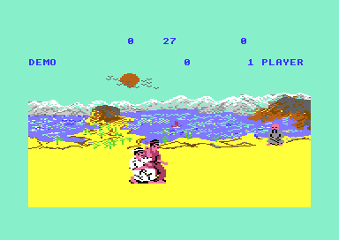
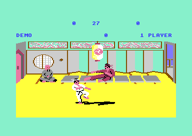
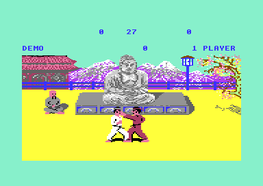

# The game flow (version I)

The game flow connects the fights. After the start, the program shows the text panel at the top of the screen and plays a demo of two computer fighters under it. A function key or the fire button starts a one-player game against the computer, or a two-player game. A one-player game climbs the ranks from NOVICE to 10TH DAN, and one lost bout ends it. A two-player game has four bouts of 30 seconds, and the higher score wins. The flow chooses the scene, runs the clock and gives the points and the score. It writes the rank, the high score and the mode into the panel. (**Code**)

**Conventions.**
- Addresses are C64 addresses. Names are the names of the knowledge of v1.
- A *frame* is one PAL screen, 1/50 of a second. A *pass* is one run of the frame loop of `bout_loop`.
- An *exchange* is one call of `bout_loop`. The fighters start at their start places. The exchange ends when a fighter falls, the time ends or a start key comes.
- A *bout* is a sequence of exchanges in one scene, with the clock at 30 at its start, and one result.
- A *full point* is two *half points*. A fighter with 4 half points wins a one-player bout or a demo bout.
- A *stage* is one value of `stage_counter`. The scene is `stage_counter` AND 3.
- The *rank index* is `cpu_skill+1` (`$A9`) in a one-player game. It is also the AI level of the computer fighter.
- Player 1 is fighter 0: white, joystick port 2. Player 2 is fighter 1: red, joystick port 1.
- **Observed** marks a fact that a run showed. **Code** marks a fact from the code only. **Conclusion** marks an interpretation.

## How it works

The program has no separate title screen. The title is the text panel, and the demo plays under it. Each game mode is a loop of bouts, and each bout is a loop of exchanges. The bout loop reads the title keys in each pass, so the keys work only while the fighters are on the screen. (**Code**)

~~~mermaid
flowchart TB
  A["Cold start: machine and screen (init_game_state)"] --> B["Title loop: panel texts, scores to 0 (title_demo_loop)"]
  B --> C["Demo: 4 bouts (demo_play)"]
  B --> D["One-player game (game_one_player)"]
  B --> E["Two-player game (game_two_players)"]
  C --> F["Bout handler of the mode: points and result"]
  D --> F
  E --> F
  F --> G["One exchange (bout_loop)"]
  G --> H["One pass per frame: fighters, random, keys, clock"]
~~~

[`cold_start` `$1601`](../src/game/init_bout_loop.asm#L240) prepares the machine one time and jumps into [`title_main_loop` `$19A7`](../src/game/title_and_scene.asm#L64). The title loop never returns. Each mode calls its own bout handler, and each bout handler calls [`bout_loop` `$1590`](../src/game/init_bout_loop.asm#L184) again until the bout has a result. The state machines at the end of the page give each change of state. (**Code**)

### The cold start

The loader jumps to [`program_entry` `$1158`](../src/game/entry_and_tables.asm#L6), which jumps to `cold_start`. `cold_start` calls [`init_game_state` `$1414`](../src/game/init_bout_loop.asm#L6) and then jumps to `title_main_loop`. `init_game_state` does these steps in this order (**Code**):

1. It writes 0 to `game_mode`, `front_fighter` and `shape_page_offset`. With `game_mode` 0, the music driver keeps the SID silent.
2. [`init_vectors_cias` `$1459`](../src/game/init_bout_loop.asm#L51) switches the ROMs out (`$01` = `$05`) and stops the CIA 1 interrupts. It enables only the raster interrupt and sets the IRQ, NMI and RESET vectors. The CIA 2 timer B gives the NMI of the floor colour. The page [interrupts.md](interrupts.md) explains the chain.
3. `init_vic_screen` selects VIC bank 3, the screen at `$CC00` and the bitmap and the panel characters at `$E000`. It switches on all 8 sprites in multicolour, fills the panel with spaces and gives the floor its yellow colour. It writes colour `$0E` into the 16 cells of the yin-yang symbols. The page [graphics.md](graphics.md) explains the screen.
4. It writes `$53` into `frame_random`.
5. It writes 1 into `scene_shown`. Scene 1 is not on the screen, so the first bout draws scene 0.

The byte after the JMP of `cold_start` is an RTS that no code reaches (**Code**). This byte is a trace of an older cold start that called the title loop with a JSR (**Conclusion**). The page [../../docs/development.md](../../docs/development.md) tells about such traces.

### The title loop and its keys

`title_main_loop` writes 0 into `two_player_mode`, so the panel shows 1 PLAYER. Then `title_demo_loop` shows the high score of the mode and the mode text. It writes 0 into `in_game`, clears both scores to `     0` and calls `demo_play`. When the demo ends without a start key, the loop starts again. A start key or fire starts the game of `two_player_mode`. (**Code**)

After a one-player game, the title loop reads the fire button of port 2 one time. When the player still holds fire, a new one-player game starts at once. Else the title loop clears both scores and starts the demo again. The last score of the game thus stays on the panel only during the bow of the winner. The high score keeps it. (**Code**)

[`read_title_keys` `$1948`](../src/game/title_and_scene.asm#L6) selects keyboard column 0 with `$DC00` = `$FE` and reads the row byte at `$DC01`. It acts only when the row byte differs from `last_key_row`, so a held key acts one time. The compare uses the full byte, so only one key of column 0 can be pressed. The fire test has no such edge test. Fire on port 2 gives a start in each pass while `in_game` is 0. (**Code**)

| Key | Row byte | Effect | Condition |
|---|---|---|---|
| F1 | `$EF` | Start the game of the mode (A = `$80`) | `in_game` = 0 |
| F3 | `$DF` | Change 1 PLAYER and 2 PLAYER, then show the mode text and the high score of the new mode | `in_game` = 0 |
| F5 | `$BF` | JMP to `title_main_loop` | Always, also in a game |
| F7 | `$F7` | Nothing: the same result as no key | Always |
| Fire, port 2 | `$DC00` bit 4 = 0 | Start the game of the mode (A = `$80`) | `in_game` = 0 |

[`title_key_f5` `$19A4`](../src/game/title_and_scene.asm#L60) jumps to the title loop from inside `bout_loop`. It does not reset the stack. Each press leaves 4 return addresses, 8 bytes, on the stack. (**Code**) The stack pointer wraps in page 1 and no code reads these bytes, so the program does not crash (**Conclusion**). F5 also changes the mode back to 1 PLAYER, because `title_main_loop` clears `two_player_mode` (**Code**).

F7 has its own compare but gives the same result as no key (**Code**). The authors removed an F7 function (**Conclusion**). No run executed the paths of F1, F3, F5 and F7 (**Code**, coverage). The runs started each game with fire on port 2 or with a register step to the start path of `title_keys_fire` (**Observed**).

### The attract demo

[`demo_play` `$17BF`](../src/game/game_modes.asm#L220) writes 0 into `stage_counter` and gives each computer fighter a random level from 3 to 11. The level is `ai_next_random` AND 7, plus 3, plus the carry of the random step. Then it writes DEMO at `$CCA0`, the place of the rank text, and gives both fighters to the computer. `game_mode` 1 selects tune 1. (**Code**) The page [sound_music.md](sound_music.md) tells about the tunes.

The demo plays four bouts, stages 0 to 3, so it shows the four scenes in order. Each bout clears the half points and the yin-yang symbols, writes 30 into the clock and draws the scene. A demo bout ends when a fighter has 4 half points, and the winner bows. At time up the bout ends without a decision and without a bow. The demo gives no score. After the fourth bout, the title loop starts a new demo with new levels. (**Code**) The screenshots show the four scenes in this order (**Observed**).

Scene 0: a pagoda, Mount Fuji, a torii gate and a lake.

Scene 1: a lake with a sun and mountains.

Scene 2: the dojo with a lantern and windows.

Scene 3: the Buddha statue and the temple.

No code seeds `ai_random` before the first demo. At the entry, `ai_random` is `$C7`, so the first two random steps give `$93` and `$3B`. Both give level 7. A saved machine state at the first demo bout shows `cpu_skill` = 7, 7 and `ai_random` = `$3B` (**Observed**). The demo fighters read no joystick, so the first demo after each start shows the same fights (**Conclusion**).

`ai_setup_level` writes most AI masks without the index X. Thus the level of fighter 1 sets these masks for both computer fighters. The page [ai.md](ai.md) gives the details. (**Code**)

### The one-player game

[`game_one_player` `$16A9`](../src/game/game_modes.asm#L81) prepares the game in this order (**Code**):

1. It writes 0 into `stage_counter` and the rank index. It gives fighter 0 to the player and fighter 1 to the computer, and clears the rank text.
2. It writes 1 into `in_game`, so F1, F3 and fire have no effect in the game. It writes 2 into `wins_to_promotion`.
3. It clears both scores and then also the last digit of player 2. Thus the panel shows no score for player 2 in this mode.
4. It copies `frame_random` into `ai_random`. `frame_random` steps in each pass, so the length of the demo before the start selects the random numbers of the opponent.
5. It writes NOVICE at `$CCA0` and writes 2 into `game_mode`, which selects tune 2.

Each bout clears the half points, the tie-break values and the symbols, writes 30 into the clock and draws the scene of the stage. Then [`bout_1p_exchanges` `$175F`](../src/game/game_modes.asm#L165) plays the bout and returns its result. (**Code**)

- **Won (1).** `wins_to_promotion` decrements. After two won bouts, [`game_1p_promote` `$171D`](../src/game/game_modes.asm#L133) increments the rank index and `stage_counter` together and writes the new rank text. A promotion thus changes the scene too.
- **Draw (`$81`).** Both fighters bow and the bout starts again. The count of wins does not change.
- **Lost (0).** `high_score_update` tests the score of player 1, `high_score_show` writes the high score, and the game ends.

The rank index is also `cpu_skill+1`, the AI level of the computer. NOVICE fights level 0, 1ST DAN fights level 1, and 10TH DAN fights level 10. The page [ai.md](ai.md) tells what each level changes. (**Code**) The test `one_player_cpu.json` and the recording `cpu_ranks` play promotions with the computer in place of player 1. Their screens and states are the same on the original and on the rebuild. (**Observed**)

### The rank overflow

A one-player game has no upper rank. After 10TH DAN, the rank text shows wrong characters, and the computer fighter reads its level from wrong bytes. The game does not stop. (**Code**) The worked example at the end of this page decodes each byte.

The only limit is a test of `stage_counter` >= `$16` before each promotion. The rank index and `stage_counter` start at 0 and increase together, so the rank index reaches 22 after 44 won bouts. [`rank_number_table` `$1D3C`](../src/game/panel_texts_1c62.asm#L144) has 12 entries, for the rank index 0 to 11. Index 11 reads the second `$0A` and shows 10TH DAN again. Index 12 to 22 read the first 11 bytes of `ai_update` at `$1D48-$1D52`, which are code. (**Code**)

[`print_rank_text` `$1CAA`](../src/game/panel_texts_1c62.asm#L50) has three paths (**Code**):

- Number 0 writes `NOVICE ` into 7 cells.
- Number `$0A` writes `10TH DAN` into 8 cells.
- Each other number writes the character number + `$30`, with an 8-bit add. Then it writes ST, ND or RD for 1, 2 or 3, else TH, and then ` DAN`. This text has 7 cells.

The promotion does not call `clear_rank_text`. Thus cell 7 keeps the N of `10TH DAN`, and each text after it ends in `DANN` or `NOVICE N`. (**Code**)

The panel character set at `$E000` has 128 glyphs. Characters `$80-$BF` are RAM noise that the authors saved with M.CHSET. Characters `$C8-$FF` read the scene bitmap at `$E640` and up. Such a character shows a piece of the scene that is on the screen, in blue. The rank text comes before the scene drawing, so the glyph changes again while the new scene unpacks. (**Code**) A saved machine state of a one-player run at rank index 12 has `$D4`, `TH DANN` at `$CCA0-$CCA7`. The score of player 1 is 85900 in this state. (**Observed**)

After rank index 22, [`game_1p_rank_wrap` `$1749`](../src/game/game_modes.asm#L152) runs at each promotion. It writes `$20` + (`stage_counter` + 1) AND 3 into `stage_counter`, so the scenes continue in order. It writes a random level from 2 to 10 into the rank index and writes no rank text. The panel thus keeps `>TH DANN`. (**Code**) No run executed this path (**Code**, coverage).

`ai_setup_level` reads 12-entry level tables with the rank index. With index 12 to 22 it reads the bytes of the next table. The last table, `ai_level_react_mask` at `$2227`, then gives code bytes of `fighter_update` at `$2233-$223D`. The page [ai.md](ai.md) tells what these values do. (**Code**)

In practice, a player who wins more than 22 bouts sees a wrong rank text, and the game continues. A test or a fix can use the limit test at `$1719`. Version II stops the rank at 10TH DAN, see [../../docs/versions.md](../../docs/versions.md). (**Conclusion**)

The screenshot run makes the same writes as the test [rank_overflow.json](../tests/rank_overflow.json): the rank index 12 and the stage 11 at the start of a game. Then the computer plays for player 1 and wins the next promotion. The second `print_rank_text` reads the byte `$5E` of the code after the rank table, adds `$30` and prints character `$8E`. The panel shows it as "@", then "TH DAN". The panel bytes at `$CCA0` are `8E 54 48 20 44 41 4E 20`. (**Observed**)

### The two-player game

[`game_two_players` `$161D`](../src/game/game_modes.asm#L6) gives both fighters to the players, clears the rank text, the symbols and both scores, and writes 1 into `in_game`. `game_mode` 3 selects tune 3. The game has four bouts, stages 0 to 3, so it shows the four scenes in order. (**Code**)

[`bout_2p_exchanges` `$167C`](../src/game/game_modes.asm#L55) plays exchanges until the time ends. This mode counts no half points, so a bout always lasts the full 30 seconds of the clock. A hit of one fighter gives score points to the other player. The symbol of the hit appears at the moment of the hit, and the handler clears all symbols at the end of each exchange. (**Code**)

After the fourth bout, [`score_compare_players` `$1A98`](../src/game/score_and_timer.asm#L17) compares the six score characters from left to right. The player with the higher score bows, and `high_score_update` tests the score of this player against `high_score_2p`. With equal scores, both fighters bow and the score of player 1 goes to the high score test. No run executed this path. Then the title loop starts the demo again. (**Code**) The test `two_player.json` plays the four bouts with the computer for both players and reaches the demo again (**Observed**).

Before the bow, the code calls `winner_stub` with the winner in X. `winner_stub` is a lone RTS. The one-player game also calls it after a decision at time up. (**Code**) The authors removed a winner action, for example a message or a sound (**Conclusion**).

### The bout loop

`bout_loop` plays one exchange. First it writes 0 into `shape_page_offset` and calls `bout_setup_fighters`. This routine puts the fighters at x `$3E` and `$5A` on the ground, face to face, in move and animation `$17`, the start move. It clears the hit reactions, writes 8 into `knockdown_delay`, colours fighter 1 red and calls `ai_setup_level` for both fighters. Then `bout_loop` steps both animations once, enables the interrupts and switches sprites 0-5 on. (**Code**)

Each pass does this work in this order (**Code**):

1. It waits until the raster line is `$FD` or more, in the lower border.
2. It calls `fighter_update` for fighter 1, with fighter 0 as the opponent. See [fighters.md](fighters.md).
3. It calls `fighter_update` for fighter 0, with fighter 1 as the opponent.
4. It calls [`frame_random_step` `$1613`](../src/game/init_bout_loop_1608.asm#L15).
5. It calls `read_title_keys`. A start key ends the exchange with A = `$80`.
6. A nonzero `bout_knockdown` ends the exchange with A = the hit reaction move.
7. When no fighter is in a hit reaction and fighter 0 left the start move `$17`, it calls `timer_tick`.
8. When `time_up` is 1, both fighters show frame `$37` on the ground, and the exchange ends with A = 1.

A pass takes one frame when its work fits in the frame. In the two-player recording, 11579 passes ran in 12455 frames (**Observed**). The other frames are the start, the scene drawing and the bows (**Conclusion**).

A hit does not end the exchange at once. The hit fighter plays its hit reaction, and the end of this animation writes the reaction move into `bout_knockdown`. The page [combat.md](combat.md) explains the hits. (**Code**) After a fall, both fighters start again from the start places.

Each bout handler tests `hit_reaction` of fighter 0 EOR `hit_reaction` of fighter 1, AND `$10`. In all reaction moves bit 4 is 1, so this test finds a hit of exactly one fighter. When both fighters hit each other in the same exchange, nobody gets a point. (**Code**)

### Points and yin-yang symbols

A hit gives `hit_points` 2 for a full point or 1 for a half point. The page [combat.md](combat.md) tells how the hit test chooses. In the one-player game and the demo, [`add_half_points` `$1843`](../src/game/game_modes.asm#L292) adds this value to `half_points` of the fighter who hit. It draws the symbols and returns C set at 4 half points or more, which wins the bout at once. (**Code**)

Each fighter has two symbol places of 2 x 2 characters. The first symbol is the one near the middle of the panel. Characters 1-4 are a full yin-yang, and characters 5-8 are a half yin-yang. (**Code**)

| Half points | Inner place | Outer place |
|---|---|---|
| 1 | Half symbol | Empty |
| 2 | Full symbol | Empty |
| 3 | Full symbol | Half symbol |
| 4 or more | Full symbol | Full symbol |

In the one-player game, a hit of the player adds score points, a tie-break value and half points. A hit of the computer adds only a tie-break value and half points. The demo adds only half points. (**Code**)

The two-player game shows the symbols in another way. On a hit, `hit_full_point` and the half-point path of the hit test draw one symbol at once. The offset is 0 for fighter 0 and `$1D` for fighter 1. This test reads `two_player_mode`, not `game_mode`. (**Code**) Thus after F3 the demo also draws these symbols, on top of the symbols of `add_half_points`. One full hit of fighter 0 then shows two full symbols. (**Conclusion**)

### The bout timer and the time bonus

Before each bout, `timer_show_30` writes 30 into the clock at `$CC3B`. [`timer_tick` `$1BDD`](../src/game/score_and_timer.asm#L230) decrements `timer_frames`. After each 50 calls it decrements the clock digits and `timer_seconds`. From 10 to 9 the tens digit becomes a space. At 0 it writes 1 into `time_up`. (**Code**)

The clock runs only in the passes without a hit reaction, and only after fighter 0 left the start move. A bout of 30 clock seconds thus lasts longer than 30 seconds. (**Code**) The demo screenshots show 27 on the clock (**Observed**).

After a won one-player bout, [`time_bonus_count` `$1C8E`](../src/game/panel_texts_1c62.asm#L33) converts the remaining time into points. It calls `timer_tick` without a frame wait until the next whole second, adds 100 points for player 1 and waits 6 frames. It does this until `time_up` is 1. The bonus is thus 100 points for each second on the clock. (**Code**) 30 seconds take 180 frames, 3.6 seconds (**Conclusion**). A win by decision at time up gives no bonus, because `time_up` is already 1 (**Code**).

### Scoring and high scores

A score is six screen characters, not a number. `score_clear` writes five spaces and a 0. The last digit is always 0. The first points change the tens digit from a space to 0. (**Code**)

[`score_add_move` `$1B1A`](../src/game/score_and_timer.asm#L112) reads the value of `scoring_move` in `move_score_values` and halves it for a half point. Then it calls [`score_add_100` `$1B43`](../src/game/score_and_timer.asm#L142) that many times. `score_add_100` increments the hundreds digit with a carry into the higher digits, and a space digit becomes 1. Above 999900, all six digits become 0. No run executed this path. (**Code**)

The one-player game gives score points only to player 1, and the demo gives no score. In the two-player game, each player gets the points of each hit. (**Code**)

At time up in the one-player game, the fighter with more half points wins. With equal half points, the higher `bout_hit_value` wins. This value is the sum of the score values of the hits in the bout, halved for a half point. With equal values, the bout is a draw. (**Code**)

[`bout_hit_value_add` `$1C17`](../src/game/panel_texts.asm#L6) reads `hit_points` without the index X. Thus the value of the computer uses the full or half flag of the last hit of the player. A hit of the computer can count as full when it was a half point, or the opposite. This bug changes only the tie-break at time up. (**Code**)

The program keeps two high scores, `high_score_1p` and `high_score_2p`, each six characters. `high_score_update` compares the score with the high score of the mode, character by character. A space is `$20` and a digit is `$30-$39`, so the compare of the screen characters works. A higher score replaces the high score. `high_score_show` writes the high score of the mode at `$CCB1`. (**Code**) The program switches the ROMs out and has no disk code, so the high scores stay only in RAM (**Conclusion**).

## The data

### The panel layout

The panel is screen rows 0-4 at `$CC00-$CCC7`, in text mode. Rows 2 and 3 stay empty. The text is blue hires, colour RAM 6, on the cyan background 3. The 16 cells of the symbols have colour RAM `$0E`, multicolour with black, white and blue. (**Code**) The screenshots show this layout (**Observed**).

| Row | Columns | Address | Content |
|---|---|---|---|
| 0 | 3-4, 6-7 | `$CC03-$CC07` | Upper half of the two symbols of player 1 (outer, inner) |
| 0 | 32-33, 35-36 | `$CC20-$CC24` | Upper half of the two symbols of player 2 (inner, outer) |
| 1 | 3-4, 6-7 | `$CC2B-$CC2F` | Lower half of the two symbols of player 1 |
| 1 | 9-14 | `$CC31-$CC36` | Score of player 1 |
| 1 | 19-20 | `$CC3B-$CC3C` | Clock, from `30` to ` 0` |
| 1 | 25-30 | `$CC41-$CC46` | Score of player 2, empty in the one-player game |
| 1 | 32-33, 35-36 | `$CC48-$CC4C` | Lower half of the two symbols of player 2 |
| 4 | 0-7 | `$CCA0-$CCA7` | Rank text, or DEMO |
| 4 | 17-22 | `$CCB1-$CCB6` | High score of the mode |
| 4 | 31-38 | `$CCBF-$CCC6` | `1 PLAYER` or `2 PLAYER` |

The panel character set has ASCII order: `$20` is a space, `$30-$39` are the digits and `$41-$5A` are the letters. Thus the source writes the texts with `!pet` and lower-case letters. (**Code**)

### The ranks

`rank_number_table` gives the number for `print_rank_text`. The number of won bouts counts only the bouts of the current game. (**Code**)

| Rank index | Won bouts | Rank text | AI level | Scene |
|---|---|---|---|---|
| 0 | 0 | `NOVICE` | 0 | 0 |
| 1 | 2 | `1ST DAN` | 1 | 1 |
| 2 | 4 | `2ND DAN` | 2 | 2 |
| 3 | 6 | `3RD DAN` | 3 | 3 |
| 4-9 | 8-18 | `4TH DAN` to `9TH DAN` | 4-9 | index AND 3 |
| 10 | 20 | `10TH DAN` | 10 | 2 |
| 11 | 22 | `10TH DAN` | 11 | 3 |
| 12-22 | 24-44 | Wrong text, see the worked example | 12-22, read from wrong bytes | index AND 3 |
| 2-10, random | 46 and more | Stays `>TH DANN` | 2-10 | continues in order |

### The score values

`move_score_values` at `$12A3` gives the points of a full point in hundreds, one byte for each move `$00-$18`. The names come from the comments of the AI and the hit zone tables. The page [combat.md](combat.md) describes the moves. (**Code**)

| Move | Name or hit zone table | Full point | Half point |
|---|---|---|---|
| `$06` | `hitzone_up_fwd` | 800 | 400 |
| `$07` | `hitzone_down_fwd_crouch` | 800 | 400 |
| `$0A` | Foot sweep | 400 | 200 |
| `$0B` | Low kick | 200 | 100 |
| `$0C` | `hitzone_fire_fwd` | 200 | 100 |
| `$0D` | `hitzone_fire_up_fwd` | 800 | 400 |
| `$0E` | Flying kick | 1000 | 500 |
| `$0F` | Roundhouse | 800 | 400 |
| `$10` | Back sweep | 800 | 400 |
| `$11` | Back kick | 1000 | 500 |
| `$18` | `hitzone_down_fwd_stand` | 600 | 300 |

The other moves have the value 0. They are not attacks. (**Code**)

## The state machine of the game modes

`game_mode` holds the mode: 0 at the start, 1 in the demo, 2 in the one-player game and 3 in the two-player game. The music driver plays the tune of `game_mode`. `two_player_mode` selects the game that a start key starts. (**Code**)

~~~mermaid
stateDiagram-v2
  state "Cold start (game_mode 0)" as Init
  state "Title loop and demo (game_mode 1)" as Demo
  state "One-player game (game_mode 2)" as P1
  state "Two-player game (game_mode 3)" as P2
  [*] --> Init
  Init --> Demo
  Demo --> Demo: demo ends, or F3, or F5
  Demo --> P1: F1 or fire, 1 PLAYER
  Demo --> P2: F1 or fire, 2 PLAYER
  P1 --> P1: bout lost, fire held
  P1 --> Demo: bout lost, or F5
  P2 --> Demo: 4 bouts played, or F5
~~~

| State | Condition | Next state | Code |
|---|---|---|---|
| Cold start | `init_game_state` returns | Title loop and demo | `cold_start` |
| Title loop and demo | Four demo bouts end without a start key | Title loop and demo, new levels | `title_demo_loop` |
| Title loop and demo | F3 | Same state, other mode text and high score | `read_title_keys` |
| Title loop and demo | F1 or fire, `two_player_mode` = 0 | One-player game | `title_demo_loop` |
| Title loop and demo | F1 or fire, `two_player_mode` = 1 | Two-player game | `title_demo_loop` |
| One-player game | Bout lost, fire held on port 2 | New one-player game | `title_1p_again` |
| One-player game | Bout lost, fire not held | Title loop and demo | `title_1p_again` |
| Two-player game | Four bouts played | Title loop and demo | `game_two_players` |
| Each state with fighters | F5 | Title loop and demo, 1 PLAYER | `title_key_f5` |

## The state machine of a bout

The diagram shows a one-player bout. A demo bout has no score, no time bonus and no decision. A two-player bout ends only at time up and has no bow until the end of the game. (**Code**)

~~~mermaid
stateDiagram-v2
  state "Exchange set-up (bout_setup_fighters)" as Setup
  state "One pass per frame" as Pass
  state "Point for the fighter who hit" as Award
  state "Decision at time up" as Decide
  state "Winner bows" as Bow
  state "Time bonus" as Bonus
  state "Draw: both bow" as Draw
  [*] --> Setup
  Setup --> Pass
  Pass --> Pass: no fall, time left
  Pass --> Award: a fall ends the exchange
  Pass --> Decide: time_up
  Award --> Setup: less than 4 half points
  Award --> Bow: 4 half points
  Decide --> Bow: more half points or higher bout_hit_value
  Decide --> Draw: all equal
  Bow --> Bonus: player 1 won before time up
  Bow --> [*]: computer won, or win at time up
  Bonus --> [*]
  Draw --> [*]
~~~

| State | Condition | Next state | Code |
|---|---|---|---|
| Exchange set-up | Always | One pass per frame | `bout_loop` |
| One pass per frame | No fall, `time_up` = 0 | One pass per frame | `bout_frame_loop` |
| One pass per frame | `bout_knockdown` not 0 | Point for the fighter who hit | `bout_loop` |
| One pass per frame | `time_up` = 1 | Decision at time up | `bout_check_time_up` |
| One pass per frame | Start key, `in_game` = 0 | End of the demo, A = `$80` | `read_title_keys` |
| Point for the fighter who hit | Exactly one fighter hit, less than 4 half points | Exchange set-up | `bout_1p_exchanges` |
| Point for the fighter who hit | No hit, or both fighters hit | Exchange set-up | `bout_1p_exchanges` |
| Point for the fighter who hit | 4 half points or more | Winner bows | `add_half_points` |
| Decision at time up | More half points, else higher `bout_hit_value` | Winner bows | `bout_1p_exchanges` |
| Decision at time up | Equal half points and equal `bout_hit_value` | Draw, result `$81` | `bout_1p_exchanges` |
| Winner bows | Player 1 won, `time_up` = 0 | Time bonus | `bout_1p_won` |
| Winner bows | Computer won, result 0 | End of the game | `bow_winner` |
| Draw | Both bows end | Same bout again | `game_1p_check_draw` |

## The worked example: the rank texts after 10TH DAN

This example decodes the rank text for each rank index from 12 to 22. The bytes come from the original file at `$1D48-$1D52`. They are the first instructions of `ai_update`: `LDY $5E`, `LDA $0054,Y`, `BEQ +$0F`, `LDA $56,X`, `CMP #$0E`. (**Code**)

The character is the byte + `$30`, without the carry. A character from `$C8` up shows 8 bytes of the scene bitmap at `$E000` + 8 x character. Cell 7 is always the N of `10TH DAN`. The scene is the rank index AND 3. (**Code**)

| Rank index | Address | Byte | Character | Glyph | Panel text |
|---|---|---|---|---|---|
| 11 | `$1D47` | `$0A` | - | - | `10TH DAN` |
| 12 | `$1D48` | `$A4` (LDY) | `$D4` | Scene bitmap `$E6A0`, row 5 | `*TH DANN` |
| 13 | `$1D49` | `$5E` | `$8E` | RAM noise `$E470` | `*TH DANN` |
| 14 | `$1D4A` | `$B9` (LDA abs,Y) | `$E9` | Scene bitmap `$E748`, row 5 | `*TH DANN` |
| 15 | `$1D4B` | `$54` | `$84` | RAM noise `$E420` | `*TH DANN` |
| 16 | `$1D4C` | `$00` | - | NOVICE path | `NOVICE N` |
| 17 | `$1D4D` | `$F0` (BEQ) | `$20` | Space | ` TH DANN` |
| 18 | `$1D4E` | `$0F` | `$3F` | `?` | `?TH DANN` |
| 19 | `$1D4F` | `$B5` (LDA zp,X) | `$E5` | Scene bitmap `$E728`, row 5 | `*TH DANN` |
| 20 | `$1D50` | `$56` | `$86` | RAM noise `$E430` | `*TH DANN` |
| 21 | `$1D51` | `$C9` (CMP #) | `$F9` | Scene bitmap `$E7C8`, row 6 | `*TH DANN` |
| 22 | `$1D52` | `$0E` | `$3E` | `>` | `>TH DANN` |

In the column "Panel text", `*` stands for a glyph from the scene bitmap or from the RAM noise. At index 18 the glyph is a real `?`. Index 16 goes the NOVICE path because the byte is 0. Index 17 gives a space, because `$F0` + `$30` is `$120`. (**Code**) The saved state at rank index 12 confirms the character `$D4` and the text `TH DANN` (**Observed**).

## Still open

- How do F1, F3, F5 and F7 act in a run? The bits 5-7 of `$DC01` read 0 in this emulator, so the row byte never matches. A run on another emulator, or a write of `last_key_row` and a register step, can test them.
- What does the panel show at each rank index from 12 to 22? A run that stops after `print_rank_text` in `game_1p_promote` at each index can capture each screen. The test `rank_overflow.json` captures only the start of the game.
- What does the wrap after rank index 22 do in a run? A run with the rank index and `stage_counter` at 21 before two won bouts can show it.
- Does the demo show the extra symbols after F3? A run with `two_player_mode` = 1 during the demo can show it.
- The equal scores at the end of a two-player game and the score above 999900 had no run.
