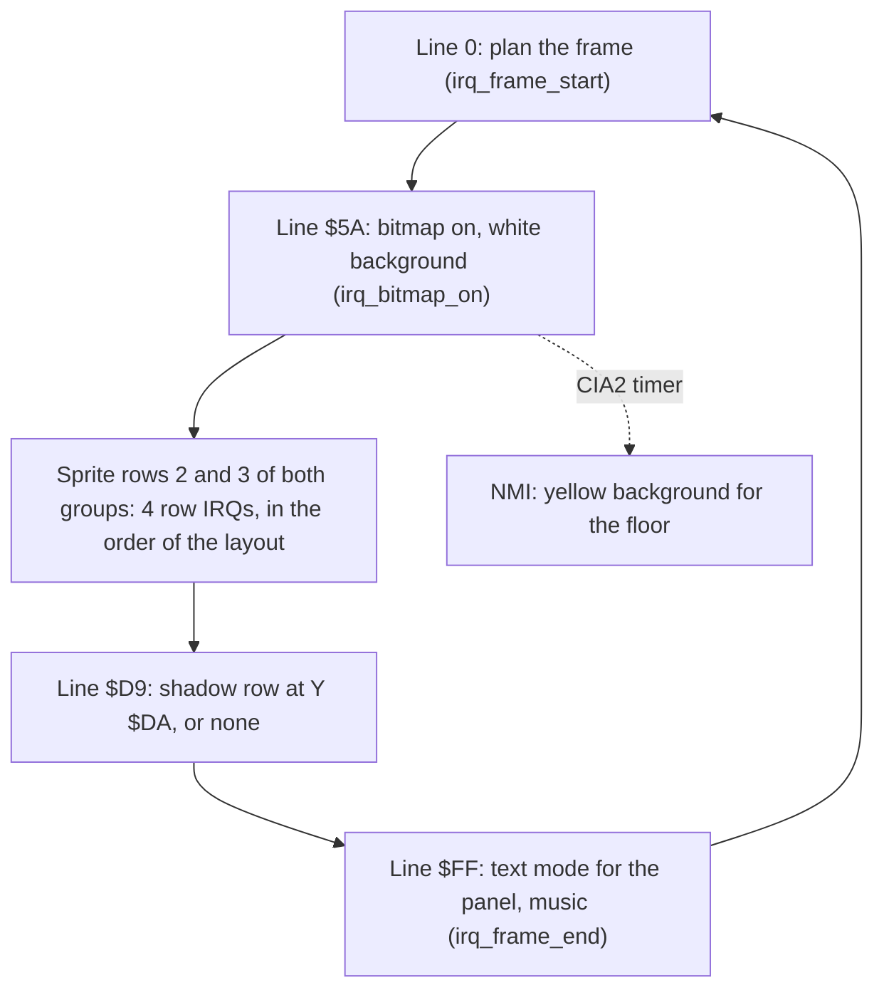

# The graphics of version I

The graphics give the player one fixed screen for each bout. A text panel at the top shows the scores, the clock, the yin-yang symbols and the rank. Under it, a multicolour bitmap shows one of four scenes, for example a pagoda with Mount Fuji. The lower part of the screen is a flat yellow floor. Two large fighters stand on the floor and in front of the scene. Each fighter is 72 x 63 pixels, much larger than one sprite. The program thus builds each fighter from 9 sprite parts and moves 6 hardware sprites down the screen in each frame.

**Conventions.**
- Addresses are C64 addresses. Names are the names of the knowledge.
- A *frame* is one PAL screen of 312 raster lines, 50 frames each second. A *line* is a raster line, the value of `$D012`.
- A *row* without other words is a text row of the screen (0-24, 8 lines each). A *sprite row* is a band of three sprites of one fighter, 21 lines high.
- A *part* is one 64-byte sprite image of a fighter. A *shape frame* (the value of `fighter_frame`) is one pose: 9 parts in 3 sprite rows of 3 columns.
- A *slot* is the place of a part in a shape frame: slot n is in sprite row n/3 and column n MOD 3.
- *Group A* is sprites 0-2 (the fighter in front). *Group B* is sprites 3-5 (the other fighter).
- *Pattern colours* are the colours of the reference images: in multicolour, light grey is %01, grey is %10 and yellow is %11.
- **Observed** marks a fact that a run showed. **Code** marks a fact from the code only. **Conclusion** marks an interpretation.

## The screen

The screen has three bands. Each band has its own mode and its own memory. The raster interrupts change the mode two times in each frame. The page [interrupts.md](interrupts.md) tells how the raster handlers do it.

| Rows | Lines | Mode | Memory | Colours |
|---|---|---|---|---|
| 0-4 | 51-90 | Text, multicolour on | Screen `$CC00-$CCC7`, charset `$E000` | Text colour 6 (blue, hires characters), background 3 (cyan) |
| 5-16 | 91-186 | Multicolour bitmap | Bitmap `$E640-$F53F`, screen `$CCC8-$CEA7`, colour RAM `$D8C8-$DAA7` | From the scene maps, background 1 (white) |
| 17-24 | 187-250 | Multicolour bitmap | Bitmap `$F540-$FF3F`, screen and colour RAM `$77` | All four pixel values yellow |

[`init_vic_screen` `$14A7`](../src/game/init_bout_loop.asm#L79) sets the VIC-II one time at the start. It writes 0 to `$DD00`, which selects VIC bank 3 (`$C000-$FFFF`). It writes `$38` to `$D018`, so the screen is at `$CC00` and the charset and the bitmap both start at `$E000`. It writes `$18` to `$D016` (multicolour) and enables all 8 sprites in multicolour. **Code**.

### One base address for the charset and the bitmap

The charset and the bitmap use the same base address `$E000`. In text mode, the VIC reads the characters of the panel from `$E000-$E7FF`. In bitmap mode, the VIC reads rows 0-4 of the bitmap from `$E000-$E63F`, but the screen never shows bitmap rows 0-4. The program thus puts its font into the bitmap memory of rows 0-4. The scene starts at `$E640`, the first byte of bitmap row 5. **Code**.

[`panel_charset` `$E000`](../src/graphics/panel_charset.asm#L6) holds 128 characters in ASCII order. Characters `$01-$08` are the full and the half yin-yang symbols. The panel uses only a few of them: the yin-yang characters, the space, the digits and 16 capital letters. Characters `$C8-$FF` are not font data: they are the first bytes of the scene bitmap. A character code in this range thus shows a part of the scene as a character. The rank overflow of [game_flow.md](game_flow.md) prints codes from `$C0` up, so the panel then shows such bytes. **Code**.


The panel charset: the yin-yang characters are in the first line, then the digits, the capitals and the lower-case letters.

The panel text uses colour RAM value 6. This value is below 8, so the VIC shows these characters in hires, also in multicolour mode. The 16 cells of the four yin-yang symbols get colour RAM value `$0E`. They show in multicolour with black (`$D022` = 0), white (`$D023` = 1) and blue (`$0E` AND 7 = 6). **Code**.

### The floor

[`floor_colour_fill` `$1445`](../src/game/init_bout_loop.asm#L39) writes `$77` into the screen and the colour RAM of rows 17-24. Then the pixel values %01, %10 and %11 all give colour 7 (yellow). A CIA2 timer NMI, [`nmi_floor_colour` `$28A5`](../src/irq/irq_screen_split.asm#L66), sets the background (%00) to 7 near the floor. Thus each pixel of the floor is yellow, whatever bitmap bytes are in `$F540-$FF3F`. **Code**.

M.XSPRITES fills `$F540-$FFEF` and thus starts at the first byte of bitmap row 17. The VIC thus reads the bull sprites of the unused bonus test as floor bitmap, but the floor colours hide them. The fill loop also writes `$77` into the sprite pointers `$CFF8-$CFFF`. The raster handlers write pointers 0-5 again in each frame. **Code**. **Conclusion**: the authors used the hidden floor bitmap as free memory for sprite data.

### The memory of VIC bank 3

| Range | Content |
|---|---|
| `$C000-$C03F` | Blank sprite (pointer 0), cleared by `clear_blank_sprite` |
| `$C040-$C93F` | Four fighter shape buffers, pointers `$01-$24`. Buffer 3 covers the first 64 bytes of the M.SHAPES end |
| `$C940-$CBFF` | The end of M.SHAPES: parts of a second shape set, not used in version I |
| `$CC00-$CFE7` | Screen RAM. Rows 0-4 are the panel text, rows 5-24 the bitmap colours |
| `$CFF8-$CFFF` | Sprite pointers |
| `$D000-$DFFF` | M.SHAPES in the RAM under the I/O: floor shadows (pointers `$55-$7B`) and second-set parts |
| `$E000-$E3FF` | Panel charset (bitmap rows 0-4) |
| `$E400-$E5FF` | RAM noise, saved with M.CHSET |
| `$E600-$E63F` | No game file fills it. The VIC shows it only as characters `$C0-$C7` |
| `$E640-$F53F` | Scene bitmap, rows 5-16 |
| `$F540-$FF3F` | Floor bitmap, rows 17-24. It holds M.XSPRITES (bull parts) |
| `$FFFA-$FFFF` | CPU vectors (the KERNAL ROM is off) |

The VIC sees RAM in all of `$D000-$DFFF`, because bank 3 has no character ROM image. The floor shadows at `$D540-$DEFF` thus show without a copy, although the CPU sees the I/O chips at these addresses (`$01` = `$05`). **Code**.

## The fighters

### One fighter is 9 sprites

A fighter is 3 sprite rows of 3 sprites. The columns are at X, X+`$18` and X+`$30`. The sprite rows start at Y, Y+`$15` and Y+`$2A`. Thus a fighter is 72 x 63 pixels, or 36 x 63 multicolour pixels. One group of 3 hardware sprites shows the three sprite rows one after the other. The sprite X of a fighter is `fighter_x` * 2 and the sprite Y is `fighter_y` * 2. A fighter on the ground has `fighter_y` = `$50`, thus sprite Y `$A0`. **Code**.

The sprite colours are the same for both fighters, except one:

| Pixel | Register | Colour |
|---|---|---|
| %01 | `$D025` | 0, black |
| %10 | Sprite colour, `fighter_colour` | 1 white (fighter 0) or 2 red (fighter 1) |
| %11 | `$D026` | `$0A`, light red (skin) |

`front_fighter` selects the fighter for group A, usually the fighter that attacks. Sprites 0-2 have priority over sprites 3-5, so this fighter shows in front of the other fighter. Sprites 6 and 7 are on, but no code writes their position. **Code**. **Conclusion**: they stay out of the visible screen.

### Shape frames and parts

The animation scripts give a shape frame for each step (see [fighters.md](fighters.md)). A shape frame is 9 part numbers, one for each slot. Nine tables of `$48` bytes hold them: the table of slot n starts at `$7AE0` + n * `$48`, and the shape frame is the index. [`frame_parts_top_left` `$7AE0`](../src/shapes/frame_part_tables.asm#L6) is the table of slot 0. Part number 0 means an empty slot. **Code**.

A part number p gives the address of its 64 bytes in two steps:

1. The page is [`shape_part_page_table` `$7F00`](../src/shapes/shape_lookup_tables.asm#L24) entry p, plus `shape_page_offset`. Each entry is `$80` + p / 4.
2. The low byte is [`shape_part_lo` `$3109`](../src/shapes/shape_build.asm#L6) entry p AND 3: `$00`, `$40`, `$80` or `$C0`.

With `shape_page_offset` = 0, part p is thus at `$8000` + p * 64. Parts `$01-$FF` fill `$8040-$BFFF` (`shape_parts`). Part 0 is never read, and `$8000-$803F` holds zeros. The part tables name all 255 parts. **Code**.


The fighter parts in pattern colours: light grey is black in the game, grey is the white or red gi, and yellow is the skin.

M.SHAPES is one file of 21248 bytes. In the game, its bytes fill three ranges: `$8000-$BFFF`, `$D000-$DFFF` and `$C900-$CBFF`. Only the first part holds the fighter set. The other two parts hold the floor shadows and the parts of a second shape set. The second set needs `shape_page_offset` = `$40`: part p is then at `$C000` + p * 64, which is also VIC sprite pointer p. Only the unused bull test sets this offset, see [fighters.md](fighters.md). **Code**.

### The build and the double buffer

[`shape_build` `$316D`](../src/shapes/shape_build_3165.asm#L11) copies the 9 parts of `fighter_frame` into a sprite buffer. Each fighter has two buffers of 9 x 64 bytes. The screen shows one buffer while the program writes the other one. These are the steps:

1. It toggles `draw_buffer` with EOR #1. Fighter 0 uses buffers 0 and 1, fighter 1 uses buffers 2 and 3. The four buffers start at `$C040`, `$C280`, `$C4C0` and `$C700`, with sprite pointers `$01-$09`, `$0A-$12`, `$13-$1B` and `$1C-$24`.
2. When `fighter_facing` is 1, it jumps to the mirrored copy (next section).
3. It copies the 9 sprite pointers of the new buffer into `part_ptr_build`.
4. For each slot 0-8, it reads the part number from the table of the slot. For part 0, it sets the pointer of the slot to 0, the blank sprite at `$C000`. For another part, it copies 64 bytes into the buffer. The destination moves 64 bytes for each slot, also for an empty slot.
5. [`shape_publish_ptrs` `$3365`](../src/shapes/shape_build_3165.asm#L409) copies the 9 new pointers into `fighter_part_ptrs`. The raster IRQ at line 0 reads the pointers from there.
6. It looks for `fighter_frame` in the list of the frames with a floor shadow, and sets the shadow pointers (see below).

The new pointers go into `fighter_part_ptrs` only after the last copy. Until then, the screen shows the complete old shape frame from the other buffer. Thus a fighter never shows half of a new pose. **Code**.

Each part copy uses its own `LDA $xxxx,Y` instruction. The code writes the source address into the operand of this instruction. These self-modified operands are why the SHADOW release, a memory dump, has other bytes here (see [the releases](../../docs/releases.md)). **Code**.

### Worked example: shape frame 0

Animation 1 (stand) shows shape frame 0. The 9 tables give these parts for frame 0. Here, fighter 0 builds the frame with facing 0 into buffer 0.

| Slot | Table | Part | Source | Destination | Pointer |
|---|---|---|---|---|---|
| 0 | `$7AE0` | `$03` | `$80C0` | `$C040` | `$01` |
| 1 | `$7B28` | `$02` | `$8080` | `$C080` | `$02` |
| 2 | `$7B70` | `$00` | none | (`$C0C0`, not written) | `$00` |
| 3 | `$7BB8` | `$04` | `$8100` | `$C100` | `$04` |
| 4 | `$7C00` | `$05` | `$8140` | `$C140` | `$05` |
| 5 | `$7C48` | `$00` | none | (`$C180`, not written) | `$00` |
| 6 | `$7C90` | `$07` | `$81C0` | `$C1C0` | `$07` |
| 7 | `$7CD8` | `$08` | `$8200` | `$C200` | `$08` |
| 8 | `$7D20` | `$00` | none | (`$C240`, not written) | `$00` |

Part `$03` has page `$7F00`+3 = `$80` and low byte `$3109`+3 = `$C0`, thus `$80C0`. The standing fighter uses only the left and the middle column. The right column shows the blank sprite. **Code**.

### Mirroring

The parts show a fighter that looks to the right. For `fighter_facing` = 1, [`shape_build_mirrored` `$33E7`](../src/shapes/shape_build_mirror.asm#L6) makes the mirror image during the copy. It changes three things:

1. **The columns.** Slot 0 takes the part of the top-right table, slot 2 the part of the top-left table. The same change applies to the middle and the bottom sprite row. The pointer lists stay the same.
2. **The bytes of a line.** [`shape_copy_mirrored_part` `$365F`](../src/shapes/shape_build_mirror.asm#L297) copies 3 bytes for each of the 21 lines. Source byte 2 goes to byte 0, byte 1 stays, and source byte 0 goes to byte 2. Three store instructions with the bases destination-2, destination and destination+2 do this in one loop.
3. **The pixels of a byte.** Each byte goes through [`shape_mirror_table` `$7E00`](../src/shapes/shape_lookup_tables.asm#L6). Entry b is b with its four 2-bit pixels in the opposite order.

For example, `$1B` is %00 01 10 11 and entry `$1B` is `$E4`, %11 10 01 00. A mirror of the single bits would give `$D8`, %11 01 10 00. That byte exchanges the colours %01 and %10, so a hires mirror would draw the outline in the gi colour and the gi in black. The table keeps each pixel pair intact. **Code**.

The mirrored copy writes 63 bytes for each part, and the normal copy writes 64. Byte `$3F` of a sprite is not part of the image, so the difference does not show. **Code**.

### The floor shadow in a fourth sprite row

Some moves lift the fighter off the floor, for example the jump and the flying kick. Then a fourth sprite row shows a black shadow on the floor under him. The shadow sprites are 5 to 8 lines high and use only pixel value %01 (black). **Code**.

The program does not copy the shadow parts. They stay at `$D540-$DEFF` (pointers `$55-$7B`), and the VIC reads them directly. After the build, `shape_build` looks for `fighter_frame` in [`shape_row4_frames` `$33AF`](../src/shapes/shape_build_3165.asm#L452). This list has the 8 air frames `$0A`, `$3A`, `$09`, `$20`, `$15`, `$17`, `$16` and `$14` of the animations 5, 8, 9 and `$0E`. Three tables give the pointers for the left, the middle and the right sprite: entries 0-7 for facing 0, entries 8-15 for facing 1. They go into `row4_ptr_left`, `row4_ptr_mid` and `row4_ptr_right`. **Code**.

There is no mirror at run time for the shadows. Each facing-1 shadow is a second copy of a facing-0 shadow, already mirrored through the table `$7E00`. A byte compare finds 15 such pairs. **Code**.


The shadows for facing 0, pointers `$55-$5E`.


The shadows for facing 1, pointers `$6D-$7B`, the mirror images of the facing-0 shadows.

The frame-start IRQ shows the fourth sprite row for each group with a sprite Y other than `$A0`. A frame that is not in the list keeps the old shadow pointers. **Code**. **Conclusion**: a fighter that changes to a frame outside the list in the air shows the old shadow. Whether a hit in the air can cause this is in **Still open**.

## The sprite multiplexer

A frame shows 2 fighters x 4 sprite rows x 3 sprites, thus 24 sprite images, with only 6 hardware sprites. Each group of 3 sprites starts the frame with sprite row 1 of its fighter. At the last line of the sprite row, a raster IRQ moves the 3 sprites 21 lines down. It also sets the pointers of the next sprite row. [`irq_frame_start` `$2A66`](../src/irq/sprite_mux_plan.asm#L6) plans this chain at line 0 of each frame. **Code**.



The planner does these steps in each frame:

1. It puts `front_fighter` into group A and the other fighter into group B. It copies the position of each fighter into `group_y`, `group_x_lo` and `group_x_msb`.
2. It selects the shadow handler. A group with a `group_y` other than `$A0` gets its shadow at Y `$DA`. It then writes the shadow pointers into the handlers.
3. [`mux_choose_layout` `$2B40`](../src/irq/sprite_mux_plan.asm#L104) selects one of 7 layouts from the Y gap g between the groups. It writes the lines, the next handlers and the pointers into the operands of the row handlers.
4. [`mux_set_row1` `$2E5A`](../src/irq/sprite_mux_plan.asm#L485) sets sprite row 1 of both groups: pointers, Y, colours, X and the X bit 8.

The sprite Y is `fighter_y` * 2, and the dy values of the scripts are 0, ±2 and ±8 (see [fighters.md](fighters.md)). Thus g = |`group_y` A - `group_y` B| is always a multiple of 4. **Code**.

| Layout | Condition | IRQ chain after irq_bitmap_on | Planner code |
|---|---|---|---|
| 1 | g = 0 | irq_ab_row2 at Y+`$14`, irq_ab_row3 at Y+`$29` | mux_layout_same_y |
| 2 | A above, g below `$16`, not `$14` | irq_a_row2, irq_b_row2, irq_a_row3, irq_b_row3 | mux_layout_a_interleave |
| 3 | B above, g below `$16`, not `$14` | irq_b_row2, irq_a_row2, irq_b_row3, irq_a_row3 | mux_layout_b_interleave |
| 4 | A above, g = `$14` | irq_a_row2, irq_b2_a3 at A+`$28`, irq_b_row3 | mux_layout_a_gap14 |
| 5 | B above, g = `$14` | irq_b_row2, irq_a2_b3 at B+`$28`, irq_a_row3 | mux_layout_b_gap14 |
| 6 | A above, g `$16` or more | irq_a_row2, irq_a_row3, irq_b_row2, irq_b_row3 | mux_layout_a_apart |
| 7 | B above, g `$16` or more | irq_b_row2, irq_b_row3, irq_a_row2, irq_a_row3 | mux_layout_b_apart |

Each chain ends with the shadow handler at line `$D9` and `irq_frame_end` at line `$FF`. With g = `$14`, sprite row 2 of the lower group starts at line A+`$29`. Sprite row 3 of the upper group starts one line later, at A+`$2A`. One combined handler sets both sprite rows. **Code**. **Conclusion**: one line gives too little time for two separate handlers.

The planner also compares g with `$16` and then branches to the next instruction (`$2B54` and `$2B67`). Two patch routines for combined handlers, [`mux_unused_patch_b3_a2` `$2FBD`](../src/leftovers/leftover_2fbd.asm#L6) and `mux_unused_patch_a3_b2`, have no caller. With g = `$16`, the two sprite rows would also start one line apart. **Conclusion**: the authors first had two more layouts for g = `$16`. Because g is always a multiple of 4, g = `$16` cannot occur. The authors removed the two layouts, but kept the compares and the routines. See [the development](../../docs/development.md).

## The scenes

The game has four scenes. The scene of a bout is `stage_counter` AND 3. A two-player game counts its 4 bouts with `stage_counter` 0-3 (**Code**). The demo shows the four scenes in order, one for each bout. Each scene has a seated old master at the left or the right side, as a part of the bitmap. **Observed**.


Scene 0: a pagoda, Mount Fuji, a torii gate and a lake.


Scene 1: a lake with a sun and mountains.


Scene 2: the inside of a dojo with a lantern and windows.


Scene 3: a Buddha statue and a temple.

### Drawing a scene

[`scene_draw_if_new` `$1A63`](../src/game/title_and_scene.asm#L165) runs before each bout. It draws the scene only when the scene number differs from `scene_shown`. At the start, `scene_shown` is 1, so the first bout draws scene 0. The routine does these steps:

1. It writes 3 into the operand of the background colour of `irq_bitmap_on`. The bitmap rows now have a cyan background.
2. `scene_blank_rows` fills the screen RAM and the colour RAM of rows 5-16 with `$33`. All four pixel values now give cyan, so the player sees a cyan area and not a half-drawn scene.
3. `scene_unpack_bitmap` unpacks the bitmap into `$E640-$F53F` (see the data format below).
4. [`scene_copy_maps` `$19F6`](../src/game/title_and_scene.asm#L108) copies the 480-byte colour map to `$D8C8` and the 480-byte screen map to `$CCC8`.
5. It writes 1 into the operand again, and the scene shows on a white background.

**Code**.

### The colour maps and the screen maps

A multicolour bitmap cell takes its colours from three places. Each scene has one 480-byte map for two of them: 12 rows of 40 bytes, one byte for each cell of rows 5-16. Byte i of a map is the cell at column i MOD 40 and row 5 + i / 40. **Code**.

| Pixel | Source | Map |
|---|---|---|
| %00 | `$D021`, 1 (white) | none |
| %01 | High nybble of the screen RAM | Screen map, `$6A80` + 480 * scene |
| %10 | Low nybble of the screen RAM | Screen map, `$6A80` + 480 * scene |
| %11 | Low nybble of the colour RAM | Colour map, `$6300` + 480 * scene |

`scene_colour_map_ptrs` and `scene_screen_map_ptrs` give the address of each map. [`scene0_colour_map` `$6300`](../src/scenes/scene_colour_maps.asm#L6) and [`scene0_screen_map` `$6A80`](../src/scenes/scene_screen_maps.asm#L6) are the maps of scene 0. The four colour maps fill `$6300-$6A7F` and the four screen maps fill `$6A80-$71FF`. **Code**.

The high nybbles of the colour maps vary, for example `$F0`, `$E3`, `$56`. Colour RAM keeps only the low nybble, so the high nybbles have no effect. **Code**. **Conclusion**: the authors saved the maps from the colour RAM of a running C64, where the high nybbles read as random bits.

The four packed scenes end at `$62FF`, just before the first colour map. The unused table [`old_scene_bitmap_ptrs` `$127F`](../src/leftovers/leftover_127f.asm#L6) holds the words `$E640`, `$3600`, `$4500` and `$5400`. The gaps are `$F00` bytes, the size of one unpacked scene, and `$5400` + `$F00` is `$6300`. **Conclusion**: an earlier version kept three unpacked scene bitmaps at `$3600-$62FF` and one at its screen place. See [the development](../../docs/development.md).

## Data format: the packed scene bitmaps

### Where the data is

[`scene_unpack_bitmap` `$12CE`](../src/scenes/scene_unpack.asm#L6) unpacks scene `stage_counter` AND 3. It takes the start of the packed block from [`scene_packed_ptrs` `$134C`](../src/scenes/scene_unpack.asm#L81). The four blocks follow one after the other and end at `$62FF`. **Code**.

| Scene | Block | Packed | Unpacked | Packed / unpacked |
|---|---|---|---|---|
| 0 | `$3994-$44E2` | 2895 bytes | 3840 bytes | 75 % |
| 1 | `$44E3-$4EE0` | 2558 bytes | 3840 bytes | 67 % |
| 2 | `$4EE1-$5720` | 2112 bytes | 3840 bytes | 55 % |
| 3 | `$5721-$62FF` | 3039 bytes | 3840 bytes | 79 % |

Each block unpacks to 3840 bytes (`$F00`), the 12 bitmap rows 5-16. The four blocks use 10604 bytes for 15360 bytes of bitmap. **Code**.

### The byte layout

A block starts with a word and a zero byte. The control bytes follow from the end of the block to the start. The unpacker reads them backwards and writes the bitmap backwards, from `$F53F` down to `$E640`.

| Offset or byte | Meaning |
|---|---|
| +0, +1 | Word: the offset from the start of the block to its last byte, the first control byte. It is the size of the block minus 1. |
| +2 | `$00`: the end of the data. |
| `$01-$7F` | Literal: the n bytes just below the control byte go to the bitmap, in the same order. |
| `$81-$FF` | Run: the byte just below the control byte goes to the bitmap n AND `$7F` times. |
| `$80` | Not in the data. The unpacker would write 256 bytes from the destination upwards. |

In the four scenes, the longest literal is 127 bytes and the longest run is 120 bytes. Runs of 2 bytes also occur. **Code**.

### The decoder

```
src  = block + word(block)          ; the last byte of the block
dest = $F53F
loop:
    c = mem[src]
    if c == 0: return
    if c < $80:                     ; literal
        dest = dest - c
        src  = src - c - 1          ; now points at the next control byte
        for y = c down to 1: mem[dest + y] = mem[src + y]
    else:                           ; run
        n = c AND $7F
        v = mem[src - 1]
        src  = src - 2
        dest = dest - n
        for y = n down to 1: mem[dest + y] = v
```

`scene_src_back` moves the source pointer down by the count plus 1. It uses CLC before SBC to get the extra 1. `scene_dest_back` moves the destination pointer down by the count. **Code**.

### Worked example: the first bytes of scene 0

The word at `$3994` is `$0B4E`, so the unpacker starts at `$3994` + `$0B4E` = `$44E2`. The last bytes of the block are these:

```
$44D5: AA 85 FF 65 96 03 AA 85 FF AA 56 03 AA 85
```

The unpacker reads them from the right:

| Control | Address | Kind | Data | Bitmap bytes |
|---|---|---|---|---|
| `$85` | `$44E2` | Run of 5 | `$AA` at `$44E1` | `$F53B-$F53F` = `AA AA AA AA AA` |
| `$03` | `$44E0` | Literal of 3 | `$44DD-$44DF` | `$F538-$F53A` = `FF AA 56` |
| `$85` | `$44DC` | Run of 5 | `$AA` at `$44DB` | `$F533-$F537` = `AA AA AA AA AA` |
| `$03` | `$44DA` | Literal of 3 | `$44D7-$44D9` | `$F530-$F532` = `FF 65 96` |
| `$85` | `$44D6` | Run of 5 | `$AA` at `$44D5` | `$F52B-$F52F` = `AA AA AA AA AA` |

The first two control bytes fill the 8 bytes `$F538-$F53F`. This is the cell at column 39 of row 16, the lower right corner of the scene. The screen map byte of this cell (index 479) is `$87`, and the colour map byte is `$FE`. Thus %01 is orange (8), %10 is yellow (7) and %11 is light blue (`$E`). **Code**.

| Line | Byte | Pixels | Colours |
|---|---|---|---|
| 0 | `$FF` | 11 11 11 11 | light blue x 4 |
| 1 | `$AA` | 10 10 10 10 | yellow x 4 |
| 2 | `$56` | 01 01 01 10 | orange x 3, yellow |
| 3-7 | `$AA` | 10 10 10 10 | yellow x 4 |

The capture of scene 0 shows these colours in this cell. Line 0 is light blue and line 1 is yellow. Line 2 has three orange pixels and a yellow pixel, and the other lines are yellow. **Observed**. **Conclusion**: the lower lines of the scene are yellow, so the scene joins the yellow floor without a visible edge.

A model of this decoder unpacks each of the four blocks to exactly 3840 bytes, and stops at the `$00` at offset +2. Scene 0 has 474 control bytes, scene 1 657, scene 2 772 and scene 3 768. **Code**.

### The assets

The four images of the section [The scenes](#the-scenes) are the unpacked bitmaps with their maps, as the demo shows them.

## Still open

- Can a fighter get a hit reaction while he is in the air? Then the frame changes to a frame outside `shape_row4_frames`, and the old shadow can stay. A run with a watchpoint on `fighter_y` and `hit_reaction` during a two-player game can show it.
- Does the gap g between the groups ever reach `$14` in a game, and does layout 4 or 5 show without errors? A run that watches `group_y` during a forward somersault next to a standing fighter can show it.
