<!-- Generated by c64-docs from knowledge revision 20261025T214834.473-anyvn7 and .c64-re-tools/local/generated/src/source-map.json. Do not edit: change the knowledge, generate the source again, then run docs.ts generate. -->
# Graphics

Each sprite, bitmap, charset and screen region of the knowledge. The knowledge gives no display mode and no colours, so a sprite, bitmap or charset shows in hires and in multicolour, in pattern colours: black is pixel value 0, white is 1 in hires; in multicolour light grey is 1, grey is 2 and yellow is 3. Index: [the reference](index.md).

## [`fighter_f02_parts` `$8040`](../../src/graphics/fighter_shapes_8000.asm#L21) `$8040-$BFFF`

*sprite*

Part $01 (1 block), first used by frame 2. Frames that use it: 2 (anim $02,$03), 3 (anim $02,$03), 49 (anim $02,$03), 50 (anim $02,$03). Slots: top left. Poses: walk.

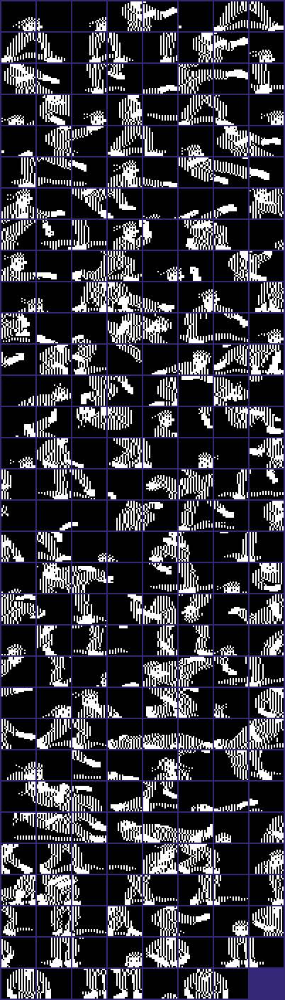

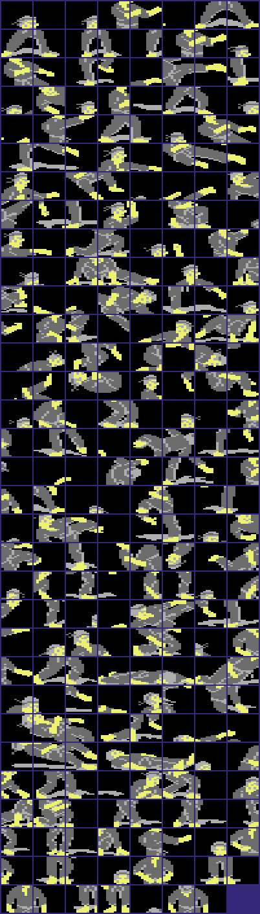

## [`figure_f68_parts` `$C980`](../../src/graphics/figure_sprites_c900_c980.asm#L6) `$C980-$CB7F`

*sprite*

Second set, parts $26-$28: slots top left, middle left and bottom left of frame 68 with shape_page_offset $40 (block $c000 + part*64). Frames 67-71 build a small standing figure. No animation script uses frames 67-71, so v1 never shows it.

## [`figure_f70_parts` `$D180`](../../src/graphics/figure_sprites_d000.asm#L42) `$D180-$D3FF`

*sprite*

Second set, parts $46-$4a: frame 70 of the small figure, with one arm up. Part $47 is also in frame 68. Part $4f is in frames 70 and 71.

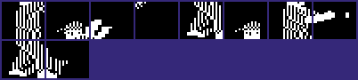

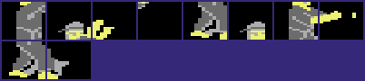

## [`shadow_facing0` `$D540`](../../src/graphics/shadow_sprites_facing0.asm#L6) `$D540-$D7BF`

*sprite*

Floor shadow blocks for facing 0, shown directly as VIC pointers in the 4th sprite row at Y $da. Tables $33b7/$33c7/$33d7 give the pointers for the 8 air frames at $33af (10, 58, 9, 32, 21, 23, 22, 20).
Pointers $55-$5e: shadows of frames 32, 21, 23, 22 and 20.

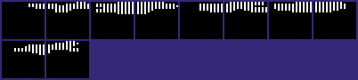

## [`figure_f67_parts` `$D7C0`](../../src/graphics/shadow_sprites_facing0.asm#L222) `$D7C0-$D87F`

*sprite*

Second set, parts $5f-$61: frame 67 of the small figure (standing, arms down). These numbers are no shadow pointers.

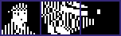

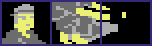

## [`shadow_facing0_b` `$D8C0`](../../src/graphics/shadow_sprites_facing0.asm#L295) `$D8C0-$D9FF`

*sprite*

Pointers $63-$67: shadows of frames 10 and 58 ($63-$65) and frame 9 ($66-$67), facing 0.

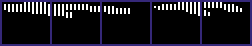

## [`shadow_facing1` `$DB40`](../../src/graphics/shadow_sprites_facing1.asm#L39) `$DB40-$DEFF`

*sprite*

Floor shadow blocks for facing 1, pointers $6d-$7b. Each block is the mirror image (table $7e00) of a facing 0 shadow block.

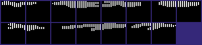

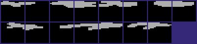

## [`panel_charset` `$E000`](../../src/graphics/panel_charset.asm#L6) `$E000-$E3FF`

*charset*

Character set of the text rows 0-4 ($d018=$38, char base $e000), 128 characters in ASCII order. The panel shows hires characters (colour RAM 6, $142b).
Char $00: empty.

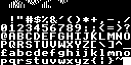

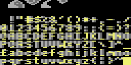

## [`charset_ram_noise` `$E400`](../../src/graphics/panel_charset.asm#L143) `$E400-$E5FF`

*charset*

Chars $80-$bf: 512 bytes of RAM noise that M.CHSET saved with the 128 characters. Even bytes are mostly $00/$40/$80/$c0, odd bytes $3f/$7f/$bf/$ff, as at $c900, $79b0-$7adf and $ff80-$ffef. No text of the game uses them, but the rank text after the rank overflow does: at rank index 13 the panel shows char $8E from $e470.

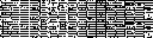

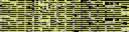

## [`bull_parts` `$F540`](../../src/graphics/bull_sprites_run.asm#L6) `$F540-$F6BF`

*sprite*

M.XSPRITES: second-set parts $d5-$fd (block $c000 + part*64). With shape_page_offset $40 the frames 59-63 (anim $1c) show a four-legged animal, a bull. Only the unreferenced test code at $138f selects offset $40 and anim $1c, with sprite colour 9 (brown).
Part $d5: frame 60.

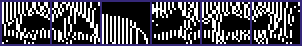

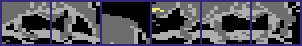

## [`bull_f61_parts` `$F700`](../../src/graphics/bull_sprites_run_f700.asm#L5) `$F700-$FF7F`

*sprite*

Parts $dc-$de: frame 61.

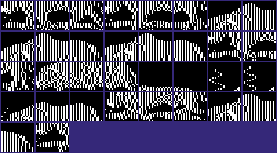

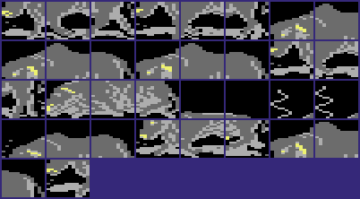
