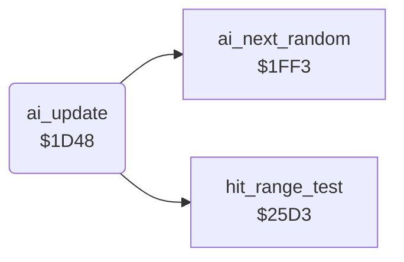

<!-- Generated by c64-docs from knowledge revision 20261025T191824.210-p015r5 and .c64-re-tools/local/generated/src/source-map.json. Do not edit: change the knowledge, generate the source again, then run docs.ts generate. -->
# ai/ai_opponent.asm: Computer opponent: decisions, random numbers, level set-up and special actions

Range `$1D48-$1F8B`. Source: [ai/ai_opponent.asm](../../../../src/ai/ai_opponent.asm). Index: [the reference](../../index.md).

## Routines

| Routine | Address | Reached from | Summary |
|---|---|---|---|
| [`ai_update`](ai_opponent.md#ai_update) | `$1D48` | [`fighter_get_input`](../fighter/fighter_moves.md#fighter_get_input) | AI of a CPU fighter: sets fighter_input,x and ai_command,x for this frame. |
| [`ai_start_turn`](ai_opponent.md#ai_start_turn) | `$1EE4` | [`ai_update`](ai_opponent.md#ai_update) | Command $12 = about turn |

## Call graph

A solid arrow is a call, a thick arrow a table entry. Rounded nodes are in this file.

## Details

### [`ai_update`](../../../../src/ai/ai_opponent.asm#L6) `$1D48`

*routine*

AI of a CPU fighter: sets fighter_input,x and ai_command,x for this frame. X = fighter, opponent_index = the other fighter. Called by a JMP from fighter_get_input ($226d).

- **Jumped to from:** [`fighter_get_input`](../fighter/fighter_moves.md#fighter_get_input)
- **Calls:** [`hit_range_test`](../fighter/hit_test.md#hit_range_test), [`ai_next_random`](ai_opponent_1f8f.md#ai_next_random)
- **Jumps to:** [`ai_dispatch_special`](ai_opponent_1f8f.md#ai_dispatch_special)
- **Reads:** [`opponent_index`](../../memory-map.md#opponent_index), [`hit_reaction`](../../memory-map.md#hit_reaction), [`fighter_move`](../../memory-map.md#fighter_move), [`ai_release_timer`](../../memory-map.md#ai_release_timer), [`ai_special_action`](../../memory-map.md#ai_special_action), [`pose_held`](../../memory-map.md#pose_held), [`cpu_skill`](../../memory-map.md#cpu_skill), [`fighter_input`](../../memory-map.md#fighter_input), [`anim_reverse`](../../memory-map.md#anim_reverse), [`move_attack_flags`](../game/entry_and_tables.md#move_attack_flags), [`move_counter_moves`](../game/entry_and_tables.md#move_counter_moves), [`ai_command`](../../memory-map.md#ai_command) and 22 more
- **Writes:** [`ai_release_timer`](../../memory-map.md#ai_release_timer), [`fighter_input`](../../memory-map.md#fighter_input), [`ai_command`](../../memory-map.md#ai_command), [`ai_react_timer`](../../memory-map.md#ai_react_timer), [`ai_special_action`](../../memory-map.md#ai_special_action), [`fighter_move`](../../memory-map.md#fighter_move), [`fighter_facing`](../../memory-map.md#fighter_facing), [`pose_held`](../../memory-map.md#pose_held), [`ai_turning`](../../memory-map.md#ai_turning), [`ai_hold_timer`](../../memory-map.md#ai_hold_timer), [`fighter_distance`](../../memory-map.md#fighter_distance), [`ai_walk_timer`](../../memory-map.md#ai_walk_timer) and 2 more

| Label | Address | Comment |
|---|---|---|
| [`ai_hit_release_now`](../../../../src/ai/ai_opponent.asm#L15) | `$1D59` |  |
| [`ai_hit_return`](../../../../src/ai/ai_opponent.asm#L18) | `$1D5D` | fighter_input keeps its last value |
| [`ai_check_special`](../../../../src/ai/ai_opponent.asm#L20) | `$1D5E` |  |
| [`ai_check_opponent`](../../../../src/ai/ai_opponent.asm#L24) | `$1D65` |  |
| [`ai_check_opp_reverse`](../../../../src/ai/ai_opponent.asm#L35) | `$1D7C` | Opponent retracts its move: no danger |
| [`ai_to_movement`](../../../../src/ai/ai_opponent.asm#L38) | `$1D81` |  |
| [`ai_check_opp_attack`](../../../../src/ai/ai_opponent.asm#L40) | `$1D84` |  |
| [`ai_check_block_fits`](../../../../src/ai/ai_opponent.asm#L50) | `$1D97` | Block that stops the opponent move |
| [`ai_command_stand`](../../../../src/ai/ai_opponent.asm#L55) | `$1DA0` | Command 1 = stand: the current move returns |
| [`ai_check_own_move`](../../../../src/ai/ai_opponent.asm#L60) | `$1DA7` |  |
| [`ai_check_idle_move`](../../../../src/ai/ai_opponent.asm#L65) | `$1DB0` | Stand, walk back or walk forward: react |
| [`ai_check_low_move`](../../../../src/ai/ai_opponent.asm#L82) | `$1DD1` | Keep only crouch, low and sweep moves |
| [`ai_keep_command`](../../../../src/ai/ai_opponent.asm#L94) | `$1DE7` |  |
| [`ai_react_to_attack`](../../../../src/ai/ai_opponent.asm#L98) | `$1DEC` | Opponent attack in range? Z = 1 out of range |
| [`ai_react_wait`](../../../../src/ai/ai_opponent.asm#L108) | `$1E00` |  |
| [`ai_react_count`](../../../../src/ai/ai_opponent.asm#L110) | `$1E03` |  |
| [`ai_choose_response`](../../../../src/ai/ai_opponent.asm#L115) | `$1E0B` |  |
| [`ai_response_attack`](../../../../src/ai/ai_opponent.asm#L128) | `$1E24` |  |
| [`ai_response_counter`](../../../../src/ai/ai_opponent.asm#L130) | `$1E27` |  |
| [`ai_movement`](../../../../src/ai/ai_opponent.asm#L138) | `$1E35` | Own move runs backwards: keep the command |
| [`ai_turn_check`](../../../../src/ai/ai_opponent.asm#L148) | `$1E47` |  |
| [`ai_hold_pose`](../../../../src/ai/ai_opponent.asm#L162) | `$1E60` |  |
| [`ai_hold_count`](../../../../src/ai/ai_opponent.asm#L170) | `$1E70` |  |
| [`ai_check_standing`](../../../../src/ai/ai_opponent.asm#L179) | `$1E7F` |  |
| [`ai_repeat_command`](../../../../src/ai/ai_opponent.asm#L187) | `$1E8D` |  |
| [`ai_check_position`](../../../../src/ai/ai_opponent.asm#L191) | `$1E92` |  |
| [`ai_facing_distance`](../../../../src/ai/ai_opponent.asm#L196) | `$1E9B` |  |
| [`ai_distance_facing_left`](../../../../src/ai/ai_opponent.asm#L203) | `$1EA8` |  |
| [`ai_store_distance`](../../../../src/ai/ai_opponent.asm#L207) | `$1EAE` | Distance of the opponent in front, signed |
| [`ai_walk_decision`](../../../../src/ai/ai_opponent.asm#L215) | `$1EBC` |  |
| [`ai_start_walk`](../../../../src/ai/ai_opponent.asm#L229) | `$1ED6` |  |
| [`ai_same_facing_distance`](../../../../src/ai/ai_opponent.asm#L244) | `$1EEF` |  |
| [`ai_same_facing_right`](../../../../src/ai/ai_opponent.asm#L251) | `$1EFC` |  |
| [`ai_store_same_distance`](../../../../src/ai/ai_opponent.asm#L255) | `$1F02` | Negative = opponent in front |
| [`ai_same_facing_turn`](../../../../src/ai/ai_opponent.asm#L263) | `$1F10` |  |
| [`ai_attack_timing`](../../../../src/ai/ai_opponent.asm#L265) | `$1F13` | Attack delay: bit 7 reload, else count down to the attack |
| [`ai_attack_count`](../../../../src/ai/ai_opponent.asm#L272) | `$1F21` |  |
| [`ai_choose_attack`](../../../../src/ai/ai_opponent.asm#L277) | `$1F29` | Entry also from ai_response_attack, without the delay |
| [`ai_reply_low_block`](../../../../src/ai/ai_opponent.asm#L296) | `$1F4F` |  |
| [`ai_attack_by_distance`](../../../../src/ai/ai_opponent.asm#L305) | `$1F5D` |  |
| [`ai_wait_standing`](../../../../src/ai/ai_opponent.asm#L327) | `$1F85` |  |

### [`ai_start_turn`](../../../../src/ai/ai_opponent.asm#L237) `$1EE4`

*label*

Command $12 = about turn

- **Jumped to from:** [`ai_update`](ai_opponent.md#ai_update)
