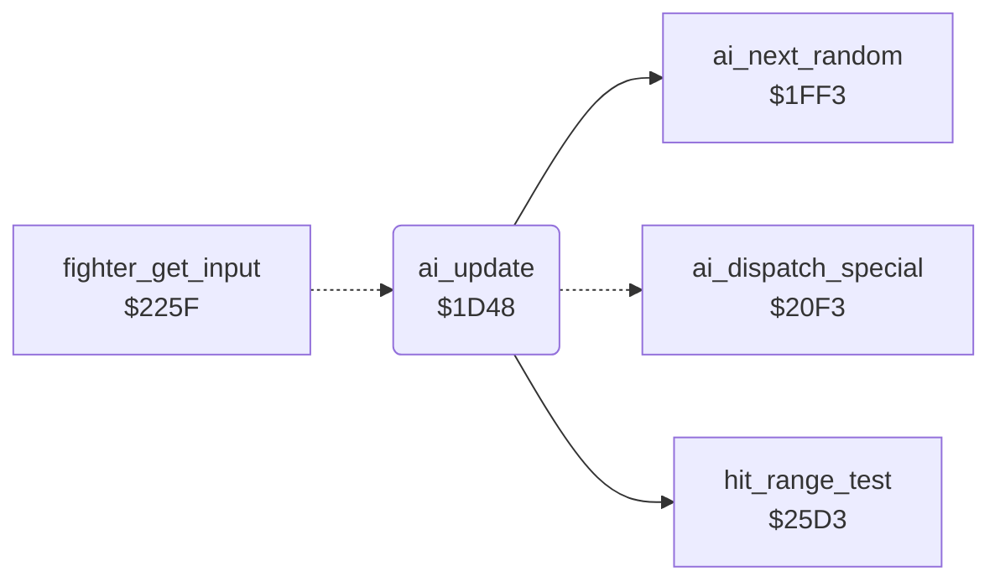

<!-- Generated by c64-docs from knowledge revision 20261022T132731.733-fztd87 and .c64-re-tools/local/generated/src/source-map.json. Do not edit: change the knowledge, generate the source again, then run docs.ts generate. -->
# ai/ai_opponent.asm: Computer opponent: decisions, random numbers, level set-up and special actions

Range `$1D48-$1F8B`. Source: [ai/ai_opponent.asm](../../../../src/ai/ai_opponent.asm). Index: [the reference](../../index.md).

## Call graph

A solid arrow is a call, a thick arrow a table entry, a dotted arrow a jump. Rounded nodes are in this file.

## Names

### [`ai_update`](../../../../src/ai/ai_opponent.asm#L6) `$1D48`

*routine*

AI of a CPU fighter: sets fighter_input,x and ai_command,x for this frame. X = fighter, opponent_index = the other fighter. Called by a JMP from fighter_get_input ($226d).

- **Jumped to from:** [`fighter_get_input`](../fighter/fighter_moves.md#fighter_get_input) [`$226D`](../../../../src/fighter/fighter_moves.asm#L40)
- **Calls:** [`hit_range_test`](../fighter/hit_test.md#hit_range_test), [`ai_next_random`](ai_opponent_1f8f.md#ai_next_random)
- **Jumps to:** [`ai_dispatch_special`](ai_opponent_1f8f.md#ai_dispatch_special)
- **Reads:** [`opponent_index`](../../memory-map.md#opponent_index), [`hit_reaction`](../../memory-map.md#hit_reaction), [`fighter_move`](../../memory-map.md#fighter_move), [`ai_release_timer`](../../memory-map.md#ai_release_timer), [`ai_special_action`](../../memory-map.md#ai_special_action), [`pose_held`](../../memory-map.md#pose_held), [`cpu_skill`](../../memory-map.md#cpu_skill), [`fighter_input`](../../memory-map.md#fighter_input), [`anim_reverse`](../../memory-map.md#anim_reverse), [`move_attack_flags`](../game/entry_and_tables.md#move_attack_flags), [`move_counter_moves`](../game/entry_and_tables.md#move_counter_moves), [`ai_command`](../../memory-map.md#ai_command), [`ai_react_timer`](../../memory-map.md#ai_react_timer), [`ai_react_mask`](../../memory-map.md#ai_react_mask), [`ai_response_mask`](../../memory-map.md#ai_response_mask), [`ai_special_by_move`](ai_tables.md#ai_special_by_move), [`ai_turning`](../../memory-map.md#ai_turning), [`fighter_facing`](../../memory-map.md#fighter_facing), [`ai_hold_timer`](../../memory-map.md#ai_hold_timer), [`ai_hold_mask`](../../memory-map.md#ai_hold_mask), [`fighter_x`](../../memory-map.md#fighter_x), [`ai_walk_timer`](../../memory-map.md#ai_walk_timer), [`ai_stop_mask`](../../memory-map.md#ai_stop_mask), [`ai_walk_mask`](../../memory-map.md#ai_walk_mask), [`ai_attack_timer`](../../memory-map.md#ai_attack_timer), [`ai_attack_mask`](../../memory-map.md#ai_attack_mask), [`ai_reply_to_high_block`](ai_tables.md#ai_reply_to_high_block), [`ai_reply_to_low_block`](ai_tables.md#ai_reply_to_low_block), [`fighter_distance`](../../memory-map.md#fighter_distance), [`ai_spread_mask`](../../memory-map.md#ai_spread_mask), [`ai_table_index`](../../memory-map.md#ai_table_index), [`ai_attack_facing_table`](ai_tables.md#ai_attack_facing_table), [`ai_attack_same_facing_table`](ai_tables.md#ai_attack_same_facing_table), [`ai_variant_mask`](../../memory-map.md#ai_variant_mask)
- **Writes:** [`ai_release_timer`](../../memory-map.md#ai_release_timer), [`fighter_input`](../../memory-map.md#fighter_input), [`ai_command`](../../memory-map.md#ai_command), [`ai_react_timer`](../../memory-map.md#ai_react_timer), [`ai_special_action`](../../memory-map.md#ai_special_action), [`fighter_move`](../../memory-map.md#fighter_move), [`fighter_facing`](../../memory-map.md#fighter_facing), [`pose_held`](../../memory-map.md#pose_held), [`ai_turning`](../../memory-map.md#ai_turning), [`ai_hold_timer`](../../memory-map.md#ai_hold_timer), [`fighter_distance`](../../memory-map.md#fighter_distance), [`ai_walk_timer`](../../memory-map.md#ai_walk_timer), [`ai_attack_timer`](../../memory-map.md#ai_attack_timer), [`ai_table_index`](../../memory-map.md#ai_table_index)

### [`ai_hit_release_now`](../../../../src/ai/ai_opponent.asm#L15) `$1D59`

*label*

- **Jumped to from:** [`ai_update`](ai_opponent.md#ai_update) [`$1D53`](../../../../src/ai/ai_opponent.asm#L12)

### [`ai_hit_return`](../../../../src/ai/ai_opponent.asm#L18) `$1D5D`

*label*

fighter_input keeps its last value

- **Jumped to from:** [`ai_update`](ai_opponent.md#ai_update) [`$1D57`](../../../../src/ai/ai_opponent.asm#L14)

### [`ai_check_special`](../../../../src/ai/ai_opponent.asm#L20) `$1D5E`

*label*

- **Jumped to from:** [`ai_update`](ai_opponent.md#ai_update) [`$1D4D`](../../../../src/ai/ai_opponent.asm#L9)

### [`ai_check_opponent`](../../../../src/ai/ai_opponent.asm#L24) `$1D65`

*label*

- **Jumped to from:** [`ai_update`](ai_opponent.md#ai_update) [`$1D60`](../../../../src/ai/ai_opponent.asm#L22)

### [`ai_check_opp_reverse`](../../../../src/ai/ai_opponent.asm#L35) `$1D7C`

*label*

Opponent retracts its move: no danger

- **Jumped to from:** [`ai_update`](ai_opponent.md#ai_update) [`$1D6A`](../../../../src/ai/ai_opponent.asm#L27), [`ai_update`](ai_opponent.md#ai_update) [`$1D70`](../../../../src/ai/ai_opponent.asm#L30)

### [`ai_to_movement`](../../../../src/ai/ai_opponent.asm#L38) `$1D81`

*label*

- **Jumped to from:** [`ai_update`](ai_opponent.md#ai_update) [`$1D77`](../../../../src/ai/ai_opponent.asm#L33), [`ai_update`](ai_opponent.md#ai_update) [`$1D8B`](../../../../src/ai/ai_opponent.asm#L44)

### [`ai_check_opp_attack`](../../../../src/ai/ai_opponent.asm#L40) `$1D84`

*label*

- **Jumped to from:** [`ai_update`](ai_opponent.md#ai_update) [`$1D7F`](../../../../src/ai/ai_opponent.asm#L37)

### [`ai_check_block_fits`](../../../../src/ai/ai_opponent.asm#L50) `$1D97`

*label*

Block that stops the opponent move

- **Jumped to from:** [`ai_update`](ai_opponent.md#ai_update) [`$1D91`](../../../../src/ai/ai_opponent.asm#L47)

### [`ai_command_stand`](../../../../src/ai/ai_opponent.asm#L55) `$1DA0`

*label*

Command 1 = stand: the current move returns

- **Jumped to from:** [`ai_update`](ai_opponent.md#ai_update) [`$1DBE`](../../../../src/ai/ai_opponent.asm#L73), [`ai_update`](ai_opponent.md#ai_update) [`$1DC2`](../../../../src/ai/ai_opponent.asm#L75), [`ai_update`](ai_opponent.md#ai_update) [`$1DE5`](../../../../src/ai/ai_opponent.asm#L93)

### [`ai_check_own_move`](../../../../src/ai/ai_opponent.asm#L60) `$1DA7`

*label*

- **Jumped to from:** [`ai_update`](ai_opponent.md#ai_update) [`$1D95`](../../../../src/ai/ai_opponent.asm#L49), [`ai_update`](ai_opponent.md#ai_update) [`$1D9A`](../../../../src/ai/ai_opponent.asm#L52)

### [`ai_check_idle_move`](../../../../src/ai/ai_opponent.asm#L65) `$1DB0`

*label*

Stand, walk back or walk forward: react

- **Jumped to from:** [`ai_update`](ai_opponent.md#ai_update) [`$1DAB`](../../../../src/ai/ai_opponent.asm#L63)

### [`ai_check_low_move`](../../../../src/ai/ai_opponent.asm#L82) `$1DD1`

*label*

Keep only crouch, low and sweep moves

- **Jumped to from:** [`ai_update`](ai_opponent.md#ai_update) [`$1D79`](../../../../src/ai/ai_opponent.asm#L34), [`ai_update`](ai_opponent.md#ai_update) [`$1DCB`](../../../../src/ai/ai_opponent.asm#L79)

### [`ai_keep_command`](../../../../src/ai/ai_opponent.asm#L94) `$1DE7`

*label*

- **Jumped to from:** [`ai_update`](ai_opponent.md#ai_update) [`$1D9E`](../../../../src/ai/ai_opponent.asm#L54), [`ai_update`](ai_opponent.md#ai_update) [`$1DCF`](../../../../src/ai/ai_opponent.asm#L81), [`ai_update`](ai_opponent.md#ai_update) [`$1DD5`](../../../../src/ai/ai_opponent.asm#L85), [`ai_update`](ai_opponent.md#ai_update) [`$1DD9`](../../../../src/ai/ai_opponent.asm#L87), [`ai_update`](ai_opponent.md#ai_update) [`$1DDD`](../../../../src/ai/ai_opponent.asm#L89), [`ai_update`](ai_opponent.md#ai_update) [`$1DE1`](../../../../src/ai/ai_opponent.asm#L91)

### [`ai_react_to_attack`](../../../../src/ai/ai_opponent.asm#L98) `$1DEC`

*label*

Opponent attack in range? Z = 1 out of range

- **Jumped to from:** [`ai_update`](ai_opponent.md#ai_update) [`$1DB2`](../../../../src/ai/ai_opponent.asm#L67), [`ai_update`](ai_opponent.md#ai_update) [`$1DB6`](../../../../src/ai/ai_opponent.asm#L69), [`ai_update`](ai_opponent.md#ai_update) [`$1DBA`](../../../../src/ai/ai_opponent.asm#L71)

### [`ai_react_wait`](../../../../src/ai/ai_opponent.asm#L108) `$1E00`

*label*

- **Jumped to from:** [`ai_update`](ai_opponent.md#ai_update) [`$1E05`](../../../../src/ai/ai_opponent.asm#L112)

### [`ai_react_count`](../../../../src/ai/ai_opponent.asm#L110) `$1E03`

*label*

- **Jumped to from:** [`ai_update`](ai_opponent.md#ai_update) [`$1DF5`](../../../../src/ai/ai_opponent.asm#L103)

### [`ai_choose_response`](../../../../src/ai/ai_opponent.asm#L115) `$1E0B`

*label*

- **Jumped to from:** [`ai_update`](ai_opponent.md#ai_update) [`$1DF3`](../../../../src/ai/ai_opponent.asm#L102), [`ai_update`](ai_opponent.md#ai_update) [`$1DFC`](../../../../src/ai/ai_opponent.asm#L106)

### [`ai_response_attack`](../../../../src/ai/ai_opponent.asm#L128) `$1E24`

*label*

- **Jumped to from:** [`ai_update`](ai_opponent.md#ai_update) [`$1E10`](../../../../src/ai/ai_opponent.asm#L118)

### [`ai_response_counter`](../../../../src/ai/ai_opponent.asm#L130) `$1E27`

*label*

- **Jumped to from:** [`ai_update`](ai_opponent.md#ai_update) [`$1E14`](../../../../src/ai/ai_opponent.asm#L120), [`ai_update`](ai_opponent.md#ai_update) [`$1E1F`](../../../../src/ai/ai_opponent.asm#L125)

### [`ai_movement`](../../../../src/ai/ai_opponent.asm#L138) `$1E35`

*label*

Own move runs backwards: keep the command

- **Jumped to from:** [`ai_update`](ai_opponent.md#ai_update) [`$1D81`](../../../../src/ai/ai_opponent.asm#L39), [`ai_update`](ai_opponent.md#ai_update) [`$1DAD`](../../../../src/ai/ai_opponent.asm#L64), [`ai_update`](ai_opponent.md#ai_update) [`$1DEF`](../../../../src/ai/ai_opponent.asm#L100), [`ai_update`](ai_opponent.md#ai_update) [`$1E00`](../../../../src/ai/ai_opponent.asm#L109)

### [`ai_turn_check`](../../../../src/ai/ai_opponent.asm#L148) `$1E47`

*label*

### [`ai_hold_pose`](../../../../src/ai/ai_opponent.asm#L162) `$1E60`

*label*

- **Jumped to from:** [`ai_update`](ai_opponent.md#ai_update) [`$1E45`](../../../../src/ai/ai_opponent.asm#L147)

### [`ai_hold_count`](../../../../src/ai/ai_opponent.asm#L170) `$1E70`

*label*

- **Jumped to from:** [`ai_update`](ai_opponent.md#ai_update) [`$1E62`](../../../../src/ai/ai_opponent.asm#L164)

### [`ai_check_standing`](../../../../src/ai/ai_opponent.asm#L179) `$1E7F`

*label*

- **Jumped to from:** [`ai_update`](ai_opponent.md#ai_update) [`$1E3B`](../../../../src/ai/ai_opponent.asm#L142)

### [`ai_repeat_command`](../../../../src/ai/ai_opponent.asm#L187) `$1E8D`

*label*

- **Jumped to from:** [`ai_update`](ai_opponent.md#ai_update) [`$1E37`](../../../../src/ai/ai_opponent.asm#L140), [`ai_update`](ai_opponent.md#ai_update) [`$1E41`](../../../../src/ai/ai_opponent.asm#L145), [`ai_update`](ai_opponent.md#ai_update) [`$1E49`](../../../../src/ai/ai_opponent.asm#L150), [`ai_update`](ai_opponent.md#ai_update) [`$1E6D`](../../../../src/ai/ai_opponent.asm#L169), [`ai_update`](ai_opponent.md#ai_update) [`$1E72`](../../../../src/ai/ai_opponent.asm#L172), [`ai_update`](ai_opponent.md#ai_update) [`$1EBE`](../../../../src/ai/ai_opponent.asm#L217)

### [`ai_check_position`](../../../../src/ai/ai_opponent.asm#L191) `$1E92`

*label*

- **Jumped to from:** [`ai_update`](ai_opponent.md#ai_update) [`$1E83`](../../../../src/ai/ai_opponent.asm#L182), [`ai_update`](ai_opponent.md#ai_update) [`$1E87`](../../../../src/ai/ai_opponent.asm#L184), [`ai_update`](ai_opponent.md#ai_update) [`$1E8B`](../../../../src/ai/ai_opponent.asm#L186)

### [`ai_facing_distance`](../../../../src/ai/ai_opponent.asm#L196) `$1E9B`

*label*

### [`ai_distance_facing_left`](../../../../src/ai/ai_opponent.asm#L203) `$1EA8`

*label*

- **Jumped to from:** [`ai_update`](ai_opponent.md#ai_update) [`$1E9D`](../../../../src/ai/ai_opponent.asm#L198)

### [`ai_store_distance`](../../../../src/ai/ai_opponent.asm#L207) `$1EAE`

*label*

Distance of the opponent in front, signed

- **Jumped to from:** [`ai_update`](ai_opponent.md#ai_update) [`$1EA5`](../../../../src/ai/ai_opponent.asm#L202)

### [`ai_walk_decision`](../../../../src/ai/ai_opponent.asm#L215) `$1EBC`

*label*

- **Jumped to from:** [`ai_update`](ai_opponent.md#ai_update) [`$1F0E`](../../../../src/ai/ai_opponent.asm#L262)

### [`ai_start_walk`](../../../../src/ai/ai_opponent.asm#L229) `$1ED6`

*label*

- **Jumped to from:** [`ai_update`](ai_opponent.md#ai_update) [`$1EC4`](../../../../src/ai/ai_opponent.asm#L220), [`ai_update`](ai_opponent.md#ai_update) [`$1ECB`](../../../../src/ai/ai_opponent.asm#L223)

### [`ai_start_turn`](../../../../src/ai/ai_opponent.asm#L237) `$1EE4`

*label*

Command $12 = about turn

- **Jumped to from:** [`ai_update`](ai_opponent.md#ai_update) [`$1EBA`](../../../../src/ai/ai_opponent.asm#L214), [`ai_update`](ai_opponent.md#ai_update) [`$1F10`](../../../../src/ai/ai_opponent.asm#L264), [`ai_update`](ai_opponent.md#ai_update) [`$1FE9`](../../../../src/ai/ai_opponent_1f8f.asm#L62)

### [`ai_same_facing_distance`](../../../../src/ai/ai_opponent.asm#L244) `$1EEF`

*label*

- **Jumped to from:** [`ai_update`](ai_opponent.md#ai_update) [`$1E99`](../../../../src/ai/ai_opponent.asm#L195)

### [`ai_same_facing_right`](../../../../src/ai/ai_opponent.asm#L251) `$1EFC`

*label*

- **Jumped to from:** [`ai_update`](ai_opponent.md#ai_update) [`$1EF1`](../../../../src/ai/ai_opponent.asm#L246)

### [`ai_store_same_distance`](../../../../src/ai/ai_opponent.asm#L255) `$1F02`

*label*

Negative = opponent in front

- **Jumped to from:** [`ai_update`](ai_opponent.md#ai_update) [`$1EF9`](../../../../src/ai/ai_opponent.asm#L250)

### [`ai_same_facing_turn`](../../../../src/ai/ai_opponent.asm#L263) `$1F10`

*label*

### [`ai_attack_timing`](../../../../src/ai/ai_opponent.asm#L265) `$1F13`

*label*

Attack delay: bit 7 reload, else count down to the attack

- **Jumped to from:** [`ai_update`](ai_opponent.md#ai_update) [`$1EB2`](../../../../src/ai/ai_opponent.asm#L210), [`ai_update`](ai_opponent.md#ai_update) [`$1EB6`](../../../../src/ai/ai_opponent.asm#L212), [`ai_update`](ai_opponent.md#ai_update) [`$1F06`](../../../../src/ai/ai_opponent.asm#L258), [`ai_update`](ai_opponent.md#ai_update) [`$1F0A`](../../../../src/ai/ai_opponent.asm#L260)

### [`ai_attack_count`](../../../../src/ai/ai_opponent.asm#L272) `$1F21`

*label*

- **Jumped to from:** [`ai_update`](ai_opponent.md#ai_update) [`$1F15`](../../../../src/ai/ai_opponent.asm#L267)

### [`ai_choose_attack`](../../../../src/ai/ai_opponent.asm#L277) `$1F29`

*label*

Entry also from ai_response_attack, without the delay

- **Jumped to from:** [`ai_update`](ai_opponent.md#ai_update) [`$1E24`](../../../../src/ai/ai_opponent.asm#L129)

### [`ai_reply_low_block`](../../../../src/ai/ai_opponent.asm#L296) `$1F4F`

*label*

- **Jumped to from:** [`ai_update`](ai_opponent.md#ai_update) [`$1F37`](../../../../src/ai/ai_opponent.asm#L284)

### [`ai_attack_by_distance`](../../../../src/ai/ai_opponent.asm#L305) `$1F5D`

*label*

- **Jumped to from:** [`ai_update`](ai_opponent.md#ai_update) [`$1F3B`](../../../../src/ai/ai_opponent.asm#L286)

### [`ai_wait_standing`](../../../../src/ai/ai_opponent.asm#L327) `$1F85`

*label*

- **Jumped to from:** [`ai_update`](ai_opponent.md#ai_update) [`$1F1E`](../../../../src/ai/ai_opponent.asm#L271), [`ai_update`](ai_opponent.md#ai_update) [`$1F23`](../../../../src/ai/ai_opponent.asm#L274)
