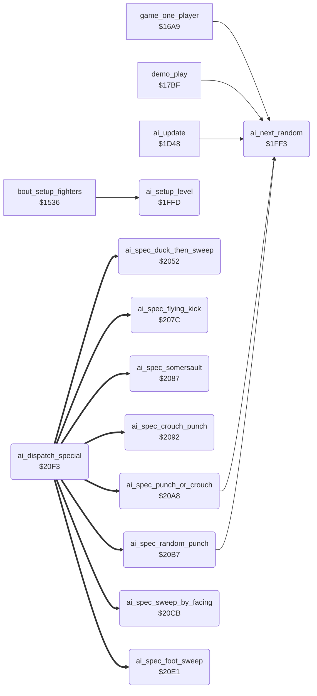

<!-- Generated by c64-docs from knowledge revision 20261025T214834.473-anyvn7 and .c64-re-tools/local/generated/src/source-map.json. Do not edit: change the knowledge, generate the source again, then run docs.ts generate. -->
# ai/ai_opponent_1f8f.asm

Range `$1F8F-$2101`. Source: [ai/ai_opponent_1f8f.asm](../../../../src/ai/ai_opponent_1f8f.asm). Index: [the reference](../../index.md).

## Routines

| Routine | Address | Reached from | Summary |
|---|---|---|---|
| [`ai_attack_foot_sweep`](ai_opponent_1f8f.md#ai_attack_foot_sweep) | `$1F8F` | [`ai_update`](ai_opponent.md#ai_update) |  |
| [`ai_start_crouch_punch`](ai_opponent_1f8f.md#ai_start_crouch_punch) | `$1F9D` | [`ai_update`](ai_opponent.md#ai_update) | Special action 5: crouch, then move $07 |
| [`ai_choose_same_facing`](ai_opponent_1f8f.md#ai_choose_same_facing) | `$1FA8` | [`ai_update`](ai_opponent.md#ai_update) |  |
| [`ai_attack_variant`](ai_opponent_1f8f.md#ai_attack_variant) | `$1FC8` | [`ai_update`](ai_opponent.md#ai_update) | Variant of move $0f or $10 (Y): bit 7 turn, $40-$7f walk back, $20-$3f move $08, 1-$1f the move, 0 move $09. |
| [`ai_next_random`](ai_opponent_1f8f.md#ai_next_random) | `$1FF3` | [`game_one_player`](../game/game_modes.md#game_one_player), [`demo_play`](../game/game_modes.md#demo_play), [`ai_update`](ai_opponent.md#ai_update), [`ai_spec_punch_or_crouch`](ai_opponent_1f8f.md#ai_spec_punch_or_crouch), [`ai_spec_random_punch`](ai_opponent_1f8f.md#ai_spec_random_punch) | Steps the 8-bit random value ai_random (shift left, EOR #$1d on carry) and returns it in A. |
| [`ai_setup_level`](ai_opponent_1f8f.md#ai_setup_level) | `$1FFD` | [`bout_setup_fighters`](../game/init_bout_loop.md#bout_setup_fighters) | Copies the parameters of skill level cpu_skill,x and resets the AI state of both fighters. |
| [`ai_spec_duck_then_sweep`](ai_opponent_1f8f.md#ai_spec_duck_then_sweep) | `$2052` | [`ai_dispatch_special`](ai_opponent_1f8f.md#ai_dispatch_special) | Special action 1, against a flying kick: crouch, then foot sweep. |
| [`ai_spec_flying_kick`](ai_opponent_1f8f.md#ai_spec_flying_kick) | `$207C` | [`ai_dispatch_special`](ai_opponent_1f8f.md#ai_dispatch_special) | Special action 3, against a low kick: flying kick $0e. |
| [`ai_spec_somersault`](ai_opponent_1f8f.md#ai_spec_somersault) | `$2087` | [`ai_dispatch_special`](ai_opponent_1f8f.md#ai_dispatch_special) | Special action 4, against a foot sweep or roundhouse: move $09. |
| [`ai_spec_crouch_punch`](ai_opponent_1f8f.md#ai_spec_crouch_punch) | `$2092` | [`ai_dispatch_special`](ai_opponent_1f8f.md#ai_dispatch_special) | Special action 5: crouch (command 4) until the crouch holds its end pose, then move $07. |
| [`ai_spec_punch_or_crouch`](ai_opponent_1f8f.md#ai_spec_punch_or_crouch) | `$20A8` | [`ai_dispatch_special`](ai_opponent_1f8f.md#ai_dispatch_special) | Special action 8, against move $06: half the time special action 5, else as special action 6. |
| [`ai_spec_random_punch`](ai_opponent_1f8f.md#ai_spec_random_punch) | `$20B7` | [`ai_dispatch_special`](ai_opponent_1f8f.md#ai_dispatch_special) | Special action 6, against move $18: move $06 or move $18, half the time each. |
| [`ai_spec_sweep_by_facing`](ai_opponent_1f8f.md#ai_spec_sweep_by_facing) | `$20CB` | [`ai_dispatch_special`](ai_opponent_1f8f.md#ai_dispatch_special) | Special action 7, against a back sweep: back sweep $10 when the facings differ, else foot sweep $0a. |
| [`ai_spec_foot_sweep`](ai_opponent_1f8f.md#ai_spec_foot_sweep) | `$20E1` | [`ai_dispatch_special`](ai_opponent_1f8f.md#ai_dispatch_special) | Special action 2, against moves $07, $0c and $11: foot sweep $0a. |
| [`ai_dispatch_special`](ai_opponent_1f8f.md#ai_dispatch_special) | `$20F3` | [`ai_update`](ai_opponent.md#ai_update) | Jumps to special action A (1-8) through ai_special_jump_table. |

## Call graph

A solid arrow is a call, a thick arrow a table entry. Rounded nodes are in this file.

## Details

### [`ai_attack_foot_sweep`](../../../../src/ai/ai_opponent_1f8f.asm#L5) `$1F8F`

*label*

- **Jumped to from:** [`ai_update`](ai_opponent.md#ai_update)

### [`ai_start_crouch_punch`](../../../../src/ai/ai_opponent_1f8f.asm#L15) `$1F9D`

*label*

Special action 5: crouch, then move $07

- **Jumped to from:** [`ai_update`](ai_opponent.md#ai_update)

### [`ai_choose_same_facing`](../../../../src/ai/ai_opponent_1f8f.asm#L22) `$1FA8`

*label*

- **Jumped to from:** [`ai_update`](ai_opponent.md#ai_update)

### [`ai_attack_variant`](../../../../src/ai/ai_opponent_1f8f.asm#L41) `$1FC8`

*label*

Variant of move $0f or $10 (Y): bit 7 turn, $40-$7f walk back, $20-$3f move $08, 1-$1f the move, 0 move $09.

- **Jumped to from:** [`ai_update`](ai_opponent.md#ai_update)

### [`ai_next_random`](../../../../src/ai/ai_opponent_1f8f.asm#L69) `$1FF3`

*routine*

Steps the 8-bit random value ai_random (shift left, EOR #$1d on carry) and returns it in A. Carry = the bit that went out. Used by the AI and the demo set-up.

- **Called from:** [`game_one_player`](../game/game_modes.md#game_one_player), [`demo_play`](../game/game_modes.md#demo_play), [`ai_update`](ai_opponent.md#ai_update), [`ai_spec_punch_or_crouch`](ai_opponent_1f8f.md#ai_spec_punch_or_crouch), [`ai_spec_random_punch`](ai_opponent_1f8f.md#ai_spec_random_punch)
- **Reads:** [`ai_random`](../../memory-map.md#ai_random)
- **Writes:** [`ai_random`](../../memory-map.md#ai_random)

| Label | Address | Comment |
|---|---|---|
| [`ai_random_store`](../../../../src/ai/ai_opponent_1f8f.asm#L74) | `$1FFA` |  |

### [`ai_setup_level`](../../../../src/ai/ai_opponent_1f8f.asm#L78) `$1FFD`

*routine*

Copies the parameters of skill level cpu_skill,x and resets the AI state of both fighters. Called for fighter 0, then fighter 1, at bout set-up ($157a, $157f). Bug: the masks $82, $89, $8c, $91, $98, $a1 and the release times $96/$97 are written without X. The level of fighter 1 wins for both.

- **Called from:** [`bout_setup_fighters`](../game/init_bout_loop.md#bout_setup_fighters)
- **Reads:** [`cpu_skill`](../../memory-map.md#cpu_skill), [`ai_level_hold_mask`](ai_tables.md#ai_level_hold_mask), [`ai_level_spread_mask`](ai_tables.md#ai_level_spread_mask), [`ai_level_variant_mask`](ai_tables.md#ai_level_variant_mask), [`ai_level_attack_mask`](ai_tables.md#ai_level_attack_mask), [`ai_level_response_mask`](ai_tables.md#ai_level_response_mask), [`ai_level_walk_mask`](ai_tables.md#ai_level_walk_mask), [`ai_level_stop_mask`](ai_tables.md#ai_level_stop_mask), [`ai_level_react_mask`](ai_tables.md#ai_level_react_mask)
- **Writes:** [`ai_hold_mask`](../../memory-map.md#ai_hold_mask), [`ai_release_timer`](../../memory-map.md#ai_release_timer), [`ai_spread_mask`](../../memory-map.md#ai_spread_mask), [`ai_variant_mask`](../../memory-map.md#ai_variant_mask), [`ai_hold_timer`](../../memory-map.md#ai_hold_timer), [`ai_command`](../../memory-map.md#ai_command), [`ai_attack_mask`](../../memory-map.md#ai_attack_mask), [`ai_attack_timer`](../../memory-map.md#ai_attack_timer), [`ai_turning`](../../memory-map.md#ai_turning), [`ai_special_action`](../../memory-map.md#ai_special_action), [`ai_response_mask`](../../memory-map.md#ai_response_mask), [`ai_walk_mask`](../../memory-map.md#ai_walk_mask) and 4 more
- **Refers to:** [`ai_release_timer`](../../memory-map.md#ai_release_timer), [`ai_hold_timer`](../../memory-map.md#ai_hold_timer), [`ai_command`](../../memory-map.md#ai_command), [`ai_attack_timer`](../../memory-map.md#ai_attack_timer), [`ai_turning`](../../memory-map.md#ai_turning), [`ai_special_action`](../../memory-map.md#ai_special_action), [`ai_walk_timer`](../../memory-map.md#ai_walk_timer)

### [`ai_spec_duck_then_sweep`](../../../../src/ai/ai_opponent_1f8f.asm#L119) `$2052`

*routine*

Special action 1, against a flying kick: crouch, then foot sweep. Level 7 and up sweeps at frame $19 of the opponent, lower levels when it stands again.

- **Entry of:** [`ai_special_jump_table`](../../tables.md#ai_special_jump_table)
- **Reads:** [`opponent_index`](../../memory-map.md#opponent_index), [`cpu_skill`](../../memory-map.md#cpu_skill), [`fighter_frame`](../../memory-map.md#fighter_frame), [`fighter_move`](../../memory-map.md#fighter_move)
- **Writes:** [`fighter_input`](../../memory-map.md#fighter_input), [`ai_command`](../../memory-map.md#ai_command), [`ai_special_action`](../../memory-map.md#ai_special_action)

| Label | Address | Comment |
|---|---|---|
| [`ai_spec_wait_frame`](../../../../src/ai/ai_opponent_1f8f.asm#L124) | `$205A` |  |
| [`ai_spec_crouch_wait`](../../../../src/ai/ai_opponent_1f8f.asm#L128) | `$2061` |  |
| [`ai_spec_sweep_now`](../../../../src/ai/ai_opponent_1f8f.asm#L133) | `$2068` |  |
| [`ai_spec_wait_stand`](../../../../src/ai/ai_opponent_1f8f.asm#L140) | `$2073` |  |

### [`ai_spec_flying_kick`](../../../../src/ai/ai_opponent_1f8f.asm#L146) `$207C`

*routine*

Special action 3, against a low kick: flying kick $0e.

- **Entry of:** [`ai_special_jump_table`](../../tables.md#ai_special_jump_table)
- **Writes:** [`fighter_input`](../../memory-map.md#fighter_input), [`ai_command`](../../memory-map.md#ai_command), [`ai_special_action`](../../memory-map.md#ai_special_action)

### [`ai_spec_somersault`](../../../../src/ai/ai_opponent_1f8f.asm#L154) `$2087`

*routine*

Special action 4, against a foot sweep or roundhouse: move $09.

- **Entry of:** [`ai_special_jump_table`](../../tables.md#ai_special_jump_table)
- **Writes:** [`fighter_input`](../../memory-map.md#fighter_input), [`ai_command`](../../memory-map.md#ai_command), [`ai_special_action`](../../memory-map.md#ai_special_action)

### [`ai_spec_crouch_punch`](../../../../src/ai/ai_opponent_1f8f.asm#L162) `$2092`

*routine*

Special action 5: crouch (command 4) until the crouch holds its end pose, then move $07.

- **Jumped to from:** [`ai_spec_punch_or_crouch`](ai_opponent_1f8f.md#ai_spec_punch_or_crouch)
- **Entry of:** [`ai_special_jump_table`](../../tables.md#ai_special_jump_table)
- **Reads:** [`pose_held`](../../memory-map.md#pose_held)
- **Writes:** [`ai_command`](../../memory-map.md#ai_command), [`fighter_input`](../../memory-map.md#fighter_input), [`ai_special_action`](../../memory-map.md#ai_special_action)

| Label | Address | Comment |
|---|---|---|
| [`ai_spec_crouch_first`](../../../../src/ai/ai_opponent_1f8f.asm#L171) | `$20A1` |  |

### [`ai_spec_punch_or_crouch`](../../../../src/ai/ai_opponent_1f8f.asm#L177) `$20A8`

*routine*

Special action 8, against move $06: half the time special action 5, else as special action 6.

- **Entry of:** [`ai_special_jump_table`](../../tables.md#ai_special_jump_table)
- **Calls:** [`ai_next_random`](ai_opponent_1f8f.md#ai_next_random)
- **Jumps to:** [`ai_spec_random_punch`](ai_opponent_1f8f.md#ai_spec_random_punch), [`ai_spec_crouch_punch`](ai_opponent_1f8f.md#ai_spec_crouch_punch)
- **Writes:** [`ai_special_action`](../../memory-map.md#ai_special_action)

| Label | Address | Comment |
|---|---|---|
| [`ai_spec_set_crouch_punch`](../../../../src/ai/ai_opponent_1f8f.asm#L181) | `$20B0` |  |

### [`ai_spec_random_punch`](../../../../src/ai/ai_opponent_1f8f.asm#L186) `$20B7`

*routine*

Special action 6, against move $18: move $06 or move $18, half the time each.

- **Jumped to from:** [`ai_spec_punch_or_crouch`](ai_opponent_1f8f.md#ai_spec_punch_or_crouch)
- **Entry of:** [`ai_special_jump_table`](../../tables.md#ai_special_jump_table)
- **Calls:** [`ai_next_random`](ai_opponent_1f8f.md#ai_next_random)
- **Writes:** [`ai_command`](../../memory-map.md#ai_command), [`fighter_input`](../../memory-map.md#fighter_input), [`ai_special_action`](../../memory-map.md#ai_special_action)

| Label | Address | Comment |
|---|---|---|
| [`ai_spec_pick_punch`](../../../../src/ai/ai_opponent_1f8f.asm#L188) | `$20BA` |  |
| [`ai_spec_high_punch`](../../../../src/ai/ai_opponent_1f8f.asm#L190) | `$20BC` |  |
| [`ai_spec_low_punch`](../../../../src/ai/ai_opponent_1f8f.asm#L193) | `$20C0` |  |
| [`ai_spec_store_punch`](../../../../src/ai/ai_opponent_1f8f.asm#L195) | `$20C2` |  |

### [`ai_spec_sweep_by_facing`](../../../../src/ai/ai_opponent_1f8f.asm#L202) `$20CB`

*routine*

Special action 7, against a back sweep: back sweep $10 when the facings differ, else foot sweep $0a. No run executed it. Bug: Y is 14 from the dispatch, not the opponent index, so the compare reads fighter_move of fighter 0.

- **Entry of:** [`ai_special_jump_table`](../../tables.md#ai_special_jump_table)
- **Reads:** [`fighter_facing`](../../memory-map.md#fighter_facing)
- **Writes:** [`ai_command`](../../memory-map.md#ai_command), [`fighter_input`](../../memory-map.md#fighter_input), [`ai_special_action`](../../memory-map.md#ai_special_action)

| Label | Address | Comment |
|---|---|---|
| [`ai_spec_same_facing_sweep`](../../../../src/ai/ai_opponent_1f8f.asm#L209) | `$20D6` |  |
| [`ai_spec_store_sweep`](../../../../src/ai/ai_opponent_1f8f.asm#L211) | `$20D8` |  |

### [`ai_spec_foot_sweep`](../../../../src/ai/ai_opponent_1f8f.asm#L218) `$20E1`

*routine*

Special action 2, against moves $07, $0c and $11: foot sweep $0a. The action ends when the move $0a starts.

- **Entry of:** [`ai_special_jump_table`](../../tables.md#ai_special_jump_table)
- **Reads:** [`fighter_move`](../../memory-map.md#fighter_move)
- **Writes:** [`fighter_input`](../../memory-map.md#fighter_input), [`ai_command`](../../memory-map.md#ai_command), [`ai_special_action`](../../memory-map.md#ai_special_action)

| Label | Address | Comment |
|---|---|---|
| [`ai_spec_sweep_done`](../../../../src/ai/ai_opponent_1f8f.asm#L226) | `$20EE` |  |

### [`ai_dispatch_special`](../../../../src/ai/ai_opponent_1f8f.asm#L231) `$20F3`

*routine*

Jumps to special action A (1-8) through ai_special_jump_table. Y = 2*A, not the opponent index. Reached from ai_check_special ($1d62).

- **Jumped to from:** [`ai_update`](ai_opponent.md#ai_update)
- **Jumps to:** [`bull_f60_parts_c`](../graphics/bull_sprites_extra.md#bull_f60_parts_c)
- **Reads:** [`ai_special_jump_table`](ai_tables.md#ai_special_jump_table), [`ai_special_vector`](../../memory-map.md#ai_special_vector)
- **Writes:** [`ai_special_vector`](../../memory-map.md#ai_special_vector)
- **Refers to:** [`ai_special_jump_table`](ai_tables.md#ai_special_jump_table), [`ai_special_vector`](../../memory-map.md#ai_special_vector)

## Labels

| Label | Address | Comment |
|---|---|---|
| [`ai_command_foot_sweep`](../../../../src/ai/ai_opponent_1f8f.asm#L10) | `$1F96` |  |
| [`ai_variant_back_roll`](../../../../src/ai/ai_opponent_1f8f.asm#L54) | `$1FE1` |  |
| [`ai_variant_store`](../../../../src/ai/ai_opponent_1f8f.asm#L56) | `$1FE3` |  |
| [`ai_variant_turn`](../../../../src/ai/ai_opponent_1f8f.asm#L61) | `$1FE9` |  |
| [`ai_variant_walk_back`](../../../../src/ai/ai_opponent_1f8f.asm#L63) | `$1FEC` |  |
