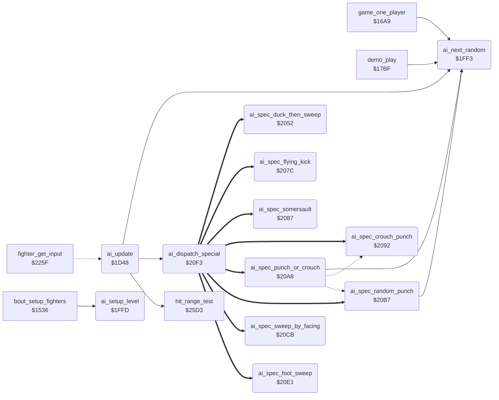

<!-- Generated by c64-docs from knowledge revision 20261021T021734.611-6rf0n2 and src/source-map.json. Do not edit: change the knowledge, generate the source again, then run docs.ts generate. -->
# ai_opponent.asm: Computer opponent: decisions, random numbers, level set-up and special actions

Range `$1D48-$2101`. Source: [ai_opponent.asm](../../../src/ai_opponent.asm). Index: [the reference](../index.md).

## Call graph

A solid arrow is a call, a thick arrow a table entry, a dotted arrow a jump. Rounded nodes are in this file.

## Data

| Range | Type | Name | Read by | Written by |
|---|---|---|---|---|
| [`$1F8C`](../../../src/ai_opponent.asm#L334)-`$1F8E` | unused | [`ai_dead_repeat_jump`](../../../src/ai_opponent.asm#L333) |  |  |

## Names

### [`ai_update`](../../../src/ai_opponent.asm#L6) `$1D48`

*routine*

AI of a CPU fighter: sets fighter_input,x and ai_command,x for this frame. X = fighter, opponent_index = the other fighter. Called by a JMP from fighter_get_input ($226d).

- **Jumped to from:** [`fighter_get_input`](fighter_moves.md#fighter_get_input) [`$226D`](../../../src/fighter_moves.asm#L40)
- **Calls:** [`ai_dispatch_special`](ai_opponent.md#ai_dispatch_special), [`hit_range_test`](hit_test.md#hit_range_test), [`ai_next_random`](ai_opponent.md#ai_next_random)
- **Reads:** [`opponent_index`](../memory-map.md#opponent_index), [`ai_react_mask`](../memory-map.md#ai_react_mask), [`ai_response_mask`](../memory-map.md#ai_response_mask), [`ai_hold_mask`](../memory-map.md#ai_hold_mask), [`ai_attack_mask`](../memory-map.md#ai_attack_mask), [`fighter_distance`](../memory-map.md#fighter_distance), [`ai_spread_mask`](../memory-map.md#ai_spread_mask), [`ai_table_index`](../memory-map.md#ai_table_index), [`ai_variant_mask`](../memory-map.md#ai_variant_mask)
- **Writes:** [`fighter_distance`](../memory-map.md#fighter_distance), [`ai_table_index`](../memory-map.md#ai_table_index)
- **Refers to:** [`move_attack_flags`](entry_and_tables.md#move_attack_flags), [`move_counter_moves`](entry_and_tables.md#move_counter_moves), [`ai_special_by_move`](ai_tables.md#ai_special_by_move), [`ai_reply_to_high_block`](ai_tables.md#ai_reply_to_high_block), [`ai_reply_to_low_block`](ai_tables.md#ai_reply_to_low_block), [`ai_attack_facing_table`](ai_tables.md#ai_attack_facing_table), [`ai_attack_same_facing_table`](ai_tables.md#ai_attack_same_facing_table)

### [`ai_hit_release_now`](../../../src/ai_opponent.asm#L15) `$1D59`

*label*

- **Jumped to from:** [`ai_update`](ai_opponent.md#ai_update) [`$1D53`](../../../src/ai_opponent.asm#L12)

### [`ai_hit_return`](../../../src/ai_opponent.asm#L18) `$1D5D`

*label*

fighter_input keeps its last value

- **Jumped to from:** [`ai_update`](ai_opponent.md#ai_update) [`$1D57`](../../../src/ai_opponent.asm#L14)

### [`ai_check_special`](../../../src/ai_opponent.asm#L20) `$1D5E`

*label*

- **Jumped to from:** [`ai_update`](ai_opponent.md#ai_update) [`$1D4D`](../../../src/ai_opponent.asm#L9)

### [`ai_check_opponent`](../../../src/ai_opponent.asm#L24) `$1D65`

*label*

- **Jumped to from:** [`ai_update`](ai_opponent.md#ai_update) [`$1D60`](../../../src/ai_opponent.asm#L22)

### [`ai_check_opp_reverse`](../../../src/ai_opponent.asm#L35) `$1D7C`

*label*

Opponent retracts its move: no danger

- **Jumped to from:** [`ai_update`](ai_opponent.md#ai_update) [`$1D6A`](../../../src/ai_opponent.asm#L27), [`ai_update`](ai_opponent.md#ai_update) [`$1D70`](../../../src/ai_opponent.asm#L30)

### [`ai_to_movement`](../../../src/ai_opponent.asm#L38) `$1D81`

*label*

- **Jumped to from:** [`ai_update`](ai_opponent.md#ai_update) [`$1D77`](../../../src/ai_opponent.asm#L33), [`ai_update`](ai_opponent.md#ai_update) [`$1D8B`](../../../src/ai_opponent.asm#L44)

### [`ai_check_opp_attack`](../../../src/ai_opponent.asm#L40) `$1D84`

*label*

- **Jumped to from:** [`ai_update`](ai_opponent.md#ai_update) [`$1D7F`](../../../src/ai_opponent.asm#L37)

### [`ai_check_block_fits`](../../../src/ai_opponent.asm#L50) `$1D97`

*label*

Block that stops the opponent move

- **Jumped to from:** [`ai_update`](ai_opponent.md#ai_update) [`$1D91`](../../../src/ai_opponent.asm#L47)

### [`ai_command_stand`](../../../src/ai_opponent.asm#L55) `$1DA0`

*label*

Command 1 = stand: the current move returns

- **Jumped to from:** [`ai_update`](ai_opponent.md#ai_update) [`$1DBE`](../../../src/ai_opponent.asm#L73), [`ai_update`](ai_opponent.md#ai_update) [`$1DC2`](../../../src/ai_opponent.asm#L75), [`ai_update`](ai_opponent.md#ai_update) [`$1DE5`](../../../src/ai_opponent.asm#L93)

### [`ai_check_own_move`](../../../src/ai_opponent.asm#L60) `$1DA7`

*label*

- **Jumped to from:** [`ai_update`](ai_opponent.md#ai_update) [`$1D95`](../../../src/ai_opponent.asm#L49), [`ai_update`](ai_opponent.md#ai_update) [`$1D9A`](../../../src/ai_opponent.asm#L52)

### [`ai_check_idle_move`](../../../src/ai_opponent.asm#L65) `$1DB0`

*label*

Stand, walk back or walk forward: react

- **Jumped to from:** [`ai_update`](ai_opponent.md#ai_update) [`$1DAB`](../../../src/ai_opponent.asm#L63)

### [`ai_check_low_move`](../../../src/ai_opponent.asm#L82) `$1DD1`

*label*

Keep only crouch, low and sweep moves

- **Jumped to from:** [`ai_update`](ai_opponent.md#ai_update) [`$1D79`](../../../src/ai_opponent.asm#L34), [`ai_update`](ai_opponent.md#ai_update) [`$1DCB`](../../../src/ai_opponent.asm#L79)

### [`ai_keep_command`](../../../src/ai_opponent.asm#L94) `$1DE7`

*label*

- **Jumped to from:** [`ai_update`](ai_opponent.md#ai_update) [`$1D9E`](../../../src/ai_opponent.asm#L54), [`ai_update`](ai_opponent.md#ai_update) [`$1DCF`](../../../src/ai_opponent.asm#L81), [`ai_update`](ai_opponent.md#ai_update) [`$1DD5`](../../../src/ai_opponent.asm#L85), [`ai_update`](ai_opponent.md#ai_update) [`$1DD9`](../../../src/ai_opponent.asm#L87), [`ai_update`](ai_opponent.md#ai_update) [`$1DDD`](../../../src/ai_opponent.asm#L89), [`ai_update`](ai_opponent.md#ai_update) [`$1DE1`](../../../src/ai_opponent.asm#L91)

### [`ai_react_to_attack`](../../../src/ai_opponent.asm#L98) `$1DEC`

*label*

Opponent attack in range? Z = 1 out of range

- **Jumped to from:** [`ai_update`](ai_opponent.md#ai_update) [`$1DB2`](../../../src/ai_opponent.asm#L67), [`ai_update`](ai_opponent.md#ai_update) [`$1DB6`](../../../src/ai_opponent.asm#L69), [`ai_update`](ai_opponent.md#ai_update) [`$1DBA`](../../../src/ai_opponent.asm#L71)

### [`ai_react_wait`](../../../src/ai_opponent.asm#L108) `$1E00`

*label*

- **Jumped to from:** [`ai_update`](ai_opponent.md#ai_update) [`$1E05`](../../../src/ai_opponent.asm#L112)

### [`ai_react_count`](../../../src/ai_opponent.asm#L110) `$1E03`

*label*

- **Jumped to from:** [`ai_update`](ai_opponent.md#ai_update) [`$1DF5`](../../../src/ai_opponent.asm#L103)

### [`ai_choose_response`](../../../src/ai_opponent.asm#L115) `$1E0B`

*label*

- **Jumped to from:** [`ai_update`](ai_opponent.md#ai_update) [`$1DF3`](../../../src/ai_opponent.asm#L102), [`ai_update`](ai_opponent.md#ai_update) [`$1DFC`](../../../src/ai_opponent.asm#L106)

### [`ai_response_attack`](../../../src/ai_opponent.asm#L128) `$1E24`

*label*

- **Jumped to from:** [`ai_update`](ai_opponent.md#ai_update) [`$1E10`](../../../src/ai_opponent.asm#L118)

### [`ai_response_counter`](../../../src/ai_opponent.asm#L130) `$1E27`

*label*

- **Jumped to from:** [`ai_update`](ai_opponent.md#ai_update) [`$1E14`](../../../src/ai_opponent.asm#L120), [`ai_update`](ai_opponent.md#ai_update) [`$1E1F`](../../../src/ai_opponent.asm#L125)

### [`ai_movement`](../../../src/ai_opponent.asm#L138) `$1E35`

*label*

Own move runs backwards: keep the command

- **Jumped to from:** [`ai_update`](ai_opponent.md#ai_update) [`$1D81`](../../../src/ai_opponent.asm#L39), [`ai_update`](ai_opponent.md#ai_update) [`$1DAD`](../../../src/ai_opponent.asm#L64), [`ai_update`](ai_opponent.md#ai_update) [`$1DEF`](../../../src/ai_opponent.asm#L100), [`ai_update`](ai_opponent.md#ai_update) [`$1E00`](../../../src/ai_opponent.asm#L109)

### [`ai_turn_check`](../../../src/ai_opponent.asm#L148) `$1E47`

*label*

### [`ai_hold_pose`](../../../src/ai_opponent.asm#L162) `$1E60`

*label*

- **Jumped to from:** [`ai_update`](ai_opponent.md#ai_update) [`$1E45`](../../../src/ai_opponent.asm#L147)

### [`ai_hold_count`](../../../src/ai_opponent.asm#L170) `$1E70`

*label*

- **Jumped to from:** [`ai_update`](ai_opponent.md#ai_update) [`$1E62`](../../../src/ai_opponent.asm#L164)

### [`ai_check_standing`](../../../src/ai_opponent.asm#L179) `$1E7F`

*label*

- **Jumped to from:** [`ai_update`](ai_opponent.md#ai_update) [`$1E3B`](../../../src/ai_opponent.asm#L142)

### [`ai_repeat_command`](../../../src/ai_opponent.asm#L187) `$1E8D`

*label*

- **Jumped to from:** [`ai_update`](ai_opponent.md#ai_update) [`$1E37`](../../../src/ai_opponent.asm#L140), [`ai_update`](ai_opponent.md#ai_update) [`$1E41`](../../../src/ai_opponent.asm#L145), [`ai_update`](ai_opponent.md#ai_update) [`$1E49`](../../../src/ai_opponent.asm#L150), [`ai_update`](ai_opponent.md#ai_update) [`$1E6D`](../../../src/ai_opponent.asm#L169), [`ai_update`](ai_opponent.md#ai_update) [`$1E72`](../../../src/ai_opponent.asm#L172), [`ai_update`](ai_opponent.md#ai_update) [`$1EBE`](../../../src/ai_opponent.asm#L217)

### [`ai_check_position`](../../../src/ai_opponent.asm#L191) `$1E92`

*label*

- **Jumped to from:** [`ai_update`](ai_opponent.md#ai_update) [`$1E83`](../../../src/ai_opponent.asm#L182), [`ai_update`](ai_opponent.md#ai_update) [`$1E87`](../../../src/ai_opponent.asm#L184), [`ai_update`](ai_opponent.md#ai_update) [`$1E8B`](../../../src/ai_opponent.asm#L186)

### [`ai_facing_distance`](../../../src/ai_opponent.asm#L196) `$1E9B`

*label*

### [`ai_distance_facing_left`](../../../src/ai_opponent.asm#L203) `$1EA8`

*label*

- **Jumped to from:** [`ai_update`](ai_opponent.md#ai_update) [`$1E9D`](../../../src/ai_opponent.asm#L198)

### [`ai_store_distance`](../../../src/ai_opponent.asm#L207) `$1EAE`

*label*

Distance of the opponent in front, signed

- **Jumped to from:** [`ai_update`](ai_opponent.md#ai_update) [`$1EA5`](../../../src/ai_opponent.asm#L202)

### [`ai_walk_decision`](../../../src/ai_opponent.asm#L215) `$1EBC`

*label*

- **Jumped to from:** [`ai_update`](ai_opponent.md#ai_update) [`$1F0E`](../../../src/ai_opponent.asm#L262)

### [`ai_start_walk`](../../../src/ai_opponent.asm#L229) `$1ED6`

*label*

- **Jumped to from:** [`ai_update`](ai_opponent.md#ai_update) [`$1EC4`](../../../src/ai_opponent.asm#L220), [`ai_update`](ai_opponent.md#ai_update) [`$1ECB`](../../../src/ai_opponent.asm#L223)

### [`ai_start_turn`](../../../src/ai_opponent.asm#L237) `$1EE4`

*label*

Command $12 = about turn

- **Jumped to from:** [`ai_update`](ai_opponent.md#ai_update) [`$1EBA`](../../../src/ai_opponent.asm#L214), [`ai_update`](ai_opponent.md#ai_update) [`$1F10`](../../../src/ai_opponent.asm#L264), [`ai_update`](ai_opponent.md#ai_update) [`$1FE9`](../../../src/ai_opponent.asm#L392)

### [`ai_same_facing_distance`](../../../src/ai_opponent.asm#L244) `$1EEF`

*label*

- **Jumped to from:** [`ai_update`](ai_opponent.md#ai_update) [`$1E99`](../../../src/ai_opponent.asm#L195)

### [`ai_same_facing_right`](../../../src/ai_opponent.asm#L251) `$1EFC`

*label*

- **Jumped to from:** [`ai_update`](ai_opponent.md#ai_update) [`$1EF1`](../../../src/ai_opponent.asm#L246)

### [`ai_store_same_distance`](../../../src/ai_opponent.asm#L255) `$1F02`

*label*

Negative = opponent in front

- **Jumped to from:** [`ai_update`](ai_opponent.md#ai_update) [`$1EF9`](../../../src/ai_opponent.asm#L250)

### [`ai_same_facing_turn`](../../../src/ai_opponent.asm#L263) `$1F10`

*label*

### [`ai_attack_timing`](../../../src/ai_opponent.asm#L265) `$1F13`

*label*

Attack delay: bit 7 reload, else count down to the attack

- **Jumped to from:** [`ai_update`](ai_opponent.md#ai_update) [`$1EB2`](../../../src/ai_opponent.asm#L210), [`ai_update`](ai_opponent.md#ai_update) [`$1EB6`](../../../src/ai_opponent.asm#L212), [`ai_update`](ai_opponent.md#ai_update) [`$1F06`](../../../src/ai_opponent.asm#L258), [`ai_update`](ai_opponent.md#ai_update) [`$1F0A`](../../../src/ai_opponent.asm#L260)

### [`ai_attack_count`](../../../src/ai_opponent.asm#L272) `$1F21`

*label*

- **Jumped to from:** [`ai_update`](ai_opponent.md#ai_update) [`$1F15`](../../../src/ai_opponent.asm#L267)

### [`ai_choose_attack`](../../../src/ai_opponent.asm#L277) `$1F29`

*label*

Entry also from ai_response_attack, without the delay

- **Jumped to from:** [`ai_update`](ai_opponent.md#ai_update) [`$1E24`](../../../src/ai_opponent.asm#L129)

### [`ai_reply_low_block`](../../../src/ai_opponent.asm#L296) `$1F4F`

*label*

- **Jumped to from:** [`ai_update`](ai_opponent.md#ai_update) [`$1F37`](../../../src/ai_opponent.asm#L284)

### [`ai_attack_by_distance`](../../../src/ai_opponent.asm#L305) `$1F5D`

*label*

- **Jumped to from:** [`ai_update`](ai_opponent.md#ai_update) [`$1F3B`](../../../src/ai_opponent.asm#L286)

### [`ai_wait_standing`](../../../src/ai_opponent.asm#L327) `$1F85`

*label*

- **Jumped to from:** [`ai_update`](ai_opponent.md#ai_update) [`$1F1E`](../../../src/ai_opponent.asm#L271), [`ai_update`](ai_opponent.md#ai_update) [`$1F23`](../../../src/ai_opponent.asm#L274)

### [`ai_dead_repeat_jump`](../../../src/ai_opponent.asm#L333) `$1F8C-$1F8E`

*data*

Unused: JMP ai_repeat_command after an RTS. Nothing jumps here. A leftover of an earlier exit of the attack timing.

### [`ai_attack_foot_sweep`](../../../src/ai_opponent.asm#L335) `$1F8F`

*label*

- **Jumped to from:** [`ai_update`](ai_opponent.md#ai_update) [`$1F72`](../../../src/ai_opponent.asm#L317)

### [`ai_command_foot_sweep`](../../../src/ai_opponent.asm#L340) `$1F96`

*label*

- **Jumped to from:** [`ai_update`](ai_opponent.md#ai_update) [`$1F93`](../../../src/ai_opponent.asm#L338)

### [`ai_start_crouch_punch`](../../../src/ai_opponent.asm#L345) `$1F9D`

*label*

Special action 5: crouch, then move $07

- **Jumped to from:** [`ai_update`](ai_opponent.md#ai_update) [`$1F48`](../../../src/ai_opponent.asm#L292), [`ai_update`](ai_opponent.md#ai_update) [`$1F76`](../../../src/ai_opponent.asm#L319)

### [`ai_choose_same_facing`](../../../src/ai_opponent.asm#L352) `$1FA8`

*label*

- **Jumped to from:** [`ai_update`](ai_opponent.md#ai_update) [`$1F30`](../../../src/ai_opponent.asm#L281)

### [`ai_attack_variant`](../../../src/ai_opponent.asm#L371) `$1FC8`

*label*

Variant of move $0f or $10 (Y): bit 7 turn, $40-$7f walk back, $20-$3f move $08, 1-$1f the move, 0 move $09.

- **Jumped to from:** [`ai_update`](ai_opponent.md#ai_update) [`$1F7A`](../../../src/ai_opponent.asm#L321), [`ai_update`](ai_opponent.md#ai_update) [`$1F7E`](../../../src/ai_opponent.asm#L323), [`ai_update`](ai_opponent.md#ai_update) [`$1FBD`](../../../src/ai_opponent.asm#L364), [`ai_update`](ai_opponent.md#ai_update) [`$1FC1`](../../../src/ai_opponent.asm#L366)

### [`ai_variant_back_roll`](../../../src/ai_opponent.asm#L384) `$1FE1`

*label*

- **Jumped to from:** [`ai_update`](ai_opponent.md#ai_update) [`$1FD6`](../../../src/ai_opponent.asm#L379)

### [`ai_variant_store`](../../../src/ai_opponent.asm#L386) `$1FE3`

*label*

- **Jumped to from:** [`ai_update`](ai_opponent.md#ai_update) [`$1FDA`](../../../src/ai_opponent.asm#L381), [`ai_update`](ai_opponent.md#ai_update) [`$1FDE`](../../../src/ai_opponent.asm#L383)

### [`ai_variant_turn`](../../../src/ai_opponent.asm#L391) `$1FE9`

*label*

- **Jumped to from:** [`ai_update`](ai_opponent.md#ai_update) [`$1FCE`](../../../src/ai_opponent.asm#L375)

### [`ai_variant_walk_back`](../../../src/ai_opponent.asm#L393) `$1FEC`

*label*

- **Jumped to from:** [`ai_update`](ai_opponent.md#ai_update) [`$1FD2`](../../../src/ai_opponent.asm#L377)

### [`ai_next_random`](../../../src/ai_opponent.asm#L399) `$1FF3`

*routine*

Steps the 8-bit random value ai_random (shift left, EOR #$1d on carry) and returns it in A. Carry = the bit that went out. Used by the AI and the demo set-up.

- **Called from:** [`game_one_player`](game_modes.md#game_one_player) [`$1753`](../../../src/game_modes.asm#L165), [`demo_play`](game_modes.md#demo_play) [`$17C3`](../../../src/game_modes.asm#L229), [`demo_play`](game_modes.md#demo_play) [`$17CC`](../../../src/game_modes.asm#L233), [`ai_update`](ai_opponent.md#ai_update) [`$1DF7`](../../../src/ai_opponent.asm#L104), [`ai_update`](ai_opponent.md#ai_update) [`$1E0B`](../../../src/ai_opponent.asm#L116), [`ai_update`](ai_opponent.md#ai_update) [`$1E64`](../../../src/ai_opponent.asm#L165), [`ai_update`](ai_opponent.md#ai_update) [`$1EC6`](../../../src/ai_opponent.asm#L221), [`ai_update`](ai_opponent.md#ai_update) [`$1ED6`](../../../src/ai_opponent.asm#L230), [`ai_update`](ai_opponent.md#ai_update) [`$1F17`](../../../src/ai_opponent.asm#L268), [`ai_update`](ai_opponent.md#ai_update) [`$1F3D`](../../../src/ai_opponent.asm#L287), [`ai_update`](ai_opponent.md#ai_update) [`$1F4F`](../../../src/ai_opponent.asm#L298), [`ai_update`](ai_opponent.md#ai_update) [`$1F64`](../../../src/ai_opponent.asm#L310), [`ai_update`](ai_opponent.md#ai_update) [`$1FAF`](../../../src/ai_opponent.asm#L357), [`ai_update`](ai_opponent.md#ai_update) [`$1FC9`](../../../src/ai_opponent.asm#L373), [`ai_spec_punch_or_crouch`](ai_opponent.md#ai_spec_punch_or_crouch) [`$20A8`](../../../src/ai_opponent.asm#L508), [`ai_spec_random_punch`](ai_opponent.md#ai_spec_random_punch) [`$20B7`](../../../src/ai_opponent.asm#L517)
- **Reads:** [`ai_random`](../memory-map.md#ai_random)
- **Writes:** [`ai_random`](../memory-map.md#ai_random)

### [`ai_random_store`](../../../src/ai_opponent.asm#L404) `$1FFA`

*label*

- **Jumped to from:** [`ai_next_random`](ai_opponent.md#ai_next_random) [`$1FF6`](../../../src/ai_opponent.asm#L402)

### [`ai_setup_level`](../../../src/ai_opponent.asm#L408) `$1FFD`

*routine*

Copies the parameters of skill level cpu_skill,x and resets the AI state of both fighters. Called for fighter 0, then fighter 1, at bout set-up ($157a, $157f). Bug: the masks $82, $89, $8c, $91, $98, $a1 and the release times $96/$97 are written without X. The level of fighter 1 wins for both.

- **Called from:** [`bout_setup_fighters`](init_bout_loop.md#bout_setup_fighters) [`$157A`](../../../src/init_bout_loop.asm#L182), [`bout_setup_fighters`](init_bout_loop.md#bout_setup_fighters) [`$157F`](../../../src/init_bout_loop.asm#L184)
- **Writes:** [`ai_hold_mask`](../memory-map.md#ai_hold_mask), [`ai_release_timer`](../memory-map.md#ai_release_timer), [`ai_release_timer+1`](../memory-map.md#ai_release_timer), [`ai_spread_mask`](../memory-map.md#ai_spread_mask), [`ai_variant_mask`](../memory-map.md#ai_variant_mask), [`ai_hold_timer`](../memory-map.md#ai_hold_timer), [`ai_hold_timer+1`](../memory-map.md#ai_hold_timer), [`ai_command`](../memory-map.md#ai_command), [`ai_command+1`](../memory-map.md#ai_command), [`ai_attack_mask`](../memory-map.md#ai_attack_mask), [`ai_attack_timer`](../memory-map.md#ai_attack_timer), [`ai_attack_timer+1`](../memory-map.md#ai_attack_timer), [`ai_turning`](../memory-map.md#ai_turning), [`ai_turning+1`](../memory-map.md#ai_turning), [`ai_special_action`](../memory-map.md#ai_special_action), [`ai_special_action+1`](../memory-map.md#ai_special_action), [`ai_response_mask`](../memory-map.md#ai_response_mask), [`ai_walk_timer`](../memory-map.md#ai_walk_timer), [`ai_walk_timer+1`](../memory-map.md#ai_walk_timer), [`ai_react_mask`](../memory-map.md#ai_react_mask)
- **Refers to:** [`ai_level_hold_mask`](ai_tables.md#ai_level_hold_mask), [`ai_release_timer`](../memory-map.md#ai_release_timer), [`ai_level_spread_mask`](ai_tables.md#ai_level_spread_mask), [`ai_level_variant_mask`](ai_tables.md#ai_level_variant_mask), [`ai_hold_timer`](../memory-map.md#ai_hold_timer), [`ai_command`](../memory-map.md#ai_command), [`ai_level_attack_mask`](ai_tables.md#ai_level_attack_mask), [`ai_attack_timer`](../memory-map.md#ai_attack_timer), [`ai_turning`](../memory-map.md#ai_turning), [`ai_special_action`](../memory-map.md#ai_special_action), [`ai_level_response_mask`](ai_tables.md#ai_level_response_mask), [`ai_level_walk_mask`](ai_tables.md#ai_level_walk_mask), [`ai_level_stop_mask`](ai_tables.md#ai_level_stop_mask), [`ai_walk_timer`](../memory-map.md#ai_walk_timer), [`ai_level_react_mask`](ai_tables.md#ai_level_react_mask)

### [`ai_spec_duck_then_sweep`](../../../src/ai_opponent.asm#L449) `$2052`

*routine*

Special action 1, against a flying kick: crouch, then foot sweep. Level 7 and up sweeps at frame $19 of the opponent, lower levels when it stands again.

- **Entry of:** [`ai_special_jump_table`](../tables.md#ai_special_jump_table)
- **Reads:** [`opponent_index`](../memory-map.md#opponent_index)

### [`ai_spec_wait_frame`](../../../src/ai_opponent.asm#L454) `$205A`

*label*

### [`ai_spec_crouch_wait`](../../../src/ai_opponent.asm#L458) `$2061`

*label*

- **Jumped to from:** [`ai_spec_duck_then_sweep`](ai_opponent.md#ai_spec_duck_then_sweep) [`$2078`](../../../src/ai_opponent.asm#L473)

### [`ai_spec_sweep_now`](../../../src/ai_opponent.asm#L463) `$2068`

*label*

- **Jumped to from:** [`ai_spec_duck_then_sweep`](ai_opponent.md#ai_spec_duck_then_sweep) [`$205F`](../../../src/ai_opponent.asm#L457), [`ai_spec_duck_then_sweep`](ai_opponent.md#ai_spec_duck_then_sweep) [`$207A`](../../../src/ai_opponent.asm#L474)

### [`ai_spec_wait_stand`](../../../src/ai_opponent.asm#L470) `$2073`

*label*

- **Jumped to from:** [`ai_spec_duck_then_sweep`](ai_opponent.md#ai_spec_duck_then_sweep) [`$2058`](../../../src/ai_opponent.asm#L453)

### [`ai_spec_flying_kick`](../../../src/ai_opponent.asm#L476) `$207C`

*routine*

Special action 3, against a low kick: flying kick $0e.

- **Entry of:** [`ai_special_jump_table`](../tables.md#ai_special_jump_table)

### [`ai_spec_somersault`](../../../src/ai_opponent.asm#L484) `$2087`

*routine*

Special action 4, against a foot sweep or roundhouse: move $09.

- **Entry of:** [`ai_special_jump_table`](../tables.md#ai_special_jump_table)

### [`ai_spec_crouch_punch`](../../../src/ai_opponent.asm#L492) `$2092`

*routine*

Special action 5: crouch (command 4) until the crouch holds its end pose, then move $07.

- **Jumped to from:** [`ai_spec_punch_or_crouch`](ai_opponent.md#ai_spec_punch_or_crouch) [`$20B4`](../../../src/ai_opponent.asm#L514)
- **Entry of:** [`ai_special_jump_table`](../tables.md#ai_special_jump_table)

### [`ai_spec_crouch_first`](../../../src/ai_opponent.asm#L501) `$20A1`

*label*

- **Jumped to from:** [`ai_spec_crouch_punch`](ai_opponent.md#ai_spec_crouch_punch) [`$2094`](../../../src/ai_opponent.asm#L494)

### [`ai_spec_punch_or_crouch`](../../../src/ai_opponent.asm#L507) `$20A8`

*routine*

Special action 8, against move $06: half the time special action 5, else as special action 6.

- **Entry of:** [`ai_special_jump_table`](../tables.md#ai_special_jump_table)
- **Calls:** [`ai_next_random`](ai_opponent.md#ai_next_random)
- **Jumps to:** [`ai_spec_random_punch`](ai_opponent.md#ai_spec_random_punch), [`ai_spec_crouch_punch`](ai_opponent.md#ai_spec_crouch_punch)
- **Writes:** [`ai_special_action`](../memory-map.md#ai_special_action)

### [`ai_spec_set_crouch_punch`](../../../src/ai_opponent.asm#L511) `$20B0`

*label*

- **Jumped to from:** [`ai_spec_punch_or_crouch`](ai_opponent.md#ai_spec_punch_or_crouch) [`$20AB`](../../../src/ai_opponent.asm#L509)

### [`ai_spec_random_punch`](../../../src/ai_opponent.asm#L516) `$20B7`

*routine*

Special action 6, against move $18: move $06 or move $18, half the time each.

- **Jumped to from:** [`ai_spec_punch_or_crouch`](ai_opponent.md#ai_spec_punch_or_crouch) [`$20AD`](../../../src/ai_opponent.asm#L510)
- **Entry of:** [`ai_special_jump_table`](../tables.md#ai_special_jump_table)
- **Calls:** [`ai_next_random`](ai_opponent.md#ai_next_random)

### [`ai_spec_pick_punch`](../../../src/ai_opponent.asm#L518) `$20BA`

*label*

### [`ai_spec_high_punch`](../../../src/ai_opponent.asm#L520) `$20BC`

*label*

### [`ai_spec_low_punch`](../../../src/ai_opponent.asm#L523) `$20C0`

*label*

- **Jumped to from:** [`ai_spec_random_punch`](ai_opponent.md#ai_spec_random_punch) [`$20BA`](../../../src/ai_opponent.asm#L519)

### [`ai_spec_store_punch`](../../../src/ai_opponent.asm#L525) `$20C2`

*label*

- **Jumped to from:** [`ai_spec_random_punch`](ai_opponent.md#ai_spec_random_punch) [`$20BE`](../../../src/ai_opponent.asm#L522)

### [`ai_spec_sweep_by_facing`](../../../src/ai_opponent.asm#L532) `$20CB`

*routine*

Special action 7, against a back sweep: back sweep $10 when the facings differ, else foot sweep $0a. No run executed it. Bug: Y is 14 from the dispatch, not the opponent index, so the compare reads fighter_move of fighter 0.

- **Entry of:** [`ai_special_jump_table`](../tables.md#ai_special_jump_table)

### [`ai_spec_same_facing_sweep`](../../../src/ai_opponent.asm#L539) `$20D6`

*label*

### [`ai_spec_store_sweep`](../../../src/ai_opponent.asm#L541) `$20D8`

*label*

### [`ai_spec_foot_sweep`](../../../src/ai_opponent.asm#L548) `$20E1`

*routine*

Special action 2, against moves $07, $0c and $11: foot sweep $0a. The action ends when the move $0a starts.

- **Entry of:** [`ai_special_jump_table`](../tables.md#ai_special_jump_table)

### [`ai_spec_sweep_done`](../../../src/ai_opponent.asm#L556) `$20EE`

*label*

- **Jumped to from:** [`ai_spec_foot_sweep`](ai_opponent.md#ai_spec_foot_sweep) [`$20E5`](../../../src/ai_opponent.asm#L551)

### [`ai_dispatch_special`](../../../src/ai_opponent.asm#L561) `$20F3`

*routine*

Jumps to special action A (1-8) through ai_special_jump_table. Y = 2*A, not the opponent index. Reached from ai_check_special ($1d62).

- **Called from:** [`ai_update`](ai_opponent.md#ai_update) [`$1D62`](../../../src/ai_opponent.asm#L23)
- **Jumps to:** [`bull_f60_parts_c+85`](bull_sprites_extra.md#bull_f60_parts_c)
- **Reads:** [`ai_special_vector`](../memory-map.md#ai_special_vector)
- **Writes:** [`ai_special_vector`](../memory-map.md#ai_special_vector), [`ai_special_vector+1`](../memory-map.md#ai_special_vector)
- **Refers to:** [`ai_special_jump_table`](ai_tables.md#ai_special_jump_table), [`ai_special_jump_table+1`](ai_tables.md#ai_special_jump_table), [`ai_special_vector`](../memory-map.md#ai_special_vector)
